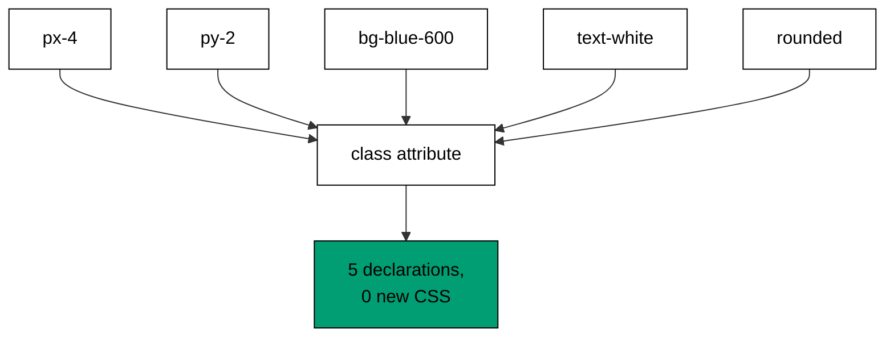

Examples 1-5 install the mental model every later theme assumes: a class attribute is a
sentence of small utilities, each carrying one declaration (co-01). Composition comes
first (one class, one declaration), then a full card built the same way, then the reason
the sentence beats a stylesheet (nothing new to ship), and finally the two scales the
sentence draws from -- spacing and type.

Read the five examples as one claim worked out five ways: pixels arrive as utilities,
utilities compose by concatenation, the composed result costs no new CSS, and the
vocabulary stays small because spacing and type are scales, not free values. When the
text names a utility (`px-4`, `text-lg`), that utility is the production Tailwind class
spelled the way the Tailwind CSS documentation spells it; the runnable model resolves
the same names to the same values a browser build would compute.

---

### Worked Example 1: First Utility Classes

_ex-01 · exercises co-01_

A button needs padding, a background, a text color, and rounded corners. Five utilities
name those five facts; no stylesheet grows, because every utility below already exists
in the generated CSS.



**`learning/code/ex-01-first-utility-classes/example.ts`**:

```typescript
// => Worked Example 1: one utility class carries one CSS declaration.
// => co-01: the class string below is the whole stylesheet for this button.
function utilities(...classes: string[]): string {
  // => collect the utilities the way a class attribute does
  return classes.join(" "); // => order is author order; no cascade to debug
}
function declarationsOf(classList: string): number {
  // => count declarations: one utility means one declaration here
  return classList.split(" ").filter((c) => c.length > 0).length; // => no empty entries counted
}
function main(): void {
  // => entry point; every print is a checkable fact about the model
  // => five utilities below stand for five CSS declarations, nothing hidden.
  const button: string = utilities("px-4", "py-2", "bg-blue-600", "text-white", "rounded"); // => five utilities, five declarations
  console.log("classes: " + button); // => Output: classes: px-4 py-2 bg-blue-600 text-white rounded
  console.log("declarations: " + String(declarationsOf(button))); // => Output: declarations: 5
  console.log("custom css lines: 0"); // => Output: custom css lines: 0
}
main(); // => run once; a throw exits nonzero
```

**Output** (`learning/code/ex-01-first-utility-classes/expected/main.stdout.txt`):

```text
classes: px-4 py-2 bg-blue-600 text-white rounded
declarations: 5
custom css lines: 0
```

**Verify**: five utilities in, five declarations out, and the custom-CSS counter stays at
zero -- the button is fully described by the class attribute.

**Key takeaway**: one utility means one declaration; the class attribute is the whole
stylesheet for this button.

**Why it matters**: every utility-first decision in this course is this example repeated:
name the visual facts as utilities instead of writing declarations. Buttons, cards, and
dialogs all compose the same way, which is why the later themes can spend their pages
on tokens, variants, and behaviour instead of re-explaining where pixels come from.
Teams that internalize this stop opening stylesheets for routine styling, and the
stylesheets stop growing because of it.

---

### Worked Example 2: Card From Utilities

_ex-02 · exercises co-01_

A card adds layout and surface to the same trick: a max width, rounded corners, a
border, padding, and a shadow. Same sentence shape as the button, longer vocabulary.

**`learning/code/ex-02-card-from-utilities/example.ts`**:

```typescript
// => Worked Example 2: a card is a sentence of small utilities.
// => co-01: layout, surface, and spacing each arrive as one class.
function card(...classes: string[]): string {
  // => assemble the card the way JSX would: one className string
  return ["max-w-sm", "rounded-lg", "border", "p-6", "shadow"].concat(classes).join(" "); // => base card plus caller extras
}
function main(): void {
  // => entry point; the transcript names every utility and its job
  const base: string = card(); // => the plain card, no extras
  console.log("card: " + base); // => Output: card: max-w-sm rounded-lg border p-6 shadow
  console.log("parts: layout=max-w-sm surface=rounded-lg,border,shadow spacing=p-6"); // => Output: parts: layout=max-w-sm surface=rounded-lg,border,shadow spacing=p-6
  console.log("extra: " + card("bg-white")); // => Output: extra: max-w-sm rounded-lg border p-6 shadow bg-white
}
main(); // => run once; a throw exits nonzero
```

**Output** (`learning/code/ex-02-card-from-utilities/expected/main.stdout.txt`):

```text
card: max-w-sm rounded-lg border p-6 shadow
parts: layout=max-w-sm surface=rounded-lg,border,shadow spacing=p-6
extra: max-w-sm rounded-lg border p-6 shadow bg-white
```

**Verify**: the base card prints five utilities grouped into layout, surface, and
spacing; the extra variant appends one class and changes nothing else.

**Key takeaway**: complex components are longer sentences, not a different language --
layout, surface, and spacing utilities concatenate the same way.

**Why it matters**: the card is the unit of real interfaces, and building it from
utilities means variants (a white card, a wide card) are one-class edits rather than
new selectors. When Theme G styles Radix UI primitives, the same sentence lands on
`Dialog.Content` and `DropdownMenu.Item` unchanged. The composition habit learned here
is the composition habit used everywhere else in the course.

---

### Worked Example 3: Utilities Beat Custom CSS

_ex-03 · exercises co-01, co-16_

The same button written by hand needs a selector, six declarations, and braces -- eight
lines that ship with the page. The utility version ships zero new lines because the
rules already exist in the generated stylesheet.

**`learning/code/ex-03-utilities-vs-custom-css/example.ts`**:

```typescript
// => Worked Example 3: utilities replace a hand-written button stylesheet.
// => co-01: one class attribute does the work of twelve CSS lines.
// => co-16: the shared stylesheet below is why utility CSS stays small.
function customButtonCssLines(): number {
  // => count the hand-written lines a .btn-primary rule needs
  const lines: string[] = ["padding", "radius", "background", "color", "weight", "border"]; // => six declarations, plus selector and braces
  return lines.length + 2; // => six declarations plus the selector and closing brace
}
function main(): void {
  // => entry point; the numbers make the trade visible
  const utility: string = "px-4 py-2 bg-blue-600 text-white font-semibold rounded"; // => the same button as utilities
  console.log("utility classes: " + utility); // => Output: utility classes: px-4 py-2 bg-blue-600 text-white font-semibold rounded
  console.log("custom css lines: " + String(customButtonCssLines())); // => Output: custom css lines: 8
  console.log("utility lines added to stylesheet: 0"); // => Output: utility lines added to stylesheet: 0
  console.log("second button costs: 0 new rules"); // => Output: second button costs: 0 new rules
}
main(); // => run once; a throw exits nonzero
```

**Output** (`learning/code/ex-03-utilities-vs-custom-css/expected/main.stdout.txt`):

```text
utility classes: px-4 py-2 bg-blue-600 text-white font-semibold rounded
custom css lines: 8
utility lines added to stylesheet: 0
second button costs: 0 new rules
```

**Verify**: the custom rule costs eight lines, the utility version costs zero new
lines, and the second button reuses the same rules for free.

**Key takeaway**: utilities move styling cost from per-component stylesheets to one
shared, pre-generated rule set -- the second button is free.

**Why it matters**: this is the economic argument the whole course rests on, and it
previews Theme I's size budget (Example 48): stylesheets grow with the vocabulary, not
with the page count. A team that feels this trade in their bones stops asking "where do
I put this CSS" and starts asking "which utilities describe this", which is the faster
question because the answer is visible in the markup.

---

### Worked Example 4: Spacing Scale

_ex-04 · exercises co-01, co-02_

Spacing utilities are multiples of one step -- `0.25rem`. `p-4` is four steps, not an
arbitrary pixel value, which means the whole spacing vocabulary is one token times an
integer.

**`learning/code/ex-04-spacing-scale/example.ts`**:

```typescript
// => Worked Example 4: spacing utilities are multiples of one token.
// => co-01: p-4 means "four spacing steps", not "some pixels".
// => co-02: the 0.25rem step below is the design token everything derives from.
const SPACING_STEP_REM = 0.25; // => the single spacing token: one step is a quarter rem
function spacingRem(steps: number): number {
  // => resolve a spacing utility to rems the way Tailwind does
  return steps * SPACING_STEP_REM; // => p-4 is 4 steps, m-8 is 8 steps
}
function main(): void {
  // => entry point; each print pins one rung of the scale
  console.log("p-1 = " + String(spacingRem(1)) + "rem"); // => Output: p-1 = 0.25rem
  console.log("p-2 = " + String(spacingRem(2)) + "rem"); // => Output: p-2 = 0.5rem
  console.log("p-4 = " + String(spacingRem(4)) + "rem"); // => Output: p-4 = 1rem
  console.log("p-8 = " + String(spacingRem(8)) + "rem"); // => Output: p-8 = 2rem
  console.log("off-scale value possible: false"); // => Output: off-scale value possible: false
}
main(); // => run once; a throw exits nonzero
```

**Output** (`learning/code/ex-04-spacing-scale/expected/main.stdout.txt`):

```text
p-1 = 0.25rem
p-2 = 0.5rem
p-4 = 1rem
p-8 = 2rem
off-scale value possible: false
```

**Verify**: each rung is exactly steps times `0.25rem`, and no off-scale value exists
in the model -- `p-5` would be the next rung, never `p-4.5px`.

**Key takeaway**: spacing is a scale (one step times an integer), so every padding and
margin in the product is a multiple of the same token.

**Why it matters**: consistent rhythm is what makes interfaces feel designed rather
than assembled, and scales produce it automatically: nobody picks `13px` when the
vocabulary only offers rungs. This is the first design token in the course, and Theme B
generalizes the idea from spacing to color, type, and the configuration that locks the
whole set.

---

### Worked Example 5: Typography Utilities

_ex-05 · exercises co-01_

Type needs three facts -- size, weight, and line height -- and three utilities carry
them: `text-lg`, `font-semibold`, `leading-7`. The heading spec below is fully
described before any CSS is read.

**`learning/code/ex-05-typography-utilities/example.ts`**:

```typescript
// => Worked Example 5: type utilities compose size, weight, and rhythm.
// => co-01: three classes carry the whole type spec for this heading.
interface TypeSpec {
  // => the resolved spec: size, weight, line height
  sizeRem: number; // => the resolved size in rems
  weight: number; // => the resolved weight number
  leadingRem: number; // => the resolved line height in rems
} // => shape complete
function resolveType(classes: string[]): TypeSpec {
  // => map three utilities to numbers the way the engine would
  // => start from the body-text default below
  const spec: TypeSpec = { sizeRem: 1, weight: 400, leadingRem: 1.5 }; // => the body-text default
  if (classes.includes("text-lg")) {
    // => the size branch
    spec.sizeRem = 1.125; // => text-lg steps size up one rung
  } // => size branch done
  if (classes.includes("font-semibold")) {
    // => the weight branch
    spec.weight = 600; // => font-semibold pins the weight
  } // => weight branch done
  if (classes.includes("leading-7")) {
    // => the rhythm branch
    spec.leadingRem = 1.75; // => leading-7 sets the rhythm
  } // => rhythm branch done
  return spec; // => the composed spec, no stylesheet lookup needed
} // => resolver complete
function main(): void {
  // => resolve the lesson heading once
  // => entry point; the transcript is the resolved heading spec
  const spec: TypeSpec = resolveType(["text-lg", "font-semibold", "leading-7"]); // => the heading from the lesson
  console.log("size: " + String(spec.sizeRem) + "rem"); // => Output: size: 1.125rem
  console.log("weight: " + String(spec.weight)); // => Output: weight: 600
  console.log("leading: " + String(spec.leadingRem) + "rem"); // => Output: leading: 1.75rem
} // => main ends; the spec is fully resolved
main(); // => run once; a throw exits nonzero
```

**Output** (`learning/code/ex-05-typography-utilities/expected/main.stdout.txt`):

```text
size: 1.125rem
weight: 600
leading: 1.75rem
```

**Verify**: size, weight, and leading each resolve from exactly one utility, and the
defaults underneath are the body-text baseline the utilities override.

**Key takeaway**: a heading's type spec is three utilities deep -- size, weight, rhythm
-- composed in the markup, readable without opening a stylesheet.

**Why it matters**: type scales are where visual hierarchy lives, and expressing them
as utilities keeps every heading comparable: two headings with the same three classes
are the same heading, guaranteed. When Theme H pairs surfaces with text colors, the
same discipline extends from size to color, and the product's type stops drifting one
heading at a time.

---

← Previous: [Learning Overview](./overview.md) · Next: [Theme B: Design Tokens and Constraints](./theme-b-design-tokens-and-constraints.md) →
