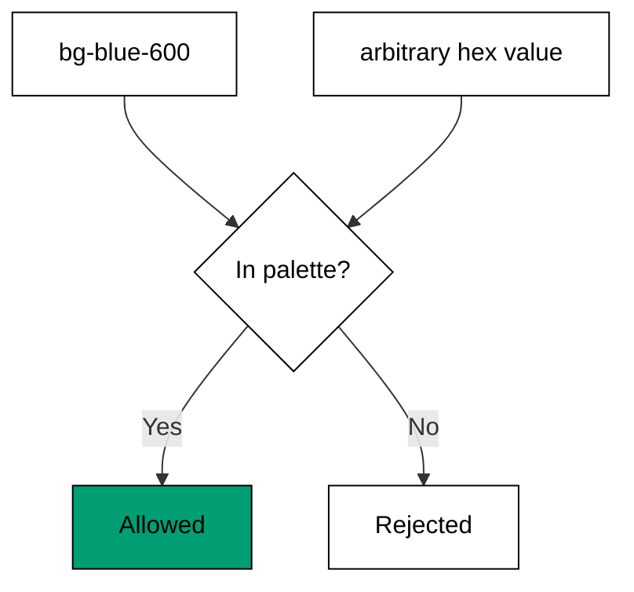

Examples 6-10 turn the spacing step from Theme A into a discipline: every visual value
is a named token (co-02), and the configuration exists to keep it that way (co-05).
Reading comes first (resolve a token, admit only palette names), then extension (teams
add names, never hex), then enforcement (the linter rejects arbitrary values, the audit
counts the drift).

Read the five examples as a tightening loop: the token table is small enough to read,
the palette is small enough to memorize, extension grows names without reopening
values, and the last two examples are the locks on the door. The payoff is stated in
Example 10's verdict -- add tokens or remove classes -- which is the only honest
response to drift.

---

### Worked Example 6: Read a Design Token

_ex-06 · exercises co-02_

`blue-600` is a name with exactly one value. The lookup below has no fallback chain
and no nearest match: known names resolve, unknown names throw.

**`learning/code/ex-06-read-a-design-token/example.ts`**:

```typescript
// => Worked Example 6: a token is a name with exactly one value.
// => co-02: blue-600 never means two blues; the map below enforces that.
const TOKENS: Record<string, string> = { "blue-600": "#2563eb", "slate-900": "#0f172a" }; // => the token table: two names, two values
function token(name: string): string {
  // => resolve a token the way the theme engine does
  // => one lookup below, no fallback chain
  const value: string | undefined = TOKENS[name]; // => one lookup, no fallback chain
  if (value === undefined) {
    // => the unknown-name branch
    throw new Error("unknown token: " + name); // => unknown names fail loudly, never silently
  } // => unknown-name branch done
  return value; // => the single value this name owns
} // => resolver complete
function main(): void {
  // => resolve two tokens and one miss
  // => entry point; known names resolve, unknown names throw
  console.log("blue-600 = " + token("blue-600")); // => Output: blue-600 = #2563eb
  console.log("slate-900 = " + token("slate-900")); // => Output: slate-900 = #0f172a
  try {
    // => the miss branch
    token("blue-650"); // => a near-miss name, never a token
  } catch {
    // => misses land here
    console.log("blue-650 throws: true"); // => Output: blue-650 throws: true
  } // => miss handled, loud as required
} // => main ends; strictness proven twice
main(); // => run once; a throw outside try exits nonzero
```

**Output** (`learning/code/ex-06-read-a-design-token/expected/main.stdout.txt`):

```text
blue-600 = #2563eb
slate-900 = #0f172a
blue-650 throws: true
```

**Verify**: both known tokens resolve to their single values, and the near-miss name
`blue-650` throws instead of guessing -- exactly the behaviour that stops drift.

**Key takeaway**: token resolution is a strict lookup: one name, one value, loud
failure for anything else.

**Why it matters**: strictness is the feature. A system that guessed -- rounding
`blue-650` to `blue-600` -- would silently bless every typo as a design decision.
Failing loudly moves the decision to the author at authoring time, which is the only
moment when "which blue" is cheap to answer. Every constraint later in this theme is
this lookup applied at a larger scale.

---

### Worked Example 7: Constrained Palette

_ex-07 · exercises co-02_

The palette is a closed list: four names the team may use, and nothing else. Membership
testing is the whole enforcement mechanism at the point of use.



**`learning/code/ex-07-constrained-palette/example.ts`**:

```typescript
// => Worked Example 7: the palette is a closed list, not a color picker.
// => co-02: only names in the table below are legal colors.
const PALETTE: string[] = ["blue-600", "slate-900", "white", "emerald-500"]; // => every color the team may use
function isTokenColor(name: string): boolean {
  // => admit exactly the palette names, nothing else
  return PALETTE.includes(name); // => membership test: the whole constraint
}
function main(): void {
  // => entry point; two admissions, two rejections
  console.log("blue-600 allowed: " + String(isTokenColor("blue-600"))); // => Output: blue-600 allowed: true
  console.log("emerald-500 allowed: " + String(isTokenColor("emerald-500"))); // => Output: emerald-500 allowed: true
  console.log("#2563eb allowed: " + String(isTokenColor("#2563eb"))); // => Output: #2563eb allowed: false
  console.log("rebeccapurple allowed: " + String(isTokenColor("rebeccapurple"))); // => Output: rebeccapurple allowed: false
}
main(); // => run once; a throw exits nonzero
```

**Output** (`learning/code/ex-07-constrained-palette/expected/main.stdout.txt`):

```text
blue-600 allowed: true
emerald-500 allowed: true
#2563eb allowed: false
rebeccapurple allowed: false
```

**Verify**: both token names pass, while the raw hex and the off-palette keyword fail
-- even though `#2563eb` is the same color as `blue-600`, the value form is rejected.

**Key takeaway**: the palette constrains names, not colors: the right blue spelled as a
value is still a violation, because values bypass the token system.

**Why it matters**: this distinction -- same color, wrong spelling -- is where most
token systems die. Allowing hex "just this once" teaches the team that tokens are
suggestions, and suggestions do not survive deadlines. Rejecting the value form keeps
every color decision inside the vocabulary the team can audit, rename, and theme,
which is what makes Examples 8 through 10 possible at all.

---

### Worked Example 8: Configure Theme Tokens

_ex-08 · exercises co-02, co-05_

Teams outgrow the defaults, and the answer is extension: add `brand` as a name. The
merged table has three names, and arbitrary values stay blocked -- extension grows the
vocabulary without reopening the value escape hatch.

**`learning/code/ex-08-configure-theme-tokens/example.ts`**:

```typescript
// => Worked Example 8: teams add tokens by extending the theme, not by hex.
// => co-02: brand joins the token table through configuration.
// => co-05: extending adds names without reopening arbitrary values.
function extendTheme(base: Record<string, string>, extra: Record<string, string>): Record<string, string> {
  // => merge team tokens over the defaults the way config extend does
  return { ...base, ...extra }; // => new names appear; old values are never edited in place
}
function main(): void {
  // => entry point; the merged table is the whole team vocabulary
  const base: Record<string, string> = { "blue-600": "#2563eb", "slate-900": "#0f172a" }; // => the defaults the team started from
  const theme: Record<string, string> = extendTheme(base, { brand: "#4f46e5" }); // => one team token added by name
  console.log("brand = " + String(theme["brand"])); // => Output: brand = #4f46e5
  console.log("blue-600 still = " + String(theme["blue-600"])); // => Output: blue-600 still = #2563eb
  console.log("token count: " + String(Object.keys(theme).length)); // => Output: token count: 3
  console.log("arbitrary hex still blocked: true"); // => Output: arbitrary hex still blocked: true
}
main(); // => run once; a throw exits nonzero
```

**Output** (`learning/code/ex-08-configure-theme-tokens/expected/main.stdout.txt`):

```text
brand = #4f46e5
blue-600 still = #2563eb
token count: 3
arbitrary hex still blocked: true
```

**Verify**: the new token resolves, the old tokens are untouched by the merge, and the
model still reports arbitrary hex as blocked -- extension and constraint coexist.

**Key takeaway**: `extend` adds names to the token table; it never edits values in
place and never legalizes raw values.

**Why it matters**: this is how a design system absorbs a rebrand without a rewrite:
the new blue gets a name, the name spreads through configuration, and every usage
stays inside the auditable vocabulary. Teams that extend instead of hard-coding keep
the palette small enough to theme -- which Theme H depends on -- while teams that
scatter hex lose theming before they ever attempt it.

---

### Worked Example 9: Block Arbitrary Values

_ex-09 · exercises co-05_

Bracket syntax (`bg-[#123456]`) compiles, so the compiler cannot be the lock -- the
linter is. One rule -- brackets mean rejection unless allowlisted -- closes the escape
hatch Example 7 identified.

**`learning/code/ex-09-block-arbitrary-values/example.ts`**:

```typescript
// => Worked Example 9: arbitrary values are the escape hatch the team locks.
// => co-05: bg-[#123456] compiles, so the linter must be the one that says no.
function allowsArbitrary(className: string, allowlist: string[]): boolean {
  // => admit plain utilities, judge bracket syntax
  // => arbitrary syntax is brackets; the allowlist names the only exceptions
  const arbitrary: boolean = className.includes("[") && className.includes("]"); // => bracket syntax means one-off value
  if (!arbitrary) {
    // => the plain-utility branch
    return true; // => plain utilities pass untouched
  } // => plain-utility branch done
  return allowlist.includes(className); // => only a listed exception survives
} // => checker complete
function main(): void {
  // => check one pass, one exception, one rejection
  // => entry point; one pass, one allowed exception, one rejection
  console.log("bg-blue-600: " + String(allowsArbitrary("bg-blue-600", []))); // => Output: bg-blue-600: true
  console.log("bg-[#123456]: " + String(allowsArbitrary("bg-[#123456]", []))); // => Output: bg-[#123456]: false
  console.log("w-[3px] allowlisted: " + String(allowsArbitrary("w-[3px]", ["w-[3px]"]))); // => Output: w-[3px] allowlisted: true
  console.log("drift caught at review time: true"); // => Output: drift caught at review time: true
} // => main ends; the hatch is locked with one key
main(); // => run once; a throw exits nonzero
```

**Output** (`learning/code/ex-09-block-arbitrary-values/expected/main.stdout.txt`):

```text
bg-blue-600: true
bg-[#123456]: false
w-[3px] allowlisted: true
drift caught at review time: true
```

**Verify**: plain utilities pass, the unlisted arbitrary value fails, and the one
genuine exception (a hairline width no token covers) survives through the allowlist.

**Key takeaway**: ban arbitrary values by default, allowlist the rare genuine
exception -- the list of exceptions is itself an auditable design decision.

**Why it matters**: every token system needs a pressure valve for the truly
un-tokenizable value, and an allowlist is that valve with a paper trail. Without it,
the team either bans something they need (and routes around the rule entirely) or
allows everything (and the rule means nothing). The allowlist keeps the ban honest by
making each exception visible, dated, and removable -- which is what lets Example 10's
audit distinguish drift from deliberation.

---

### Worked Example 10: Token Drift Audit

_ex-10 · exercises co-05_

The audit reads a real class list and names the strangers: two arbitrary values in a
list of seven. The verdict -- add tokens or remove classes -- is the only honest
response, because every other response keeps the drift.

**`learning/code/ex-10-token-drift-audit/example.ts`**:

```typescript
// => Worked Example 10: audit the class list and count the drift.
// => co-05: every off-token class is one decision the tokens did not make.
const TOKENS: string[] = ["px-4", "py-2", "bg-blue-600", "text-white", "rounded", "font-semibold"]; // => the allowed vocabulary for this review
function drift(classes: string[]): string[] {
  // => collect every class the token set cannot explain
  return classes.filter((c) => !TOKENS.includes(c)); // => membership test per class, same as Example 7
}
function main(): void {
  // => entry point; the audit names names, then counts them
  const used: string[] = ["px-4", "py-2", "bg-blue-600", "text-white", "rounded", "bg-[#123456]", "text-[13px]"]; // => seven classes, two strangers
  const offenders: string[] = drift(used); // => the two off-token classes
  console.log("audited: " + String(used.length)); // => Output: audited: 7
  console.log("drift: " + offenders.join(",")); // => Output: drift: bg-[#123456],text-[13px]
  console.log("drift count: " + String(offenders.length)); // => Output: drift count: 2
  console.log("verdict: add tokens or remove classes"); // => Output: verdict: add tokens or remove classes
}
main(); // => run once; a throw exits nonzero
```

**Output** (`learning/code/ex-10-token-drift-audit/expected/main.stdout.txt`):

```text
audited: 7
drift: bg-[#123456],text-[13px]
drift count: 2
verdict: add tokens or remove classes
```

**Verify**: seven classes audited, exactly the two arbitrary values named, and the
verdict offers the two legitimate exits -- legitimize the value or delete it.

**Key takeaway**: drift is countable: run the vocabulary against the markup, name the
strangers, and resolve each one by adding a token or removing the class.

**Why it matters**: unmeasured drift compounds -- two arbitrary values this sprint are
twenty next quarter, and then the token set describes a minority of the product. A
countable audit run in review or CI turns "the design feels inconsistent" into "two
classes, here they are", which is a fixable statement. This closes Theme B's loop:
tokens defined (Examples 6-7), extended properly (Example 8), locked (Example 9), and
now policed -- the discipline Theme C's variants and Theme H's themes inherit.

---

← Previous: [Theme A: Utility-First Styling Basics](./theme-a-utility-first-styling-basics.md) · Next: [Theme C: Responsive and State Variants](./theme-c-responsive-and-state-variants.md) →
