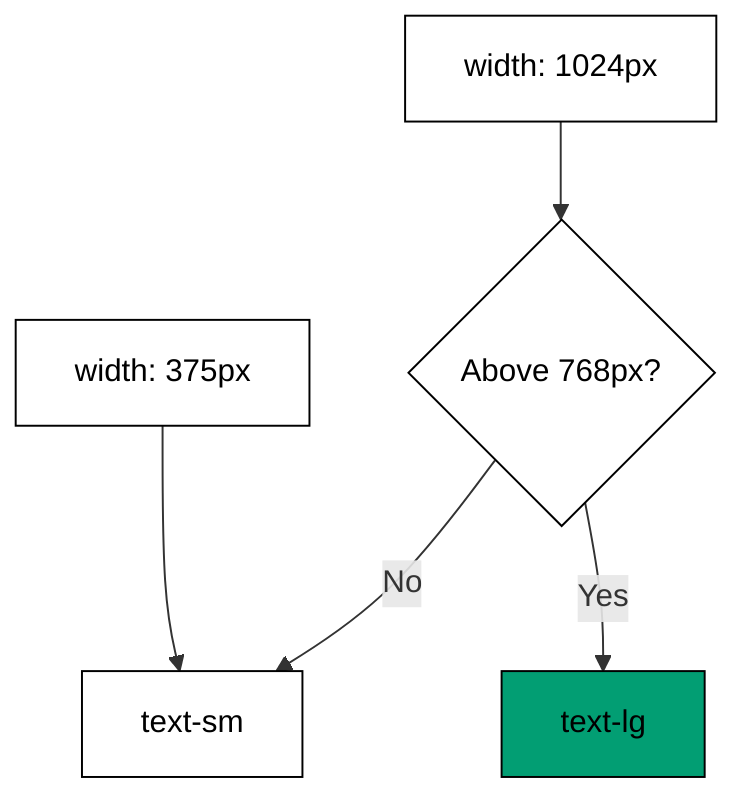

Examples 11-15 teach the two axes utilities vary along: viewport width (co-03) and
element state (co-04). Breakpoints come first -- base styles cover small screens, `md:`
adds the desktop -- then a full responsive grid, then the state axis: hover and focus,
the dark-mode toggle that previews Theme H, and the disabled and ARIA states that keep
styling honest about semantics.

Read the five examples as one rule applied twice: the base is always present, and a
variant adds a rule that fires on exactly one condition. Width conditions and state
conditions compose freely -- `md:dark:hover:` is legal -- because each variant is
independent of the others. The last example is the bridge to Part 2 of the course:
styling that follows ARIA attributes is styling that cannot break accessibility.

---

### Worked Example 11: Mobile-First Breakpoint

_ex-11 · exercises co-03_

Base utilities apply at every width; `md:` adds a rule above `768px` and changes
nothing below. The small screen is the default, not the afterthought.



**`learning/code/ex-11-mobile-first-breakpoint/example.ts`**:

```typescript
// => Worked Example 11: mobile-first means base styles apply everywhere.
// => co-03: md:text-lg adds a rule above 768px and changes nothing below it.
const MD_BREAKPOINT = 768; // => the md threshold in pixels: one design decision
function textSize(classes: string[], widthPx: number): string {
  // => resolve the size the way the cascade does
  // => base applies at every width, including phones
  let size: string = "text-sm"; // => base applies at every width, including phones
  if (classes.includes("md:text-lg") && widthPx >= MD_BREAKPOINT) {
    // => the variant branch
    size = "text-lg"; // => the variant wins only above the breakpoint
  } // => variant branch done
  return size; // => exactly one size survives per width
} // => resolver complete
function main(): void {
  // => measure one phone width, one desktop width
  // => entry point; one phone width, one desktop width
  const classes: string[] = ["text-sm", "md:text-lg"]; // => the responsive heading
  console.log("375px: " + textSize(classes, 375)); // => Output: 375px: text-sm
  console.log("1024px: " + textSize(classes, 1024)); // => Output: 1024px: text-lg
  console.log("base covers small screens: true"); // => Output: base covers small screens: true
} // => main ends; mobile-first proven twice
main(); // => run once; a throw exits nonzero
```

**Output** (`learning/code/ex-11-mobile-first-breakpoint/expected/main.stdout.txt`):

```text
375px: text-sm
1024px: text-lg
base covers small screens: true
```

**Verify**: the phone width keeps the base size, the desktop width takes the variant,
and the base is what covers small screens -- nothing else does.

**Key takeaway**: mobile-first means the unprefixed utility is the universal default
and each breakpoint prefix only adds above its threshold.

**Why it matters**: starting from small screens forces the essential layout first and
adds enhancement upward, which is cheaper than designing desktop-first and subtracting
downward. Every responsive decision in this course -- the grid next, the dark toggle
later -- reuses this shape: base truth plus conditional overrides. Learn it once here
and every later variant reads as the same idea in a new condition.

---

### Worked Example 12: Responsive Grid

_ex-12 · exercises co-03_

One column on phones, three on desktops, same markup. The grid utilities describe two
layouts in one attribute, and the gutter stays constant across both.

**`learning/code/ex-12-responsive-grid/example.ts`**:

```typescript
// => Worked Example 12: one column on phones, three on desktops.
// => co-03: the grid utilities below describe two layouts in one attribute.
function columns(classes: string[], widthPx: number): number {
  // => resolve the column count for a viewport width
  // => stacked on small screens unless the variant fires
  let count: number = 1; // => grid-cols-1: stacked on small screens
  if (classes.includes("md:grid-cols-3") && widthPx >= 768) {
    // => the desktop branch
    count = 3; // => md:grid-cols-3: side by side on desktops
  } // => desktop branch done
  return count; // => the layout the user actually sees
} // => resolver complete
function main(): void {
  // => measure the same markup at two widths
  // => entry point; the same markup measured at two widths
  const grid: string[] = ["grid", "grid-cols-1", "md:grid-cols-3", "gap-4"]; // => one grid, two layouts, even gutters
  console.log("375px columns: " + String(columns(grid, 375))); // => Output: 375px columns: 1
  console.log("1024px columns: " + String(columns(grid, 1024))); // => Output: 1024px columns: 3
  console.log("markup changes between layouts: 0"); // => Output: markup changes between layouts: 0
} // => main ends; stable markup proven twice
main(); // => run once; a throw exits nonzero
```

**Output** (`learning/code/ex-12-responsive-grid/expected/main.stdout.txt`):

```text
375px columns: 1
1024px columns: 3
markup changes between layouts: 0
```

**Verify**: one column at phone width, three at desktop width, and the markup never
changes between the two -- the layout difference is entirely in the class list.

**Key takeaway**: responsive layout is conditional classes on stable markup, not
conditional markup.

**Why it matters**: markup that rearranges itself per breakpoint -- duplicated lists,
hidden copies -- doubles every future edit and breaks screen-reader order. One list
with responsive columns keeps a single source of truth that assistive tech reads in
the same order at every width. This stability is what lets Theme E's tabs and Theme
F's focus management reason about order at all.

---

### Worked Example 13: Hover and Focus States

_ex-13 · exercises co-04_

`hover:` fires for the pointer, `focus:` fires for keyboard focus. The resting style
is always present; each variant adds exactly one conditional rule.

**`learning/code/ex-13-hover-and-focus-states/example.ts`**:

```typescript
// => Worked Example 13: hover and focus variants react to pointer and keyboard.
// => co-04: each variant below fires on exactly one user state.
interface ElementState {
  // => the two states this button cares about
  hover: boolean; // => pointer presence
  focus: boolean; // => keyboard presence
} // => shape complete
function buttonClasses(state: ElementState): string {
  // => apply the state variants the way the engine does
  // => resting background below is always present
  const classes: string[] = ["bg-blue-600"]; // => resting background, always present
  if (state.hover) {
    // => the hover branch
    classes.push("hover:bg-blue-700"); // => pointer over: deepen one rung
  } // => hover branch done
  if (state.focus) {
    // => the focus branch
    classes.push("focus:ring-2"); // => keyboard here: show the ring
  } // => focus branch done
  return classes.join(" "); // => the class list for this exact state
} // => builder complete
function main(): void {
  // => build three states, three class lists
  // => entry point; three states, three class lists
  console.log("rest: " + buttonClasses({ hover: false, focus: false })); // => Output: rest: bg-blue-600
  console.log("hover: " + buttonClasses({ hover: true, focus: false })); // => Output: hover: bg-blue-600 hover:bg-blue-700
  console.log("focus: " + buttonClasses({ hover: false, focus: true })); // => Output: focus: bg-blue-600 focus:ring-2
} // => main ends; independence proven three times
main(); // => run once; a throw exits nonzero
```

**Output** (`learning/code/ex-13-hover-and-focus-states/expected/main.stdout.txt`):

```text
rest: bg-blue-600
hover: bg-blue-600 hover:bg-blue-700
focus: bg-blue-600 focus:ring-2
```

**Verify**: rest shows the base alone, hover adds only the deepen rule, focus adds
only the ring -- variants never disturb each other or the base.

**Key takeaway**: state variants are additive and independent: each fires on its own
condition and leaves the rest of the class list alone.

**Why it matters**: the focus ring is the visible half of keyboard accessibility --
without it, keyboard users cannot tell where they are. Making it a variant keeps it
attached to the component instead of scattered across stylesheets, so it survives
refactors. And the independence of variants is what makes `focus-visible:` and
`data-state` later expressible at all: each new condition is one more additive rule.

---

### Worked Example 14: Dark-Mode Variant

_ex-14 · exercises co-04, co-14_

`dark:` answers to one ancestor class. Adding `.dark` to the root flips every
dark-mode utility in the product at once -- the whole of Theme H's mechanism in one
example.

**`learning/code/ex-14-dark-mode-variant/example.ts`**:

```typescript
// => Worked Example 14: dark: variants answer to one ancestor class.
// => co-04: dark:bg-slate-900 fires only while .dark sits above the element.
// => co-14: that single toggle is the whole light and dark mechanism.
function surface(theme: string): string {
  // => resolve the page surface for the current theme
  // => light default below: paper white
  let classes: string = "bg-white"; // => light default: paper white
  if (theme === "dark") {
    // => the dark branch
    classes += " dark:bg-slate-900"; // => dark ancestor present: swap the surface
  } // => dark branch done
  return classes; // => both utilities ship; the ancestor picks one
} // => resolver complete
function main(): void {
  // => resolve both themes once
  // => entry point; the toggle is one class on <html>
  console.log("light: " + surface("light")); // => Output: light: bg-white
  console.log("dark: " + surface("dark")); // => Output: dark: bg-white dark:bg-slate-900
  console.log("toggle mechanism: one .dark class"); // => Output: toggle mechanism: one .dark class
} // => main ends; the single toggle proven twice
main(); // => run once; a throw exits nonzero
```

**Output** (`learning/code/ex-14-dark-mode-variant/expected/main.stdout.txt`):

```text
light: bg-white
dark: bg-white dark:bg-slate-900
toggle mechanism: one .dark class
```

**Verify**: the toggle mechanism line names the single control point for the whole
product's theme.

**Key takeaway**: `dark:` is a state variant keyed on the `.dark` ancestor -- one
class on the root re-themes every component that carries dark utilities.

**Why it matters**: a single toggle point is what makes theming testable: flip one
class, screenshot, compare. Per-component theme props would need per-component tests
and would drift the moment one component forgot its prop. Theme H builds the full
light-and-dark discipline -- paired tokens, contrast checks, the toggle component --
on this one mechanism, so understanding it here pays off across four later examples.

---

### Worked Example 15: Disabled and ARIA States

_ex-15 · exercises co-04, co-12_

`disabled:` dims what cannot be used; `aria-expanded:` rotates the chevron that
announces openness. Styling follows the attributes -- and the `aria-expanded` value in
particular must stay truthful, because assistive tech reads it.

**`learning/code/ex-15-disabled-and-aria-states/example.ts`**:

```typescript
// => Worked Example 15: disabled and aria-expanded are states, not styles.
// => co-04: disabled: and aria-expanded: variants fire on attribute truth.
// => co-12: the aria attribute below is behaviour the styling must not remove.
interface ToggleState {
  // => the two facts this button exposes
  disabled: boolean; // => usability fact
  expanded: boolean; // => openness fact
} // => shape complete
function toggleClasses(state: ToggleState): string {
  // => build the class list from the element's real state
  // => shape utilities below, always on
  const classes: string[] = ["px-4", "py-2"]; // => shape utilities, always on
  if (state.disabled) {
    // => the disabled branch
    classes.push("disabled:opacity-50"); // => disabled: dims the button for every user
  } // => disabled branch done
  if (state.expanded) {
    // => the expanded branch
    classes.push("aria-expanded:rotate-180"); // => open menu: turn the chevron with it
  } // => expanded branch done
  return classes.join(" "); // => styling follows state; state lives in attributes
} // => builder complete
function main(): void {
  // => build three states, three class lists
  // => entry point; state in, honest classes out
  console.log("ready: " + toggleClasses({ disabled: false, expanded: false })); // => Output: ready: px-4 py-2
  console.log("disabled: " + toggleClasses({ disabled: true, expanded: false })); // => Output: disabled: px-4 py-2 disabled:opacity-50
  console.log("open: " + toggleClasses({ disabled: false, expanded: true })); // => Output: open: px-4 py-2 aria-expanded:rotate-180
} // => main ends; state honesty proven three times
main(); // => run once; a throw exits nonzero
```

**Output** (`learning/code/ex-15-disabled-and-aria-states/expected/main.stdout.txt`):

```text
ready: px-4 py-2
disabled: px-4 py-2 disabled:opacity-50
open: px-4 py-2 aria-expanded:rotate-180
```

**Verify**: the ready button carries shape alone, the disabled button adds only the
dim, and the open button adds only the chevron turn -- each state visible, none
invented.

**Key takeaway**: attribute-driven variants (`disabled:`, `aria-expanded:`) keep
styling subordinate to semantics: the attribute is the truth, the class is its shadow.

**Why it matters**: this is the rule that protects everything in Part 2 of the
course. A team that styles `aria-expanded` never removes it (the chevron depends on
it), while a team with separate state classes can delete the attribute and keep the
pixels -- breaking screen readers silently. Styling that depends on semantics
preserves semantics, which is the cheapest accessibility guarantee available.

---

← Previous: [Theme B: Design Tokens and Constraints](./theme-b-design-tokens-and-constraints.md) · Next: [Theme D: Radix UI Primitives Dialog and Dropdown](./theme-d-radix-ui-primitives-dialog-and-dropdown.md) →
