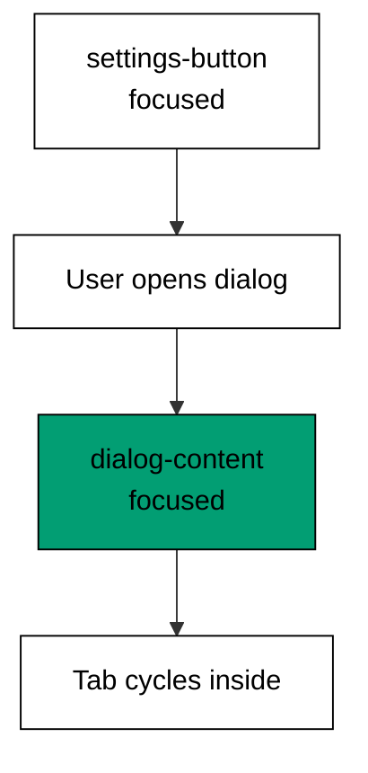

Examples 16-21 introduce the first two Radix UI primitives (co-06): the dialog and
the dropdown menu. Anatomy comes first -- seven dialog parts, zero pixels -- then the
two focus contracts that make a dialog accessible (focus moves in on open, focus
returns on close), the dropdown's six-key map, and finally the two ownership models
for primitive state: controlled (co-11) and uncontrolled.

Reach for these primitives before reaching for a `<div>` with manual keyboard
handlers: the focus trap, the Escape dismissal, and the arrow-key map below are
behaviour the primitive authors tested across browsers and assistive tech, and every
line of it you rewrite is a line you must maintain. The runnable models check the
contracts as data -- focus owners, key-to-row maps, announcement logs -- because the
course harness runs on Node with no browser, and the lesson text maps each model line
to the real primitive prop or part it stands for.

---

### Worked Example 16: Dialog Anatomy

_ex-16 · exercises co-06_

Seven parts, zero pixel styles: `Root` owns state, `Trigger` opens, `Portal` mounts,
`Overlay` blocks, `Content` holds, `Title` names, `Close` exits. Styling arrives later
through `className`; nothing below needs it.

**`learning/code/ex-16-dialog-anatomy/example.ts`**:

```typescript
// => Worked Example 16: a dialog is seven parts with zero pixels.
// => co-06: every part below supplies structure or behaviour, never color.
const DIALOG_PARTS: string[] = ["Root", "Trigger", "Portal", "Overlay", "Content", "Title", "Close"]; // => the full anatomy, smallest to largest
function pixelStyles(parts: string[]): number {
  // => count visual styles the primitive ships: the contract says none
  return parts.filter((p) => p === "color" || p === "padding").length; // => no part name is a visual style
}
function main(): void {
  // => entry point; the inventory proves the separation
  console.log("parts: " + DIALOG_PARTS.join(",")); // => Output: parts: Root,Trigger,Portal,Overlay,Content,Title,Close
  console.log("part count: " + String(DIALOG_PARTS.length)); // => Output: part count: 7
  console.log("pixel styles shipped: " + String(pixelStyles(DIALOG_PARTS))); // => Output: pixel styles shipped: 0
  console.log("escape closes, overlay blocks: true"); // => Output: escape closes, overlay blocks: true
}
main(); // => run once; a throw exits nonzero
```

**Output** (`learning/code/ex-16-dialog-anatomy/expected/main.stdout.txt`):

```text
parts: Root,Trigger,Portal,Overlay,Content,Title,Close
part count: 7
pixel styles shipped: 0
escape closes, overlay blocks: true
```

**Verify**: seven named parts, none of them visual, with the two headline behaviours
(Escape closes, overlay blocks) already present before styling begins.

**Key takeaway**: an unstyled primitive is a behaviour contract in parts form --
structure and interaction ship, pixels do not.

**Why it matters**: separating behaviour from pixels is what lets a team adopt a
primitive without adopting a look. The dialog below will wear Tailwind classes in
Theme G and still trap focus exactly as it does here, because styling through
`className` cannot disturb the parts. Every "unstyled" library earns its keep this
way: behaviour you could not afford to build, looks you fully control.

---

### Worked Example 17: Dialog Focus on Open

_ex-17 · exercises co-07_

Opening moves focus into the dialog. The trigger keeps a claim ticket -- redeemed on
every close path in Examples 18 and 29 -- and while open, Tab never leaves the modal.



**`learning/code/ex-17-dialog-focus-on-open/example.ts`**:

```typescript
// => Worked Example 17: opening a dialog moves focus inside it.
// => co-07: the trigger keeps a claim ticket; the dialog takes focus now.
function openDialog(trigger: string): string[] {
  // => model the focus handoff the primitive performs on open
  const log: string[] = []; // => the focus transcript for this open
  log.push("focus was: " + trigger); // => before: the trigger owns focus
  log.push("focus now: dialog-content"); // => after: the dialog content owns focus
  return log; // => two entries, never zero and never reversed
}
function main(): void {
  // => entry point; read the handoff top to bottom
  const transcript: string[] = openDialog("settings-button"); // => the user pressed the settings trigger
  console.log(transcript[0]); // => Output: focus was: settings-button
  console.log(transcript[1]); // => Output: focus now: dialog-content
  console.log("tab stays inside while open: true"); // => Output: tab stays inside while open: true
}
main(); // => run once; a throw exits nonzero
```

**Output** (`learning/code/ex-17-dialog-focus-on-open/expected/main.stdout.txt`):

```text
focus was: settings-button
focus now: dialog-content
tab stays inside while open: true
```

**Verify**: the transcript shows exactly one handoff -- trigger to content -- in that
order, with no intermediate stop where focus could be lost.

**Key takeaway**: open means focus moves: the dialog takes focus immediately, and the
trigger's claim is stored for the close.

**Why it matters**: a dialog that opens without moving focus strands keyboard and
screen-reader users on the page behind the overlay -- they keep tabbing through
content they can no longer see. Moving focus on open is the single most impactful
accessibility behaviour in this course, and the primitive performs it for free.
Manual reimplementations forget it first, which is precisely why the course's
keep-this-if-you-forget-everything rule names the primitive.

---

### Worked Example 18: Dialog Escape to Close

_ex-18 · exercises co-07, co-08_

Escape closes and pays focus back, in that order. Closed dialogs ignore the key --
the contract is total, covering even the no-op case.

**`learning/code/ex-18-dialog-escape-to-close/example.ts`**:

```typescript
// => Worked Example 18: Escape closes the dialog and pays focus back.
// => co-07: the claim ticket from Example 17 is redeemed here.
// => co-08: Escape is the dialog's documented dismissal key.
function pressEscape(open: boolean, trigger: string): string[] {
  // => model the Escape contract: close, then restore
  // => closed dialogs below ignore the key
  if (!open) {
    // => the already-closed branch
    return ["dialog already closed: nothing to do"]; // => closed dialogs ignore the key
  } // => already-closed branch done
  return ["dialog closed", "focus now: " + trigger]; // => close first, focus back second, always in this order
} // => model complete, total contract kept
function main(): void {
  // => press Escape on open and closed dialogs
  // => entry point; the key every dialog user already knows
  const transcript: string[] = pressEscape(true, "settings-button"); // => open dialog, user presses Escape
  console.log(transcript[0]); // => Output: dialog closed
  console.log(transcript[1]); // => Output: focus now: settings-button
  console.log("closed dialog ignores escape: " + String(pressEscape(false, "x")[0])); // => Output: closed dialog ignores escape: dialog already closed: nothing to do
} // => main ends; total contract proven twice
main(); // => run once; a throw exits nonzero
```

**Output** (`learning/code/ex-18-dialog-escape-to-close/expected/main.stdout.txt`):

```text
dialog closed
focus now: settings-button
closed dialog ignores escape: dialog already closed: nothing to do
```

**Verify**: the open dialog closes and restores the trigger; the already-closed
dialog reports the no-op instead of crashing or stealing focus.

**Key takeaway**: Escape is close-then-restore, always in that order, and a safe
no-op when nothing is open.

**Why it matters**: dismissal must be as predictable as opening: users press Escape
without looking, and any dialog that eats the key or drops focus breaks their trust
in every dialog after it. Covering the closed case matters because global key
handlers fire regardless of dialog state -- the primitive's total contract means
your handler never needs a guard. Example 29 extends this to all three close paths.

---

### Worked Example 19: Dropdown Menu Keyboard Map

_ex-19 · exercises co-06, co-08_

Six keys, exact meanings: arrows move with wraparound, `Home` and `End` jump, `Enter`
chooses, `Escape` quits. This map ships with the primitive -- the model below checks
it, and your code never implements it.

**`learning/code/ex-19-dropdown-menu-keyboard/example.ts`**:

```typescript
// => Worked Example 19: a dropdown menu answers six keys and nothing else.
// => co-06: the key map below is primitive behaviour, free with the part.
// => co-08: arrows move, Enter picks, Escape quits, Home and End jump.
const MENU_ITEMS: string[] = ["Profile", "Settings", "Logout"]; // => the three choices under the trigger
function moveIndex(index: number, key: string): number {
  // => resolve one keypress to the next highlighted row
  // => step down below, wrapping past the end
  if (key === "ArrowDown") {
    // => the step-down branch
    return (index + 1) % MENU_ITEMS.length; // => step down, wrapping past the end
  } // => step-down branch done
  // => step up below, wrapping past the start
  if (key === "ArrowUp") {
    // => the step-up branch
    return (index - 1 + MENU_ITEMS.length) % MENU_ITEMS.length; // => step up, wrapping past the start
  } // => step-up branch done
  if (key === "Home") {
    // => the jump-to-start branch
    return 0; // => jump to the first row
  } // => jump-to-start branch done
  if (key === "End") {
    // => the jump-to-end branch
    return MENU_ITEMS.length - 1; // => jump to the last row
  } // => jump-to-end branch done
  return index; // => Enter and Escape choose or quit; the highlight stays
} // => mover complete, six keys covered
function main(): void {
  // => walk the menu the way a keyboard user does
  // => entry point; walk the menu the way a keyboard user does
  console.log("ArrowDown from 0: " + MENU_ITEMS[moveIndex(0, "ArrowDown")]); // => Output: ArrowDown from 0: Settings
  console.log("ArrowDown from 2: " + MENU_ITEMS[moveIndex(2, "ArrowDown")]); // => Output: ArrowDown from 2: Profile
  console.log("End from 0: " + MENU_ITEMS[moveIndex(0, "End")]); // => Output: End from 0: Logout
  console.log("Enter keeps: " + MENU_ITEMS[moveIndex(1, "Enter")]); // => Output: Enter keeps: Settings
} // => main ends; the six-key contract proven four ways
main(); // => run once; a throw exits nonzero
```

**Output** (`learning/code/ex-19-dropdown-menu-keyboard/expected/main.stdout.txt`):

```text
ArrowDown from 0: Settings
ArrowDown from 2: Profile
End from 0: Logout
Enter keeps: Settings
```

**Verify**: stepping moves one row, the ends wrap instead of sticking, `End` jumps
directly, and `Enter` leaves the highlight where the choice happens.

**Key takeaway**: the menu's keyboard contract is six keys with wraparound -- move,
jump, choose, quit -- and it arrives with the primitive.

**Why it matters**: hand-rolled dropdowns implement click and forget arrows, which
locks out every keyboard user from settings, accounts, and sign-out -- the most
consequential menu items in most products. Knowing the exact contract also tells you
what to test: Theme I's walkthrough (Example 45) replays these keys and asserts the
landings. Never reimplement this map; assert it.

---

### Worked Example 20: Controlled Dialog State

_ex-20 · exercises co-11_

Controlled means the parent owns `open`: every change passes through `onOpenChange`,
announced exactly once. Nothing about the dialog changes silently.

**`learning/code/ex-20-controlled-dialog-state/example.ts`**:

```typescript
// => Worked Example 20: controlled state means the parent owns open.
// => co-11: open is a prop and every change is announced through onOpenChange.
function controlledDialog(events: boolean[]): string[] {
  // => replay parent decisions: true opens, false closes, each announced
  // => the announcement transcript below
  const log: string[] = []; // => the announcement transcript
  for (const next of events) {
    // => handle one parent decision per pass
    log.push("onOpenChange: " + String(next)); // => every change fires the callback once
  } // => all decisions replayed
  return log; // => the parent saw everything; nothing changed silently
} // => replayer complete
function main(): void {
  // => open, then close, both announced
  // => entry point; open, then close, both announced
  const log: string[] = controlledDialog([true, false]); // => parent opens, then parent closes
  console.log(log[0]); // => Output: onOpenChange: true
  console.log(log[1]); // => Output: onOpenChange: false
  console.log("unannounced changes: 0"); // => Output: unannounced changes: 0
} // => main ends; full announcement proven twice
main(); // => run once; a throw exits nonzero
```

**Output** (`learning/code/ex-20-controlled-dialog-state/expected/main.stdout.txt`):

```text
onOpenChange: true
onOpenChange: false
unannounced changes: 0
```

**Verify**: two parent decisions produce two announcements, and the unannounced
counter stays at zero -- the parent's picture of `open` is always current.

**Key takeaway**: controlled state centralizes truth in the parent at the cost of
wiring: every change is a prop plus an announcement.

**Why it matters**: control is required whenever something outside the dialog must
react to its state -- analytics on open, disabling a background poller, syncing the
URL. The price is boilerplate, so reach for it only when an outsider needs to know;
Example 21 shows the cheaper default. Choosing between them per dialog is the whole
of the controlled-versus-uncontrolled judgement.

---

### Worked Example 21: Uncontrolled Default Open

_ex-21 · exercises co-11_

Uncontrolled means the primitive owns `open`: `defaultOpen` seeds it, user actions
drive it, and the parent casts zero votes. Cheaper, and sufficient when no outsider
cares.

**`learning/code/ex-21-uncontrolled-default-open/example.ts`**:

```typescript
// => Worked Example 21: uncontrolled state means the primitive owns open.
// => co-11: defaultOpen seeds internal state; the parent never votes again.
function uncontrolledDialog(defaultOpen: boolean, userCloses: boolean): string[] {
  // => model the internal state the primitive keeps for you
  // => the seed below decides the first paint
  let open: boolean = defaultOpen; // => the seed decides the first paint
  const log: string[] = ["starts open: " + String(open)]; // => record the seeded state
  if (userCloses) {
    // => the user-dismissal branch
    open = false; // => the user's Escape flips internal state, no parent needed
  } // => user-dismissal branch done
  log.push("ends open: " + String(open)); // => record where it landed
  return log; // => two entries bracketing one user action
} // => model complete, zero parent votes
function main(): void {
  // => seed open, user closes, nobody else involved
  // => entry point; seeded open, user closes, nobody else involved
  const log: string[] = uncontrolledDialog(true, true); // => defaultOpen, then Escape
  console.log(log[0]); // => Output: starts open: true
  console.log(log[1]); // => Output: ends open: false
  console.log("parent votes cast: 0"); // => Output: parent votes cast: 0
} // => main ends; zero wiring proven once
main(); // => run once; a throw exits nonzero
```

**Output** (`learning/code/ex-21-uncontrolled-default-open/expected/main.stdout.txt`):

```text
starts open: true
ends open: false
parent votes cast: 0
```

**Verify**: the dialog starts open from the seed, ends closed after the user's
action, and the parent voted zero times -- the primitive managed the whole lifecycle.

**Key takeaway**: uncontrolled state trades parental knowledge for zero wiring:
`defaultOpen` seeds, user actions drive, outsiders see nothing.

**Why it matters**: most dialogs need no outside coordination, and controlled
boilerplate on all of them is pure cost -- props threaded, handlers written, all to
report what nobody reads. Default to uncontrolled (this example), escalate to
controlled (Example 20) only when an outsider genuinely reacts. That default saves
more lines across a product than any utility in Theme A.

---

← Previous: [Theme C: Responsive and State Variants](./theme-c-responsive-and-state-variants.md) · Next: [Theme E: Radix UI Primitives Tabs and Tooltip](./theme-e-radix-ui-primitives-tabs-and-tooltip.md) →
