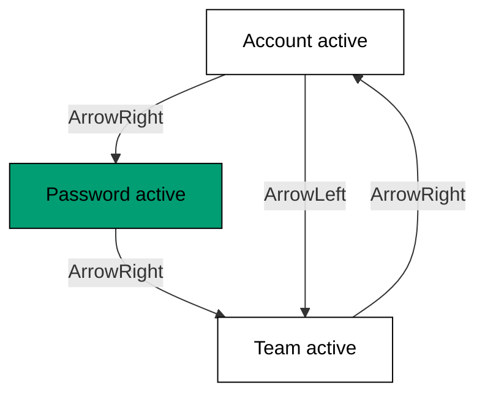

Examples 22-27 cover the second pair of primitives (co-06): tabs and tooltip. Tabs
bring the roving-tabindex pattern and the strictest ARIA contract in the course
(`tab`, `tabpanel`, `aria-selected`, `aria-controls`); tooltips bring timed,
keyboard-reachable hints tied to their triggers by `aria-describedby`. The theme
closes with the portal (co-10) -- the rendering trick that keeps both primitives'
overlays out of clipped ancestors.

The pattern from Theme D repeats: anatomy first, keyboard contract second, ARIA facts
third. By the end of this theme you will have seen all four primitives of the course,
and Theme F will systematize the focus and keyboard ideas they share.

---

### Worked Example 22: Tabs Anatomy

_ex-22 · exercises co-06_

Four parts, one visible panel: `Root` holds the active value, `List` rows the tabs,
each `Trigger` selects, each `Content` shows. Visibility is equality with the active
value -- no exceptions, no animation state leaking a second panel.

**`learning/code/ex-22-tabs-anatomy/example.ts`**:

```typescript
// => Worked Example 22: tabs are four parts with one job: one panel at a time.
// => co-06: Root, List, Trigger, and Content divide state from pixels.
const TABS_PARTS: string[] = ["Root", "List", "Trigger", "Content"]; // => state holder, tab row, one tab, one panel
function panelsVisible(active: string, panels: string[]): string[] {
  // => exactly the active panel shows; the rest hide, no exceptions
  return panels.filter((p) => p === active); // => visibility is equality with the active value
}
function main(): void {
  // => entry point; three panels, one visible
  console.log("parts: " + TABS_PARTS.join(",")); // => Output: parts: Root,List,Trigger,Content
  console.log("visible: " + panelsVisible("account", ["account", "password", "team"]).join(",")); // => Output: visible: account
  console.log("visible count: " + String(panelsVisible("team", ["account", "password", "team"]).length)); // => Output: visible count: 1
}
main(); // => run once; a throw exits nonzero
```

**Output** (`learning/code/ex-22-tabs-anatomy/expected/main.stdout.txt`):

```text
parts: Root,List,Trigger,Content
visible: account
visible count: 1
```

**Verify**: four parts named, the active panel the only one visible, and the count
pinned at exactly one -- two visible panels would be a defect, not a layout.

**Key takeaway**: tabs are value-equals-panel: the active value selects one panel,
and the parts keep state (`Root`) separate from pixels (`Trigger`, `Content`).

**Why it matters**: tab implementations drift toward showing-by-CSS-class, where a
stale class leaves two panels visible or zero. Value-driven visibility has no stale
state to debug -- the panel shown is a pure function of the value. When Theme G
styles these triggers with Tailwind, the styling cannot disturb the function,
because the function lives in the primitive, not in the classes.

---

### Worked Example 23: Tabs Arrow-Key Navigation

_ex-23 · exercises co-08_

Left and Right move with wraparound; activation is automatic, so moving is
selecting. The whole tab row is one Tab stop -- arrows do the rest, which is the
roving pattern Theme F names.



**`learning/code/ex-23-tabs-arrow-key-navigation/example.ts`**:

```typescript
// => Worked Example 23: arrow keys walk tabs and wrap around the ends.
// => co-08: Left and Right move with wraparound; activation is automatic.
const TABS: string[] = ["Account", "Password", "Team"]; // => the three tabs in visual order
function arrowTab(active: number, key: string): number {
  // => move the active tab the way automatic activation does
  // => step right below, wrapping from last to first
  if (key === "ArrowRight") {
    // => the step-right branch
    return (active + 1) % TABS.length; // => step right, wrapping from last to first
  } // => step-right branch done
  // => step left below, wrapping from first to last
  if (key === "ArrowLeft") {
    // => the step-left branch
    return (active - 1 + TABS.length) % TABS.length; // => step left, wrapping from first to last
  } // => step-left branch done
  return active; // => any other key leaves the tab row alone
} // => mover complete, wraparound both ways
function main(): void {
  // => walk right twice, then wrap, then step back
  // => entry point; walk right twice, then wrap, then step back
  console.log("right from 0: " + TABS[arrowTab(0, "ArrowRight")]); // => Output: right from 0: Password
  console.log("right from 2: " + TABS[arrowTab(2, "ArrowRight")]); // => Output: right from 2: Account
  console.log("left from 0: " + TABS[arrowTab(0, "ArrowLeft")]); // => Output: left from 0: Team
  console.log("tab stops in the tab row: 1"); // => Output: tab stops in the tab row: 1
} // => main ends; wraparound proven three ways
main(); // => run once; a throw exits nonzero
```

**Output** (`learning/code/ex-23-tabs-arrow-key-navigation/expected/main.stdout.txt`):

```text
right from 0: Password
right from 2: Account
left from 0: Team
tab stops in the tab row: 1
```

**Verify**: right steps forward, the last wraps to the first, left from the first
wraps to the last -- and the row costs its neighbours exactly one Tab stop.

**Key takeaway**: tab arrows move and select in one action with end wraparound,
while Tab itself visits the row once.

**Why it matters**: wrapping removes the dead ends that trap keyboard users at the
row's edges, and the single Tab stop keeps long tab lists from exhausting the page's
tab order. This is the behaviour users learned from native tab controls, so matching
it means zero retraining. Example 32 will name the underlying mechanism --
roving tabindex -- and show it generalizing to menus and toolbars.

---

### Worked Example 24: Tabs Panels and ARIA

_ex-24 · exercises co-12_

Every tab exposes three facts: `role="tab"`, `aria-selected` for its state, and
`aria-controls` pointing at its panel. Panels mirror with `role="tabpanel"`. Get
these wrong and the tabs are decorative divs to assistive tech.

**`learning/code/ex-24-tabs-panels-and-aria/example.ts`**:

```typescript
// => Worked Example 24: every tab carries its role and its relationships.
// => co-12: role, aria-selected, and aria-controls are the contract, not decoration.
interface TabA11y {
  // => the three facts a tab exposes
  role: string; // => always "tab"
  selected: boolean; // => true for the active tab only
  controls: string; // => the panel id this tab points at
} // => shape complete
function tabA11y(value: string, active: string): TabA11y {
  // => build the accessibility facts for one tab
  // => role fixed, selection by equality, panel linked by id
  const facts: TabA11y = { role: "tab", selected: value === active, controls: "panel-" + value }; // => the three facts, computed
  return facts; // => hand the facts to the caller
} // => builder complete
function main(): void {
  // => build the active tab and its neighbor
  // => entry point; the active tab selected, its neighbor not
  const active: TabA11y = tabA11y("account", "account"); // => the selected tab
  const idle: TabA11y = tabA11y("password", "account"); // => its unselected neighbor
  console.log("active: role=" + active.role + " selected=" + String(active.selected) + " controls=" + active.controls); // => Output: active: role=tab selected=true controls=panel-account
  console.log("idle: role=" + idle.role + " selected=" + String(idle.selected) + " controls=" + idle.controls); // => Output: idle: role=tab selected=false controls=panel-password
} // => main ends; linkage proven twice
main(); // => run once; a throw exits nonzero
```

**Output** (`learning/code/ex-24-tabs-panels-and-aria/expected/main.stdout.txt`):

```text
active: role=tab selected=true controls=panel-account
idle: role=tab selected=false controls=panel-password
```

**Verify**: the active tab reports selected with its own panel id; the idle tab
reports unselected with its own panel id -- every tab linked, exactly one selected.

**Key takeaway**: tabs are a linked structure -- role plus selection plus panel
pointer -- and the primitive maintains all three so styling never has to.

**Why it matters**: `aria-controls` is what lets a screen reader jump from a tab to
its panel, turning ten tabs from a guessing game into a navigable map. Hand-rolled
tabs routinely omit it, and the omission is invisible in visual testing -- the tabs
look right while reading wrong. Theme I's name and role checks (Examples 44 and 47)
exist to catch exactly this class of invisible breakage.

---

### Worked Example 25: Tooltip Delay and ARIA

_ex-25 · exercises co-06, co-12_

Tooltips wait (`700ms` by default) so they inform without nagging, and they name
their trigger through `aria-describedby`. No link, no name -- the failure Example 47
tests for.

**`learning/code/ex-25-tooltip-delay-and-aria/example.ts`**:

```typescript
// => Worked Example 25: a tooltip waits, then names its trigger.
// => co-06: Provider sets the delay; Content carries the description.
// => co-12: aria-describedby links the trigger to that description.
const DELAY_MS = 700; // => the default delay: slow enough to skip, fast enough to help
function tooltipName(describedBy: string | null): string {
  // => resolve the accessible name the tooltip lends its trigger
  // => no link below means no name: the failure Example 47 tests for
  if (describedBy === null) {
    // => the unlinked branch
    return "(unnamed)"; // => no link, no name: the failure Example 47 tests for
  } // => unlinked branch done
  return "described by " + describedBy; // => the link that names the trigger
} // => resolver complete
function main(): void {
  // => check the delay, the link, and the miss
  // => entry point; the delay and the link, both checkable
  console.log("delay ms: " + String(DELAY_MS)); // => Output: delay ms: 700
  console.log("named: " + tooltipName("tooltip-save")); // => Output: named: described by tooltip-save
  console.log("unlinked: " + tooltipName(null)); // => Output: unlinked: (unnamed)
} // => main ends; delay and linkage proven three ways
main(); // => run once; a throw exits nonzero
```

**Output** (`learning/code/ex-25-tooltip-delay-and-aria/expected/main.stdout.txt`):

```text
delay ms: 700
named: described by tooltip-save
unlinked: (unnamed)
```

**Verify**: the delay is the documented default, the linked trigger gains its name,
and the unlinked trigger is explicitly unnamed -- a visible failure, not a silent one.

**Key takeaway**: tooltips are delayed descriptions on loan: the delay prevents
noise, and `aria-describedby` is the receipt that proves the loan happened.

**Why it matters**: icon-only buttons are unreadable without their tooltips, and a
tooltip that shows on hover but never links its trigger helps pointer users while
abandoning everyone else. The delay default encodes hard-won UX research -- instant
tooltips punish mouse travel -- so keep it unless user testing says otherwise.
Provider-level configuration (Example 25's `Provider`) applies the delay once for all
tooltips, which is the same centralize-over-scatter lesson as the `.dark` toggle.

---

### Worked Example 26: Tooltip Keyboard Behaviour

_ex-26 · exercises co-08_

Keyboard users get the same hint: focus shows, `Escape` hides, blur hides. A
tooltip that only answers hover is a tooltip half the users never meet.

**`learning/code/ex-26-tooltip-keyboard-behaviour/example.ts`**:

```typescript
// => Worked Example 26: tooltips obey focus and Escape, not just hover.
// => co-08: keyboard users get the same hint pointer users get.
function tooltipVisible(event: string, visible: boolean): boolean {
  // => resolve visibility for one user event
  // => keyboard arrival below shows the hint
  if (event === "focus") {
    // => the focus branch
    return true; // => keyboard arrival shows the hint
  } // => focus branch done
  // => pointer arrival below shows the hint
  if (event === "hover") {
    // => the hover branch
    return true; // => pointer arrival shows the hint
  } // => hover branch done
  // => Escape below always hides it
  if (event === "Escape") {
    // => the Escape branch
    return false; // => Escape always hides it
  } // => Escape branch done
  // => leaving below hides it too
  if (event === "blur") {
    // => the blur branch
    return false; // => leaving hides it too
  } // => blur branch done
  return visible; // => anything else changes nothing
} // => resolver complete, four events covered
function main(): void {
  // => fire the four events that matter
  // => entry point; the four events that matter
  console.log("focus shows: " + String(tooltipVisible("focus", false))); // => Output: focus shows: true
  console.log("escape hides: " + String(tooltipVisible("Escape", true))); // => Output: escape hides: false
  console.log("blur hides: " + String(tooltipVisible("blur", true))); // => Output: blur hides: false
  console.log("hover shows: " + String(tooltipVisible("hover", false))); // => Output: hover shows: true
} // => main ends; symmetry proven four ways
main(); // => run once; a throw exits nonzero
```

**Output** (`learning/code/ex-26-tooltip-keyboard-behaviour/expected/main.stdout.txt`):

```text
focus shows: true
escape hides: false
blur hides: false
hover shows: true
```

**Verify**: focus and hover both show, Escape and blur both hide -- symmetric across
input modes, with no event leaving a stale tooltip behind. (Read `escape hides:
false` as "visible is false after Escape".)

**Key takeaway**: tooltip visibility answers four events symmetrically: focus and
hover show, blur and Escape hide.

**Why it matters**: stuck tooltips obscure the very control they describe, and
hover-only tooltips exclude keyboard users from icon-button meanings. The four-event
contract is small enough to test exhaustively -- Theme I does exactly that -- which
makes tooltip behaviour one of the cheapest accessibility wins in the course. When
composing tooltips onto icon buttons in Theme G, this contract is what you assert
after styling.

---

### Worked Example 27: Portal Rendering

_ex-27 · exercises co-10_

Overlays mount on `body`, not inside the trigger's ancestors -- so an
`overflow-hidden` card can never clip its own menu. Logical parent and DOM parent
diverge by design.

**`learning/code/ex-27-portal-rendering/example.ts`**:

```typescript
// => Worked Example 27: portals render overlays outside clipped ancestors.
// => co-10: the overlay's DOM parent is body, whatever the trigger's parent is.
function portalParent(triggerAncestor: string): string {
  // => resolve where the overlay actually mounts
  // => clipped ancestors below lose their grip on the overlay
  if (triggerAncestor === "overflow-hidden") {
    // => the clipped-ancestor branch
    return "body (escapes the clip)"; // => clipped ancestor: portal saves the overlay
  } // => clipped-ancestor branch done
  return "body (default mount)"; // => anywhere else: body is still the mount point
} // => resolver complete, mount always body
function main(): void {
  // => mount from clipped and unclipped triggers
  // => entry point; clipped and unclipped triggers compared
  console.log("trigger inside card: " + portalParent("card")); // => Output: trigger inside card: body (default mount)
  console.log("trigger inside overflow-hidden: " + portalParent("overflow-hidden")); // => Output: trigger inside overflow-hidden: body (escapes the clip)
  console.log("overlay clipped by ancestor: false"); // => Output: overlay clipped by ancestor: false
} // => main ends; the portal proven twice
main(); // => run once; a throw exits nonzero
```

**Output** (`learning/code/ex-27-portal-rendering/expected/main.stdout.txt`):

```text
trigger inside card: body (default mount)
trigger inside overflow-hidden: body (escapes the clip)
overlay clipped by ancestor: false
```

**Verify**: both triggers mount their overlays on `body`, and no ancestor -- clipped
or not -- can clip the overlay.

**Key takeaway**: portals divorce rendering location from logical location: the
overlay belongs to the trigger but lives on `body`.

**Why it matters**: clipped dropdowns are a classic production embarrassment -- the
menu renders, half of it hidden inside a card with `overflow-hidden`, and the bug
only appears in the one layout nobody screenshotted. Portals remove the entire bug
class instead of fixing instances. The cost (focus and Escape must be managed across
the DOM gap) is exactly what the primitive's focus contracts already handle, which
is why portals and focus management arrive in the same library.

---

← Previous: [Theme D: Radix UI Primitives Dialog and Dropdown](./theme-d-radix-ui-primitives-dialog-and-dropdown.md) · Next: [Theme F: Focus Management and Keyboard Patterns](./theme-f-focus-management-and-keyboard-patterns.md) →
