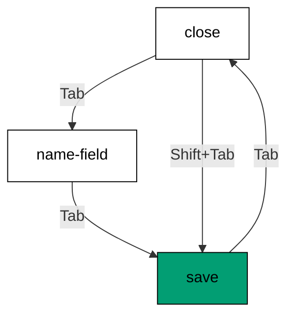
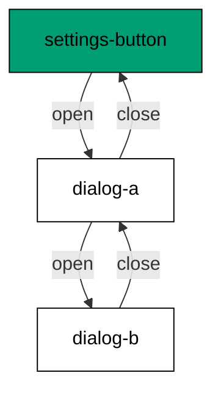

Examples 28-33 systematize what Themes D and E demonstrated per primitive: where
focus goes and which keys do what (co-07, co-08, co-10). The trap cycle comes first
-- Tab wraps at both edges -- then the three dismissal paths that all restore focus,
menu typeahead, outside-dismiss, the roving-tabindex mechanism behind Example 23's
single Tab stop, and finally the focus stack that unwinds nested dialogs in order.

Read the six examples as the complete keyboard contract for overlay interfaces: enter
focused, move without leaving, dismiss from anywhere, land back where you started.
Every example here is directly asserted by Theme I's tests, so read Theme F as the
specification and Theme I as its executable form.

---

### Worked Example 28: Focus Trap Cycle

_ex-28 · exercises co-07_

Tab on the last stop wraps to the first; Shift+Tab on the first wraps to the last.
The page behind is unreachable while the modal is open -- not hidden, just
unvisitable.



**`learning/code/ex-28-focus-trap-cycle/example.ts`**:

```typescript
// => Worked Example 28: Tab cycles inside the modal, never past its edges.
// => co-07: the trap wraps focus; the page behind stays unreachable.
function trapTab(focusables: string[], current: number, shift: boolean): number {
  // => resolve one Tab press inside an open modal
  // => forward Tab on the last stop below wraps to first
  if (!shift && current === focusables.length - 1) {
    // => the forward-wrap branch
    return 0; // => Tab on last wraps to first
  } // => forward-wrap branch done
  // => reverse Tab on the first stop below wraps to last
  if (shift && current === 0) {
    // => the reverse-wrap branch
    return focusables.length - 1; // => Shift+Tab on first wraps to last
  } // => reverse-wrap branch done
  if (shift) {
    // => the mid-list reverse branch
    return current - 1; // => anywhere else reverse: step one stop back
  } // => mid-list reverse branch done
  return current + 1; // => anywhere else forward: step one stop ahead
} // => trap complete, two wraps plus ordinary steps
function main(): void {
  // => wrap both edges, step mid-list
  // => entry point; three stops, both edges wrapped
  const stops: string[] = ["close", "name-field", "save"]; // => the modal's three tab stops in order
  console.log("tab on save goes to: " + stops[trapTab(stops, 2, false)]); // => Output: tab on save goes to: close
  console.log("shift+tab on close goes to: " + stops[trapTab(stops, 0, true)]); // => Output: shift+tab on close goes to: save
  console.log("tab on close goes to: " + stops[trapTab(stops, 0, false)]); // => Output: tab on close goes to: name-field
} // => main ends; the trap proven three ways
main(); // => run once; a throw exits nonzero
```

**Output** (`learning/code/ex-28-focus-trap-cycle/expected/main.stdout.txt`):

```text
tab on save goes to: close
shift+tab on close goes to: save
tab on close goes to: name-field
```

**Verify**: both edges wrap to the opposite end, and mid-list Tab steps normally --
the trap is exactly two special cases plus the ordinary step.

**Key takeaway**: a focus trap is ordinary stepping plus two wraparounds; everything
outside the stop list is simply unvisitable while open.

**Why it matters**: without the trap, Tab walks into the dimmed page behind the
modal -- the user tabs through invisible content while the dialog sits unanswered.
That failure is silent in visual testing and total for keyboard users. The trap's
two-edge rule is small enough to hold in your head and important enough to test on
every modal, which is why Example 46 asserts order and Example 29 asserts the exit.

---

### Worked Example 29: Return Focus on Close

_ex-29 · exercises co-07_

Escape, overlay click, close button -- three paths, one restoration each. The claim
ticket from Example 17 is redeemed on every path, with no path allowed to forget.

**`learning/code/ex-29-return-focus-on-close/example.ts`**:

```typescript
// => Worked Example 29: closing returns focus to the trigger that opened.
// => co-07: the ticket from Example 17 is redeemed on every close path.
function closeDialog(trigger: string, how: string): string[] {
  // => model each close path: all of them restore focus
  return ["closed via " + how, "focus now: " + trigger]; // => the path varies; the restoration does not
}
function main(): void {
  // => entry point; three ways to close, one restoration each
  console.log(closeDialog("settings-button", "escape").join(" | ")); // => Output: closed via escape | focus now: settings-button
  console.log(closeDialog("settings-button", "overlay-click").join(" | ")); // => Output: closed via overlay-click | focus now: settings-button
  console.log(closeDialog("settings-button", "close-button").join(" | ")); // => Output: closed via close-button | focus now: settings-button
}
main(); // => run once; a throw exits nonzero
```

**Output** (`learning/code/ex-29-return-focus-on-close/expected/main.stdout.txt`):

```text
closed via escape | focus now: settings-button
closed via overlay-click | focus now: settings-button
closed via close-button | focus now: settings-button
```

**Verify**: all three close paths end on the trigger -- the restoration is a property
of closing, not of any particular path.

**Key takeaway**: close means restore, on every path: the opener stored at open time
receives focus at close time, unconditionally.

**Why it matters**: focus dropped on `body` after close forces keyboard users to
re-navigate from the top of the page -- for a settings dialog opened mid-page, that
is dozens of lost Tab stops. Restoring focus preserves the user's place, which is
the difference between a dialog that interrupts and a dialog that assists. Test all
three paths (Example 45 does), because the path you skip is the one that strands.

---

### Worked Example 30: Menu Typeahead Search

_ex-30 · exercises co-08_

Typing matches the label prefix and moves the highlight: `ch` lands on Cheese, not
Chili, because first match wins. Case-insensitive, as users expect.

**`learning/code/ex-30-menu-typeahead-search/example.ts`**:

```typescript
// => Worked Example 30: typing in a menu jumps to the matching item.
// => co-08: typeahead matches the label prefix; the highlight follows the text.
const MENU_ITEMS: string[] = ["Apple", "Banana", "Cheese", "Chili"]; // => the menu in visual order
function typeahead(typed: string): string | null {
  // => find the first item whose label starts with the typed text
  const lower: string = typed.toLowerCase(); // => matching ignores case, as users expect
  const hit: string | undefined = MENU_ITEMS.find((item) => item.toLowerCase().startsWith(lower)); // => first prefix match wins
  return hit === undefined ? null : hit; // => null when nothing matches: highlight stays put
}
function main(): void {
  // => entry point; two hits and one clean miss
  console.log("type ch: " + String(typeahead("ch"))); // => Output: type ch: Cheese
  console.log("type b: " + String(typeahead("b"))); // => Output: type b: Banana
  console.log("type z: " + String(typeahead("z"))); // => Output: type z: null
}
main(); // => run once; a throw exits nonzero
```

**Output** (`learning/code/ex-30-menu-typeahead-search/expected/main.stdout.txt`):

```text
type ch: Cheese
type b: Banana
type z: null
```

**Verify**: `ch` finds the first of the two Ch- items, `b` finds Banana, and `z`
returns null -- the highlight stays rather than jumping somewhere wrong.

**Key takeaway**: typeahead is first-prefix-match on the label, case-insensitive,
with a clean miss that moves nothing.

**Why it matters**: long menus are unnavigable by arrows alone -- forty items means
thirty-nine presses. Typeahead turns that into two keystrokes, which is the
difference between a menu power users love and one they avoid. Like the arrow map,
it ships with the primitive; your job is to keep labels typeable (distinct
prefixes) and to test the miss case, because a miss that jumps is worse than no
typeahead at all.

---

### Worked Example 31: Focus Outside Dismiss

_ex-31 · exercises co-07, co-10_

Pointer-down on the overlay closes and restores; pointer-down inside changes nothing.
The overlay -- a portal from Example 27 -- is what makes "outside" detectable at all.

**`learning/code/ex-31-focus-outside-dismiss/example.ts`**:

```typescript
// => Worked Example 31: outside pointer-down dismisses; inside never does.
// => co-07: dismissal restores focus exactly like Example 29.
// => co-10: the overlay (a portal) is what receives the outside press.
function pointerDown(target: string, trigger: string): string {
  // => resolve one pointer-down while the dialog is open
  // => outside presses below dismiss and restore
  if (target === "overlay") {
    // => the outside branch
    return "closed, focus now: " + trigger; // => outside press: dismiss and restore
  } // => outside branch done
  return "stays open, focus unchanged"; // => inside press: the dialog keeps everything
} // => resolver complete, outside-only dismissal
function main(): void {
  // => press outside, content, and trigger
  // => entry point; outside closes, content and trigger do not
  console.log("overlay press: " + pointerDown("overlay", "settings-button")); // => Output: overlay press: closed, focus now: settings-button
  console.log("content press: " + pointerDown("content", "settings-button")); // => Output: content press: stays open, focus unchanged
  console.log("trigger press: " + pointerDown("trigger", "settings-button")); // => Output: trigger press: stays open, focus unchanged
} // => main ends; outside-only proven three ways
main(); // => run once; a throw exits nonzero
```

**Output** (`learning/code/ex-31-focus-outside-dismiss/expected/main.stdout.txt`):

```text
overlay press: closed, focus now: settings-button
content press: stays open, focus unchanged
trigger press: stays open, focus unchanged
```

**Verify**: the overlay press closes with restoration, while content and trigger
presses leave the dialog exactly as it was -- dismissal is outside-only.

**Key takeaway**: outside-dismiss is one rule -- overlay press closes and restores,
everything else is ignored -- built on the portal that receives the press.

**Why it matters**: pointer users dismiss by clicking away, and a dialog that
ignores that gesture feels broken to the majority of users. But inside presses must
never dismiss, or selecting text in the dialog closes it -- the most infuriating
modal bug there is. The overlay boundary is the whole discriminator, which is why
portals (Example 27) and dismissal arrive in the same library: one supplies the
boundary, the other enforces it.

---

### Worked Example 32: Roving Tabindex Model

_ex-32 · exercises co-08_

Exactly one `tabindex="0"` serves the group; every sibling carries `-1`. Arrows move
the zero, Tab moves past the group -- this is the mechanism behind Example 23's
single Tab stop.

**`learning/code/ex-32-roving-tabindex-model/example.ts`**:

```typescript
// => Worked Example 32: exactly one tab stop serves a whole group.
// => co-08: roving tabindex keeps Tab moving between groups, arrows within.
function tabStops(members: number, active: number): number[] {
  // => assign tabindex per member: the active one gets 0, the rest -1
  return members <= 0 ? [] : Array.from({ length: members }, (_, i) => (i === active ? 0 : -1)); // => one zero, the rest minus one
}
function main(): void {
  // => entry point; four tabs, one stop, then the stop moves
  console.log("stops: " + tabStops(4, 1).join(",")); // => Output: stops: -1,0,-1,-1
  console.log("zero count: " + String(tabStops(4, 1).filter((t) => t === 0).length)); // => Output: zero count: 1
  console.log("after arrow: " + tabStops(4, 2).join(",")); // => Output: after arrow: -1,-1,0,-1
}
main(); // => run once; a throw exits nonzero
```

**Output** (`learning/code/ex-32-roving-tabindex-model/expected/main.stdout.txt`):

```text
stops: -1,0,-1,-1
zero count: 1
after arrow: -1,-1,0,-1
```

**Verify**: exactly one zero exists before and after the arrow, and the zero follows
the active member -- the invariant holds across movement.

**Key takeaway**: roving tabindex is one zero that follows the active member: Tab
crosses the group in one stop, arrows relocate the stop.

**Why it matters**: this is the mechanism that keeps composite widgets from
devouring the page's tab order -- ten tabs cost one stop, not ten. It generalizes
beyond tabs to menus, toolbars, and radio groups, so learning it here pays off in
every composite widget you will ever build or test. And it explains a common
mystery: `tabindex="-1"` does not mean unfocusable, it means un-Tab-able --
programmatic and arrow focus still work, which is the whole trick.

---

### Worked Example 33: Nested Dialogs Focus Stack

_ex-33 · exercises co-07, co-10_

Dialogs stack: each open pushes, each close pops back to its opener, and the final
pop lands on the page trigger. The stack never inverts, because closes redeem in
reverse order of opens.



**`learning/code/ex-33-nested-dialogs-focus-stack/example.ts`**:

```typescript
// => Worked Example 33: nested dialogs stack focus and unwind in order.
// => co-07: each dialog remembers its own opener; closes redeem bottom-up.
// => co-10: each layer portals above the last, so stacking is visual too.
function focusStack(trigger: string, events: string[]): string[] {
  // => replay opens and closes against a seeded stack
  // => bottom of stack below: the trigger that started it all
  const stack: string[] = [trigger]; // => bottom of stack: the trigger that started it all
  const log: string[] = ["focus now: " + trigger]; // => the transcript opens where the page was
  for (const event of events) {
    // => handle one user action per pass
    if (event.startsWith("open:")) {
      // => the open branch
      stack.push(event.slice(5)); // => open pushes the new owner
      log.push("focus now: " + event.slice(5)); // => record the new owner
    } // => open branch done
    if (event === "close" && stack.length > 1) {
      // => the close branch
      stack.pop(); // => close pops back to the opener
      log.push("focus now: " + String(stack[stack.length - 1])); // => record the restored opener
    } // => close branch done
  } // => all events replayed, stack never inverted
  return log; // => opens and closes alternate; the stack never inverts
} // => replayer complete
function main(): void {
  // => open twice, unwind twice
  // => entry point; dialog over dialog, then unwind to the trigger
  const log: string[] = focusStack("settings-button", ["open:dialog-a", "open:dialog-b", "close", "close"]); // => two opens, two closes
  console.log(log[1]); // => Output: focus now: dialog-a
  console.log(log[2]); // => Output: focus now: dialog-b
  console.log(log[3]); // => Output: focus now: dialog-a
  console.log(log[4]); // => Output: focus now: settings-button
} // => main ends; the stack proven four deep
main(); // => run once; a throw exits nonzero
```

**Output** (`learning/code/ex-33-nested-dialogs-focus-stack/expected/main.stdout.txt`):

```text
focus now: dialog-a
focus now: dialog-b
focus now: dialog-a
focus now: settings-button
```

**Verify**: the transcript climbs trigger-A-B then unwinds B-A-trigger -- the exact
reverse, ending where the page started.

**Key takeaway**: nested overlays are a stack discipline: push on open, pop on
close, and the page trigger is the bottom that everything returns to.

**Why it matters**: confirmation dialogs inside settings dialogs are common, and a
flat focus model strands focus in the closed inner dialog -- invisible, unreachable,
with the outer dialog still open. The stack makes nesting safe by construction,
which is why the primitive (not your code) should own it. If you ever manage overlay
focus by hand, replicate this stack exactly: seed with the trigger, push opens, pop
closes, never skip.

---

← Previous: [Theme E: Radix UI Primitives Tabs and Tooltip](./theme-e-radix-ui-primitives-tabs-and-tooltip.md) · Next: [Theme G: Composing Tailwind onto Radix Primitives](./theme-g-composing-tailwind-onto-radix-primitives.md) →
