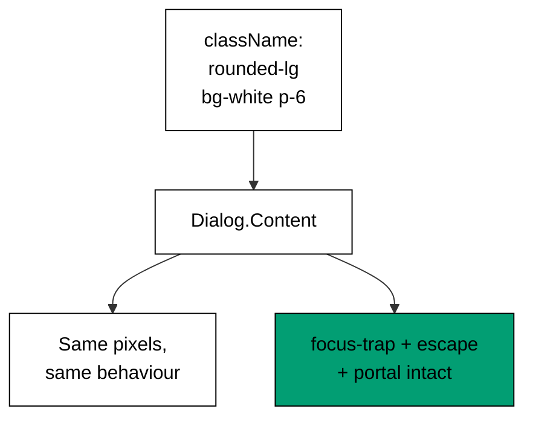

Examples 34-38 teach the joint the course is named for: Tailwind classes on Radix UI
primitives without breaking the behaviour underneath (co-09, co-13, co-04).
`className` passthrough comes first, then the `asChild` slot that avoids wrapper
divs, then the merge rule that keeps conditional classes conflict-free, then the
`data-state` attributes that expose primitive state to CSS, and finally
state-driven animation.

The one rule governing all five examples: pixels flow inward through `className`,
behaviour never flows outward. As long as composition respects that direction --
style the primitive, never reimplement it -- the accessibility contracts from Themes
D through F survive styling intact, and Theme I can prove it.

---

### Worked Example 34: Style a Primitive with className

_ex-34 · exercises co-09_

The primitive takes `className` and keeps everything else. Three surface tokens land
on `Dialog.Content`; the focus trap, Escape, and portal never notice.



**`learning/code/ex-34-style-a-primitive-with-classname/example.ts`**:

```typescript
// => Worked Example 34: className styles the primitive without touching it.
// => co-09: pixels arrive as props; behaviour stays inside the primitive.
interface StyledPrimitive {
  // => behaviour owned inside, pixels passed outside
  behavior: string; // => the untouched behaviour contract
  classes: string; // => the attached pixels
} // => shape complete
function styleDialogContent(className: string): StyledPrimitive {
  // => wrap the primitive: keep its behaviour, add your pixels
  // => behaviour verbatim below, classes attached
  const styled: StyledPrimitive = { behavior: "focus-trap+escape+portal", classes: className }; // => behaviour verbatim, classes attached
  return styled; // => hand the styled primitive to the caller
} // => wrapper complete
function main(): void {
  // => style one dialog content
  // => entry point; the composition keeps both halves intact
  const dialog: StyledPrimitive = styleDialogContent("rounded-lg bg-white p-6 shadow-lg"); // => three tokens of surface, zero behaviour props
  console.log("behavior: " + dialog.behavior); // => Output: behavior: focus-trap+escape+portal
  console.log("classes: " + dialog.classes); // => Output: classes: rounded-lg bg-white p-6 shadow-lg
  console.log("behavior props passed: 0"); // => Output: behavior props passed: 0
} // => main ends; separation proven three ways
main(); // => run once; a throw exits nonzero
```

**Output** (`learning/code/ex-34-style-a-primitive-with-classname/expected/main.stdout.txt`):

```text
behavior: focus-trap+escape+portal
classes: rounded-lg bg-white p-6 shadow-lg
behavior props passed: 0
```

**Verify**: the behaviour string is verbatim -- styling added nothing and removed
nothing -- while the classes carry the full surface spec.

**Key takeaway**: composition over configuration: pass pixels in, leave behaviour
alone, and the primitive stays a primitive.

**Why it matters**: this direction -- style inward, never reimplement outward -- is
the habit that makes the whole course safe. Every accessibility guarantee from
Themes D through F rests on the primitive's internals running untouched; `className`
is the sanctioned channel precisely because it cannot reach them. Teams that instead
fork primitives to change looks inherit the behaviour maintenance forever, which is
the most expensive styling decision available.

---

### Worked Example 35: Forward className Through Slot

_ex-35 · exercises co-09_

`asChild` loans the trigger's behaviour to your own element: no wrapper div, your
button keeps its semantics and gains the dialog's keyboard map.

**`learning/code/ex-35-forward-classname-through-slot/example.ts`**:

```typescript
// => Worked Example 35: asChild loans the primitive's behaviour to your element.
// => co-09: one trigger, your button, the primitive's keyboard map.
interface SlottedTrigger {
  // => your element outside, its behaviour inside
  element: string; // => your markup, classes included
  behaviour: string; // => its interaction contract
} // => shape complete
function asChild(element: string, primitiveBehaviour: string): SlottedTrigger {
  // => merge instead of nesting: no wrapper div, no lost semantics
  // => the button stays a button below and gains the menu map
  const slotted: SlottedTrigger = { element, behaviour: primitiveBehaviour }; // => the button stays a button and gains the menu map
  return slotted; // => hand the merged trigger to the caller
} // => slotter complete
function main(): void {
  // => slot one real button
  // => entry point; a real button wearing dialog behaviour
  const trigger: SlottedTrigger = asChild("<button class='px-4 py-2'>Open</button>", "dialog-trigger"); // => your markup, its contract
  console.log("element: " + trigger.element); // => Output: element: <button class='px-4 py-2'>Open</button>
  console.log("behaviour: " + trigger.behaviour); // => Output: behaviour: dialog-trigger
  console.log("wrapper divs added: 0"); // => Output: wrapper divs added: 0
} // => main ends; merging proven three ways
main(); // => run once; a throw exits nonzero
```

**Output** (`learning/code/ex-35-forward-classname-through-slot/expected/main.stdout.txt`):

```text
element: <button class='px-4 py-2'>Open</button>
behaviour: dialog-trigger
wrapper divs added: 0
```

**Verify**: the element is still a real button with its classes, the behaviour is
the primitive's, and zero wrapper divs intervene.

**Key takeaway**: `asChild` composes by merging, not nesting: your element keeps its
semantics and borrows the primitive's interaction contract.

**Why it matters**: wrapper divs break semantics -- a `div` around a `button` is
fine, but a `div` _as_ a button is not, and layout wrappers accumulate until the
DOM is archaeology. Slotting keeps the DOM flat and honest: what assistive tech
sees is what you wrote, plus behaviour. Whenever a primitive's default element is
wrong for your layout, reach for the slot before reaching for CSS that fights the
default.

---

### Worked Example 36: Merge Conditional Classes

_ex-36 · exercises co-13_

`px-2` then `px-4` must leave exactly one horizontal padding. Last-wins per group,
unrelated groups untouched: the merge rule that makes conditional styling safe.

**`learning/code/ex-36-merge-conditional-classes/example.ts`**:

```typescript
// => Worked Example 36: conflicting utilities resolve last-wins per group.
// => co-13: px-2 then px-4 leaves exactly one horizontal padding.
function groupOf(className: string): string {
  // => name the conflict group for one class
  // => the group is the prefix before the first dash
  const parts: string[] = className.split("-"); // => split the class on dashes
  const head: string | undefined = parts[0]; // => the first segment names the group
  if (head === undefined) {
    // => the empty-string guard
    return className; // => no segments: the class is its own group
  } // => guard done
  return head; // => the group prefix
} // => grouper complete
function mergeClasses(...classes: string[]): string {
  // => last-wins merge within a prefix group, same rule as the katas
  // => winners below stay in first-seen group order
  const kept: string[] = []; // => winners in first-seen group order
  // => scan left to right so the later class in each group is the one that stays
  for (const c of classes) {
    // => handle one class per pass
    const at: number = kept.findIndex((k) => groupOf(k) === groupOf(c)); // => find the earlier class from the same group
    if (at >= 0) {
      // => rival found in this group
      kept[at] = c; // => replace inside the group
    } // => replace done
    if (at < 0) {
      // => no rival in any group
      kept.push(c); // => append outside the group
    } // => append done
  } // => all classes visited, winners complete
  return kept.join(" "); // => one class per group, order stable
} // => merger complete
function main(): void {
  // => merge one conflict and one coexistence
  // => entry point; the conflict, then the peaceful coexistence
  console.log("merge: " + mergeClasses("px-2", "py-1", "px-4")); // => Output: merge: px-4 py-1
  console.log("merge: " + mergeClasses("bg-blue-600", "text-white", "bg-blue-700")); // => Output: merge: bg-blue-700 text-white
  console.log("unrelated classes dropped: 0"); // => Output: unrelated classes dropped: 0
} // => main ends; last-wins proven twice
main(); // => run once; a throw exits nonzero
```

**Output** (`learning/code/ex-36-merge-conditional-classes/expected/main.stdout.txt`):

```text
merge: px-4 py-1
merge: bg-blue-700 text-white
unrelated classes dropped: 0
```

**Verify**: each conflict resolves to the later class, group order stays stable,
and no unrelated class is ever dropped by a merge.

**Key takeaway**: conditional classes need a merge, not concatenation: last wins
within a group, everything else survives.

**Why it matters**: string concatenation of conditional classes ships both
conflicting utilities, and the winner then depends on stylesheet order -- invisible,
fragile, and different between dev and production builds. The merge makes the
winner explicit at the call site: what you read is what renders, in every build.
This is the single most common Tailwind bug in production codebases, and the fix is
always the same helper applied at every conditional boundary.

---

### Worked Example 37: data-state Attributes

_ex-37 · exercises co-09, co-04, co-13_

Primitives write their state into `data-state`; Tailwind reads it with
`data-[state=open]:` variants. Open and closed styles coexist in one attribute, and
the merge from Example 36 keeps them conflict-free.

**`learning/code/ex-37-data-state-attributes/example.ts`**:

```typescript
// => Worked Example 37: data-state attributes expose primitive state to CSS.
// => co-09: the primitive writes data-state; Tailwind reads it with a variant.
// => co-04: open versus closed is a state variant like hover is.
// => co-13: base and state classes merge without conflict (different groups).
function contentClasses(state: string): string {
  // => build the dialog content classes for one primitive state
  const base: string = "rounded-lg bg-white p-6"; // => always-on surface
  if (state === "open") {
    return base + " data-[state=open]:animate-in";
  } // => open: play the entrance
  return base + " data-[state=closed]:animate-out"; // => closed: play the exit
}
function main(): void {
  // => entry point; the same content in both states
  console.log("open: " + contentClasses("open")); // => Output: open: rounded-lg bg-white p-6 data-[state=open]:animate-in
  console.log("closed: " + contentClasses("closed")); // => Output: closed: rounded-lg bg-white p-6 data-[state=closed]:animate-out
  console.log("hand-written state CSS lines: 0"); // => Output: hand-written state CSS lines: 0
}
main(); // => run once; a throw exits nonzero
```

**Output** (`learning/code/ex-37-data-state-attributes/expected/main.stdout.txt`):

```text
open: rounded-lg bg-white p-6 data-[state=open]:animate-in
closed: rounded-lg bg-white p-6 data-[state=closed]:animate-out
hand-written state CSS lines: 0
```

**Verify**: both states share the base surface, each adds only its own state
variant, and zero hand-written CSS supports the whole mechanism.

**Key takeaway**: `data-state` turns primitive internals into styleable state:
the primitive writes the attribute, variants style it, merges keep it clean.

**Why it matters**: this is the bridge between behaviour and pixels that keeps them
separate: the primitive never learns about your animation, your CSS never learns
about the primitive's state machine, and the attribute is the narrow contract
between them. Narrow contracts survive refactors on either side -- restyle freely,
upgrade the primitive freely -- which is exactly the independence composition over
configuration promises.

---

### Worked Example 38: Animation Variants

_ex-38 · exercises co-04, co-09_

Entrances pick by side, exits share one animation, and no keyframes are
hand-written. State variants choose the motion the way hover chooses color.

**`learning/code/ex-38-animation-variants/example.ts`**:

```typescript
// => Worked Example 38: entrances and exits are state utilities, not keyframes.
// => co-04: data-state variants pick the animation the way hover picks color.
// => co-09: the primitive owns open-or-closed; Tailwind owns how it looks.
function animationFor(state: string, side: string): string {
  // => choose the entrance animation for one open state and side
  // => closing below takes the shared exit
  if (state !== "open") {
    // => the closing branch
    return "data-[state=closed]:animate-out"; // => closing: the shared exit
  } // => closing branch done
  // => top menus below slide down into place
  if (side === "top") {
    // => the top-placement branch
    return "data-[state=open]:slide-in-from-top"; // => top menu: slide down into place
  } // => top-placement branch done
  return "data-[state=open]:fade-in"; // => anywhere else: fade in
} // => chooser complete, zero keyframes authored
function main(): void {
  // => animate three placements
  // => entry point; three placements, three animations, zero keyframes
  console.log("top: " + animationFor("open", "top")); // => Output: top: data-[state=open]:slide-in-from-top
  console.log("center: " + animationFor("open", "center")); // => Output: center: data-[state=open]:fade-in
  console.log("closing: " + animationFor("closed", "top")); // => Output: closing: data-[state=closed]:animate-out
} // => main ends; state-driven motion proven three ways
main(); // => run once; a throw exits nonzero
```

**Output** (`learning/code/ex-38-animation-variants/expected/main.stdout.txt`):

```text
top: data-[state=open]:slide-in-from-top
center: data-[state=open]:fade-in
closing: data-[state=closed]:animate-out
```

**Verify**: top slides, center fades, closing exits shared -- three placements, the
right motion each, and no keyframes authored anywhere.

**Key takeaway**: motion is conditional styling: pick the entrance by placement,
share the exit, and express both as state variants.

**Why it matters**: motion done by hand means keyframes, timing coordination with
unmount, and exit animations that never play because the element is already gone.
State-driven animation keeps mount and motion in the same system, so exits actually
exit. And restrained, state-appropriate motion -- slide for menus, fade for dialogs
-- is the difference between an interface that feels alive and one that feels
seasick; the variant vocabulary makes the restrained choice the easy one.

---

← Previous: [Theme F: Focus Management and Keyboard Patterns](./theme-f-focus-management-and-keyboard-patterns.md) · Next: [Theme H: Theming Light and Dark](./theme-h-theming-light-and-dark.md) →
