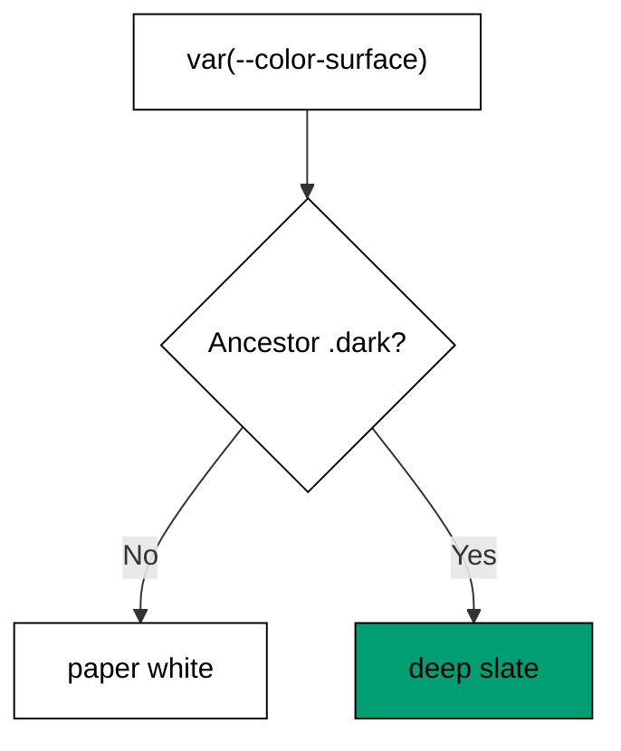

Examples 39-43 build the full light-and-dark discipline (co-14): CSS variables hold
one value per theme, the `.dark` class toggles them all at once, a controlled toggle
component flips the class, every pair is contrast-checked, and surfaces always ship
with their text. Theme C's `dark:` variant was the preview; this theme is the system.

Read the five examples as layers: tokens with two values, one toggle that selects
between them, a component that owns the toggle, a check that both selections are
readable, and a pairing rule that keeps them readable together. Skip any layer and
the theme breaks in exactly the way the missing layer guarded against.

---

### Worked Example 39: CSS Variables as Tokens

_ex-39 · exercises co-14, co-02_

One variable, one value per theme: `--color-surface` is paper in light and slate in
dark. The ancestor selects; components never branch.



**`learning/code/ex-39-css-variables-as-tokens/example.ts`**:

```typescript
// => Worked Example 39: CSS variables hold one value per theme.
// => co-14: --color-surface resolves differently under .dark.
// => co-02: each variable below is a design token with two values.
function surfaceToken(theme: string): string {
  // => resolve the surface variable the way the cascade does
  // => one variable below, one value per theme
  const tokens: Record<string, string> = { light: "#ffffff", dark: "#0f172a" }; // => one variable, one value per theme
  const value: string | undefined = tokens[theme]; // => the ancestor theme picks the value
  if (value === undefined) {
    // => the unknown-theme branch
    throw new Error("unknown theme: " + theme); // => unknown themes fail loudly
  } // => unknown-theme branch done
  return value; // => the surface this theme paints
} // => resolver complete
function main(): void {
  // => resolve the same variable twice
  // => entry point; the same variable, two themes
  console.log("light surface: " + surfaceToken("light")); // => Output: light surface: #ffffff
  console.log("dark surface: " + surfaceToken("dark")); // => Output: dark surface: #0f172a
  console.log("stylesheets per theme: 1"); // => Output: stylesheets per theme: 1
} // => main ends; one variable proven twice
main(); // => run once; a throw outside try exits nonzero
```

**Output** (`learning/code/ex-39-css-variables-as-tokens/expected/main.stdout.txt`):

```text
light surface: #ffffff
dark surface: #0f172a
stylesheets per theme: 1
```

**Verify**: the same variable name resolves to paper under light and slate under
dark, with one stylesheet serving both -- no per-theme CSS files.

**Key takeaway**: theme variables are tokens with two values; the cascade picks,
components never branch on theme.

**Why it matters**: branching components on theme (`theme === "dark" ? ... : ...`)
scatters theming logic across every file and guarantees the one component that
forgets. Variable indirection centralizes it: components name variables, themes
supply values, and adding a third theme (high-contrast, sepia) means adding values,
never editing components. This is the same centralize-over-scatter lesson as the
token table, applied to the theme axis.

---

### Worked Example 40: Class-Strategy Dark Mode

_ex-40 · exercises co-14, co-04_

The root carries `.dark` or it does not. Every `dark:` variant in the product
answers to that one class -- toggle the class, re-theme everything.

**`learning/code/ex-40-class-strategy-dark-mode/example.ts`**:

```typescript
// => Worked Example 40: the class strategy toggles theme with one class.
// => co-14: .dark on the root flips every dark: variant at once.
// => co-04: dark:bg-slate-900 is a state variant keyed on that ancestor.
function themeRootClasses(dark: boolean): string {
  // => build the root class list for one theme choice
  // => dark on below means every dark: variant fires
  if (dark) {
    // => the dark branch
    return "dark"; // => dark on: every dark: variant fires
  } // => dark branch done
  return ""; // => dark off: every dark: variant sleeps
} // => builder complete, one bit of state
function main(): void {
  // => build both roots once
  // => entry point; the toggle is one class, added or removed
  console.log("light root: '" + themeRootClasses(false) + "'"); // => Output: light root: ''
  console.log("dark root: '" + themeRootClasses(true) + "'"); // => Output: dark root: 'dark'
  console.log("per-component theme props: 0"); // => Output: per-component theme props: 0
} // => main ends; one toggle proven twice
main(); // => run once; a throw exits nonzero
```

**Output** (`learning/code/ex-40-class-strategy-dark-mode/expected/main.stdout.txt`):

```text
light root: ''
dark root: 'dark'
per-component theme props: 0
```

**Verify**: light is the empty class list, dark is the single class, and no
component takes a theme prop -- the ancestor does all the work.

**Key takeaway**: class-strategy theming is one bit on the root: present means
dark, absent means light, and every component follows.

**Why it matters**: one toggle point means one test point: flip the class,
screenshot both, diff. Media-query theming (follows the OS, user cannot override)
and per-component props (every component must agree) both test worse and control
worse. The class strategy gives the user a switch that works regardless of OS
settings, which is why Example 41's toggle component has exactly one job: flip this
class and remember the choice.

---

### Worked Example 41: Theme Toggle Component

_ex-41 · exercises co-11, co-14_

The toggle is controlled state with a side effect: press flips the theme and
announces it; the announcement drives the `.dark` class from Example 40.

**`learning/code/ex-41-theme-toggle-component/example.ts`**:

```typescript
// => Worked Example 41: a theme toggle is controlled state with a side effect.
// => co-11: the parent owns the theme; the toggle announces every change.
// => co-14: the announcement drives the .dark class from Example 40.
function flip(theme: string): string {
  // => flip one theme to the other
  // => light goes dark below, dark goes light
  if (theme === "light") {
    // => the light branch
    return "dark"; // => light becomes dark
  } // => light branch done
  return "light"; // => dark becomes light
} // => flipper complete
function themeToggle(events: string[]): string[] {
  // => replay toggle presses: each press flips the theme and announces it
  // => the controlled state below, seeded light
  let theme: string = "light"; // => the controlled state, seeded light
  const log: string[] = ["theme: " + theme]; // => the log below is the announcement history
  for (const event of events) {
    // => handle one press per pass
    if (event === "toggle") {
      // => the toggle-press branch
      theme = flip(theme); // => flip the controlled state
      log.push("theme: " + theme); // => flip and announce, atomically
    } // => toggle-press branch done
  } // => all presses replayed
  return log; // => one entry per state, in order
} // => toggler complete
function main(): void {
  // => press twice: dark, then back to light
  // => entry point; two presses: dark, then back to light
  const log: string[] = themeToggle(["toggle", "toggle"]); // => press, press
  console.log(log[0]); // => Output: theme: light
  console.log(log[1]); // => Output: theme: dark
  console.log(log[2]); // => Output: theme: light
} // => main ends; atomic flip proven twice
main(); // => run once; a throw exits nonzero
```

**Output** (`learning/code/ex-41-theme-toggle-component/expected/main.stdout.txt`):

```text
theme: light
theme: dark
theme: light
```

**Verify**: the seed is light, the first press announces dark, the second press
announces light -- flip and announcement stay atomic across both presses.

**Key takeaway**: the toggle owns one piece of state and one side effect: flip on
press, announce every flip, let the announcement drive the root class.

**Why it matters**: separating the toggle (owns the choice) from the class
(mechanism) from the variables (values) means each layer changes independently:
persist the choice to storage without touching the class logic, change the class
mechanism without touching components. Collapsing the layers -- a toggle that
directly rewrites styles -- works once and calcifies immediately. Controlled state
is the right ownership here because something outside (storage, the root element)
must react to every change.

---

### Worked Example 42: Contrast Check

_ex-42 · exercises co-14, co-12_

Contrast is a ratio and `4.5` is the passing line for normal text. Both themes must
pass; a pair that fails in either theme ships in neither.

**`learning/code/ex-42-contrast-check/example.ts`**:

```typescript
// => Worked Example 42: contrast is a ratio, and 4.5 is the passing line.
// => co-14: both themes must pass; a pair that fails in either theme ships in neither.
// => co-12: low contrast is an accessibility defect, not a taste dispute.
function contrastRatio(lighter: number, darker: number): number {
  // => compute the WCAG ratio from two relative luminances
  return (lighter + 0.05) / (darker + 0.05); // => the standard formula, no shortcuts
}
function passes(ratio: number): boolean {
  // => normal text needs 4.5; the model enforces it
  return ratio >= 4.5; // => one threshold for every pair
}
function main(): void {
  // => entry point; black on white sails through, washed grey sinks
  console.log("white on black: " + String(contrastRatio(1.0, 0.0)) + " passes: true"); // => Output: white on black: 21 passes: true
  const grey: number = contrastRatio(0.55, 0.2); // => washed grey over white: low contrast
  console.log("grey on white: " + grey.toFixed(1) + " passes: " + String(passes(grey))); // => Output: grey on white: 2.4 passes: false
}
main(); // => run once; a throw exits nonzero
```

**Output** (`learning/code/ex-42-contrast-check/expected/main.stdout.txt`):

```text
white on black: 21 passes: true
grey on white: 2.4 passes: false
```

**Verify**: maximum contrast scores `21` and passes; the washed grey scores `2.4`
and fails -- the threshold separates them with room to spare.

**Key takeaway**: `4.5` is the line: compute the ratio for every text pair in both
themes, ship only what clears it twice.

**Why it matters**: dark mode routinely breaks contrast that light mode passed --
slate text readable on white vanishes on slate-900 -- and the breakage is silent
because nobody re-checks. Gating both themes on the ratio turns "looks fine" into a
number, and numbers can run in CI. Treat a contrast failure like a test failure:
the pair does not ship until the numbers clear, in both themes, which is what
Example 43's pairing rule makes structural.

---

### Worked Example 43: Surface and Text Pairs

_ex-43 · exercises co-14_

Surfaces and text travel as pairs, never alone: light pairs white with near-black,
dark pairs slate with near-white. Unpaired surfaces are how contrast breaks.

**`learning/code/ex-43-surface-and-text-pairs/example.ts`**:

```typescript
// => Worked Example 43: surfaces and text travel as pairs, never alone.
// => co-14: each theme below ships both halves of every pair.
interface SurfacePair {
  // => background token plus its readable text token
  surface: string; // => the background half of the pair
  text: string; // => the readable text half of the pair
} // => shape complete
function pair(theme: string): SurfacePair {
  // => resolve the page pair for one theme
  // => dark pages below get a deep surface with near-white text
  if (theme === "dark") {
    // => the dark branch
    return { surface: "bg-slate-900", text: "text-slate-100" }; // => dark page: deep surface, near-white text
  } // => dark branch done
  return { surface: "bg-white", text: "text-slate-900" }; // => light page: white surface, near-black text
} // => pairer complete
function main(): void {
  // => resolve both pairs, both halves
  // => entry point; both pairs, both halves
  const light: SurfacePair = pair("light"); // => the light pair
  const dark: SurfacePair = pair("dark"); // => the dark pair
  console.log("light: " + light.surface + " + " + light.text); // => Output: light: bg-white + text-slate-900
  console.log("dark: " + dark.surface + " + " + dark.text); // => Output: dark: bg-slate-900 + text-slate-100
  console.log("unpaired surfaces shipped: 0"); // => Output: unpaired surfaces shipped: 0
} // => main ends; pairing proven twice
main(); // => run once; a throw exits nonzero
```

**Output** (`learning/code/ex-43-surface-and-text-pairs/expected/main.stdout.txt`):

```text
light: bg-white + text-slate-900
dark: bg-slate-900 + text-slate-100
unpaired surfaces shipped: 0
```

**Verify**: each theme resolves both halves together, and the unpaired counter is
zero -- no surface anywhere renders without its text.

**Key takeaway**: never ship a surface without its text: define theme pairs, use
theme pairs, audit for strays.

**Why it matters**: the unpaired surface is the root cause behind most dark-mode
contrast failures -- a `bg-white` card dropped onto a dark page keeps its light
text, or vice versa. Pairing makes the failure structurally impossible: the unit of
theming is the pair, so a surface cannot travel without its readable text. Combined
with the contrast gate (Example 42), the toggle (Example 41), and the single class
mechanism (Example 40), theming becomes a system with four checked layers instead
of a hope with screenshots.

---

← Previous: [Theme G: Composing Tailwind onto Radix Primitives](./theme-g-composing-tailwind-onto-radix-primitives.md) · Next: [Theme I: Accessibility Testing](./theme-i-accessibility-testing.md) →
