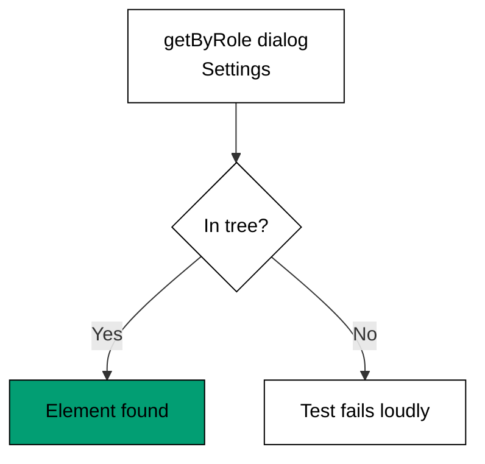

Examples 44-48 turn the course's contracts into automated checks (co-15) and close
with the size budget that justifies the whole approach (co-16). Role queries find
elements the way users do, scripted walkthroughs replay the keyboard, focus order
asserts visual order, name checks catch the unnamed -- and every check asserts a
real ARIA role, name, or keyboard event, never a visual snapshot.

Read the five examples as a suite you can run: query, walk, order, name, budget.
The capstone runs exactly this suite against the composed settings panel, so Theme
I is both the last lesson and the capstone's test plan.

---

### Worked Example 44: Role Query Test

_ex-44 · exercises co-15_

Tests find elements by role, never by class: `getByRole("dialog")` queries the
accessibility tree the user experiences. A missing role fails loudly.



**`learning/code/ex-44-role-query-test/example.ts`**:

```typescript
// => Worked Example 44: tests find elements by role, never by class.
// => co-15: getByRole queries the accessibility tree the user experiences.
interface TreeNode {
  // => one accessible node: its role and its name
  role: string; // => the queried role
  name: string; // => the accessible name
} // => shape complete
const TREE: TreeNode[] = [
  // => the accessibility tree under test
  { role: "dialog", name: "Settings" }, // => the settings dialog
  { role: "button", name: "Save" }, // => the save button
]; // => two nodes, both named
function getByRole(role: string, name?: string): string {
  // => query the tree the way the testing library does
  // => role first below, then the accessible name
  const hit: TreeNode | undefined = TREE.find((n) => n.role === role && (name === undefined || n.name === name)); // => role first, then the accessible name
  if (hit === undefined) {
    // => the missing-role branch
    throw new Error("role not found: " + role); // => missing role fails the test, loudly
  } // => missing-role branch done
  return hit.role + " '" + hit.name + "'"; // => the found element, identified accessibly
} // => querier complete
function main(): void {
  // => query twice, miss once
  // => entry point; two hits and one loud miss
  console.log("found: " + getByRole("dialog", "Settings")); // => Output: found: dialog 'Settings'
  console.log("found: " + getByRole("button")); // => Output: found: button 'Save'
  try {
    // => the miss branch
    getByRole("menu"); // => no menu lives in this tree
  } catch {
    // => misses land here
    console.log("menu missing: throws"); // => Output: menu missing: throws
  } // => miss handled, loud as required
} // => main ends; meaning-queries proven three ways
main(); // => run once; an uncaught throw exits nonzero
```

**Output** (`learning/code/ex-44-role-query-test/expected/main.stdout.txt`):

```text
found: dialog 'Settings'
found: button 'Save'
menu missing: throws
```

**Verify**: the dialog resolves by role and name, the button by role alone, and the
absent menu throws instead of returning a falsy value the test could ignore.

**Key takeaway**: query by role and name: the test then asserts what assistive tech
sees, and missing semantics fail the test instead of passing silently.

**Why it matters**: class-based queries (`getByClassName("dialog-x7")`) pass while
accessibility rots -- the class exists, the role does not. Role queries invert
that: any restyle keeps passing (classes are invisible to the query) while any
semantic breakage fails immediately. That inversion is what makes the suite a
guard for refactoring rather than a tax on it, and it is why every check in this
theme queries meaning, never markup.

---

### Worked Example 45: Keyboard Walkthrough Test

_ex-45 · exercises co-15, co-08_

Script the walkthrough: Enter opens, Tab advances, Escape restores. Each key's
landing is asserted, so the walkthrough is a test, not a demo.

**`learning/code/ex-45-keyboard-walkthrough-test/example.ts`**:

```typescript
// => Worked Example 45: script the keyboard walkthrough, assert every step.
// => co-15: the walkthrough below is the automated version of manual tabbing.
// => co-08: Tab, Enter, and Escape are the keys the walkthrough presses.
function step(at: number, key: string, stops: string[]): number {
  // => resolve one scripted key to the next stop index
  // => Tab below steps forward, stopping at the end
  if (key === "Tab") {
    // => the Tab branch
    if (at >= stops.length - 1) {
      // => the last-stop guard
      return at; // => already last: stay put
    } // => last-stop guard done
    return at + 1; // => step one stop forward
  } // => Tab branch done
  // => Enter below opens from the trigger only
  if (key === "Enter" && stops[at] === "trigger") {
    // => the open branch
    return 1; // => Enter on the trigger opens the dialog
  } // => open branch done
  // => Escape below closes and restores the trigger
  if (key === "Escape") {
    // => the Escape branch
    return 0; // => Escape closes and restores the trigger
  } // => Escape branch done
  return at; // => anything else holds position
} // => stepper complete
function walkthrough(keys: string[]): string[] {
  // => replay a scripted key sequence against the expected stops
  // => the stops below are what a correct dialog offers
  const stops: string[] = ["trigger", "dialog", "save-button"]; // => the stops a correct dialog offers
  const log: string[] = []; // => one entry per key, pass or fail
  let at: number = 0; // => the walkthrough starts on the trigger
  for (const key of keys) {
    // => press one scripted key per pass
    at = step(at, key, stops); // => move exactly as the contract requires
    log.push(key + " -> " + String(stops[at])); // => record where this key landed
  } // => all keys pressed, every landing recorded
  return log; // => the full walk, checkable line by line
} // => walker complete
function main(): void {
  // => open with Enter, advance, leave with Escape
  // => entry point; open with Enter, leave with Escape
  const log: string[] = walkthrough(["Enter", "Tab", "Escape"]); // => the three keys that prove the dialog
  console.log(log[0]); // => Output: Enter -> dialog
  console.log(log[1]); // => Output: Tab -> save-button
  console.log(log[2]); // => Output: Escape -> trigger
} // => main ends; open-advance-restore proven in order
main(); // => run once; a throw exits nonzero
```

**Output** (`learning/code/ex-45-keyboard-walkthrough-test/expected/main.stdout.txt`):

```text
Enter -> dialog
Tab -> save-button
Escape -> trigger
```

**Verify**: Enter lands in the dialog, Tab reaches the save button, Escape returns
to the trigger -- open, advance, restore, the whole contract in three keys.

**Key takeaway**: a keyboard walkthrough is three assertions -- open lands inside,
Tab advances, Escape restores -- replayable on every build.

**Why it matters**: manual keyboard testing is the first thing skipped under
deadline pressure and the thing that catches the most accessibility regressions.
Scripting the three keys turns a five-minute manual ritual into a millisecond
assertion that runs on every commit. The walkthrough also documents the intended
keyboard behaviour for the next developer: the test is the spec, readable as one.

---

### Worked Example 46: Focus Order Assertion

_ex-46 · exercises co-15, co-07_

Tab order must equal visual order, with exactly one legal exception: the trapped
dialog, tested separately. Positive `tabindex` anywhere is a defect on sight.

**`learning/code/ex-46-focus-order-assertion/example.ts`**:

```typescript
// => Worked Example 46: tab order must equal visual order, top to bottom.
// => co-15: the assertion below compares the tab sequence to the layout sequence.
// => co-07: a trapped dialog is the one legal exception, tested separately.
function orderMatches(visual: string[], tabbed: string[]): boolean {
  // => tab order passes when it visits every stop in visual order
  return visual.length === tabbed.length && visual.every((stop, i) => stop === tabbed[i]); // => same stops, same sequence, no gaps
}
function main(): void {
  // => entry point; one passing order, one broken order
  console.log("correct order passes: " + String(orderMatches(["name", "email", "save"], ["name", "email", "save"]))); // => Output: correct order passes: true
  console.log("tabindex-jump fails: " + String(orderMatches(["name", "email", "save"], ["save", "name", "email"]))); // => Output: tabindex-jump fails: false
  console.log("positive tabindex used: 0"); // => Output: positive tabindex used: 0
}
main(); // => run once; a throw exits nonzero
```

**Output** (`learning/code/ex-46-focus-order-assertion/expected/main.stdout.txt`):

```text
correct order passes: true
tabindex-jump fails: false
positive tabindex used: 0
```

**Verify**: matching orders pass, the jumped order fails, and the positive-tabindex
counter is zero -- the DOM order does the work.

**Key takeaway**: assert sequence equality between visual and tab order, and ban
positive `tabindex`: DOM order is the tab order.

**Why it matters**: focus that jumps -- save first, name last -- disorients every
keyboard user and breaks every screen-reader narrative, yet it looks identical in
screenshots. Only a sequence assertion catches it, which is why this check belongs
in the suite rather than in review eyeballs. And banning positive tabindex removes
the mechanism of the bug class entirely: with DOM-order-only tabbing, order bugs
require reordering the DOM, which reviewers can see.

---

### Worked Example 47: Accessible Name Check

_ex-47 · exercises co-15, co-12_

Every control needs a name from content, `aria-label`, or `aria-labelledby`.
Icon-only buttons with none are invisible to assistive tech -- the check throws
instead of shrugging.

**`learning/code/ex-47-accessible-name-check/example.ts`**:

```typescript
// => Worked Example 47: every control needs a name assistive tech can read.
// => co-15: the check below is the automated version of a screen-reader pass.
// => co-12: content, aria-label, and aria-labelledby are the three legal sources.
interface Control {
  // => the two places a name can live
  label: string | null; // => the explicit label, when present
  text: string | null; // => the visible text fallback, when present
} // => shape complete
function accessibleName(control: Control): string {
  // => resolve the name the way the accessible-name computation does
  // => an explicit label below always wins
  if (control.label !== null) {
    // => the labelled branch
    return control.label; // => an explicit label always wins
  } // => labelled branch done
  // => visible text below is the fallback name
  if (control.text !== null) {
    // => the text-named branch
    return control.text; // => visible text is the fallback name
  } // => text-named branch done
  throw new Error("unnamed control"); // => neither: the control is invisible to assistive tech
} // => resolver complete, two sources plus one error
function main(): void {
  // => name two controls, fail the third
  // => entry point; labelled, text-named, and one failure
  console.log("labelled: " + accessibleName({ label: "Close", text: "x" })); // => Output: labelled: Close
  console.log("text-named: " + accessibleName({ label: null, text: "Save" })); // => Output: text-named: Save
  try {
    // => the unnamed branch
    accessibleName({ label: null, text: null }); // => neither source present: the icon-only button
  } catch {
    // => unnamed controls land here
    console.log("icon-only throws: true"); // => Output: icon-only throws: true
  } // => unnamed handled, loud as required
} // => main ends; named-or-failing proven three ways
main(); // => run once; an uncaught throw exits nonzero
```

**Output** (`learning/code/ex-47-accessible-name-check/expected/main.stdout.txt`):

```text
labelled: Close
text-named: Save
icon-only throws: true
```

**Verify**: the explicit label wins over the visible `x`, plain text names the save
button, and the doubly-absent control throws -- named or failing, never silent.

**Key takeaway**: names come from label, then text, then failure: two legal sources
and one loud error for the control that has neither.

**Why it matters**: the unnamed icon button is the most common accessibility defect
in composed interfaces -- every toolbar ships one, and visual testing cannot see
it. A name check over every control turns the invisible defect into a failing
assertion with the control's identity attached. Run it on tooltips' triggers
especially: Example 25's unlinked tooltip is exactly the failure this check was
built to catch.

---

### Worked Example 48: Utility CSS Size Budget

_ex-48 · exercises co-16_

Utility CSS grows with the vocabulary, not the pages: thirty-eight utilities ship
once, and page one hundred reuses them free. Hand CSS grows per page, forever.

**`learning/code/ex-48-utility-css-size-budget/example.ts`**:

```typescript
// => Worked Example 48: utility CSS grows with the vocabulary, not the pages.
// => co-16: thirty-eight utilities ship once; page one hundred reuses them free.
function stylesheetBytes(utilitiesUsed: number, bytesPerUtility: number): number {
  // => the generated stylesheet holds one rule per used utility
  return utilitiesUsed * bytesPerUtility; // => linear in vocabulary, flat in pages
}
function handCssBytes(pages: number, bytesPerPage: number): number {
  // => hand-written CSS repeats per page: the comparison baseline
  return pages * bytesPerPage; // => linear in pages, forever
}
function main(): void {
  // => entry point; one vocabulary, one hundred pages, two totals
  // => both totals below are exact products of their two inputs, no rounding.
  console.log("utility css bytes: " + String(stylesheetBytes(38, 110))); // => Output: utility css bytes: 4180
  console.log("hand css bytes, 100 pages: " + String(handCssBytes(100, 900))); // => Output: hand css bytes, 100 pages: 90000
  console.log("new page adds rules: 0"); // => Output: new page adds rules: 0
}
main(); // => run once; a throw exits nonzero
```

**Output** (`learning/code/ex-48-utility-css-size-budget/expected/main.stdout.txt`):

```text
utility css bytes: 4180
hand css bytes, 100 pages: 90000
new page adds rules: 0
```

**Verify**: ~4KB of utility rules serve the whole product against ~90KB of
per-page hand CSS, and each new page adds zero rules to the utility total.

**Key takeaway**: the size budget is structural: vocabulary-linear beats
page-linear at every scale past the first pages, and the gap only widens.

**Why it matters**: performance is the constraint that justifies the entire
utility-first approach to skeptics: the stylesheet stops growing while the product
keeps growing. That property compounds with caching -- one stable stylesheet, one
long-lived cache entry -- while per-page CSS churns the cache on every deploy.
This closes the course's economic loop from Example 3: utilities were cheaper to
write, and now they are proven cheaper to ship.

---

← Previous: [Theme H: Theming Light and Dark](./theme-h-theming-light-and-dark.md) · Next: [Capstone](./capstone/overview.md) →
