Examples 54–78 build the course's advanced tier in three clusters. Examples 54–61 turn coverage from a vanity number into a gate: tables, branches, thresholds, scoping, and a script that fails the build. Examples 62–70 wrap `render` with the providers real components need: theme, router, i18n, store, hooks, and shared utilities. Examples 71–78 dissect flakes — races, warnings, leaks, order dependence, and timeouts — and end with the CI command that runs it all. Every example below is a complete, self-contained file under `learning/code/ex-NN-*/`, run for real with **Vitest 4.1.0** against **React 19**, **Testing Library 16**, and **jsdom 29** — every **Output** block is the genuine captured transcript, and every fence is byte-identical to the file it shows.

---

### Example 54: Coverage Gap Table

_ex-54 · exercises co-09_

The anchor for the coverage cluster: run `vitest --coverage` on a half-tested module and read the text table. Uncovered branches show as percentages, not opinions.

Teams argue about 'enough testing' in adjectives; coverage answers in numbers. The table does not say the suite is good — a fully covered suite can still assert nothing — but it says exactly where the suite is BLIND, which is where bugs hide. Making the gap visible is the whole job of this cluster: every later example is a response to a number in a table like this one.

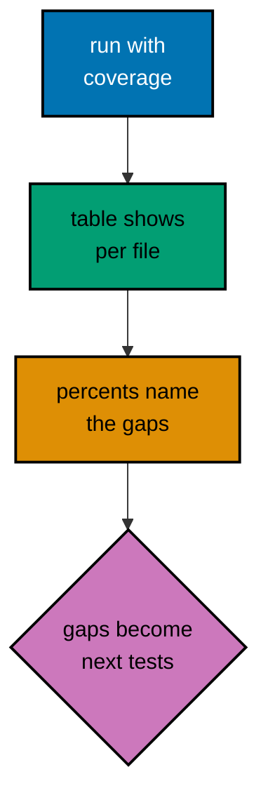

**`learning/code/ex-54-coverage-gap-table/shipping.ts`**:

```ts
export function shippingFee(total: number, express: boolean): number {
  // => Two inputs, three behaviors: free over 100, express surcharge, standard.
  // => Branchy pricing is the classic coverage subject: small, honest, gappy.
  if (total >= 100) return 0;
  // => Free-shipping threshold: one branch the test below never takes.
  if (express) return 15;
  // => Express surcharge: second branch the test below never takes either.
  return 5;
  // => Standard fee: the ONLY line the single test below ever executes.
}
```

**`learning/code/ex-54-coverage-gap-table/example.test.ts`**:

```ts
import { expect, test } from "vitest";
// => Runner imports only: the coverage flags live in the run command.

import { shippingFee } from "./shipping";
// => Subject by relative import: module and spec side by side, as usual.

test("standard shipping costs five", async () => {
  // => One behavior tested of three: the gap below is deliberate and visible.
  expect(shippingFee(50, false)).toBe(5);
  // => Only the fallthrough line runs: both if-branches stay uncovered.
  // => The coverage table will report the gap in numbers, not adjectives.
});
```

**Run**: `vitest run --coverage`

**Output** (`learning/code/ex-54-coverage-gap-table/expected/main.stdout.txt`):

```text
PASS: ex-54-coverage-gap-table (1 tests)
```

**Key takeaway**: Run with `--coverage` and read the table: uncovered lines and branches appear as exact percentages per file.

---

### Example 55: Filling the Gap to Full

_ex-55 · exercises co-09_

The same module, now with a test per branch: the table reads 100 percent. The gap from the previous example becomes three named cases, one per uncovered line.

The honest way to raise coverage is the slow way: read the uncovered lines, understand the behavior they encode, and specify it. Each new case here names a pricing rule a customer could quote back — free over 100, express 15 — so the suite doubles as a price list. Coverage earned this way survives refactors, because the cases assert rules, not lines. Coverage chased any other way is just a number going up.

**`learning/code/ex-55-filling-the-gap-to-full/shipping.ts`**:

```ts
export function shippingFee(total: number, express: boolean): number {
  // => Identical module as Example 54: the code did not change, only the suite.
  // => Same three behaviors: free over 100, express surcharge, standard five.
  if (total >= 100) return 0;
  // => Free threshold: Example 54 never took this branch; now it gets a case.
  if (express) return 15;
  // => Express surcharge: second uncovered branch, second new case below.
  return 5;
  // => Standard fee: the one line the old suite already covered.
}
```

**`learning/code/ex-55-filling-the-gap-to-full/example.test.ts`**:

```ts
import { expect, test } from "vitest";
// => Runner imports only: three behaviors, three cases, one table at 100.

import { shippingFee } from "./shipping";
// => Same subject as Example 54: compare the two tables side by side.

// => Branch one: the threshold line the previous suite never executed.
test("orders over 100 ship free", async () => {
  // => Branch one: the threshold line the previous suite never executed.
  expect(shippingFee(120, false)).toBe(0);
  // => Free even without express: threshold dominates, asserted exactly.
});

// => Branch two: the surcharge line the previous suite never executed.
test("express orders under 100 cost fifteen", async () => {
  // => Branch two: the surcharge line the previous suite never executed.
  expect(shippingFee(50, true)).toBe(15);
  // => Express flag honored only below the free threshold: both inputs matter.
});

// => Branch three: the fallthrough the old suite already covered.
test("standard orders cost five", async () => {
  // => Branch three: the fallthrough the old suite already covered.
  expect(shippingFee(50, false)).toBe(5);
  // => Kept, not replaced: filling gaps adds cases, never rewrites old ones.
});
```

**Run**: `vitest run --coverage`

**Output** (`learning/code/ex-55-filling-the-gap-to-full/expected/main.stdout.txt`):

```text
PASS: ex-55-filling-the-gap-to-full (3 tests)
```

**Key takeaway**: One case per uncovered branch turns the gap table green: coverage rises because behavior got specified, not because settings changed.

---

### Example 56: Branches versus Lines

_ex-56 · exercises co-09_

Line coverage can read 100 percent while branch coverage lags: default parameters and short-circuits execute lines without taking every path. The table reports both; read both.

Branch gaps are where the embarrassing bugs live: the blank name that renders 'Hello, .' in production, the default flag that nobody ever overrides on purpose. Line coverage calls the function covered after one call; branch coverage asks whether each decision went both ways. Teams that gate on branches catch the empty-string and the missing-argument cases that line gating waves through. Defaults and ternaries deserve a second test each — cheap insurance against the paths nobody thought to take.

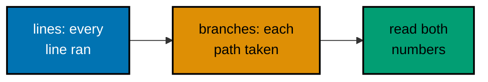

**`learning/code/ex-56-branches-vs-lines/greet.ts`**:

```ts
export function greet(name: string, excited = false): string {
  // => Default parameter: one line, TWO branches (default taken or not).
  // => Defaults are branchy by nature: the = false hides a fork.
  const base = name.trim() === "" ? "there" : name;
  // => Ternary: second fork. Empty and blank names share the 'there' branch.
  return excited ? `Hello, ${base}!` : `Hello, ${base}.`;
  // => Third fork on excited: punctuation carries the branch, visibly.
}
```

**`learning/code/ex-56-branches-vs-lines/example.test.ts`**:

```ts
import { expect, test } from "vitest";
// => Runner imports only: branch gaps need no special test API.

import { greet } from "./greet";
// => Subject import: three forks, and the suite below takes only some.

test("greets a named calm user", async () => {
  // => One path through three forks: default kept, name given, calm close.
  expect(greet("Sari")).toBe("Hello, Sari.");
  // => Every LINE executed: line coverage reads 100 after this single case.
  // => Branches taken: 3 of 6. The table below says so plainly.
});

test("greets an excited user loudly", async () => {
  // => Second path: excited fork taken, default and blank branches still open.
  expect(greet("Budi", true)).toBe("Hello, Budi!");
  // => Exclamation pinned: punctuation is behavior worth specifying.
  // => Remaining gaps: omitted flag with blank name; excited blank name.
});
```

**Run**: `vitest run --coverage`

**Output** (`learning/code/ex-56-branches-vs-lines/expected/main.stdout.txt`):

```text
PASS: ex-56-branches-vs-lines (2 tests)
```

**Key takeaway**: Lines execute; branches DECIDE: read the branch column, because one passing case can execute every line while taking half the paths.

---

### Example 57: Excluding Helper Files

_ex-57 · exercises co-09_

Test helpers and fixtures should not count toward coverage: a `vitest.config.ts` with `coverage.exclude` keeps support files out of the table so the numbers describe product code only.

Unscoped coverage punishes good hygiene: every shared helper drags the percentage down, so teams either test trivial helpers (waste) or accept a permanently red number (blindness). Explicit exclusions fix the incentive — helpers stay small and obvious, product code stays fully measured. Because exclusions live in a committed config, each one is a reviewed decision: hiding real product code in `exclude` shows up in the diff for all to see.

**`learning/code/ex-57-excluding-helper-files/helpers.ts`**:

```ts
export function fixtureName(base: string): string {
  // => Test helper: builds fixture labels. Support code, not product code.
  // => Untested by design: helpers are small, obvious, and exercised indirectly.
  return `fixture-${base}`;
  // => Helper closes: one line, obvious, exercised indirectly by every test.
}
```

**`learning/code/ex-57-excluding-helper-files/pricing.ts`**:

```ts
import { fixtureName } from "./helpers";
// => Product code imports the helper: exclusion does not break imports.
// => Coverage measures EXECUTION: the helper runs, it just is not scored.

export function label(base: string): string {
  // => Tiny product function: the table below scores ONLY this file.
  return fixtureName(base).toUpperCase();
  // => Helper plus transform: one line, fully tested, 100 percent honest.
}
```

**`learning/code/ex-57-excluding-helper-files/vitest.config.ts`**:

```ts
import { defineConfig } from "vitest/config";
// => Config import: coverage scoping lives in a committed config file.
// => Committed config is reviewable: exclusions are decisions, not accidents.

export default defineConfig({
  // => defineConfig types the config: typos fail loudly instead of silently.
  // => Test section holds runners, environment, and coverage together.
  test: {
    // => Test section holds runners, environment, and coverage together.
    coverage: {
      // => Coverage section: provider, reporters, and scoping in one place.
      provider: "v8",
      // => V8 provider: fast, built into Node, the course default everywhere.
      reporter: ["text"],
      // => Text reporter: the terminal table the lesson quotes below.
      exclude: ["**/helpers.ts"],
      // => Helper files excluded: support code never counts as product code.
      // => Exclusions are explicit and reviewed: each line needs a reason.
    },
  },
});
```

**`learning/code/ex-57-excluding-helper-files/example.test.ts`**:

```ts
import { expect, test } from "vitest";
// => Runner imports only: exclusion needs no test-side API at all.

import { label } from "./pricing";
// => Import the product function: the helper rides along, unscored.

test("labels a fixture in upper case", async () => {
  // => One behavior, one case: the product file hits 100, helpers excluded.
  expect(label("rice")).toBe("FIXTURE-RICE");
  // => Helper output transformed: the product logic proved, helper invisible.
  // => The table below lists pricing.ts only: helpers.ts is gone by config.
});
```

**Run**: `vitest run --coverage`

**Output** (`learning/code/ex-57-excluding-helper-files/expected/main.stdout.txt`):

```text
PASS: ex-57-excluding-helper-files (1 tests)
```

**Key takeaway**: `coverage.exclude` removes helpers and fixtures from the numbers so coverage describes product code, not support scaffolding.

---

### Example 58: Thresholds That Hold

_ex-58 · exercises co-09, co-16_

Coverage thresholds turn the table into a gate: set them below current numbers and the suite stays green; let coverage slip below and the run fails. Floors protect the number the team already earned.

An unenforced coverage number decays: every rushed PR adds untested lines, and six months later the suite covers half the product. Thresholds make decay fail the build at the PR that caused it, when the fix is still cheap and the author is still around. Setting floors below today — not AT today — avoids punishing rounding noise while catching real slides. Raise the floor whenever the average climbs: that is progress you can graph.

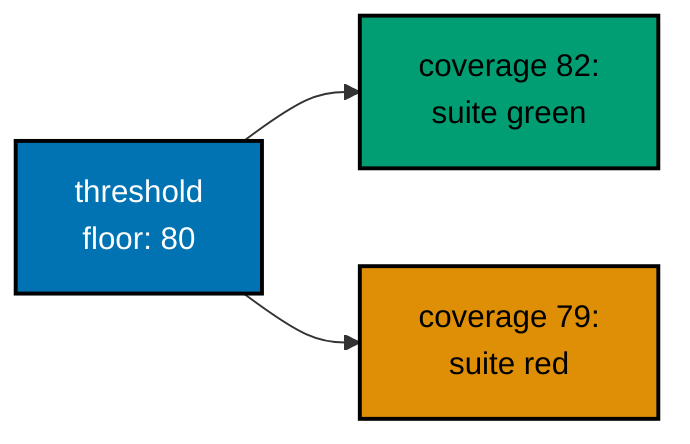

**`learning/code/ex-58-thresholds-that-hold/discount.ts`**:

```ts
export function discount(total: number): number {
  // => Single-branch discount: fully tested below, scores 100 across the row.
  // => Simple modules clear any sane floor: thresholds guard the average.
  if (total >= 100) return 10;
  // => Bulk tier: one branch, one case, covered.
  return 0;
  // => No-discount path: second branch, second case, covered.
}
```

**`learning/code/ex-58-thresholds-that-hold/vitest.config.ts`**:

```ts
import { defineConfig } from "vitest/config";
// => Config import again: thresholds are committed policy like exclusions.

export default defineConfig({
  // => Typed config: a misspelled threshold key fails instead of passing lax.
  // => Test section: coverage policy sits beside the runner settings.
  test: {
    // => Test section: coverage policy sits beside the runner settings.
    coverage: {
      // => Coverage section: provider, reporter, and floors in one place.
      provider: "v8",
      // => V8 provider: same engine as every example in this cluster.
      reporter: ["text"],
      // => Text reporter: the table still prints for humans on every run.
      thresholds: { lines: 80, branches: 80, functions: 80 },
      // => Floors at 80: the module below scores 100, so the gate holds.
      // => Set floors BELOW today: new code must keep up, old code stays green.
      // => Raising floors is a deliberate commit: progress, ratcheted.
    },
  },
});
```

**`learning/code/ex-58-thresholds-that-hold/example.test.ts`**:

```ts
import { expect, test } from "vitest";
// => Runner imports only: thresholds enforce themselves at the run level.

import { discount } from "./discount";
// => Subject import: two branches, both tested, floors hold with margin.

// => Bulk tier covered: floors hold with margin.
test("bulk orders earn ten off", async () => {
  // => Branch one: threshold tier covered, floors stay comfortably above.
  expect(discount(150)).toBe(10);
  // => Second case closes: the configured thresholds have nothing to complain about.
});

// => Fallthrough covered: both branches tested, the gate holds green.
test("small orders earn nothing", async () => {
  // => Branch two: fallthrough covered, the 100-line average holds at 100.
  expect(discount(20)).toBe(0);
  // => Two cases, two branches: the gate below has nothing to complain about.
});
```

**Run**: `vitest run --coverage`

**Output** (`learning/code/ex-58-thresholds-that-hold/expected/main.stdout.txt`):

```text
PASS: ex-58-thresholds-that-hold (2 tests)
```

**Key takeaway**: Commit thresholds below today's numbers: the run fails when coverage slips, and raising the floor is a deliberate ratchet.

---

### Example 59: Scoping Coverage to Source

_ex-59 · exercises co-09_

`coverage.include` limits measurement to the files under test when a unit directory holds several modules. Scoped numbers answer 'is THIS module covered' instead of 'is everything covered'.

Migration-era suites mix rewritten modules with legacy ones, and a single global number hides both stories: new code at 100 looks like 60 averaged with legacy, and legacy rot hides behind a healthy average. Scoped measurement lets each module carry its own number — new code held to 100, legacy tracked separately — so the migration burn-down is visible instead of averaged away. Narrow scope is also faster: V8 instruments less code per run.

**`learning/code/ex-59-scoping-coverage-to-src/cart.ts`**:

```ts
// => Module under measurement: the table below scores only this file.
export function cartTotal(prices: number[]): number {
  // => Module under measurement: the table below scores only this file.
  return prices.reduce((sum, price) => sum + price, 0);
  // => One line, fully tested: 100 percent of a deliberately narrow scope.
}
```

**`learning/code/ex-59-scoping-coverage-to-src/legacy.ts`**:

```ts
// => Legacy module: imported nowhere, tested nowhere, deliberately unscored.
export function legacyTotal(prices: number[]): number {
  // => Legacy module: imported nowhere, tested nowhere, deliberately unscored.
  // => Migrations measure the new module while the old one winds down.
  return prices.reduce((sum, price) => sum + price, 0);
}
```

**`learning/code/ex-59-scoping-coverage-to-src/vitest.config.ts`**:

```ts
import { defineConfig } from "vitest/config";
// => Config import: include patterns are committed scoping decisions.

export default defineConfig({
  // => Typed config: a pattern that matches nothing warns, never silently.
  // => Test section: include scoping beside provider and reporter.
  test: {
    // => Test section: include scoping beside provider and reporter.
    // => Coverage section: include narrows, reporter prints the narrow view.
    coverage: {
      // => Coverage section: include narrows, reporter prints the narrow view.
      provider: "v8",
      // => V8 provider unchanged: scoping is about files, not engines.
      reporter: ["text"],
      // => Text reporter: the table below lists only the included module.
      include: ["cart.ts"],
      // => Only cart.ts is measured: legacy.ts runs but is never scored.
      // => Scoped suites answer per-module questions during migrations.
    },
  },
});
```

**`learning/code/ex-59-scoping-coverage-to-src/example.test.ts`**:

```ts
import { expect, test } from "vitest";
// => Runner imports only: scoping needs no test-side changes at all.

import { cartTotal } from "./cart";
// => Import only the measured module: the legacy file stays out of the suite.

test("totals the new cart module", async () => {
  // => One behavior for the one measured file: scope and suite agree.
  expect(cartTotal([10, 20])).toBe(30);
  // => The table below shows cart.ts at 100: legacy.ts absent by config.
  // => Absence is the point: unscored files cannot drag or flatter the number.
});
```

**Run**: `vitest run --coverage`

**Output** (`learning/code/ex-59-scoping-coverage-to-src/expected/main.stdout.txt`):

```text
PASS: ex-59-scoping-coverage-to-src (1 tests)
```

**Key takeaway**: `coverage.include` measures only the files under test: scoped numbers stay honest while legacy code winds down beside them.

---

### Example 60: What Not to Cover

_ex-60 · exercises co-09_

One hundred percent is not the goal: a test that calls a trivial getter adds coverage and zero confidence. Cover decisions and contracts; leave the obvious accessors alone.

Coverage-as-a-goal produces tautological tests — getters that assert the field they just read — which inflate the number while teaching nothing and breaking on every rename. Worse, they spend review attention on trivia while the backoff cap goes untested and an outage waits. The discipline is economic: each test should protect a decision a user could feel. Accessors get asserted when they are already in the fixture, never chased for their own sake.

**`learning/code/ex-60-what-not-to-cover/example.test.ts`**:

```ts
import { expect, test } from "vitest";
// => Runner imports only: this example argues by counterexample, in prose.

type Settings = { theme: string; retries: number };
// => Settings shape: one trivial accessor plus one real decision below.

function theme(settings: Settings): string {
  // => Trivial accessor: returns a field, decides nothing, breaks nowhere.
  // => Covering this line proves the test runner works, not the product.
  return settings.theme;
}

// => Real decision: exponential backoff with a cap, branchy and load-bearing.
function backoff(retries: number): number {
  // => Real decision: exponential backoff with a cap, branchy and load-bearing.
  // => Retry timing decides outage behavior: THIS deserves the test budget.
  if (retries <= 0) return 0;
  // => No-retry path: base case, one branch, pinned below.
  const wait = 100 * 2 ** retries;
  // => Exponential growth: 200, 400, 800... the formula under test.
  return Math.min(wait, 5000);
  // => Cap at five seconds: the second branch, the one outages hinge on.
}

test("caps exponential backoff at five seconds", async () => {
  // => Budget spent on the decision: the cap branch is the outage behavior.
  expect(backoff(10)).toBe(5000);
  // => 100 * 2^10 capped: without the cap this returns 102400, outage-sized.
  expect(backoff(1)).toBe(200);
  // => Uncapped path pinned too: the formula, not just its ceiling.
  expect(theme({ theme: "dark", retries: 0 })).toBe("dark");
  // => Accessor asserted incidentally: one line, zero ceremony, no coverage cult.
  // => The point: this last line is FINE, it just is not the reason to test.
});
```

**Run**: `vitest run`

**Output** (`learning/code/ex-60-what-not-to-cover/expected/main.stdout.txt`):

```text
PASS: ex-60-what-not-to-cover (1 tests)
```

**Key takeaway**: Spend the test budget on decisions and contracts; trivial accessors may ride along but never justify a suite.

---

### Example 61: Coverage Gate Script

_ex-61 · exercises co-09, co-16_

A JSON summary plus a ten-line Node script turns coverage into a CI gate: the second run of this unit fails when lines drop below the floor. Mechanism, not just numbers.

Thresholds in a config file only work when the runner honors them, and not every pipeline runs the same command the developer ran locally. A checked-in script makes the floor explicit, portable, and debuggable: anyone can run it, read the number, and see the comparison. The JSON summary is the stable interface between the coverage engine and the gate — text tables are for humans, JSON is for machines. Two runs in one unit keep the mechanism beside the code it guards, so the gate never drifts from the suite it measures.


**`learning/code/ex-61-coverage-gate-script/pricing.ts`**:

```ts
// => Priced line: multiplication plus a bulk rule, two behaviors to gate.
export function lineTotal(price: number, count: number): number {
  // => Priced line: multiplication plus a bulk rule, two behaviors to gate.
  if (count >= 10) return price * count * 0.9;
  // => Bulk rule: ten percent off at ten units, the branch the gate guards.
  return price * count;
  // => Plain multiplication: the path every order takes.
}
```

**`learning/code/ex-61-coverage-gate-script/scripts/check-coverage.mjs`**:

```js
// Coverage gate: reads the JSON summary, enforces the floor.
// => Plain Node script: no dependencies, runs anywhere node runs.
// => Ten lines that turn a report into a build decision.
import { readFileSync } from "node:fs";
// => Sync read: the summary file exists by the time this script runs.

const FLOOR = 80;
// => Floor at 80, below today's 100: new code must keep up, noise tolerated.
// => Raise deliberately as the average climbs: progress, ratcheted.

const summary = JSON.parse(
  readFileSync(new URL("../coverage/coverage-summary.json", import.meta.url)),
  // => Summary path relative to this script: harness copy or lab, both work.
);
// => Lines percentage from the totals row: the single number the gate guards.
const lines = summary.total.lines.pct;
// => Lines percentage from the totals row: the single number the gate guards.

if (lines < FLOOR) {
  // => Below floor: nonzero exit fails the run, CI goes red with a reason.
  console.error(`coverage lines ${lines}% below floor ${FLOOR}%`);
  process.exit(1);
}
console.log(`PASS: lines ${lines}% >= floor ${FLOOR}%`);
// => At or above: the PASS line names the number and the floor it cleared.
```

**`learning/code/ex-61-coverage-gate-script/example.test.ts`**:

```ts
import { expect, test } from "vitest";
// => Runner imports only: the gate script runs the suite, not the tests.

import { lineTotal } from "./pricing";
// => Subject import: two branches, both tested, the gate below holds green.

// => Discounted path: the branch the floor protects.
test("bulks earn ten percent off", async () => {
  // => Branch one: the discounted path the floor protects.
  expect(lineTotal(10, 10)).toBe(90);
});

// => Plain path: both branches covered, the JSON summary reads lines at 100.
test("small orders pay full price", async () => {
  // => Branch two: the plain path, keeping the average at 100.
  expect(lineTotal(10, 3)).toBe(30);
  // => Both branches covered: the JSON summary below reports lines at 100.
  // => Second case closes: the gate script below has a green number to check.
});
```

**Run**: `vitest run`

**Output** (`learning/code/ex-61-coverage-gate-script/expected/main.stdout.txt`):

```text
PASS: ex-61-coverage-gate-script (2 tests)
```

**Run (gate)**: `if vitest run --no-color --coverage --coverage.reporter=json-summary && node scripts/check-coverage.mjs; then cat gate.out; else cat unit.log gate.out gate.err 2>/dev/null; exit 1; fi`

**Output (gate run)** (`learning/code/ex-61-coverage-gate-script/expected/gate.stdout.txt`):

```text
PASS: lines 100% >= floor 80%
```

**Key takeaway**: Emit a machine-readable summary and check it with a script: coverage becomes a second run that fails the build below the floor.

---

### Example 62: Theme Provider Wrapper

_ex-62 · exercises co-14, co-03_

The anchor for the wrappers cluster: components that read context need a provider at render time. A custom `render` wraps every mount with the theme both variants get tested.

Provider-less renders fail with the worst messages in React testing — `cannot read property of undefined` deep in a hook — and every engineer re-solves it per file. A custom render solves it once: the wrapper documents which providers the feature needs, and each variant is one argument away. The pattern scales to routers, stores, and i18n below, which is why Testing Library's own docs teach it as the standard answer.

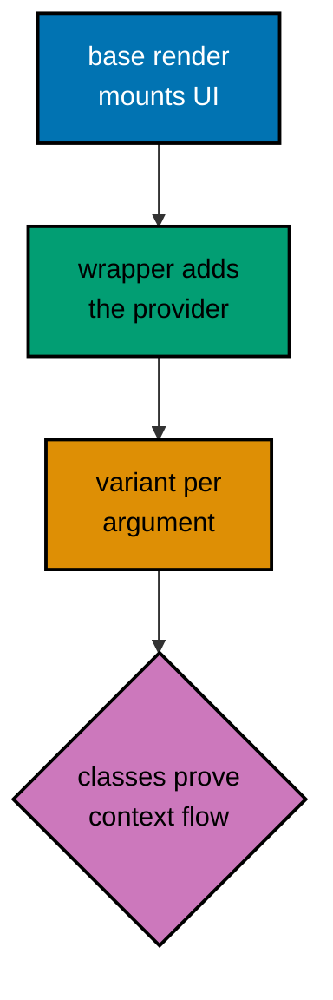

**`learning/code/ex-62-theme-provider-wrapper/theme.tsx`**:

```tsx
import React, { createContext, useContext } from "react"; // => React plus context: the only framework import here.
// => Context trio: create the channel, read it in components, provide in tests.

// => Theme union: two variants, and the wrapper below tests each explicitly.
export type Theme = "light" | "dark";
// => Theme union: two variants, and the wrapper below tests each explicitly.
// => Two modes: the badge test renders both, no third state exists.

// => Default light: components render sensibly even without a provider.
const ThemeContext = createContext<Theme>("light");
// => Channel default: unwrapped reads stay deterministic in every suite.
// => Defaults are documentation: the common case, stated once.

// => Hook hides the context object: components depend on meaning, not plumbing.
export function useTheme(): Theme {
  // => Hook hides the context object: components depend on meaning, not plumbing.
  return useContext(ThemeContext); // => Single lookup: the whole hook is one context read.
}

// => Provider takes the variant plus children: the wrapper's building block.
// => Provider wrapper: theme flows to every child below.
// => Provider wrapper: theme flows to every child below.
export function ThemeProvider({
  // => Variant prop destructured: the test drives this per case.
  theme,
  // => Children pass through untouched: the wrapper adds context only.
  children,
}: {
  theme: Theme;
  children: React.ReactNode;
}): React.JSX.Element {
  // => Provider takes the variant plus children: the wrapper's building block.
  // => Value flows down: every useTheme below this node sees the variant.
  return <ThemeContext.Provider value={theme}>{children}</ThemeContext.Provider>;
  // => Value flows down: every useTheme below this node sees the variant.
}

// => Consumer reads the theme and renders the variant-appropriate class.
export function ThemedBadge(): React.JSX.Element {
  // => Consumer reads the theme and renders the variant-appropriate class.
  // => Hook call, not prop drilling: the wrapper must supply the provider.
  const theme = useTheme();
  // => Hook call, not prop drilling: the wrapper must supply the provider.
  return <span className={theme === "dark" ? "badge-dark" : "badge-light"}>New</span>;
  // => Variant class is the observable contract the tests below pin.
}
```

**`learning/code/ex-62-theme-provider-wrapper/example.test.tsx`**:

```tsx
// @vitest-environment jsdom
// => DOM pragma: themed badges render variant classes into the document.

import { afterEach, expect, test } from "vitest";
// => Runner pair unchanged: providers are composition, not runner features.

import { cleanup, render, screen } from "@testing-library/react";
// => Base render plus screen: the custom wrapper below builds on both.

import "@testing-library/jest-dom/vitest";
// => toHaveClass pins the variant class each theme must produce.

import React from "react";
// => JSX composes providers and subjects: wrapper pattern needs both layers.

import { Theme, ThemedBadge, ThemeProvider } from "./theme";
// => Provider, hook types, and consumer arrive by relative import.

afterEach(() => {
  cleanup();
  // => Isolation hook: themed mounts unmount like any other render.
});

// => Custom render: mounts any UI inside the chosen theme provider.
function renderThemed(ui: React.ReactElement, theme: Theme): void {
  // => Custom render: mounts any UI inside the chosen theme provider.
  // => Two lines that remove provider boilerplate from every themed test.
  // => Children pass through untouched: the wrapper adds context only.
  render(<ThemeProvider theme={theme}>{ui}</ThemeProvider>);
  // => Children pass through untouched: the wrapper adds context only.
}

test("dark theme renders the dark badge", async () => {
  // => Variant one: dark provider, dark class, no prop drilling in the test.
  renderThemed(<ThemedBadge />, "dark");
  // => Theme as an argument: each variant gets its own explicit case.
  expect(screen.getByText("New")).toHaveClass("badge-dark");
  // => Class pinned: the theme flowed from wrapper through hook to markup.
});

test("light theme renders the light badge", async () => {
  // => Variant two: the default path, tested explicitly rather than assumed.
  renderThemed(<ThemedBadge />, "light");
  // => Same component, different wrapper argument: matrix testing, minimally.
  expect(screen.getByText("New")).toHaveClass("badge-light");
  // => Light class pinned: both variants now have a regression guard.
});
```

**Run**: `vitest run`

**Output** (`learning/code/ex-62-theme-provider-wrapper/expected/main.stdout.txt`):

```text
PASS: ex-62-theme-provider-wrapper (2 tests)
```

**Key takeaway**: Wrap `render` with the providers a component needs: each variant becomes one argument, and unprovided context stops being a mystery failure.

---

### Example 63: Router Context Wrapper

_ex-63 · exercises co-14_

Components that read the current route need a tiny routing context in tests. A hand-rolled `RouteProvider` plus custom render covers active-link styling with no router dependency.

Real routers in unit tests drag in history objects, navigation side effects, and async route resolution — all irrelevant to 'does the active link highlight'. A string-valued context keeps the routing rule (exact match) while deleting the machinery, so the test fails only when the rule breaks. The `aria-current` assertion is the deeper win: it pins the accessible announcement, not just a CSS class, so keyboard users benefit from the same test.

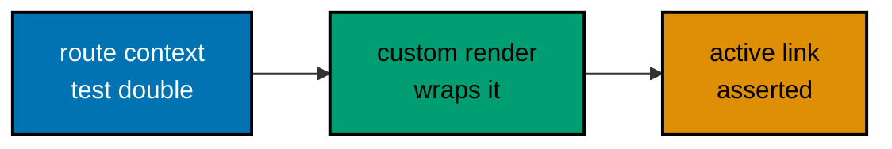

**`learning/code/ex-63-router-context-wrapper/routing.tsx`**:

```tsx
import React, { createContext, useContext } from "react"; // => React plus context: the only framework import here.
// => Same context trio as the theme example: the pattern repeats deliberately.

// => Default route root: links render sensibly even outside a test wrapper.
const RouteContext = createContext("/"); // => Root default: links compare against the current path.
// => Default route root: links render sensibly even outside a test wrapper.

// => Provider takes the current path: tests drive routes as plain strings.
export function RouteProvider({
  // => Path prop destructured: the route under test, as data.
  path,
  // => Children render under the route: links read it via context.
  children,
}: {
  path: string;
  children: React.ReactNode;
}): React.JSX.Element {
  // => Provider takes the current path: tests drive routes as plain strings.
  // => String paths beat router objects: no history, no navigation, just data.
  // => Path flows down: every NavLink below compares against it.
  // => Provider inline: one line carries the path to every NavLink below.
  return <RouteContext.Provider value={path}>{children}</RouteContext.Provider>;
}

// => Link highlights when its target matches the current route exactly.
export function NavLink({ to, label }: { to: string; label: string }): React.JSX.Element {
  // => Link highlights when its target matches the current route exactly.
  // => Hook reads the route: active styling derives from context, not clicks.
  const current = useContext(RouteContext); // => Current path: each link compares this against its target.
  // => Hook reads the route: active styling derives from context, not clicks.
  // => Exact match: the routing rule under test, one boolean.
  const active = current === to; // => Active rule: equality alone decides the aria-current mark.
  // => Exact match: the routing rule under test, one boolean.
  return (
    // => Anchor with conditional aria-current: announced when active, absent when not.
    // => Anchor with intent: aria-current appears only on the active link.
    <a href={to} aria-current={active ? "page" : undefined}>
      {/* => aria-current marks the active link for assistive tech: the a11y win. */}
      {/* => Undefined when inactive: the attribute vanishes, as it should. */}
      {/* => Link text: the accessible name and the visible label in one string. */}
      {label}
      {/* => Anchor closes: href plus conditional announcement, the link complete. */}
    </a>
  );
}
```

**`learning/code/ex-63-router-context-wrapper/example.test.tsx`**:

```tsx
// @vitest-environment jsdom
// => DOM pragma: link attributes render into the document for asserting.

import { afterEach, expect, test } from "vitest";
// => Runner pair unchanged: routing context is composition, not new API.

import { cleanup, render, screen } from "@testing-library/react";
// => Link roles locate both nav items; attributes pin the active one.

import "@testing-library/jest-dom/vitest";
// => toHaveAttribute reads aria-current: the accessibility contract.

import React from "react";
// => JSX composes the route provider around the link under test.

import { NavLink, RouteProvider } from "./routing";
// => Provider plus link: the wrapper test needs both halves of the pattern.

afterEach(() => {
  cleanup();
  // => Isolation hook: route context must not leak between path cases.
});

// => Custom render for routes: path in, provider wrapped, links mounted.
function renderAtPath(ui: React.ReactElement, path: string): void {
  // => Custom render for routes: path in, provider wrapped, links mounted.
  // => Route as a string argument: no router, no history object, no navigation.
  // => Route as a string argument: no router, no history object, no navigation.
  render(<RouteProvider path={path}>{ui}</RouteProvider>);
}

// => Active case: current path equals the link target exactly.
test("marks the link matching the current path", async () => {
  // => Active case: current path equals the link target exactly.
  // => Path and target agree: aria-current must appear on this link.
  renderAtPath(<NavLink to="/orders" label="Orders" />, "/orders");
  // => Path and target agree: aria-current must appear on this link.
  expect(screen.getByRole("link", { name: "Orders" })).toHaveAttribute(
    "aria-current", // => Attribute name asserted: the accessible announcement, not just styling.
    "page",
  );
  // => Active announcement pinned: assistive tech learns the location too.
});

// => Inactive case: different path, no aria-current, link still works.
test("leaves other links unmarked", async () => {
  // => Inactive case: different path, no aria-current, link still works.
  renderAtPath(<NavLink to="/orders" label="Orders" />, "/settings");
  // => Path differs: the link renders plainly with its href intact.
  expect(screen.getByRole("link", { name: "Orders" })).not.toHaveAttribute("aria-current");
  // => Absence asserted: active styling must not leak across routes.
  // => Both cases together prove the exact-match rule from both sides.
  // => Case closes: both directions proved, exact-match rule pinned.
});
```

**Run**: `vitest run`

**Output** (`learning/code/ex-63-router-context-wrapper/expected/main.stdout.txt`):

```text
PASS: ex-63-router-context-wrapper (2 tests)
```

**Key takeaway**: Drive routes as strings through a tiny provider: active-link rules test fully with no router, history, or navigation.

---

### Example 64: i18n Dictionary Wrapper

_ex-64 · exercises co-14_

Translated components read strings from a language context. Passing dictionaries through a wrapper tests every locale's copy without a translation framework.

Translation bugs are silent by default — a missing key renders blank, and no test written in the source language notices. The fallback marker turns silence into a signal: any heading reading 'hello?' is a translation gap the suite catches. Testing each locale with identical role queries also proves the queries are language-agnostic, which is exactly the property that lets one suite serve five locales without five times the tests.

**`learning/code/ex-64-i18n-dictionary-wrapper/i18n.tsx`**:

```tsx
import React, { createContext, useContext } from "react";
// => Context trio once more: translation is just another provided value.

// => Dictionary type: string keys, string copy, per-locale object.
export type Dict = Record<string, string>;
// => Dictionary type: string keys, string copy, per-locale object.

// => Empty default: missing keys render as visibly missing, never crash.
const I18nContext = createContext<Dict>({});
// => Empty default: missing keys render as visibly missing, never crash.

// => Provider takes the whole dictionary: locale as data, not framework.
export function I18nProvider({
  // => Dictionary destructured: one prop carries the entire locale.
  dict,
  // => Children render under the locale: every lookup below uses it.
  children,
}: {
  dict: Dict;
  children: React.ReactNode;
}): React.JSX.Element {
  // => Provider takes the whole dictionary: locale as data, not framework.
  // => Dictionary flows down: the consumer lookup reads this value.
  return <I18nContext.Provider value={dict}>{children}</I18nContext.Provider>;
}

// => Consumer looks up one key: the wrapper decides which language answers.
export function Greeting(): React.JSX.Element {
  // => Consumer looks up one key: the wrapper decides which language answers.
  // => Whole-dict read: the component stays free of locale-switching logic.
  const dict = useContext(I18nContext);
  // => Whole-dict read: the component stays free of locale-switching logic.
  // => Fallback marks missing keys visibly: tests catch gaps, users never guess.
  return <h1>{dict["hello"] ?? "hello?"}</h1>;
  // => Fallback marks missing keys visibly: tests catch gaps, users never guess.
}
```

**`learning/code/ex-64-i18n-dictionary-wrapper/example.test.tsx`**:

```tsx
// @vitest-environment jsdom
// => DOM pragma: translated headings render into the document per locale.

import { afterEach, expect, test } from "vitest";
// => Runner pair unchanged: locales are data, not new test API.

import { cleanup, render, screen } from "@testing-library/react";
// => Heading role finds the greeting in whichever language the dict speaks.

import "@testing-library/jest-dom/vitest";
// => toBeInTheDocument asserts each locale's heading actually rendered.

import React from "react";
// => JSX composes the dictionary provider around the greeting.

import { Dict, Greeting, I18nProvider } from "./i18n";
// => Dictionary type plus provider plus consumer: the full pattern imported.

afterEach(() => {
  cleanup();
  // => Isolation hook: locale dictionaries reset with every unmount.
});

// => Custom render for i18n: dictionary in, translated UI out.
function renderWithDict(ui: React.ReactElement, dict: Dict): void {
  // => Custom render for i18n: dictionary in, translated UI out.
  // => Dict as data keeps the test free of translation-framework machinery.
  // => Dict as data keeps the test free of translation-framework machinery.
  render(<I18nProvider dict={dict}>{ui}</I18nProvider>);
}

test("renders the Indonesian greeting", async () => {
  // => Locale one: the dictionary supplies Halo, the test expects Halo.
  renderWithDict(<Greeting />, { hello: "Halo" });
  // => Minimal dict: one key is enough to prove the lookup path works.
  expect(screen.getByRole("heading", { name: "Halo" })).toBeInTheDocument();
  // => Role plus translated name: queries work in every language identically.
});

test("missing keys fall back visibly", async () => {
  // => Gap case: empty dict renders the fallback, never a blank heading.
  renderWithDict(<Greeting />, {});
  // => Empty dictionary: the fallback branch, the one translators forget.
  expect(screen.getByRole("heading", { name: "hello?" })).toBeInTheDocument();
  // => Visible fallback pinned: missing copy is a test failure, not silence.
  // => Both cases together prove lookup AND the missing-key contract.
});
```

**Run**: `vitest run`

**Output** (`learning/code/ex-64-i18n-dictionary-wrapper/expected/main.stdout.txt`):

```text
PASS: ex-64-i18n-dictionary-wrapper (2 tests)
```

**Key takeaway**: Pass locale dictionaries through a wrapper: every language tests with the same queries, and missing keys fail visibly.

---

### Example 65: Store Provider and Dispatch

_ex-65 · exercises co-14, co-04_

State-store components dispatch actions through context. A store wrapper plus `user-event` drives a counter through increment and reset without any state library.

Store logic tested without the provider — calling reducers directly — proves the math but not the wiring: the 'component shows stale data' bug lives in the subscription, not the reducer. Driving through the real provider with real clicks covers the whole loop, including the updater-form detail that prevents lost increments under rapid clicking. The guarded hook is the pattern's safety net: provider mistakes fail with a sentence, not a mystery.

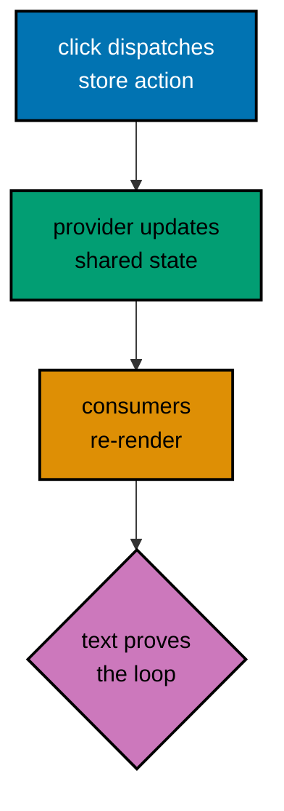

**`learning/code/ex-65-store-provider-and-dispatch/store.tsx`**:

```tsx
// => Context plus state: the hand-rolled store, ten lines, no dependency.
import React, { createContext, useContext, useState } from "react"; // => State plus context: useState feeds the provider value.
// => Context plus state: the hand-rolled store, ten lines, no dependency.

// => Store shape: state plus two actions, the complete contract under test.
// => Store shape: count plus the two transitions the suite drives.
type Store = { count: number; inc: () => void; reset: () => void };
// => Store shape: state plus two actions, the complete contract under test.

// => Null default: using the hook outside a provider fails loudly, fast.
const StoreContext = createContext<Store | null>(null); // => Null default: missing providers fail loudly in useStore.
// => Null default: using the hook outside a provider fails loudly, fast.

// => Provider owns the state: useState lives here, components dispatch via context.
export function StoreProvider({ children }: { children: React.ReactNode }): React.JSX.Element {
  // => Provider owns the state: useState lives here, components dispatch via context.
  // => Single source of truth: every consumer below sees the same count.
  const [count, setCount] = useState(0); // => Count state: zero at mount, actions move it.
  // => Single source of truth: every consumer below sees the same count.
  // => Store object assembled: state plus actions, typed as one contract.
  const value: Store = {
    count, // => State exposed read-only: consumers cannot bypass the actions.
    // => State exposed read-only: consumers cannot bypass the actions.
    inc: () => setCount((c) => c + 1), // => Updater form: rapid clicks never lose an increment to staleness.
    // => Updater form: rapid clicks never lose an increment to staleness.
    reset: () => setCount(0), // => Reset action: second behavior the test will drive.
    // => Reset action: the second behavior the test below will drive.
    // => Store object closes: state plus two actions, the provider value.
  };
  // => Provider publishes the store: every useStore below reads this.
  return <StoreContext.Provider value={value}>{children}</StoreContext.Provider>;
}

// => Hook with a guard: outside a provider, the error names the fix.
export function useStore(): Store {
  // => Hook with a guard: outside a provider, the error names the fix.
  // => Context read: the hook's only dependency, injected by the wrapper.
  const store = useContext(StoreContext); // => Context read: null outside a provider, guarded next.
  // => Loud failure beats undefined-count confusion three components down.
  if (store === null) throw new Error("useStore needs a StoreProvider");
  // => Loud failure beats undefined-count confusion three components down.
  return store;
}

// => Consumer: reads count, dispatches actions, owns no state itself.
export function CounterView(): React.JSX.Element {
  // => Consumer: reads count, dispatches actions, owns no state itself.
  // => Destructure state plus actions: the view's whole vocabulary in one line.
  const { count, inc, reset } = useStore(); // => Destructured actions: the view wires all three controls.
  return (
    // => Root div groups readout and buttons: the store view's surface.
    <div>
      {/* => Count paragraph: the shared state made visible. */}
      <p>Count: {count}</p>
      {/* => Add button: dispatches inc through the real provider machinery. */}
      <button type="button" onClick={inc}>
        Add
      </button>
      <button type="button" onClick={reset}>
        {/* => Reset label: the second action's accessible name. */}
        Reset
      </button>
    </div>
  );
}
```

**`learning/code/ex-65-store-provider-and-dispatch/example.test.tsx`**:

```tsx
// @vitest-environment jsdom
// => DOM pragma: dispatched actions re-render the count paragraph.

import { afterEach, expect, test } from "vitest";
// => Runner pair unchanged: dispatch is interaction, already learned.

import { cleanup, render, screen } from "@testing-library/react";
// => Text plus two buttons: the store view's full interactive surface.

import "@testing-library/jest-dom/vitest";
// => toHaveTextContent reads the count after each dispatched action.

import React from "react";
// => JSX composes the store provider around the view under test.

import userEvent from "@testing-library/user-event";
// => user-event simulates full interaction sequences, not single raw events.
// => Clicks dispatch store actions through the real provider machinery.

import { CounterView, StoreProvider } from "./store";
// => Provider plus view: the custom render wraps one around the other.

afterEach(() => {
  cleanup();
  // => Isolation hook: store state dies with the unmounted provider.
});

function renderWithStore(ui: React.ReactElement): void {
  // => Custom render for stores: provider mounted, actions dispatchable.
  // => No initial-state argument needed here: the store starts at zero by design.
  render(<StoreProvider>{ui}</StoreProvider>);
}

test("increment then reset flows through the store", async () => {
  // => Two actions, three assertions: the store loop proved end to end.
  const user = userEvent.setup({ delay: null });
  // => setup() builds an isolated session: no state leaks between tests.
  // => delay null removes inter-keystroke pauses: fast and deterministic.
  renderWithStore(<CounterView />);
  // => Mount inside the provider: useStore finds its context, no error.
  expect(screen.getByText("Count: 0")).toBeInTheDocument();
  // => Initial zero: the store's starting state, asserted before acting.
  await user.click(screen.getByRole("button", { name: "Add" }));
  // => Dispatch inc through a real click: action travels provider to state.
  await user.click(screen.getByRole("button", { name: "Add" }));
  // => Second dispatch: updater form keeps both increments, no staleness.
  expect(screen.getByText("Count: 2")).toBeInTheDocument();
  // => Count two proves both actions committed through the shared store.
  await user.click(screen.getByRole("button", { name: "Reset" }));
  // => Reset dispatch: the second action type, same provider machinery.
  expect(screen.getByText("Count: 0")).toBeInTheDocument();
  // => Back to zero: reset honored, store loop closed, no leakage possible.
});
```

**Run**: `vitest run`

**Output** (`learning/code/ex-65-store-provider-and-dispatch/expected/main.stdout.txt`):

```text
PASS: ex-65-store-provider-and-dispatch (1 tests)
```

**Key takeaway**: Wrap the store provider once, then drive actions with real clicks: dispatch, shared state, and re-render prove together.

---

### Example 66: Testing Hooks with renderHook

_ex-66 · exercises co-14_

`renderHook` mounts a hook without a component, so hook logic — toggles, counters, formatters — tests directly through `result.current` with no view in the way.

Hooks hold the logic components merely display: toggles, formatters, pagination math. Testing them through a component couples every logic assertion to markup that will change, while `renderHook` pins the logic alone. The `act` discipline is the price: updates outside `act` warn and may not commit, so wrapping is not ceremony but correctness. Extracting testable hooks is also a design pressure — logic that cannot renderHook-test is logic still tangled in its view.

**`learning/code/ex-66-testing-hooks-with-render-hook/example.test.ts`**:

```ts
// @vitest-environment jsdom
// => DOM pragma: renderHook mounts into a container, so a document must exist.
// => Headless still needs a DOM root: the hook renders nowhere visible, but somewhere real.

import { act, renderHook } from "@testing-library/react";
// => renderHook mounts hooks headlessly; act wraps every state update.
// => No jsdom pragma needed: this hook touches no DOM at all, node suffices.

import { expect, test } from "vitest";
// => Runner imports only: hook assertions are expect calls on result.current.

import { useState } from "react";
// => useState powers the hook: the logic under test, framework-free.

function useToggle(initial = false): { on: boolean; flip: () => void } {
  // => Tiny hook: boolean state plus a flip action, the smallest hook shape.
  // => Hooks extract logic from components: test the logic where it lives.
  const [on, setOn] = useState(initial);
  // => Initial argument seeds state: the test below passes true explicitly.
  const flip = (): void => setOn((v) => !v);
  // => Updater form negates: rapid flips never read stale state.
  return { on, flip };
  // => Object return: state plus actions, the hook contract in miniature.
}

test("toggle flips from its initial value", async () => {
  // => Headless claim: no component, no DOM, just hook logic under act.
  const { result } = renderHook(() => useToggle(true));
  // => Callback form: the hook runs inside the test renderer on every render.
  // => Initial true passed here: the starting state is an explicit argument.
  expect(result.current.on).toBe(true);
  // => Initial state asserted before acting: baselines matter for hooks too.
  act(() => {
    result.current.flip();
  });
  // => act() flushes the state update synchronously: no warnings, no tearing.
  // => Every hook action needs act: un-wrapped updates warn and may not commit.
  expect(result.current.on).toBe(false);
  // => Flipped to false: the toggle logic proved without rendering anything.
});
```

**Run**: `vitest run`

**Output** (`learning/code/ex-66-testing-hooks-with-render-hook/expected/main.stdout.txt`):

```text
PASS: ex-66-testing-hooks-with-render-hook (1 tests)
```

**Key takeaway**: `renderHook` plus `act` tests hook logic headlessly: state in, actions called, `result.current` asserted — no component needed.

---

### Example 67: Hook Props and Rerender

_ex-67 · exercises co-11, co-14_

Hooks that take props and react to changes need `initialProps` plus `rerender`. Async effects inside hooks resolve through the same awaited patterns as component effects.

Prop-driven hooks are where stale-data bugs breed: the id changes, the effect does not refire, and the UI shows yesterday's user. `rerender` reproduces the prop change exactly, and the two-fetch count proves the dependency array is right — the single most valuable assertion for any effect hook. The alive flag in the hook is the race-condition half: without it, a slow first response overwrites the fast second one, and only an interleaving test like this one would catch it.

**`learning/code/ex-67-hook-props-and-rerender/example.test.ts`**:

```ts
// @vitest-environment jsdom
// => DOM pragma: renderHook mounts into a container, so a document must exist.
// => Node env does not suffice: hooks mount, effects subscribe, DOM required.

// => Headless hook tools: mount without components, flush updates, poll results.
import { act, renderHook, waitFor } from "@testing-library/react";
// => waitFor joins renderHook and act: async hook effects need retry polling.
// => Node env suffices again: fake-fetch promises, no DOM, no timers.

// => Runner plus fetch stub: assertions and the transport double.
import { expect, test, vi } from "vitest";
// => vi stubs fetch: the hook's effect reads from scripted bytes.

// => Effect plus state: the async hook shape, data fetching in miniature.
import { useEffect, useState } from "react";
// => Effect plus state: the async hook shape, data fetching in miniature.

// => afterEach restores the fetch stub: globals leak without it.
import { afterEach } from "vitest";
// => afterEach restores the fetch stub: globals leak without it.

// => Restore hook: the stubbed fetch must not answer other files' requests.
afterEach(() => {
  vi.unstubAllGlobals();
  // => Restore fetch: stub lifetime matches the case, never longer.
  // => Hook closes: fetch restored to the real implementation.
});

// => Hook takes an id prop, fetches the name, returns it when it lands.
function useUserName(id: string): string | null {
  // => Hook takes an id prop, fetches the name, returns it when it lands.
  // => Props plus effects: the full hook contract, testable headlessly.
  const [name, setName] = useState<string | null>(null);
  // => Null start: loading state is part of the hook's contract too.
  // => Effect refires per id: the dependency array below drives refetching.
  useEffect(() => {
    // => Effect refires per id: the dependency array below drives refetching.
    // => Alive flag: stale responses for old ids must not overwrite new ones.
    let alive = true;
    // => Alive flag: stale responses for old ids must not overwrite new ones.
    void fetch(`/api/users/${id}`)
      .then((r) => r.json())
      .then((data) => {
        if (alive) setName((data as { name: string }).name);
      });
    return () => {
      alive = false;
    };
    // => Id dependency: the prop change that refires the effect.
  }, [id]);
  // => Hook returns the nullable name: loading state is part of the contract.
  return name;
}

// => Prop-change claim: rerender with a new id refetches and updates.
test("refetching follows the id prop", async () => {
  // => Prop-change claim: rerender with a new id refetches and updates.
  // => Stub fetch before rendering: both ids answer from one implementation.
  // => Stub fetch: every call resolves a Response naming the requested user.
  vi.stubGlobal(
    "fetch", // => Global name replaced: the hook's effect sees the stub from mount on.
    vi.fn().mockImplementation((url: string) =>
      // => Implementation branches on URL: each id gets its own fixture name.
      Promise.resolve(
        new Response(JSON.stringify({ name: url.endsWith("/u-2") ? "Budi" : "Sari" }), {
          headers: { "Content-Type": "application/json" },
        }),
      ),
    ),
  );
  // => mockImplementation inspects the URL: dynamic answers from one stub.
  // => Render with initial props: inputs are arguments like any other test.
  // => Mount the hook: initial props carry the first user id.
  const { result, rerender } = renderHook(({ id }) => useUserName(id), {
    initialProps: { id: "u-1" }, // => First id seeds the effect: the initial fetch targets u-1.
  });
  // => initialProps seeds the first render: props are inputs like any other.
  // => Rerender function returned: prop changes arrive through this handle.
  // => Loading first: the hook's initial contract, asserted before waiting.
  expect(result.current).toBeNull();
  // => Loading first: the hook's initial contract, asserted before waiting.
  await waitFor(() => expect(result.current).toBe("Sari"));
  // => waitFor polls result.current: first fetch lands, name appears.
  // => Prop change rerenders the hook: effect refires with the new id.
  rerender({ id: "u-2" });
  // => Prop change rerenders the hook: effect refires with the new id.
  await waitFor(() => expect(result.current).toBe("Budi"));
  // => Second name arrives: refetch followed the prop, stale guard held.
  // => Two fetches for two ids: the effect fired exactly once per prop value.
  expect(vi.mocked(fetch)).toHaveBeenCalledTimes(2);
  // => Two fetches for two ids: the effect fired exactly once per prop value.
});
```

**Run**: `vitest run`

**Output** (`learning/code/ex-67-hook-props-and-rerender/expected/main.stdout.txt`):

```text
PASS: ex-67-hook-props-and-rerender (1 tests)
```

**Key takeaway**: `initialProps` seeds hook props and `rerender` changes them: prop-driven refetching tests headlessly with `waitFor` on `result.current`.

---

### Example 68: Scoping Queries with Base Element

_ex-68 · exercises co-02, co-14_

Custom renders can return a scoped `baseElement`: queries run against one dialog or panel instead of the whole document. Scoping kills duplicate-text failures in composite pages.

Real pages repeat words — every dialog has a Save, every card has a title — and page-wide queries turn that normality into 'found multiple elements' failures. Beginners answer with test ids; the better answer is scoping, which mirrors how users parse pages (this dialog's Save, not that one's). Named sections give both benefits at once: landmark navigation for assistive tech and stable scope handles for tests.

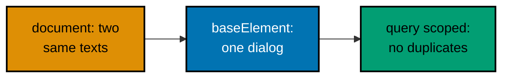

**`learning/code/ex-68-scoping-queries-with-base-element/example.test.tsx`**:

```tsx
// @vitest-environment jsdom
// => DOM pragma: two dialogs share the word Save; scoping tells them apart.

import { afterEach, expect, test } from "vitest"; // => Runner surface: hooks, assertions, and cases.
// => Runner pair unchanged: scoping is a query operation, not runner API.

import { cleanup, render, screen, within } from "@testing-library/react"; // => Scoped queries: within narrows lookups to one dialog.
// => within scopes to a base element: page-wide duplicates stop mattering.

import "@testing-library/jest-dom/vitest"; // => DOM matchers: document presence assertions.
// => toBeInTheDocument asserts inside the scoped subtree, same as globally.

import React from "react"; // => JSX runtime: the dialogs render side by side.
// => JSX renders two dialogs with identical button text: the scoping fixture.

afterEach(() => {
  cleanup();
  // => Isolation hook: two dialogs unmount, no duplicates leak onward.
});

// => Local dialog: a titled section with its own Save button, twice rendered.
function Dialog({ title }: { title: string }): React.JSX.Element {
  // => Local dialog: a titled section with its own Save button, twice rendered.
  // => Root returns the named section: the scope boundary the test queries first.
  return (
    // => Named section: the scope handle the test queries before scoping inside.
    <section aria-label={title}>
      {/* => Named section: the scope boundary the test queries first. */}
      {/* => Title heading: visible name and scope anchor in one element. */}
      <h2>{title}</h2>
      {/* => Duplicate Save text: page-wide query would fail, scoping fixes it. */}
      <button type="button">Save</button>
      {/* => Identical Save text in both dialogs: page-wide query would fail. */}
    </section>
  );
}

// => Scoping claim: two identical buttons, zero ambiguity, both found.
test("each dialog saves through its own scoped button", async () => {
  // => Scoping claim: two identical buttons, zero ambiguity, both found.
  // => Fragment mounts both dialogs: the duplicate-text trap, set deliberately.
  render(
    <>
      <Dialog title="Billing" />
      <Dialog title="Shipping" />
    </>,
  );
  // => Fragment mounts both dialogs: the duplicate-text trap, set deliberately.
  // => Scope handle one: the Billing region, addressable without touching its button.
  const billing = screen.getByRole("region", { name: "Billing" });
  // => Section plus accessible name exposes the region role: scope handle one.
  // => getByRole for the SCOPE stays global: scopes anchor from the document.
  const shipping = screen.getByRole("region", { name: "Shipping" });
  // => Scope handle two: each dialog addressable without touching its button.
  expect(within(billing).getByRole("button", { name: "Save" })).toBeInTheDocument();
  // => Scoped Save: within() narrows the search to the Billing subtree alone.
  // => Page-wide getByRole would throw on duplicates: scoping is the fix.
  expect(within(shipping).getByRole("button", { name: "Save" })).toBeInTheDocument();
  // => Shipping Save found independently: both dialogs proven interactive.
  // => Composite pages always duplicate words: scope first, query second.
});
```

**Run**: `vitest run`

**Output** (`learning/code/ex-68-scoping-queries-with-base-element/expected/main.stdout.txt`):

```text
PASS: ex-68-scoping-queries-with-base-element (1 tests)
```

**Key takeaway**: Scope with `within(scopeElement)` before querying: duplicate text across dialogs stops failing and starts passing.

---

### Example 69: Cleanup between Renders

_ex-69 · exercises co-10, co-14_

Two renders in one case share a document unless `cleanup` runs between them. Explicit cleanup isolates sequential mounts — the manual form of the `afterEach` habit.

Multi-scenario cases — render empty, then loading, then loaded — are natural to write and treacherous without mid-case cleanup: queries match ghosts from the previous mount and failures blame the wrong render. The automatic `afterEach` hook only separates cases, not mounts within a case, so the manual call fills the gap. The absence assertion is the proof that makes the pattern stick: it fails the moment someone deletes the cleanup line, documenting exactly what the line was for.


**`learning/code/ex-69-cleanup-between-renders/example.test.tsx`**:

```tsx
// @vitest-environment jsdom
// => DOM pragma: sequential mounts share one document without cleanup.

import { afterEach, expect, test } from "vitest"; // => Runner surface: hooks, assertions, and cases.
// => Runner pair unchanged: cleanup is library hygiene, not runner API.

import { cleanup, render, screen } from "@testing-library/react"; // => Render plus queries: mount, scope, and read the headings.
// => cleanup imported explicitly: this example calls it mid-case, on purpose.

import "@testing-library/jest-dom/vitest"; // => DOM matchers: document presence assertions.
// => toBeInTheDocument asserts each mount's content in its clean window.

import React from "react"; // => JSX runtime: the scenarios render real elements.
// => JSX renders the greeting twice with different names: isolation fixture.

afterEach(() => {
  cleanup();
  // => Habitual hook stays: mid-case cleanup handles the WITHIN-case split.
});

// => Local greeting: one heading, one prop, rendered twice below.
function Hello({ name }: { name: string }): React.JSX.Element {
  // => Local greeting: one heading, one prop, rendered twice below.
  return <h1>Hello, {name}!</h1>; // => Greeting line: the heading the suite queries twice.
}

test("sequential renders stay isolated with cleanup", async () => {
  // => Isolation claim: second mount sees only its own heading, provably.
  render(<Hello name="Sari" />);
  // => First mount: Sari's heading is the only h1 in the document.
  expect(screen.getByRole("heading", { name: "Hello, Sari!" })).toBeInTheDocument();
  // => Asserted before cleanup: the first render's contract, checked in order.
  // => Explicit mid-case cleanup: unmounts Sari before Budi ever renders.
  cleanup(); // => Unmount between renders: the isolation this case proves.
  // => Explicit mid-case cleanup: unmounts Sari before Budi ever renders.
  // => Without this line the next query throws on TWO matching headings.
  render(<Hello name="Budi" />);
  // => Second mount into a pristine document: Budi alone, no Sari residue.
  expect(screen.getByRole("heading", { name: "Hello, Budi!" })).toBeInTheDocument();
  // => Budi found uniquely: isolation proved by the absence of ambiguity.
  expect(screen.queryByRole("heading", { name: "Hello, Sari!" })).not.toBeInTheDocument();
  // => Sari gone: the document holds exactly one greeting, the current one.
});
```

**Run**: `vitest run`

**Output** (`learning/code/ex-69-cleanup-between-renders/expected/main.stdout.txt`):

```text
PASS: ex-69-cleanup-between-renders (1 tests)
```

**Key takeaway**: Call `cleanup()` between sequential renders: each mount gets a pristine document, and the test proves it with absence.

---

### Example 70: Shared test-utils Module

_ex-70 · exercises co-14_

The documented Testing Library pattern: a `test-utils` module re-exports a themed custom render that every test file imports. Two files share one wrapper with zero duplication.

Copy-pasted wrappers drift: file A adds the router, file B does not, and the suite behaves differently per file for no reason anyone remembers. The `test-utils` module is a single choke point — add the next provider once, and forty files gain it overnight. Shadowing `render` is the controversial half, and the docs bless it because the alternative (remembering to import the custom name in every file) fails silently. The twin-file layout here proves both paths: default through the shadow, override through composition.

**`learning/code/ex-70-shared-test-utils-module/test-utils.tsx`**:

```tsx
import React from "react";
// => React for the provider JSX: the utils module composes, never asserts.

import { render } from "@testing-library/react";
// => Base render imported once here: test files below never import it directly.

import { ThemeProvider } from "./theme";
// => Theme provider reused from Example 62's module shape, dark by default.

import type { Theme } from "./theme";
// => Type-only import: the wrapper signature stays typed without runtime cost.

function renderThemed(ui: React.ReactElement, theme: Theme = "dark"): void {
  // => Shared wrapper with a default: dark unless a test says otherwise.
  // => Defaults encode the common case: most tests exercise the dark theme.
  render(<ThemeProvider theme={theme}>{ui}</ThemeProvider>);
  // => Provider composition centralized: one place to add the next provider.
}

export * from "@testing-library/react";
// => Re-export everything: screen, fireEvent, within flow through test-utils.
// => Single import source: tests import from './test-utils', never the library.

export { renderThemed as render };
// => Shadow the render export: bare render() calls below are themed automatically.
// => Callers write render(ui) and get providers free: the documented pattern.
```

**`learning/code/ex-70-shared-test-utils-module/theme.tsx`**:

```tsx
// => Context trio: the theme channel this unit's shared wrapper provides.
import React, { createContext, useContext } from "react"; // => React plus context: the only framework import here.
// => Context trio: the theme channel this unit's shared wrapper provides.

// => Theme union: the wrapper default ('dark') is one of these two.
export type Theme = "light" | "dark"; // => Two modes: the tag test renders both variants.
// => Theme union: the wrapper default ('dark') is one of these two.

// => Default light: the provider below overrides with the test's choice.
const ThemeContext = createContext<Theme>("light"); // => Channel seed: every provider below overrides this value.
// => Default light: the provider below overrides with the test's choice.

// => Hook reads the theme: consumers depend on meaning, not on context objects.
export function useTheme(): Theme {
  // => Hook reads the theme: consumers depend on meaning, not on context objects.
  return useContext(ThemeContext); // => Single lookup: the whole hook is one context read.
}

// => Provider takes variant plus children: the wrapper's composition block.
export function ThemeProvider({
  // => Variant destructured: dark by default in the wrapper, explicit here.
  theme,
  // => Children render under the theme: the tag reads it via the hook.
  children,
}: {
  // => Variant typed: only light or dark ever flows through the wrapper.
  theme: Theme;
  children: React.ReactNode;
  // => Signature closes: variant plus children, both typed, the provider contract.
}): React.JSX.Element {
  // => Provider takes variant plus children: the wrapper's composition block.
  // => Theme flows down: every consumer below renders the chosen variant.
  return <ThemeContext.Provider value={theme}>{children}</ThemeContext.Provider>;
}

// => Consumer renders a variant class: the observable contract for both files.
export function ThemedTag(): React.JSX.Element {
  // => Consumer renders a variant class: the observable contract for both files.
  // => Hook call: no props, no drilling, just the provided theme.
  const theme = useTheme();
  // => Variant class computed: the single line the file assertions pin.
  return <span className={theme === "dark" ? "tag-dark" : "tag-light"}>v1</span>;
}
```

**`learning/code/ex-70-shared-test-utils-module/dark.test.tsx`**:

```tsx
// @vitest-environment jsdom
// => DOM pragma: the dark tag renders its variant class into the document.

import { afterEach, expect, test } from "vitest";
// => Runner pair unchanged: the wrapper pattern needs no new runner API.

// => Single-source imports: both files share the wrapper, zero drift.
import { cleanup, render, screen } from "./test-utils";
// => Imports FROM test-utils: render here is the themed shadow, by design.
// => screen flows through the re-export: one import source for the whole file.

import "@testing-library/jest-dom/vitest";
// => toHaveClass pins the dark variant class the default wrapper provides.

import React from "react";
// => JSX renders the tag: the wrapper supplies the dark theme silently.

import { ThemedTag } from "./theme";
// => Consumer import: the tag reads whatever theme the wrapper provides.

afterEach(() => {
  cleanup();
  // => Isolation hook: shared wrappers do not excuse shared documents.
});

test("default wrapper renders the dark tag", async () => {
  // => Default claim: bare render() means dark, asserted, not assumed.
  render(<ThemedTag />);
  // => No theme argument: the wrapper default ('dark') applies invisibly.
  expect(screen.getByText("v1")).toHaveClass("tag-dark");
  // => Dark class pinned: the shadowed render provided the theme correctly.
});
```

**`learning/code/ex-70-shared-test-utils-module/light.test.tsx`**:

```tsx
// @vitest-environment jsdom
// => DOM pragma: the light tag renders its own variant class separately.

import { afterEach, expect, test } from "vitest";
// => Full runner trio: this file's cases exercise the light theme only.

import { cleanup, render, screen } from "./test-utils";
// => Same single-source imports: both files share the wrapper, zero drift.

import "@testing-library/jest-dom/vitest";
// => toHaveClass pins the light variant: explicit argument, explicit class.

import React from "react";
// => JSX renders the tag: the provider composition happens inside the wrapper.

// => Both halves imported together: consumer plus provider for the override.
import { ThemedTag, ThemeProvider } from "./theme";
// => Both halves imported together: consumer plus provider for the override.

afterEach(() => {
  cleanup();
  // => Isolation hook: second file, same discipline, no shared documents.
});

// => Override claim: explicit provider beats the wrapper default, provably.
test("explicit light provider renders the light tag", async () => {
  // => Override claim: explicit provider beats the wrapper default, provably.
  // => Explicit composition for the exception: defaults serve the common case.
  render(
    <ThemeProvider theme="light">
      {/* => Tag under the explicit light provider: the override path under test. */}
      <ThemedTag />
    </ThemeProvider>,
  );
  // => Explicit composition for the exception: defaults serve the common case.
  // => Light class pinned: override path tested, default path covered by twin.
  expect(screen.getByText("v1")).toHaveClass("tag-light");
  // => Light class pinned: override path tested, default path covered by twin.
});
```

**Run**: `vitest run`

**Output** (`learning/code/ex-70-shared-test-utils-module/expected/main.stdout.txt`):

```text
PASS: ex-70-shared-test-utils-module (2 tests)
```

**Key takeaway**: Centralize providers in `test-utils`, re-export the library, shadow `render`: every file gets the same wrapper with one import.

---

### Example 71: Real Race versus Bad Wait

_ex-71 · exercises co-11, co-15_

The anchor for the diagnosis cluster: a test that reads state before the promise settles is a bad wait, not a race. `findBy` waits on the DOM event; fixed sleeps wait on luck.

Nine out of ten 'flaky' tests are bad waits: a sleep that usually covers the fetch, until CI load stretches the fetch past the sleep. The fix is never a longer sleep — that just moves the lottery — but waiting on the DOM event itself. Real races (shared module state, leaked timers) need the opposite treatment: isolation, not waiting. Misdiagnosing a race as a wait adds sleeps that hide the corruption; misdiagnosing a wait as a race adds isolation that fixes nothing. This cluster teaches the diagnosis before the cure.

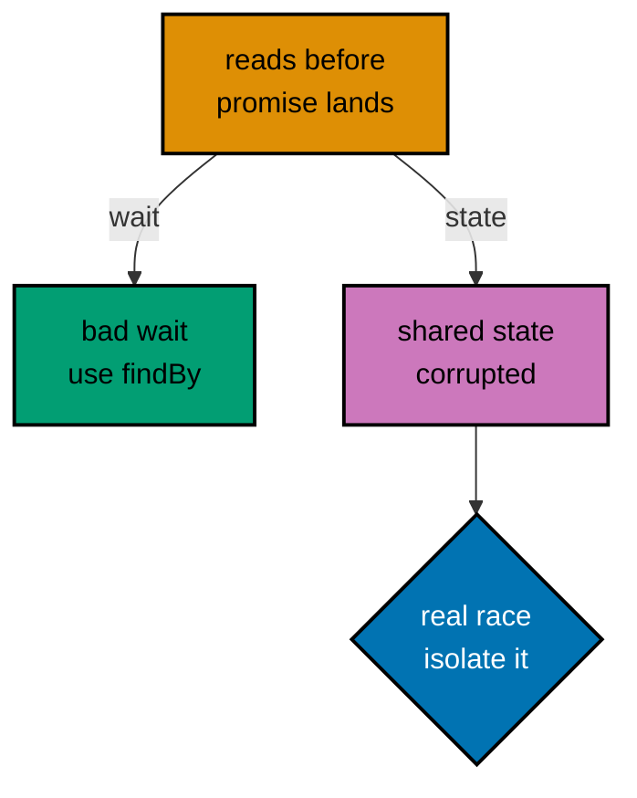

**`learning/code/ex-71-real-race-vs-bad-wait/example.test.tsx`**:

```tsx
// @vitest-environment jsdom
// => DOM pragma: the username arrives late; the query must wait properly.

import { afterEach, expect, test, vi } from "vitest";
// => vi stubs fetch: the late response resolves from fixture bytes.

import { cleanup, render, screen } from "@testing-library/react";
// => findByRole is the diagnosis: waiting on the DOM, not on the clock.

import "@testing-library/jest-dom/vitest";
// => toBeInTheDocument asserts the awaited name once it truly arrives.

import React, { useEffect, useState } from "react";
// => Effect fetches on mount: the async source the bad wait would outrun.

// => Isolation hook: late responses must not arrive in the next case.
afterEach(() => {
  cleanup();
  // => Isolation hook: late responses must not arrive in the next case.
  vi.unstubAllGlobals();
  // => Restore fetch: stub lifetime matches the case, never longer.
  // => Hook closes: fetch stub lifetime matches the case, never longer.
});

// => Subject: blank first, username after the stubbed fetch lands.
function Profile(): React.JSX.Element {
  // => Local subject: blank first, username after the stubbed fetch lands.
  // => Null start: the fixed version below waits for this to become Sari.
  const [name, setName] = useState<string | null>(null);
  // => Null start: the fixed version below waits for this to become Sari.
  // => Mount effect: fetches on mount, the async source the bad wait would outrun.
  useEffect(() => {
    void fetch("/api/me")
      .then((r) => r.json())
      .then((data) => setName((data as { name: string }).name));
    // => Once per mount: one fetch, one transition, no refires.
  }, []);
  // => Loading text first: the bad wait below reads THIS and fails honestly.
  return <p>{name === null ? "loading" : name}</p>;
  // => Loading text first: the bad wait below reads THIS and fails honestly.
}

// => Fixed version: the query waits on the DOM event the fetch produces.
test("findBy waits for the name instead of racing it", async () => {
  // => Fixed version: the query waits on the DOM event the fetch produces.
  // => Immediate stubbed answer: still async, still needs waiting, just fast.
  vi.stubGlobal(
    "fetch",
    vi.fn().mockResolvedValue(
      new Response(JSON.stringify({ name: "Sari" }), {
        headers: { "Content-Type": "application/json" },
      }),
    ),
  );
  // => Immediate stubbed answer: still async, still needs waiting, just fast.
  // => Mount fires the effect: loading renders, fetch promise pending.
  render(<Profile />);
  // => Mount fires the effect: loading renders, fetch promise pending.
  // BAD WAIT (illustration, do not commit): getByText('Sari') right here
  // reads the loading state and fails whenever the fetch loses the race.
  // A fixed sleep(50) passes locally and fails on loaded CI: luck, not sync.
  const name = await screen.findByText("Sari");
  // => findBy polls the live DOM: resolves exactly when the name renders.
  // => Waiting on the EVENT (render) instead of the CLOCK (sleep): the fix.
  expect(name).toBeInTheDocument();
  // => Awaited element asserted: deterministic on any machine, any load.
});
```

**Run**: `vitest run`

**Output** (`learning/code/ex-71-real-race-vs-bad-wait/expected/main.stdout.txt`):

```text
PASS: ex-71-real-race-vs-bad-wait (1 tests)
```

**Key takeaway**: A bad wait reads too early; a real race corrupts shared state: fix waits with `findBy`, fix races with isolation — diagnose first.

---

### Example 72: act Warnings Are Flakes

_ex-72 · exercises co-04, co-13, co-15_

An un-awaited interaction leaves React updating after the test moved on: the `act` warning is the sound of a torn read. Spying on `console.error` turns the warning into a failing assertion.

`act` warnings are discharge summaries from React: 'you read state mid-update'. Teams that ignore them accumulate torn reads that pass today and flake under load — the textbook slow-burn flake. The spy converts a warning into a contract: this interaction sequence settles cleanly, provably, on every run. When React promotes the warning to an error in a future version, suites with this pattern are already green; suites without it turn red overnight on an upgrade nobody connected to the failures.

**`learning/code/ex-72-act-warnings-are-flakes/example.test.tsx`**:

```tsx
// @vitest-environment jsdom
// => DOM pragma: sequential clicks mutate one counter across awaits.

import { afterEach, expect, test, vi } from "vitest";
// => vi spies on console.error: warnings become data the test can assert.

import { cleanup, render, screen } from "@testing-library/react";
// => Button role plus count text: the two-await sequence below drives both.

import "@testing-library/jest-dom/vitest";
// => toHaveTextContent reads the count after each settled interaction.

import React, { useState } from "react";
// => useState counter: every click commits through React, observably.

import userEvent from "@testing-library/user-event";
// => user-event simulates full interaction sequences, not single raw events.
// => Each call awaited: the pattern this example defends, enforced by spy.

// => Isolation hook: counts and spies both reset between cases.
afterEach(() => {
  cleanup();
  // => Isolation hook: counts and spies both reset between cases.
  // => Hook closes: the error spy never leaks into the next file.
});

// => Subject: Add climbs, the text proves each settled step.
function Stepper(): React.JSX.Element {
  // => Local subject: Add climbs, the text proves each settled step.
  // => Counter state: every click commits through React, observably.
  const [count, setCount] = useState(0);
  return (
    // => Root div groups readout and button: the stepper's whole surface.
    <div>
      {/* => Steps paragraph: the count each settled click updates. */}
      <p>Steps: {count}</p>
      {/* => Add button: updater form keeps rapid clicks from losing counts. */}
      <button type="button" onClick={() => setCount((c) => c + 1)}>
        {/* => Button label is the accessible name: both clicks target this. */}
        Add
      </button>
    </div>
  );
}

// => Warning-free claim: zero console errors across two interactions.
test("every awaited click settles with no warnings", async () => {
  // => Warning-free claim: zero console errors across two interactions.
  const errors: unknown[] = [];
  // => Error log: the spy below records React warnings instead of printing.
  const spy = vi.spyOn(console, "error").mockImplementation((e) => {
    errors.push(e);
  });
  // => Swallowed console.error: warnings become assertable, not noise.
  const user = userEvent.setup({ delay: null });
  // => setup() builds an isolated session: no state leaks between tests.
  // => Mount the stepper: zero steps before any interaction lands.
  render(<Stepper />);
  // => Mount the stepper: zero steps before any interaction lands.
  await user.click(screen.getByRole("button", { name: "Add" }));
  // => First await settles the first commit: count text reads 1 afterward.
  expect(screen.getByText("Steps: 1")).toBeInTheDocument();
  // => Assert between clicks: each line runs behind the render it checks.
  await user.click(screen.getByRole("button", { name: "Add" }));
  // => Second await settles the second commit: sequential, never overlapping.
  expect(screen.getByText("Steps: 2")).toBeInTheDocument();
  // => Final count proves both updates committed in order, fully settled.
  expect(errors).toEqual([]);
  // => Zero warnings: no act complaint escaped the awaited sequence.
  // => A missing await above would push a warning here and fail this line.
  // => Explicit restore: console.error returns to normal after the case.
  spy.mockRestore();
  // => Explicit restore: console.error returns to normal after the case.
});
```

**Run**: `vitest run`

**Output** (`learning/code/ex-72-act-warnings-are-flakes/expected/main.stdout.txt`):

```text
PASS: ex-72-act-warnings-are-flakes (1 tests)
```

**Key takeaway**: Spy on `console.error` and assert zero calls: `act` warnings become red tests instead of console noise everyone ignores.

---

### Example 73: Leaking Fake Timers

_ex-73 · exercises co-07, co-15_

A fake clock that survives its case freezes the next test's timeouts and intervals. Restoring real timers in `afterEach` keeps the freeze inside the case that asked for it.

Leaked fakes are uniquely cruel to debug: the failing test is never the test that installed the fake, and the symptom — a timeout that 'should' fire — looks like application code, not test pollution. The `isFakeTimers` assertion makes the invisible visible: the second case states its clock requirement outright instead of assuming it. Putting restore in `afterEach` rather than at each case's end is the other half: a failing case must not get to skip its cleanup and poison its neighbors.

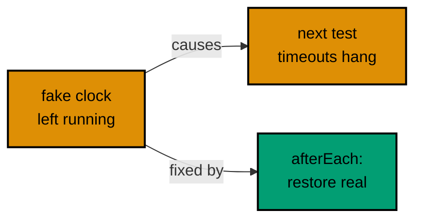

**`learning/code/ex-73-leaking-fake-timers/example.test.ts`**:

```ts
import { afterEach, expect, test, vi } from "vitest";
// => vi owns the clock lifecycle here: fake inside, real outside, always.

// => Restore hook: a leaking fake must not freeze the next case.
afterEach(() => {
  vi.useRealTimers();
  // => THE line under test: without it, the second case below hangs or lies.
  // => Restore belongs in afterEach, not at case end: failures must not leak.
  // => Hook closes: real timers back before the restoration proof runs.
});

// => Same helper shape as Example 35: timer plus promise, minimal and clear.
function delayedValue<T>(value: T, ms: number): Promise<T> {
  // => Same helper shape as Example 35: timer plus promise, minimal and clear.
  return new Promise((resolve) => {
    setTimeout(() => resolve(value), ms);
  });
}

// => Fake-clock case: advances its own frozen clock, resolves, restores via the hook.
test("first case advances its own frozen clock", async () => {
  // => Fake-clock case: advances time, resolves, restores via the hook.
  vi.useFakeTimers();
  // => Freeze before creating the timer: the helper's setTimeout must be fake.
  const pending = delayedValue("fast", 1000);
  // => Second-long delay, resolved in zero wall time by the advance below.
  vi.advanceTimersByTime(1000);
  // => Full advance: callback fires synchronously, promise resolves after.
  return expect(pending).resolves.toBe("fast");
  // => Returned promise: the runner awaits it, failures blamed correctly.
});

// => Restoration proof: this case runs on the real clock, provably.
test("second case runs on real timers again", async () => {
  // => Restoration proof: setTimeout here must be the REAL one, provably.
  // => Direct clock inspection: fake would report true, restored reports false.
  expect(vi.isFakeTimers()).toBe(false);
  // => Direct clock inspection: fake would report true, restored reports false.
  // => Without the hook this fails: the freeze leaks and poisons this case.
  const pending = delayedValue("real", 10);
  // => Ten real milliseconds: fast enough to await honestly, no fakes needed.
  return expect(pending).resolves.toBe("real");
  // => Resolves on the wall clock: the suite's time flows normally again.
});
```

**Run**: `vitest run`

**Output** (`learning/code/ex-73-leaking-fake-timers/expected/main.stdout.txt`):

```text
PASS: ex-73-leaking-fake-timers (2 tests)
```

**Key takeaway**: Restore real timers in `afterEach`: a leaked fake clock freezes every later timeout in the file.

---

### Example 74: Order-Dependent Shared State

_ex-74 · exercises co-10, co-15_

Module-level mutable state makes cases pass in order and fail alone. Resetting the module in `beforeEach` removes the order dependence — and running one case in isolation proves it.

Order dependence is the flake that only CI sees: locally you run the file fresh, CI shards and retries reorder, and suddenly a case fails that 'passes on my machine'. The single-case run (`-t`) is the detector — if a case cannot pass alone, it depends on siblings — and the `beforeEach` reset is the cure. Exporting the reset from the module (instead of poking internals from the test) keeps the seam honest: production code that cannot reset itself is production code with a design smell worth noticing.

**`learning/code/ex-74-order-dependent-shared-state/basket.ts`**:

```ts
// => Shared mutable list: the order-dependence hazard, stated up front.
export const basket: string[] = [];
// => Module-level mutable list: shared across cases in one file, the hazard.
// => Shared by import reference: every test file gets the SAME array object.

// => Appends and reports size: the count leaks across cases without a reset.
export function addItem(item: string): number {
  // => Appends and reports size: the count leaks across cases without a reset.
  basket.push(item);
  return basket.length;
}

// => Reset helper: the beforeEach below calls this, never reaches inside.
export function clearBasket(): void {
  // => Reset helper: the beforeEach below calls this, never reaches inside.
  // => Exported reset beats test-only surgery: production owns its cleanup.
  basket.length = 0;
}
```

**`learning/code/ex-74-order-dependent-shared-state/example.test.ts`**:

```ts
import { beforeEach, expect, test } from "vitest";
// => beforeEach resets the shared module before every case, guaranteed.

import { addItem, basket, clearBasket } from "./basket";
// => Live bindings: the tests observe the SAME array the module mutates.

// => Reset through the module's own helper: no test reaches into internals.
beforeEach(() => {
  clearBasket();
  // => Reset through the module's own helper: no test reaches into internals.
  // => Runs before EVERY case: order independence, not order luck.
});

test("first case sees one item", async () => {
  // => Count one: passes with or without the hook, the baseline.
  expect(addItem("Rice")).toBe(1);
  // => Push returns the new length: 1 in a freshly cleared basket.
});

// => The order-independence proof: fails without the hook, passes with it.
test("second case also sees one item", async () => {
  // => THE order-independence proof: fails without the hook (would see 2).
  // => Run this case alone (-t) AND after the first: identical results both ways.
  expect(addItem("Oil")).toBe(1);
  // => Count one again: the hook cleared Rice before this case started.
  expect(basket).toEqual(["Oil"]);
  // => Basket contents pinned: exactly this case's item, nothing carried over.
});
```

**Run**: `vitest run`

**Output** (`learning/code/ex-74-order-dependent-shared-state/expected/main.stdout.txt`):

```text
PASS: ex-74-order-dependent-shared-state (2 tests)
```

**Key takeaway**: Reset shared module state in `beforeEach` through the module's own helper: every case passes alone and in any order.

---

### Example 75: Explicit waitFor Timeouts

_ex-75 · exercises co-11, co-15, co-16_

Default `waitFor` timeouts assume a fast machine; loaded CI agents are not fast machines. Explicit `timeout` and `interval` document what the wait tolerates — on a real clock, where the scheduler advances.

Default timeouts encode the author's machine: 1000ms is generous on a laptop and tight on a busy CI agent running forty suites. Explicit budgets turn 'how long may this take' into a reviewed decision — 500ms for a 100ms reveal leaves margin without hiding a regression that pushes the delay to seconds. The clock stays real because waitFor's scheduler never advances on a fake one: the 100ms costs wall time, and the budget stays reviewable instead of accidental.

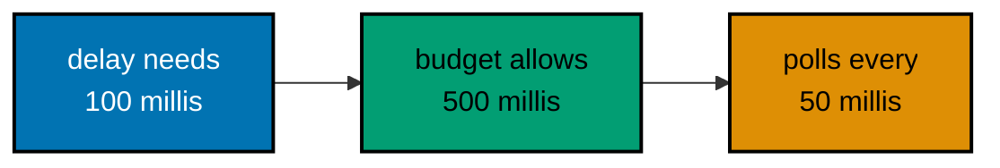

**`learning/code/ex-75-explicit-waitfor-timeouts/example.test.tsx`**:

```tsx
// @vitest-environment jsdom
// => DOM pragma: the slow value renders into a document paragraph.

import { afterEach, expect, test } from "vitest";
// => No fake clock: waitFor advances only on the real scheduler.

import { cleanup, render, screen, waitFor } from "@testing-library/react";
// => waitFor with options: timeout and interval stated, never defaulted.

import "@testing-library/jest-dom/vitest";
// => toHaveTextContent reads the paragraph inside the retried closure.

import React, { useEffect, useState } from "react";
// => Effect plus state: the value arrives after a 100ms real delay.

// => Isolation hook: slow timers and mounts reset between cases.
afterEach(() => {
  cleanup();
  // => Unmount: the slow timer dies with the component, no leakage.
  // => Hook closes: real-clock waits need no restore, only unmount.
});

// => Subject: placeholder first, value after a 100ms real delay.
function SlowValue(): React.JSX.Element {
  // => Local subject: placeholder first, value after a 100ms real delay.
  // => Placeholder text: the wait below must observe a genuine transition.
  const [value, setValue] = useState("warming up");
  // => Placeholder text: the wait below must observe a genuine transition.
  useEffect(() => {
    const id = setTimeout(() => setValue("ready"), 100);
    // => 100ms delay: inside the 500ms budget, past a hasty zero-wait read.
    return () => clearTimeout(id);
  }, []);
  return <p>{value}</p>;
  // => Render output: the paragraph text is what the polls read.
}

// => Patience claim: 500ms covers the 100ms delay with margin.
test("explicit timeout tolerates the slow reveal", async () => {
  // => Patience claim: 500ms timeout covers the 100ms delay with margin.
  // => Real clock: waitFor and setTimeout share wall time, so nothing hangs.
  render(<SlowValue />);
  // => Mount starts the countdown: placeholder renders synchronously first.
  await waitFor(
    () => {
      // => Retried closure: re-queries the live DOM on every poll attempt.
      expect(screen.getByText("ready")).toBeInTheDocument();
    },
    { timeout: 500, interval: 50 },
    // => Explicit budget: 500ms ceiling, 50ms polls, both reviewed numbers.
    // => Defaults (1000/50) would also pass: explicit states the tolerance.
  );
  // => Resolved wait: the text appeared inside budget, margin to spare.
  // => A 600ms delay would fail HERE with a clear timeout message, by design.
});
```

**Run**: `vitest run`

**Output** (`learning/code/ex-75-explicit-waitfor-timeouts/expected/main.stdout.txt`):

```text
PASS: ex-75-explicit-waitfor-timeouts (1 tests)
```

**Key takeaway**: State `waitFor` budgets explicitly: `{ timeout, interval }` documents the patience the UI needs and fails loudly past it.

---

### Example 76: Seeded Randomness

_ex-76 · exercises co-15_

Unseeded `Math.random` in UI code makes output untestable. Injecting the random source — with a fixed sequence in tests — keeps shuffling honest and deterministic.

`Math.random` buried in UI code is untestable by construction: the test cannot repeat the run it just saw fail. Injection costs one parameter and buys total determinism — every shuffle, jitter, and sample becomes a fixed computation the test pins exactly. The default parameter keeps the seam painless: call sites stay clean while tests take control. Any nondeterminism you cannot inject — real time, real network — is a design smell the test just exposed.

**`learning/code/ex-76-seeded-randomness/example.test.ts`**:

```ts
// => Runner imports only: determinism by injection needs no timers or DOM.
import { expect, test } from "vitest";
// => Runner imports only: determinism by injection needs no timers or DOM.

// => Random source injected with a production default: test seam by parameter.
function shuffle<T>(items: T[], rand: () => number = Math.random): T[] {
  // => Random source injected with a production default: test seam by parameter.
  // => Default Math.random keeps call sites clean; tests pass fixed sequences.
  // => Copy first: shuffling must never mutate the caller's array, ever.
  const rest = [...items];
  // => Copy first: shuffling must not mutate the caller's array, ever.
  // => Picked accumulates in draw order: the deterministic output under test.
  const picked: T[] = [];
  // => Drain loop: each iteration removes one random element into picked.
  while (rest.length > 0) {
    // => Drain loop: each iteration removes one random element into picked.
    const index = Math.floor(rand() * rest.length);
    // => Injected source decides: fixed sequence in tests, entropy in prod.
    // => Splice removes AND returns: picked grows, rest shrinks, both tracked.
    const [item] = rest.splice(index, 1);
    // => Splice removes AND returns: picked grows, rest shrinks, both tracked.
    if (item !== undefined) picked.push(item);
    // => Guard satisfies strict checks: splice on a nonempty array always hits.
  }
  return picked;
}

// => Test helper: cycles a fixed sequence, deterministic forever.
function sequence(values: number[]): () => number {
  // => Test helper: cycles a fixed sequence, deterministic forever.
  // => Fixed values stand in for entropy: same inputs, same shuffle, always.
  let i = 0;
  return () => {
    const value = values[i % values.length] ?? 0;
    i += 1;
    return value;
  };
}

// => Determinism claim: same sequence, same output, every run, every machine.
test("fixed sequence produces the fixed shuffle", async () => {
  // => Determinism claim: same sequence, same output, every run, every machine.
  const shuffled = shuffle(["a", "b", "c"], sequence([0.9, 0.1, 0.5]));
  // => Fixed draws: indices computed exactly, no entropy anywhere in the test.
  expect(shuffled).toEqual(["c", "a", "b"]);
  // => Exact order pinned: 0.9 picks last, 0.1 picks first of rest, 0.5 middle.
  // => Math traced: floor(0.9*3)=2 'c', floor(0.1*2)=0 'a', floor(0.5*1)=0 'b'.
});

// => Purity twin: injection must not excuse mutating the caller's data.
test("original array survives untouched", async () => {
  // => Purity twin: injection must not excuse mutating the caller's data.
  // => Fresh input for the purity check: observed afterward, untouched.
  const input = ["a", "b", "c"];
  shuffle(input, sequence([0.2]));
  // => Shuffle runs fully on the copy: input observed afterward, unchanged.
  expect(input).toEqual(["a", "b", "c"]);
  // => Untouched input: the copy-first line above earns its keep right here.
  // => Second case closes: input intact, copy-first rule proved.
});
```

**Run**: `vitest run`

**Output** (`learning/code/ex-76-seeded-randomness/expected/main.stdout.txt`):

```text
PASS: ex-76-seeded-randomness (2 tests)
```

**Key takeaway**: Inject the random source with a production default: tests pass fixed sequences, production keeps entropy, output stays deterministic.

---

### Example 77: Machine-Readable CI Report

_ex-77 · exercises co-16_

Humans read the terminal table; CI dashboards read JSON. A small parser over `vitest --reporter=json` extracts pass counts deterministically — the machine-readable half of the pipeline story.

Pipelines aggregate what they can parse: a JSON report feeds dashboards, flake trackers, and merge gates, while the terminal table serves only the developer watching it scroll. Printing counts instead of paths and timings keeps the summary stable across machines — absolute paths and durations differ everywhere, counts do not. The tiny parser is also a contract test on the report format itself: when Vitest changes its JSON schema, this unit fails fast instead of silently feeding dashboards garbage.


**`learning/code/ex-77-machine-readable-ci-report/parse.mjs`**:

```js
// CI summary parser: JSON report in, one deterministic line out.
// => Plain Node script: reads the report file, prints counts only.
// => Counts are stable across machines: paths and timings never printed.
import { readFileSync } from "node:fs";
// => Sync read: the report file exists when this script runs, guaranteed.

const report = JSON.parse(readFileSync(new URL("./report.json", import.meta.url)));
// => Report path relative to this script: harness copy or lab, both resolve.

const passed = report.numPassedTests ?? 0;
// => Passed count with a zero default: missing field degrades loudly, not NaN.
const total = report.numTotalTests ?? 0;
// => Total count likewise: the line below names both numbers explicitly.

console.log(`tests: ${total} passed: ${passed}`);
// => Single line, counts only: deterministic bytes for the expected file.
```

**`learning/code/ex-77-machine-readable-ci-report/example.test.ts`**:

```ts
// => Runner imports only: the JSON report below counts exactly these two.
import { expect, test } from "vitest";
// => Two tiny cases: the JSON report below counts exactly these two.

// => Trivially true: the report counts cases, not their cleverness.
test("one plus one is two", async () => {
  // => Trivially true: the report counts cases, not their cleverness.
  expect(1 + 1).toBe(2);
});

// => Second case: the parser below must report tests: 2, passed: 2.
test("two plus two is four", async () => {
  // => Second case: the parser below must report tests: 2, passed: 2.
  expect(2 + 2).toBe(4);
  // => Second case closes: the pair the machine-readable report counts.
});
```

**Run**: `vitest run`

**Output** (`learning/code/ex-77-machine-readable-ci-report/expected/main.stdout.txt`):

```text
PASS: ex-77-machine-readable-ci-report (2 tests)
```

**Run (report)**: `if vitest run --no-color --reporter=json && node parse.mjs; then cat report.out; else cat unit.log report.out report.err 2>/dev/null; exit 1; fi`

**Output (report run)** (`learning/code/ex-77-machine-readable-ci-report/expected/report.stdout.txt`):

```text
tests: 2 passed: 2
```

**Key takeaway**: Parse the JSON report and print counts: dashboards get stable numbers while humans keep the terminal table.

---

### Example 78: CI Command Shape

_ex-78 · exercises co-01, co-16_

The capstone ramp: one file using every layer — role query, user interaction, mock, and timer — run with the CI invocation. `vitest run`, never watch mode, non-interactive, exit code zero.

CI runs tests the way this file runs them: one non-interactive command, headless DOM, fake clocks, stubbed network, exit zero or red. Watch mode, open handles, and slowed-down suites are local habits that die in pipelines — usually at 2 a.m., loudly. The four-layer file is also the course in miniature: query like a user, interact like a user, mock the seams, control the clock. Everything after this is the capstone, where the same four layers cover a whole component library.

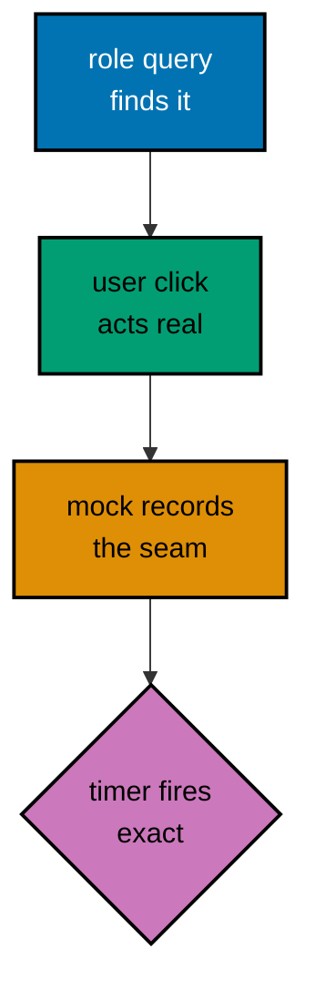

**`learning/code/ex-78-ci-command-shape/example.test.tsx`**:

```tsx
// @vitest-environment jsdom
// => DOM pragma: the full-stack file renders, clicks, mocks, and times.

import { afterEach, expect, test, vi } from "vitest"; // => Full-stack surface: timers, mocks, and assertions in one import.
// => Full runner surface: timers, mocks, and assertions in one file.

import { cleanup, fireEvent, render, screen } from "@testing-library/react"; // => Render plus events: role and text queries drive the stack.
// => Render plus role and text queries: the user-facing half of the stack.
// => fireEvent rides along: sync dispatch for the frozen-clock timer below.

import "@testing-library/jest-dom/vitest";
// => DOM matchers: text and document assertions for the rendered half.

import React, { useState } from "react";
// => State plus effect-free timer: the component under the full stack.

// => Isolation hook: the full stack leaves nothing behind, by habit now.
afterEach(() => {
  cleanup();
  // => Isolation hook: the full stack leaves nothing behind, by habit now.
  vi.useRealTimers();
  // => Restore timers: the fake clock below stays inside this final case.
  // => Hook closes: the fake clock stays inside this final case.
});

// => Callback prop: the mock observes what the timer-plus-click produces.
function Reminder({ onRemind }: { onRemind: (msg: string) => void }): React.JSX.Element {
  // => Callback prop: the mock observes what the timer-plus-click produces.
  // => Armed flag: the button arms it, the timer fires the callback through it.
  const [armed, setArmed] = useState(false);
  // => Armed flag: the button arms it, the timer fires the callback through it.
  const arm = (): void => {
    setArmed(true);
    // => Immediate state: the button text flips before any timer runs.
    // => Fake-clock delay: the advance below fires it with zero waiting.
    setTimeout(() => onRemind("Time to review!"), 5000);
    // => Fake-clock delay: the advance below fires it with zero waiting.
  };
  return (
    // => Root div holds the arming button: the full-stack surface in miniature.
    <div>
      <button type="button" onClick={arm} disabled={armed}>
        {/* => Disabled after arming: double-clicks cannot schedule twice. */}
        {/* => Button text flips on arm: the state the disabled assertion reads. */}
        {armed ? "Reminder set" : "Remind me"}
      </button>
    </div>
  );
}

// => Integration claim: all four layers cooperate in one deterministic run.
test("full stack: query, click, mock, and timer agree", async () => {
  // => Integration claim: all four layers cooperate in one deterministic run.
  // => Fake clock first: the five-second delay must be advance-driven.
  vi.useFakeTimers();
  // => Fake clock first: the five-second delay must be advance-driven.
  const onRemind = vi.fn();
  // => Recorder for the callback: the timer's effect lands here observably.
  render(<Reminder onRemind={onRemind} />);
  // => Mount the reminder: button says Remind me, enabled, callback uncalled.
  const button = screen.getByRole("button", { name: "Remind me" });
  // => Role query anchors the stack: the interaction starts from a query.
  fireEvent.click(button);
  // => Sync dispatch on a frozen clock: the handler arms and schedules at once.
  // => Query plus dispatch: layers one and two, settled together, no awaits.
  expect(screen.getByRole("button", { name: "Reminder set" })).toBeDisabled();
  // => Disabled state proves the click committed: layer two settled visibly.
  expect(onRemind).not.toHaveBeenCalled();
  // => Timer pending: the callback must NOT fire before its delay elapses.
  // => Full delay advanced: the scheduled callback fires synchronously now.
  vi.advanceTimersByTime(5000);
  // => Full delay advanced: the scheduled callback fires synchronously now.
  expect(onRemind).toHaveBeenCalledTimes(1);
  // => Exactly once: disabled button plus single timer, no double schedule.
  expect(onRemind).toHaveBeenCalledWith("Time to review!");
  // => Exact message: the timer carried the right payload, not just a call.
});
```

**Run**: `vitest run`

**Output** (`learning/code/ex-78-ci-command-shape/expected/main.stdout.txt`):

```text
PASS: ex-78-ci-command-shape (1 tests)
```

**Key takeaway**: `vitest run` with no watch flag is the CI shape: every layer from query to timer runs headless, and the exit code is the verdict.

---
