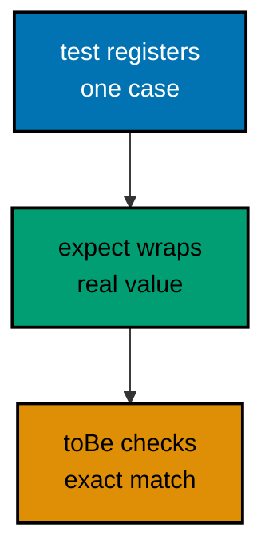
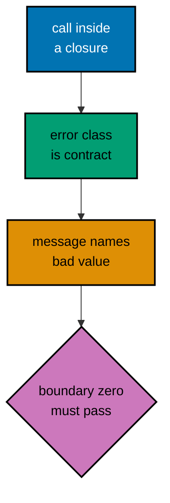
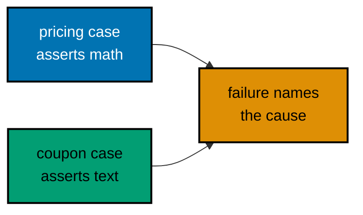
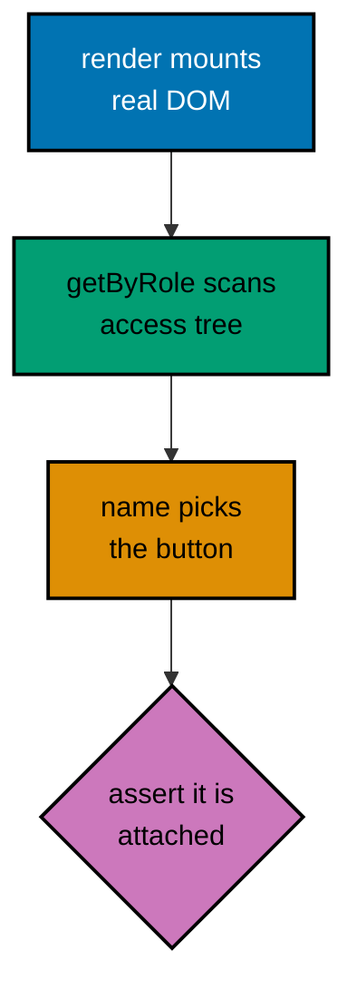
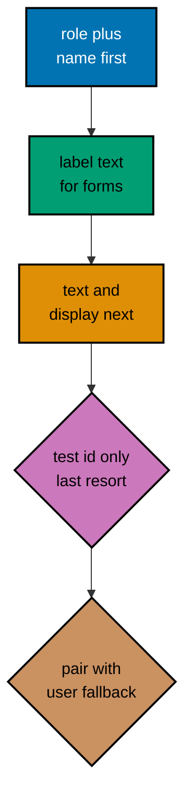
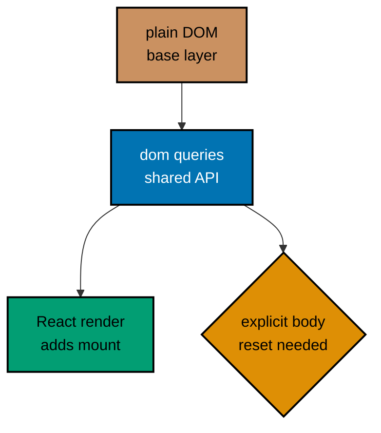
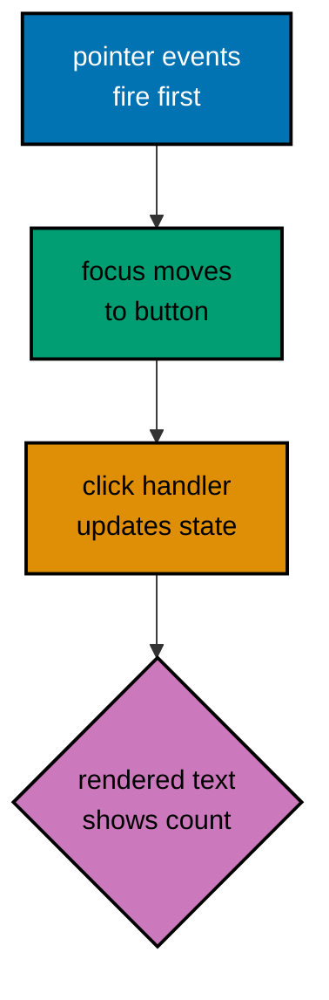
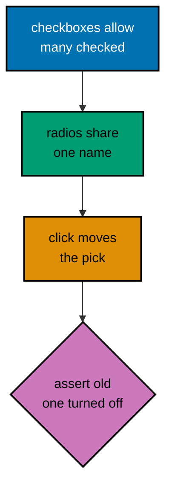
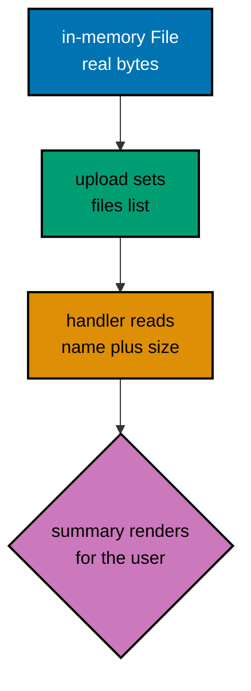

Examples 1–25 build the course's beginner tier in three clusters. Examples 1–8 learn Vitest's core vocabulary: discovery, `test` and `expect`, matchers, errors, and isolation with hooks. Examples 9–17 build Testing Library's query ladder from roles up through labels, text, and test ids. Examples 18–25 drive components the way users do, with pointer and keyboard events. Every example below is a complete, self-contained file under `learning/code/ex-NN-*/`, run for real with **Vitest 4.1.0** against **React 19**, **Testing Library 16**, and **jsdom 29** — every **Output** block is the genuine captured transcript, and every fence is byte-identical to the file it shows.

---

### Example 1: First Passing Test

_ex-01 · exercises co-01_

The smallest Vitest test: import `test` and `expect`, call a typed function, and assert its result with `toBe`. When this passes, the runner, the TypeScript transform, and the assertion library all work.

Every later example in this course is this same shape with more setup: render instead of call, query instead of compute, but the arrange-act-assert spine never changes. Teams that keep tests this small get failure messages that name the broken behavior instead of a random line deep in a mega-test. The five minutes this file costs pay back the first time someone edits `add` and the suite answers in milliseconds instead of a bug report weeks later.



**`learning/code/ex-01-first-passing-test/example.test.ts`**:

```ts
import { expect, test } from "vitest";
// => One import carries the whole runner vocabulary this file needs.
// => Vitest compiles this TypeScript directly, so no build step runs first.
// => Keeping the import list tiny shows a reader exactly what the file uses.

function add(a: number, b: number): number {
  // => The unit under test is an ordinary typed function, nothing special.
  // => Testing starts with plain functions because they have no DOM to set up.
  // => Types on the parameters document the contract the test then checks.
  return a + b;
  // => One obvious line: the test below pins this behavior in place.
}

test("adds two positive numbers", async () => {
  // => test() registers one case; its name reads as a specification sentence.
  // => A good name states the input shape and the expected outcome together.
  // => Later failures quote this name, so it must identify the case alone.
  expect(add(2, 3)).toBe(5);
  // => expect() wraps the real value; toBe() states the exact match rule.
  // => toBe uses Object.is, the strictest equality, right for numbers.
  // => If add ever returns 6, this line names the file and the line number.
});
```

**Run**: `vitest run`

**Output** (`learning/code/ex-01-first-passing-test/expected/main.stdout.txt`):

```text
PASS: ex-01-first-passing-test (1 tests)
```

**Key takeaway**: `test` plus `expect().toBe()` is a complete specification for one behavior of one function.

---

### Example 2: Grouping with describe

_ex-02 · exercises co-01_

`describe` groups related cases under one name so a suite reads as a nested specification. The runner reports each group separately, which keeps large files navigable.

A suite with two hundred flat tests is a log file, not documentation; grouping tells the next reader which unit each case protects before they read a single assertion. Reporters, coverage tools, and editors all understand describe blocks, so grouping also unlocks run-just-this-group workflows. The habit costs one line per unit and compounds across every suite the team will ever write.

**`learning/code/ex-02-grouping-with-describe/example.test.ts`**:

```ts
import { describe, expect, test } from "vitest";
// => describe joins the vocabulary: it groups cases, never asserts alone.
// => Three imports still fit on one line, so the file stays scannable.
// => A reader sees the full runner surface this file touches up front.

function clamp(value: number, min: number, max: number): number {
  // => clamp pins a number into a range: three behaviors worth three cases.
  // => One function with branches deserves a describe, not three loose tests.
  // => The types repeat the contract: numbers in, one number out.
  if (value < min) return min;
  // => Branch one: below the range snaps up to the floor.
  // => Early return keeps branches flat: no nesting, each guard exits fast.
  if (value > max) return max;
  // => Branch two: above the range snaps down to the ceiling.
  // => Guards read top-down in severity order: too low, too high, then fine.
  return value;
  // => Branch three: inside the range passes through untouched.
}

describe("clamp", () => {
  // => The describe name is the unit under test, quoted in every report line.
  // => Nesting describes mirrors the module structure of the source code.
  // => A failing case prints its full path: clamp > snaps values below min.
  test("snaps values below the minimum", async () => {
    // => Each case name finishes the sentence the describe name starts.
    expect(clamp(-5, 0, 10)).toBe(0);
    // => Boundary input: just below min must return min exactly.
  });

  test("snaps values above the maximum", async () => {
    // => The mirror case guards the other boundary the same way.
    expect(clamp(99, 0, 10)).toBe(10);
    // => Symmetric boundaries deserve symmetric cases, never one case.
  });

  test("leaves in-range values alone", async () => {
    // => The pass-through case stops a fix for one branch breaking another.
    expect(clamp(4, 0, 10)).toBe(4);
    // => Interior input proves the function is not just min-or-max.
  });
});
```

**Run**: `vitest run`

**Output** (`learning/code/ex-02-grouping-with-describe/expected/main.stdout.txt`):

```text
PASS: ex-02-grouping-with-describe (3 tests)
```

**Key takeaway**: `describe` turns a flat list of cases into a readable specification tree, one unit per group.

---

### Example 3: Equality Matchers Compared

_ex-03 · exercises co-01_

`toBe`, `toEqual`, and `toStrictEqual` answer three different questions about sameness. Picking the wrong one makes tests pass for the wrong reason.

Matcher choice is the cheapest decision in a test and the most common source of tests that pass while the code is wrong: `toEqual` silently accepts an object carrying a stray `undefined` field that later crashes a serializer. Strict-by-default suites catch shape drift at the test that introduced it instead of in production logs. Knowing all three matchers also lets a reader trust what a green suite actually proved about the data shapes.

**`learning/code/ex-03-equality-matchers/example.test.ts`**:

```ts
import { expect, test } from "vitest";
// => Same two imports as Example 1: matchers are the whole lesson here.
// => No new runner API appears, so attention stays on equality semantics.

test("toBe checks reference identity for objects", async () => {
  // => toBe is Object.is: same reference passes, equal copy fails.
  const current = { role: "admin" };
  // => One object literal with a single field keeps the point sharp.
  expect(current).toBe(current);
  // => Same reference on both sides: identity holds, trivially true.
  // => This assertion documents that toBe is about identity, not shape.
});

test("toEqual checks structural equality", async () => {
  // => toEqual walks both structures field by field, ignoring identity.
  const actual = { role: "admin", scopes: ["read"] };
  // => A nested array proves the comparison recurses, not just top level.
  expect(actual).toEqual({ role: "admin", scopes: ["read"] });
  // => A fresh literal with the same shape passes: values match, refs differ.
  // => Two literals can never be identical, so toBe would fail this case.
});

test("toStrictEqual also checks types and shape", async () => {
  // => toStrictEqual adds: undefined fields, class, and sparse-array checks.
  expect({ role: "admin", extra: undefined }).toEqual({ role: "admin" });
  // => PASSES: toEqual ignores undefined props, so this pair is equal to it.
  // => Leniency documented: the strict twin below rejects the same pair.
  expect({ role: "admin", extra: undefined }).not.toStrictEqual({
    role: "admin",
  });
  // => toStrictEqual counts the undefined field as a real shape difference.
  // => Strict mode rejects the sloppy object; lenient mode waves it through.
  // => Rule of thumb: default to toStrictEqual for state, toEqual for DTOs.
});
```

**Run**: `vitest run`

**Output** (`learning/code/ex-03-equality-matchers/expected/main.stdout.txt`):

```text
PASS: ex-03-equality-matchers (3 tests)
```

**Key takeaway**: Identity (`toBe`), structure (`toEqual`), and strict structure (`toStrictEqual`) are three different claims: state which one you mean.

---

### Example 4: Truthiness and Number Matchers

_ex-04 · exercises co-01_

Booleans, nullish values, and floats each need their own matcher. `toBeCloseTo` exists because floating-point arithmetic is not exact.

Float and null bugs are silent: `0.1 + 0.2 !== 0.3` breaks a totals row without throwing, and a `null` discount coerces to `0` somewhere downstream and undercharges every new customer. The right matcher turns both failure modes into red tests at the unit that introduced them. Suites that default to `toBe` for everything either fail on float noise or, worse, pass on nullish sloppiness.

**`learning/code/ex-04-truthiness-and-numbers/example.test.ts`**:

```ts
import { expect, test } from "vitest";
// => Runner vocabulary stays at two imports: matchers do all the new work.

function discountRate(orders: number): number | null {
  // => A nullable return models real business rules: no history, no discount.
  // => The union type forces every caller, and this test, to handle null.
  if (orders <= 0) return null;
  // => Guard clause first: the degenerate input gets the degenerate output.
  return 0.1 + 0.2;
  // => Deliberately naive math: 0.1 + 0.2 is NOT exactly 0.3 in floats.
  // => Real code would use integer cents; the imprecision here is the lesson.
}

test("null means no discount, not zero discount", async () => {
  // => Null and zero must stay distinct: one means unknown, one means none.
  expect(discountRate(0)).toBeNull();
  // => toBeNull matches only null, never undefined and never zero.
  // => toBeFalsy would also pass for 0 and '', hiding the distinction.
  expect(discountRate(0)).not.toBe(0);
  // => No toBeZero exists in Vitest; not.toBe(0) states the same claim exactly.
  // => Pairing the null check with the zero check pins the boundary.
});

test("float math needs an epsilon comparison", async () => {
  // => 0.1 + 0.2 === 0.30000000000000004, so toBe(0.3) would fail here.
  expect(discountRate(5)).toBeCloseTo(0.3, 10);
  // => toBeCloseTo compares within half a unit of the last decimal place.
  // => Precision 10 is strict; money code usually wants precision 2.
  // => The matcher name tells the reader floats are approximate by nature.
});

test("defined and truthy guard the happy path", async () => {
  // => Definedness checks catch missing fields before deeper assertions run.
  const rate = discountRate(5);
  // => Bind once, assert twice: the value under test stays identical.
  expect(rate).toBeDefined();
  // => toBeDefined rejects only undefined: null and 0 both pass it.
  expect(rate).toBeGreaterThan(0);
  // => A range assertion beats an exact one for values math may perturb.
});
```

**Run**: `vitest run`

**Output** (`learning/code/ex-04-truthiness-and-numbers/expected/main.stdout.txt`):

```text
PASS: ex-04-truthiness-and-numbers (3 tests)
```

**Key takeaway**: Match the matcher to the type: null checks, epsilon checks, and range checks each catch a different class of numeric bug.

---

### Example 5: Errors and Throws

_ex-05 · exercises co-01_

Code that must fail loudly gets tested by asserting the throw: the error class, the message, and the property that names the cause.

Untested error paths are where outages hide: the happy path gets exercised manually, the guard clause only fires at 3 a.m. on bad input. Pinning the error class lets callers `catch` with confidence instead of string-matching messages, and the boundary twin stops a well-meaning `<=` tightening from locking out legitimate zero-aged records. Three tiny cases buy an honest failure contract.



**`learning/code/ex-05-errors-and-throws/example.test.ts`**:

```ts
import { expect, test } from "vitest";
// => No new runner API: throws are asserted through expect, like values.

class NegativeAgeError extends Error {
  // => A named error class turns a string message into a catchable contract.
  // => Callers can branch on the class; tests can pin it down exactly.
  constructor(age: number) {
    // => The constructor takes the offending value, not a prebuilt message.
    super(`Age must be non-negative, got ${age}`);
    // => The message embeds the bad input so logs diagnose without reruns.
    this.name = "NegativeAgeError";
    // => Setting name keeps stack traces and serializers honest.
  }
}

function validateAge(age: number): number {
  // => Validation either returns clean data or throws: never a silent default.
  // => The return type promises a valid age; the throw enforces the promise.
  if (age < 0) throw new NegativeAgeError(age);
  // => Throw the specific class, never a bare Error, so callers can react.
  // => Throwing beats returning null: invalid ages cannot slip through silently.
  return age;
  // => The happy path returns the input unchanged: validation, not repair.
}

test("rejects a negative age with the named error", async () => {
  // => Wrap the throwing call in a closure: expect needs a function to run.
  // => Calling validateAge directly would throw before expect sees anything.
  expect(() => validateAge(-3)).toThrow(NegativeAgeError);
  // => The class argument asserts the contract, not just that something threw.
  // => A refactor that throws RangeError instead now fails this test loudly.
});

test("the message names the offending value", async () => {
  // => Messages are user-facing; pinning them stops vague-error regressions.
  expect(() => validateAge(-3)).toThrow("got -3");
  // => A substring match is enough: full-message matches rot on rewording.
  // => Substring plus class (previous test) covers contract and diagnosis.
});

test("accepts the boundary value zero", async () => {
  // => Every throw test needs its boundary twin, or the guard may be too wide.
  expect(validateAge(0)).toBe(0);
  // => Zero is valid: the guard is strictly-less-than, proved right here.
});
```

**Run**: `vitest run`

**Output** (`learning/code/ex-05-errors-and-throws/expected/main.stdout.txt`):

```text
PASS: ex-05-errors-and-throws (3 tests)
```

**Key takeaway**: Assert the error class for the contract, a message substring for diagnosis, and the boundary value that must not throw.

---

### Example 6: Isolation with beforeEach

_ex-06 · exercises co-01, co-10_

`beforeEach` rebuilds shared fixtures before every case so tests cannot leak state into each other. Isolation is what makes failures reproducible one case at a time.

Order-dependent tests are the classic flaky suite: green file by file, red on CI, unreproducible locally. The failure always appears far from its cause, because the polluting case ran minutes earlier. A reset hook costs three lines and converts an entire class of mystery failures into impossibility. Isolation is also what lets a developer run one case with `-t` and trust the result.

**`learning/code/ex-06-isolation-with-before-each/example.test.ts`**:

```ts
import { beforeEach, expect, test } from "vitest";
// => beforeEach joins the imports: setup hooks are runner vocabulary too.
// => Hooks run around cases; they never contain assertions of their own.

let attempts: string[];
// => Shared mutable state on purpose: the hook below tames it.
// => Module-level let is the simplest fixture a hook can reset.
// => Real suites share page objects or stores; the pattern is identical.

beforeEach(() => {
  // => This hook runs before EACH case, in order, even when one case fails.
  attempts = [];
  // => Reassign a fresh array: no case ever sees another case's entries.
  // => Fresh assignment beats .length = 0: aliases cannot smuggle state.
});

function record(attempt: string): number {
  // => The unit under test appends to the shared log and reports its size.
  // => Stateful units are exactly the ones that need hook-guarded fixtures.
  attempts.push(attempt);
  // => Push mutates shared state: without the hook, counts would accumulate.
  return attempts.length;
  // => Returning the size makes the leak observable in the very next case.
}

test("first case sees exactly one entry", async () => {
  // => Each case assumes a pristine log: the hook, not luck, provides it.
  expect(record("login")).toBe(1);
  // => Count 1 proves the log started empty for THIS case.
});

test("second case also starts empty", async () => {
  // => This is the case that fails without beforeEach: it would see 2.
  // => Order-dependent suites fail only in full runs, never in isolation.
  expect(record("checkout")).toBe(1);
  // => Count 1 again: the hook ran between the two cases, guaranteed.
  // => Two identical expectations in a row are the isolation proof itself.
});
```

**Run**: `vitest run`

**Output** (`learning/code/ex-06-isolation-with-before-each/expected/main.stdout.txt`):

```text
PASS: ex-06-isolation-with-before-each (2 tests)
```

**Key takeaway**: `beforeEach` makes every case start from the same fixture, so results never depend on run order.

---

### Example 7: Skipping Work in Progress

_ex-07 · exercises co-01, co-10_

`test.skip` parks an unfinished case without deleting it, and the runner reports it as skipped rather than silently dropping it. Skips stay visible so they cannot rot unnoticed.

Every team has half-built features; the question is whether the suite tracks them or hides them. A skipped test is a ticket the runner enforces: it appears in every report until someone finishes it or deletes it deliberately. Commented-out tests, by contrast, rot silently and teach the team that dead code is acceptable. The `.only` warning matters because one committed `.only` turns CI green while running a single case.

**`learning/code/ex-07-skipping-work-in-progress/example.test.ts`**:

```ts
import { expect, test } from "vitest";
// => No new API: skip is a property on the test function you already know.

function refund(total: number): number {
  // => A half-built feature: the happy path works, the edge case is unwritten.
  // => Committing the passing half with a skip beats a commented-out test file.
  return total;
  // => Stub body: returns the input until the fee schedule lands.
}

test("refunds the full total", async () => {
  // => The finished case guards what already works, as usual.
  expect(refund(100)).toBe(100);
  // => Green today, and it will catch regressions while the feature grows.
});

test.skip("deducts the restocking fee", async () => {
  // => .skip registers the case AND marks it pending: visible, not run.
  // => The runner counts it as skipped, so dashboards track the debt.
  // => Prefer skip over commenting out: comments are invisible to tooling.
  expect(refund(100)).toBe(95);
  // => The assertion states the intended behavior before the code exists.
  // => When the fee lands, removing .skip turns intent into a live check.
  // => Never commit test.only: it silences the rest of the file for everyone.
});
```

**Run**: `vitest run`

**Output** (`learning/code/ex-07-skipping-work-in-progress/expected/main.stdout.txt`):

```text
PASS: ex-07-skipping-work-in-progress (1 tests)
```

**Key takeaway**: `test.skip` keeps unfinished work visible in reports instead of hiding it in comments, and `test.only` must never be committed.

---

### Example 8: One Behavior per Test

_ex-08 · exercises co-01, co-10_

Each case asserts one behavior, so a failure names exactly what broke. Multi-assertion mega-tests fail with a line number but no story.

The mega-test anti-pattern (twenty assertions, one name like 'works') fails with all the information of a fire alarm: something is wrong somewhere. Splitting by behavior gives each failure a name the team can triage in seconds and lets runners report exactly which half of a feature regressed. Small cases also survive refactors: renaming the coupon rule touches one test, not a twenty-assertion monolith.



**`learning/code/ex-08-one-behavior-per-test/example.test.ts`**:

```ts
import { expect, test } from "vitest";
// => Back to the two-import minimum: structure, not API, is the lesson.

type Cart = { items: string[]; coupon: string | null };
// => A tiny domain type: a cart with items and an optional coupon code.
// => The type makes the two behaviors below visible before any test runs.

function total(items: string[]): number {
  // => Pricing rule, simplified: every item costs 10, no exceptions here.
  // => A pure function: the easiest possible subject for behavior-per-test.
  return items.length * 10;
  // => Length times price: one behavior, one line, one future test.
}

function couponLabel(coupon: string | null): string {
  // => Display rule: a missing coupon must say so plainly, never crash.
  // => Null handling is a separate behavior from pricing: separate test.
  if (coupon === null) return "No coupon applied";
  // => The null branch is the behavior this second test will pin.
  return `Coupon ${coupon} applied`;
  // => Template literal keeps the code visible in the receipt string.
}

test("prices three items at thirty", async () => {
  // => One behavior: pricing. No coupon logic appears in this case at all.
  expect(total(["a", "b", "c"])).toBe(30);
  // => A single assertion: when it fails, pricing broke, full stop.
});

test("labels a missing coupon plainly", async () => {
  // => One behavior: null display. No pricing math appears here either.
  // => Splitting behaviors means splitting failure stories: priceless later.
  expect(couponLabel(null)).toBe("No coupon applied");
  // => The string is pinned so UI copy changes become deliberate diffs.
});
```

**Run**: `vitest run`

**Output** (`learning/code/ex-08-one-behavior-per-test/expected/main.stdout.txt`):

```text
PASS: ex-08-one-behavior-per-test (2 tests)
```

**Key takeaway**: One behavior per case turns each failure into a sentence about what broke, not a line number to decode.

---

### Example 9: Render and Role Query

_ex-09 · exercises co-02, co-03_

The anchor for the queries cluster: mount a real React component into a test DOM with `render`, then find its button the way a user would, by role and accessible name.

Role queries are the foundation every later example builds on: they test the contract blind users rely on, so a green suite means the interface is operable, not just present. Components that are only findable by CSS class or test id can be completely broken for keyboard and screen-reader users while every test passes. Querying by role also decouples tests from markup churn: restyle the button however you like, the role and name stay stable.



**`learning/code/ex-09-render-and-role-query/button.tsx`**:

```tsx
import React from "react";
// => React is imported so JSX has its classic createElement target.
// => The component file holds no test code: subject and spec stay separate.
// => Separation lets reviewers read behavior without tripping over assertions.

type ButtonProps = { label: string; onPress: () => void };
// => Props are a typed contract: what the test may pass and must handle.
// => onPress returns void: the button reports the press, nothing more.
// => Two props keep the surface minimal: label for users, onPress for logic.

export function PressButton({ label, onPress }: ButtonProps): React.JSX.Element {
  // => A named export keeps the import in the test file explicit and greppable.
  // => The return type documents that this is a rendered element, not data.
  // => Named plus typed: the signature teaches the contract before the body runs.
  return (
    // => JSX describes the DOM the test will query: a real button element.
    // => One root element returned: components render a single tree, always.
    <button type="button" onClick={onPress}>
      {/* => type="button" stops accidental form submits when reused in forms. */}
      {/* => onClick wires the DOM event to the prop: the seam the test presses. */}
      {/* => Wiring by prop, not by global: the button stays reusable anywhere. */}
      {label}
      {/* => The label prop becomes the accessible name screen readers use. */}
      {/* => No aria-label needed: visible text is already the best name. */}
      {/* => Prop-to-name flow: change the prop, the announced name follows. */}
    </button>
    // => A native button carries the button role for free: no ARIA required.
    // => Native elements beat divs-with-roles: semantics come built in.
  );
  // => Closing brace ends the component: everything above renders per props.
}
```

**`learning/code/ex-09-render-and-role-query/example.test.tsx`**:

```tsx
// @vitest-environment jsdom
// => This pragma gives THIS file a browser-like DOM: no real browser runs.
// => Pragma beats config files here: each example declares its own world.
// => Node-only examples skip the pragma and stay in the faster node env.

import { afterEach, expect, test } from "vitest";
// => afterEach joins the imports: isolation hooks are part of every UI file.

import { cleanup, render, screen } from "@testing-library/react";
// => render mounts into document.body; screen queries from the same root.
// => cleanup unmounts after each case so renders never leak across cases.

import "@testing-library/jest-dom/vitest";
// => The vitest entry registers DOM matchers like toBeInTheDocument.
// => Without this import, toBeInTheDocument is an unknown matcher error.

import React from "react";
// => React in scope for the JSX below: the test renders real elements.

import { PressButton } from "./button";
// => The subject arrives by relative import: the unit is self-contained.
// => No path aliases: a reader can resolve this import without a tsconfig.

afterEach(() => {
  cleanup();
  // => Unmount after every case: two renders must never share one document.
  // => RTL would auto-clean only with globals on; explicit beats magical.
});

test("finds the button by its role and name", async () => {
  // => The case name states the query strategy, not the component internals.
  let pressed = 0;
  // => Local mutable flag: the simplest observable effect a click can have.
  render(
    <PressButton
      label="Save"
      onPress={() => {
        pressed += 1;
      }}
    />,
  );
  // => render mounts into a detached DOM node appended to document.body.
  // => The label prop doubles as the accessible name the query will use.
  const button = screen.getByRole("button", { name: "Save" });
  // => getByRole queries the accessibility tree, exactly like assistive tech.
  // => The name option disambiguates when several buttons share one page.
  // => getBy* throws when missing: absence is loud, never a silent null.
  expect(button).toBeInTheDocument();
  // => toBeInTheDocument asserts attachment to the rendered document body.
  // => A detached node would fail here: rendering is part of the claim.
  expect(pressed).toBe(0);
  // => Nothing pressed yet: rendering alone must never trigger behavior.
});
```

**Run**: `vitest run`

**Output** (`learning/code/ex-09-render-and-role-query/expected/main.stdout.txt`):

```text
PASS: ex-09-render-and-role-query (1 tests)
```

**Key takeaway**: `render` mounts the real component and `getByRole` finds it the way assistive technology does: role first, accessible name second.

---

### Example 10: Roles and Accessible Names

_ex-10 · exercises co-02, co-12_

Headings, links, and form controls each expose a role plus a name computed from content, labels, or alt text. Querying all three proves the page announces itself correctly.

Accessible names are the difference between 'button' and 'Save changes' in a screen reader's rotor: unnamed controls force blind users to guess. Testing names locks the announcement contract, so a redesign that wraps the heading in three divs still announces 'Checkout'. Teams that assert names catch the most embarrassing accessibility regressions — the empty button — with the cheapest possible test.

**`learning/code/ex-10-roles-and-accessible-names/example.test.tsx`**:

```tsx
// @vitest-environment jsdom
// => DOM pragma again: every query example needs a document to scan.

import { afterEach, expect, test } from "vitest";
// => Runner vocabulary stays minimal: the queries carry the lesson.

import { cleanup, render, screen } from "@testing-library/react";
// => Same three RTL imports as Example 9: the query surface is consistent.

import "@testing-library/jest-dom/vitest";
// => DOM matchers registered again: each file stands alone, no shared setup.

import React from "react";
// => JSX below renders a small page fragment with three named elements.

afterEach(() => {
  cleanup();
  // => Isolation hook repeated: every UI file in this course carries it.
});

test("every landmark names itself accessibly", async () => {
  // => One render, three queries: each asserts a different naming mechanism.
  // => Three naming rules in one case: the priority order made concrete.
  render(
    <main>
      {/* => main gives the page its landmark region for jumping around. */}
      {/* => Landmarks let assistive tech skip straight to content: free wins. */}
      <h1>Checkout</h1>
      {/* => Heading text becomes the heading name with zero extra markup. */}
      {/* => h1 level plus text: level from the tag, name from the content. */}
      <a href="/help">Get help</a>
      {/* => Link text becomes the link name: visible text wins again. */}
      {/* => href carries navigation; the NAME carries meaning: assert both. */}
      
      {/* => alt text becomes the img name: images must never be nameless. */}
      {/* => Decorative images take alt="": named or hidden, never ambiguous. */}
    </main>,
    // => main closes the landmark: everything testable lives inside it.
  );
  // => One fragment, three roles: heading, link, img each announce a name.
  // => Fragment renders without extra DOM: queries see exactly these three.
  expect(screen.getByRole("heading", { name: "Checkout" })).toBeInTheDocument();
  // => Headings: name comes from text content, level from h1-h6 tag.
  // => Level implied by h1: screen readers announce heading level one.
  expect(screen.getByRole("link", { name: "Get help" })).toHaveAttribute(
    "href",
    "/help",
    // => Attribute name, then value: toHaveAttribute takes both explicitly.
  );
  // => Links: name from text, href asserted separately as behavior, not name.
  // => toHaveAttribute keeps navigation targets pinned without snapshots.
  // => Splitting name from href: copy changes and URL changes fail separately.
  expect(
    screen.getByRole("img", { name: "AyoKoding logo" }),
    // => img query by alt-derived name: the ONLY way to find images accessibly.
  ).toBeInTheDocument();
  // => Images: alt text is the ONLY name source; empty alt hides the image.
  // => Three roles, three naming rules, one query API: that is the priority.
  // => Priority order practiced: role first, name second, nothing else needed.
});
```

**Run**: `vitest run`

**Output** (`learning/code/ex-10-roles-and-accessible-names/expected/main.stdout.txt`):

```text
PASS: ex-10-roles-and-accessible-names (1 tests)
```

**Key takeaway**: Headings name themselves from text, links from text, images from alt: one query API covers all three naming rules.

---

### Example 11: Labels for Form Controls

_ex-11 · exercises co-02, co-12_

`getByLabelText` only finds controls a real label points at, so it tests the label association itself, not just the input's existence.

Placeholder-only inputs are the most common form accessibility failure: sighted users cope, screen-reader users hear 'edit text, blank'. A suite built on `getByLabelText` cannot pass while that failure ships, because the query itself enforces the association. The queryBy twin matters too: proving absence needs the null return, and reaching for getBy in that spot throws a confusing error instead of a clean assertion.

**`learning/code/ex-11-labels-for-form-controls/example.test.tsx`**:

```tsx
// @vitest-environment jsdom
// => DOM pragma: labels live in the document the queries scan.

import { afterEach, expect, test } from "vitest";
// => Unchanged runner imports: the query does the teaching again.

import { cleanup, render, screen } from "@testing-library/react";
// => getByLabelText arrives with the same three RTL imports as before.

import "@testing-library/jest-dom/vitest";
// => jest-dom matchers for the value and disabled-state assertions below.

import React from "react";
// => JSX renders a labelled email field plus one deliberately bare field.

afterEach(() => {
  cleanup();
  // => Same isolation hook: the course repeats it until it is muscle memory.
});

test("a labelled input is found by its label text", async () => {
  // => The query IS the accessibility test: no label, no element found.
  render(
    <form>
      {/* => A form groups controls so submit semantics apply later. */}
      <label htmlFor="email">Email address</label>
      {/* => htmlFor must equal the input id: that pairing is the contract. */}
      {/* => Visible label text doubles as the query hook: no ids in tests. */}
      <input id="email" type="email" defaultValue="sari@example.com" />
      {/* => defaultValue sets an uncontrolled initial value for the test. */}
      {/* => Uncontrolled input: the DOM holds the value, React does not track it. */}
    </form>,
    // => Form closes: label and input associated, ready for the query below.
  );
  // => Label plus input: the smallest testable unit of form accessibility.
  // => Association proved by the query itself: no association, no element found.
  const field = screen.getByLabelText("Email address");
  // => getByLabelText follows htmlFor, aria-labelledby, and wrapping labels.
  // => It fails on placeholder-only inputs: placeholders are not labels.
  expect(field).toHaveValue("sari@example.com");
  // => toHaveValue reads the live control value, not the HTML attribute.
  // => Asserting the value proves the query returned the real control.
});

test("an unlabelled input stays invisible to the query", async () => {
  // => The negative twin proves the query checks association, not presence.
  render(<input type="text" defaultValue="orphan" />);
  // => Deliberately bare: no label, no aria, no name anywhere nearby.
  expect(screen.queryByLabelText("orphan")).not.toBeInTheDocument();
  // => queryBy* returns null instead of throwing: absence needs this variant.
  // => Combined with Example 10, the rule is total: label everything.
});
```

**Run**: `vitest run`

**Output** (`learning/code/ex-11-labels-for-form-controls/expected/main.stdout.txt`):

```text
PASS: ex-11-labels-for-form-controls (2 tests)
```

**Key takeaway**: `getByLabelText` passes only for properly labelled controls, which makes it an accessibility test disguised as a query.

---

### Example 12: Text, Placeholder, and Display Value

_ex-12 · exercises co-02_

Below roles and labels sit `getByText`, `getByPlaceholderText`, and `getByDisplayValue`: useful, but each tests presentation rather than semantics, so they rank lower in the query priority.

Query priority is a testing strategy, not trivia: suites built on text queries break on every copy tweak, while suites built on roles survive redesigns. Lower-priority queries still have honest uses — static receipt lines have no role worth querying — but each one is a small bet on wording that the team should place deliberately. Knowing all three tiers lets a reviewer ask 'could this be a role query?' on every new test.

**`learning/code/ex-12-text-placeholder-display-value/example.test.tsx`**:

```tsx
// @vitest-environment jsdom
// => DOM pragma: text queries scan rendered text nodes in the document.

import { afterEach, expect, test } from "vitest";
// => Runner imports unchanged for the tenth time: consistency is the point.

import { cleanup, render, screen } from "@testing-library/react";
// => The lower-priority queries live on the same screen object, same import.

import "@testing-library/jest-dom/vitest";
// => toHaveDisplayValue and friends come from the jest-dom registration.

import React from "react";
// => JSX renders a receipt: a total line plus a prefilled promo field.

afterEach(() => {
  cleanup();
  // => Isolation hook: identical in every UI file, no exceptions made.
});

test("text queries read what the user reads", async () => {
  // => getByText matches rendered strings: the user's view, not the markup.
  render(
    <section>
      {/* => section groups the receipt so within() could scope it later. */}
      {/* => Grouping also names the region if an aria-label gets added. */}
      <p>Total: $30</p>
      {/* => Plain paragraph text: no role, so role queries cannot reach it. */}
      {/* => Static copy like totals is the honest home of text queries. */}
      <input defaultValue="SAVE10" placeholder="Promo code" aria-label="Promo" />
      {/* => aria-label gives the role query a hook; value gives display query. */}
      {/* => placeholder is decorative here: the label carries accessibility. */}
      {/* => Three attributes, three query tiers, one input: priority visible. */}
    </section>,
    // => section closes: static copy plus one field, three tiers to compare.
  );
  // => One receipt fragment exercises three query tiers at once.
  // => Same assertion target reached three ways: the priority lesson live.
  expect(screen.getByText("Total: $30")).toBeInTheDocument();
  // => getByText normalizes whitespace: layout changes rarely break it.
  // => Exact strings still couple to copy; prefer roles for interactive parts.
  // => Static totals change rarely: text queries cost little here.
  expect(screen.getByPlaceholderText("Promo code")).toHaveDisplayValue(
    "SAVE10",
    // => Expected value argument: display value asserted in the same call.
  );
  // => Placeholder query finds the field; display value asserts its content.
  // => Placeholder-as-label would fail Example 11's query: this one is extra.
  // => Extra, not primary: the role query below is the one to keep.
  expect(
    screen.getByRole("textbox", { name: "Promo" }),
    // => Role plus accessible name: the highest-priority hook on this field.
  ).toHaveDisplayValue("SAVE10");
  // => The same field via its role: higher priority, same assertion passes.
  // => Showing both side by side teaches the priority order concretely.
  // => Review rule: new tests should reach for the role form first.
});
```

**Run**: `vitest run`

**Output** (`learning/code/ex-12-text-placeholder-display-value/expected/main.stdout.txt`):

```text
PASS: ex-12-text-placeholder-display-value (1 tests)
```

**Key takeaway**: `getByText` and `getByPlaceholderText` work, but they test presentation: prefer role and label queries for anything interactive.

---

### Example 13: Test ID as Last Resort

_ex-13 · exercises co-02_

`getByTestId` finds anything, which is exactly its danger: it tests nothing about the user experience. Reserve it for elements no user-facing query can reach.

Test ids are morally hazardous: they make any test pass without improving accessibility one bit, so suites drift toward testing attributes instead of experience. The pairing rule fixes the incentive: every test id must sit next to an assertion on what the user actually gets. Used that way, test ids mark exactly the spots where the UI is weakest for assistive tech — a map of future accessibility work, not just hooks for tests.



**`learning/code/ex-13-test-id-as-last-resort/example.test.tsx`**:

```tsx
// @vitest-environment jsdom
// => DOM pragma: even last-resort queries need a document to scan.

import { afterEach, expect, test } from "vitest";
// => Runner surface unchanged: only the query strategy is new here.

import { cleanup, render, screen } from "@testing-library/react";
// => getByTestId is on screen too: same import, deliberately weaker query.

import "@testing-library/jest-dom/vitest";
// => toHaveTextContent asserts inside the located canvas node below.

import React from "react";
// => JSX renders a canvas chart with a text fallback for assistive tech.

afterEach(() => {
  cleanup();
  // => Isolation hook, repeated verbatim: the course never skips it.
});

test("canvas content is reachable only by test id", async () => {
  // => Canvas pixels carry no semantics: no role query can ever find data.
  render(
    <figure>
      {/* => figure groups the visual with its accessible fallback text. */}
      {/* => Grouping tells assistive tech the caption describes the canvas. */}
      <canvas data-testid="revenue-chart" aria-label="Revenue chart" />
      {/* => data-testid is invisible to users: it changes nothing announced. */}
      {/* => The aria-label names the canvas; the fallback text carries data. */}
      {/* => Both present: the name for context, the caption for the numbers. */}
      <figcaption>Revenue up 12 percent</figcaption>
      {/* => figcaption IS queryable by text: prefer it whenever it exists. */}
      {/* => Captions serve every user: sighted, blind, and search engines alike. */}
    </figure>,
    // => figure closes: visual plus fallback, the complete honest pattern.
  );
  // => Chart plus fallback: the honest pattern for non-DOM visuals.
  // => Honest means two assertions: presence of canvas, content of fallback.
  const chart = screen.getByTestId("revenue-chart");
  // => getByTestId matches the attribute exactly: powerful and meaningless.
  // => Reach for it only after role, label, text, and display value fail.
  // => The attribute is test-only: users never see it, readers never hear it.
  expect(chart).toBeInTheDocument();
  // => Presence is all a test id proves: pair it with the fallback assertion.
  // => Alone this line passes while the chart shows stale data: always pair.
  expect(screen.getByText("Revenue up 12 percent")).toBeInTheDocument();
  // => The text fallback is what users get: assert it alongside the canvas.
  // => If the fallback ever disappears, this line fails while test id passes.
  // => The pair is the contract: visual exists AND its meaning is announced.
});
```

**Run**: `vitest run`

**Output** (`learning/code/ex-13-test-id-as-last-resort/expected/main.stdout.txt`):

```text
PASS: ex-13-test-id-as-last-resort (1 tests)
```

**Key takeaway**: `getByTestId` is the escape hatch for unqueryable visuals like canvas: always pair it with an assertion on the user-facing fallback.

---

### Example 14: Presence and Absence

_ex-14 · exercises co-02, co-10, co-13_

`getBy*` throws when nothing matches; `queryBy*` returns null. Presence needs the throwing variant, absence needs the null one, and confusing them produces the suite's most misleading failures.

The getBy/queryBy confusion produces failures that point nowhere: 'Unable to find' when the test meant to assert absence sends the reader hunting for a rendering bug that is actually a query bug. Getting the split right also documents intent — a queryBy line tells the next reader that absence is the expected state here, which is exactly the information a future refactor needs before removing the 'unnecessary' null branch.

**`learning/code/ex-14-presence-and-absence/example.test.tsx`**:

```tsx
// @vitest-environment jsdom
// => DOM pragma: absence assertions still need a document to search.

import { afterEach, expect, test } from "vitest";
// => Same runner imports: the getBy/queryBy split is a library concern.

import { cleanup, render, screen } from "@testing-library/react";
// => Both variants live on screen: one import covers presence and absence.

import "@testing-library/jest-dom/vitest";
// => toBeInTheDocument makes null-vs-element assertions read naturally.

import React from "react";
// => JSX renders a conditional banner: shown only when an error exists.

afterEach(() => {
  cleanup();
  // => Isolation hook: absence tests especially need a pristine document.
});

function Banner({ error }: { error: string | null }): React.JSX.Element | null {
  // => The subject renders nothing for null: absence is a designed state.
  // => Returning null is legitimate UI: the test must assert it deliberately.
  if (error === null) return null;
  // => Early return keeps the error path visually separate from the markup.
  return <p role="alert">{error}</p>;
  // => role alert announces errors assertively: the role is the test hook.
}

test("shows the banner when an error exists", async () => {
  // => Presence case: getBy* throws if the banner is missing, failing loudly.
  render(<Banner error="Card declined" />);
  // => Non-null error prop takes the rendering branch, not the early return.
  expect(screen.getByRole("alert")).toHaveTextContent("Card declined");
  // => getByRole plus text content: role finds it, text pins the message.
});

test("shows no banner when there is no error", async () => {
  // => Absence case: queryBy* returns null, and the assertion checks null.
  render(<Banner error={null} />);
  // => Null prop takes the early return: document.body stays banner-free.
  expect(screen.queryByRole("alert")).not.toBeInTheDocument();
  // => queryBy never throws: the assertion, not the query, decides pass.
  // => Using getBy here would throw inside the query, hiding the real claim.
  expect(() => screen.getByRole("alert")).toThrow(/Unable to find/);
  // => The throwing behavior itself is pinnable: getBy documents its demand.
  // => This line teaches what absence looks like when the wrong query runs.
});
```

**Run**: `vitest run`

**Output** (`learning/code/ex-14-presence-and-absence/expected/main.stdout.txt`):

```text
PASS: ex-14-presence-and-absence (2 tests)
```

**Key takeaway**: Presence uses `getBy*` (throws when missing); absence uses `queryBy*` (returns null): the query encodes whether absence is a bug.

---

### Example 15: Lists and within

_ex-15 · exercises co-02, co-03_

`getAllBy*` returns every match, and `within` scopes queries to a subtree. Together they test lists without depending on item order or page-wide uniqueness.

List tests break in two familiar ways: they assert `[0]`, `[1]`, `[2]` and then fail on a sort change nobody cares about, or they use page-wide queries and fail because an unrelated widget renders the same word. Scoped, order-free assertions test what lists promise — these members, this count — and nothing about layout. That keeps the suite green through the redesigns lists always undergo.

**`learning/code/ex-15-lists-and-within/example.test.tsx`**:

```tsx
// @vitest-environment jsdom
// => DOM pragma: list queries scan listitem roles in the document.

import { afterEach, expect, test } from "vitest";
// => Runner imports steady: list testing adds no new runner API.

import { cleanup, render, screen, within } from "@testing-library/react";
// => within joins the imports: scoped queries are a first-class operation.
// => within(element) returns a screen-like object bound to that subtree.

import "@testing-library/jest-dom/vitest";
// => toHaveLength and text matchers assert on the returned collections.

import React from "react";
// => JSX renders two lists: the scoping test needs a distractor list.

afterEach(() => {
  cleanup();
  // => Isolation hook: leaked lists would poison later getAllBy counts.
});

const groceries = ["Rice", "Oil", "Sugar"];
// => Module-level fixture data: the same array feeds both rendered lists.
// => Shared data keeps the example small; beforeEach is unnecessary here.

test("finds every item without depending on order", async () => {
  // => getAllBy returns an array: length plus membership beats index access.
  render(
    <ul aria-label="Groceries">
      {/* => aria-label names the list so within() can scope to it precisely. */}
      {groceries.map((item) => (
        <li key={item}>{item}</li>
        // => key uses the item text: stable and unique for this fixture.
        // => Real code keys by id; text keys are fine for literal fixtures.
      ))}
    </ul>,
  );
  // => Render maps data to listitems: the standard dynamic-list shape.
  const list = screen.getByRole("list", { name: "Groceries" });
  // => Scope first: within() binds every later query to this subtree alone.
  const items = within(list).getAllByRole("listitem");
  // => getAllByRole throws when empty, returns all matches otherwise.
  // => Scoped queries ignore identical items rendered elsewhere on the page.
  expect(items).toHaveLength(3);
  // => Length pins the count; content assertions below pin the members.
  // => Count first, members second: two independent facts, two assertions.
  const names = items.map((item) => item.textContent);
  // => textContent reads each item: mapping keeps assertions order-free.
  // => Mapping over Elements keeps the test in the DOM world, not strings.
  expect(names).toEqual(expect.arrayContaining(["Rice", "Sugar"]));
  // => arrayContaining asserts membership without pinning render order.
  // => Sorting is a presentation choice: tests should not lock it in.
  // => Membership plus count equals the whole list contract, order aside.
});
```

**Run**: `vitest run`

**Output** (`learning/code/ex-15-lists-and-within/expected/main.stdout.txt`):

```text
PASS: ex-15-lists-and-within (1 tests)
```

**Key takeaway**: `getAllBy*` plus `within` tests list contents independent of order and immune to duplicate content elsewhere on the page.

---

### Example 16: Testing Library DOM without React

_ex-16 · exercises co-03_

`@testing-library/dom` queries any DOM, including hand-written HTML with no framework at all. The query philosophy does not depend on React.

Not every project is React, and not every test needs a component: server-rendered pages, web components, and legacy jQuery widgets all expose a DOM that these queries can read. Knowing the framework-free layer also demystifies what `render` adds — mounting plus cleanup — so the team reaches for the lightest tool that can prove each claim. The manual teardown line teaches the price of skipping the renderer.



**`learning/code/ex-16-testing-library-dom-without-react/example.test.ts`**:

```ts
// @vitest-environment jsdom
// => DOM pragma without React: document exists, no component layer involved.

import { expect, test } from "vitest";
// => No afterEach/cleanup here: no renderer mounts anything to clean up.

import { fireEvent, screen } from "@testing-library/dom";
// => Queries come from the dom package directly: same names, no React.
// => fireEvent dispatches raw DOM events here; user-event takes over later.
// => Importing from dom instead of react proves the layers are separable.

test("queries plain HTML the same way", async () => {
  // => Arrange writes markup by hand: the smallest possible render step.
  document.body.innerHTML = '<button id="buy">Buy now</button><p id="log"></p>';
  // => innerHTML assignment replaces the whole body: pristine every test.
  // => No cleanup hook needed: each test overwrites the body from scratch.
  const button = screen.getByRole("button", { name: "Buy now" });
  // => Identical query as the React examples: roles work on plain HTML too.
  // => The accessibility tree does not care which library created the DOM.
  const log = document.getElementById("log");
  // => getElementById reaches the plain node the test will mutate directly.
  button.addEventListener("click", () => {
    // => A raw listener stands in for framework event wiring, visibly.
    if (log !== null) log.textContent = "ordered";
    // => Null guard satisfies strict TypeScript: getElementById may miss.
  });
  fireEvent.click(button);
  // => fireEvent dispatches a synthetic click: no pointer, no focus, no hover.
  // => Raw and fast, but unfaithful: Example 25 shows what it skips.
  expect(log?.textContent).toBe("ordered");
  // => Optional chaining keeps the assertion total even if setup failed.
  document.body.innerHTML = "";
  // => Explicit teardown: plain-DOM tests clean up after themselves manually.
});
```

**Run**: `vitest run`

**Output** (`learning/code/ex-16-testing-library-dom-without-react/expected/main.stdout.txt`):

```text
PASS: ex-16-testing-library-dom-without-react (1 tests)
```

**Key takeaway**: `@testing-library/dom` tests any HTML with the same queries, which proves the query philosophy belongs to the DOM, not to React.

---

### Example 17: Reading Debug Output

_ex-17 · exercises co-13_

When a query fails, `prettyDOM` shows exactly what the test saw. Learning to read that dump — roles, names, and all — is the fastest way to fix a broken query.

Most query debugging is guessing — trying text, then test id, then a regex — because developers never look at what the test actually saw. The dump ends the guessing: it prints the accessibility tree with computed names, so a hidden `aria-hidden` or a misnested span becomes obvious in seconds. This one habit separates engineers who fix failing queries in a minute from those who rewrite tests until something passes for unknown reasons.

**`learning/code/ex-17-reading-debug-output/example.test.tsx`**:

```tsx
// @vitest-environment jsdom
// => DOM pragma: debug output describes a document, so one must exist.

import { afterEach, expect, test } from "vitest";
// => Runner imports unchanged: debugging is a library skill, not new API.

import { prettyDOM } from "@testing-library/dom";
// => prettyDOM RETURNS the formatted DOM string instead of printing it.
// => screen.debug prints the same string: same content, noisier channel.
// => Returning lets the test assert on the dump deterministically.

import { cleanup, render, screen } from "@testing-library/react";
// => render builds the mystery DOM; screen proves what the query sees.

import "@testing-library/jest-dom/vitest";
// => jest-dom matchers assert on the queried node after the dump is read.

import React from "react";
// => JSX renders a button whose name comes from nesting, not plain text.

afterEach(() => {
  cleanup();
  // => Isolation hook: debug examples especially must not leak markup.
});

test("the dump shows the computed accessible name", async () => {
  // => The mystery: where does this button's name come from? Read the dump.
  const { container } = render(
    <button type="button">
      {/* => No text child: the name must come from the nested span. */}
      <span aria-hidden="true">*</span> Save draft
      {/* => aria-hidden star is decorative: hidden from the access tree. */}
      {/* => Visible text after the span forms the real accessible name. */}
    </button>,
  );
  // => container is the mount root: prettyDOM prints from here downward.
  const dump = prettyDOM(container);
  // => The dump shows roles, names, and hidden flags: the query's raw input.
  // => Reading dumps beats guessing selectors: the tree never lies.
  // => prettyDOM output is deterministic text: safe to assert on in tests.
  expect(dump).toContain("Save draft");
  // => The dump contains the name text: proof the name computation worked.
  // => Asserting on the dump pins the lesson: names come from visible text.
  // => The hidden star is absent from the name: exclusion proved too.
  expect(screen.getByRole("button", { name: "Save draft" })).toBeInTheDocument();
  // => The passing query confirms the dump-reading skill on a real lookup.
  // => aria-hidden content correctly stays OUT of the computed name here.
  // => Dump first, query second: diagnose, then verify, in that order.
});
```

**Run**: `vitest run`

**Output** (`learning/code/ex-17-reading-debug-output/expected/main.stdout.txt`):

```text
PASS: ex-17-reading-debug-output (1 tests)
```

**Key takeaway**: Read the DOM dump before changing the query: it shows roles and computed names exactly as the query engine sees them.

---

### Example 18: Clicking a Button

_ex-18 · exercises co-04, co-03_

The anchor for the interaction cluster: `user.click` presses a real rendered button and the counter text updates. Fake events cannot prove this; a full click sequence can.

Fire-and-forget event tests lie: un-awaited clicks assert before React commits the update, passing today and flaking under load. The await-every-interaction rule costs seven characters and removes an entire class of timing flakes. More importantly, full-sequence dispatch catches handlers wired to the wrong event — `onMouseDown` instead of `onClick` — which raw `fireEvent.click` would never reveal because it fires only the click.



**`learning/code/ex-18-clicking-a-button/counter.tsx`**:

```tsx
import React, { useState } from "react";
// => useState holds the count: interaction tests need stateful subjects.
// => State plus render output is the smallest loop worth driving by click.

export function Counter(): React.JSX.Element {
  // => Named export, no props: the counter owns its state entirely.
  // => Zero props keeps the interaction pure: clicks are the only input.
  const [count, setCount] = useState(0);
  // => Initial zero: the test asserts this starting text before clicking.
  // => State lives in the component: the test drives it only through UI.
  // => useState returns the value plus setter: the standard state pair.
  return (
    // => Single root returned: one tree per component, React reconciles it.
    <div>
      {/* => Wrapper div gives the heading and button one mount root. */}
      {/* => Wrapper carries no semantics: queries look past it to content. */}
      <p>Total clicks: {count}</p>
      {/* => Count rendered as text: the observable effect every click checks. */}
      {/* => Interpolation re-renders on state change: the loop under test. */}
      <button type="button" onClick={() => setCount((c) => c + 1)}>
        {/* => Updater form avoids stale closures when clicks arrive quickly. */}
        {/* => Arrow handler creates no binding bugs: setCount is stable. */}
        {/* => type button prevents form-submit surprises when nested in forms. */}
        Add one
        {/* => Visible text is the accessible name: role query needs nothing else. */}
        {/* => Label and name are one string: rename it, query follows. */}
      </button>
      {/* => Button closes: click target complete, handler wired, named. */}
    </div>
    // => Root closes: paragraph plus button, the whole interactive surface.
  );
  // => Component ends: state, render, and handler, all in twelve lines.
}
```

**`learning/code/ex-18-clicking-a-button/example.test.tsx`**:

```tsx
// @vitest-environment jsdom
// => DOM pragma: clicks dispatch into a document, so one must exist.

import { afterEach, expect, test } from "vitest";
// => Runner trio unchanged: interaction adds no new runner API.

import { cleanup, render, screen } from "@testing-library/react";
// => render mounts the counter; screen finds its button and its text.

import "@testing-library/jest-dom/vitest";
// => toHaveTextContent reads the counter paragraph after each click.

import React from "react";
// => JSX renders the stateful counter: interaction needs something to change.

import userEvent from "@testing-library/user-event";
// => user-event simulates full interaction sequences, not single raw events.
// => One import covers clicks, typing, selection, hover, upload, and more.

import { Counter } from "./counter";
// => Subject by relative import: the unit stays self-contained.

afterEach(() => {
  cleanup();
  // => Unmount the counter: state must never survive into the next case.
});

test("two clicks raise the count to two", async () => {
  // => The case name counts clicks out loud: arrange, act, assert below.
  const user = userEvent.setup({ delay: null });
  // => setup() builds an isolated session: no state leaks between tests.
  // => delay null removes inter-keystroke pauses: fast and deterministic.
  // => Real timers stay on here: no waiting happens, only event dispatch.
  render(<Counter />);
  // => Mount once: every later line acts on this rendered instance.
  expect(screen.getByText("Total clicks: 0")).toBeInTheDocument();
  // => Assert the starting state first: a test that cannot see zero is blind.
  const button = screen.getByRole("button", { name: "Add one" });
  // => Role query, as always: interaction never excuses weak queries.
  await user.click(button);
  // => AWAIT the click: user-event is async because real browsers are async.
  // => click fires pointer, mouse, focus, and click events in true order.
  await user.click(button);
  // => Second awaited click: sequential awaits mirror sequential user acts.
  expect(screen.getByText("Total clicks: 2")).toBeInTheDocument();
  // => Final text proves both clicks dispatched, focused, and updated state.
  // => Forgetting await would assert before React re-renders: always await.
});
```

**Run**: `vitest run`

**Output** (`learning/code/ex-18-clicking-a-button/expected/main.stdout.txt`):

```text
PASS: ex-18-clicking-a-button (1 tests)
```

**Key takeaway**: `user.click` dispatches the full browser event sequence and must be awaited; the rendered text then proves the interaction worked.

---

### Example 19: Typing into Inputs

_ex-19 · exercises co-04_

`user.type` sends keystrokes one by one into a controlled input, so `onChange` wiring, character-by-character state, and the final value are all exercised exactly as a user would drive them.

Uncontrolled-input bugs — a missing `onChange` that freezes the field, a formatter that eats the third character — are invisible to tests that assign `.value` directly, because assignment bypasses the event pipeline. Keystroke simulation travels the same path user input travels, so it catches exactly the breakage users report. The click-to-focus line matters too: asserting focus behavior is part of proving the interaction, not ceremony.

**`learning/code/ex-19-typing-into-inputs/example.test.tsx`**:

```tsx
// @vitest-environment jsdom
// => DOM pragma: keystrokes target elements in a document.

import { afterEach, expect, test } from "vitest";
// => Runner trio steady: typing is library behavior, not runner behavior.

import { cleanup, render, screen } from "@testing-library/react";
// => render mounts the controlled input; screen tracks its live value.

import "@testing-library/jest-dom/vitest";
// => toHaveValue asserts the input's current value after typing finishes.

import React, { useState } from "react";
// => useState makes the input controlled: every keystroke flows through state.

import userEvent from "@testing-library/user-event";
// => user-event simulates full interaction sequences, not single raw events.
// => type() sends keyDown, keyPress, input, and keyUp per character typed.

afterEach(() => {
  cleanup();
  // => Unmount: controlled state must reset between cases like all state.
});

function NicknameField(): React.JSX.Element {
  // => Local component: small subjects can live in the test file itself.
  // => Colocation is fine when no other test reuses the component.
  // => Local keeps the lesson on one screen: subject above, spec below.
  const [name, setName] = useState("");
  // => Empty start: the test types every character and watches state follow.
  // => Empty is the baseline assertion: type() must change SOMETHING.
  return (
    // => Single label root: association and control in one element.
    <label>
      {/* => Wrapping label associates implicitly: no htmlFor/id needed. */}
      {/* => Implicit association survives markup moves: ids do not. */}
      Nickname
      {/* => Label text is the accessible name: the query hook, stated once. */}
      <input value={name} onChange={(e) => setName(e.target.value)} />
      {/* => Controlled pattern: value from state, state from onChange. */}
      {/* => A missing onChange would make this input read-only: type proves it. */}
      {/* => e.target.value carries the keystroke: the state update input. */}
    </label>
    // => Label closes: text plus control, associated by nesting.
  );
  // => Component ends: state, binding, and association in one return.
}

test("typing fills the controlled input", async () => {
  // => Case name states the contract: keystrokes become state becomes value.
  const user = userEvent.setup({ delay: null });
  // => setup() builds an isolated session: no state leaks between tests.
  // => delay null removes inter-keystroke pauses: fast and deterministic.
  // => Real timers stay on here: no waiting happens, only event dispatch.
  render(<NicknameField />);
  // => Mount the controlled field: empty value is the starting assertion.
  const field = screen.getByRole("textbox", { name: "Nickname" });
  // => Role textbox plus wrapping-label name: no ids, no test ids needed.
  await user.click(field);
  // => Click focuses first: typing into an unfocused field tests nothing.
  // => Focus-then-type mirrors the user: click the field, then type.
  await user.keyboard("sari");
  // => keyboard() sends four real chars: s, a, r, i through four onChanges.
  // => Each char commits through React state before the next arrives.
  expect(field).toHaveValue("sari");
  // => Final value proves all four keystrokes dispatched and state kept up.
  // => Setting .value directly would skip onChange: type() cannot skip it.
});
```

**Run**: `vitest run`

**Output** (`learning/code/ex-19-typing-into-inputs/expected/main.stdout.txt`):

```text
PASS: ex-19-typing-into-inputs (1 tests)
```

**Key takeaway**: `user.keyboard` drives controlled inputs keystroke by keystroke, which proves the `onChange` wiring direct value sets skip.

---

### Example 20: Selecting Options

_ex-20 · exercises co-04_

`user.selectOptions` changes a `<select>` the way the browser does, firing the change event the React `onChange` handler listens for and updating the displayed choice.

Selects break in ways text inputs do not: option values diverge from option labels, controlled selects ignore changes when `value` is stale, and custom dropdowns swallow keyboard selection entirely. Driving the real selection path catches the value/label mix-up that ships the wrong plan to billing. Asserting the displayed text — not just state — keeps the test honest about what the user sees.

**`learning/code/ex-20-selecting-options/example.test.tsx`**:

```tsx
// @vitest-environment jsdom
// => DOM pragma: option selection manipulates document elements.

import { afterEach, expect, test } from "vitest";
// => Runner trio unchanged: selection is one more user-event operation.

import { cleanup, render, screen } from "@testing-library/react";
// => combobox role finds the select; option roles find its choices.

import "@testing-library/jest-dom/vitest";
// => toHaveDisplayValue reads the select's currently shown option text.

import React, { useState } from "react";
// => useState tracks the chosen plan: selection is state like any other.

import userEvent from "@testing-library/user-event";
// => user-event simulates full interaction sequences, not single raw events.
// => selectOptions clicks the option through the browser's own machinery.

afterEach(() => {
  cleanup();
  // => Isolation hook: selected options must reset like all other state.
});

function PlanPicker(): React.JSX.Element {
  // => Local subject: a two-option plan picker with visible selection state.
  const [plan, setPlan] = useState("basic");
  // => Default basic: the test asserts the default before changing it.
  return (
    // => Label root again: association by nesting, no ids anywhere.
    <label>
      {/* => Wrapping label names the combobox without id bookkeeping. */}
      {/* => Naming without ids: markup stays movable, queries stay stable. */}
      Plan
      {/* => Label text is the accessible name: combobox query hook. */}
      <select value={plan} onChange={(e) => setPlan(e.target.value)}>
        {/* => Controlled select: value from state, state from onChange. */}
        {/* => Controlled means the test drives state: no direct DOM poking. */}
        <option value="basic">Basic</option>
        {/* => Option value is the data; option text is what users read. */}
        {/* => Value/text split: the test selects by value, users read text. */}
        <option value="team">Team</option>
        {/* => Two options are enough to prove selection actually switches. */}
        {/* => Two is the minimum plural: one option cannot prove switching. */}
      </select>
      {/* => Select closes: options listed, change handler wired, controlled. */}
    </label>
    // => Label closes: name plus control, the accessible unit complete.
  );
  // => Component ends: state, select, and options in one return.
}

test("choosing Team updates the displayed plan", async () => {
  // => Case name states the user-visible outcome: displayed text changes.
  const user = userEvent.setup({ delay: null });
  // => setup() builds an isolated session: no state leaks between tests.
  // => delay null removes inter-keystroke pauses: fast and deterministic.
  // => Real timers stay on here: no waiting happens, only event dispatch.
  render(<PlanPicker />);
  // => Mount with the default: assert Basic shows before switching away.
  const picker = screen.getByRole("combobox", { name: "Plan" });
  // => select elements expose the combobox role: query the semantics.
  expect(picker).toHaveDisplayValue("Basic");
  // => Starting display pinned: the switch below has something to change.
  await user.selectOptions(picker, "team");
  // => selectOptions takes the OPTION VALUE, not its visible text here.
  // => The browser fires change: React onChange commits team into state.
  expect(picker).toHaveDisplayValue("Team");
  // => Displayed text proves the full loop: option, event, state, render.
});
```

**Run**: `vitest run`

**Output** (`learning/code/ex-20-selecting-options/expected/main.stdout.txt`):

```text
PASS: ex-20-selecting-options (1 tests)
```

**Key takeaway**: `user.selectOptions` drives the browser's own option machinery, so the change event, state update, and displayed text are all proven.

---

### Example 21: Checkboxes and Radios

_ex-21 · exercises co-04, co-12_

Checkboxes toggle independently while radios share one `name`; `user.click` on each proves the grouping semantics the browser enforces, not just the checked attribute.

The `name` attribute is load-bearing and invisible: drop it and radios behave like checkboxes, letting users select two sizes at once while every unit test that only checks 'click sets checked' stays green. Testing the negative — Small must turn OFF — is what catches the missing name. This is the cheapest possible test of a real HTML contract that CSS frameworks routinely break by restructuring markup.



**`learning/code/ex-21-checkboxes-and-radios/example.test.tsx`**:

```tsx
// @vitest-environment jsdom
// => DOM pragma: checked states live on document elements.

import { afterEach, expect, test } from "vitest"; // => Runner surface: hooks, assertions, and cases.
// => Runner trio steady: grouping semantics are markup plus interaction.

import { cleanup, render, screen } from "@testing-library/react"; // => Render plus queries: mount the form, read it by role.
// => checkbox and radio roles distinguish the two control families.

import "@testing-library/jest-dom/vitest"; // => DOM matchers: checked-state assertions.
// => toBeChecked reads the live checked property, not the HTML attribute.

import React, { useState } from "react"; // => State hook: extras and size live here.
// => useState tracks toppings and size: two grouping rules, one component.

import userEvent from "@testing-library/user-event"; // => Real-event driver: clicks behave like a user, without delay.
// => user-event simulates full interaction sequences, not single raw events.
// => Clicks on checks and radios travel the browser's grouping logic.

// => Isolation hook: each case gets pristine checkboxes.
afterEach(() => {
  cleanup(); // => Unmount: checkbox states never leak between cases.
  // => Isolation hook: checked states are state and must reset too.
});

function OrderForm(): React.JSX.Element {
  // => Local subject: independent checkboxes plus an exclusive radio group.
  const [extras, setExtras] = useState<string[]>([]);
  // => Array state: each checkbox toggles membership independently.
  const [size, setSize] = useState("small");
  // => Single string state: radios share one value by design.
  const toggle = (item: string): void => {
    // => Toggle adds or removes: the checkbox independence rule in code.
    setExtras((prev) => (prev.includes(item) ? prev.filter((x) => x !== item) : [...prev, item]));
  };
  return (
    // => One form, two grouping rules: independence versus exclusivity.
    <form>
      {/* => One form holds both groups: queries below tell them apart. */}
      {/* => Shared form is realistic: checkout pages mix both control kinds. */}
      <label>
        {/* => Wrapping label: text plus control associated without ids. */}
        <input type="checkbox" checked={extras.includes("cheese")} onChange={() => toggle("cheese")} />
        {/* => Checked derives from membership: the browser holds no separate truth. */}
        {/* => onChange toggles membership: state is the single source of truth. */}
        {/* => No value attribute needed: membership IS the value here. */}
        Cheese
        {/* => Label text names the checkbox: query hook and user reading. */}
      </label>
      {/* => First checkbox complete: independent toggle, membership-derived. */}
      <label>
        {/* => Second label, same pattern: independence means no shared name. */}
        <input type="checkbox" checked={extras.includes("spicy")} onChange={() => toggle("spicy")} />
        {/* => Second checkbox shares the toggle helper but independent state. */}
        {/* => Shared helper, separate membership: reuse without coupling. */}
        Spicy
        {/* => Second label text: distinct name, distinct query, distinct state. */}
      </label>
      {/* => Checkbox group complete: two independents, both on at once allowed. */}
      <label>
        {/* => Radio label: same wrapping pattern, different grouping rule. */}
        <input type="radio" name="size" checked={size === "small"} onChange={() => setSize("small")} />
        {/* => Shared name groups radios: the browser enforces exclusivity. */}
        {/* => name="size" is THE grouping mechanism: remove it, exclusivity dies. */}
        {/* => Checked derives from single state: one value, one selection. */}
        Small
        {/* => Label names the option: small is the default selected value. */}
      </label>
      <label>
        {/* => Fourth label: the alternative the exclusivity test will click. */}
        <input type="radio" name="size" checked={size === "large"} onChange={() => setSize("large")} />
        {/* => Same name, different value: clicking moves the single selection. */}
        {/* => Same handler shape, different payload: setSize('large') on change. */}
        Large
        {/* => Large label: clicking it must uncheck Small, by browser rule. */}
      </label>
      {/* => Radio group complete: one name, two options, exactly one checked. */}
    </form>
    // => Form closes: two families, two rules, one submit someday.
  );
  // => Component ends: toggle helper plus two state variables drive four controls.
}

test("checkboxes toggle independently, radios exclusively", async () => {
  // => One case, two rules: the component exists to contrast the families.
  const user = userEvent.setup({ delay: null });
  // => setup() builds an isolated session: no state leaks between tests.
  // => delay null removes inter-keystroke pauses: fast and deterministic.
  // => Real timers stay on here: no waiting happens, only event dispatch.
  render(<OrderForm />);
  // => Mount the form: four controls, two grouping rules to verify.
  // => Initial state: both boxes off, Small selected, assertions start here.
  await user.click(screen.getByRole("checkbox", { name: "Cheese" }));
  // => Click checks the first box: independence means the second stays off.
  // => Awaited click settles state before the next interaction begins.
  expect(screen.getByRole("checkbox", { name: "Spicy" })).not.toBeChecked();
  // => Second box untouched: independence proved mid-sequence, not just at end.
  await user.click(screen.getByRole("checkbox", { name: "Spicy" }));
  // => Click checks the second box: both on at once proves independence.
  // => Sequential awaits keep each assertion behind the render it checks.
  expect(screen.getByRole("checkbox", { name: "Cheese" })).toBeChecked();
  // => toBeChecked reads the property: attributes would lie after toggling.
  // => Property over attribute: checked state lives in the DOM property.
  expect(screen.getByRole("checkbox", { name: "Spicy" })).toBeChecked();
  // => Both checked simultaneously: the checkbox contract, pinned.
  // => Independence complete: two on at once, no interference, contract held.
  await user.click(screen.getByRole("radio", { name: "Large" }));
  // => Radio click moves the single selection: exclusivity in one action.
  // => One click, two state changes expected: Large on AND Small off.
  expect(screen.getByRole("radio", { name: "Large" })).toBeChecked();
  // => Large on: the assertion that matters for the radio family.
  // => Direct effect of the click: the newly selected option.
  expect(screen.getByRole("radio", { name: "Small" })).not.toBeChecked();
  // => Small off without being clicked: the browser moved it, state followed.
  // => The negative assertion is the exclusivity proof: never skip it.
});
```

**Run**: `vitest run`

**Output** (`learning/code/ex-21-checkboxes-and-radios/expected/main.stdout.txt`):

```text
PASS: ex-21-checkboxes-and-radios (1 tests)
```

**Key takeaway**: Checkbox groups allow many checked; radio groups with one `name` allow exactly one: click both and assert the difference.

---

### Example 22: Submitting a Form

_ex-22 · exercises co-04, co-05_

Submitting collects every field into one payload and calls `onSubmit` once. A `vi.fn()` spy captures the payload so the test asserts data flow, not just navigation.

Form bugs live at the boundary between fields and payload: the email state updates but submit reads a stale closure, or the password never makes it into the object. Rendering-only tests miss both because they never submit. The spy pattern also decouples the component test from the server: the API contract is asserted here, the HTTP layer is tested elsewhere, and neither test needs the other to run.

**`learning/code/ex-22-submitting-a-form/example.test.tsx`**:

```tsx
// @vitest-environment jsdom
// => DOM pragma: form submission reads live control values from a document.

import { afterEach, expect, test, vi } from "vitest"; // => Runner plus mocks: the submit callback becomes a recorder.
// => vi joins the imports: the submit spy is this file's first mock function.
// => Spy plus queries: interaction examples now observe calls as well as DOM.

import { cleanup, render, screen } from "@testing-library/react"; // => Render plus queries: mount the form, read it by role.
// => textbox and button roles locate the fields and the submit control.

import "@testing-library/jest-dom/vitest"; // => DOM matchers: call-count and payload assertions.
// => jest-dom matchers stay registered: every UI file keeps the import.

import React, { useState } from "react"; // => State hook: email and password live here.
// => useState holds the two fields: submit reads state, not the DOM directly.

import userEvent from "@testing-library/user-event"; // => Real-event driver: typing behaves like a user, without delay.
// => user-event simulates full interaction sequences, not single raw events.
// => Clicking a submit button runs validation, submit, and reset faithfully.

type Credentials = { email: string; password: string }; // => Payload shape: the typed object submit delivers.
// => Payload type: the spy below will assert this exact shape arrived.

function LoginForm({ onSubmit }: { onSubmit: (c: Credentials) => void }): React.JSX.Element {
  // => The submit handler arrives as a prop: the seam the spy observes.
  // => Props-as-seams keep components testable without routers or stores.
  const [email, setEmail] = useState("");
  // => Empty fields: the test types both before submitting.
  const [password, setPassword] = useState("");
  // => Separate state per field: submit combines them into one payload.
  return (
    <form
      onSubmit={(e) => {
        // => onSubmit on the form catches button clicks AND Enter-key submits.
        e.preventDefault(); // => No reload: submit stays in the test DOM.
        // => preventDefault stops navigation: tests never leave the document.
        onSubmit({ email, password });
        // => One payload object: the contract the spy asserts below.
        // => State read at submit time: fresh values, never stale closures.
      }}
    >
      <label>
        {/* => Wrapping label: Email text associated with the field by nesting. */}
        Email
        {/* => Label text is the textbox name the test queries below. */}
        <input value={email} onChange={(e) => setEmail(e.target.value)} />
        {/* => Controlled email field: state mirrors keystrokes exactly. */}
      </label>
      {/* => Email control complete: labeled, controlled, submittable. */}
      <label>
        {/* => Second wrapping label: password associated the same way. */}
        Password
        {/* => Password label text: the query hook for the secret field. */}
        <input type="password" value={password} onChange={(e) => setPassword(e.target.value)} />
        {/* => type password masks display: value still assertable by the spy. */}
        {/* => Controlled like email: both fields flow through state uniformly. */}
      </label>
      {/* => Password control complete: masked on screen, plain in state. */}
      <button type="submit">Sign in</button>
      {/* => type submit wires the button to the form handler automatically. */}
      {/* => Submit button: click here runs the form handler, not a click handler. */}
    </form>
    // => Form closes: fields plus submit, the complete login contract.
  );
  // => Component ends: two state variables, one payload, one spy seam.
}

test("submit delivers both fields in one payload", async () => {
  // => Case name states the data contract: one call, complete payload.
  const user = userEvent.setup({ delay: null });
  // => setup() builds an isolated session: no state leaks between tests.
  // => delay null removes inter-keystroke pauses: fast and deterministic.
  // => Real timers stay on here: no waiting happens, only event dispatch.
  const onSubmit = vi.fn();
  // => vi.fn() builds a recording spy: no implementation, total recall.
  // => The spy replaces the real handler: no server, no side effects.
  render(<LoginForm onSubmit={onSubmit} />);
  // => Inject the spy as a prop: the component calls it like the real one.
  await user.type(screen.getByRole("textbox", { name: "Email" }), "sari@example.com");
  // => type() fills the email through real keystroke events and onChange.
  await user.type(screen.getByLabelText("Password"), "s3cret!");
  // => Password has no textbox role quirk here: label query reaches it.
  // => Special characters type fine: no escaping needed in user-event strings.
  await user.click(screen.getByRole("button", { name: "Sign in" }));
  // => Clicking submit runs the form handler: the moment the spy observes.
  expect(onSubmit).toHaveBeenCalledTimes(1);
  // => Exactly once: double-submit bugs fail this line before anything else.
  expect(onSubmit).toHaveBeenCalledWith({
    email: "sari@example.com",
    password: "s3cret!",
  });
  // => Payload asserted whole: a missing field fails the object match.
  // => The spy recorded what the user did: data flow proved end to end.
});
```

**Run**: `vitest run`

**Output** (`learning/code/ex-22-submitting-a-form/expected/main.stdout.txt`):

```text
PASS: ex-22-submitting-a-form (1 tests)
```

**Key takeaway**: Drive the form like a user, capture `onSubmit` with a spy, and assert the complete payload: interaction plus data in one case.

---

### Example 23: Hover Reveals Tooltip

_ex-23 · exercises co-04_

`user.hover` and `user.unhover` drive pointer-over behavior that clicks never touch: tooltips, menus, and previews that appear on hover and vanish when the pointer leaves.

Hover UI is untestable by clicks and invisible to snapshots taken at rest: without hover simulation, tooltips and menus ship with broken positioning and stale text that nobody notices until a user complains. The absence-presence-absence sandwich also guards the reverse bug — a tooltip that opens but never closes and covers the submit button. Pointer behavior deserves the same rigor as clicks.

**`learning/code/ex-23-hover-reveals-tooltip/example.test.tsx`**:

```tsx
// @vitest-environment jsdom
// => DOM pragma: hover states are document state like any other.

import { afterEach, expect, test } from "vitest"; // => Runner surface: hooks, assertions, and cases.
// => Runner trio unchanged: hover adds no runner API, only pointer events.

import { cleanup, render, screen } from "@testing-library/react"; // => Render plus queries: mount the hint, read it by text.
// => button role for the trigger; queryBy for asserting the tooltip's exit.

import "@testing-library/jest-dom/vitest"; // => DOM matchers: presence and absence assertions.
// => toBeInTheDocument asserts both the appearance and the disappearance.

import React, { useState } from "react"; // => State hook: the hover flag lives here.
// => useState tracks hover: tooltip visibility is state, not CSS alone.

import userEvent from "@testing-library/user-event";
// => user-event simulates full interaction sequences, not single raw events.
// => hover dispatches pointerover, mouseover, and pointerenter in order.

// => Isolation hook opens the file: unmount plus restores, every case.
afterEach(() => {
  cleanup();
  // => Isolation hook: a lingering tooltip would pollute the next document.
  // => Hook closes: cleanup, timers, and globals reset between cases.
});

// => Subject: an info button with a hover-only help tooltip.
function HelpHint(): React.JSX.Element {
  // => Local subject: an info button with a hover-only help tooltip.
  // => Closed by default: the test proves absence before proving presence.
  const [open, setOpen] = useState(false);
  // => Closed by default: the test proves absence before proving presence.
  return (
    <div>
      <button
        type="button"
        aria-describedby="hint"
        onMouseEnter={() => setOpen(true)}
        onMouseLeave={() => setOpen(false)}
      >
        {/* => Mouse enter/leave drive the state: the hover contract in code. */}
        {/* => aria-describedby links the hint so readers get it on demand. */}
        Help
      </button>
      {open && <p id="hint">Passwords need 8 characters.</p>}
      {/* => Conditional render: absent from the DOM until hovered, truly. */}
      {/* => CSS-only tooltips stay in the DOM: this one tests real toggling. */}
    </div>
  );
}

test("hover shows the hint, leaving hides it", async () => {
  // => Two-phase case: appear on hover, disappear on leave, both asserted.
  const user = userEvent.setup({ delay: null });
  // => setup() builds an isolated session: no state leaks between tests.
  // => delay null removes inter-keystroke pauses: fast and deterministic.
  // => Real timers stay on here: no waiting happens, only event dispatch.
  // => Mount closed: the first assertion proves the absence.
  render(<HelpHint />);
  // => Mount closed: the first assertion proves the starting absence.
  expect(screen.queryByText("Passwords need 8 characters.")).not.toBeInTheDocument();
  // => queryBy returns null: absence asserted before any pointer moves.
  // => Role query for the trigger: hover never excuses weak queries.
  const trigger = screen.getByRole("button", { name: "Help" });
  // => Role query for the trigger: hover never excuses weak queries.
  await user.hover(trigger);
  // => hover() moves the virtual pointer over the button: enter events fire.
  // => Awaited like every interaction: state updates commit after dispatch.
  expect(screen.getByText("Passwords need 8 characters.")).toBeInTheDocument();
  // => getByText now finds the hint: appearance proved after hover.
  await user.unhover(trigger);
  // => unhover() moves the pointer away: leave events fire, state closes.
  expect(screen.queryByText("Passwords need 8 characters.")).not.toBeInTheDocument();
  // => Absence again: the tooltip truly unmounts instead of hiding via CSS.
  // => Case closes: appear on hover, vanish on leave, both asserted.
});
```

**Run**: `vitest run`

**Output** (`learning/code/ex-23-hover-reveals-tooltip/expected/main.stdout.txt`):

```text
PASS: ex-23-hover-reveals-tooltip (1 tests)
```

**Key takeaway**: `hover`/`unhover` prove pointer-driven UI appears and fully unmounts; assert absence before and after, presence in between.

---

### Example 24: Uploading a File

_ex-24 · exercises co-04_

`user.upload` attaches a real in-memory `File` to a file input, proving the handler reads names, sizes, and contents without touching a disk or a network.

File upload code fails on the details — `files[0]` versus `files`, empty selections, wrong MIME handling — and manual testing is slow because it needs real files on disk. In-memory fixtures make every edge a one-line test: empty file, huge name, multiple selection. The `accept` attribute plus handler logic together form the upload contract, and only an upload-shaped test can prove both halves agree.



**`learning/code/ex-24-uploading-a-file/example.test.tsx`**:

```tsx
// @vitest-environment jsdom
// => DOM pragma: file inputs live in the document like any other control.

import { afterEach, expect, test } from "vitest";
// => Runner trio steady: uploads are events plus assertions, nothing exotic.

import { cleanup, render, screen } from "@testing-library/react";
// => The file input has no role query; label query reaches it accessibly.

import "@testing-library/jest-dom/vitest";
// => toHaveTextContent asserts the file summary the component renders.

import React, { useState } from "react";
// => useState holds the chosen file: upload is state like typing is state.

import userEvent from "@testing-library/user-event";
// => user-event simulates full interaction sequences, not single raw events.
// => upload() sets files and fires change: the full selection pipeline.

// => Isolation hook: unmount plus restores guard every upload case.
afterEach(() => {
  cleanup();
  // => Isolation hook: chosen files must not survive into the next case.
  // => Hook closes: chosen files and stubs reset between cases.
});

// => Subject: picks a CSV and reports its name and byte size.
function CsvPicker(): React.JSX.Element {
  // => Local subject: picks a CSV and reports its name and byte size.
  // => Placeholder text: the test asserts this changes after upload.
  const [summary, setSummary] = useState("No file chosen");
  // => Placeholder text: the test asserts this changes after upload.
  return (
    <div>
      <label>
        Upload CSV
        <input
          type="file"
          accept=".csv"
          onChange={(e) => {
            // => onChange reads e.target.files: the browser's selection list.
            // => First selected file: the handler reads the browser's selection list.
            const file = e.target.files?.[0];
            // => Optional chaining: no selection means no file, handled below.
            // => Empty selection guard: no file means nothing to report, exit early.
            if (file === undefined) return;
            // => Early return keeps the empty-selection path explicit and safe.
            setSummary(`${file.name} (${file.size} bytes)`);
            // => Name plus size: the observable contract the test will assert.
          }}
        />
      </label>
      <p>{summary}</p>
      {/* => Summary paragraph mirrors state: upload proof users can read. */}
    </div>
  );
}

test("uploading a CSV shows its name and size", async () => {
  // => Case name states the observable outcome: name and size rendered.
  const user = userEvent.setup({ delay: null });
  // => setup() builds an isolated session: no state leaks between tests.
  // => delay null removes inter-keystroke pauses: fast and deterministic.
  // => Real timers stay on here: no waiting happens, only event dispatch.
  // => Mount the picker: placeholder text is the starting assertion.
  render(<CsvPicker />);
  // => Mount the picker: placeholder text is the starting assertion.
  const input = screen.getByLabelText("Upload CSV");
  // => Label query reaches the file input: file inputs deserve labels too.
  const file = new File(["a,b\n1,2\n"], "orders.csv", { type: "text/csv" });
  // => In-memory File: real name, real bytes, zero disk, zero network.
  // => Content array plus name plus MIME type: a faithful fixture upload.
  await user.upload(input, file);
  // => upload() selects the file and fires change: the handler reads it.
  // => Arrays upload several files at once; one file suffices for the proof.
  expect(screen.getByText("orders.csv (8 bytes)")).toBeInTheDocument();
  // => Name and byte size rendered: the handler read the File object fully.
  // => Byte count pins the fixture: editing content must update this line.
  // => Case closes: name and size rendered, handler proved with real bytes.
});
```

**Run**: `vitest run`

**Output** (`learning/code/ex-24-uploading-a-file/expected/main.stdout.txt`):

```text
PASS: ex-24-uploading-a-file (1 tests)
```

**Key takeaway**: `new File(...)` plus `user.upload` proves file handling with real bytes and zero disk or network involvement.

---

### Example 25: user-event versus fireEvent

_ex-25 · exercises co-04_

`fireEvent.click` fires one event; `user.click` fires the whole browser sequence. Recording both sequences side by side shows exactly what the cheaper tool skips.

This comparison is the philosophy of the whole course in one file: test the way the browser behaves and you catch wiring bugs; test one event and you are really testing your own test setup. `fireEvent` still earns its place for edge cases user-event cannot express — hovering at coordinates, exotic compositions — but every use should carry a comment saying what the cheaper tool skips. Default to user-event; downgrade deliberately.

**`learning/code/ex-25-user-event-vs-fire-event/example.test.tsx`**:

```tsx
// @vitest-environment jsdom
// => DOM pragma: event sequences dispatch into a document.

import { afterEach, expect, test } from "vitest";
// => Runner trio unchanged: the comparison is between two dispatchers.

import { cleanup, fireEvent, render, screen } from "@testing-library/react";
// => fireEvent arrives beside the usual imports: same file, both tools.
// => Comparing in one file keeps the sequences literally side by side.

import React from "react";
// => JSX renders a bare button: listeners below record whatever arrives.

import userEvent from "@testing-library/user-event";
// => user-event simulates full interaction sequences, not single raw events.
// => Its sequence should be a superset of the fireEvent single dispatch.

afterEach(() => {
  cleanup();
  // => Isolation hook: recorded listener logs must not cross cases.
});

test("user-event dispatches the full sequence", async () => {
  // => The claim under test: full sequence, in browser order, all awaited.
  const user = userEvent.setup({ delay: null });
  // => setup() builds an isolated session: no state leaks between tests.
  // => delay null removes inter-keystroke pauses: fast and deterministic.
  const seen: string[] = [];
  // => Shared log: each listener pushes its event name in arrival order.
  render(<button type="button">Go</button>);
  // => Bare button: no handlers in markup, listeners attach below instead.
  const button = screen.getByRole("button", { name: "Go" });
  // => One button, found once: both dispatches below target this element.
  for (const kind of ["pointerdown", "mousedown", "focus", "click"] as const) {
    // => Four listeners cover the pointer-mouse-focus-click chain browsers run.
    button.addEventListener(kind, () => seen.push(kind));
    // => Each push records arrival: order in the array IS the sequence proof.
  }
  await user.click(button);
  // => Awaited full click: pointer, mouse, focus, then click, in order.
  // => user-event reproduces what Chromium dispatches for a real press.
  expect(seen).toEqual(["pointerdown", "mousedown", "focus", "click"]);
  // => Exact order asserted: any skip or reorder fails this comparison.
  // => Handlers on pointerdown or focus run in production: they run here too.
});

test("fireEvent dispatches only the named event", async () => {
  // => The contrast: one dispatch, nothing before or after it.
  const seen: string[] = [];
  // => Fresh log: this case must not inherit the previous case's events.
  render(<button type="button">Go</button>);
  // => Identical markup: the only variable between cases is the dispatcher.
  const button = screen.getByRole("button", { name: "Go" });
  // => Same query, same element: comparison stays apples to apples.
  for (const kind of ["pointerdown", "mousedown", "focus", "click"] as const) {
    // => Identical listener set: the log would catch any extra dispatch.
    button.addEventListener(kind, () => seen.push(kind));
  }
  fireEvent.click(button);
  // => fireEvent is synchronous: no await, one synthetic click, nothing else.
  // => Fast and precise for unit-style dispatch, blind to browser choreography.
  expect(seen).toEqual(["click"]);
  // => Only click arrived: focus handlers and pointer logic never ran here.
  // => A component wired to onFocus would pass this test and fail for users.
});
```

**Run**: `vitest run`

**Output** (`learning/code/ex-25-user-event-vs-fire-event/expected/main.stdout.txt`):

```text
PASS: ex-25-user-event-vs-fire-event (2 tests)
```

**Key takeaway**: `user-event` replays the browser's full event choreography; `fireEvent` fires exactly one event: choose fidelity or speed on purpose.

---
