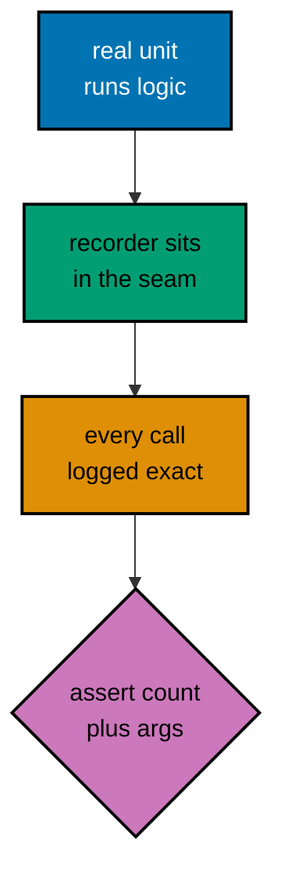
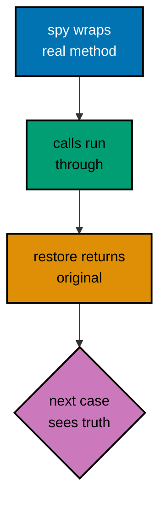
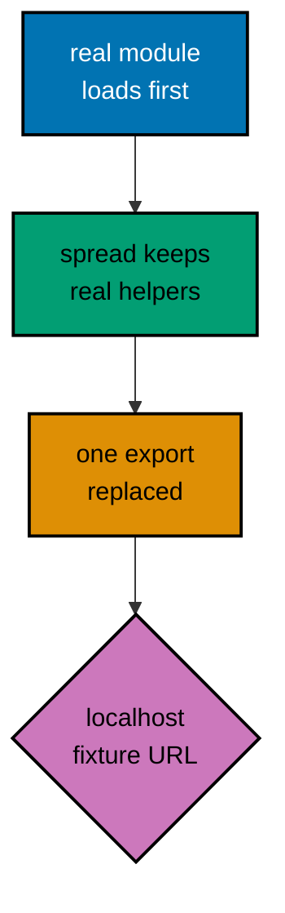
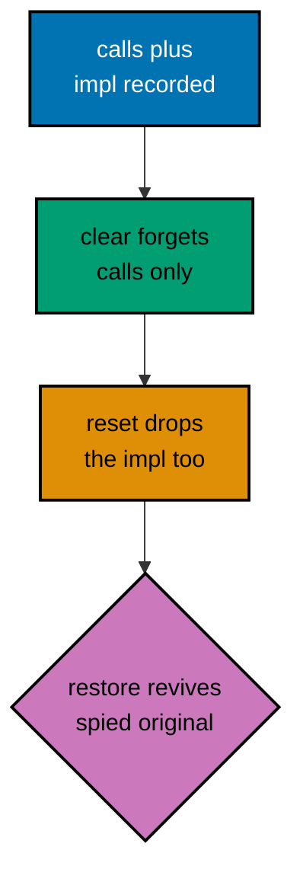
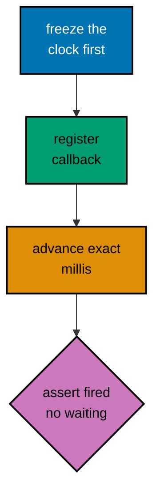
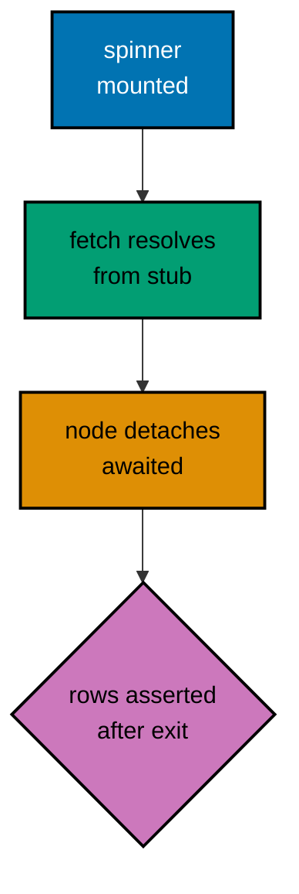
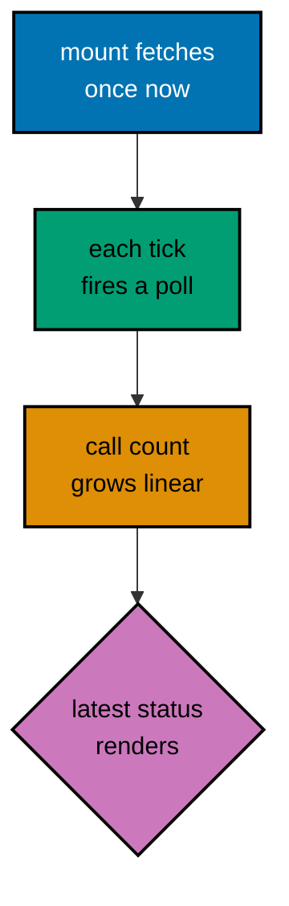
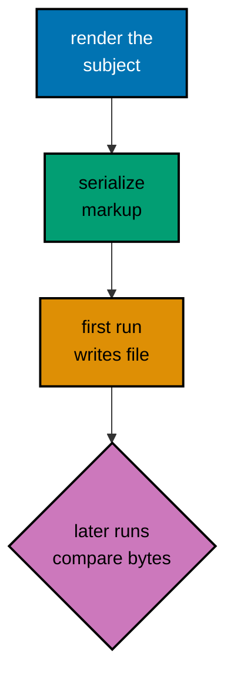
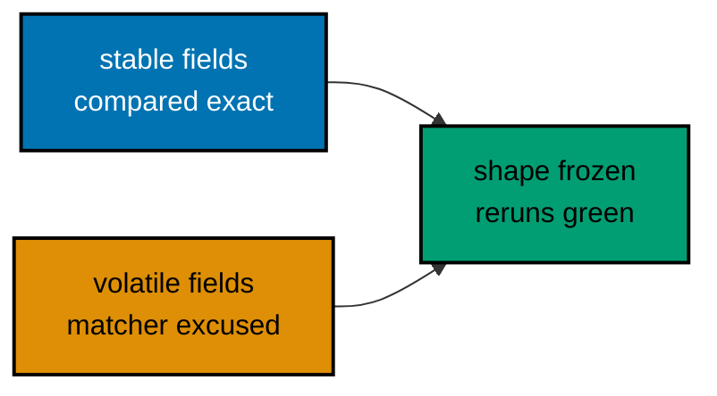
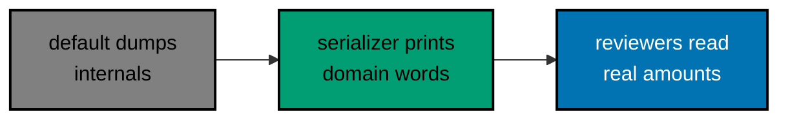

Examples 26–53 build the course's intermediate tier in three clusters. Examples 26–34 replace real collaborators with stand-ins: recorded functions, whole-module mocks, partial mocks, and spies. Examples 35–44 tame time itself with fake timers, queued microtasks, and `act`-flushed effects. Examples 45–53 record rendered output as snapshots, then teach when to keep, update, or replace them. Every example below is a complete, self-contained file under `learning/code/ex-NN-*/`, run for real with **Vitest 4.1.0** against **React 19**, **Testing Library 16**, and **jsdom 29** — every **Output** block is the genuine captured transcript, and every fence is byte-identical to the file it shows.

---

### Example 26: Recording Calls with vi.fn

_ex-26 · exercises co-05_

The anchor for the mocking cluster: `vi.fn()` builds a function that remembers every call. Arguments, count, and order become assertable facts instead of console.logs to eyeball.

Collaborator calls are invisible in return values: a checkout that charges twice still returns 'ok'. Recorders make the invisible visible, which is the only way to test notifications, analytics, and logging without reading production logs after the fact. The count assertion matters as much as the arguments — duplicate charges pass argument checks and only fail counts. Every mock in this cluster is this recorder with more behavior attached.



**`learning/code/ex-26-recording-calls-with-vi-fn/example.test.ts`**:

```ts
import { expect, test, vi } from "vitest";
// => vi is the mocking namespace: fn, spyOn, and mock all live under it.
// => Mocking starts with a bare recorder: no implementation, total memory.

function checkout(total: number, notify: (message: string) => void): string {
  // => The notifier arrives as a parameter: the seam the mock will fill.
  // => Dependency-as-argument is the most testable wiring: no imports to stub.
  if (total <= 0) throw new Error("Total must be positive");
  // => Guard clause: the recorder below only sees calls past this line.
  notify(`Charged $${total}`);
  // => The side effect under test: one call, one formatted message.
  return "ok";
  // => Return value stays trivial: the interaction is the assertion target.
}

test("records the notification call exactly", async () => {
  // => Case name states the recording claim: one call, exact arguments.
  const notify = vi.fn();
  // => vi.fn() with no implementation: records calls, returns undefined.
  // => Bare recorders suit void collaborators: nothing to compute, only proof.
  const result = checkout(25, notify);
  // => Call the real unit with the recorder in the collaborator's seat.
  expect(result).toBe("ok");
  // => Return value asserted first: the unit still does its own job.
  expect(notify).toHaveBeenCalledTimes(1);
  // => Exactly once: retries and double-sends fail this line immediately.
  expect(notify).toHaveBeenCalledWith("Charged $25");
  // => Exact arguments: the message format is part of the contract.
  // => Template drift like 'Charged $ 25' fails here, not in production logs.
  expect(notify.mock.calls[0]?.[0]).toBe("Charged $25");
  // => Raw call log access: first call, first argument, same fact, no magic.
  // => Optional chaining satisfies strict null checks on the tuple access.
});
```

**Run**: `vitest run`

**Output** (`learning/code/ex-26-recording-calls-with-vi-fn/expected/main.stdout.txt`):

```text
PASS: ex-26-recording-calls-with-vi-fn (1 tests)
```

**Key takeaway**: `vi.fn()` records every call's arguments and count; `toHaveBeenCalledWith` turns the recording into a contract.

---

### Example 27: Scripted Return Values

_ex-27 · exercises co-05_

`mockReturnValue`, `mockReturnValueOnce`, and `mockResolvedValue` script a collaborator's answers: first this, then that, promises included. Scripted answers make branching logic deterministic.

Retry logic is untestable against real services: failures are rare, slow, and unrepeatable. Scripted answers compress a warehouse outage into two queue entries and run the whole branch matrix — success, retry-then-success, total failure — in milliseconds. The nth-call assertion is the detail most suites skip and most need: it proves the retry asked for the right thing, not just that it asked twice.

**`learning/code/ex-27-scripted-return-values/example.test.ts`**:

```ts
import { expect, test, vi } from "vitest";
// => Same vi namespace: return scripting is configuration, not new API.

// => Retry helper: primary source first, alternate SKU on null, throw on double null.
async function firstAvailable(
  fetchPrice: (sku: string) => Promise<number | null>, // => Fetcher returns nullable prices: null means missing stock, the retry trigger.
  sku: string, // => SKU threads through both attempts: the alternate appends -alt below.
): Promise<number> {
  // => The fetcher may return null for missing stock: the unit must retry.
  // => Async collaborator, nullable answer: the script below covers both.
  const primary = await fetchPrice(sku);
  // => First attempt: full price source, may come back empty.
  if (primary !== null) return primary;
  // => Non-null short-circuits: the fallback never runs on success.
  const fallback = await fetchPrice(`${sku}-alt`);
  // => Retry with an alternate SKU: the second scripted answer lands here.
  if (fallback === null) throw new Error(`Out of stock: ${sku}`);
  // => Double null throws: the test scripts this path too, deterministically.
  return fallback;
  // => Fallback value returned: retry logic proved without a warehouse.
}

test("uses the fallback when primary stock is missing", async () => {
  // => Case name narrates the script: null first, price second, throw never.
  const fetchPrice = vi.fn<(sku: string) => Promise<number | null>>();
  // => Generic parameter types the recorder: arguments and answers checked.
  // => Typed mocks fail compilation on signature drift: contracts enforced.
  fetchPrice.mockResolvedValueOnce(null).mockResolvedValueOnce(42);
  // => mockResolvedValueOnce queues answers in order: null, then 42.
  // => Once-queue empties after use: a third call would return undefined.
  // => Order in the queue mirrors order in the code: script reads linearly.
  const price = await firstAvailable(fetchPrice, "rice-1kg");
  // => Await the unit: both scripted answers consumed across two awaits.
  expect(price).toBe(42);
  // => Fallback value surfaces: retry logic worked exactly as scripted.
  expect(fetchPrice).toHaveBeenCalledTimes(2);
  // => Two calls prove the retry happened: one call would mean no fallback.
  expect(fetchPrice).toHaveBeenNthCalledWith(2, "rice-1kg-alt");
  // => Nth-call assertion pins the retry argument: alternate SKU, second.
});
```

**Run**: `vitest run`

**Output** (`learning/code/ex-27-scripted-return-values/expected/main.stdout.txt`):

```text
PASS: ex-27-scripted-return-values (1 tests)
```

**Key takeaway**: Queue answers with `mockResolvedValueOnce`: each call consumes the next scripted answer, so retry and fallback logic runs deterministically.

---

### Example 28: Implementations and Rejections

_ex-28 · exercises co-05_

`mockImplementation` computes answers from inputs, and `mockRejectedValue` scripts promise failures. Together they cover branches that fixed values cannot reach.

Fixed return values cannot test policies — percentage discounts, tiered pricing, retry-with-backoff all decide from inputs. Implementations keep those tests honest while staying deterministic. Rejections close the other gap: most promise chains are only tested on success because failing on demand is hard, so the catch branch rots until production exercises it. Scripted rejections make error handling a first-class, green-or-red claim.

**`learning/code/ex-28-implementations-and-rejections/example.test.ts`**:

```ts
import { expect, test, vi } from "vitest";
// => vi namespace again: implementations and rejections extend the recorder.

// => Pricing rule: sum minus per-item discount, strategy injected for tests.
function totalWithDiscount(
  prices: number[], // => Basket lines: the reduce below visits each one exactly once.
  discount: (price: number) => number, // => Policy as a function: the mock scripts its answers per price.
): number {
  // => Returns a plain number: no options, no nulls, the total always defined.
  // => Discount strategy arrives as a function: computed answers fit naturally.
  // => Strategy-as-parameter keeps the unit pure: the mock supplies the policy.
  return prices.reduce((sum, price) => sum + price - discount(price), 0);
  // => Reduce threads the strategy through every price: branch per element.
}

test("implementation computes per-input answers", async () => {
  // => The mock decides from its input: ten percent off, computed live.
  const discount = vi.fn((price: number) => (price > 100 ? 20 : 5));
  // => Implementation in the constructor: default answer for every call.
  // => Branch inside the mock mirrors the policy the unit must handle.
  const total = totalWithDiscount([50, 200], discount);
  // => Mixed basket: one cheap item, one expensive, both branches exercised.
  expect(total).toBe(50 - 5 + (200 - 20));
  // => Arithmetic spelled out: 45 + 180 = 225, each discount visible.
  expect(discount).toHaveBeenCalledTimes(2);
  // => Once per price: the reduce contract, proved by the count.
});

// => Failure path next: the same recorder scripts a rejection for the catch branch.
test("rejected promises surface through rejects", async () => {
  // => Async failure needs its own idiom: rejects unwraps the thrown error.
  const failing = vi.fn().mockRejectedValue(new Error("warehouse down"));
  // => mockRejectedValue scripts a promise that always rejects with this error.
  // => Chained off a bare vi.fn(): record plus reject in one expression.
  const outcome = (async (): Promise<string> => {
    // => Tiny inline unit: calls the collaborator, labels the failure mode.
    try {
      await failing("rice-1kg");
      // => Awaited call throws inside try: the catch below translates it.
      return "in stock";
      // => Bare catch: the test asserts the translated label, not the raw error.
    } catch {
      // => Bare catch: the test asserts the message separately, precisely.
      return "unavailable";
    }
  })();
  // => Immediately invoked: the promise under test exists before assertions.
  await expect(outcome).resolves.toBe("unavailable");
  // => resolves unwraps: the translated label, not the raw warehouse error.
  // => rejects would assert a thrown error; resolves asserts a handled one.
  expect(failing).toHaveBeenCalledWith("rice-1kg");
  // => The collaborator still recorded its call: failure observed, then handled.
});
```

**Run**: `vitest run`

**Output** (`learning/code/ex-28-implementations-and-rejections/expected/main.stdout.txt`):

```text
PASS: ex-28-implementations-and-rejections (2 tests)
```

**Key takeaway**: `mockImplementation` derives answers from inputs; `mockRejectedValue` plus `rejects`/`resolves` proves async error handling without a failing server.

---

### Example 29: Spying on Real Methods

_ex-29 · exercises co-05, co-10_

`vi.spyOn` watches a real method without replacing its behavior, and `mockRestore` hands the original back. Spies observe; mocks replace; confusing them breaks isolation.

Spies answer the question mocks cannot: did the real code run AND who called it? Analytics, audit trails, and cache writes need both proofs at once. The restore discipline is the price: an unrestored spy is a mock wearing a costume, and the following case tests a lie. Asserting `isMockFunction` false in the second case turns the discipline itself into a checked fact instead of a hopeful comment.



**`learning/code/ex-29-spying-on-real-methods/example.test.ts`**:

```ts
import { afterEach, expect, test, vi } from "vitest";
// => afterEach returns: spies must be restored between cases, guaranteed.

// => Collaborator with real behavior: the spy below observes without replacing.
const audit = {
  // => A tiny collaborator object: one method, real behavior worth keeping.
  entries: [] as string[], // => Log array holds events: the spy watches the method, the test reads this.
  // => The log array is observable state: the spy watches the method, not this.
  // => Real append: spying preserves this body while recording its calls.
  record(event: string): void {
    // => Real implementation appends: spies preserve this while observing.
    this.entries.push(event);
    // => Method closes: push done, entries observable for the assertions below.
  },
};

afterEach(() => {
  vi.restoreAllMocks();
  // => restoreAllMocks returns every spied method to its original body.
  // => Without restore, mock implementations leak into the next case's reality.
  audit.entries = [];
  // => Fixture state resets beside the spies: behavior plus data, both fresh.
});

// => Unit under test: validates, records audit, returns ok — spied end to end.
function checkout(total: number): string {
  // => The unit calls the real collaborator: audit trail is a real requirement.
  if (total <= 0) throw new Error("Total must be positive");
  audit.record(`charged ${total}`);
  // => Real method, real append: the spy below observes without interfering.
  return "ok";
}

test("spies observe the real method and its call", async () => {
  // => Observe, do not replace: the entries array must still fill up.
  const spy = vi.spyOn(audit, "record");
  // => spyOn wraps in place: calls run through, arguments get recorded.
  // => Wrapping beats replacing when the behavior itself is under test too.
  expect(checkout(25)).toBe("ok");
  // => Real unit, real collaborator, observing spy: the honest triangle.
  expect(spy).toHaveBeenCalledWith("charged 25");
  // => Call recorded with exact message: observation proved, behavior kept.
  expect(audit.entries).toEqual(["charged 25"]);
  // => Real side effect happened: a replacing mock would leave this empty.
  // => Asserting the effect separates spies from mocks in one line.
  // => First case closes: observation plus real effect, both proved.
});

test("restore hands back the original method", async () => {
  // => The isolation proof: this case runs on the un-spied original.
  // => If restore leaked, isMockFunction would report true and fail below.
  expect(vi.isMockFunction(audit.record)).toBe(false);
  // => Original method restored: no wrapper, no recording, just behavior.
  checkout(10);
  // => Plain call on the restored object: works exactly like production.
  expect(audit.entries).toEqual(["charged 10"]);
  // => Fresh log, real append: isolation held across both cases.
});
```

**Run**: `vitest run`

**Output** (`learning/code/ex-29-spying-on-real-methods/expected/main.stdout.txt`):

```text
PASS: ex-29-spying-on-real-methods (2 tests)
```

**Key takeaway**: `vi.spyOn` observes real behavior while recording calls; `restoreAllMocks` in `afterEach` guarantees the next case sees the original.

---

### Example 30: Mocking a Whole Module

_ex-30 · exercises co-06_

The anchor for module mocks: `vi.mock` replaces an entire imported module before the subject loads. The component renders against scripted data with no server and no real module code.

Module boundaries are where unit tests earn their speed: replacing the HTTP layer removes seconds of IO and all of its flakiness while keeping the orchestration logic under test real. The hoisting rule is the price of admission — the factory runs first, so it cannot close over test variables — and the typed handle keeps the double honest when the real module's signature changes. Whole-module mocks are blunt; the next examples sharpen them.

**`learning/code/ex-30-mocking-a-whole-module/api.ts`**:

```ts
export type User = { name: string };
// => Shared DTO type: mock and subject agree on the shape by construction.

export async function fetchUser(id: string): Promise<User> {
  // => The real function hits a network: never imported unmocked in tests.
  // => Its signature is the contract the mock factory below must mirror.
  const response = await fetch(`https://api.example.com/users/${id}`);
  // => Real URL, real network: this line must never execute under test.
  // => The course runs with no network: this module exists to be replaced.
  return (await response.json()) as User;
  // => Cast documents the DTO: the mock returns the same shape, minus HTTP.
}
```

**`learning/code/ex-30-mocking-a-whole-module/service.ts`**:

```ts
import { fetchUser } from "./api";
// => Static import of the real module: vi.mock below swaps it before load.
// => The subject never knows it runs against a double: that is the point.

export async function greeting(id: string): Promise<string> {
  // => Thin orchestration: fetch, then format. Mocks own the fetch half.
  // => Orchestration logic is what this unit actually tests.
  const user = await fetchUser(id);
  // => Awaited collaborator: the mock answers synchronously-fast, still async.
  return `Hello, ${user.name}!`;
  // => Formatting is the real behavior: names in, greeting out.
}
```

**`learning/code/ex-30-mocking-a-whole-module/example.test.ts`**:

```ts
import { expect, test, vi } from "vitest";
// => vi.mock hoists above these imports: the swap happens before loading.

import { fetchUser } from "./api";
// => Import the REAL path: the mock registry answers instead of the file.
// => Same specifier as production code: no test-only import paths exist.

import { greeting } from "./service";
// => Subject imports the same specifier: it receives the mock transparently.

vi.mock("./api", () => ({
  // => Factory replaces the whole module: only listed exports exist now.
  // => Unlisted exports vanish: the factory is total, not a patch.
  fetchUser: vi.fn(),
  // => Recorder in the factory: scripted per test below, fresh every file.
}));

const mockedFetchUser = vi.mocked(fetchUser);
// => vi.mocked retypes the import as a mock: typed scripting, no casts.
// => One alias per file: every test scripts through this typed handle.

test("greets the mocked user without network", async () => {
  // => No fetch, no server: the factory plus script below is the whole world.
  mockedFetchUser.mockResolvedValue({ name: "Sari" });
  // => Script the answer: async DTO, resolved immediately, deterministic.
  // => Per-test scripting beats file-level: each case owns its fixture data.
  const text = await greeting("u-1");
  // => Await the orchestration: mock answers flow through the real formatter.
  expect(text).toBe("Hello, Sari!");
  // => Greeting format proved against scripted data: logic tested, IO mocked.
  expect(mockedFetchUser).toHaveBeenCalledWith("u-1");
  // => The subject passed the id through untouched: wiring proved as well.
});
```

**Run**: `vitest run`

**Output** (`learning/code/ex-30-mocking-a-whole-module/expected/main.stdout.txt`):

```text
PASS: ex-30-mocking-a-whole-module (1 tests)
```

**Key takeaway**: `vi.mock` with a factory swaps the module before anyone imports it; `vi.mocked` gives back a typed handle for per-test scripting.

---

### Example 31: Mocking Part of a Module

_ex-31 · exercises co-06_

`importOriginal` keeps every real export and replaces only the one that touches the network — plus any function that closes over it, since module-internal bindings ignore the swap. Partial mocks shrink the lie to a single seam.

Whole-module mocks rot: when the real module gains a helper, every factory silently drops it and tests run against an outdated copy of the world. Partial mocks invert the default — real unless dangerous — so new exports flow through automatically and only the network-touching constant needs attention. The localhost override keeps the suite honest: even if a test accidentally fetched, it would hit a fixture address, never production.



**`learning/code/ex-31-mocking-part-of-a-module/config.ts`**:

```ts
// => Production URL constant: the single export the partial mock replaces.
export const apiUrl = "https://api.example.com";
// => Real production URL: the one export this test refuses to run against.

export function endpoint(path: string): string {
  // => Pure URL joiner: real behavior, safe to keep, worth testing for real.
  return `${apiUrl}/${path}`;
  // => Template join: no network, no side effects, keep the original.
}

export function timeoutMs(): number {
  // => Pure constant reader: another safe export the partial mock preserves.
  return 3000;
  // => Real value flows through: partial mocks keep honest behavior honest.
  // => Reader closes: real value flows through the preserved export.
}
```

**`learning/code/ex-31-mocking-part-of-a-module/example.test.ts`**:

```ts
import { expect, test, vi } from "vitest";
// => vi.mock with importOriginal: the surgical variant of Example 30.

import { apiUrl, endpoint, timeoutMs } from "./config";
// => Same specifiers as production: the swap stays transparent to readers.

vi.mock("./config", async (importOriginal) => {
  // => Async factory: importOriginal loads the real module for spreading.
  // => The factory stays hoisted: only importOriginal bridges the two worlds.
  const real = await importOriginal<typeof import("./config")>();
  // => Typed import of the real module: spreads keep their types here.
  const apiUrl = "http://localhost:9999";
  // => Fixture URL bound once: both the export and the joiner below use it.
  // => Localhost override: a fixture address, never a real dependency.
  return {
    ...real,
    // => Spread preserves timeoutMs: real code runs for the safe exports.
    // => Preservation is the point: only the dangerous export gets replaced.
    apiUrl,
    // => Replaced export reads back the fixture value, asserted below.
    endpoint: (path: string): string => `${apiUrl}/${path}`,
    // => Re-wired joiner: the real endpoint closes over the REAL apiUrl,
    // => so spreading alone cannot redirect it — the mock re-points it here.
    // => Same template, fixture base: logic preserved, destination replaced.
  };
});

test("keeps real helpers, replaces only the URL", async () => {
  // => Two claims in one file: preserved behavior plus replaced constant.
  expect(timeoutMs()).toBe(3000);
  // => Real function survived the mock: 3000 is the actual module value.
  expect(endpoint("users")).toBe("http://localhost:9999/users");
  // => Real joiner plus fixture URL: surgery left the logic intact.
  expect(apiUrl).toBe("http://localhost:9999");
  // => The replaced export reads back exactly the fixture value set above.
  // => Nothing here touches the network: addresses are strings until fetched.
});
```

**Run**: `vitest run`

**Output** (`learning/code/ex-31-mocking-part-of-a-module/expected/main.stdout.txt`):

```text
PASS: ex-31-mocking-part-of-a-module (1 tests)
```

**Key takeaway**: Spread `importOriginal`, override the dangerous export, and re-wire functions that close over it: the mock touches only what would reach the network.

---

### Example 32: Stubbing fetch Itself

_ex-32 · exercises co-06, co-11_

Assigning `globalThis.fetch` replaces the network for every module at once. Components that call `fetch` directly render from scripted responses with zero HTTP.

This example is the course's network rule made concrete: every async case in this course renders from stubs or fixtures, never from sockets. Stubbing the global covers components that call fetch directly — no seam refactoring required — while the real Response object keeps parsing behavior faithful. The restore line is load-bearing: a leaked fetch stub makes every later test in the file pass against yesterday's fixture.

**`learning/code/ex-32-stubbing-fetch-itself/example.test.tsx`**:

```tsx
// @vitest-environment jsdom
// => DOM pragma: the component renders fetched users into a real list.

import { afterEach, expect, test, vi } from "vitest";
// => vi provides the fetch stub: global replacement needs the mock namespace.

import { cleanup, render, screen } from "@testing-library/react";
// => getByRole and findByRole locate the list before and after loading.

import "@testing-library/jest-dom/vitest";
// => toBeInTheDocument asserts the async-loaded rows when they arrive.

import React, { useEffect, useState } from "react";
// => Effect plus state: fetch on mount is the pattern under test.

import userEvent from "@testing-library/user-event";
// => user-event simulates full interaction sequences, not single raw events.

// => Isolation hook: unmount plus global restore bracket every fetch case.
afterEach(() => {
  cleanup();
  // => Unmount first: rendered output must not survive the case.
  vi.unstubAllGlobals();
  // => unstubAllGlobals returns fetch to the real implementation after each.
  // => Global stubs are the leakiest doubles: restore is not optional here.
  // => Hook closes: stubs die here so no response leaks into the next case.
});

// => DTO shape: stubbed JSON must satisfy this contract exactly.
type User = { name: string };
// => DTO shape: the stubbed response must satisfy this contract exactly.

// => Subject: fetches on mount, renders rows — the stub-fetch pattern target.
function UserList(): React.JSX.Element {
  // => Local subject: fetches on mount, renders rows, reloads on demand.
  const [users, setUsers] = useState<User[]>([]);
  // => Empty start: the loading state is genuinely observable by the test.
  // => Mount effect: the single fetch the stub below answers.
  useEffect(() => {
    // => Mount effect fetches once: the stub below answers, no network runs.
    void fetch("/api/users")
      // => Relative URL: a fixture path, never a host, never the network.
      .then((r) => r.json())
      // => Response.json parses the stubbed body: real parsing, fake bytes.
      .then((data) => setUsers(data as User[]));
    // => Cast documents the DTO: stubbed JSON must match this shape.
    // => Empty deps: runs once per mount, never refires on re-render.
  }, []);
  return (
    // => Named list: findByRole waits for these rows after the stub resolves.
    <ul aria-label="Users">
      {/* => Named list: findByRole waits for rows the effect loads. */}
      {users.map((u) => (
        // => Row per user: key by name keeps the fixture list stable.
        <li key={u.name}>{u.name}</li>
      ))}
    </ul>
  );
}

test("renders stubbed users, never touching the network", async () => {
  // => The course check in one case: async rendering with zero HTTP.
  // => Fixture rows: the only users this component will ever see.
  const payload = [{ name: "Sari" }, { name: "Budi" }];
  // => Fixture rows: the only data the component will ever see here.
  vi.stubGlobal(
    "fetch",
    vi.fn().mockResolvedValue(
      new Response(JSON.stringify(payload), {
        // => Real Response object: json() parses exactly like production.
        headers: { "Content-Type": "application/json" },
        // => JSON content type: the component branch under test is the real one.
      }),
    ),
  );
  // => stubGlobal swaps fetch everywhere: every module sees the same double.
  // => mockResolvedValue answers immediately: no timers, no waiting on IO.
  // => Mount triggers the effect: fetch is already stubbed, order matters.
  render(<UserList />);
  // => Mount triggers the effect: fetch is already stubbed, order matters.
  const list = await screen.findByRole("list", { name: "Users" });
  // => findByRole polls until rows render: the async assertion primitive.
  // => Default timeout suffices: the stub resolves in microseconds.
  expect(list).toHaveTextContent("Sari");
  // => First row rendered from stubbed bytes: fetch, parse, render proved.
  expect(list).toHaveTextContent("Budi");
  // => Second row: the whole payload arrived, not just the first element.
  expect(vi.mocked(fetch)).toHaveBeenCalledWith("/api/users");
  // => vi.mocked retypes the global: the call path itself is asserted too.
  // => Case closes: render, wait, and call-path assertions all proved.
});
```

**Run**: `vitest run`

**Output** (`learning/code/ex-32-stubbing-fetch-itself/expected/main.stdout.txt`):

```text
PASS: ex-32-stubbing-fetch-itself (1 tests)
```

**Key takeaway**: `vi.stubGlobal('fetch', ...)` plus a real `Response` gives components honest bytes with no HTTP; `unstubAllGlobals` restores it.

---

### Example 33: Mocking the Clock for Dates

_ex-33 · exercises co-05, co-07_

`vi.setSystemTime` freezes `Date.now` at a fixed instant so date formatting is deterministic. Time-dependent rendering becomes a pure function of the frozen clock.

Date-dependent tests without frozen clocks are slow-motion flakes: green for 364 days, red on New Year's Eve, blamed on CI. The freeze costs two lines and converts wall-clock dependence into a fixed input like any other fixture. The restore in `afterEach` matters equally — a leaked fake clock makes the NEXT test's timeouts and intervals behave surrealistically.

**`learning/code/ex-33-mocking-the-clock-for-dates/example.test.tsx`**:

```tsx
// @vitest-environment jsdom
// => DOM pragma: the formatted date renders into a document paragraph.

import { afterEach, expect, test, vi } from "vitest";
// => vi controls the clock here: setSystemTime plus fake timers together.

import { cleanup, render, screen } from "@testing-library/react";
// => Single text query: the clock output is one rendered string.

import "@testing-library/jest-dom/vitest";
// => toHaveTextContent pins the frozen timestamp's rendered form.

import React from "react";
// => No state, no effects: the component reads the clock at render time.

afterEach(() => {
  cleanup();
  // => Unmount the clock: rendered timestamps must not leak across cases.
  vi.useRealTimers();
  // => Restore real timers: a frozen clock leaking forward freezes everything.
});

function InvoiceDate(): React.JSX.Element {
  // => Local subject: renders today's date in ISO form, nothing else.
  const today = new Date(Date.now()).toISOString().slice(0, 10);
  // => Date.now is the seam: setSystemTime below pins it to a fixed instant.
  // => Slice takes the date part: time-of-day never enters the assertion.
  return <p>Billed on {today}</p>;
  // => Rendered sentence: the full observable output of this component.
}

test("renders the frozen system date", async () => {
  // => Determinism claim: the same instant renders the same string, always.
  vi.useFakeTimers();
  // => Fake timers are required: setSystemTime only works on a fake clock.
  vi.setSystemTime(new Date("2026-03-15T10:00:00Z"));
  // => Frozen instant: March 15, a fixed point the assertion below expects.
  // => UTC instant: TZ=UTC in the harness keeps date math identical everywhere.
  render(<InvoiceDate />);
  // => Render reads the frozen clock: no race with the real wall time.
  expect(screen.getByText("Billed on 2026-03-15")).toBeInTheDocument();
  // => Exact rendered string: year, month, day all pinned by the frozen clock.
  // => Without the freeze this test passes only on March 15: a yearly flake.
});
```

**Run**: `vitest run`

**Output** (`learning/code/ex-33-mocking-the-clock-for-dates/expected/main.stdout.txt`):

```text
PASS: ex-33-mocking-the-clock-for-dates (1 tests)
```

**Key takeaway**: Freeze the clock with `setSystemTime` before rendering: date output becomes deterministic text instead of a daily lottery.

---

### Example 34: Clear, Reset, Restore Matrix

_ex-34 · exercises co-05, co-10_

`mockClear`, `mockReset`, and `mockRestore` erase progressively more: calls, then implementation, then the original. Picking the right depth keeps doubles fresh without rebuilding them.

Stale mock state is the number-two cause of order-dependent suites after shared fixtures: yesterday's calls satisfy today's `toHaveBeenCalledTimes`, and yesterday's implementation answers today's questions. The matrix gives each situation its tool — clear for shared scripts, reset for rescripting, restore for spies — so the team stops rebuilding every double from scratch in every case and stops leaking state between them.



**`learning/code/ex-34-clear-reset-restore-matrix/example.test.ts`**:

```ts
import { expect, test, vi } from "vitest";
// => vi namespace for the whole matrix: three depths, one recorder.

test("clear, reset, and restore erase progressively more", async () => {
  // => One case walks all three depths in order: each builds on the last.
  const double = vi.fn((x: number) => x * 2);
  // => Recorder WITH implementation: doubling answers from the start.
  double(21);
  // => One call recorded: 42 answered, log holds a single entry.
  expect(double).toHaveBeenCalledTimes(1);
  // => Baseline count pinned before any erasing begins.
  double.mockClear();
  // => mockClear empties the call log ONLY: implementation survives.
  // => Cheapest reset: use between cases that share one scripted double.
  expect(double).not.toHaveBeenCalled();
  // => Log empty: the next assertion would fail if any call survived.
  expect(double(21)).toBe(42);
  // => Implementation intact: clear never touches scripted answers.
  double.mockImplementation((x) => x + 100);
  // => Override installed: the next call answers 101, not 2, by script.
  expect(double(1)).toBe(101);
  // => Override proved active: reset below has something to remove.
  double.mockReset();
  // => mockReset clears calls AND drops scripted overrides entirely.
  // => Deeper reset: the constructor implementation survives, overrides do not.
  expect(double).not.toHaveBeenCalled();
  // => Log empty again: reset clears the record like clear does.
  expect(double(1)).toBe(2);
  // => Override gone, constructor back: reset removed exactly the script.
  // => This line is the matrix in miniature: clear kept it, reset dropped it.
  double.mockRestore();
  // => mockRestore on a bare fn keeps the mock: originals return for spies only.
  // => For spyOn doubles restore resurrects the wrapped method (Example 29).
  expect(double).not.toHaveBeenCalled();
  // => Log empty once more: the matrix ends where clear began, provably.
});
```

**Run**: `vitest run`

**Output** (`learning/code/ex-34-clear-reset-restore-matrix/expected/main.stdout.txt`):

```text
PASS: ex-34-clear-reset-restore-matrix (1 tests)
```

**Key takeaway**: `mockClear` forgets calls, `mockReset` also drops scripted overrides, `mockRestore` additionally revives spied originals.

---

### Example 35: Fake Timers Control setTimeout

_ex-35 · exercises co-07_

The anchor for the timers cluster: `vi.useFakeTimers` replaces the clock, and `advanceTimersByTime` jumps it forward on command. A fifty-millisecond delay resolves in zero wall-clock time.

Timer tests on real clocks are slow AND flaky: a 50ms test takes 50ms times a thousand cases, and a loaded CI machine turns 49ms boundaries into failures. Fake timers delete both problems — the suite runs at full speed and boundary assertions like the 49ms line above hold on every machine. The restore hook is the discipline that keeps the frozen clock from escaping into other files.



**`learning/code/ex-35-fake-timers-control-timeout/example.test.ts`**:

```ts
import { afterEach, expect, test, vi } from "vitest";
// => vi owns the clock here: fake timers, advance, and restore.

// => Restore hook: a frozen clock must never escape into the next file.
afterEach(() => {
  vi.useRealTimers();
  // => Restore real timers after every case: a frozen clock must never leak.
  // => Leaked fakes make the next file's awaits hang until timeout.
  // => Hook closes: real timers back before the next case starts.
});

// => Delayed helper: resolves after ms, the minimal timer-plus-promise shape.
function delayedValue<T>(value: T, ms: number): Promise<T> {
  // => The unit: resolves after a delay, like a debounced save or a poll.
  // => Generic over the value: the timer logic is independent of the payload.
  return new Promise((resolve) => {
    // => Promise executor runs immediately: the timer starts on call.
    setTimeout(() => resolve(value), ms);
    // => The ONLY clock read: advancing fake time fires this callback.
  });
}

test("advancing time resolves the delayed promise", async () => {
  // => The determinism claim: time jumps on command, never on wall clocks.
  vi.useFakeTimers();
  // => Fake timers replace setTimeout before the unit under test runs.
  // => Every timer the unit creates is now driven by explicit advances.
  let settled: string | null = null;
  // => Outside variable observes resolution: the promise writes here on fire.
  const pending = delayedValue("ready", 50);
  // => Promise created but unfired: frozen time holds the callback back.
  const observed = pending.then((v) => {
    // => Attach the observer BEFORE advancing: callbacks must be registered.
    settled = v;
  });
  // => Observer attached: nothing has fired yet, clock still frozen.
  expect(settled).toBeNull();
  // => Still null: frozen time proves the callback waits for the advance.
  vi.advanceTimersByTime(49);
  // => One millisecond short: the boundary assertion below needs this step.
  expect(settled).toBeNull();
  // => Still pending at 49ms: off-by-one timer bugs fail exactly here.
  vi.advanceTimersByTime(1);
  // => The final millisecond: the timer fires synchronously on advance.
  await observed;
  // => Flush microtasks: the fired timer's continuation runs on this await.
  // => Timer callbacks run sync, promise continuations need one microtask tick.
  expect(settled).toBe("ready");
  // => Resolved value observed: time travel complete, zero waiting involved.
  await pending;
  // => Await the original: the runner sees a clean async test, failures propagate.
});
```

**Run**: `vitest run`

**Output** (`learning/code/ex-35-fake-timers-control-timeout/expected/main.stdout.txt`):

```text
PASS: ex-35-fake-timers-control-timeout (1 tests)
```

**Key takeaway**: `useFakeTimers` freezes the clock; `advanceTimersByTime` fires callbacks synchronously: delays become instant and exact.

---

### Example 36: System Time and Clock Render

_ex-36 · exercises co-07_

A ticking clock component advances one second per timer tick. Freezing the system time and advancing the interval proves each tick renders without waiting a real second.

Interval UI — clocks, countdowns, polling badges — is chronically undertested because each tick costs a real second and CI hates waiting. Fake time compresses an hour of ticks into milliseconds, so the suite can assert the fiftieth tick as cheaply as the first. The epoch-seconds display is deliberately unfriendly: asserting exact numbers forces the test to compute what the clock should show, which is exactly the reasoning production code must get right across time zones.

**`learning/code/ex-36-system-time-and-clock-render/example.test.tsx`**:

```tsx
// @vitest-environment jsdom
// => DOM pragma: each tick re-renders a paragraph in the document.

import { afterEach, expect, test, vi } from "vitest";
// => vi drives both the system clock and the interval timers here.

import { act, cleanup, render, screen } from "@testing-library/react";
// => act joins the imports: bare timer advances below need explicit flushing.
// => One text query per tick: the clock output is a single paragraph.

import "@testing-library/jest-dom/vitest";
// => toHaveTextContent pins the frozen timestamp after each advance.

import React, { useEffect, useState } from "react";
// => Effect owns the interval; state owns the displayed second.

afterEach(() => {
  cleanup();
  // => Unmount the clock: intervals die with the component, then restore.
  vi.useRealTimers();
  // => Real timers back: frozen intervals must never leak into other cases.
});

// => Subject: epoch seconds ticking once per fake second.
function Ticker(): React.JSX.Element {
  // => Local subject: shows epoch seconds, ticking once per fake second.
  const [now, setNow] = useState(() => Date.now());
  // => Lazy initializer reads the clock once: setSystemTime below pins it.
  useEffect(() => {
    // => Interval effect: the timer under test lives exactly here.
    const id = setInterval(() => setNow(Date.now()), 1000);
    // => One-second cadence: each advance below fires exactly one tick.
    return () => clearInterval(id);
    // => Cleanup clears the interval: unmount never leaves timers running.
  }, []);
  return <p>Epoch seconds: {Math.floor(now / 1000)}</p>;
  // => Seconds displayed: advancing 1000ms must increment this by exactly 1.
}

test("each advanced second ticks the display", async () => {
  // => Two ticks, two assertions: cadence proved, not just one lucky update.
  vi.useFakeTimers();
  // => Fake timers before render: the effect's interval must be fake too.
  vi.setSystemTime(new Date("2026-03-15T10:00:00Z"));
  // => Frozen start: epoch 1773568800, a fixed number the test expects.
  render(<Ticker />);
  // => Mount starts the interval AND reads the frozen clock for state.
  expect(screen.getByText("Epoch seconds: 1773568800")).toBeInTheDocument();
  // => Initial render pinned: 2026-03-15T10:00:00Z in epoch seconds.
  // => Advance inside act(): the tick must commit before the assertion reads.
  act(() => {
    // => One fake second elapses: interval fires, setNow runs, React flushes.
    vi.advanceTimersByTime(1000);
    // => Synchronous inside act: no microtask gap, no torn read possible.
  });
  // => Block closes: the epoch display now reads exactly one second later.
  // => Fake timers plus React state: act() keeps the commit synchronous here.
  expect(screen.getByText("Epoch seconds: 1773568801")).toBeInTheDocument();
  // => Plus exactly one: cadence proved, no skipped or doubled ticks.
  // => Case closes: two ticks proved, cadence exactly one per second.
});
```

**Run**: `vitest run`

**Output** (`learning/code/ex-36-system-time-and-clock-render/expected/main.stdout.txt`):

```text
PASS: ex-36-system-time-and-clock-render (1 tests)
```

**Key takeaway**: Freeze system time, advance the interval, assert each tick: periodic UI becomes a deterministic sequence of rendered strings.

---

### Example 37: Debounced Search

_ex-37 · exercises co-04, co-07_

A search field that waits 300ms after the last change fires exactly one request for rapid input. Fake timers plus synchronous change events prove the debounce without waiting: user-event stays on real timers everywhere in this course, because its async machinery hangs on a frozen clock.

Debounce bugs are silent performance killers: a missing `clearTimeout` fires a request per keystroke, and nobody notices until the search backend falls over. Real-timer debounce tests take 300ms each and still flake under load; fake timers make them instant and exact. Asserting the intermediate silence — not called before the advance — is the line that catches the forgotten clear, which is the actual bug in the wild.

**`learning/code/ex-37-debounced-search/example.test.tsx`**:

```tsx
// @vitest-environment jsdom
// => DOM pragma: keystrokes land in a document input element.

import { afterEach, expect, test, vi } from "vitest"; // => Runner plus fakes: timers and mocks in one import.
// => vi owns timers and the fetch recorder: interaction plus time together.

import { cleanup, fireEvent, render, screen } from "@testing-library/react"; // => Sync dispatch: fireEvent plus queries on a frozen clock.
// => fireEvent joins the imports: sync dispatch composes with frozen time.
// => textbox role for the search field: label query needs no ids.

import React, { useRef, useState } from "react"; // => Refs plus state: the query text and its pending timer.
// => Ref holds the pending timer id; state holds the query text.

// => Isolation hook: pending debounce timers die with the unmount.
afterEach(() => {
  cleanup();
  // => Unmount the search field: pending timers die with the component.
  vi.useRealTimers(); // => Restore timers: the fake clock stays inside this case.
  // => Restore real timers: debounce fakes must not leak into other cases.
  // => Hook closes: pending debounce timers die with the unmount.
});

// => Subject: keystrokes update state, silence fires the search.
function SearchBox({ onSearch }: { onSearch: (q: string) => void }): React.JSX.Element {
  // => The search callback is the seam: the test scripts it, never the network.
  const [query, setQuery] = useState("");
  // => Query state updates per keystroke: the timer reads the latest value.
  const timer = useRef<ReturnType<typeof setTimeout> | null>(null);
  // => Ref survives re-renders: clearing the previous timer needs the id.
  // => Keystroke handler: updates state, clears the old timer, starts a fresh one.
  const type = (value: string): void => {
    // => Every keystroke restarts the 300ms quiet-period clock.
    setQuery(value);
    if (timer.current !== null) clearTimeout(timer.current);
    // => Clear the pending search: only silence triggers a request.
    timer.current = setTimeout(() => onSearch(value), 300);
    // => Fresh timer captures THIS keystroke's value in its closure.
  };
  return (
    <label>
      Search
      {/* => Controlled input: every keystroke flows through the debounce handler. */}
      <input value={query} onChange={(e) => type(e.target.value)} />
      {/* => Label closes: name plus control, the accessible unit complete. */}
    </label>
  );
}

test("rapid changes fire one search for the final text", async () => {
  // => The debounce contract: three changes, one request, final text.
  vi.useFakeTimers();
  // => Fake timers before typing: debounce timers must be advance-driven.
  const onSearch = vi.fn();
  // => Recorder for the search callback: count plus argument, both asserted.
  render(<SearchBox onSearch={onSearch} />);
  // => Mount the debounced field: empty query, no timers pending.
  const field = screen.getByRole("textbox", { name: "Search" });
  // => Role plus wrapping-label name: the standard accessible query.
  fireEvent.change(field, { target: { value: "a" } });
  // => First change: starts a 300ms timer, synchronously, on the fake clock.
  // => fireEvent dispatches synchronously: frozen time composes with it exactly.
  fireEvent.change(field, { target: { value: "ab" } });
  // => Second change: clears the first timer, starts a fresh 300ms one.
  fireEvent.change(field, { target: { value: "abc" } });
  // => Third change: only this timer survives; the first two were cleared.
  // => Three dispatches, one pending timer: the debounce shape, stated plainly.
  expect(onSearch).not.toHaveBeenCalled();
  // => Nothing fired yet: the quiet period has not elapsed, correctly.
  vi.advanceTimersByTime(300);
  // => The full quiet period elapses at once: exactly one timer survives.
  expect(onSearch).toHaveBeenCalledTimes(1);
  // => One call for three keystrokes: the debounce earned its keep.
  expect(onSearch).toHaveBeenCalledWith("abc");
  // => Final text only: intermediate queries never reached the callback.
  // => Case closes: one call for three changes, the debounce proved.
});
```

**Run**: `vitest run`

**Output** (`learning/code/ex-37-debounced-search/expected/main.stdout.txt`):

```text
PASS: ex-37-debounced-search (1 tests)
```

**Key takeaway**: Dispatch rapid changes on a fake clock, advance past the quiet period, assert one call with final text: the whole debounce contract in one case.

---

### Example 38: findBy Waits for Elements

_ex-38 · exercises co-11_

`findBy*` polls until an element appears, combining a query with an implicit wait. The delayed render resolves on a real local timer against findBy's generous default budget: no arbitrary sleeps, no flakes. (findBy and waitFor hang on fake timers under Vitest, because their fake path calls the absent jest global, so rendering waits in this course always run on real timers.)

Newcomers test delayed UI with fixed `sleep(500)` calls that are slow when they pass and flaky when machines are loaded — the worst of both worlds. `findBy` waits exactly as long as needed and not a millisecond more, and on a fake clock the wait costs nothing. The advance-async pairing is the pattern to memorize: start polling, then move time forward, then await the result.

**`learning/code/ex-38-find-by-waits-for-elements/example.test.tsx`**:

```tsx
// @vitest-environment jsdom
// => DOM pragma: the delayed greeting renders into the document late.

import { afterEach, expect, test, vi } from "vitest";
// => vi drives the fake clock the delayed render waits on.

import { cleanup, render, screen } from "@testing-library/react";
// => findByRole lives on screen: query plus wait in one call.

import "@testing-library/jest-dom/vitest";
// => toBeInTheDocument confirms the awaited element truly arrived.

import React, { useEffect, useState } from "react";
// => Effect plus state: the greeting appears after a 100ms fake delay.

afterEach(() => {
  cleanup();
  // => Unmount: pending delayed renders must not arrive in the next case.
  vi.useRealTimers();
  // => Restore timers: findBy polling must use real time elsewhere.
});

// => Subject: empty first, greeting after a 100ms fake delay.
function DelayedGreeting(): React.JSX.Element {
  // => Local subject: empty first, greeting after a short fake delay.
  const [ready, setReady] = useState(false);
  // => Not ready initially: the query below must genuinely wait.
  useEffect(() => {
    // => Mount effect schedules the reveal: the async behavior under test.
    const id = setTimeout(() => setReady(true), 100);
    // => 100ms delay: short enough to be polite, long enough to need waiting.
    return () => clearTimeout(id);
  }, []);
  return <div>{ready ? <p role="status">Welcome back!</p> : null}</div>;
  // => status role announces politely: the query hook and the a11y win.
}

test("findByRole resolves when the greeting renders", async () => {
  // => The async assertion claim: poll, resolve, no arbitrary sleeps anywhere.
  render(<DelayedGreeting />);
  // => Mount starts the 100ms countdown: nothing rendered yet.
  const greeting = await screen.findByRole("status");
  // => findBy polls until the element appears: waiting on the DOM, not the clock.
  // => No name option: live-region roles take no accessible name from content.
  // => Real 100ms delay against the 1000ms default budget: ten times headroom.
  expect(greeting).toHaveTextContent("Welcome back!");
  // => Text asserted separately: role locates, content confirms, both proved.
  // => Status is the live-region role: the TEXT above names the message.
  // => Case closes: polling resolved the greeting with no fixed sleep.
});
```

**Run**: `vitest run`

**Output** (`learning/code/ex-38-find-by-waits-for-elements/expected/main.stdout.txt`):

```text
PASS: ex-38-find-by-waits-for-elements (1 tests)
```

**Key takeaway**: `findBy*` polls for late elements; on a fake clock, pair it with `advanceTimersByTimeAsync` so waiting stays instant.

---

### Example 39: waitFor Assertions

_ex-39 · exercises co-11_

`waitFor` retries an assertion until promises settle and state commits. It covers everything `findBy` cannot: text changes, counts, and multi-element conditions.

`findBy` only waits for elements to APPEAR; most async UI is about elements CHANGING — counts, text, totals. `waitFor` covers the general case with the same no-sleep discipline: it polls on an interval and resolves the moment the world matches, instead of waiting out a fixed delay. Pinning the loading state first is the detail that keeps the test honest: without it, a component that renders the answer synchronously would pass for the wrong reason.

**`learning/code/ex-39-wait-for-assertions/example.test.tsx`**:

```tsx
// @vitest-environment jsdom
// => DOM pragma: the counter text mutates after a promise resolves.

import { afterEach, expect, test, vi } from "vitest";
// => vi stubs fetch: the promise below resolves from fixture bytes.

import { cleanup, render, screen, waitFor } from "@testing-library/react";
// => waitFor joins the imports: retry-until-pass for non-query assertions.

import "@testing-library/jest-dom/vitest";
// => toHaveTextContent reads the count paragraph inside the retried closure.

import React, { useEffect, useState } from "react";
// => Effect fetches the count; state renders it when the promise lands.

afterEach(() => {
  cleanup();
  // => Unmount: settling promises must not write into the next case.
  vi.unstubAllGlobals();
  // => Restore fetch: the stub below is global for this file's cases.
});

// => Subject: loading text first, count after the stubbed promise lands.
function OrderCount(): React.JSX.Element {
  // => Local subject: shows a count fetched once on mount.
  const [count, setCount] = useState<number | null>(null);
  // => Null start: the loading text is the first observable state.
  // => Mount effect: the single fetch whose settlement waitFor observes.
  useEffect(() => {
    // => Mount effect fetches: the stub answers immediately, still async.
    void fetch("/api/count") // => Void marks the floating promise: the effect owns it, lint stays quiet.
      .then((r) => r.json())
      .then((data) => setCount((data as { count: number }).count));
    // => Once per mount: the loading-to-count transition happens exactly once.
  }, []);
  // => Conditional text: placeholder while null, count after — the transition under test.
  return <p>Orders: {count === null ? "loading" : count}</p>;
  // => Loading text first, count after: the transition waitFor observes.
}

// => Retry claim: fails on loading, passes after settle.
test("waitFor retries until the count renders", async () => {
  // => The retry claim: assertion fails on loading, passes after settle.
  // => Stub fetch before mounting: the effect must see the double from its first run.
  vi.stubGlobal(
    "fetch", // => Global name replaced: every module in this file shares the stub.
    vi.fn().mockResolvedValue(
      new Response(JSON.stringify({ count: 7 }), {
        headers: { "Content-Type": "application/json" },
      }),
    ),
  );
  // => Immediate stubbed response: still a promise, still needs a retry tick.
  // => Mount fires the effect: loading renders synchronously, promise pending.
  render(<OrderCount />);
  // => Mount fires the effect: loading text renders synchronously first.
  expect(screen.getByText("Orders: loading")).toBeInTheDocument();
  // => Starting state pinned: waitFor below must observe a real transition.
  // => Retry loop: reruns the closure until it stops throwing.
  await waitFor(() => {
    // => The closure reruns until it stops throwing: polling, not sleeping.
    // => Each run re-queries the live DOM: no stale element handles involved.
    expect(screen.getByText("Orders: 7")).toBeInTheDocument();
    // => Closure closes: the retried assertion, polled until the count renders.
  });
  // => Resolves when the count renders: exactly as long as needed, no longer.
  // => Default timeout and interval suit microtask-speed stubbed promises.
  // => Case closes: resolved exactly when the count rendered, no longer.
});
```

**Run**: `vitest run`

**Output** (`learning/code/ex-39-wait-for-assertions/expected/main.stdout.txt`):

```text
PASS: ex-39-wait-for-assertions (1 tests)
```

**Key takeaway**: `waitFor` reruns an assertion until it passes: use it for state transitions that `findBy` cannot express.

---

### Example 40: Waiting for Disappearance

_ex-40 · exercises co-11_

`waitForElementToBeRemoved` resolves when a loading indicator leaves the DOM. Disappearance is a first-class async event with its own primitive — never assert it with a fixed sleep.

Asserting content while the spinner may still be mounted is the most common async flake: the rows render a tick after the assertion runs, and the failure message shows a loading screen instead of a bug. Waiting on removal synchronizes the test with the component's own state machine — loading, then content — instead of with wall time. Grabbing the spinner node first is the subtle part: the primitive watches a node, so the query must run before the fetch resolves.



**`learning/code/ex-40-waiting-for-disappearance/example.test.tsx`**:

```tsx
// @vitest-environment jsdom
// => DOM pragma: the spinner mounts, then unmounts, in the document.

import { afterEach, expect, test, vi } from "vitest";
// => vi stubs fetch: the spinner's lifetime is promise-bound, not timer-bound.

import {
  cleanup, // => Cleanup unmounts after each case: no removed spinner lingers.
  render, // => Render mounts the spinner-then-rows lifecycle under test.
  screen, // => Screen queries the spinner node first, then the rows after removal.
  waitForElementToBeRemoved, // => The disappearance primitive: resolves when the watched node detaches.
  // => Import source closed: all five RTL names bound for the cases below.
} from "@testing-library/react";
// => The disappearance primitive arrives with the usual RTL imports.

import "@testing-library/jest-dom/vitest";
// => toBeInTheDocument asserts the rows that replace the spinner.

import React, { useEffect, useState } from "react";
// => Effect loads rows; state flips the spinner off when they land.

// => Isolation hook: a removed spinner must stay removed for the next case.
afterEach(() => {
  cleanup();
  // => Unmount: a removed spinner must stay removed for the next case.
  vi.unstubAllGlobals();
  // => Restore fetch: stub lifetime matches the case, never longer.
  // => Hook closes: fetch stub restored beside the unmount.
});

// => Subject: spinner while loading, rows after — nothing in between.
function ProductList(): React.JSX.Element {
  // => Local subject: spinner while loading, rows after, nothing in between.
  // => Null start: the spinner renders exactly while rows are null.
  const [rows, setRows] = useState<string[] | null>(null);
  // => Null means loading: the spinner renders exactly while rows are null.
  // => Mount effect: loads rows once, the promise the spinner waits on.
  useEffect(() => {
    void fetch("/api/products") // => Void marks the floating promise: the effect owns its lifetime.
      .then((r) => r.json())
      .then((data) => setRows(data as string[]));
    // => Once per mount: one fetch, one spinner lifetime, one removal.
  }, []);
  // => Spinner branch: null rows render the status node the test grabs first.
  if (rows === null) return <p role="status">Loading products</p>;
  // => Early return renders the spinner: removal is a real unmount event.
  return (
    // => Named list: the after-state the content assertions query.
    <ul aria-label="Products">
      {rows.map((row) => (
        // => Row per product: key by name keeps the stubbed list stable.
        <li key={row}>{row}</li>
      ))}
    </ul>
  );
  // => Component closes: loading branch plus list branch, both rendered above.
}

// => Order claim: disappearance first, content assertions second.
test("spinner leaves before the rows assert", async () => {
  // => Order claim: disappearance first, content assertions second.
  // => Stub before mounting: the effect must see the double immediately.
  vi.stubGlobal(
    "fetch", // => Global name replaced: the component fetch is the stub from mount on.
    vi.fn().mockResolvedValue(
      new Response(JSON.stringify(["Rice", "Oil"]), {
        headers: { "Content-Type": "application/json" },
      }),
    ),
  );
  // => Two stubbed rows: the content half of the after-state is fixed.
  // => Mount renders the spinner synchronously: catch it before it leaves.
  render(<ProductList />);
  // => Mount renders the spinner synchronously: catch it before it leaves.
  // => Grab the live node now: the removal primitive watches THIS element.
  const spinner = screen.getByRole("status");
  // => No name option here either: live regions announce text, not names.
  expect(spinner).toHaveTextContent("Loading products");
  // => Text pinned on the grabbed node: the spinner's message, asserted now.
  // => getByRole grabs the live node: the removal primitive watches THIS one.
  await waitForElementToBeRemoved(spinner); // => No sleep guessing fetch time: the DOM announces readiness.
  // => Resolves when the node detaches: the suite waits on the event itself.
  // => No sleep guessing how long fetch takes: the DOM announces readiness.
  // => Rows asserted AFTER removal: ordering removes a whole flake class.
  expect(screen.getByRole("list", { name: "Products" })).toBeInTheDocument();
  // => Rows asserted AFTER removal: ordering removes a whole flake class.
  expect(screen.getAllByRole("listitem")).toHaveLength(2); // => Both stubbed rows rendered: fetch, parse, and list proved in order.
  // => Both stubbed rows rendered: fetch, parse, list, all proved in order.
  // => Case closes: removal awaited, rows pinned, spinner gone for good.
});
```

**Run**: `vitest run`

**Output** (`learning/code/ex-40-waiting-for-disappearance/expected/main.stdout.txt`):

```text
PASS: ex-40-waiting-for-disappearance (1 tests)
```

**Key takeaway**: `waitForElementToBeRemoved` turns spinner exit into an awaitable event; assert content only after it resolves.

---

### Example 41: Awaited User Events Settle

_ex-41 · exercises co-04, co-11_

Every `user-event` call returns a promise that settles after React commits the update. Awaiting each interaction keeps assertions behind the render they check — no `act` warnings, no torn reads.

`act` warnings are React telling you the test read a torn state — asserted between dispatch and commit. They are warnings today and failures in future React versions, so treating them as noise is borrowing trouble. The spy-on-console pattern converts the warning into a hard assertion: this suite fails if React ever complains. Interleaved assertions then prove each step settled, which is exactly the guarantee a multi-step flow test must give before it claims the flow works.

**`learning/code/ex-41-awaited-user-events-settle/example.test.tsx`**:

```tsx
// @vitest-environment jsdom
// => DOM pragma: sequential interactions mutate one document in order.

import { afterEach, expect, test, vi } from "vitest";
// => vi spies on console.error: act warnings would surface there if present.

import { cleanup, render, screen } from "@testing-library/react";
// => button and textbox roles: the adder form has two interactive parts.

import "@testing-library/jest-dom/vitest";
// => toHaveTextContent reads the running total after each addition.

import React, { useState } from "react";
// => useState accumulates the total: every click commits through React.

import userEvent from "@testing-library/user-event";
// => user-event simulates full interaction sequences, not single raw events.
// => Each awaited call settles React updates before the next line runs.

// => Isolation hook: counts and spies both reset between cases.
afterEach(() => {
  cleanup();
  // => Isolation hook: accumulated totals reset with the unmount.
  // => Hook closes: accumulated totals die with the unmount.
});

// => Subject: type a number, click add, watch the total climb.
function Adder(): React.JSX.Element {
  // => Local subject: type a number, click add, watch the total climb.
  // => Running total: every awaited interaction settles into this state.
  const [total, setTotal] = useState(0);
  // => Running total: the value each awaited interaction must settle.
  // => Draft holds the field text: submit reads and clears it atomically.
  const [draft, setDraft] = useState("");
  // => Draft holds the field text: submit reads and clears it atomically.
  return (
    <div>
      <label>
        {/* => Label text names the textbox the typing steps query. */}
        Amount
        {/* => Controlled amount field: draft state mirrors every keystroke. */}
        <input value={draft} onChange={(e) => setDraft(e.target.value)} />
        {/* => Label closes: name plus control associated by nesting. */}
      </label>
      {/* => Submit button: reads the draft, bumps the total, clears the field. */}
      <button
        type="button"
        onClick={() => {
          // => Adds the draft to the running total: updater form defeats staleness.
          setTotal((t) => t + Number(draft));
          setDraft("");
        }}
      >
        {/* => Button label is the accessible name the click queries target. */}
        Add
        {/* => Button closes: handler wired, named, ready for clicks. */}
      </button>
      {/* => Total paragraph: the settled value each assertion reads. */}
      <p>Total: {total}</p>
    </div>
  );
}

// => Settling claim: three interactions, three settled assertions, zero warnings.
test("sequential awaits keep assertions behind renders", async () => {
  // => The settling claim: three interactions, three settled assertions.
  // => Error log: the console spy records React warnings instead of printing.
  const errors: unknown[] = [];
  // => Error log: console.error spy below records React warnings, if any.
  // => Swallowed console.error: warnings become assertable data, not noise.
  const spy = vi.spyOn(console, "error").mockImplementation((e) => {
    errors.push(e);
    // => Case closes: sequence settled, warnings absent, spy restored.
  });
  // => Spy swallows console.error: warnings become assertable data, not noise.
  // => Isolated session, no inter-key pauses: interactions dispatch instantly.
  const user = userEvent.setup({ delay: null });
  // => setup() builds an isolated session: no state leaks between tests.
  // => Mount the adder: total zero is the baseline before any interaction lands.
  render(<Adder />);
  // => Mount the adder: total zero is the baseline before any interaction.
  await user.type(screen.getByRole("textbox", { name: "Amount" }), "10");
  // => Type first: the draft must commit before the click reads it.
  await user.click(screen.getByRole("button", { name: "Add" }));
  // => Click second: submit reads the settled draft, total becomes 10.
  // => First total pinned: the draft committed and the submit cleared it.
  expect(screen.getByText("Total: 10")).toBeInTheDocument();
  // => Assert between interactions: each await settled the render it checks.
  await user.type(screen.getByRole("textbox", { name: "Amount" }), "5");
  // => Second round: draft cleared by submit, typing starts from empty.
  await user.click(screen.getByRole("button", { name: "Add" }));
  // => Fourth await: total climbs to 15 only if every prior step settled.
  expect(screen.getByText("Total: 15")).toBeInTheDocument();
  // => Final total proves the sequence: type, click, type, click, all settled.
  expect(errors).toEqual([]);
  // => Zero console errors: no act warnings escaped the awaited sequence.
  // => Explicit restore: console.error returns to normal after the case.
  spy.mockRestore();
  // => Explicit restore: the spy swallowed console.error for this case only.
});
```

**Run**: `vitest run`

**Output** (`learning/code/ex-41-awaited-user-events-settle/expected/main.stdout.txt`):

```text
PASS: ex-41-awaited-user-events-settle (1 tests)
```

**Key takeaway**: Await every interaction and assert between steps: sequential awaits keep the test behind React's renders with no `act` warnings.

---

### Example 42: Async Timers Together

_ex-42 · exercises co-07, co-11_

Promises and timers interleave: a retry loop waits, fetches, and waits again. `advanceTimersByTimeAsync` moves the clock AND flushes microtasks, so the whole loop runs deterministically.

Polling, retries, and backoff are the hardest code to test because two async systems — the clock and the promise queue — must agree. Advancing only the clock leaves promises unflushed; flushing only promises leaves timers pending. The async advance does both in one call, which is why this pattern appears in every polling test in this course. Un-awaited start plus external driving is the shape to memorize: the test, not the wall clock, decides when time passes.

**`learning/code/ex-42-async-timers-together/example.test.ts`**:

```ts
import { afterEach, expect, test, vi } from "vitest";
// => vi drives timers and records fetch attempts: time plus IO in one file.

// => Restore hook: interleaved async state must not escape the case.
afterEach(() => {
  vi.useRealTimers();
  // => Restore real timers: interleaved async state must not escape the case.
  // => Hook closes: real timers back before the next file runs.
});

// => Poll loop: try, wait, retry, up to N tries, then report success or not.
async function pollUntilOk(
  check: () => Promise<boolean>, // => Injected async check: the scripted answers below drive each attempt.
  intervalMs: number, // => Wait between attempts: advanced by the test, never wall-clocked.
  tries: number, // => Attempt cap: bounds the loop so tests stay finite by design.
): Promise<boolean> {
  // => Poll loop: try, wait, retry, up to N tries, then report success or not.
  // => Pure orchestration over an injected async check: the test scripts both.
  for (let attempt = 0; attempt < tries; attempt += 1) {
    // => Bounded loop: tries caps the waiting, tests stay finite by design.
    if (await check()) return true;
    // => Awaited check: success short-circuits before any waiting happens.
    await new Promise((resolve) => setTimeout(resolve, intervalMs));
    // => Timer wait between attempts: the fake clock below fast-forwards it.
  }
  return false;
  // => Exhausted tries report false: giving up is a designed outcome too.
}

test("third attempt succeeds after two waits", async () => {
  // => Script: false, false, true with 100ms waits: attempts and time pinned.
  vi.useFakeTimers();
  // => Fake clock before the loop starts: every wait is advance-driven.
  // => Scripted answers: false, false, then true — the loop's whole script.
  const check = vi
    .fn<() => Promise<boolean>>()
    .mockResolvedValueOnce(false)
    .mockResolvedValueOnce(false)
    .mockResolvedValue(true);
  // => Three scripted answers: two failures, then success on attempt three.
  // => Once-queue mirrors the loop iterations: readable and exact.
  // => Start the loop WITHOUT awaiting: the test drives time from outside.
  const pending = pollUntilOk(check, 100, 5);
  // => Start the loop WITHOUT awaiting: the test drives time from outside.
  // => Un-awaited promise plus external clock: the standard timer-test shape.
  // => Driver advances through both waits, flushing promises between them.
  const drive = (async (): Promise<boolean> => {
    // => Driver advances through both waits, flushing promises between them.
    await vi.advanceTimersByTimeAsync(100);
    // => First wait elapses AND microtasks flush: attempt two runs now.
    await vi.advanceTimersByTimeAsync(100);
    // => Second wait elapses: attempt three runs and returns true.
    return pending;
    // => Return the loop promise: resolved value asserted by the caller.
  })();
  // => Immediately invoked driver: time moves only when the test says so.
  const result = await drive;
  // => Await the driver: loop promise resolves inside, result flows out.
  expect(result).toBe(true);
  // => Success on attempt three: retry logic plus timing, both proved.
  expect(check).toHaveBeenCalledTimes(3);
  // => Three checks, two waits: the loop cadence matches the script exactly.
  // => Case closes: success on attempt three, cadence exactly as scripted.
});
```

**Run**: `vitest run`

**Output** (`learning/code/ex-42-async-timers-together/expected/main.stdout.txt`):

```text
PASS: ex-42-async-timers-together (1 tests)
```

**Key takeaway**: `advanceTimersByTimeAsync` moves fake time and flushes promises together: interleaved timer-plus-async code runs deterministically.

---

### Example 43: Polling Hook with Timers and Fetch

_ex-43 · exercises co-06, co-07_

A status hook fetches immediately and then every five seconds. Stubbed fetch plus a fake interval prove the cadence — one call on mount, one per tick — with no waiting.

Polling bugs — double-fetch on mount, intervals that survive unmount, drift from setTimeout chains — cost real money in API bills and real confusion in dashboards. Counting calls against advanced time turns cadence into arithmetic the test can pin exactly. The alive-flag pattern in the hook deserves attention too: it is the difference between a clean unmount and a React warning about state updates on dead components.



**`learning/code/ex-43-polling-hook-with-timers-and-fetch/example.test.tsx`**:

```tsx
// @vitest-environment jsdom
// => DOM pragma: the status text renders each polled value into a paragraph.

import { afterEach, expect, test, vi } from "vitest";
// => vi stubs fetch AND drives the interval: the two doubles cooperate here.

import { act, cleanup, render, screen } from "@testing-library/react";
// => act joins the imports: async advances below flush timers, promises, renders.
// => Single text query: status paragraph carries the latest polled value.

import "@testing-library/jest-dom/vitest";
// => toHaveTextContent asserts each poll result as the clock advances.

import React, { useEffect, useState } from "react";
// => Effect owns fetch-plus-interval; state owns the displayed status.

// => Isolation hook: fake clock, fetch stub, and mounts all reset here.
afterEach(() => {
  cleanup();
  // => Unmount clears the interval: polling must stop with the component.
  vi.useRealTimers();
  // => Restore timers: the five-second cadence stays inside this case.
  vi.unstubAllGlobals();
  // => Restore fetch: the stub below answers only for this polling test.
  // => Hook closes: interval, stub, and timers die with the case.
});

// => Hook: fetches now, then polls every five seconds, returns latest status.
function useStatus(): string {
  // => Local hook: fetches now, then polls every 5000ms, returns latest status.
  // => Unknown start: the test asserts this before any fetch lands.
  const [status, setStatus] = useState("unknown");
  // => Unknown start: the test asserts this before any fetch lands.
  // => Effect owns fetch-plus-interval: the polling lifecycle in one place.
  useEffect(() => {
    // => Alive flag: late responses after unmount must not set state.
    let alive = true;
    // => Alive flag: late responses after unmount must not set state.
    // => Loader: fetches once per call, guarded by the alive flag.
    const load = (): void => {
      void fetch("/api/status")
        .then((r) => r.json())
        .then((data) => {
          if (alive) setStatus((data as { status: string }).status);
        });
    };
    // => Immediate first load: mount fetches without waiting for a tick.
    load();
    // => Immediate first load: mount fetches without waiting for a tick.
    // => Five-second cadence: each advance below fires exactly one poll.
    const id = setInterval(load, 5000);
    // => Five-second cadence: each advance below fires exactly one poll.
    return () => {
      alive = false;
      // => Interval cleared: polling stops with the component, no ghost fetches.
      clearInterval(id);
    };
    // => Once per mount: interval installed on mount, cleared on unmount.
  }, []);
  // => Hook returns the latest polled value: the view reads this.
  return status;
}

// => Thin view over the hook: renders whatever the latest poll returned.
function StatusBadge(): React.JSX.Element {
  // => Thin view over the hook: renders whatever the latest poll returned.
  // => Hook call in the view: state flows from polling into markup.
  const status = useStatus();
  // => Status paragraph: the observable endpoint of every poll.
  return <p>Status: {status}</p>;
}

// => Cadence claim: one call on mount, then exactly one per tick.
test("mount fetches once, each tick fetches again", async () => {
  // => Cadence claim: 1 call on mount, then exactly 1 per advanced 5 seconds.
  // => Fake clock before render: the interval must be advance-driven.
  vi.useFakeTimers();
  // => Fake clock before render: the interval must be advance-driven.
  // => Stub the transport before mounting: polls resolve in microseconds.
  vi.stubGlobal(
    "fetch", // => Global name replaced: every poll in this file sees the stub.
    vi.fn().mockImplementation(() =>
      Promise.resolve(
        new Response(JSON.stringify({ status: "ok" }), {
          headers: { "Content-Type": "application/json" },
        }),
      ),
    ),
  );
  // => Fresh Response per call: bodies read once, so the stub rebuilds each time.
  // => Immediate stubbed answers: polls resolve in microseconds of fake time.
  // => Mount triggers the immediate load: first fetch fires synchronously.
  render(<StatusBadge />);
  // => Mount triggers the immediate load: first fetch fires synchronously.
  // => One call with zero ticks: the immediate load, proved separately.
  expect(vi.mocked(fetch)).toHaveBeenCalledTimes(1);
  // => One call with zero ticks: the immediate load, proved separately.
  // => Async act advances clock, promises, and renders together: nothing tears.
  await act(async () => {
    // => First interval fires: second fetch dispatched, first response applied.
    await vi.advanceTimersByTimeAsync(5000);
    // => Async advance flushes timer callbacks AND the fetch continuations.
  });
  // => Block closes: both the call count and the rendered text are settled.
  // => First interval settled in one flush: still stubbed instant, now committed.
  // => Two calls after one tick: cadence is exactly one poll per interval.
  expect(vi.mocked(fetch)).toHaveBeenCalledTimes(2);
  // => Two calls after one tick: cadence is exactly one poll per interval.
  // => Two more intervals: total four calls, no more, no fewer.
  // => Second async act block: two more intervals, same full flush.
  await act(async () => {
    // => Two intervals elapse: polls three and four dispatch and resolve.
    await vi.advanceTimersByTimeAsync(10000);
    // => Ten fake seconds: every promise and every render committed inside.
  });
  // => Block closes: four calls dispatched, latest status rendered, all settled.
  // => Two more intervals: total four calls, no more, no fewer.
  expect(vi.mocked(fetch)).toHaveBeenCalledTimes(4);
  // => Linear cadence proved: mount plus one call per five fake seconds.
  // => Latest poll rendered: fetch, state, and display proved end to end.
  expect(screen.getByText("Status: ok")).toBeInTheDocument();
  // => Latest poll rendered: fetch, state, and display proved end to end.
  // => Case closes: mount plus three ticks, linear cadence proved.
});
```

**Run**: `vitest run`

**Output** (`learning/code/ex-43-polling-hook-with-timers-and-fetch/expected/main.stdout.txt`):

```text
PASS: ex-43-polling-hook-with-timers-and-fetch (1 tests)
```

**Key takeaway**: Stub the transport, fake the clock, count the calls: polling cadence becomes exact arithmetic instead of timing folklore.

---

### Example 44: Delayed Toast on a Fake Clock

_ex-44 · exercises co-07_

A save button shows its confirmation 200ms after the click. On a frozen clock the click dispatches synchronously with fireEvent, the advance fires the timer, and the toast renders with zero waiting. Course rule, proved here: user-event stays on real timers (its async machinery hangs on frozen clocks); frozen-clock tests dispatch with fireEvent.

Probed, not assumed: user-event — click included — hangs on Vitest fake timers in this stack, because its async dispatch machinery waits on timers the frozen clock never fires. The course rule follows the evidence: full-sequence fidelity (user-event) runs on real timers where the clock lives, and frozen-clock precision (debounce, delays, polling) dispatches synchronously with fireEvent. fireEvent is not the cheaper tool here; it is the only tool that composes with frozen time. Delayed confirmations, toasts, and autosaves are exactly the UI that needs frozen clocks, and this pattern tests them honestly at full speed.

**`learning/code/ex-44-delayed-toast-on-fake-clock/example.test.tsx`**:

```tsx
// @vitest-environment jsdom
// => DOM pragma: the click lands on a document button; the toast appears late.

import { afterEach, expect, test, vi } from "vitest"; // => Runner plus fakes: timers and mocks in one import.
// => vi owns the fake clock the toast delay waits on.

// => Act plus fireEvent: sync dispatch with flushed effects.
import { act, cleanup, fireEvent, render, screen } from "@testing-library/react";
// => act joins the imports: the timer advance below must flush React too.
// => fireEvent joins the imports: sync dispatch composes with frozen time.
// => button role for the trigger; role query for the delayed toast.

import "@testing-library/jest-dom/vitest"; // => DOM matchers: status presence assertions.
// => toBeInTheDocument asserts the toast once the clock lets it appear.

import React, { useState } from "react"; // => State hook: the saved flag the toast reads.
// => useState flips the toast on after a 200ms fake delay.

// => Course rule: user-event hangs on frozen clocks, so frozen tests use fireEvent.
// => fireEvent dispatches synchronously with no internal timers to freeze.

afterEach(() => {
  cleanup(); // => Unmount: the toast timer dies with the component.
  // => Unmount: the toast timer dies with the component, no leakage.
  vi.useRealTimers();
  // => Restore real timers: the frozen clock must not escape.
});

function SaveButton(): React.JSX.Element {
  // => Local subject: click saves, toast confirms 200ms later on the fake clock.
  // => Hidden start duplicated in state: the test watches this flip exactly.
  const [saved, setSaved] = useState(false);
  // => Hidden start: the toast must genuinely wait for click plus clock.
  const save = (): void => {
    // => Save handler: arms the toast timer, flips state on fire.
    setTimeout(() => setSaved(true), 200);
    // => Fake-clock delay: advancing time reveals the toast, waiting not needed.
  };
  return (
    <div>
      <button type="button" onClick={save}>
        Save
      </button>
      {saved && <p role="status">Saved!</p>}
      {/* => Conditional toast: absent until the delay elapses, truly unmounted. */}
    </div>
  );
}

test("click on a fake clock reveals the delayed toast", async () => {
  // => Combined claim: sync dispatch, fake delay, deterministic toast.
  vi.useFakeTimers();
  // => Fake clock before interaction: the 200ms delay must be advance-driven.
  // => Mount hidden: absence asserted before the click proves the wait is real.
  render(<SaveButton />);
  // => Mount hidden: assert absence before the click proves the wait is real.
  expect(screen.queryByRole("status")).not.toBeInTheDocument();
  // => No toast yet: the delay below has something to reveal.
  // => Dispatch scheduled the timer: the click committed, the toast pends.
  fireEvent.click(screen.getByRole("button", { name: "Save" }));
  // => Sync dispatch on a frozen clock: the handler schedules the toast now.
  // => No internal waits: fireEvent and fake timers compose without bridges.
  // => Still hidden after dispatch: the timer, not the click, reveals the toast.
  expect(screen.queryByRole("status")).not.toBeInTheDocument();
  // => Still hidden: the timer has not fired, the click alone reveals nothing.
  // => Two hundred fake milliseconds elapse at once: the timer is due now.
  act(() => {
    // => Two hundred fake milliseconds elapse: the timer is due now.
    vi.advanceTimersByTime(200);
    // => Full delay advanced: the scheduled callback fires synchronously now.
  });
  // => act() flushes the toast re-render: the element below exists now.
  // => Toast asserted after the advance: the delay, not luck, revealed it.
  const toast = screen.getByRole("status");
  // => Role locates the live region: names do not apply to status roles.
  expect(toast).toHaveTextContent("Saved!");
  // => Text pins the message: the delay revealed exactly this confirmation.
});
```

**Run**: `vitest run`

**Output** (`learning/code/ex-44-delayed-toast-on-fake-clock/expected/main.stdout.txt`):

```text
PASS: ex-44-delayed-toast-on-fake-clock (1 tests)
```

**Key takeaway**: On a frozen clock, dispatch with fireEvent and advance time explicitly: deterministic and instant. User-event stays on real timers.

---

### Example 45: First Snapshot

_ex-45 · exercises co-08_

The anchor for the snapshots cluster: `toMatchSnapshot` serializes rendered HTML on the first run and compares byte for byte on every later run. The committed `.snap` file is the contract.

Snapshots are change detectors, not correctness proofs: they cannot say the badge SHOULD show '3 new', only that it still does. That limitation is also their power — any markup drift, intentional or not, becomes a diff a human must review and bless with `-u`. The discipline is in the review: an unreviewed `-u` turns the detector off. Small, stable subjects like this badge snapshot well; the coming examples show where snapshots rot.



**`learning/code/ex-45-first-snapshot/badge.tsx`**:

```tsx
import React from "react";
// => Subject file holds only the component: snapshot tests live separately.

type BadgeProps = { count: number };
// => Single numeric prop: the snapshot below pins one rendered instance.

export function Badge({ count }: BadgeProps): React.JSX.Element {
  // => Named export: the test imports this exact symbol, nothing ambient.
  return <span className="badge">{count} new</span>;
  // => One element, one class, interpolated count: small surface, stable snap.
  // => Stable markup snapshots well: no timestamps, no ids, no randomness.
}
```

**`learning/code/ex-45-first-snapshot/example.test.tsx`**:

```tsx
// @vitest-environment jsdom
// => DOM pragma: the badge renders into a document before serializing.

import { afterEach, expect, test } from "vitest";
// => Runner pair unchanged: snapshots are matchers, not runner features.

import { cleanup, render } from "@testing-library/react";
// => No screen needed: the snapshot captures the container directly.

import React from "react";
// => JSX renders the badge: the snapshot subject, one element small.

import { Badge } from "./badge";
// => Subject by relative import: markup and spec stay in separate files.

afterEach(() => {
  cleanup();
  // => Isolation hook: mounted badges must not leak into later snapshots.
});

test("badge markup matches the committed snapshot", async () => {
  // => Case name states the contract: committed bytes, not fresh rendering.
  const { container } = render(<Badge count={3} />);
  // => container is the mount root: snapshots capture from here downward.
  // => Fixed prop value: snapshots pin ONE instance, never a moving target.
  expect(container.firstChild).toMatchSnapshot();
  // => firstChild skips the wrapper div: the snapshot holds only the badge.
  // => First run WRITES the .snap file; later runs COMPARE against it.
  // => The committed .snap file ships with the course: compare-only in CI.
});
```

**Run**: `vitest run`

**Output** (`learning/code/ex-45-first-snapshot/expected/main.stdout.txt`):

```text
PASS: ex-45-first-snapshot (1 tests)
```

**Key takeaway**: `toMatchSnapshot` freezes rendered output into a committed file; later runs fail on any byte difference.

---

### Example 46: Inline Snapshots

_ex-46 · exercises co-08_

`toMatchInlineSnapshot` writes the snapshot into the test file itself, next to the assertion. Tiny outputs belong inline; large ones belong in `.snap` files.

External `.snap` files hide the expected value one click away, which is fine for fifty-line markup and terrible for a twelve-word string. Inline snapshots put tiny contracts where reviewers already look — in the diff — so wrong values get caught in review instead of in production. The rule of thumb: if the snapshot fits in the assertion line comfortably, inline it; if it scrolls, file it.

**`learning/code/ex-46-inline-snapshots/example.test.ts`**:

```ts
import { expect, test } from "vitest";
// => No DOM, no React: inline snapshots shine for pure data shapes.

type Money = { cents: number; currency: string };
// => Tiny domain type: two fields serialize to a three-line snapshot.

function formatMoney(money: Money): string {
  // => Pure formatter: deterministic string out, ideal inline-snapshot subject.
  const units = (money.cents / 100).toFixed(2);
  // => Cents to units with two decimals: fixed math, no float drift here.
  return `${units} ${money.currency}`;
  // => Template output: the exact string the snapshot below freezes.
}

test("formats cents into a currency string", async () => {
  // => One formatter, one snapshot: the output IS the entire contract.
  expect(formatMoney({ cents: 2599, currency: "EUR" })).toMatchInlineSnapshot();
  // => Empty inline call: the first run FILLS the snapshot argument in place.
  // => After writing, the file holds the frozen string for review in situ.
  // => Small outputs inline keep the contract visible without opening files.
});
```

**Run**: `vitest run`

**Output** (`learning/code/ex-46-inline-snapshots/expected/main.stdout.txt`):

```text
PASS: ex-46-inline-snapshots (1 tests)
```

**Key takeaway**: Inline snapshots freeze small outputs inside the test file, so the contract reads without opening a second file.

---

### Example 47: Snapshots of Objects

_ex-47 · exercises co-08_

Snapshots serialize any value, not just DOM: reducer state, parsed configs, computed view models. Object snapshots freeze data contracts the way markup snapshots freeze UI.

State bugs hide between transitions: the coupon applies but the items vanish, and only a full-state assertion catches the dropped spread. Targeted assertions check what the author remembered to check; snapshots check everything, including the fields added last week by someone else. The immutability twin is the pattern's other half: freezing the outcome plus proving the input survived pins the whole transition, not just its result.

**`learning/code/ex-47-snapshots-of-objects/example.test.ts`**:

```ts
import { expect, test } from "vitest"; // => Runner plus snapshot: one test, one recorded state.
// => Runner imports only: state snapshots need no DOM and no timers.

type CartState = { items: string[]; coupon: string | null }; // => Cart shape: items accumulate, coupon stays singular.
// => State shape: two fields, one transition function, one frozen outcome.

type CartAction = { type: "add"; item: string } | { type: "coupon"; code: string };
// => Action union: each variant is a transition the reducer must handle.

// => Pure reducer: state plus action in, new state out, no side effects.
function cartReducer(state: CartState, action: CartAction): CartState {
  // => Pure reducer: state plus action in, new state out, no side effects.
  // => Reducers snapshot beautifully: total inputs, total outputs, no IO.
  // => Switch on the variant: exhaustiveness keeps new actions honest.
  switch (action.type) {
    // => Switch on the variant: exhaustiveness keeps new actions honest.
    case "add":
      return { ...state, items: [...state.items, action.item] };
    // => Immutable append: new array, same coupon, transition pinned below.
    case "coupon":
      return { ...state, coupon: action.code };
    // => Coupon set: items untouched, the snapshot below proves the spread.
  }
}

test("a sequence of actions reaches the expected state", async () => {
  // => Two transitions, one frozen outcome: the state contract in miniature.
  const empty: CartState = { items: [], coupon: null };
  // => Explicit empty start: snapshots of sequences need a visible origin.
  const withItem = cartReducer(empty, { type: "add", item: "Rice" });
  // => First transition: item appended, coupon still null, immutably.
  // => Second transition: coupon set, items carried over by the spread.
  const withCoupon = cartReducer(withItem, { type: "coupon", code: "SAVE10" });
  // => Second transition: coupon set, items carried over by the spread.
  expect(withCoupon).toMatchSnapshot();
  // => Object snapshot freezes the final state: items plus coupon together.
  // => Pretty-format prints fields sorted: key order never causes diffs.
  expect(empty).toEqual({ items: [], coupon: null });
  // => Immutability twin: the origin state survived both transitions intact.
});
```

**Run**: `vitest run`

**Output** (`learning/code/ex-47-snapshots-of-objects/expected/main.stdout.txt`):

```text
PASS: ex-47-snapshots-of-objects (1 tests)
```

**Key takeaway**: Snapshot any deterministic value — reducer state, view models, parsed configs — not just rendered markup.

---

### Example 48: Reviewing Snapshot Changes

_ex-48 · exercises co-08_

When markup intentionally changes, the snapshot fails first and a human blesses the new output with `-u`. The failure is the review request; the update is the approval.

The `-u` flag is the most dangerous convenience in testing: one keystroke converts every failure into a pass, including the regressions the snapshot was built to catch. Teams that update blindly end up with snapshots that assert whatever the code happens to do — expensive ways to write `expect(true).toBe(true)`. The workflow above makes the economics explicit: the snapshot fails fast, the human reads a small diff, and only intentional changes get committed. That reading minute is the entire value of snapshots.

**`learning/code/ex-48-reviewing-snapshot-changes/alert.tsx`**:

```tsx
import React from "react";
// => Subject file: the alert box whose variant prop changed this sprint.

type AlertProps = { tone: "info" | "warning"; message: string };
// => Tone union grew from info-only to info-plus-warning: the intentional change.
// => The snapshot below freezes the NEW warning markup after human review.

// => Named export: the reviewed snapshot names this symbol in its header.
export function Alert({ tone, message }: AlertProps): React.JSX.Element {
  // => Named export: the reviewed snapshot names this symbol in its header.
  return (
    // => Alert paragraph: role for announcement, tone for styling, message inside.
    <p role="alert" data-tone={tone}>
      {/* => data-tone exposes the variant for styling: the reviewed addition. */}
      {/* => role alert keeps screen-reader announcement across the redesign. */}
      {/* => Message text: the user-facing copy the snapshot freezes. */}
      {message}
    </p>
  );
}
```

**`learning/code/ex-48-reviewing-snapshot-changes/example.test.tsx`**:

```tsx
// @vitest-environment jsdom
// => DOM pragma: the reviewed alert renders before serializing.

import { afterEach, expect, test } from "vitest";
// => Runner pair unchanged: review workflow is process, not new API.

import { cleanup, render } from "@testing-library/react";
// => Container capture again: snapshots serialize the mount root's child.

import React from "react";
// => JSX renders the warning variant: the intentionally changed markup.

import { Alert } from "./alert";
// => Subject import: the reviewed component, post-redesign version.

afterEach(() => {
  cleanup();
  // => Isolation hook: reviewed markup must not leak into other snapshots.
});

test("warning alert matches the reviewed snapshot", async () => {
  // => Case name says REVIEWED: a human blessed these bytes after the diff.
  const { container } = render(<Alert tone="warning" message="Stock low" />);
  // => Warning variant rendered: data-tone plus message, the new contract.
  expect(container.firstChild).toMatchSnapshot();
  // => Compares against the committed file: passes only after review + -u.
  // => Workflow: change markup, watch this fail, READ the diff, then update.
  // => Blind -u approves everything: the diff reading is the actual review.
});
```

**Run**: `vitest run`

**Output** (`learning/code/ex-48-reviewing-snapshot-changes/expected/main.stdout.txt`):

```text
PASS: ex-48-reviewing-snapshot-changes (1 tests)
```

**Key takeaway**: Snapshot failures are review requests: read the diff, then bless intentional changes with `-u` — never update blindly.

---

### Example 49: Property Matchers in Snapshots

_ex-49 · exercises co-08, co-10_

Volatile fields like generated ids break snapshots on every run. Asymmetric matchers (`expect.any`) freeze the shape while letting the volatile value vary.

Snapshots of volatile data fail on every run, and teams respond by deleting the snapshot — losing the shape coverage with the noise. Property matchers are the third option between brittle exactness and no coverage at all: the id stays a number, the item stays exact, and reruns stay green. Reach for them whenever a value is generated rather than decided: ids, tokens, timestamps, and anything the database assigns.



**`learning/code/ex-49-property-matchers-in-snapshots/example.test.ts`**:

```ts
import { expect, test } from "vitest";
// => Runner imports only: shape matching needs no DOM and no clock.

let nextId = 1000;
// => Module counter stands in for a database sequence: ever-increasing ids.
// => Deterministic per process, different across runs: the snapshot hazard.

type Order = { id: number; item: string };
// => Entity shape: stable item plus volatile generated id, the classic mix.

function placeOrder(item: string): Order {
  // => Factory assigns the next id: real behavior, snapshot-hostile by nature.
  nextId += 1;
  // => Pre-increment: ids start at 1001, unique per call, never repeating.
  return { id: nextId, item };
  // => Returned entity mixes volatile id with stable item: match accordingly.
}

test("order shape is stable while the id varies", async () => {
  // => Shape claim: item exact, id any-number: the honest snapshot contract.
  const order = placeOrder("Rice");
  // => Fresh entity: id 1001 this run, different next run, always a number.
  expect(order).toMatchSnapshot({ id: expect.any(Number) });
  // => Property matcher excuses ONLY the id: every other field compares exact.
  // => expect.any(Number) matches any number: type pinned, value free.
  // => Without the matcher, reruns fail on id drift: snapshot rot by design.
  expect(order.item).toBe("Rice");
  // => Stable field asserted exactly beside the snapshot: belt and suspenders.
});
```

**Run**: `vitest run`

**Output** (`learning/code/ex-49-property-matchers-in-snapshots/expected/main.stdout.txt`):

```text
PASS: ex-49-property-matchers-in-snapshots (1 tests)
```

**Key takeaway**: Excuse volatile fields with property matchers: the snapshot freezes the shape while ids, timestamps, and tokens vary freely.

---

### Example 50: File Snapshots for Documents

_ex-50 · exercises co-08_

`toMatchFileSnapshot` freezes a whole generated document — an email body, a receipt — into a committed file. Large outputs get their own artifact instead of bloating the `.snap`.

Generated documents are user-facing contracts — invoices, emails, export files — where a shifted line or a dropped total is a support ticket, but stuffing fifty lines into a `.snap` makes review a chore and diffs unreadable. File snapshots keep the document as a document: reviewers read the actual receipt text in the diff, line breaks and all. The targeted twin covers the number that matters most, so even a reviewer skimming the file sees the total asserted plainly.

**`learning/code/ex-50-file-snapshots-for-documents/example.test.ts`**:

```ts
import { expect, test } from "vitest";
// => Runner imports only: document generation is pure string building.

type Receipt = { items: string[]; total: number };
// => Receipt shape: item lines plus a total, the document's whole content.

function renderReceipt(receipt: Receipt): string {
  // => Pure renderer: data in, multi-line document out, no IO anywhere.
  // => Email and receipt bodies deserve freezing: users read every line.
  const lines = receipt.items.map((item, index) => `${index + 1}. ${item}`);
  // => Numbered lines: index plus one, human counting starts at one.
  return [...lines, `Total: $${receipt.total}`, "Thank you for shopping!"].join("\n");
  // => Lines plus total plus sign-off joined: the complete document text.
  // => Join with real newlines: the file snapshot below preserves them.
}

test("receipt document matches the committed file", async () => {
  // => Document claim: all three lines frozen byte for byte in a file.
  const document = renderReceipt({ items: ["Rice", "Oil"], total: 30 });
  // => Fixed fixture: the snapshot pins THIS receipt's exact rendering.
  await expect(document).toMatchFileSnapshot("./receipt.txt");
  // => File snapshot writes receipt.txt beside the test on first run.
  // => Committed thereafter: CI compares, never regenerates, deterministically.
  // => Async matcher: file IO is promised, so the expectation awaits.
  expect(document).toContain("Total: $30");
  // => Targeted twin: the total is important enough to assert twice.
});
```

**Run**: `vitest run`

**Output** (`learning/code/ex-50-file-snapshots-for-documents/expected/main.stdout.txt`):

```text
PASS: ex-50-file-snapshots-for-documents (1 tests)
```

**Key takeaway**: `toMatchFileSnapshot` freezes whole documents into reviewable files: receipts and emails get byte-level contracts without `.snap` bloat.

---

### Example 51: Snapshots of Thrown Errors

_ex-51 · exercises co-05, co-08_

`toThrowErrorMatchingSnapshot` freezes the error a failure path raises. Error text is user-facing copy with a stack contract: snapshot it like any other output.

Error messages are the UI of failure paths: support pastes them into tickets, users screenshot them, and monitoring greps them. Untested messages rot into 'Error: undefined' embarrassments that only surface in incident reviews. Snapshotting them makes every rewording a deliberate diff and every accidental change a red test. The class argument keeps the contract half; the snapshot keeps the copy half; together they cover the whole failure.

**`learning/code/ex-51-snapshot-of-thrown-errors/example.test.ts`**:

```ts
import { expect, test } from "vitest";
// => Runner imports only: thrown errors snapshot without DOM or timers.

// => Named error: the snapshot freezes its message, not its stack.
class CheckoutError extends Error {
  // => Named error: the snapshot below freezes its message, not its stack.
  // => Stacks carry file paths: snapshots capture message only, stable always.
  constructor(total: number) {
    // => Offending total in: diagnostic message out, same as Example 5.
    super(`Cannot check out an empty cart (total: ${total})`);
    // => Message embeds the value: support reads it without rerunning.
    this.name = "CheckoutError";
  }
}

// => Guard-then-act: zero or negative totals throw before any side effect.
function checkout(total: number): string {
  // => Guard-then-act: zero or negative totals throw before any side effect.
  if (total <= 0) throw new CheckoutError(total);
  // => Named throw: the snapshot names the class plus the frozen message.
  return "ok";
}

// => Error contract: class from the matcher, message from the snapshot.
test("empty checkout throws the frozen error", async () => {
  // => Error contract: class from the matcher, message from the snapshot.
  expect(() => checkout(0)).toThrowErrorMatchingSnapshot(CheckoutError);
  // => Class argument plus snapshot: contract and copy frozen together.
  // => First run writes the message; later runs compare it byte for byte.
  // => Message edits become diffs: copy changes get reviewed like code.
});
```

**Run**: `vitest run`

**Output** (`learning/code/ex-51-snapshot-of-thrown-errors/expected/main.stdout.txt`):

```text
PASS: ex-51-snapshot-of-thrown-errors (1 tests)
```

**Key takeaway**: `toThrowErrorMatchingSnapshot` freezes error messages as reviewable copy: error text is a user-facing contract too.

---

### Example 52: Snapshots versus Targeted Assertions

_ex-52 · exercises co-08_

One component, two styles: a full-DOM snapshot that breaks on any change, and three targeted assertions that break only on meaningful change. The side-by-side shows when each earns its keep.

This is the decision the whole cluster builds toward, and most teams get it backwards: they snapshot interactive components (noisy, brittle) and hand-assert generated documents (thin coverage). The side-by-side makes the trade visible in one file — restyle the card and watch exactly one test fail for no reason. That failing test is the cost of snapshots stated honestly; the three passing targeted assertions are the contract that survives the redesign.

**`learning/code/ex-52-snapshots-vs-targeted-assertions/profile.tsx`**:

```tsx
import React from "react";
// => Subject: a profile card with a name, a role, and a decorative wrapper.

type ProfileProps = { name: string; role: string };
// => Two string props: the targeted assertions below pin each one separately.

// => Named export: both test styles below import this same symbol.
export function Profile({ name, role }: ProfileProps): React.JSX.Element {
  // => Named export: both test styles below import this same symbol.
  return (
    // => Article landmark: three styling classes the snapshot freezes.
    <article className="card rounded shadow">
      {/* => Three styling classes: snapshot-fragile, assertion-invisible. */}
      {/* => Name heading: the primary content both styles assert. */}
      <h2>{name}</h2>
      {/* => Name heading: the primary content both styles below assert. */}
      {/* => Role paragraph: secondary content, equally pinned by assertions. */}
      <p className="muted">{role}</p>
      {/* => Role paragraph: secondary content, equally pinned by assertions. */}
    </article>
  );
}
```

**`learning/code/ex-52-snapshots-vs-targeted-assertions/example.test.tsx`**:

```tsx
// @vitest-environment jsdom
// => DOM pragma: both assertion styles below query the same rendered card.

import { afterEach, expect, test } from "vitest";
// => Runner pair unchanged: the lesson contrasts matchers, not runners.

import { cleanup, render, screen } from "@testing-library/react";
// => Container for the snapshot style; screen for the targeted style.

import "@testing-library/jest-dom/vitest";
// => toHaveTextContent and class assertions power the targeted style.

import React from "react";
// => JSX renders the profile card once: both styles share the markup.

import { Profile } from "./profile";
// => One subject, two verdicts: the comparison stays perfectly controlled.

afterEach(() => {
  cleanup();
  // => Isolation hook: the card unmounts before the next style runs.
});

test("full-DOM snapshot breaks on any change", async () => {
  // => Snapshot style: maximum coverage, maximum fragility, one matcher.
  const { container } = render(<Profile name="Sari" role="Cashier" />);
  // => Render the card: classes, heading, paragraph, all serialized together.
  expect(container.firstChild).toMatchSnapshot();
  // => Freezes everything: a class rename fails this test with zero meaning.
  // => Review load: every styling tweak demands a snapshot blessing ritual.
});

test("targeted assertions break only on meaning", async () => {
  // => Targeted style: three claims, each failing only for a real regression.
  render(<Profile name="Sari" role="Cashier" />);
  // => Same markup, different contract: content pinned, styling ignored.
  expect(screen.getByRole("heading", { name: "Sari" })).toBeInTheDocument();
  // => Name by role: survives class renames, fails on name regressions.
  expect(screen.getByText("Cashier")).toBeInTheDocument();
  // => Role text pinned: content change fails, wrapper change passes.
  expect(screen.getByRole("article")).toHaveClass("card");
  // => One structural class asserted deliberately: the rest may churn freely.
  // => toHaveClass on the landmark: layout contract stated, not snapshotted.
});
```

**Run**: `vitest run`

**Output** (`learning/code/ex-52-snapshots-vs-targeted-assertions/expected/main.stdout.txt`):

```text
PASS: ex-52-snapshots-vs-targeted-assertions (2 tests)
```

**Key takeaway**: Snapshots freeze everything including trivia; targeted assertions pin meaning and ignore styling: use snapshots for change detection, assertions for contracts.

---

### Example 53: Custom Snapshot Serializers

_ex-53 · exercises co-08_

`expect.addSnapshotSerializer` teaches snapshots to print domain objects compactly. Custom printing keeps snapshots readable when the default dump buries the meaning.

Unreadable snapshots do not get reviewed — a fifty-line object dump with private fields and prototypes is a 'looks fine, approve' machine. Teaching the snapshot to print `Money($25.99)` restores the review: a wrong amount is visible at a glance, and the domain language in the snapshot teaches newcomers what matters about the object. Serializers are a small upfront cost that pays on every later diff.



**`learning/code/ex-53-custom-snapshot-serializers/example.test.ts`**:

```ts
import { expect, test } from "vitest";
// => Runner imports only: serializers register on expect, no DOM involved.

// => Domain object with private cents: default dump shows internals opaquely.
class Money {
  // => Domain object with private cents: default dump shows internals opaquely.
  // => Money deserves compact printing: amounts read, field dumps do not.
  constructor(private cents: number) {}
  // => Private field: encapsulation the default serializer ignores verbosely.
  formatted(): string {
    // => The domain's own rendering: dollars with two decimals, prefixed.
    return `$${(this.cents / 100).toFixed(2)}`;
  }
}

// => File-level registration: every snapshot below prints Money compactly.
expect.addSnapshotSerializer({
  // => File-level registration: every snapshot below prints Money compactly.
  // => Registration runs at import time: serializers apply file-wide.
  // => Test decides WHAT this serializer handles: Money instances only.
  // => Readability claim: the snapshot shows amounts, not internals.
  test(value: unknown): boolean {
    // => Test decides WHAT this serializer handles: Money instances only.
    return value instanceof Money;
  },
  // => Print decides HOW: the domain's own formatted string, nothing else.
  print(value: unknown): string {
    // => Print decides HOW: the domain's own formatted string, nothing else.
    return `Money(${(value as Money).formatted()})`;
    // => Cast inside print: test() already proved the type, print trusts it.
  },
});

test("money snapshots print as amounts, not internals", async () => {
  // => Readability claim: the snapshot shows $25.99, not { cents: 2599 }.
  expect(new Money(2599)).toMatchSnapshot();
  // => Serializer intercepts: pretty-format delegates Money to print() above.
  // => Reviewers read amounts: the snapshot speaks the domain language now.
  expect(new Money(2599).formatted()).toBe("$25.99");
  // => Targeted twin: the formatted string pinned exactly beside the snapshot.
});
```

**Run**: `vitest run`

**Output** (`learning/code/ex-53-custom-snapshot-serializers/expected/main.stdout.txt`):

```text
PASS: ex-53-custom-snapshot-serializers (1 tests)
```

**Key takeaway**: Custom serializers print domain objects in domain language: snapshots stay readable when defaults dump internals.

---
