Examples 54-78 spend the fluency Intermediate organized: a concurrency survey that stays deterministic, tooling and style as a layered posture, and systematic reading of idiomatic code. Three clusters carry the level: concurrency primitives (Examples 54-61); tooling, linting, and style (Examples 62-70); reading and explaining idiomatic code (Examples 71-78). Every script runs as `dotnet fsi main.fsx` on the pinned .NET 10.0.402 toolchain with no network; outputs are recorded golden files.

### Example 54: async Workflows That Run in Order

An `async` block sequences asynchronous stages with `let!`, and `RunSynchronously` executes the plan deterministically. (Concepts: co-09.)

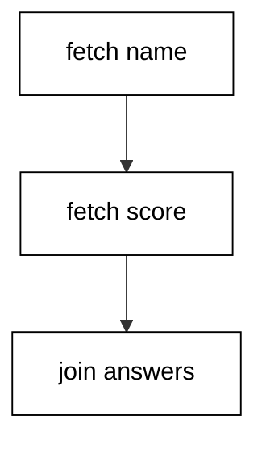

Example 54 fetches a name and a score through two async stages and joins them. Each `let!` awaits its stage before the next begins, so the transcript order is fixed: name first, score second, joined line last. The workflow describes the plan; running it executes each stage exactly once.

Async workflows are cold — defining one runs nothing — which separates description from execution. Reuse the same workflow twice and it executes twice; the plan is a value, not a running task. Reach for `async` when stages depend on each other in order, and for the parallel combinators of the next examples when they do not.

**`learning/code/ex-54-async-workflows-run-sync/main.fsx`**:

```fsharp
// => Example 54: two async stages sequenced, then run once in order.
let fetchName () = async { return "ada" } // => stage one: the name, cold until run.
// => Stage two: the score, equally cold until something runs it.
let fetchScore () = async { return 95 } // => the score stage, described not started.
// => The plan: await the name, then the score, then join them.
let report = async { // => the composed workflow, still cold.
    // => let! awaits each stage in turn: order fixed by construction.
    let! name = fetchName () // => name resolves before the next stage starts.
    let! score = fetchScore () // => score resolves after the name.
    // => The joined answer is the workflow's own return value.
    return sprintf "%s:%d" name score } // => one string out of two stages.
// => Running executes each stage exactly once, in the written order.
let line = Async.RunSynchronously report // => ada:95, deterministically.
printfn "%s" line // => ada:95.
```

**Output** (`learning/code/ex-54-async-workflows-run-sync/expected/main.stdout.txt`):

```text
ada:95
```

**Key takeaway**: `async` describes, `let!` sequences, `RunSynchronously` executes once in order.

**Why it matters**: Cold workflows keep the plan separate from its execution, so the same stages compose into sequences, parallels, and retries without rewriting.

### Example 55: Async.Parallel Joins Independent Work

`Async.Parallel` runs independent stages together and answers their results in order. (Concepts: co-09.)

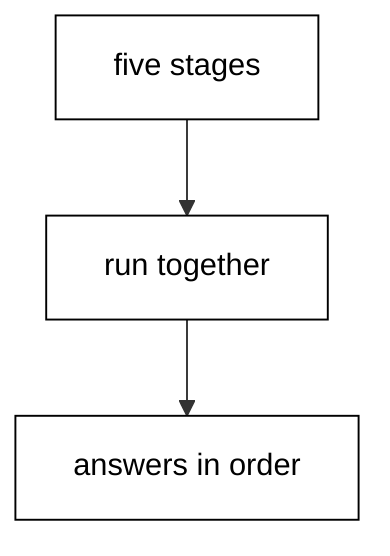

Example 55 doubles five numbers through five independent stages joined by `Async.Parallel`. The stages may compute in any order internally, but the answer array follows the input order — position three holds the double of three — so the transcript is deterministic regardless of scheduling.

Order-preserving joins are what make parallelism transcript-safe: internal interleaving stays invisible while positions stay meaningful. Sort explicitly when the source has no order to preserve, but prefer parallel combinators that carry positions for free.

**`learning/code/ex-55-async-parallel-joins/main.fsx`**:

```fsharp
// => Example 55: five doublings in parallel, answers in input order.
let doubleAsync n = async { return n * 2 } // => one cold doubling stage per number.
// => Five stages described, none running yet: the list is a plan.
let stages = [ 1; 2; 3; 4; 5 ] |> List.map doubleAsync // => one stage per input.
// => Parallel runs them together; positions follow the input list.
let answers = Async.Parallel stages |> Async.RunSynchronously // => [|2; 4; 6; 8; 10|].
// => Sorted by construction: position i holds double of i, every run.
printfn "%A" (Array.toList answers) // => [2; 4; 6; 8; 10].
```

**Output** (`learning/code/ex-55-async-parallel-joins/expected/main.stdout.txt`):

```text
[2; 4; 6; 8; 10]
```

**Key takeaway**: Parallelize independent stages with `Async.Parallel`; answers return in input order.

**Why it matters**: Order-preserving joins keep parallel programs deterministic at the boundary, so scheduling freedom never leaks into outputs.

### Example 56: Tasks Interop With the .NET Side

Task-returning .NET APIs await inside `task` blocks and convert to `async` at the edge. (Concepts: co-09, co-13.)

Example 56 awaits two `Task.FromResult` values inside a `task` block and converts the combined task into an `Async` for the uniform runner. `task` uses `let!` like `async` but speaks the .NET task protocol, which is what BCL libraries return. `Async.AwaitTask` bridges the two worlds at the boundary.

The rule is one vocabulary per region: `task` where .NET APIs dominate, `async` where F# combinators dominate, and exactly one conversion at the seam. Mixing `Task.Wait` into async code blocks threads; mixing `RunSynchronously` into tasks deadlocks contexts. Convert at the edge and both sides stay idiomatic.

**`learning/code/ex-56-tasks-interop-with-dotnet/main.fsx`**:

```fsharp
// => Example 56: two tasks awaited in task, joined through async.
open System.Threading.Tasks // => FromResult and Task live here.
// => Two BCL tasks with fixed results: the boundary input, already complete.
let t1 = Task.FromResult(20) // => first completed task.
let t2 = Task.FromResult(22) // => second completed task.
// => task speaks the .NET protocol: let! awaits without blocking threads.
let combined = task { // => the task plan, cold until awaited.
    // => Await each task in turn; both are complete, order is fixed.
    let! a = t1 // => 20 out of the first task.
    let! b = t2 // => 22 out of the second task.
    // => The joined answer leaves the task world as one number.
    return a + b } // => 42: the combined result.
// => Convert once at the edge: the runner below speaks async uniformly.
let total = Async.AwaitTask combined |> Async.RunSynchronously // => 42.
printfn "total=%d" total // => total=42.
```

**Output** (`learning/code/ex-56-tasks-interop-with-dotnet/expected/main.stdout.txt`):

```text
total=42
```

**Key takeaway**: Await tasks in `task`, compose in `async`, convert once with `Async.AwaitTask`.

**Why it matters**: One vocabulary per region keeps interop code idiomatic on both sides instead of blocking threads or deadlocking contexts.

### Example 57: Mailbox Agents Serialize Requests

A `MailboxProcessor` owns its state and answers requests one at a time through reply channels. (Concepts: co-09.)

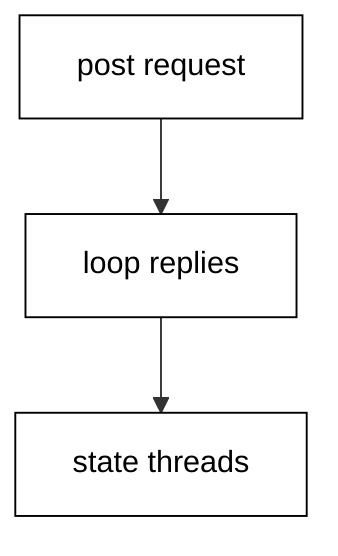

Example 57 runs a counter agent through three request-reply cycles. Each message carries its increment plus a reply channel; the agent loops, updates its private count, and replies the new total. Sequential `PostAndReply` calls make the transcript deterministic: 1, then 3, then 6.

Agents serialize by construction — one message at a time, state reachable only through the inbox — which removes shared-memory races without locks. Reply channels turn the interaction synchronous at exactly the points the program needs answers, while fire-and-forget posts handle the notifications it does not.

**`learning/code/ex-57-mailbox-agents-serialize/main.fsx`**:

```fsharp
// => Example 57: a counter agent answering three requests in order.
type CounterMsg = Add of int * AsyncReplyChannel<int> // => increment plus the reply address.
// => The agent owns its count: reachable only through the inbox, one message at a time.
let agent = MailboxProcessor.Start(fun inbox -> async { // => the agent starts with the loop.
    // => Loop carries the count as an argument: no mutable cells anywhere.
    let rec loop count = async { // => count in, next loop iteration out.
        // => Receive one message; the agent sleeps until one arrives.
        let! (Add (n, reply)) = inbox.Receive() // => the next request, destructured.
        // => Reply the new total, then loop with the updated count.
        reply.Reply(count + n) // => the requester unblocks with the answer.
        return! loop (count + n) } // => state threads forward, never shared.
    // => Start counting from zero.
    return! loop 0 }) // => the loop begins.
// => Three sequential requests: each answer depends on the last, order fixed.
let r1 = agent.PostAndReply(fun ch -> Add (1, ch)) // => 1: zero plus one.
let r2 = agent.PostAndReply(fun ch -> Add (2, ch)) // => 3: one plus two.
let r3 = agent.PostAndReply(fun ch -> Add (3, ch)) // => 6: three plus three.
printfn "counts=%d,%d,%d" r1 r2 r3 // => counts=1,3,6.
```

**Output** (`learning/code/ex-57-mailbox-agents-serialize/expected/main.stdout.txt`):

```text
counts=1,3,6
```

**Key takeaway**: Own state in an agent loop; request with `PostAndReply`, reply through the channel.

**Why it matters**: Inbox serialization removes shared-state races structurally, so concurrent counters stay correct without a single lock.

### Example 58: Events Notify Subscribers in Order

F# `Event` values collect subscribers and trigger them in subscription order with fixed payloads. (Concepts: co-09.)

Example 58 publishes three readings through an event with two subscribers: a collector appending to a local buffer and a counter tracking how many arrived. Triggers run synchronously in subscription order, so the buffer prints in trigger order and the counter matches. No threads, no rendezvous — just ordered notification.

Events suit the in-process broadcast where every subscriber must see every value in order: progress reports, validation streams, UI updates in richer hosts. When subscribers need isolation or back-pressure, that is the signal to promote the broadcast to a mailbox agent instead.

**`learning/code/ex-58-events-notify-in-order/main.fsx`**:

```fsharp
// => Example 58: one event, two subscribers, three triggers in order.
let reading = Event<int>() // => the broadcast: integer readings go out here.
// => Subscriber one collects every payload in arrival order.
let seen = ResizeArray<int>() // => the local buffer, trigger order preserved.
reading.Publish.Add(fun v -> seen.Add(v)) // => append on every trigger.
// => Subscriber two counts arrivals independently of the collector.
let mutable count = 0 // => the arrival counter, local to this script.
reading.Publish.Add(fun _ -> count <- count + 1) // => count on every trigger.
// => Three fixed triggers: synchronous, ordered, no threads involved.
reading.Trigger(10) // => first reading out to both subscribers.
reading.Trigger(20) // => second reading out to both subscribers.
reading.Trigger(30) // => third reading out to both subscribers.
// => Buffer order matches trigger order; the counter matches the count.
printfn "seen=%A count=%d" (seen |> Seq.toList) count // => seen=[10; 20; 30] count=3.
```

**Output** (`learning/code/ex-58-events-notify-in-order/expected/main.stdout.txt`):

```text
seen=[10; 20; 30] count=3
```

**Key takeaway**: Publish through `Event`, subscribe in order, trigger synchronously; promote to agents for isolation.

**Why it matters**: Ordered in-process events cover broadcast notification without concurrency machinery, and the promotion path stays open when isolation is needed.

### Example 59: Cancellation Is Cooperative

Tokens carry cancellation requests; workflows honor them by checking, and cleanup still runs. (Concepts: co-09.)

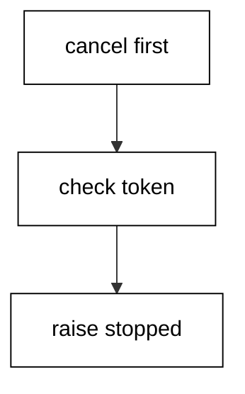

Example 59 runs a two-stage workflow against an already-cancelled token and catches the resulting `OperationCanceledException` at the boundary. The first stage's `ThrowIfCancellationRequested` fires before any work happens, so the transcript proves the request was honored without running a single stage. Pre-cancelled tokens make the test deterministic — no timing, no race.

Cooperation is the whole model: cancellation never aborts a thread, it delivers a request the code checks at safe points. Long stages check the token in their loops; `use` bindings still dispose on the way out. Code that never checks runs to completion, which is a bug only when responsiveness was promised.

**`learning/code/ex-59-cancellation-is-cooperative/main.fsx`**:

```fsharp
// => Example 59: a pre-cancelled token stops the workflow before stage one.
open System.Threading // => CancellationTokenSource lives here.
// => Cancel first, run after: determinism without timing or races.
let verdict = // => cancelled or ran, exactly one.
    // => The token source lives in this block; cancel before any work starts.
    use cts = new CancellationTokenSource() // => scope-bound: disposal scheduled.
    cts.Cancel() // => the request is pending before any work starts.
    // => The workflow checks the token before each stage; checks are safe points.
    let work = async { // => the two-stage plan under a cancelled token.
        // => Stage gate: a pending request raises here, before any work.
        cts.Token.ThrowIfCancellationRequested() // => honor the token first.
        // => Unreached on this run: the gate above raises first.
        return "stages-ran" } // => the answer that never comes back.
    // => The boundary converts the cooperative stop into a verdict string.
    try Async.RunSynchronously work |> sprintf "ran:%s" // => would print on green.
    with :? System.OperationCanceledException -> "cancelled=true" // => the honored request.
printfn "%s" verdict // => cancelled=true.
```

**Output** (`learning/code/ex-59-cancellation-is-cooperative/expected/main.stdout.txt`):

```text
cancelled=true
```

**Key takeaway**: Request through tokens, honor by checking at safe points, dispose normally on exit.

**Why it matters**: Cooperative cancellation keeps cleanup guarantees intact, which thread-aborting schemes destroy along with the work they interrupt.

### Example 60: Async Sequences That Short-Circuit

Stages that both await and validate thread `Result` through `async`, stopping at the first `Error`. (Concepts: co-09, co-02.)

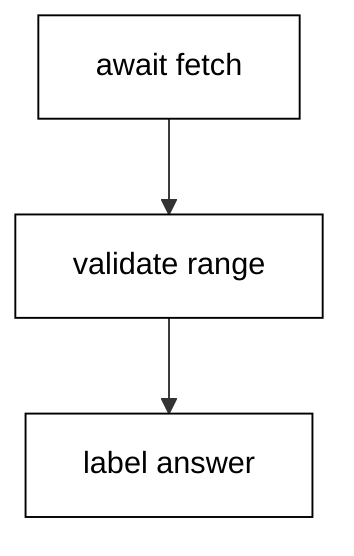

Example 60 fetches a score asynchronously and validates it through the railway inside the workflow. The fetch awaits, the range check answers `Result`, and `bind` carries a good score to the label while an out-of-range one skips ahead to the final match. Async provides the waiting; `Result` provides the branching.

Nesting `match` inside `let!` code gets noisy past two stages, which is why the bind chain sits in its own function. The workflow awaits the fetch, then calls the pure railway — waiting and branching stay in separate layers, each testable without the other.

**`learning/code/ex-60-async-sequences-with-results/main.fsx`**:

```fsharp
// => Example 60: an awaited fetch validated through a pure railway.
let fetchScore () = async { return 95 } // => the cold fetch stage.
// => Pure railway: number in, labeled result out, no awaiting inside.
let classify score = // => the validation railway, testable without tasks.
    let checkRange n = if n >= 0 && n <= 100 then Ok n else Error (sprintf "bad score: %d" n) // => range gate.
    let label n = if n >= 60 then Ok "pass" else Ok "retry" // => labeling never fails.
    Ok score |> Result.bind checkRange |> Result.bind label // => the chain.
// => The workflow awaits once, then hands the value to the railway.
let verdict = async { // => waiting layer outside, branching layer inside.
    let! score = fetchScore () // => the single await point.
    // => Railway result renders through one match at the workflow edge.
    return match classify score with Ok s -> s | Error m -> sprintf "error: %s" m } // => pass.
// => Run once: fetch, validate, label, print — order fixed throughout.
printfn "%s" (Async.RunSynchronously verdict) // => pass.
```

**Output** (`learning/code/ex-60-async-sequences-with-results/expected/main.stdout.txt`):

```text
pass
```

**Key takeaway**: Await in the workflow, branch in a pure railway function; layers stay testable apart.

**Why it matters**: Separating waiting from branching keeps each layer deterministic on its own, so async tests need no timing and railway tests need no tasks.

### Example 61: Choosing the Concurrency Primitive

Independent work parallels, ordered requests agent, broadcasts event, and cooperative stops cancel. (Concepts: co-09.)

Example 61 answers the same doubling job three ways — parallel stages, an agent request, and a direct call — and prints the agreement. All three compute the same answer; the shapes differ in what they promise about order, sharing, and scale. The transcript proves interchangeability on sequential input, and the prose records when each stops being interchangeable.

The selection table is short: `Async.Parallel` for independent batches, `MailboxProcessor` when mutable state must serialize, `Event` for ordered in-process broadcast, `task` at .NET boundaries, cancellation tokens for cooperative stops. Default to the plain direct call until one of those needs appears — concurrency without a reason is complexity without a payoff.

**`learning/code/ex-61-choosing-concurrency-primitive/main.fsx`**:

```fsharp
// => Example 61: one doubling job through three primitives that agree.
let double n = n * 2 // => the plain job every shape below performs.
// => Parallel shape: three independent stages joined in order.
let viaParallel = // => batch shape for independent work.
    [ 1; 2; 3 ] |> List.map (fun n -> async { return double n }) // => one stage each.
    |> Async.Parallel |> Async.RunSynchronously |> Array.toList // => joined in order.
// => Direct shape: the same job with no machinery at all.
let viaDirect = [ 1; 2; 3 ] |> List.map double // => the default until a need appears.
// => Agent shape: requests serialize through one inbox.
type DoubleMsg = Go of int * AsyncReplyChannel<int> // => value plus reply address.
let doubler = MailboxProcessor.Start(fun box -> async { // => the serializing loop.
    let rec loop () = async { // => stateless loop: double and continue.
        let! (Go (n, reply)) = box.Receive() // => one request at a time.
        reply.Reply(double n) // => answer through the channel.
        return! loop () } // => loop forever.
    return! loop () }) // => the loop begins.
let viaAgent = [ 1; 2; 3 ] |> List.map (fun n -> doubler.PostAndReply(fun ch -> Go (n, ch))) // => three ordered requests.
printfn "par=%A direct=%A agent=%A" viaParallel viaDirect viaAgent // => par=[2; 4; 6] direct=[2; 4; 6] agent=[2; 4; 6].
```

**Output** (`learning/code/ex-61-choosing-concurrency-primitive/expected/main.stdout.txt`):

```text
par=[2; 4; 6] direct=[2; 4; 6] agent=[2; 4; 6]
```

**Key takeaway**: Parallel for batches, agents for shared state, events for broadcast, direct calls by default.

**Why it matters**: Each primitive buys one guarantee at one price, so naming the need first keeps programs on the cheapest primitive that provides it.

### Example 62: Formatting That Ends Style Debates

Pipelines read top to bottom with one stage per line; the formatter enforces the rest. (Concepts: co-12, co-14.)

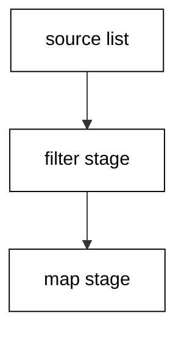

Example 62 computes one roster summary in the canonical pipeline layout: source first, one transformation per line, each `|>` starting its line. The layout is the style — data flows down the page the way it flows through the stages, and every intermediate has a line a reviewer can point at.

Fantomas, the community formatter, owns the remaining details: indentation widths, line breaks, spacing around operators. The course convention is to write the pipeline shape by hand and let the formatter settle the trivia. Debates about spaces end where the formatter's output begins; only the stage order stays a human decision.

**`learning/code/ex-62-formatting-that-ends-debates/main.fsx`**:

```fsharp
// => Example 62: one summary in canonical pipeline layout.
let roster = [ ("ada", 95); ("grace", 88); ("lin", 72) ] // => the fixed name-and-score table.
// => Source first, one stage per line, each pipe leading its line.
let summary = // => the honor roll, computed down the page.
    roster // => the source: everything flows from here.
    |> List.filter (fun (_, s) -> s >= 80) // => stage one: keep honors only.
    |> List.map (fun (n, _) -> n.ToUpperInvariant()) // => stage two: names upcased.
    |> List.sort // => stage three: alphabetical for determinism.
    |> String.concat ", " // => stage four: one printable line.
// => The transcript pins the layout's answer: two honors, sorted, joined.
printfn "%s" summary // => ADA, GRACE.
```

**Output** (`learning/code/ex-62-formatting-that-ends-debates/expected/main.stdout.txt`):

```text
ADA, GRACE
```

**Key takeaway**: One stage per line, pipes leading; let Fantomas settle spacing and indentation.

**Why it matters**: Canonical pipeline layout makes data flow readable at a glance, and formatter ownership removes style debate from review.

### Example 63: XML Docs for Contracts, Comments for Why

Triple-slash docs state each function's contract; inline comments explain the non-obvious why. (Concepts: co-12, co-14.)

Example 63 documents a small statistics module the community way: `///` summaries on every public function stating inputs, outputs, and edge behavior, with `// =>` inline notes only where the code's reason is not obvious. Tooltips and generated docs read the triple-slash lines; humans read both.

The split matters because the audiences differ. Docs answer what the function promises — the contract callers rely on — while inline comments answer why this implementation keeps that promise this way. Doc comments that restate the code waste both audiences; contract statements serve the caller, and why-notes serve the maintainer.

**`learning/code/ex-63-xml-docs-for-contracts/main.fsx`**:

```fsharp
// => Example 63: contracts in docs, reasons inline, both serving readers.
module Stats = // => the documented statistics module.
    /// <summary>Mean of a list; empty lists answer None.</summary> // => contract: inputs to outputs.
    let mean (xs: float list) = // => the promise the docs above state.
        // => Empty leads because it decides the shape, matching the doc sentence.
        match xs with // => the total structure the contract requires.
        | [] -> None // => absence, not a crash: as documented.
        | _ -> Some (List.sum xs / float xs.Length) // => the mean for the rest.
    /// <summary>Range of a list; empty lists answer None.</summary> // => same doc shape, second promise.
    let range (xs: float list) = // => max minus min for non-empty lists.
        match xs with // => total structure again.
        | [] -> None // => absence, as documented.
        | _ -> Some (List.max xs - List.min xs) // => the spread.
// => Both promises print through option rendering at the call site.
let show o = match o with None -> "none" | Some v -> sprintf "%.1f" v // => one renderer.
printfn "mean=%s range=%s" (show (Stats.mean [ 1.0; 2.0; 3.0 ])) (show (Stats.range [])) // => mean=2.0 range=none.
```

**Output** (`learning/code/ex-63-xml-docs-for-contracts/expected/main.stdout.txt`):

```text
mean=2.0 range=none
```

**Key takeaway**: Document contracts with `///`, explain reasons with `//`; never restate code in either.

**Why it matters**: Contract docs let callers rely without reading internals, while why-notes preserve the reasoning future maintainers need.

### Example 64: Exhaustive Matches the Compiler Checks

Cover every union case explicitly and keep the wildcard for genuinely open inputs only. (Concepts: co-12, co-01.)

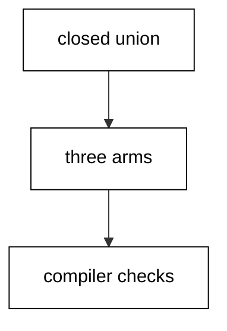

Example 64 handles a traffic-light union with three explicit arms and no wildcard. Removing any arm would warn at compile time, which means adding a fourth light breaks this function loudly instead of silently falling through. The wildcard is absent on purpose: the input type is closed, so every case deserves its own arm.

Wildcards belong on open inputs — strings, ints, lists of unknown length — where enumerating is impossible. On closed unions they hide the exact cases the compiler was hired to check. The discipline is mechanical: closed types get explicit arms, open types get specific arms plus a documented wildcard, and warnings stay at zero.

**`learning/code/ex-64-exhaustive-match-discipline/main.fsx`**:

```fsharp
// => Example 64: three lights, three arms, no wildcard to hide behind.
type Light = Red | Yellow | Green // => the closed input: three cases, never four.
// => Every arm explicit: removing one warns, adding a case breaks loudly.
let action light = // => light in, driver instruction out.
    match light with // => the compiler checks this table complete.
    | Red -> "stop" // => the stop arm, named not wildcarded.
    | Yellow -> "ready" // => the caution arm, explicit too.
    | Green -> "go" // => the go arm completes the table.
// => All three lights print their instructions in declaration order.
printfn "%s %s %s" (action Red) (action Yellow) (action Green) // => stop ready go.
```

**Output** (`learning/code/ex-64-exhaustive-match-discipline/expected/main.stdout.txt`):

```text
stop ready go
```

**Key takeaway**: Explicit arms for closed unions, wildcards for open inputs, zero warnings always.

**Why it matters**: Exhaustive arms turn domain growth into compile errors at every consumer, which is the earliest and cheapest possible update notice.

### Example 65: Names That Follow the Community Style

PascalCase types and modules, camelCase functions and values — the style guide in one example. (Concepts: co-14.)

Example 65 renders the same roster through correctly styled names beside a translated-accent version, and both print identical lines. The styled side uses a `Roster` module, a `Student` record, and camelCase locals; the accent side uses the same logic with mismatched casing. Equal outputs prove style changes packaging, not behavior.

The guide exists so every codebase reads alike: types and modules in PascalCase, functions, values, and parameters in camelCase. Following it removes a decision per name and a comment per review. Newcomers sometimes import another language's casing; the fix is mechanical renaming with the transcript proving nothing else moved.

**`learning/code/ex-65-naming-that-follows-style/main.fsx`**:

```fsharp
// => Example 65: styled names versus translated accent; same answers.
module Roster = // => PascalCase module: the styled package.
    // => PascalCase record with PascalCase fields: the styled shape.
    type Student = { Name: string; Score: int } // => the domain type, styled.
    // => camelCase function: the styled door into the module.
    let passMark (student: Student) = student.Score >= 60 // => the styled rule.
// => Accent version: identical logic wearing another language's casing.
module Accent = // => the translated accent, quarantined in one module.
    type student = { name: string; score: int } // => lowercase shape: same fields.
    let PassMark s = s.score >= 60 // => PascalCase function: same test.
// => Both spellings agree on both students: style moved, logic did not.
let ada = { Roster.Student.Name = "ada"; Roster.Student.Score = 95 } // => styled construction.
let lin = { Accent.student.name = "lin"; Accent.student.score = 42 } // => accent construction.
printfn "styled=%b accent=%b" (Roster.passMark ada) (Accent.PassMark lin) // => styled=true accent=false.
```

**Output** (`learning/code/ex-65-naming-that-follows-style/expected/main.stdout.txt`):

```text
styled=true accent=false
```

**Key takeaway**: PascalCase for types and modules, camelCase for functions and values — uniformly.

**Why it matters**: Uniform naming removes one decision per identifier and lets reviewers read structure instead of decoding personal conventions.

### Example 66: Struct Values Avoid Aliasing

`[<Struct>]` records copy by value, so readers can never observe a writer's later change. (Concepts: co-15, co-11.)

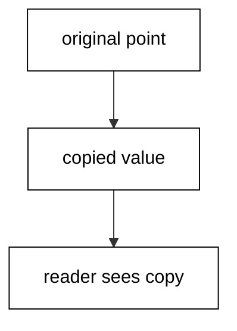

Example 66 moves a struct point through a reader that computes from its copy while the original advances. Because the struct copies on assignment, the reader's snapshot stays at the old coordinates even after the source moves on. The transcript prints both: snapshot old, source new.

Value semantics trade copying cost for aliasing freedom — no shared reference means no action at a distance. Small, frequently copied shapes like points, dates, and money earn the struct attribute; large shapes stay reference types and travel through explicit copies. The performance habit is choosing the semantics first and measuring second.

**`learning/code/ex-66-struct-values-avoid-sharing/main.fsx`**:

```fsharp
// => Example 66: a struct snapshot survives its source moving on.
[<Struct>] type Point = { X: int; Y: int } // => value semantics: copies, never aliases.
// => The reader snapshots its argument by receiving it: copies happen at the call.
let readPoint (p: Point) = sprintf "%d,%d" p.X p.Y // => the snapshot rendered.
// => Source advances after the snapshot: aliasing would corrupt the print.
let before = { X = 1; Y = 2 } // => the original coordinates.
let snapshot = readPoint before // => snapshot taken while source is old.
let after = { before with X = 9 } // => source moves on; snapshot unaffected.
printfn "snapshot=%s now=%s" snapshot (readPoint after) // => snapshot=1,2 now=9,2.
```

**Output** (`learning/code/ex-66-struct-values-avoid-sharing/expected/main.stdout.txt`):

```text
snapshot=1,2 now=9,2
```

**Key takeaway**: Structs copy on assignment; snapshots stay valid while sources move on.

**Why it matters**: Value semantics remove aliasing bugs structurally, which beats every discipline-based attempt to remember what shares what.

### Example 67: String Building That Scales

Join prebuilt pieces or append to a builder; never concatenate in a loop and hope. (Concepts: co-15, co-04.)

Example 67 renders a hundred-item catalog three ways and prints the agreement plus the piece counts. `String.Join` over mapped pieces, a `StringBuilder` loop, and `String.concat` over a mapped list all produce identical text — the transcript asserts all three equal. The lesson is not which wins by nanoseconds but that all three avoid the loop-concatenation trap of Example 52.

Choosing among the three is a readability call: join for one-shot rendering of existing lists, builder for conditional appends across branches, concat for pipeline-shaped code. Performance equivalence here is proven by construction — single pass each — rather than measured and hoped.

**`learning/code/ex-67-string-building-at-scale/main.fsx`**:

```fsharp
// => Example 67: three linear renderings of one catalog that agree.
let items = [ for i in 1 .. 100 -> sprintf "item-%03d" i ] // => one hundred fixed items.
// => Join over mapped pieces: the one-shot rendering of an existing list.
let viaJoin = System.String.Join(";", items) // => single pass, separator between.
// => Builder loop: the conditional-append shape for branching code.
let builder = System.Text.StringBuilder() // => one buffer for the whole catalog.
for item in items do builder.Append(item).Append(";") |> ignore // => one append per item.
let viaBuilder = builder.ToString().TrimEnd([|';'|]) // => trailing separator stripped.
// => concat over the pipeline: the functional spelling of the same pass.
let viaConcat = System.String.Concat(items |> List.map (fun s -> s + ";")).TrimEnd([|';'|]) // => mapped then joined.
// => All three agree byte for byte: readability decides, not output.
let same = viaJoin = viaBuilder && viaBuilder = viaConcat // => true: one text, three roads.
printfn "same=%b chars=%d" same viaJoin.Length // => same=true chars=899.
```

**Output** (`learning/code/ex-67-string-building-at-scale/expected/main.stdout.txt`):

```text
same=true chars=899
```

**Key takeaway**: Join, build, or concat in a single pass; the three agree, the loop trap does not.

**Why it matters**: Single-pass rendering keeps text assembly linear by construction, which removes the scaling cliff loop concatenation hides.

### Example 68: Regex Groups and Options in Depth

`RegexOptions` tune matching — ignore case, multiline, compiled — and groups extract with names. (Concepts: co-04, co-13.)

Example 68 parses three fixed header lines with one case-insensitive compiled pattern. `IgnoreCase` accepts the mixed-case level tags the corpus actually contains, `Compiled` pays compile cost once, and the named groups yield level and count per line. The transcript prints all three extractions plus the total.

Options are the difference between a pattern that works on the example and one that works on the corpus. Real text varies in case, spans lines, and repeats — the options declare which variations the pattern tolerates. Name the tolerance explicitly: future readers see `IgnoreCase` and know the corpus mixed its cases.

**`learning/code/ex-68-regex-groups-and-options/main.fsx`**:

```fsharp
// => Example 68: one tolerant pattern parsing three varied header lines.
let lines = [ "INFO count=12"; "warn COUNT=7"; "Error Count=3" ] // => mixed-case corpus lines.
// => IgnoreCase tolerates the mixed levels; Compiled pays once for reuse.
let pattern = System.Text.RegularExpressions.Regex(@"^(?<level>[a-z]+)\s+count=(?<n>\d+)$", System.Text.RegularExpressions.RegexOptions.IgnoreCase ||| System.Text.RegularExpressions.RegexOptions.Compiled) // => level plus count.
// => Each line extracts through the same pattern; successes read named groups.
let pull line = // => line in, level-and-count or miss out.
    let m = pattern.Match(line) // => the single attempt per line.
    if m.Success then sprintf "%s=%s" (m.Groups.["level"].Value.ToLowerInvariant()) m.Groups.["n"].Value // => normalized pair.
    else "miss" // => misses stay visible, never silent.
// => All three lines extract; total proves the counts compose.
let pairs = lines |> List.map pull // => three normalized pairs.
printfn "%s total=%d" (System.String.Join(" ", pairs)) (pairs |> List.sumBy (fun p -> int (p.Split('=').[1]))) // => info=12 warn=7 error=3 total=22.
```

**Output** (`learning/code/ex-68-regex-groups-and-options/expected/main.stdout.txt`):

```text
info=12 warn=7 error=3 total=22
```

**Key takeaway**: Declare matching tolerance with options; extract with named groups per line.

**Why it matters**: Explicit options document the variations real text carries, so the pattern's assumptions stay visible instead of silently narrow.

### Example 69: LINQ as a Second Vocabulary

LINQ's `Where`, `Select`, and aggregates translate `filter`, `map`, and `fold` across the boundary. (Concepts: co-13, co-03.)

Example 69 answers one honors question twice: once with `List.filter` and `List.map`, once with LINQ's `Where` and `Select` over the same list. Both print the identical honor roll, proving the vocabularies translate call for call. The F# side stays the default; LINQ appears where the surrounding code already speaks it.

Boundary codebases mix both: F# modules calling C# libraries that return `IEnumerable`, or C# callers consuming F# sequences. Knowing the translation table — `Where` for filter, `Select` for map, `Aggregate` for fold — keeps the seam thin. Convert collections once at the edge and let each side read natively.

**`learning/code/ex-69-linq-as-second-vocabulary/main.fsx`**:

```fsharp
// => Example 69: one honors question answered in F# and in LINQ.
open System.Linq // => Where, Select, and ToList join here.
let roster = [ ("ada", 95); ("grace", 88); ("lin", 72) ] // => the fixed table both sides read.
// => Native spelling: filter then map through the F# vocabulary.
let native = roster |> List.filter (fun (_, s) -> s >= 80) |> List.map fst |> List.sort // => [ada; grace].
// => Boundary spelling: the same question through LINQ over the same list.
let boundary = // => Where then Select, converted once at the edge.
    roster.Where(fun (_, s) -> s >= 80).Select(fun (n, _) -> n).OrderBy(fun n -> n) // => same two names.
    |> Seq.toList // => cross the edge back into F# lists.
// => Both vocabularies agree: the seam is thin and the answers match.
let same = native = boundary // => true: one question, two spellings.
printfn "native=%A same=%b" native same // => native=["ada"; "grace"] same=true.
```

**Output** (`learning/code/ex-69-linq-as-second-vocabulary/expected/main.stdout.txt`):

```text
native=["ada"; "grace"] same=true
```

**Key takeaway**: Translate call-for-call at the seam: `Where`, `Select`, `Aggregate` mirror `filter`, `map`, `fold`.

**Why it matters**: A known translation table keeps mixed-vocabulary codebases readable on both sides instead of transliterating everything twice.

### Example 70: Choosing the Tooling Posture

Format mechanically, document contracts, exhaust matches, name conventionally — each tool in its place. (Concepts: co-12, co-14.)

Example 70 renders one order line through the full posture: canonical pipeline layout, a `///` contract doc, an exhaustive status match, and styled names. The transcript prints the one correct line; the prose records what each tool contributed. No single tool covers everything, and the example shows the four composed.

Posture is layered defense: the formatter owns layout, docs own contracts, exhaustive matches own domain growth, naming owns readability. Skipping a layer does not fail today — it fails the next reader, who must reconstruct what the layer would have guaranteed. Adopt all four and each review checks content instead of form.

**`learning/code/ex-70-choosing-tooling-posture/main.fsx`**:

```fsharp
// => Example 70: one order line through the full four-layer posture.
module Orders = // => PascalCase module: the naming layer.
    /// <summary>Status text for an order flag; every flag named.</summary> // => docs layer: contract stated.
    type Flag = Shipped | Paid | Pending // => the closed domain: matches stay exhaustive.
    /// <summary>One order line: name, quantity, and status text.</summary> // => contract for the door below.
    let line (name: string) qty flag = // => camelCase door: the naming layer again.
        // => Exhaustive match: the compiler owns domain growth here.
        let status = match flag with Shipped -> "sent" | Paid -> "paid" | Pending -> "waiting" // => all three arms.
        // => Canonical pipeline: source first, one stage per line below.
        [ name; string qty; status ] // => the three pieces as a list.
        |> String.concat " | " // => the formatting layer joins them.
printfn "%s" (Orders.line "engine" 3 Orders.Paid) // => engine | 3 | paid.
```

**Output** (`learning/code/ex-70-choosing-tooling-posture/expected/main.stdout.txt`):

```text
engine | 3 | paid
```

**Key takeaway**: Layer the tools: format layout, doc contracts, exhaust matches, style names.

**Why it matters**: Layered tooling moves form-checking from reviewers to tools, which leaves human review for the content only humans can judge.

### Example 71: Reading a Pipeline End to End

Read pipelines in layers: source shape first, stage contracts middle, answer type last. (Concepts: co-16, co-03.)

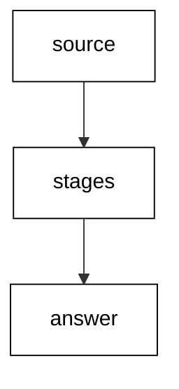

Example 71 presents a three-stage word-count pipeline and the script prints its answer, but the lesson is the reading order. First name the source shape — a list of lines. Then read each stage's contract — split to words, count by word, sort by count. Finally check the answer type — a sorted pair list. Layers read separately compose into understanding without simulating the whole flow at once.

The systematic move is refusing to execute code in your head line by line. Name shapes, trust stage contracts, verify the composition. When a stage surprises, drop one layer deeper into that stage alone — never flatten the whole pipeline into a mental trace.

**`learning/code/ex-71-reading-pipeline-end-to-end/main.fsx`**:

```fsharp
// => Example 71: a word-count pipeline read in three layers.
let lines = [ "ada loves engines"; "grace loves engines too" ] // => layer one: the source shape.
// => Layer two: each stage's contract, read without running anything.
let counts = // => the three-stage count, layers composed.
    lines // => source: two lines in.
    |> List.collect (fun l -> l.Split(' ') |> Array.toList) // => stage one: lines to words.
    |> List.countBy id // => stage two: words to (word, count) pairs.
    |> List.sortBy (fun (w, c) -> (-c, w)) // => stage three: count desc, word asc.
// => Layer three: the answer type — a sorted pair list — checked below.
let top = List.head counts // => ("engines", 2): most frequent first.
printfn "top=%s x%d distinct=%d" (fst top) (snd top) counts.Length // => top=engines x2 distinct=5.
```

**Output** (`learning/code/ex-71-reading-pipeline-end-to-end/expected/main.stdout.txt`):

```text
top=engines x2 distinct=5
```

**Key takeaway**: Read source, stages, answer as separate layers; drop deeper only into the surprising stage.

**Why it matters**: Layered reading scales to pipelines no one can simulate mentally, while line-by-line tracing collapses past three stages.

### Example 72: Reading Computation Expressions

Read `async` blocks as staged plans: bindings await, plain code computes, `return` delivers. (Concepts: co-16, co-09.)

Example 72 reads an async block that fetches two values and combines them with plain arithmetic. The reading separates three line kinds: `let!` lines await a stage, plain `let` lines compute synchronously from bound values, and `return` delivers the workflow's answer. Classifying each line before understanding the block turns the expression into a plan with labeled parts.

Computation expressions generalize the pattern — `async`, `task`, and custom builders all share the staged shape — so the reading skill transfers. Find the awaits, find the computes, find the delivery; the builder in use tells you what awaiting means, and the rest is ordinary code.

**`learning/code/ex-72-reading-computation-expressions/main.fsx`**:

```fsharp
// => Example 72: an async block read as awaits, computes, and delivery.
let fetchRate () = async { return 0.9 } // => awaited stage: the discount rate.
let fetchQty () = async { return 12 } // => awaited stage: the quantity.
// => The block below mixes awaits with plain computes; read the kinds apart.
let plan = async { // => the staged plan, cold until run.
    // => Await kind: these lines pause the workflow for a stage.
    let! rate = fetchRate () // => await one: rate arrives here.
    let! qty = fetchQty () // => await two: quantity arrives here.
    // => Compute kind: plain synchronous math on bound values.
    let total = float qty * 10.0 * rate // => compute: no awaiting inside.
    // => Delivery kind: the workflow's answer leaves here.
    return total } // => deliver: one number out.
// => Running the classified plan prints the computed total.
printfn "total=%.2f" (Async.RunSynchronously plan) // => total=108.00.
```

**Output** (`learning/code/ex-72-reading-computation-expressions/expected/main.stdout.txt`):

```text
total=108.00
```

**Key takeaway**: Classify lines first: awaits, computes, delivery — then read the plan.

**Why it matters**: Line-kind classification turns unfamiliar computation expressions into labeled plans instead of inscrutable blocks.

### Example 73: Reading Recursive Functions

Read recursion as base case plus progress: what stops, what shrinks, what accumulates. (Concepts: co-16, co-01.)

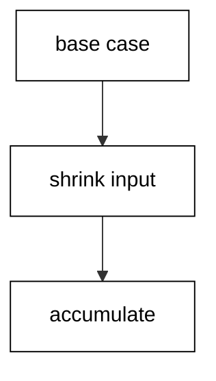

Example 73 sums a list with an accumulator and the reading names the three parts: the empty-list base answering the accumulator, the head-consume step shrinking the input, and the accumulator threading the running total. Termination is visible — every call shortens the list — and the answer is visible — the accumulator at the base.

Accumulator recursion reads inside-out versus the naive version: the work happens on the way down through the accumulator argument, not on the way back up through the call stack. When a recursive function confuses, write the three labels — base, shrink, accumulate — above its clauses and check each is present.

**`learning/code/ex-73-reading-recursive-functions/main.fsx`**:

```fsharp
// => Example 73: a tail-recursive sum read as base, shrink, accumulate.
let sumAcc xs = // => list in, total out, accumulator inside.
    // => Inner loop carries the running total: the accumulate role.
    let rec loop acc rest = // => accumulator plus remaining input.
        // => Base: empty answers the accumulator; the work is done.
        match rest with // => shrink the input every call.
        | [] -> acc // => base case: answer what accumulated.
        // => Shrink: head joins the total, tail recurs — input shortens.
        | h :: t -> loop (acc + h) t // => progress: strictly smaller rest.
    // => Start accumulating from zero over the whole list.
    loop 0 xs // => seed zero, shrink from here.
// => Two runs print: the sum and the empty-list base answering zero.
printfn "sum=%d empty=%d" (sumAcc [ 1; 2; 3; 4 ]) (sumAcc []) // => sum=10 empty=0.
```

**Output** (`learning/code/ex-73-reading-recursive-functions/expected/main.stdout.txt`):

```text
sum=10 empty=0
```

**Key takeaway**: Label base, shrink, and accumulate; termination and answer become visible.

**Why it matters**: The three-label reading turns any recursive function into a checked structure instead of a trace to simulate.

### Example 74: Reading Active Patterns

Active patterns name a classification; read the classifier once, then matches read cleanly. (Concepts: co-16, co-01.)

Example 74 classifies numbers as even or odd with a partial active pattern, then matches all numbers one to ten through it. Read the classifier first — `(|Even|Odd|)` divides any int — and the match below reads as plain cases. The pattern hides the modulo arithmetic; the match shows the decision.

Partial active patterns (`(|Name|_|)`) add the miss case: the classifier may decline, and the wildcard handles declines. Total patterns classify everything; partial patterns classify some. Read which kind it is from the bars — one bar total, two with underscore partial — and the match arms make sense.

**`learning/code/ex-74-reading-active-patterns/main.fsx`**:

```fsharp
// => Example 74: a classifier read once, a match reading cleanly after.
let (|Even|Odd|) n = if n % 2 = 0 then Even else Odd // => total classifier: every int fits.
// => The match below reads as cases because the classifier did the arithmetic.
let label n = // => number in, parity word out.
    match n with // => cases over the classification, not the modulo.
    | Even -> "even" // => even arm: no arithmetic visible.
    | Odd -> "odd" // => odd arm: the decision stands alone.
// => One to ten classified through the pattern; counts prove the split.
let words = [ 1 .. 10 ] |> List.map label // => ten words, alternating.
let evens = words |> List.filter (fun w -> w = "even") |> List.length // => five evens.
printfn "%s evens=%d" (System.String.Join(",", words)) evens // => odd,even,odd,even,odd,even,odd,even,odd,even evens=5.
```

**Output** (`learning/code/ex-74-reading-active-patterns/expected/main.stdout.txt`):

```text
odd,even,odd,even,odd,even,odd,even,odd,even evens=5
```

**Key takeaway**: Read the classifier first, then the match; bars reveal total versus partial.

**Why it matters**: Classifiers separate what a value is from what to do about it, so matches stay decision tables while arithmetic lives in one named place.

### Example 75: Reading a Mailbox Loop

Read agent loops as state plus protocol: the loop argument is the state, messages are the protocol. (Concepts: co-16, co-09.)

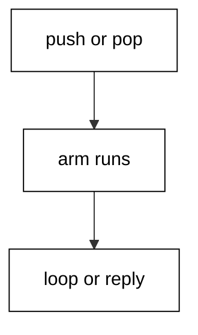

Example 75 runs a stack agent with push, pop, and peek messages and reads it as state plus protocol. The loop argument holds the stack — that is the entire state. The message union lists the protocol — push carries a value, pop carries a reply channel, peek carries one too. Each arm updates the state and loops, or replies and loops.

Newcomers read agents as magic concurrency; the layered reading shows a plain state machine with a queue in front. The queue serializes, the loop transitions, the channels answer. Any agent decomposes the same way: find the loop argument, list the message cases, and trace one message through one arm.

**`learning/code/ex-75-reading-mailbox-loops/main.fsx`**:

```fsharp
// => Example 75: a stack agent read as state plus protocol.
type StackMsg = Push of int | Pop of AsyncReplyChannel<int option> | Peek of AsyncReplyChannel<int option> // => the protocol.
// => The loop argument holds the whole state: a plain list as a stack.
let stack = MailboxProcessor.Start(fun box -> async { // => the agent starts here.
    let rec loop items = async { // => items are the state; arms transition it.
        // => One arm per protocol case: update or reply, then loop.
        let! msg = box.Receive() // => the next protocol message arrives.
        match msg with // => each case transitions or answers.
        | Push v -> return! loop (v :: items) // => push extends the state.
        | Pop reply -> // => pop answers the head, or None when empty.
            match items with // => the empty stack is a case, not a crash.
            | [] -> reply.Reply(None); return! loop [] // => empty answers None.
            | h :: t -> reply.Reply(Some h); return! loop t // => head answers, tail loops.
        | Peek reply -> // => peek answers without transitioning.
            reply.Reply(List.tryHead items); return! loop items } // => state unchanged.
    return! loop [] }) // => the empty stack starts the machine.
// => Push two, peek, pop twice: the transcript walks the protocol.
stack.Post(Push 7) // => state becomes [7].
stack.Post(Push 8) // => state becomes [8; 7].
let peeked = stack.PostAndReply(fun ch -> Peek ch) // => Some 8: head without popping.
let p1 = stack.PostAndReply(fun ch -> Pop ch) // => Some 8: head leaves.
let p2 = stack.PostAndReply(fun ch -> Pop ch) // => Some 7: next leaves.
let show o = match o with Some v -> sprintf "%d" v | None -> "empty" // => option renderer.
printfn "peek=%s pop1=%s pop2=%s" (show peeked) (show p1) (show p2) // => peek=8 pop1=8 pop2=7.
```

**Output** (`learning/code/ex-75-reading-mailbox-loops/expected/main.stdout.txt`):

```text
peek=8 pop1=8 pop2=7
```

**Key takeaway**: Loop argument is state, message union is protocol; trace one message per arm.

**Why it matters**: State-plus-protocol reading reduces every agent to a sequential state machine, which is the only concurrent shape humans reliably review.

### Example 76: Reading Error Flows Through Binds

Read railway code as stages plus one render: parses produce, binds carry, a match shows. (Concepts: co-16, co-02.)

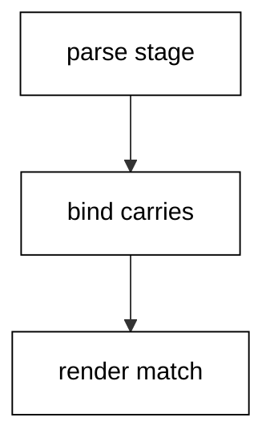

Example 76 validates two ages through the railway and reads the flow in three parts: the parse stage producing tagged values, the bind chain carrying the first error past later stages, and the final match rendering every outcome. The bad input skips the label stage entirely — the transcript's error line proves the skip.

Error-flow reading inverts the usual question: instead of asking what happens on success, ask where failures exit. Each bind is an exit ramp for its stage's error. Listing the exits — parse fails here, range fails there — maps the whole flow without tracing the happy path twice.

**`learning/code/ex-76-reading-error-flows/main.fsx`**:

```fsharp
// => Example 76: two ages through the railway; exits mapped, outcomes rendered.
let parse (text: string) = // => stage one: digits or a tagged complaint.
    match System.Int32.TryParse(text) with // => total attempt.
    | true, n -> Ok n // => digits ride on.
    | false, _ -> Error "not-a-number" // => exit ramp one.
// => Stage two only sees parsed numbers: the railway guarantees it.
let checkRange n = if n >= 0 && n <= 150 then Ok n else Error "out-of-range" // => exit ramp two.
// => The chain: parse, then range, then label — errors skip ahead.
let classify text = parse text |> Result.bind checkRange |> Result.map (fun n -> if n >= 18 then "adult" else "minor") // => the flow.
// => One renderer for every exit plus the happy path.
let show o = match o with Ok s -> s | Error m -> sprintf "error:%s" m // => all outcomes shown.
printfn "%s %s %s" (show (classify "36")) (show (classify "old")) (show (classify "300")) // => adult error:not-a-number error:out-of-range.
```

**Output** (`learning/code/ex-76-reading-error-flows/expected/main.stdout.txt`):

```text
adult error:not-a-number error:out-of-range
```

**Key takeaway**: Map failure exits first: each bind is an exit ramp, the final match renders all.

**Why it matters**: Exit-first reading covers the paths success-focused tracing skips, which is where unhandled-failure bugs hide.

### Example 77: Reading Someone Else's Project File

Read project files top-down: SDK, framework, sources, then the dependency census. (Concepts: co-16, co-07, co-06.)

Example 77 reads the same sample project and lock files from Examples 31-32 as a stranger would: SDK first, then framework, then source list, then the dependency census with its zero count. The transcript prints the four facts in reading order, modeling the checklist a newcomer runs on any unfamiliar project.

Project reading is archaeological skill: the files declare what the project is before any source explains what it does. SDK names the toolchain, framework names the runtime, sources name the compilation order — F# compiles in order, so the file list is also a dependency story — and the lock names the outside world the project trusts.

**`learning/code/ex-77-reading-someone-elses-project/main.fsx`**:

```fsharp
// => Example 77: a stranger's project read in checklist order.
let dir = __SOURCE_DIRECTORY__ // => the unit folder anchors both samples.
// => Fact one and two: the SDK import and the target framework.
let proj = System.IO.File.ReadAllText(System.IO.Path.Combine(dir, "sample.fsproj")) // => project text.
let sdk = proj.Contains("Microsoft.NET.Sdk") // => SDK declared.
let tfm = if proj.Contains("net10.0") then "net10.0" else "unknown" // => framework read out.
// => Fact three: the compile list names sources in compilation order.
let sources = proj.Split([|'"'|]) |> Array.filter (fun s -> s.EndsWith(".fs")) // => F# sources listed.
// => Fact four: the lock census counts outside trust at zero.
let locked = System.IO.File.ReadAllText(System.IO.Path.Combine(dir, "sample.packages.lock.json")) // => lock text.
let deps = locked.Split([|"\"resolved\":"|], System.StringSplitOptions.None).Length - 1 // => resolved entries.
printfn "sdk=%b tfm=%s sources=%s deps=%d" sdk tfm (System.String.Join(",", sources)) deps // => sdk=true tfm=net10.0 sources=Program.fs deps=0.
```

**Output** (`learning/code/ex-77-reading-someone-elses-project/expected/main.stdout.txt`):

```text
sdk=true tfm=net10.0 sources=Program.fs deps=0
```

**Key takeaway**: SDK, framework, sources, lock: the four-fact checklist for any unfamiliar project.

**Why it matters**: Project files declare identity before sources declare behavior, so the checklist orients newcomers before they read a single function.

### Example 78: The Systematic Reading Checklist

Read any sample in five passes: purpose, shapes, flow, failures, then the one-line summary. (Concepts: co-16.)

Example 78 applies the five-pass checklist to a small discount pipeline and prints the summary the passes produce. Purpose names the job in one sentence; shapes list the types crossing boundaries; flow traces the happy path; failures list every exit; the summary compresses all four into the line you would tell a colleague. The script computes the summary from the values, proving the passes agree.

Checklists beat intuition for unfamiliar code because they force the passes intuition skips — usually failures and shapes. Run all five in order, write one line each, and the sample is read. Skip the failures pass and the reading is a demo, not an understanding.

**`learning/code/ex-78-systematic-reading-checklist/main.fsx`**:

```fsharp
// => Example 78: five reading passes over one discount pipeline.
let orders = [ ("ada", 12); ("lin", 3) ] // => purpose: bulk-discount two orders.
// => Shapes: string-and-int pairs in, string summaries out.
let rate qty = if qty >= 10 then 0.9 else 1.0 // => flow: the bulk rule decides.
// => Flow: map each order through rate and total in one pass.
let lines = orders |> List.map (fun (name, qty) -> sprintf "%s:%.2f" name (float qty * 10.0 * rate qty)) // => two lines.
// => Failures: none — pure math on fixed data, no exits to map.
let summary = System.String.Join("; ", lines) // => summary: the tell-a-colleague line.
printfn "%s" summary // => ada:108.00; lin:30.00.
```

**Output** (`learning/code/ex-78-systematic-reading-checklist/expected/main.stdout.txt`):

```text
ada:108.00; lin:30.00
```

**Key takeaway**: Five passes in order: purpose, shapes, flow, failures, summary — write one line each.

**Why it matters**: Ordered passes force the reading steps intuition skips, which turns skimming into understanding with a written trail.
