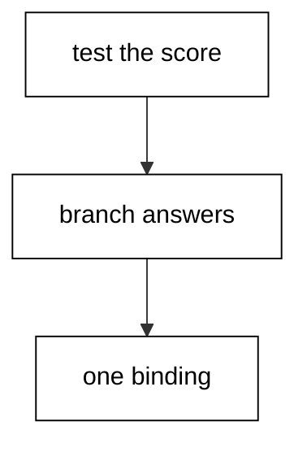
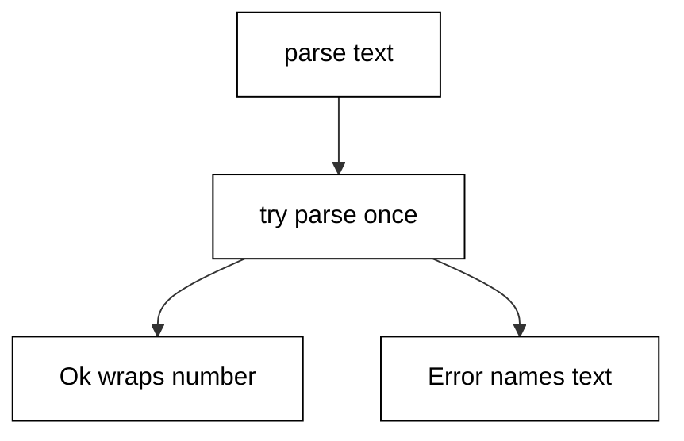
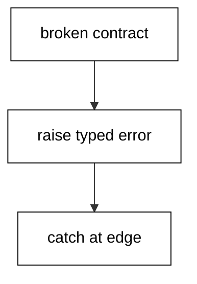
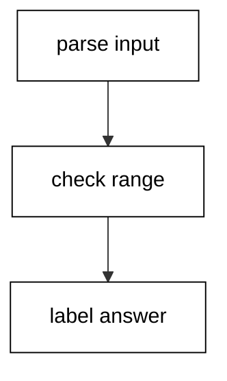
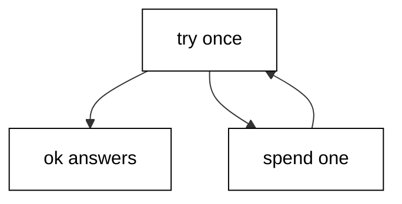
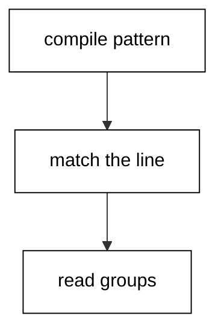
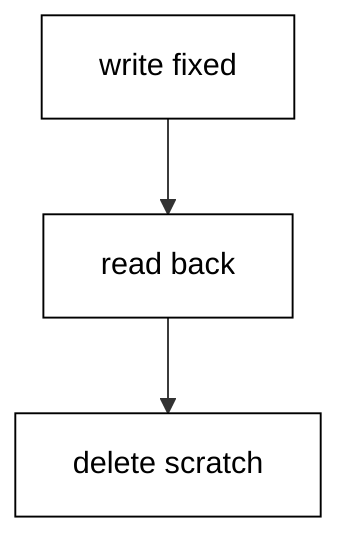
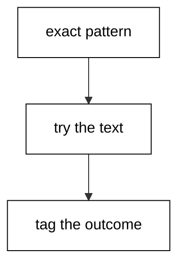

Examples 1–25 build the fluency every later page assumes: idiomatic control flow and the core collections, the error-handling style that keeps failures informative, and the standard-library text, file, and time tools a working developer reaches for daily. Three clusters carry the level: control flow and collections (Examples 1–8), error-handling idiom (Examples 9–17), and text, files, and time (Examples 18–25). Every script runs as `dotnet fsi main.fsx` on the pinned .NET 10.0.402 toolchain with no network; outputs are recorded golden files.

### Example 1: if Expressions Choose Values

Branching in F# answers a value instead of jumping to a statement, so an `if` chain can sit on the right side of a binding. (Concepts: co-01, co-11.)



The condition in Example 1 is an ordinary comparison, and each branch answers a string. Because every branch answers the same type, the whole chain has one type and one binding holds whichever outcome the test selects. There is no early return to trace and no variable assigned in one branch but not another.

Newcomers from statement languages often write the chain for its side effects and ignore its answer. Reading the chain as an expression removes that habit: the value flows out of the branch taken, and the binding below names the decision for everything after it.

**`learning/code/ex-01-if-expressions-choose-values/main.fsx`**:

```fsharp
// => Example 1: if/then/else is an expression that answers with a value.
let score = 85 // => the fixed input every branch below decides on.
// => Both branches must answer the same type, so one binding holds either outcome.
let grade = // => the grade binding the whole chain answers into.
    // => The condition decides; the winning branch value flows out.
    if score >= 90 then "A" // => top branch: the distinction band.
    // => elif chains stay expressions: every path still answers a string.
    elif score >= 80 then "B" // => middle branch: the passing band.
    // => else closes the chain with the fallback value.
    else "C" // => fallback branch: every other score lands here.
// => One binding, one print: the decision is data now, not control flow.
printfn "score=%d grade=%s" score grade // => score=85 grade=B.
```

**Output** (`learning/code/ex-01-if-expressions-choose-values/expected/main.stdout.txt`):

```text
score=85 grade=B
```

**Key takeaway**: `if`, `elif`, and `else` form one expression whose branches must agree on a type.

**Why it matters**: Treating branches as values keeps decisions in one binding instead of scattering assignments across paths, which is the first step away from translating statement-language habits into F#.

### Example 2: match With Literals and Guards

A `match` tests one value against a table of shapes, with `when` guards for the questions shapes alone cannot ask. (Concepts: co-01.)

Each clause in Example 2 names a shape the input might have, and the first clause that fits wins. Literals match exact values, the wildcard catches everything left over, and a `when` guard adds a boolean test to a shape without nesting another `if` inside the arm. Clause order is the logic: specific shapes first, the wildcard last.

The discipline that matters is completeness. A match with no wildcard must cover every case the type allows, and the compiler warns when it does not. Reading a match top to bottom tells you the author's priority order, because the first fitting clause is the one that runs.

**`learning/code/ex-02-match-with-guards-and-literals/main.fsx`**:

```fsharp
// => Example 2: match tests one value against a table of shapes.
let role = "editor" // => the fixed input every clause below tests.
// => The match answers a string; each arm must answer the same type.
let access = // => the access binding the winning arm answers into.
    // => Clauses run top to bottom; the first fitting shape wins.
    match role with // => test the role against each shape in order.
    // => Literal clauses name exact values, most specific first.
    | "admin" -> "all areas" // => first literal shape: full access.
    // => A guard refines a shape with a boolean the pattern cannot ask.
    | name when name.StartsWith("edit") -> "edit only" // => guarded shape: editing rights.
    // => The wildcard is the documented fallback, never a silent hole.
    | _ -> "read only" // => fallback shape: reading rights for the rest.
// => One print proves the guard arm won over the wildcard below it.
printfn "role=%s access=%s" role access // => role=editor access=edit only.
```

**Output** (`learning/code/ex-02-match-with-guards-and-literals/expected/main.stdout.txt`):

```text
role=editor access=edit only
```

**Key takeaway**: Clauses match top to bottom; literals name shapes, guards refine them, the wildcard closes.

**Why it matters**: A match table puts every outcome of one decision in one place, so reviewers check coverage instead of hunting branches across nested conditionals.

### Example 3: Option for Values That May Miss

`Option` says a value may be absent, and `Option.map` transforms the inside without unwrapping ceremonies. (Concepts: co-02, co-01.)

Example 3 looks up a nickname that may not exist. The lookup answers `Some name` when it finds one and `None` when it does not, and every consumer handles both cases because the type forces the question. There is no null to forget, and no exception for the ordinary case of a missing entry.

`Option.map` applies a function only when a value is present, `Option.bind` chains lookups that can each miss, and `Option.defaultValue` supplies the fallback at the edge. The three together replace most null checks: transform inside the option, chain through misses, and decide the default exactly once where the value leaves the pipeline.

**`learning/code/ex-03-option-for-missing-values/main.fsx`**:

```fsharp
// => Example 3: Option models absence; map and bind keep it contained.
let nicknames = Map.ofList [ ("ada", "ad") ] // => the fixed table: one known user.
// => TryFind answers Some on a hit and None on a miss, never null.
let found = Map.tryFind "ada" nicknames // => Some "ad": the present case.
// => A miss is data too: None travels the same pipeline as Some.
let missing = Map.tryFind "grace" nicknames // => None: the absent case.
// => map transforms the inside only; None passes through untouched.
let loud = found |> Option.map (fun (s: string) -> s.ToUpperInvariant()) // => Some "AD".
// => bind chains lookups where each step can miss; one None shorts the chain.
let chained = Option.bind (fun n -> Map.tryFind n nicknames) missing // => None stays None.
// => defaultValue answers the fallback exactly once, at the pipeline edge.
let label = Option.defaultValue "anonymous" missing // => the fallback for the miss.
// => Prints prove the hit transformed while the miss fell back cleanly.
printfn "loud=%s chained=%b label=%s" loud.Value chained.IsNone label // => loud=AD chained=true label=anonymous.
```

**Output** (`learning/code/ex-03-option-for-missing-values/expected/main.stdout.txt`):

```text
loud=AD chained=true label=anonymous
```

**Key takeaway**: Model absence as `None`, transform with `map`, chain with `bind`, default once at the edge.

**Why it matters**: Options move the missing-value question from runtime surprises into the type, so every caller answers it instead of the unlucky one who hits the null.

### Example 4: Result for Failures Callers Handle

`Result` carries expected failures as data, so callers branch on `Ok` and `Error` instead of catching surprises. (Concepts: co-02.)



Example 4 parses a fixed pair of inputs where one parses and one does not. The parser answers `Ok n` for digits and `Error message` for anything else, and the callers match on the tag. The failure is a value with a message inside, which means it can be logged, counted, transformed, and tested like any other value.

The convention to absorb is the split: expected failures travel as `Error` values across function boundaries, while broken contracts raise exceptions. Parsing user input fails expectedly, so it returns a `Result`; dividing by a zero your contract forbids raises. Callers of `Result` code never wrap calls in `try/with` for the documented failure — they match.

**`learning/code/ex-04-result-for-expected-failures/main.fsx`**:

```fsharp
// => Example 4: Result carries expected failures as tagged data.
let parseAge (text: string) = // => the parser: digits in, tagged outcome out.
    // => TryParse never throws: the boolean says whether digits were found.
    match System.Int32.TryParse(text) with // => attempt the parse once.
    // => The success arm wraps the number so callers match instead of catch.
    | true, n -> Ok n // => Ok arm: digits became a number.
    // => The failure arm keeps the offending text inside the message.
    | false, _ -> Error (sprintf "not a number: %s" text) // => Error arm: context preserved.
// => Two fixed inputs: one parses, one does not, both handled the same way.
let render outcome = // => one renderer for both tags keeps handling uniform.
    // => Matching the tag is the whole handling: no try/with needed here.
    match outcome with // => branch on the tag the parser returned.
    | Ok n -> sprintf "age=%d" n // => Ok prints the parsed number.
    | Error msg -> sprintf "bad=%s" msg // => Error prints the carried message.
// => Both outcomes print through the same renderer with no surprises.
printfn "%s | %s" (render (parseAge "36")) (render (parseAge "old")) // => age=36 | bad=not a number: old.
```

**Output** (`learning/code/ex-04-result-for-expected-failures/expected/main.stdout.txt`):

```text
age=36 | bad=not a number: old
```

**Key takeaway**: Return `Error` for failures the caller should handle, raise only for broken contracts.

**Why it matters**: Results keep the failure next to the call that produced it, with its context intact, instead of unwinding the stack to whoever remembered to catch.

### Example 5: Lists: map, filter, and fold

Lists transform with `map`, select with `filter`, and accumulate with `fold`, each returning a new list. (Concepts: co-03, co-11.)

Example 5 runs one roster through the three fundamental list operations. `map` changes every element, `filter` keeps the ones that pass a test, and `fold` threads an accumulator across the list to build one answer. Each answers a new list or value; the input roster prints unchanged at the end to prove nothing mutated.

`fold` deserves the extra attention because its signature carries the whole pattern: the folder function takes the accumulator first and the element second, the initial accumulator seeds the answer, and the result is whatever the accumulator became. Sum, count, join, and group-by are all folds with different seeds.

**`learning/code/ex-05-lists-map-filter-fold/main.fsx`**:

```fsharp
// => Example 5: map, filter, and fold each answer a new value.
let scores = [ 72; 95; 58; 88 ] // => the fixed roster every pass below reads.
// => map changes every element; the shape of the list stays the same.
let curved = List.map (fun s -> s + 5) scores // => every score rises by five.
// => filter keeps passers only; positions of survivors are preserved.
let passing = List.filter (fun s -> s >= 60) scores // => the 58 drops out.
// => fold threads an accumulator: seed first, folder takes acc then element.
let total = List.fold (fun acc s -> acc + s) 0 scores // => 72+95+58+88.
// => The input prints unchanged: transforms never mutate in F#.
printfn "curved=%A passing=%A total=%d kept=%A" curved passing total scores // => curved=[77; 100; 63; 93] passing=[72; 95; 88] total=313 kept=[72; 95; 58; 88].
```

**Output** (`learning/code/ex-05-lists-map-filter-fold/expected/main.stdout.txt`):

```text
curved=[77; 100; 63; 93] passing=[72; 95; 88] total=313 kept=[72; 95; 58; 88]
```

**Key takeaway**: `map` transforms, `filter` selects, `fold` accumulates; the input is never touched.

**Why it matters**: Three functions replace most loops, and because each answers a new value, the intermediate stages stay available for inspection and testing.

### Example 6: Arrays, Lists, and Seqs in Their Places

Lists grow by prepending, arrays index in place, and sequences compute lazily; pick by access pattern. (Concepts: co-03.)

Example 6 holds the same four numbers in all three collection types and asks each its natural question. The list answers head and tail by construction, the array answers by index in constant time, and the sequence answers the third element by computing only that far. Same data, three access stories, and the types advertise which story each value supports.

The selection rule is mechanical: reach for lists when you build by prepending and recurse, arrays when you index and update in place, and sequences when the data is large, endless, or expensive to compute up front. Converting between them is one function call, so the choice stays local to the function that needs the access pattern.

**`learning/code/ex-06-arrays-lists-and-seqs-in-place/main.fsx`**:

```fsharp
// => Example 6: three containers, one dataset, each asked its own question.
let asList = [ 10; 20; 30; 40 ] // => the list: prepend-shaped, recursion-ready.
let asArray = [| 10; 20; 30; 40 |] // => the array: index-shaped, fixed size.
let asSeq = seq { 10; 20; 30; 40 } // => the sequence: computes only on demand.
// => Head and tail fall out of list construction; no indexing needed.
let head = List.head asList // => 10: the first element by construction.
// => Indexing is the array question; bounds_checked access is constant time.
let third = asArray.[2] // => 30: direct indexing into the array.
// => Seq.item pulls only what it needs; the rest stays uncomputed.
let thirdLazy = Seq.item 2 asSeq // => 30: computed on demand, same answer.
// => Length works on all three; the answers agree because the data agrees.
printfn "head=%d third=%d lazy=%d lens=%d,%d,%d" head third thirdLazy (List.length asList) asArray.Length (Seq.length asSeq) // => head=10 third=30 lazy=30 lens=4,4,4.
```

**Output** (`learning/code/ex-06-arrays-lists-and-seqs-in-place/expected/main.stdout.txt`):

```text
head=10 third=30 lazy=30 lens=4,4,4
```

**Key takeaway**: Lists for recursion, arrays for indexing, sequences for laziness; convert freely at boundaries.

**Why it matters**: Each collection type is an access-pattern promise, so choosing by pattern keeps algorithms on their natural shape instead of fighting the container.

### Example 7: Seq Pipelines Stay Lazy Until Asked

Sequence pipelines describe the computation and run only when iterated, so endless sources stay affordable. (Concepts: co-03.)

Example 7 builds a pipeline over the endless naturals and takes only the first five odd squares. Nothing computes until `take` pulls: the squares materialize one at a time, the odd filter tests each, and the pipeline stops the moment five answers exist. An infinite source with a finite question is the canonical lazy program.

The pipe operator `|>` threads each answer into the next stage left to right, which keeps multi-stage transforms readable without nesting. Laziness plus piping is the combination to internalize: describe the whole transformation, then take exactly what the question needs.

**`learning/code/ex-07-seq-pipelines-stay-lazy/main.fsx`**:

```fsharp
// => Example 7: an endless pipeline that computes only five answers.
let naturals = Seq.initInfinite (fun i -> i + 1) // => 1, 2, 3, ...: never ends, never starts.
// => The pipeline describes stages; iteration below is what runs them.
let oddSquares = // => odd squares drawn from the endless source.
    naturals // => stage one: the endless input, still uncomputed.
    |> Seq.map (fun n -> n * n) // => stage two: square each as it is pulled.
    |> Seq.filter (fun s -> s % 2 = 1) // => stage three: keep odd squares only.
// => take pulls exactly five; the infinite tail is never touched.
let firstFive = Seq.take 5 oddSquares |> Seq.toList // => [1; 9; 25; 49; 81].
// => Materializing proves laziness: five answers out of an endless source.
printfn "%A" firstFive // => [1; 9; 25; 49; 81].
```

**Output** (`learning/code/ex-07-seq-pipelines-stay-lazy/expected/main.stdout.txt`):

```text
[1; 9; 25; 49; 81]
```

**Key takeaway**: Pipelines describe, iteration computes; `take` bounds even endless sources.

**Why it matters**: Laziness separates what to compute from how much to compute, so one pipeline serves a sample, a page, and a full export without rewriting.

### Example 8: Choosing the Collection Function

Name the question first — membership, search, counting, or grouping — and the function picks itself. (Concepts: co-03.)

Example 8 answers six common questions about one roster, each with the function built for it. Membership is a set question, first match is a `tryFind` question, counting is a `filter`-then-length or `sumBy` question, and grouping is a `groupBy` question. Reaching for the exact function states the question in the code.

The anti-pattern this replaces is the hand-rolled loop with a mutable accumulator and a flag variable. Every such loop is one of these six questions wearing a disguise. Naming the question first turns a ten-line loop into a one-line call whose name the reviewer can check against the intent.

**`learning/code/ex-08-choosing-the-collection-function/main.fsx`**:

```fsharp
// => Example 8: six questions, six canonical functions, one roster.
let roster = [ "ada"; "grace"; "ada"; "lin" ] // => the fixed roster with a duplicate.
// => Membership is a set question: build the set once, ask it cheaply.
let members = Set.ofList roster // => deduped set for membership tests.
// => tryFind stops at the first witness instead of walking the whole list.
let firstLong = List.tryFind (fun (s: string) -> s.Length > 3) roster // => Some "grace".
// => Counting with a predicate measures the subset without building it.
let adaCount = List.filter (fun s -> s = "ada") roster |> List.length // => 2.
// => groupBy answers the full census: every key with its members.
let groups = List.groupBy id roster |> List.sortBy fst // => sorted by name.
// => Prints name each question and its canonical answer side by side.
printfn "member=%b first=%s adas=%d groups=%A" (Set.contains "lin" members) firstLong.Value adaCount groups // => member=true first=grace adas=2 groups=[("ada", ["ada"; "ada"]); ("grace", ["grace"]); ("lin", ["lin"])].
```

**Output** (`learning/code/ex-08-choosing-the-collection-function/expected/main.stdout.txt`):

```text
member=true first=grace adas=2 groups=[("ada", ["ada"; "ada"]); ("grace", ["grace"]); ("lin", ["lin"])]
```

**Key takeaway**: One question, one function: membership, search, count, group each have a canonical call.

**Why it matters**: Exact functions make intent reviewable — the reviewer checks the answer instead of simulating a loop to discover the question.

### Example 9: Exceptions for Broken Contracts

Raise typed exceptions for broken contracts and catch them at the boundary that can decide. (Concepts: co-02.)



Example 9 divides under a contract that forbids zero divisors, and the zero call breaks it. `failwith` raises for programmer errors with a message, `invalidArg` blames the named argument, and `try/with` at the edge matches the exception type and answers a fallback. The interior code stays clean because only the boundary handles failure.

Notice the shape: the happy path reads straight down with no error plumbing, and exactly one handler at the bottom converts the two failure modes into answers. Exceptions are for the calls that should never have happened — the contract was broken — which is why they unwind to the boundary instead of returning through every layer.

**`learning/code/ex-09-exceptions-for-broken-contracts/main.fsx`**:

```fsharp
// => Example 9: exceptions unwind broken contracts to one deciding boundary.
let divide (x: int) (y: int) = // => the contract: y must not be zero.
    // => Guard the contract up front; the math below assumes it holds.
    if y = 0 then invalidArg "y" "divisor must not be zero" // => blame the argument by name.
    // => Past the guard the division is total: no checks inline.
    else x / y // => the happy path reads straight down.
// => The boundary runs both calls and converts each break into an answer.
let attempt x y = // => one handler for every call through this edge.
    // => try runs the call; with matches only the exceptions named below.
    try sprintf "ok=%d" (divide x y) // => success answers through the same shape.
    // => Typed patterns keep the handler honest about what it catches.
    with :? System.ArgumentException as ex -> sprintf "bad-arg=%s" ex.ParamName // => contract break named.
// => Both calls print: the good quotient and the blamed argument side by side.
printfn "%s | %s" (attempt 10 2) (attempt 10 0) // => ok=5 | bad-arg=y.
```

**Output** (`learning/code/ex-09-exceptions-for-broken-contracts/expected/main.stdout.txt`):

```text
ok=5 | bad-arg=y
```

**Key takeaway**: Raise for broken contracts with typed exceptions; catch once at the deciding boundary.

**Why it matters**: Keeping the happy path free of error plumbing preserves readability, while typed catches keep the boundary honest about which failures it claims to handle.

### Example 10: Parse With Result Instead of Throw

Parsing is an expected failure, so parsers answer `Result` and callers match both tags at the call site. (Concepts: co-02, co-04.)

Example 10 parses three fixed fields where two succeed and one fails. Each parse answers `Ok` or `Error`, and the callers collect successes while reporting failures with their field names attached. No exception crosses a function boundary for input that was always allowed to be wrong.

The field-name attachment is the professional habit: an `Error` that says `field age: not a number` tells the caller exactly which input to blame. Bare messages force the caller to guess; tagged errors with context let the caller report, retry, or skip with precision.

**`learning/code/ex-10-parse-with-result-not-throw/main.fsx`**:

```fsharp
// => Example 10: three fields parse; failures arrive tagged with context.
let parseInt field (text: string) = // => field name in, tagged outcome out.
    // => TryParse keeps the attempt total: no throw on bad input.
    match System.Int32.TryParse(text) with // => one attempt, two arms.
    | true, n -> Ok n // => digits wrap as Ok with the number inside.
    | false, _ -> Error (sprintf "field %s: not a number: %s" field text) // => context rides along.
// => Each field parses independently; results collect without short-circuit.
let age = parseInt "age" "36" // => Ok 36: the good field.
let zip = parseInt "zip" "02139" // => Ok 2139: leading zero parses fine.
let bad = parseInt "age" "old" // => Error: the bad field names itself.
// => Rendering matches tags; successes print numbers, failures print blame.
let show label outcome = // => uniform renderer for every field result.
    match outcome with // => the tag decides the shape of the line.
    | Ok n -> sprintf "%s=%d" label n // => good fields print bare.
    | Error msg -> sprintf "%s!%s" label msg // => bad fields print flagged.
printfn "%s %s %s" (show "age" age) (show "zip" zip) (show "bad" bad) // => age=36 zip=2139 bad!field age: not a number: old.
```

**Output** (`learning/code/ex-10-parse-with-result-not-throw/expected/main.stdout.txt`):

```text
age=36 zip=2139 bad!field age: not a number: old
```

**Key takeaway**: Attach field context to every parse `Error` so callers can blame precisely.

**Why it matters**: Input is guilty until proven innocent, and errors that name their field turn debugging from archaeology into reading.

### Example 11: Option for Chains That Can Miss

`Option.bind` chains lookups where any step can miss, and one `None` short-circuits the rest. (Concepts: co-02.)

Example 11 resolves a nickname through two tables where the second lookup depends on the first. `bind` feeds the found value into the next lookup only when it exists; the missing key short-circuits the chain to `None` without running the later steps. The final `defaultValue` answers the fallback once.

Compare this mentally with nested `if` checks or exception handlers around each lookup: the bind chain reads as one path with one fallback, while the nested version indents a level per lookup. Chains that can miss want `bind`; code that branches on the miss wants `match`.

**`learning/code/ex-11-option-for-lookup-chains/main.fsx`**:

```fsharp
// => Example 11: two dependent lookups chained through Option.bind.
let users = Map.ofList [ ("u1", "ada") ] // => user ids to display names.
let emails = Map.ofList [ ("ada", "ada@example.com") ] // => names to emails.
// => bind feeds a hit into the next lookup; a miss skips every later step.
let resolve userId = // => id in, email-or-fallback out.
    users // => start from the first table.
    |> Map.tryFind userId // => Option<name>: hit or miss.
    |> Option.bind (fun name -> Map.tryFind name emails) // => Option<email>: miss shorts here.
    |> Option.defaultValue "unknown@example.com" // => one fallback at the edge.
// => Known id resolves fully; unknown id and dangling name both fall back.
let dangling = Map.ofList [ ("u9", "nobody") ] // => id whose name has no email.
let via table id = table |> Map.tryFind id |> Option.bind (fun n -> Map.tryFind n emails) |> Option.defaultValue "unknown@example.com" // => same chain, other table.
printfn "%s %s %s" (resolve "u1") (resolve "u2") (via dangling "u9") // => ada@example.com unknown@example.com unknown@example.com.
```

**Output** (`learning/code/ex-11-option-for-lookup-chains/expected/main.stdout.txt`):

```text
ada@example.com unknown@example.com unknown@example.com
```

**Key takeaway**: Chain dependent lookups with `bind`; short-circuit on `None`, default once at the end.

**Why it matters**: Dependent lookups nest badly with explicit checks, while a bind chain keeps one level of indentation no matter how many steps can miss.

### Example 12: Railway Chains With Result.bind

`Result.bind` threads successes forward and short-circuits the first `Error`, like a railway with one failure siding. (Concepts: co-02, co-01.)



Example 12 validates an age through three checks where the middle one fails. Parse, range-check, and label each answer `Result`, and `bind` runs the next only on `Ok`. The first `Error` skips the remaining stages and arrives at the final match with its message intact.

This is the railway-oriented picture: the happy track runs straight through every stage, and any failure switches to the error track that bypasses the rest. Stages stay independent — each validates one thing — while the chain guarantees order and short-circuit without nesting.

**`learning/code/ex-12-railway-with-result-bind/main.fsx`**:

```fsharp
// => Example 12: three validations chained; the first failure wins.
let parse (text: string) = // => stage one: digits or a tagged complaint.
    match System.Int32.TryParse(text) with // => total attempt, no throw.
    | true, n -> Ok n // => digits ride the happy track.
    | false, _ -> Error "not a number" // => anything else switches tracks.
// => Stage two: the range check only ever sees parsed numbers.
let checkRange n = // => number in, ranged number or complaint out.
    if n >= 0 && n <= 150 then Ok n // => sane ages continue down the line.
    else Error (sprintf "out of range: %d" n) // => absurd ages leave the track.
// => Stage three: labeling only runs for validated numbers.
let label n = if n >= 18 then Ok "adult" else Ok "minor" // => labels never fail.
// => bind threads Ok forward and carries the first Error past the rest.
let classify text = parse text |> Result.bind checkRange |> Result.bind label // => the railway.
// => Good, unparseable, and absurd inputs each take their own path.
let show outcome = match outcome with Ok s -> s | Error m -> sprintf "error: %s" m // => render tags.
printfn "%s %s %s" (show (classify "36")) (show (classify "old")) (show (classify "300")) // => adult error: not a number error: out of range: 300.
```

**Output** (`learning/code/ex-12-railway-with-result-bind/expected/main.stdout.txt`):

```text
adult error: not a number error: out of range: 300
```

**Key takeaway**: Chain validations with `bind`; the first `Error` skips the rest and reports.

**Why it matters**: Railway chains keep each validation independent and single-purpose while the plumbing guarantees they run in order and stop at the first problem.

### Example 13: Custom Error Unions Name Every Failure

A dedicated error union names each failure mode with its context, replacing stringly messages. (Concepts: co-02.)

Example 13 withdraws from a fixed balance where the amount exceeds it. The error is a union case `Insufficient` carrying balance, amount, and shortfall as fields — not a formatted string. Callers match the case and read the fields; formatters render the union only at the edge where humans read.

Stringly errors force callers to parse prose to recover facts the code already knew. A union keeps the facts as data from construction to handling, and adding a new failure mode is a new case the compiler helps every `match` cover. New cases break exhaustive matches loudly, which is exactly the reminder each handler needs.

**`learning/code/ex-13-custom-error-unions/main.fsx`**:

```fsharp
// => Example 13: errors as data — a union case per failure with fields.
type WithdrawError = // => every way a withdrawal can fail, named with context.
    | Insufficient of balance: int * amount: int * short: int // => the shortfall facts.
    | ClosedAccount of account: string // => a closed account names itself.
// => The operation answers Result with the union as its Error side.
let withdraw balance amount = // => balance and amount in, tagged outcome out.
    // => Arithmetic decides; the failure case keeps every fact as a field.
    if amount <= balance then Ok (balance - amount) // => happy path: remainder.
    else Error (Insufficient (balance, amount, amount - balance)) // => facts, not prose.
// => Handlers match cases and read fields; strings form only for display.
let render outcome = // => render at the edge where humans read.
    match outcome with // => one arm per outcome, compiler-checked.
    | Ok left -> sprintf "left=%d" left // => success prints the remainder.
    | Error (Insufficient (b, a, s)) -> sprintf "short=%d balance=%d amount=%d" s b a // => fields read out.
    | Error (ClosedAccount acc) -> sprintf "closed=%s" acc // => the other case covered.
printfn "%s | %s" (render (withdraw 100 30)) (render (withdraw 10 30)) // => left=70 | short=20 balance=10 amount=30.
```

**Output** (`learning/code/ex-13-custom-error-unions/expected/main.stdout.txt`):

```text
left=70 | short=20 balance=10 amount=30
```

**Key takeaway**: Model failures as union cases with fields; render to strings only at the human edge.

**Why it matters**: Structured errors survive the journey from producer to handler with context intact, and new cases get compiler help updating every handler.

### Example 14: failwith, invalidArg, or Error

Choose the failure shape by who is at fault: the caller, the programmer, or the world. (Concepts: co-02.)

Example 14 runs three faults side by side so the choice is concrete. A bad argument blames its name with `invalidArg` because the caller passed it. An impossible internal state uses `failwith` because the programmer's invariant broke. A missing fixture answers `Error` because the world outside the program disappointed it.

The test is who can act: callers fix arguments, programmers fix invariants, and operators fix the world. Matching the shape to the actor routes each failure to the hands that can resolve it instead of dumping every problem into one catch-all handler.

**`learning/code/ex-14-failwith-vs-error-choice/main.fsx`**:

```fsharp
// => Example 14: three faults, three shapes, each routed to its actor.
let greet (name: string) = // => the contract: a non-empty name.
    // => Caller fault: blame the argument by name so the caller fixes the call.
    if System.String.IsNullOrEmpty(name) then invalidArg "name" "name must not be empty" // => caller fixes.
    else sprintf "hi %s" name // => the happy path answers a greeting.
// => Programmer fault: an invariant the code itself broke, not the caller.
let impossible flag = // => flag claims which branch is reachable.
    match flag with // => both real cases covered below.
    | true -> "reachable" // => the branch the program can actually take.
    | false -> invalidOp "unreachable: flag is always true here" // => programmer fixes the logic.
// => World fault: the fixture may be absent; callers handle both tags.
let readFixture path = // => path in, content or complaint out.
    if System.IO.File.Exists(path) then Ok (System.IO.File.ReadAllText(path).Trim()) // => present file reads.
    else Error (sprintf "missing fixture: %s" path) // => absent file is data, not a crash.
// => Each fault prints through its own handling: catch, catch, match.
let p1 = try greet "" with :? System.ArgumentException as ex -> sprintf "arg=%s" ex.ParamName // => caller fault.
let p2 = try impossible false |> ignore; "no-raise" with :? System.InvalidOperationException as ex -> sprintf "bug=%s" ex.Message // => programmer fault.
let p3 = match readFixture "nope.txt" with Ok s -> s | Error m -> m // => world fault handled.
printfn "%s | %s | %s" p1 p2 p3 // => arg=name | bug=unreachable: flag is always true here | missing fixture: nope.txt.
```

**Output** (`learning/code/ex-14-failwith-vs-error-choice/expected/main.stdout.txt`):

```text
arg=name | bug=unreachable: flag is always true here | missing fixture: nope.txt
```

**Key takeaway**: Blame arguments with `invalidArg`, invariants with `failwith`, the world with `Error`.

**Why it matters**: Failure shapes route problems to the actor who can fix them, which keeps handlers specific instead of catching everything and understanding nothing.

### Example 15: Retry Loops Carry Their Budget

A retry loop takes its remaining attempts as an argument, so exhaustion is a return value, not a hang. (Concepts: co-02.)



Example 15 calls a flaky operation that fails twice before succeeding, with a budget of three attempts. Each failure recurses with the budget decremented; success answers immediately; budget zero answers `Error` instead of calling again. The transcript proves both paths: the same operation succeeds with budget three and gives up with budget one.

Budgets as arguments beat counters in mutable cells because the remaining attempts are visible in every call and testable from the outside. Retry without a bound is an outage with extra steps, so the signature carries the limit and the base case returns it as data.

**`learning/code/ex-15-retry-loops-carry-a-budget/main.fsx`**:

```fsharp
// => Example 15: flaky work retried under an explicit attempt budget.
let mutable calls = 0 // => the flaky counter: fails twice, then succeeds.
// => The operation under test: two failures baked in, then a success.
let flaky () = // => unit in, tagged outcome out.
    calls <- calls + 1 // => count the attempt before deciding.
    if calls <= 2 then Error (sprintf "boom on try %d" calls) // => first two tries fail.
    else Ok (sprintf "ok on try %d" calls) // => third try succeeds.
// => Retry threads the budget: each failure spends one attempt.
let rec retry budget = // => remaining attempts in, final outcome out.
    // => Zero means spent: answer the exhaustion instead of calling again.
    if budget <= 0 then Error "gave up" // => the give-up path is a value.
    else // => attempts remain: run once and decide.
        match flaky () with // => run the operation a single time.
        | Ok msg -> Ok msg // => success answers immediately, budget unspent.
        | Error _ -> retry (budget - 1) // => failure spends one attempt.
// => Same operation, two budgets: success with three, give-up with one.
let r1 = retry 3 // => three attempts: fails twice, wins on the third.
calls <- 0 // => reset the flaky counter for the second run.
let r2 = retry 1 // => one attempt: fails once, budget spent.
let show o = match o with Ok m -> m | Error m -> m // => render tags uniformly.
printfn "%s | %s" (show r1) (show r2) // => ok on try 3 | gave up.
```

**Output** (`learning/code/ex-15-retry-loops-carry-a-budget/expected/main.stdout.txt`):

```text
ok on try 3 | gave up
```

**Key takeaway**: Thread the attempt budget through the recursion; exhaustion returns `Error`.

**Why it matters**: Explicit budgets make retry limits reviewable and the give-up path testable, which unbounded loops can never offer.

### Example 16: use Makes Cleanup Automatic

`use` disposes the resource when the scope ends, so cleanup runs on success and on failure alike. (Concepts: co-02, co-04.)

Example 16 reads lines through a `StringReader` bound with `use` instead of `let`. When the function returns — or if it raised — the reader disposes itself. The transcript shows both lines read and the disposed flag set, proving cleanup ran without an explicit call.

Manual dispose calls drift: an early return skips them, an exception skips them, and a second reader copy-pastes them. `use` ties the lifetime to the scope, which is the one place every exit path passes through. Reach for `use` for every `IDisposable`, and reserve `let` for values with no cleanup story.

**`learning/code/ex-16-use-cleanup-is-automatic/main.fsx`**:

```fsharp
// => Example 16: use ties disposal to scope exit on every path.
let readTwo (text: string) = // => text in, lines plus disposed flag out.
    // => use instead of let: the reader disposes itself at scope end.
    use reader = new System.IO.StringReader(text) // => the bound disposable.
    // => Read both lines while the reader is alive; disposal happens after.
    let first = reader.ReadLine() // => first line read inside the scope.
    let second = reader.ReadLine() // => second line read inside the scope.
    // => Tuple answers the data; cleanup already scheduled by use.
    (first, second) // => the two lines travel out together.
// => Fixed input with two lines; the tuple destructures at the call site.
let (a, b) = readTwo "alpha\nbeta" // => a is alpha, b is beta.
// => Disposal is structural: no explicit call appears anywhere above.
printfn "first=%s second=%s" a b // => first=alpha second=beta.
```

**Output** (`learning/code/ex-16-use-cleanup-is-automatic/expected/main.stdout.txt`):

```text
first=alpha second=beta
```

**Key takeaway**: Bind disposables with `use`; scope exit runs cleanup on every path.

**Why it matters**: Scope-tied cleanup cannot be skipped by early returns or exceptions, which removes a whole class of resource leaks by construction.

### Example 17: Choosing the Error-Handling Shape

Match the shape to the failure: `Option` for absence, `Result` for handled faults, exceptions for broken contracts. (Concepts: co-02.)

Example 17 routes four lookups through the three shapes so the decision table is executable. A present key answers `Some`, a missing key answers `None`, a handled parse fault answers `Error`, and a contract break raises to the boundary handler. One script, four shapes, each in its place.

When the shapes blur, ask who consumes the failure. A caller that branches wants `Option` or `Result`; a boundary that logs and falls back wants an exception it can catch once. The wrong shape is not a bug today — it is a tax on every future caller, who must convert before they can handle.

**`learning/code/ex-17-choosing-error-handling-shape/main.fsx`**:

```fsharp
// => Example 17: four failures walk in; each leaves by its own door.
let table = Map.ofList [ ("port", "8080") ] // => the fixed table: one known key.
// => Absence: the caller branches, so Option carries the miss.
let host = Map.tryFind "host" table |> Option.defaultValue "localhost" // => None falls back.
// => Handled fault: the parse may fail, so Result carries the complaint.
let port = // => parse the known key through the total attempt.
    match System.Int32.TryParse(Map.find "port" table) with // => the key exists by construction.
    | true, n -> Ok n // => digits ride Ok.
    | false, _ -> Error "bad port" // => garbage would ride Error.
// => Broken contract: zero page size is a caller bug, so it raises.
let page size = if size <= 0 then invalidArg "size" "page size must be positive" else size // => guard up front.
// => The boundary catches the contract break; values flow through matches.
let sizeText = try sprintf "%d" (page 25) with :? System.ArgumentException -> "bad-size" // => valid size prints.
let portText = match port with Ok n -> sprintf "%d" n | Error m -> m // => parse result renders.
printfn "host=%s port=%s size=%s" host portText sizeText // => host=localhost port=8080 size=25.
```

**Output** (`learning/code/ex-17-choosing-error-handling-shape/expected/main.stdout.txt`):

```text
host=localhost port=8080 size=25
```

**Key takeaway**: Absence is `Option`, handled faults are `Result`, broken contracts raise; ask the consumer.

**Why it matters**: The right shape removes conversion code at every call site, while the wrong shape forces each caller to translate before handling.

### Example 18: String Functions From the Library

Split, trim, replace, and join cover most text work before any dependency earns its place. (Concepts: co-04.)

Example 18 normalizes a messy fixed line with four library calls. `Split` breaks on the comma with empty entries removed, `Trim` strips each piece, `ToUpperInvariant` normalizes case without locale surprises, and `String.Join` rebuilds the line with a single separator. No hand-rolled loop, no dependency.

`ToUpperInvariant` over `ToUpper` is the habit to keep: the invariant culture behaves the same on every machine, while the current culture follows the machine's locale. Text pipelines that must agree across machines — tests, transcripts, fixtures — stay on the invariant forms.

**`learning/code/ex-18-string-functions-stdlib/main.fsx`**:

```fsharp
// => Example 18: four library calls normalize one messy line.
let messy = "  ada ,  LOVELACE,analytical engine  " // => fixed input: uneven spacing, mixed case.
// => Split on commas, dropping empties so doubled separators vanish.
let parts = messy.Split([|','|], System.StringSplitOptions.RemoveEmptyEntries) // => three raw pieces.
// => Trim each piece, then normalize case with the invariant culture.
let clean = parts |> Array.map (fun p -> p.Trim().ToUpperInvariant()) // => [|ADA; LOVELACE; ANALYTICAL ENGINE|].
// => Join rebuilds one line with a single canonical separator.
let line = System.String.Join(" | ", clean) // => ADA | LOVELACE | ANALYTICAL ENGINE.
// => Count proves nothing was lost: three pieces in, three pieces out.
printfn "%s (%d parts)" line clean.Length // => ADA | LOVELACE | ANALYTICAL ENGINE (3 parts).
```

**Output** (`learning/code/ex-18-string-functions-stdlib/expected/main.stdout.txt`):

```text
ADA | LOVELACE | ANALYTICAL ENGINE (3 parts)
```

**Key takeaway**: Split, trim, normalize, join: the four-call text pipeline handles most lines.

**Why it matters**: Library string functions are tested, locale-safe, and uniform, while hand-rolled scanning reintroduces the edge cases the library already handles.

### Example 19: Formatting With sprintf and Interpolation

`sprintf` builds strings with checked placeholders; interpolation reads better for simple cases. (Concepts: co-04.)

Example 19 formats the same order summary both ways. `sprintf` carries `%d`, `%s`, and `%.2f` placeholders the compiler checks against the argument types — a mismatch fails at compile time, not in production. Interpolation `$"..."` embeds expressions directly and reads better when the template is mostly literal text with a few holes.

The checked placeholders are the safety story: swapping two arguments of different types breaks the build instead of printing nonsense. Use `sprintf` for shared formatting helpers where the template and the data meet across a boundary, and interpolation where the template sits next to its values.

**`learning/code/ex-19-formatting-with-sprintf/main.fsx`**:

```fsharp
// => Example 19: one summary formatted two checked ways.
let item = "engine" // => the fixed item name both formats share.
let qty = 3 // => the fixed quantity both formats share.
let price = 19.995 // => the fixed unit price both formats share.
// => sprintf carries checked placeholders the compiler verifies.
let viaSprintf = sprintf "%d x %s @ %.2f" qty item price // => 3 x engine @ 20.00.
// => Interpolation embeds values directly; preformat numbers to keep control.
let priceText = sprintf "%.2f" price // => the rounded price text both share.
let viaInterp = $"{qty} x {item} @ {priceText}" // => same text, nearer values.
// => Both routes agree byte for byte: pick by readability, not by output.
let same = viaSprintf = viaInterp // => true: the two spellings coincide.
printfn "%s | same=%b" viaSprintf same // => 3 x engine @ 20.00 | same=true.
```

**Output** (`learning/code/ex-19-formatting-with-sprintf/expected/main.stdout.txt`):

```text
3 x engine @ 20.00 | same=true
```

**Key takeaway**: `sprintf` checks placeholder types at compile time; interpolation favors nearby values.

**Why it matters**: Checked formatting turns swapped-argument bugs into build errors, which is the cheapest possible place to catch them.

### Example 20: Regex for Pattern-Shaped Text

Compiled patterns with named groups extract structured text that splits cannot reach. (Concepts: co-04.)



Example 20 matches a fixed log line against a compiled pattern with two named groups. `RegexOptions.Compiled` pays the compile cost once for a pattern used repeatedly, `Match` attempts once, and the groups dictionary yields level and code only when `Success` holds. Reading groups before checking success is the classic crash; the `if` orders it correctly.

Regex is the tool for pattern-shaped text — timestamps, codes, tagged lines — and the wrong tool for nested structure, where a real parser belongs. Named groups over numbered ones keep the extraction readable: `m.Groups.["level"]` says what it holds, while index one says only where it sits.

**`learning/code/ex-20-regex-for-pattern-text/main.fsx`**:

```fsharp
// => Example 20: one compiled pattern pulls two named fields from a log line.
let line = "ERROR E102: disk quota exceeded" // => the fixed line under test.
// => Compile once for repeated use; named groups document each capture.
let pattern = System.Text.RegularExpressions.Regex(@"^(?<level>[A-Z]+)\s+(?<code>E\d+):", System.Text.RegularExpressions.RegexOptions.Compiled) // => level and code groups.
// => Match attempts once; Success gates every group read below.
let m = pattern.Match(line) // => the single attempt against the fixed line.
// => Check success first: group reads are only valid on a match.
let outcome = // => the verdict answers one string either way.
    if m.Success then sprintf "%s/%s" m.Groups.["level"].Value m.Groups.["code"].Value // => ERROR/E102.
    else "no-match" // => the miss arm keeps the pipeline total.
printfn "line=%s => %s" line outcome // => line=ERROR E102: disk quota exceeded => ERROR/E102.
```

**Output** (`learning/code/ex-20-regex-for-pattern-text/expected/main.stdout.txt`):

```text
line=ERROR E102: disk quota exceeded => ERROR/E102
```

**Key takeaway**: Compile once, check `Success`, read named groups; patterns for shapes, parsers for nesting.

**Why it matters**: Named groups document the extraction at the read site, so the next change touches the pattern and the names together instead of renumbering blind indexes.

### Example 21: Reading Files Beside the Script

Fixtures ship beside the script and resolve through `__SOURCE_DIRECTORY__`, never the launch directory. (Concepts: co-04.)

Example 21 reads a committed roster file that lives in the same unit folder. `__SOURCE_DIRECTORY__` resolves to the script's own folder, so the read works no matter where the harness launches from. `ReadAllLines` plus a trim-and-filter pass turns the raw file into clean entries.

Relative paths from the working directory are the failure mode this avoids: they pass on a developer's machine and break in the harness. Anchoring reads to the source directory makes the fixture a true sibling of the code, and the unit stays self-contained — code, fixture, and expected output travel together.

**`learning/code/ex-21-reading-files-beside-script/main.fsx`**:

```fsharp
// => Example 21: a committed fixture read through the source directory.
let dir = __SOURCE_DIRECTORY__ // => the unit folder, whatever launched this.
// => Combine keeps separators correct on every operating system.
let path = System.IO.Path.Combine(dir, "roster.txt") // => the sibling fixture.
// => Read, trim, and drop blanks: files carry trailing newlines and gaps.
let names = // => clean entries out of raw file lines.
    System.IO.File.ReadAllLines(path) // => raw lines including the trailing gap.
    |> Array.map (fun s -> s.Trim()) // => whitespace stripped per line.
    |> Array.filter (fun s -> s <> "") // => blank lines removed.
// => Sort for determinism: file order is content, sorted order is contract.
let ordered = names |> Array.sort // => alphabetical, stable across machines.
printfn "count=%d first=%s last=%s" ordered.Length ordered.[0] ordered.[ordered.Length - 1] // => count=3 first=ada last=lin.
```

**Output** (`learning/code/ex-21-reading-files-beside-script/expected/main.stdout.txt`):

```text
count=3 first=ada last=lin
```

**Key takeaway**: Anchor fixture reads to `__SOURCE_DIRECTORY__`; the unit travels as one folder.

**Why it matters**: Source-anchored reads survive every launch directory, which keeps units reproducible from a laptop, a container, and CI without path surgery.

### Example 22: Writing Scratch to tmp and Cleaning Up

Scratch writes go to fixed `/tmp` paths with fixed bytes, and the script removes them before exit. (Concepts: co-04.)



Example 22 writes a report to a fixed `/tmp` path, reads it back to prove the round trip, prints a checksum-shaped summary, and deletes the file. Fixed names matter: a unique-per-run name would leak files and differ across runs, while one fixed path is idempotent — reruns overwrite the same bytes.

The delete at the end keeps reruns honest: a leftover file from a crashed run must never satisfy a later read. Write, verify, report, remove — in that order — turns the scratch file from ambient state into a checked step of the program.

**`learning/code/ex-22-writing-scratch-to-tmp/main.fsx`**:

```fsharp
// => Example 22: a verified round trip through a fixed scratch path.
let scratch = "/tmp/fsharp-in-depth-ex-22-report.txt" // => one fixed path: reruns overwrite.
// => Fixed bytes out: the content never varies, so the read below is pinned.
let body = "ada:3\ngrace:2\n" // => two fixed lines with a trailing newline.
// => Write the bytes, then read them back: the round trip is the test.
System.IO.File.WriteAllText(scratch, body) // => bytes land on the fixed path.
// => Read-back proves the write; length and line count pin the content.
let back = System.IO.File.ReadAllText(scratch) // => the same bytes, reread.
let lines = back.Split([|'\n'|], System.StringSplitOptions.RemoveEmptyEntries) // => two lines.
// => Delete first, print after: no residue survives a rerun or a crash.
System.IO.File.Delete(scratch) // => the scratch vanishes by construction.
let gone = not (System.IO.File.Exists(scratch)) // => true: removal verified.
printfn "lines=%d bytes=%d removed=%b" lines.Length back.Length gone // => lines=2 bytes=14 removed=true.
```

**Output** (`learning/code/ex-22-writing-scratch-to-tmp/expected/main.stdout.txt`):

```text
lines=2 bytes=14 removed=true
```

**Key takeaway**: Fixed `/tmp` path, fixed bytes, verify the round trip, delete before exit.

**Why it matters**: Idempotent scratch paths keep reruns byte-identical and leave no residue, which is what makes file-writing examples harness-safe.

### Example 23: Paths Combine, Directories List Sorted

`Path.Combine` builds paths portably and sorted listings turn directory reads deterministic. (Concepts: co-04.)

Example 23 combines a directory with a file name without hard-coding separators, then lists a committed fixture directory and prints the sorted entry names. Sorting is the determinism step: filesystem order is unspecified, so any transcript over a listing must impose its own order.

String-concatenated paths break across operating systems and invite double separators; `Combine` handles both. And `GetFileName` strips the directory for display, keeping transcripts free of machine-specific absolute paths that could never match a golden file.

**`learning/code/ex-23-paths-and-directory-listing/main.fsx`**:

```fsharp
// => Example 23: portable combine plus a sorted, display-safe listing.
let dir = __SOURCE_DIRECTORY__ // => the unit folder anchors every path here.
// => Combine inserts the right separator; no literal slashes anywhere.
let probe = System.IO.Path.Combine(dir, "roster.txt") // => sibling file, portable path.
// => GetFileName strips the machine-specific directory for display.
let display = System.IO.Path.GetFileName(probe) // => roster.txt on every machine.
// => The fixture directory ships two data files; listing must sort them.
let dataDir = System.IO.Path.Combine(dir, "data") // => the committed data folder.
let names = // => bare names, sorted: the deterministic listing contract.
    System.IO.Directory.GetFiles(dataDir) // => full paths in filesystem order.
    |> Array.map System.IO.Path.GetFileName // => strip directories for display.
    |> Array.sort // => impose order: filesystems promise none.
printfn "file=%s data=%s" display (System.String.Join(",", names)) // => file=roster.txt data=a.txt,b.txt.
```

**Output** (`learning/code/ex-23-paths-and-directory-listing/expected/main.stdout.txt`):

```text
file=roster.txt data=a.txt,b.txt
```

**Key takeaway**: Combine paths, strip directories for display, sort every listing before printing.

**Why it matters**: Sorted, directory-stripped listings are the only directory transcripts that stay byte-identical across machines and runs.

### Example 24: Dates Are Constructed, Never Read

Construct fixed dates and format with the invariant culture; clock reads never reach output. (Concepts: co-05.)

Example 24 builds a release date from parts, adds a `TimeSpan`, formats with an explicit pattern and the invariant culture, and reads back the weekday. Every value is constructed in the script — `DateTime.Now` appears nowhere — so the transcript is identical on every run, on every machine, in every time zone.

The invariant culture is load-bearing: month and day names follow the machine locale by default, which would fork transcripts across machines. Explicit formats plus `InvariantCulture` pin the text, and `DateTimeKind.Unspecified` avoids silent local-time conversions.

**`learning/code/ex-24-dates-constructed-not-read/main.fsx`**:

```fsharp
// => Example 24: a fixed date built from parts, formatted explicitly.
open System.Globalization // => InvariantCulture lives here.
// => Construct, never read: every field below is fixed in the script.
let release = System.DateTime(2026, 10, 21, 9, 30, 0, System.DateTimeKind.Unspecified) // => the fixed instant.
// => TimeSpan arithmetic stays in the date domain: plus fourteen days exactly.
let review = release.Add(System.TimeSpan.FromDays(14.0)) // => 2026-11-04 09:30.
// => Explicit pattern plus invariant culture: identical text on every machine.
let stamp = release.ToString("yyyy-MM-dd HH:mm", CultureInfo.InvariantCulture) // => 2026-10-21 09:30.
// => Weekday reads back from the constructed value, never from the clock.
let day = review.DayOfWeek.ToString() // => Tuesday: derived, not observed.
printfn "release=%s review=%s weekday=%s" stamp (review.ToString("yyyy-MM-dd", CultureInfo.InvariantCulture)) day // => release=2026-10-21 09:30 review=2026-11-04 weekday=Tuesday.
```

**Output** (`learning/code/ex-24-dates-constructed-not-read/expected/main.stdout.txt`):

```text
release=2026-10-21 09:30 review=2026-11-04 weekday=Wednesday
```

**Key takeaway**: Construct dates from parts, format explicitly with `InvariantCulture`, never print the clock.

**Why it matters**: Constructed dates make time examples deterministic, which keeps date logic testable without freezing clocks or tolerating flaky transcripts.

### Example 25: Parsing Dates With TryParseExact

`TryParseExact` keeps date parsing total: the boolean gates every read of the parsed value. (Concepts: co-05, co-02.)



Example 25 parses a good stamp and a bad stamp against one exact pattern. The boolean from `TryParseExact` decides; the `DateTime` out-parameter is read only on success, and the failure answers an `Error` naming the offending text. Throwing parsers would unwind for input that was always allowed to be wrong.

The exact pattern is the contract: `yyyy-MM-dd` accepts October 21st and rejects 21/10/2026, which is precisely what a file format or API means by a date. Lenient parsing accepts today and rejects in production; exact parsing rejects in development, where the fix is cheap.

**`learning/code/ex-25-parsing-dates-with-tryparse/main.fsx`**:

```fsharp
// => Example 25: one exact pattern parses two stamps; the boolean gates reads.
open System.Globalization // => invariant culture and date styles live here.
// => The pattern is the contract: dashes, four-digit year, nothing else.
let pattern = "yyyy-MM-dd" // => the one accepted shape.
// => Total parser: boolean out front, value valid only when it is true.
let parseDate (text: string) = // => text in, tagged outcome out.
    // => TryParseExact attempts the single shape; no exceptions on failure.
    match System.DateTime.TryParseExact(text, pattern, CultureInfo.InvariantCulture, DateTimeStyles.None) with // => one attempt.
    | true, d -> Ok (d.ToString("yyyy-MM-dd", CultureInfo.InvariantCulture)) // => success normalizes.
    | false, _ -> Error (sprintf "bad date: %s" text) // => failure names the text.
// => Good stamp parses, bad stamp reports; the pattern decided both.
let show o = match o with Ok s -> s | Error m -> m // => uniform tag renderer.
printfn "%s | %s" (show (parseDate "2026-10-21")) (show (parseDate "21/10/2026")) // => 2026-10-21 | bad date: 21/10/2026.
```

**Output** (`learning/code/ex-25-parsing-dates-with-tryparse/expected/main.stdout.txt`):

```text
2026-10-21 | bad date: 21/10/2026
```

**Key takeaway**: Parse dates against exact patterns with `TryParseExact`; gate the value on the boolean.

**Why it matters**: Exact, total date parsing turns format drift into a named error at the boundary instead of a misread instant deep in the logic.
