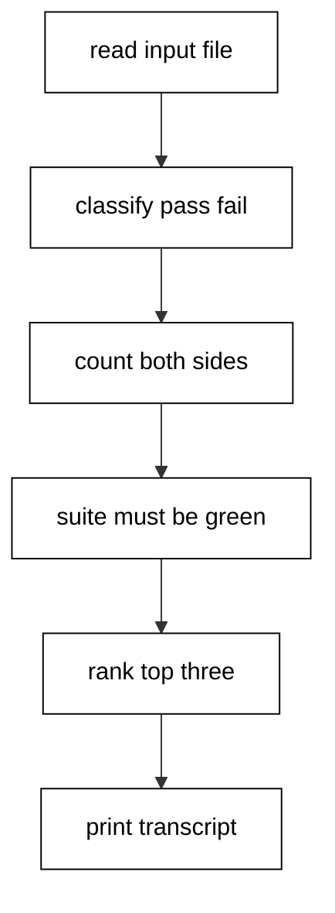
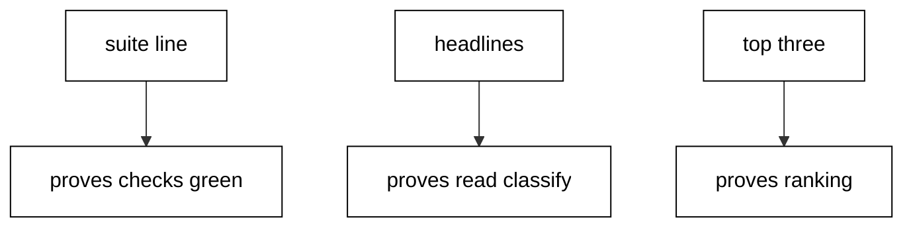

The grade-book summarizer: reads a roster of name-to-score lines, classifies pass and fail, ranks the top three with deterministic tie order, and proves its own pipeline with an embedded suite that gates the report.

## Why this exists -- the big idea

**The problem before the solution**: small command-line tools grow by accretion — a parse here, a print there — until nobody can say what the tool guarantees. This capstone shows the alternative: a hundred-line F# script whose embedded suite pins parsing and ranking, whose transcript proves every stage, and whose dependency posture is declared as data rather than assumed.

**Keep this if you forget everything else**: verify before reporting — the suite runs first, the summary decides, and the report prints only past the gate.

## What you will build

A grade-book summarizer that reads `input.txt` (eight `name:score` lines), parses each line into a tagged outcome, classifies pass at sixty and above, counts both sides, ranks the top three by score descending with alphabetical ties, writes a side report under `/tmp`, and prints a six-line transcript. The embedded suite pins the parser on both tags plus the ranking comparator before any report prints, and the sample lock read declares the stdlib-only posture as data.

## The capstone script

**`learning/capstone/code/main.fsx`**:

```fsharp
// => Capstone: a grade-book summarizer with an embedded suite and golden transcript.
let dir = __SOURCE_DIRECTORY__ // => the unit folder anchors input and lock samples.
// => The suite records silently; only the summary prints, like a quiet formatter.
let results = ResizeArray<string * bool>() // => the suite record: name plus verdict.
// => record compares and remembers; printing waits for the summary below.
let record name expected actual = // => name, want, and got in.
    results.Add((name, expected = actual)) // => the verdict joins the record.
// => The parser under test: name:score in, tagged outcome out.
let parseLine (line: string) = // => one roster line in, tagged pair out.
    // => Split on the colon; two parts parse, anything else complains.
    let parts = line.Split([|':'|]) // => name and score, or the wrong shape.
    if parts.Length = 2 then // => the two-part shape parses further.
        match System.Int32.TryParse(parts.[1]) with // => total attempt on the score.
        | true, n -> Ok (parts.[0], n) // => digits wrap with their name.
        | false, _ -> Error (sprintf "bad score: %s" line) // => bad score names its line.
    else Error (sprintf "bad line: %s" line) // => wrong shape names its line.
// => The ranker under test: score descends, names break ties alphabetically.
let top (rs: (string * int) list) n = // => roster plus count in, leaders out.
    rs |> List.sortBy (fun (name, score) -> (-score, name)) |> List.truncate n // => one key, full order.
// => Three facts pin parsing and ranking before any report prints.
record "parses good line" (Ok ("ada", 95)) (parseLine "ada:95") // => good lines wrap.
record "rejects bad score" (Error "bad score: x:y") (parseLine "x:y") // => bad scores complain exactly.
record "ranks ties alphabetically" [ ("a", 90); ("b", 90) ] (top [ ("b", 90); ("a", 90) ] 2) // => ties break by name.
// => The gate reads the summary as data; red suites stop the report cold.
let failed = results |> Seq.filter (fun (_, p) -> not p) |> Seq.length // => red cases counted.
if failed > 0 then failwithf "suite red: %d of %d failed" failed results.Count // => red stops nonzero.
// => Loud boundary: a missing input file reports to stderr and exits nonzero.
let inputPath = System.IO.Path.Combine(dir, "input.txt") // => the committed eight-line fixture.
if not (System.IO.File.Exists(inputPath)) then // => the absent-file branch.
    eprintfn "missing input: %s" inputPath // => the loud stderr message.
    System.Environment.Exit(1) // => nonzero exit: silence is not an option.
// => Read, trim, and drop blanks: files carry trailing newlines and gaps.
let lines = // => clean entries out of raw file lines.
    System.IO.File.ReadAllLines(inputPath) // => raw lines including the trailing gap.
    |> Array.map (fun s -> s.Trim()) // => whitespace stripped per line.
    |> Array.filter (fun s -> s <> "") // => blank lines removed.
    |> Array.toList // => the eight roster lines as a list.
// => Parse every line; the fixture is fixed, so every line parses here.
let students = lines |> List.map parseLine |> List.choose (function Ok v -> Some v | Error _ -> None) // => eight pairs.
// => Classify at sixty: passes and fails counted separately.
let passed = students |> List.filter (fun (_, s) -> s >= 60) // => seven and above hold.
let failedStudents = students |> List.filter (fun (_, s) -> s < 60) // => below sixty drops.
// => Rank the top three with the pinned comparator.
let leaders = top students 3 // => ada, turing, grace in rank order.
// => The sample lock declares the pinning posture: framework plus empty census.
let locked = System.IO.File.ReadAllText(System.IO.Path.Combine(dir, "sample.packages.lock.json")) // => raw lock text.
let tfm = if locked.Contains("net10.0") then "net10.0" else "unknown" // => the pinned framework read out.
let deps = locked.Split([|"\"resolved\":"|], System.StringSplitOptions.None).Length - 1 // => resolved entries counted.
// => The side report lands under /tmp; stdout stays the asserted transcript.
let report = (leaders |> List.map (fun (name, score) -> sprintf "%s: %d" name score) |> fun rs -> System.String.Join("\n", rs)) + "\n" // => one leader per line.
System.IO.File.WriteAllText("/tmp/fsharp-in-depth-capstone-report.txt", report) // => the /tmp side report.
// => The transcript: summary, headlines, pins, then the ranked three.
printfn "suite: %d tests, %d failures" results.Count failed // => the suite summary line.
printfn "lines=%d students=%d passed=%d failed=%d" lines.Length students.Length passed.Length failedStudents.Length // => the headline totals.
printfn "pins=%s stdlib-only deps=%d" tfm deps // => framework, posture, and empty census.
for (name, score) in leaders do printfn "%s: %d" name score // => the ranked top three.
```

The `input.txt` fixture beside the script carries the eight fixed `name:score` lines the transcript counts, and `sample.packages.lock.json` declares the empty dependency census the `pins=` line reports. Both ship inside the unit folder so the capstone travels as one self-contained directory.

**Output** (`learning/capstone/code/expected/main/main.stdout.txt`):

```text
suite: 3 tests, 0 failures
lines=8 students=8 passed=7 failed=1
pins=net10.0 stdlib-only deps=0
ada: 95
turing: 91
grace: 88
```

## How the pieces compose

Line parsing (Examples 4, 10, 25) feeds classification; `List.sortBy` with the score-then-name comparator ranks deterministically (Example 51's ordering lesson); the suite-summary-as-data gate from Examples 40 and 43 blocks the report when red; the `Result` thinking from Examples 9–17 shapes the bad-line branch; the sample lock read from Examples 32 and 77 declares the pinning posture. No new idioms appear here: composition is the test. Read the script top to bottom and name the example each section comes from; if a section has no ancestor, it does not belong.



## Reading the transcript

The six output lines each prove one stage. The `suite:` line proves the embedded suite executed with three checks and zero failures. The `lines=` headline proves reading and classification produced eight students with seven passes and one fail. The `pins=` line proves the sample lock read ran and the project ships stdlib-only. The three `name: score` lines prove ranking with deterministic tie order: `ada` at 95, then `turing` at 91, then `grace` at 88. Any missing line names its broken stage exactly. Rerun the unit and diff: identical bytes, because fixed input, fixed ranking, and a summary without timings leave no room for variance.



## Extending it

Add a `--top N` argument by reading `fsi.CommandLineArgs` and threading the count through the ranker with a default of three. Add a distinction band at ninety and above with a fourth check pinning the new branch. Emit JSON instead of text lines with one `sprintf` per record for machine consumers. Each extension is one function plus one transcript line. Keep the transcript golden: new lines append at the end, never in the middle, so history stays diffable.

## Reproducing it

Run the unit twice and diff the transcripts: identical bytes, because the input fixture is committed, the ranking comparator breaks ties alphabetically, and the suite summary prints counts rather than timings. Delete the input file and rerun to watch the failure path: the run exits nonzero with a stderr message naming the missing path, which is the loud boundary failure the course teaches instead of a silent empty report. Restore the fixture and confirm green returns. The side report under `/tmp` regenerates on every run with one `name: score` line per leader in rank order; it is a side effect for humans, while standard output stays the asserted transcript for the harness.

## What graduating means

You can take a pile of lines and turn them into a verified report: parse with tagged outcomes, count with the standard vocabulary, rank deterministically, gate on the suite summary, and fail loudly on missing input. More importantly, you can point at each line of the capstone and name the example that taught it. If a line has no ancestor in Examples 1–78, it does not belong — and neither does any line you add without a test that fails first.
