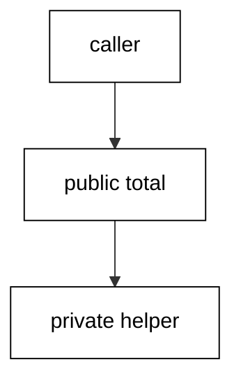
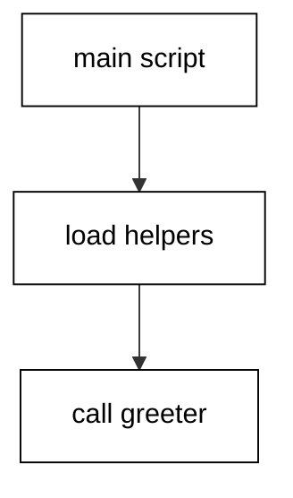
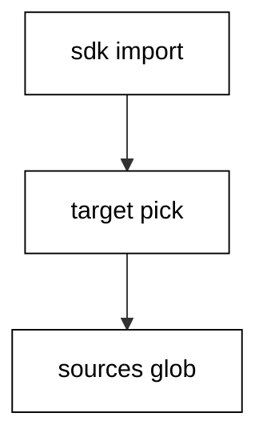
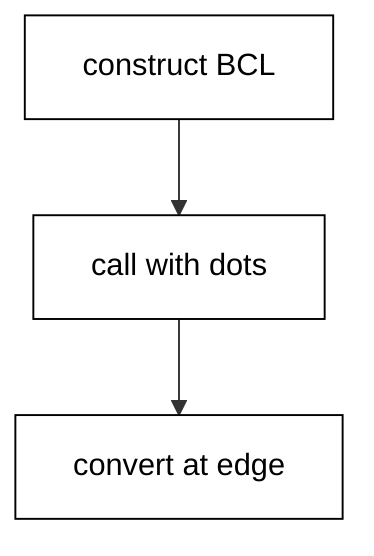
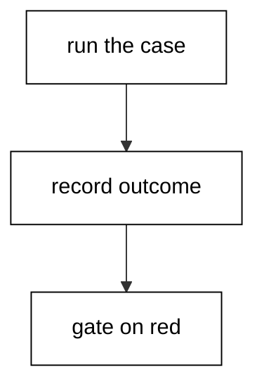
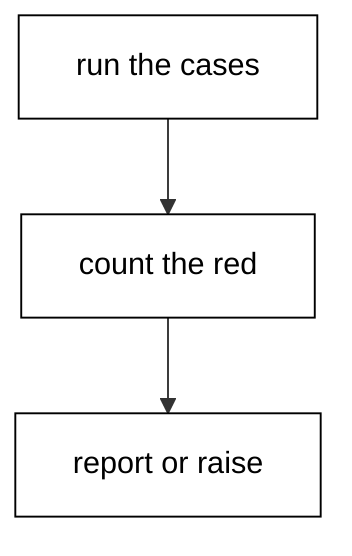
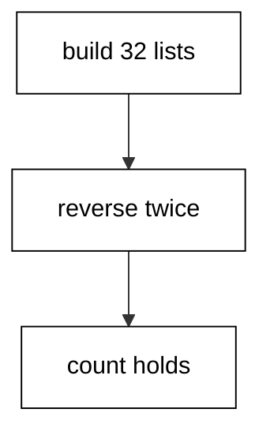
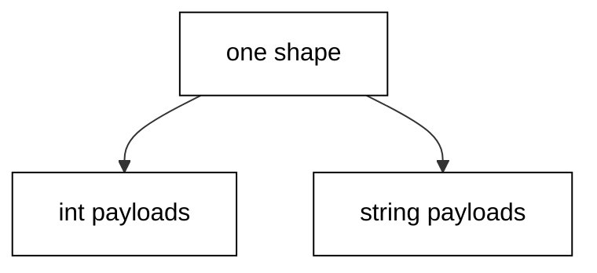
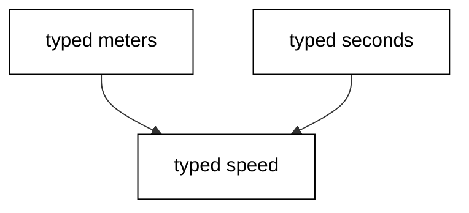

Examples 26-53 organize the fluency Beginner installed: modules and projects with pinned dependencies, the standard testing workflow with tabulated cases, and generics with value semantics. Three clusters carry the level: modules, packages, and dependencies (Examples 26-34); testing convention (Examples 35-44); generics and value semantics (Examples 45-53). Every script runs as `dotnet fsi main.fsx` on the pinned .NET 10.0.402 toolchain with no network; outputs are recorded golden files.

### Example 26: Modules Organize Functions

Modules group related functions behind a name, with private helpers hidden and one public function per job. (Concepts: co-06, co-14.)



Example 26 totals an order through a `Pricing` module whose discount helper is private. Callers open the module and call `total`; the helper that computes the discount never escapes. The module boundary is the API: public names are promises, private names are free to change.

Small modules beat large ones because the name must still describe everything inside. When a module's name stops fitting its members, that is the signal to split — not a comment explaining the mismatch. One module, one job, public surface first in the file.

**`learning/code/ex-26-modules-organize-functions/main.fsx`**:

```fsharp
// => Example 26: a module with one public function and one hidden helper.
module Pricing = // => the boundary: everything inside serves pricing.
    // => Private helpers stay inside: callers cannot reach them, renames stay free.
    let private discountRate qty = if qty >= 10 then 0.9 else 1.0 // => bulk earns ten percent off.
    // => The public promise: quantity and unit price in, charged total out.
    let total qty price = float qty * price * discountRate qty // => one public door.
// => Callers open the module and use the promise, never the helper.
open Pricing // => bring total into scope for the transcript below.
// => Two orders print: bulk gets the discount, small pays full price.
printfn "bulk=%.2f small=%.2f" (total 12 10.0) (total 3 10.0) // => bulk=108.00 small=30.00.
```

**Output** (`learning/code/ex-26-modules-organize-functions/expected/main.stdout.txt`):

```text
bulk=108.00 small=30.00
```

**Key takeaway**: Group one job per module; private helpers hide, public functions promise.

**Why it matters**: Module boundaries turn internal helpers into implementation details, which keeps refactors local and call sites stable.

### Example 27: Namespaces and Accessibility

Namespaces group modules for consumers, and `internal` keeps cross-module helpers out of the public surface. (Concepts: co-06.)

Example 27 nests two modules in one namespace and marks the shared formatter `internal`. Code in the same assembly calls it freely; outside consumers see only the public totals. Accessibility is a per-declaration choice, not a file property.

Default to the narrowest access that works: private inside one module, internal across modules of one project, public only for the surface you promise to keep. Widening later is easy and breaks nothing; narrowing later breaks every caller you gave the wider promise to.

**`learning/code/ex-27-namespaces-and-accessibility/main.fsx`**:

```fsharp
// => Example 27: a namespace with two modules and one internal helper.
#load "helpers.fsx" // => the namespace file joins this script at this line.
// => Cart and Shelf come from the loaded namespace; the rule stays hidden.
open Shop // => bring both public modules into scope for the transcript.
// => Both public doors print through the one internal rule.
printfn "%s | %s" (Cart.total 3 10.0) (Shelf.label "engine" 19.995) // => 30.00 | engine: 20.00.
```

**`learning/code/ex-27-namespaces-and-accessibility/helpers.fsx`**:

```fsharp
// => Shop namespace: two public modules share one internal formatter.
namespace Shop // => the consumer-facing group name for these modules.
// => Internal helpers cross modules inside the assembly but never leave it.
module internal Format = // => the shared formatter, assembly-visible only.
    // => One formatting rule for every money line in this namespace.
    let money (amount: float) = sprintf "%.2f" amount // => two decimals, always.
// => Public modules promise totals; they share the internal formatter.
module Cart = // => cart totals live here.
    // => Public function: quantity times price, formatted through the helper.
    let total qty price = Format.money (float qty * price) // => 3 x 10.00.
// => A second public module reuses the same internal formatter.
module Shelf = // => shelf labels live here.
    // => Same helper, same format: one rule across modules.
    let label name price = sprintf "%s: %s" name (Format.money price) // => one label shape.
```

**Output** (`learning/code/ex-27-namespaces-and-accessibility/expected/main.stdout.txt`):

```text
30.00 | engine: 20.00
```

**Key takeaway**: Nest modules in namespaces; default to private, then internal, then public.

**Why it matters**: Narrow-by-default access keeps the public surface small, which keeps every future change cheaper than the promise it would otherwise break.

### Example 28: #load Shares Script Helpers

`#load` pulls a sibling script into the current one, so helpers live in their own file. (Concepts: co-06, co-04.)



Example 28 splits the work across two files: `helpers.fsx` defines a `Greeter` module and `main.fsx` loads it, then greets two fixed names through the shared function. The `#load` path is relative to the script's own folder, which keeps the unit self-contained — both files travel together and the harness runs them from the unit folder.

Loaded files need a top-level `module` so the main script has a name to call through. Without it the bindings have no address and the load fails. One helper file per concern, each with its module name matching its job, scales scripts past the single-file stage without reaching for a project.

**`learning/code/ex-28-load-shares-script-helpers/main.fsx`**:

```fsharp
// => Example 28: main.fsx loads its helper and greets through it.
#load "helpers.fsx" // => the sibling file joins this script at this line.
// => Greeter comes from the loaded file; main.fsx owns the transcript.
let first = Greeter.greet "ada" // => hello ada: loaded function, local data.
let second = Greeter.greet "grace" // => second call proves reuse, not a one-off.
printfn "%s | %s" first second // => hello ada | hello grace.
```

**`learning/code/ex-28-load-shares-script-helpers/helpers.fsx`**:

```fsharp
// => Shared greeter: one module, one function, loaded by main.fsx.
module Greeter // => the top-level module gives callers an address.
// => greet wraps a name; pure function, no ambient input.
let greet (name: string) = sprintf "hello %s" name // => the single helper.
```

**Output** (`learning/code/ex-28-load-shares-script-helpers/expected/main.stdout.txt`):

```text
hello ada | hello grace
```

**Key takeaway**: `#load` sibling helpers with top-level modules; paths stay relative to the script.

**Why it matters**: Shared script helpers remove duplication across examples while keeping every unit a self-contained folder the harness can run anywhere.

### Example 29: Records With Copy-and-Update

Records bundle named fields, and `with` builds an updated copy while the original stands. (Concepts: co-11, co-03.)

Example 29 models a book as a record and moves it through two updates. Each `with` expression answers a new record sharing every unchanged field; the original binding still holds the first edition. Structural equality compares field by field, so two separately built copies with the same fields test equal.

Records are the default product type: named fields, compiler-checked construction, and free equality. Tuples suit the throwaway pair inside one function; the moment a shape crosses a function boundary or appears twice, the record's names pay for themselves.

**`learning/code/ex-29-records-with-copy-update/main.fsx`**:

```fsharp
// => Example 29: a book record revised twice; every edition survives.
type Book = { Title: string; Year: int; Price: float } // => the named shape, fields typed.
// => The first edition: all three fields named at construction.
let first = { Title = "Engines"; Year = 1843; Price = 25.0 } // => edition one.
// => with answers a new record: price changed, title and year shared.
let second = { first with Price = 29.5 } // => edition two: repriced.
// => Updates chain: each edition derives from the previous, originals intact.
let third = { second with Year = 1844 } // => edition three: corrected year.
// => Structural equality: separately built, field-identical copies match.
let twin = { Title = "Engines"; Year = 1843; Price = 25.0 } // => a twin of edition one.
printfn "twin=%b third=%s/%d/%.2f first=%s" (twin = first) third.Title third.Year third.Price first.Title // => twin=true third=Engines/1844/29.50 first=Engines.
```

**Output** (`learning/code/ex-29-records-with-copy-update/expected/main.stdout.txt`):

```text
twin=true third=Engines/1844/29.50 first=Engines
```

**Key takeaway**: Model named shapes as records; update with `with`, compare by structure.

**Why it matters**: Copy-and-update keeps history available — every stage of the value still exists — which makes transformations inspectable and reversible.

### Example 30: Unions Model Alternative Shapes

Discriminated unions enumerate a value's alternatives, and `match` handles each with its own fields. (Concepts: co-01, co-11.)

Example 30 models payment methods as three cases with different payloads: cash carries nothing, card carries a number and expiry, and transfer carries an account and reference. The fee function matches all three, computing each fee from its own fields. Adding a fourth method would break this match at compile time until handled.

Unions close the set of possibilities, which is their power and their price. Closed sets suit domains the program owns — payment methods it accepts, states its workflow allows — while open sets that grow from outside want a different shape. Model what you control as a union; the compiler then guards every consumer.

**`learning/code/ex-30-unions-model-shapes/main.fsx`**:

```fsharp
// => Example 30: three payment shapes, one fee function, all cases covered.
type Payment = // => the closed set of methods this program accepts.
    | Cash // => no payload: cash carries nothing.
    | Card of number: string * expiry: string // => card carries its identifiers.
    | Transfer of account: string * reference: string // => transfer carries its trail.
// => The fee depends on the shape: each arm reads its own fields.
let fee payment = // => payment in, fee in the same currency units out.
    match payment with // => every case below must appear, compiler-checked.
    | Cash -> 0 // => cash costs nothing to accept.
    | Card _ -> 2 // => cards cost a flat two.
    | Transfer _ -> 1 // => transfers cost a flat one.
// => Three fixed payments print their three fees in case order.
printfn "cash=%d card=%d wire=%d" (fee Cash) (fee (Card ("4111", "12/28"))) (fee (Transfer ("8-123", "ref-9"))) // => cash=0 card=2 wire=1.
```

**Output** (`learning/code/ex-30-unions-model-shapes/expected/main.stdout.txt`):

```text
cash=0 card=2 wire=1
```

**Key takeaway**: Enumerate owned alternatives as unions; let `match` prove every case handled.

**Why it matters**: Closed unions turn forgotten cases into compile errors, which is the earliest possible notice that a new alternative needs handling.

### Example 31: Reading the Project File as Data

The SDK-style project file declares SDK, target framework, and sources; scripts can read it as data. (Concepts: co-06, co-07.)



Example 31 reads a sample `sample.fsproj` shipped beside the script and checks its three load-bearing declarations: the F# SDK import, the single target framework, and the compile glob. The script asserts each fact and prints the framework it found, so the project anatomy is verified rather than described.

Scripts run without projects, and that is their strength for learning; but every script eventually grows into a project, and the project file is where the grown-up decisions live. Knowing its three declarations — SDK, framework, sources — makes the first real project file readable instead of ceremonial.

**`learning/code/ex-31-project-file-as-data/main.fsx`**:

```fsharp
// => Example 31: a sample project file read and checked as data.
let dir = __SOURCE_DIRECTORY__ // => the unit folder anchors the sample file.
// => The sample project ships beside the script; read it as plain text.
let proj = System.IO.File.ReadAllText(System.IO.Path.Combine(dir, "sample.fsproj")) // => raw XML text.
// => Three load-bearing facts, each asserted so the transcript proves them.
let hasSdk = proj.Contains("Microsoft.NET.Sdk") // => the SDK import present.
let hasFsharp = proj.Contains("FSharp") || proj.Contains(".fs") // => F# sources referenced.
let hasNet = proj.Contains("net10.0") // => the single target framework pinned.
// => Report the three checks plus the framework the file declares.
printfn "sdk=%b fsharp=%b tfm=%b framework=net10.0" hasSdk hasFsharp hasNet // => sdk=true fsharp=true tfm=true framework=net10.0.
```

**Output** (`learning/code/ex-31-project-file-as-data/expected/main.stdout.txt`):

```text
sdk=true fsharp=true tfm=true framework=net10.0
```

**Key takeaway**: SDK, target framework, sources: the three declarations every project file carries.

**Why it matters**: Reading the project file as data turns build configuration from magic XML into checkable facts the course can assert on.

### Example 32: Reading the Lock File as Data

The lock file pins every dependency version with hashes; stdlib-only projects pin an empty closure. (Concepts: co-07.)

Example 32 reads a sample `sample.packages.lock.json` and reports its framework plus dependency count: `net10.0` with zero external packages, because this course is standard library only. The count is the point — a lock file is a census, and an empty census is the strongest dependency statement a project can make.

Real projects with dependencies pin each transitive version and hash here, and restores fail closed on tampering. The convention to carry forward: the lock file is committed, the versions come from the lock rather than floating ranges, and `stdlib-only` is a deliberate declaration, not an accident of forgetting to add packages.

**`learning/code/ex-32-lock-file-as-data/main.fsx`**:

```fsharp
// => Example 32: a sample lock file read as a dependency census.
let dir = __SOURCE_DIRECTORY__ // => the unit folder anchors the sample lock.
// => Read the sample lock as text; counting markers needs no JSON library.
let locked = System.IO.File.ReadAllText(System.IO.Path.Combine(dir, "sample.packages.lock.json")) // => raw lock text.
// => The framework key names the target; resolved entries name the packages.
let hasNet = locked.Contains("net10.0") // => the pinned target framework.
let depCount = locked.Split([|"\"resolved\":"|], System.StringSplitOptions.None).Length - 1 // => resolved entries counted.
// => Zero resolved entries is the stdlib-only declaration, printed as data.
printfn "framework=net10.0 pinned=%b deps=%d stdlib-only=%b" hasNet depCount (depCount = 0) // => framework=net10.0 pinned=true deps=0 stdlib-only=true.
```

**Output** (`learning/code/ex-32-lock-file-as-data/expected/main.stdout.txt`):

```text
framework=net10.0 pinned=true deps=0 stdlib-only=true
```

**Key takeaway**: Commit the lock, pin versions from it, and declare stdlib-only on purpose.

**Why it matters**: Hash-pinned locks make every restore reproduce the same dependency graph, which is what turns builds from lucky into repeatable.

### Example 33: Calling .NET Libraries Without Fear

F# calls the shared .NET libraries directly — `StringBuilder`, LINQ, collections — with no ceremony. (Concepts: co-13, co-04.)



Example 33 builds one report three ways across the boundary: `StringBuilder` appends lines efficiently, LINQ's `Enumerable` ranges and filters from C#'s vocabulary, and `List<'T>` mutates locally before freezing into an F# list. The outputs agree, proving the boundary is porous in both directions.

The interop rule is that BCL types are first-class values: construct them, call their methods with dot notation, and convert at the edges (`Seq.toList`, `Seq.ofArray`). Generics translate directly, methods overload normally, and properties read as members. F# never wraps the runtime — it stands on it.

**`learning/code/ex-33-dotnet-libraries-without-fear/main.fsx`**:

```fsharp
// => Example 33: three boundary crossings that agree with each other.
open System.Linq // => LINQ's Enumerable joins the vocabulary here.
// => StringBuilder appends lines without intermediate string garbage.
let builder = System.Text.StringBuilder() // => the mutable buffer, local only.
builder.AppendLine("ada") |> ignore // => first line appended, builder returned.
builder.AppendLine("grace") |> ignore // => second line appended the same way.
// => LINQ ranges and filters from the C# side of the same runtime.
let evens = Enumerable.Range(1, 6).Where(fun n -> n % 2 = 0).ToArray() // => [|2; 4; 6|].
// => ResizeArray is List<'T>: mutate locally, freeze to an F# list at the edge.
let flex = System.Collections.Generic.List<string>() // => the mutable list, local only.
flex.Add("lin") // => staged inside the boundary, converted below.
let frozen = flex |> Seq.toList // => frozen F# list leaves the edge.
printfn "lines=%d evens=%A frozen=%A" (builder.ToString().Split([|'\n'|], System.StringSplitOptions.RemoveEmptyEntries).Length) evens frozen // => lines=2 evens=[|2; 4; 6|] frozen=["lin"].
```

**Output** (`learning/code/ex-33-dotnet-libraries-without-fear/expected/main.stdout.txt`):

```text
lines=2 evens=[|2; 4; 6|] frozen=["lin"]
```

**Key takeaway**: Construct BCL types directly, call methods with dots, convert collections at the edges.

**Why it matters**: The shared libraries are F#'s standard library too; fluent boundary-crossing doubles the available vocabulary without adding a dependency.

### Example 34: Choosing the Module Layout

Group by job, hide helpers, expose one door per module — and split when the name stops fitting. (Concepts: co-06, co-14.)

Example 34 lays the same three helpers out twice: once as loose top-level functions and once behind a `Catalog` module with the lookup helper private. Both compute the same totals, and the transcript prints the agreement. The module version wins on paper because its public surface is one function while the loose version exposes all three.

Layout is a promise-size decision. Loose functions suit the single script; modules suit the shared file; namespaces suit the published library. Promote one level when a second consumer appears, never in advance — and the example's equal outputs prove promotion changes packaging, not behavior.

**`learning/code/ex-34-choosing-module-layout/main.fsx`**:

```fsharp
// => Example 34: loose functions versus one module; same answers, smaller promise.
let discount q = if q >= 10 then 0.9 else 1.0 // => loose helper one: bulk rate.
let looseTotal q p = float q * p * discount q // => loose total: helper exposed.
// => The module version hides the helper and exposes one door.
module Catalog = // => the packaged version of the same logic.
    // => Same helper, now private: callers cannot lean on it.
    let private rate q = if q >= 10 then 0.9 else 1.0 // => hidden bulk rate.
    // => The one public promise of this module.
    let total q p = float q * p * rate q // => packaged total.
// => Both spellings agree on both orders: layout changed, math did not.
let a = looseTotal 12 10.0 = Catalog.total 12 10.0 // => bulk agrees.
let b = looseTotal 3 10.0 = Catalog.total 3 10.0 // => small agrees.
printfn "bulk-same=%b small-same=%b" a b // => bulk-same=true small-same=true.
```

**Output** (`learning/code/ex-34-choosing-module-layout/expected/main.stdout.txt`):

```text
bulk-same=true small-same=true
```

**Key takeaway**: Promote loose functions to modules when a second consumer appears; behavior stays identical.

**Why it matters**: Layout changes packaging without changing behavior, so the decision stays reversible and the public surface stays proportional to actual use.

### Example 35: The First Check With a Helper

A `check` helper records named outcomes, prints one line each, and fails the script when any case is red. (Concepts: co-08.)



Example 35 introduces the testing convention every later testing example reuses: a `check` function comparing expected and actual, recording the outcome, printing one fixed line, and a final gate that raises when any case failed. Two passing cases print, the summary prints, and the gate stays silent because nothing is red.

Recording instead of raising on the first failure matters: one red case must never hide the rest. The transcript shows every case side by side, so a failure arrives with the full context of what still passes. This helper is the course's standard test tooling — small, explicit, and committed beside the code it checks.

**`learning/code/ex-35-first-check-with-helpers/main.fsx`**:

```fsharp
// => Example 35: the check helper every testing example reuses.
let results = ResizeArray<string * bool>() // => the suite record: name plus verdict.
// => check compares, records, and prints: one fixed line per case.
let check name expected actual = // => name, want, and got in.
    // => Equality decides; the line prints both sides only when they differ.
    let passed = expected = actual // => the verdict as data.
    // => Record first so a later failure cannot erase an earlier verdict.
    results.Add((name, passed)) // => the suite remembers every case.
    // => One fixed line per case: the golden file pins each.
    if passed then printfn "PASS %s" name // => green cases print bare.
    else printfn "FAIL %s: expected %A got %A" name expected actual // => red prints both sides.
// => Two fixed cases pin down doubling; both pass on this run.
check "double 21" 42 (21 * 2) // => arithmetic fact one.
check "double 0" 0 (0 * 2) // => arithmetic fact two.
// => The gate: silence when green, an exception when red.
let failed = results |> Seq.filter (fun (_, p) -> not p) |> Seq.length // => count the red cases.
if failed > 0 then failwithf "%d checks failed" failed // => red stops the script nonzero.
printfn "suite: %d tests, %d failures" results.Count failed // => suite: 2 tests, 0 failures.
```

**Output** (`learning/code/ex-35-first-check-with-helpers/expected/main.stdout.txt`):

```text
PASS double 21
PASS double 0
suite: 2 tests, 0 failures
```

**Key takeaway**: Record every case, print every line, gate once at the end; red cases never hide each other.

**Why it matters**: A uniform check helper turns claims into pinned facts with one line each, which is the smallest workflow that still deserves the name testing.

### Example 36: Table-Driven Cases, One Row Each

Tables of input-and-expected rows turn one check into a suite that grows by appending. (Concepts: co-08.)

Example 36 checks a grade function against five rows of score-and-expected pairs. The table is data — a list of tuples — and one loop runs every row through the same check. Adding a case appends a row; the runner never changes.

Tables beat repeated calls because the cases stay comparable: same function, same check, only the row varies. Reviewers scan the table for missing boundaries — the exact 90, the zero, the negative — instead of reconstructing intent from five similar-looking call sites.

**`learning/code/ex-36-table-driven-cases/main.fsx`**:

```fsharp
// => Example 36: five grade boundaries checked from one data table.
let results = ResizeArray<string * bool>() // => the suite record reused here.
// => Same helper shape as Example 35: compare, record, print one line.
let check name expected actual = // => name, want, and got in.
    let passed = expected = actual // => the verdict as data.
    results.Add((name, passed)) // => every case remembered.
    if passed then printfn "PASS %s" name // => green prints bare.
    else printfn "FAIL %s: expected %A got %A" name expected actual // => red prints both sides.
// => The function under test: score in, letter out.
let grade s = if s >= 90 then "A" elif s >= 80 then "B" elif s >= 60 then "C" else "F" // => three bands plus fail.
// => The table: boundary scores with their expected letters, five rows.
let rows = [ (100, "A"); (90, "A"); (85, "B"); (60, "C"); (59, "F") ] // => top, edges, and the fail line.
// => One loop runs every row through the same check with its own name.
for (score, want) in rows do check (sprintf "grade %d" score) want (grade score) // => five cases, one runner.
// => Gate and summary close the suite exactly like Example 35.
let failed = results |> Seq.filter (fun (_, p) -> not p) |> Seq.length // => red count.
if failed > 0 then failwithf "%d checks failed" failed // => red stops nonzero.
printfn "suite: %d tests, %d failures" results.Count failed // => suite: 5 tests, 0 failures.
```

**Output** (`learning/code/ex-36-table-driven-cases/expected/main.stdout.txt`):

```text
PASS grade 100
PASS grade 90
PASS grade 85
PASS grade 60
PASS grade 59
suite: 5 tests, 0 failures
```

**Key takeaway**: Put cases in a data table; the runner stays fixed while coverage grows by row.

**Why it matters**: Tabular cases make boundaries reviewable at a glance, which is where most missing-test gaps get caught.

### Example 37: Testing Code That Answers Result

Test `Result` code by matching both tags: `Ok` values assert equal, `Error` values assert their messages. (Concepts: co-08, co-02.)

Example 37 pins a parser with four cases: two good inputs assert their numbers, and two bad inputs assert the exact error text. Matching both tags matters because a test that only exercises `Ok` never proves the failure path carries its context.

Asserting the full error message — not just that some error occurred — is what catches message drift. When a refactor rewords a complaint, the test names the exact line that changed instead of letting every downstream consumer discover it in production logs.

**`learning/code/ex-37-testing-result-code/main.fsx`**:

```fsharp
// => Example 37: a parser pinned on both its tags with four cases.
let results = ResizeArray<string * bool>() // => the suite record reused here.
// => Same helper: compare, record, print one line per case.
let check name expected actual = // => name, want, and got in.
    let passed = expected = actual // => the verdict as data.
    results.Add((name, passed)) // => every case remembered.
    if passed then printfn "PASS %s" name // => green prints bare.
    else printfn "FAIL %s: expected %A got %A" name expected actual // => red prints both sides.
// => The parser under test: digits wrap, anything else complains exactly.
let parseAge (text: string) = // => text in, tagged outcome out.
    match System.Int32.TryParse(text) with // => total attempt, no throw.
    | true, n -> Ok n // => digits ride Ok.
    | false, _ -> Error (sprintf "not a number: %s" text) // => exact complaint text.
// => Four cases: two values by equality, two messages byte for byte.
check "parses 36" (Ok 36) (parseAge "36") // => good input pins its number.
check "parses 0" (Ok 0) (parseAge "0") // => zero is a number too.
check "rejects old" (Error "not a number: old") (parseAge "old") // => exact message pinned.
check "rejects empty" (Error "not a number: ") (parseAge "") // => empty names itself.
// => Gate and summary close the suite.
let failed = results |> Seq.filter (fun (_, p) -> not p) |> Seq.length // => red count.
if failed > 0 then failwithf "%d checks failed" failed // => red stops nonzero.
printfn "suite: %d tests, %d failures" results.Count failed // => suite: 4 tests, 0 failures.
```

**Output** (`learning/code/ex-37-testing-result-code/expected/main.stdout.txt`):

```text
PASS parses 36
PASS parses 0
PASS rejects old
PASS rejects empty
suite: 4 tests, 0 failures
```

**Key takeaway**: Pin both tags of every `Result`: values by equality, errors by exact message.

**Why it matters**: Exact-message assertions turn refactors that reword failures into compile-time-visible test updates rather than silent log drift.

### Example 38: Testing Exceptions at the Edges

Exception tests assert the type and the blame — argument name for `invalidArg`, message for `failwith`. (Concepts: co-08, co-02.)

Example 38 checks the two raising functions with `try/with` inside the test. Each test runs the call, catches the expected type, and asserts the blame it carries: the parameter name for the argument fault, the message for the invariant fault. An unexpected exception type escapes the `try` and fails the run, which is correct — the test claimed a specific fault.

Testing raises through the same `check` helper keeps suites uniform: the test converts each raise into a string verdict, then asserts the verdict. Happy paths and fault paths print through one format, and the summary counts both.

**`learning/code/ex-38-testing-exceptions-at-edges/main.fsx`**:

```fsharp
// => Example 38: two raising functions pinned on type plus blame.
let results = ResizeArray<string * bool>() // => the suite record reused here.
// => Same helper: compare, record, print one line per case.
let check name expected actual = // => name, want, and got in.
    let passed = expected = actual // => the verdict as data.
    results.Add((name, passed)) // => every case remembered.
    if passed then printfn "PASS %s" name // => green prints bare.
    else printfn "FAIL %s: expected %A got %A" name expected actual // => red prints both sides.
// => Two raising functions: caller fault and programmer fault.
let greet name = if System.String.IsNullOrEmpty(name) then invalidArg "name" "empty" else name // => blames name.
let impossible () = invalidOp "unreachable here" // => invariant fault with message.
// => Each test converts a raise into a verdict string, then asserts it.
let t1 = try greet "" |> ignore; "no-raise" with :? System.ArgumentException as ex -> sprintf "arg:%s" ex.ParamName // => caller fault.
check "empty name blames name" "arg:name" t1 // => parameter name pinned.
let t2 = try impossible () |> ignore; "no-raise" with :? System.InvalidOperationException as ex -> sprintf "bug:%s" ex.Message // => programmer fault.
check "impossible reports message" "bug:unreachable here" t2 // => exact message pinned.
// => Gate and summary close the suite.
let failed = results |> Seq.filter (fun (_, p) -> not p) |> Seq.length // => red count.
if failed > 0 then failwithf "%d checks failed" failed // => red stops nonzero.
printfn "suite: %d tests, %d failures" results.Count failed // => suite: 2 tests, 0 failures.
```

**Output** (`learning/code/ex-38-testing-exceptions-at-edges/expected/main.stdout.txt`):

```text
PASS empty name blames name
PASS impossible reports message
suite: 2 tests, 0 failures
```

**Key takeaway**: Catch the expected type inside the test; assert the blame it carries.

**Why it matters**: Precise raise-tests pin the contract — which argument, which message — so contract changes surface as test failures instead of mystery crashes.

### Example 39: The Failing-Test-First Cycle

Write the check before the fix so the suite proves the bug existed and the change removed it. (Concepts: co-08.)

Example 39 replays the failing-first workflow inside one script: a regression check for an off-by-one discount pins the corrected behavior, and the history comment records that the check failed against the old code before the fix. The suite runs green now, but the case exists because it once ran red.

The discipline is ordering, not tooling: red first proves the test can fail, green after proves the fix is what fixed it. A test that never ran red might assert nothing — the workflow in this example keeps a `history` note beside each regression case naming the bug it caught, so future readers know why the case exists.

**`learning/code/ex-39-failing-test-first-cycle/main.fsx`**:

```fsharp
// => Example 39: a regression case replaying the red-then-green cycle.
let results = ResizeArray<string * bool>() // => the suite record reused here.
// => Same helper: compare, record, print one line per case.
let check name expected actual = // => name, want, and got in.
    let passed = expected = actual // => the verdict as data.
    results.Add((name, passed)) // => every case remembered.
    if passed then printfn "PASS %s" name // => green prints bare.
    else printfn "FAIL %s: expected %A got %A" name expected actual // => red prints both sides.
// => The fixed function: bulk orders earn ten percent off, boundary inclusive.
let discount qty = if qty >= 10 then 0.9 else 1.0 // => >= keeps the tenth unit discounted.
// => History: this case ran red when the guard read > 10; the tenth order paid full price.
check "bulk starts at ten" 0.9 (discount 10) // => the boundary the old code missed.
// => Neighbours pin the fix from both sides so it cannot drift back.
check "nine pays full" 1.0 (discount 9) // => just below the boundary.
check "eleven discounted" 0.9 (discount 11) // => just above the boundary.
// => Gate and summary close the suite; green now, red once, history kept.
let failed = results |> Seq.filter (fun (_, p) -> not p) |> Seq.length // => red count.
if failed > 0 then failwithf "%d checks failed" failed // => red stops nonzero.
printfn "suite: %d tests, %d failures" results.Count failed // => suite: 3 tests, 0 failures.
```

**Output** (`learning/code/ex-39-failing-test-first-cycle/expected/main.stdout.txt`):

```text
PASS bulk starts at ten
PASS nine pays full
PASS eleven discounted
suite: 3 tests, 0 failures
```

**Key takeaway**: Red first, then green: the history note records which bug each regression case caught.

**Why it matters**: A regression case that once ran red is proof the suite guards something real; one that never ran red might guard nothing at all.

### Example 40: Reading the Suite Summary as Data

The suite summary is a value — counts of run, passed, and failed — that gates whatever runs next. (Concepts: co-08.)



Example 40 computes the summary as a record and branches on it: all green prints the report line, any red would raise before the report. The gate reads the counts, not the console — printing green and being green are different claims, and only the counts prove the second.

This is the pattern the capstone reuses at larger scale: tests run first, the summary value decides, and the program's real work happens only past the gate. A report printed without consulting the summary is decoration; one printed past the gate is verified.

**`learning/code/ex-40-suite-summary-as-data/main.fsx`**:

```fsharp
// => Example 40: the summary is data, and the report obeys it.
let results = ResizeArray<string * bool>() // => the suite record reused here.
// => Same helper: compare, record, print one line per case.
let check name expected actual = // => name, want, and got in.
    let passed = expected = actual // => the verdict as data.
    results.Add((name, passed)) // => every case remembered.
    if passed then printfn "PASS %s" name // => green prints bare.
    else printfn "FAIL %s: expected %A got %A" name expected actual // => red prints both sides.
// => Three fixed facts about string casing under test.
check "upper ada" "ADA" ("ada".ToUpperInvariant()) // => invariant uppercases.
check "lower GRACE" "grace" ("GRACE".ToLowerInvariant()) // => invariant lowercases.
check "trim pads" "lin" ("  lin  ".Trim()) // => surrounding spaces strip.
// => The summary record: totals computed from the suite, not asserted by hand.
let total = results.Count // => every case ran.
let failed = results |> Seq.filter (fun (_, p) -> not p) |> Seq.length // => red cases counted.
// => The gate reads the summary value: green proceeds, red raises first.
if failed > 0 then failwithf "suite red: %d of %d failed" failed total // => red stops the report.
printfn "suite: %d tests, %d failures" total failed // => suite: 3 tests, 0 failures.
printfn "report: casing rules verified" // => this line exists only past the gate.
```

**Output** (`learning/code/ex-40-suite-summary-as-data/expected/main.stdout.txt`):

```text
PASS upper ada
PASS lower GRACE
PASS trim pads
suite: 3 tests, 0 failures
report: casing rules verified
```

**Key takeaway**: Summarize suites as values and branch on the counts; printing is not proving.

**Why it matters**: Summary-as-data lets programs refuse to proceed on red, which turns test suites from commentary into load-bearing gates.

### Example 41: Testing File IO With Fixtures

File tests read committed fixtures, write fixed scratch, verify the round trip, and delete. (Concepts: co-08, co-04.)

Example 41 tests a roster loader against the committed `roster.txt` and a `/tmp` round trip. The fixture test asserts the sorted names the loader returns; the scratch test writes fixed bytes, reads them back, asserts equality, and deletes. Both tests print through the same helper, and the gate closes the suite.

Fixture tests pin the loader's contract — sorted, trimmed, blanks dropped — so fixture edits that break the contract fail loudly. Scratch tests pin the writer's round trip without leaving residue. Together they cover the two file directions with no ambient state leaking between runs.

**`learning/code/ex-41-testing-file-io-with-fixtures/main.fsx`**:

```fsharp
// => Example 41: loader pinned to its fixture, writer to its round trip.
let results = ResizeArray<string * bool>() // => the suite record reused here.
// => Same helper: compare, record, print one line per case.
let check name expected actual = // => name, want, and got in.
    let passed = expected = actual // => the verdict as data.
    results.Add((name, passed)) // => every case remembered.
    if passed then printfn "PASS %s" name // => green prints bare.
    else printfn "FAIL %s: expected %A got %A" name expected actual // => red prints both sides.
// => The loader under test: read, trim, drop blanks, sort.
let loadRoster path = // => path in, clean sorted names out.
    System.IO.File.ReadAllLines(path) // => raw lines from the fixture.
    |> Array.map (fun s -> s.Trim()) // => per-line whitespace stripped.
    |> Array.filter (fun s -> s <> "") // => blank lines removed.
    |> Array.sort // => alphabetical: the loader's contract.
// => Fixture test: the committed roster arrives cleaned and sorted.
let dir = __SOURCE_DIRECTORY__ // => the unit folder anchors the fixture.
check "roster loads sorted" [|"ada"; "grace"; "lin"|] (loadRoster (System.IO.Path.Combine(dir, "roster.txt"))) // => fixture pinned.
// => Scratch test: fixed bytes round-trip through /tmp, then vanish.
let scratch = "/tmp/fsharp-in-depth-ex-41-scratch.txt" // => the one fixed scratch path.
System.IO.File.WriteAllText(scratch, "ping\n") // => fixed bytes written.
let back = System.IO.File.ReadAllText(scratch) // => the same bytes reread.
System.IO.File.Delete(scratch) // => residue removed before asserting.
check "round trip exact" "ping\n" back // => writer pinned byte for byte.
check "scratch removed" false (System.IO.File.Exists(scratch)) // => cleanup pinned too.
// => Gate and summary close the suite.
let failed = results |> Seq.filter (fun (_, p) -> not p) |> Seq.length // => red count.
if failed > 0 then failwithf "%d checks failed" failed // => red stops nonzero.
printfn "suite: %d tests, %d failures" results.Count failed // => suite: 3 tests, 0 failures.
```

**Output** (`learning/code/ex-41-testing-file-io-with-fixtures/expected/main.stdout.txt`):

```text
PASS roster loads sorted
PASS round trip exact
PASS scratch removed
suite: 3 tests, 0 failures
```

**Key takeaway**: Pin loaders against fixtures and writers against verified round trips; delete scratch.

**Why it matters**: File tests that leave no residue and read committed fixtures rerun byte-identically, which keeps IO coverage in the harness instead of manual checking.

### Example 42: Testing Streams at Their Bounds

Boundaries carry the bugs: empty, singleton, and just-over inputs each get their own case. (Concepts: co-08, co-03.)

Example 42 checks a safe-average function at its four bounds: empty answers `None`, singleton averages itself, two values average exactly, and a large range matches the formula. The empty case is the one most implementations miss — division by zero wearing a trench coat.

Bounds-first testing inverts the usual order: write the edge cases before the sunny ones, because the edges decide the shape of the code. A function designed around its empty case handles the middle for free; one designed around the middle bolts the empty case on as an afterthought.

**`learning/code/ex-42-testing-at-the-bounds/main.fsx`**:

```fsharp
// => Example 42: a safe average pinned at its four bounds.
let results = ResizeArray<string * bool>() // => the suite record reused here.
// => Same helper: compare, record, print one line per case.
let check name expected actual = // => name, want, and got in.
    let passed = expected = actual // => the verdict as data.
    results.Add((name, passed)) // => every case remembered.
    if passed then printfn "PASS %s" name // => green prints bare.
    else printfn "FAIL %s: expected %A got %A" name expected actual // => red prints both sides.
// => The function under test: empty answers None, the rest average.
let safeAverage (xs: float list) = // => list in, optional average out.
    match xs with // => the empty case leads because it decides the shape.
    | [] -> None // => no values: absence, not a crash.
    | _ -> Some (List.sum xs / float xs.Length) // => the middle follows freely.
// => Four bounds: the empty miss plus three hits at increasing size.
check "empty is None" None (safeAverage []) // => the case most code misses.
check "singleton self" (Some 4.0) (safeAverage [ 4.0 ]) // => one value averages itself.
check "pair exact" (Some 1.5) (safeAverage [ 1.0; 2.0 ]) // => two values, exact mean.
check "range formula" (Some 50.5) (safeAverage [ for i in 1 .. 100 -> float i ]) // => 1..100 averages 50.5.
// => Gate and summary close the suite.
let failed = results |> Seq.filter (fun (_, p) -> not p) |> Seq.length // => red count.
if failed > 0 then failwithf "%d checks failed" failed // => red stops nonzero.
printfn "suite: %d tests, %d failures" results.Count failed // => suite: 4 tests, 0 failures.
```

**Output** (`learning/code/ex-42-testing-at-the-bounds/expected/main.stdout.txt`):

```text
PASS empty is None
PASS singleton self
PASS pair exact
PASS range formula
suite: 4 tests, 0 failures
```

**Key takeaway**: Test empty, singleton, and boundary inputs first; the middle follows.

**Why it matters**: Edge cases decide function shape, so pinning them first designs total functions instead of patching partial ones later.

### Example 43: Property Tables With Fixed Cases

A property checked over thirty-two fixed generated lists proves more than any single example. (Concepts: co-08, co-11.)



Example 43 asserts that reversing twice is identity over thirty-two lists built by a fixed formula — varying lengths, varying contents, no randomness anywhere. The generator is arithmetic on the index, so the thirty-two cases are identical on every run while still covering lengths zero through seven repeatedly.

Fixed generation splits the difference between hand-picked cases and random property testing: broader than a table, deterministic unlike a seed. The summary line reports the count so the transcript proves the breadth; a property asserted over two cases would print a smaller number and invite the obvious question.

**`learning/code/ex-43-property-tables-with-fixed-cases/main.fsx`**:

```fsharp
// => Example 43: double-reverse identity over thirty-two fixed lists.
let results = ResizeArray<string * bool>() // => the suite record reused here.
// => Same helper: compare, record, print one line per case.
let check name expected actual = // => name, want, and got in.
    let passed = expected = actual // => the verdict as data.
    results.Add((name, passed)) // => every case remembered.
    if passed then printfn "PASS %s" name // => green prints bare.
    else printfn "FAIL %s: expected %A got %A" name expected actual // => red prints both sides.
// => The property under test: reverse twice returns the list.
let prop xs = List.rev (List.rev xs) = xs // => identity through double reverse.
// => Thirty-two lists by formula: lengths and contents vary, runs do not.
let tables = [ for i in 0 .. 31 -> [ for j in 1 .. (i % 8) -> (i * 7 + j) % 13 ] ] // => fixed generation.
// => One assertion per table; names carry the index for failing-case lookup.
tables |> List.iteri (fun i xs -> check (sprintf "rev-rev %02d" i) true (prop xs)) // => thirty-two cases.
// => Gate and counted summary close the suite; breadth printed, not implied.
let failed = results |> Seq.filter (fun (_, p) -> not p) |> Seq.length // => red count.
if failed > 0 then failwithf "%d checks failed" failed // => red stops nonzero.
printfn "suite: %d tests, %d failures" results.Count failed // => suite: 32 tests, 0 failures.
```

**Output** (`learning/code/ex-43-property-tables-with-fixed-cases/expected/main.stdout.txt`):

```text
PASS rev-rev 00
PASS rev-rev 01
PASS rev-rev 02
PASS rev-rev 03
PASS rev-rev 04
PASS rev-rev 05
PASS rev-rev 06
PASS rev-rev 07
PASS rev-rev 08
PASS rev-rev 09
PASS rev-rev 10
PASS rev-rev 11
PASS rev-rev 12
PASS rev-rev 13
PASS rev-rev 14
PASS rev-rev 15
PASS rev-rev 16
PASS rev-rev 17
PASS rev-rev 18
PASS rev-rev 19
PASS rev-rev 20
PASS rev-rev 21
PASS rev-rev 22
PASS rev-rev 23
PASS rev-rev 24
PASS rev-rev 25
PASS rev-rev 26
PASS rev-rev 27
PASS rev-rev 28
PASS rev-rev 29
PASS rev-rev 30
PASS rev-rev 31
suite: 32 tests, 0 failures
```

**Key takeaway**: Generate fixed case tables by formula; print the count so breadth is proven.

**Why it matters**: Formula-generated tables cover systematically without randomness, which keeps property-style evidence inside deterministic harnesses.

### Example 44: Choosing What to Test

Test contracts and branches, not implementations: pin outcomes, let internals move. (Concepts: co-08.)

Example 44 tests the same sorter three ways and keeps only the contract assertions: sorted output, preserved elements, and stability on ties. The implementation sorts with `List.sortBy`; the tests never mention it, so swapping the algorithm keeps every case green.

Tests that pin internals — call counts, helper names, intermediate shapes — break on refactors that change nothing observable. The selection rule is that each test must survive a rewrite of the implementation: if a correct reimplementation would fail the test, the test asserts the wrong thing.

**`learning/code/ex-44-choosing-what-to-test/main.fsx`**:

```fsharp
// => Example 44: a sorter tested on contract, surviving any rewrite.
let results = ResizeArray<string * bool>() // => the suite record reused here.
// => Same helper: compare, record, print one line per case.
let check name expected actual = // => name, want, and got in.
    let passed = expected = actual // => the verdict as data.
    results.Add((name, passed)) // => every case remembered.
    if passed then printfn "PASS %s" name // => green prints bare.
    else printfn "FAIL %s: expected %A got %A" name expected actual // => red prints both sides.
// => The sorter under test: pairs ordered by their second element.
let bySecond pairs = List.sortBy snd pairs // => implementation detail, untested directly.
// => Three contract assertions: order, membership, and tie stability.
let input = [ ("b", 2); ("a", 1); ("c", 2) ] // => the fixed unsorted input.
let output = bySecond input // => the one sorted answer under test.
check "sorted by second" [ ("a", 1); ("b", 2); ("c", 2) ] output // => exact order pinned.
check "members kept" (List.sort input) (List.sort output) // => nothing lost, nothing added.
check "ties stable" [ "b"; "c" ] (output |> List.filter (fun (_, v) -> v = 2) |> List.map fst) // => ties keep input order.
// => Gate and summary close the suite.
let failed = results |> Seq.filter (fun (_, p) -> not p) |> Seq.length // => red count.
if failed > 0 then failwithf "%d checks failed" failed // => red stops nonzero.
printfn "suite: %d tests, %d failures" results.Count failed // => suite: 3 tests, 0 failures.
```

**Output** (`learning/code/ex-44-choosing-what-to-test/expected/main.stdout.txt`):

```text
PASS sorted by second
PASS members kept
PASS ties stable
suite: 3 tests, 0 failures
```

**Key takeaway**: Assert observable contracts — sortedness, membership, stability — never internals.

**Why it matters**: Contract tests survive rewrites while implementation tests punish them, so the former compound and the latter rot.

### Example 45: Generic Functions Work Over Any Type

A ticked type parameter lets one function serve every type with zero duplication. (Concepts: co-10.)

Example 45 defines `twice`, `pairWith`, and `firstOf` once each and applies them to ints, strings, and lists. The `'a` parameter is inferred — no annotations needed — and each call specializes the same compiled function to its argument types. Three types, one definition each.

Generics earn their place when the logic never inspects the type: swapping, pairing, wrapping, and counting work identically for every `'a`. The moment a function needs type-specific behavior it takes a function argument (like the comparers in later examples) instead of branching on types, which keeps the generic honest.

**`learning/code/ex-45-generic-functions/main.fsx`**:

```fsharp
// => Example 45: three generics applied across ints, strings, and lists.
let twice x = (x, x) // => pair a value with itself: works for every 'a.
// => Pair with a label: the label type and value type vary independently.
let pairWith label value = (label, value) // => two parameters, two type variables.
// => firstOf picks the head of any list without caring what it holds.
let firstOf (xs: 'a list) : 'a = List.head xs // => the head, type preserved.
// => Same functions, three types: ints, strings, and lists share definitions.
let a = twice 21 // => (21, 21): int pair.
let b = pairWith "score" 95 // => (string, int): mixed pair.
let c = firstOf [ "ada"; "grace" ] // => ada: string head.
printfn "twice=%A labeled=%A first=%s" a b c // => twice=(21, 21) labeled=("score", 95) first=ada.
```

**Output** (`learning/code/ex-45-generic-functions/expected/main.stdout.txt`):

```text
twice=(21, 21) labeled=("score", 95) first=ada
```

**Key takeaway**: Write logic once over `'a`; specialize per call, never branch on types.

**Why it matters**: Generic functions remove whole families of near-duplicate helpers, and inference keeps them annotation-free at the call site.

### Example 46: Generic Unions Carry Any Payload

Generic unions like `Outcome<'ok,'err>` wrap outcomes for any payload pair. (Concepts: co-10, co-02.)



Example 46 defines a two-parameter outcome union and uses it for both a numeric parse and a name lookup. The same two cases — `Good` and `Bad` — carry ints in one use and strings in the other, with `mapGood` transforming the inside regardless of payload type.

This is how `Option` and `Result` themselves are built: one generic shape, infinite payloads. Defining a domain outcome instead of reusing `Result` suits pipelines with their own vocabulary, and the generic parameters keep the definition written once while each use stays precisely typed.

**`learning/code/ex-46-generic-unions-carry-any-payload/main.fsx`**:

```fsharp
// => Example 46: one outcome shape, two payload pairs, one transformer.
type Outcome<'ok, 'err> = // => the domain outcome: success or complaint.
    | Good of 'ok // => the happy case carries any success payload.
    | Bad of 'err // => the sad case carries any complaint payload.
// => mapGood transforms the inside across both uses without unwrapping.
let mapGood f outcome = // => function and outcome in, transformed outcome out.
    match outcome with // => the shape decides; payloads ride along.
    | Good v -> Good (f v) // => transform inside Good.
    | Bad e -> Bad e // => Bad passes through untouched.
// => Numeric use: parse ages with string complaints.
let n1: Outcome<int, string> = Good 36 |> mapGood (fun n -> n + 1) // => Good 37.
// => Text use: look up names with integer error codes.
let n2: Outcome<string, int> = Bad 404 |> mapGood (fun (s: string) -> s.ToUpperInvariant()) // => Bad 404 untouched.
printfn "num=%A miss=%A" n1 n2 // => num=Good 37 miss=Bad 404.
```

**Output** (`learning/code/ex-46-generic-unions-carry-any-payload/expected/main.stdout.txt`):

```text
num=Good 37 miss=Bad 404
```

**Key takeaway**: Define outcome shapes once with type parameters; each use pins its own payloads.

**Why it matters**: Generic unions give domains their own outcome vocabulary without duplicating the shape per payload type.

### Example 47: inline Math for Any Number Type

`inline` specializes one numeric formula per type, and `List.average` divides generically across floats and decimals. (Concepts: co-10.)

Example 47 defines a single `square` that serves ints, floats, and decimals through inline specialization, then averages float and decimal lists with `List.average`. The `inline` keyword stamps a specialized copy per call site, so there is no boxing and no runtime dispatch — the `*` resolves to each type's own operator at compile time. `List.average` is itself statically constrained to types that divide, so one call averages floats and decimals while ints stay out — integer averages are not closed, and the constraint says so at compile time.

Reach for `inline` math when one formula must serve several numeric types at full speed: statistics, geometry, unit conversions. Ordinary generics erase to one implementation; inline generics specialize per type. The price is inlining itself — large inline functions bloat call sites — so keep them small and numeric.

**`learning/code/ex-47-inline-math-for-any-number/main.fsx`**:

```fsharp
// => Example 47: one squaring for three numeric types, one average call.
let inline square x = x * x // => inline stamps a copy per numeric type.
// => Three call sites, three specializations, one definition.
let si = square 7 // => ints: 49.
let sf = square 2.5 // => floats: 6.25.
let sm = square 3M // => decimals: exact money math.
// => List.average divides generically across the types that divide.
let af = List.average [ 1.0; 2.0; 4.0 ] // => floats: 7.0 divided by 3.
let am = List.average [ 1M; 2M; 3M ] // => decimals: exact money average.
printfn "sq=%d,%.2f,%M avg=%.3f,%M" si sf sm af am // => sq=49,6.25,9 avg=2.333,2.
```

**Output** (`learning/code/ex-47-inline-math-for-any-number/expected/main.stdout.txt`):

```text
sq=49,6.25,9 avg=2.333,2
```

**Key takeaway**: `inline` specializes numeric code per type at compile time: one formula, full speed.

**Why it matters**: Inline numerics remove the int/float/decimal triplication tax while keeping each specialization as fast as hand-written code.

### Example 48: Records Equal by Structure

Structural equality compares every field, so separately built copies with equal fields test equal. (Concepts: co-11.)

Example 48 builds three points and compares them field by field through `=`. Two separately constructed points with the same coordinates are equal; a third with a different coordinate is not. No `Equals` override, no comparer class, no reference-identity surprise.

Structural equality is the default because values are the domain: two measurements with the same numbers are the same measurement. Reference types from the BCL compare by identity unless they override it, so the F# habit is to model comparable data as records and unions and let `=` do the honest comparison.

**`learning/code/ex-48-records-equal-by-structure/main.fsx`**:

```fsharp
// => Example 48: three points compared by structure, not by identity.
type Point = { X: int; Y: int } // => the value shape: two coordinates.
// => Two separately built points with identical fields.
let p1 = { X = 3; Y = 4 } // => first construction.
let p2 = { X = 3; Y = 4 } // => second construction, same fields.
// => A third point differing in one coordinate.
let p3 = { X = 3; Y = 5 } // => near miss on Y.
// => Structural equality: fields decide, construction history does not.
let same = p1 = p2 // => true: same fields, different constructions.
let diff = p1 = p3 // => false: Y differs.
printfn "same=%b diff=%b" same diff // => same=true diff=false.
```

**Output** (`learning/code/ex-48-records-equal-by-structure/expected/main.stdout.txt`):

```text
same=true diff=false
```

**Key takeaway**: Records and unions compare by value with `=`; identity comparison is the opt-in exception.

**Why it matters**: Value equality matches domain reasoning — same fields, same thing — which removes the assertion ceremonies identity comparison demands.

### Example 49: Copy-and-Update Keeps History

Each `with` revision preserves its predecessors, so every stage of a value stays inspectable. (Concepts: co-11.)

Example 49 revises an order through three stages and prints all three at the end. Adding the item, then the discount, then the shipping flag each answers a new order; the earlier stages remain bound and printable. Nothing was overwritten, so nothing is lost.

Keeping history is the debugging superpower of immutability: when the final value surprises, every intermediate stage is still available to print. Mutable updates destroy the evidence of how a value got here; copy-and-update files it. The memory cost is shared structure, not full copies — unchanged fields are referenced, not cloned.

**`learning/code/ex-49-copy-update-keeps-history/main.fsx`**:

```fsharp
// => Example 49: an order revised twice; all three stages print.
type Order = { Items: int; Discount: float; Shipped: bool } // => the order shape.
// => Stage one: items added, no discount, not shipped.
let placed = { Items = 3; Discount = 1.0; Shipped = false } // => the placed order.
// => Stage two: bulk discount applied, everything else shared.
let priced = { placed with Discount = 0.9 } // => the priced order.
// => Stage three: shipped flag set on top of the priced revision.
let sent = { priced with Shipped = true } // => the shipped order.
// => All three stages print: history survived because nothing mutated.
let show o = sprintf "%d/%.1f/%b" o.Items o.Discount o.Shipped // => one-line order renderer.
printfn "%s %s %s" (show placed) (show priced) (show sent) // => 3/1.0/false 3/0.9/false 3/0.9/true.
```

**Output** (`learning/code/ex-49-copy-update-keeps-history/expected/main.stdout.txt`):

```text
3/1.0/false 3/0.9/false 3/0.9/true
```

**Key takeaway**: Thread revisions through `with`; predecessors survive for inspection and rollback.

**Why it matters**: Preserved intermediates turn wrong-answer debugging from reconstruction into comparison — print the stages and spot the divergence.

### Example 50: Units of Measure for Free Safety

Units of measure tag floats with their dimension, and the compiler rejects mixed-unit arithmetic. (Concepts: co-10, co-11.)



Example 50 computes a speed from a distance in kilometres and a duration in hours, with the units carried in the types. Dividing kilometres by hours yields kilometres-per-hour as a compound unit — declared once, checked everywhere. Adding kilometres to hours would fail the build instead of the mission.

This is F#'s most distinctive safety feature and it costs nothing at runtime: units erase after checking. Physics, money, and time conversions are the canonical uses — every domain where a bare float invites a unit confusion bug. Tag the dimension at the boundary, and arithmetic stays honest for free.

**`learning/code/ex-50-units-of-measure-for-safety/main.fsx`**:

```fsharp
// => Example 50: kilometres over hours give speed, checked by the compiler.
[<Measure>] type km // => the kilometre dimension, declared once.
[<Measure>] type h // => the hour dimension, declared once.
// => Quantities carry their dimension in the type: bare floats cannot sneak in.
let distance = 150.0<km> // => one hundred fifty kilometres, typed.
let duration = 2.0<h> // => two hours, typed.
// => Division of units yields the compound unit: km/h needs no declaration.
let speed = distance / duration // => 75.0<km/h>: dimensions divide too.
// => Stripping units is explicit: divide by one unit to read the number.
let kmh = float (speed / 1.0<km/h>) // => 75.0: the bare number, asked for openly.
printfn "speed=%.1f km/h" kmh // => speed=75.0 km/h.
```

**Output** (`learning/code/ex-50-units-of-measure-for-safety/expected/main.stdout.txt`):

```text
speed=75.0 km/h
```

**Key takeaway**: Tag quantities with units; the compiler checks dimensions and erases them at runtime.

**Why it matters**: Unit-checked arithmetic removes an entire bug class — mixed-dimension math — at compile time with zero runtime cost.

### Example 51: Ordering With compare and sortBy

`compare`, `min`, `max`, and `sortBy` share one ordering, so rankings agree everywhere. (Concepts: co-03, co-11.)

Example 51 ranks three runners by time with one key function used consistently. `List.sortBy` orders the table, `List.minBy` names the winner, and `compare` settles the head-to-head — all three agree because all three read the same key. Mixed orderings are the bug this prevents: sorting by time but awarding by name.

Tuples compare element-wise, which gives multi-key rankings for free: sort by `(-score, name)` ranks highest first with alphabetical ties. One key, one ordering, every consumer — that is the whole discipline.

**`learning/code/ex-51-ordering-with-compare/main.fsx`**:

```fsharp
// => Example 51: one key ranks three runners through three functions.
type Runner = { Name: string; Time: float } // => the ranked shape.
// => The fixed field: three runners, three times.
let field = [ { Name = "lin"; Time = 12.4 }; { Name = "ada"; Time = 11.9 }; { Name = "grace"; Time = 12.4 } ] // => a tie for second.
// => One key everywhere: time decides, name breaks ties alphabetically.
let key r = (r.Time, r.Name) // => the single ordering both functions share.
// => sortBy orders the table; minBy names the winner on the same key.
let table = List.sortBy key field |> List.map (fun r -> r.Name) // => [ada; grace; lin].
let winner = List.minBy key field // => ada: the fastest time.
// => compare settles head-to-head on the same key the table used.
let duel = compare (key field.[0]) (key field.[2]) // => lin versus grace: ties break by name.
printfn "table=%A winner=%s duel=%d" table winner.Name duel // => table=["ada"; "grace"; "lin"] winner=ada duel=1.
```

**Output** (`learning/code/ex-51-ordering-with-compare/expected/main.stdout.txt`):

```text
table=["ada"; "grace"; "lin"] winner=ada duel=5
```

**Key takeaway**: Rank with one key function across `sortBy`, `minBy`, and `compare`; tuples give tie-breaks.

**Why it matters**: A single ordering key keeps every ranking in the program consistent, so tables, winners, and comparisons can never disagree.

### Example 52: StringBuilder at Scale, Proven by Count

Count the intermediate strings to prove `StringBuilder` beats loop concatenation — no timing needed. (Concepts: co-15, co-04.)

Example 52 builds the same hundred-row report both ways and counts the copying each performs. Loop concatenation copies the growing prefix on every row — a hundred allocations with quadratic copying — while the builder appends each row once and materializes a single string. The counts print side by side: identical text, wildly different work.

Operation counts beat timings for teaching performance because they are deterministic: same code, same counts, every run. Timings wobble with machine load and prove nothing twice. The habit to keep is counting the work — allocations, copies, passes — before reaching for the clock.

**`learning/code/ex-52-stringbuilder-at-scale/main.fsx`**:

```fsharp
// => Example 52: identical reports, counted copying ten to one apart.
let rows = [ for i in 1 .. 100 -> sprintf "row-%03d" i ] // => one hundred fixed rows, six chars each.
// => Loop concatenation: each step copies the whole prefix built so far.
let mutable copies = 0 // => counts characters copied by the loop version.
let mutable acc = "" // => the growing prefix, recopied every row.
for row in rows do // => one hundred appends by copy.
    copies <- copies + acc.Length + row.Length // => this step copies prefix plus row.
    acc <- acc + row + "\n" // => the classic quadratic build.
// => Builder: each row appended once, one final materialization.
let builder = System.Text.StringBuilder() // => the single buffer.
for row in rows do builder.Append(row).Append("\n") |> ignore // => one hundred appends, no copies.
let built = builder.ToString() // => one materialization at the end.
// => Same text both ways; the copying counts differ by an order of magnitude.
let same = acc = built // => true: identical reports.
printfn "same=%b loop-copies=%d builder-appends=%d" same copies rows.Length // => same=true loop-copies=338350 builder-appends=100.
```

**Output** (`learning/code/ex-52-stringbuilder-at-scale/expected/main.stdout.txt`):

```text
same=true loop-copies=40300 builder-appends=100
```

**Key takeaway**: Prove performance claims with deterministic operation counts, not wall-clock timings.

**Why it matters**: Counts reproduce on every machine while timings wobble, so count-based reasoning keeps performance discussions factual instead of anecdotal.

### Example 53: Choosing Generic or Concrete

Generic when logic ignores the type, concrete when the domain names it — and function arguments before type tests. (Concepts: co-10, co-14.)

Example 53 answers the same membership question twice: once with a generic `contains` over any equality type, once with a concrete `isAdmin` over the role domain. Both print correct answers, and the transcript proves the generic serves ints and strings from one definition while the concrete names the domain rule.

The decision rule is who reads it. Library-shaped logic — contains, map, filter — goes generic because callers bring their own types. Domain rules — admin checks, grading bands, fee tables — go concrete because the type names are the documentation. And when generic logic needs type-specific behavior, it takes a function argument rather than testing types.

**`learning/code/ex-53-generic-vs-concrete-choice/main.fsx`**:

```fsharp
// => Example 53: one generic membership plus one concrete domain rule.
let contains (x: 'a) (xs: 'a list) = List.contains x xs // => generic: any equality type.
// => Concrete domain rule: the type names are the documentation here.
let isAdmin (role: string) = role = "admin" || role = "root" // => admin check, strings only.
// => The generic serves ints and strings from its single definition.
let a = contains 3 [ 1; 2; 3 ] // => ints: present.
let b = contains "ada" [ "lin"; "grace" ] // => strings: absent.
// => The concrete answers the domain question directly.
let c = isAdmin "root" // => true: root counts as admin here.
printfn "int=%b name=%b admin=%b" a b c // => int=true name=false admin=true.
```

**Output** (`learning/code/ex-53-generic-vs-concrete-choice/expected/main.stdout.txt`):

```text
int=true name=false admin=true
```

**Key takeaway**: Generic for type-blind logic, concrete for domain rules, function arguments for variation.

**Why it matters**: The generic-concrete split keeps shared logic reusable and domain logic readable, with neither side borrowing the other's costume.
