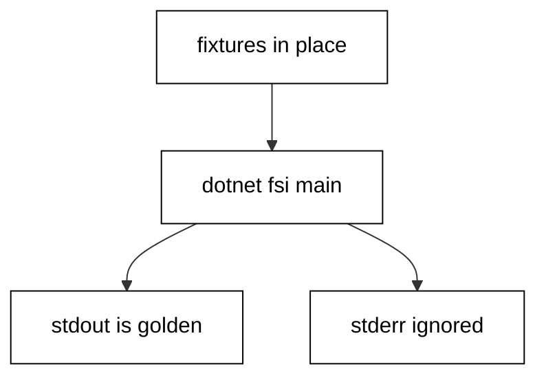

Prerequisites for this course: [just-enough-fsharp](/en/learn/courses/just-enough-fsharp/learning/overview) for F#'s basic syntax, records, unions, and pattern matching. Comfort editing and running F# scripts from a terminal is assumed throughout, and every example builds only on the primer plus earlier examples in this course.

## Why this exists -- the big idea

**The problem before the solution**: developers who learn F# as a second language write it with their first-language accent — loops with counters where folds belong, null checks where options belong, stringly errors where unions belong, hand-rolled helpers where the standard library already answers. The programs run, but they resist the ecosystem: standard tools, reviewers, and future maintainers all expect the idiomatic forms. This course replaces each accent with the native habit, one small runnable script at a time, until the idiomatic form is the first one you reach for.

**Keep this if you forget everything else**: Write F# the way its own standard library does — expressions over statements, values over mutation, data-shaped errors over stringly ones, and the standard tool running the checks.

## Tensions and trade-offs -- when NOT to reach for this

- **Idiom versus expedience**: a pipeline through two calls adds ceremony without clarity, and a mailbox agent for one counter is machinery without a failure story. Apply each idiom where its weight earns out: pipes past two stages, agents where failure domains split, generics where a third type is coming.
- **Standard library versus the ecosystem**: the course reaches for the standard library first, which keeps every example runnable with zero installs. Real projects still adopt dependencies for genuinely hard problems — web frameworks, database drivers — where the standard library ends and the ecosystem begins.
- **When NOT**: one-off exploration in F# Interactive needs no project layout, no tests, and no lock file. The engineering in this course earns its place when the program runs twice — on a schedule, on someone else's machine, or a year from now with you unavailable.

## Lineage -- where this language sits

F# is the functional-first .NET language of this series: the `just-enough-fsharp` primer teaches reading and writing, and this course builds the general-purpose fluency beneath and beyond it — control flow, collections, error handling, the standard library, testing, tooling, and the discipline of reading idiomatic code. Later F# courses (Giraffe web backends, DbUp migrations) assume exactly the idioms taught here and add their own domain systems on top.

## How this course is organized

[Beginner](/en/learn/courses/fsharp-in-depth/learning/beginner) (Examples 1-25) installs idiomatic control flow and collections, the error-handling idiom, and standard-library text, file, and time tools. [Intermediate](/en/learn/courses/fsharp-in-depth/learning/intermediate) (Examples 26-53) organizes modules and projects, declares and pins dependencies, tests with the standard check-helper workflow, and generalizes with generics and value semantics. [Advanced](/en/learn/courses/fsharp-in-depth/learning/advanced) (Examples 54-78) surveys concurrency primitives, configures tooling and style, and trains systematic reading of idiomatic code. The [capstone](/en/learn/courses/fsharp-in-depth/learning/capstone/overview) ships a grade-book summarizer with an embedded suite and a golden transcript, and [drilling](/en/learn/courses/fsharp-in-depth/drilling/overview) turns the sixteen concepts into recall, katas, and checklists.

## About the runtime

Every example runs as `dotnet fsi main.fsx` in the pinned .NET 10.0.402 container with no network and a read-only course tree: only /tmp is writable, so scratch files live there with fixed names and fixed bytes. Fixtures ship beside each script and the working directory is the unit folder, so relative reads resolve to committed files. Concurrency demos rendezvous on reply channels with sorted transcripts and never print thread identifiers; dates are constructed fixed values, never clock reads. Standard output is the asserted golden transcript; standard error is ignored.

## Worked example plan

One row per `ex-NN`: title, level, runtime, task, check, and concept refs. Every concept is exercised by at least two examples; every example names at least one concept; each cluster starts with its anchor (marked below). All anchors run F# with the standard library only and no lockfile.

| ex-NN | Title                                     | Level        | Runtime            | Task                                                           | Check                                  | Concepts            |
| ----- | ----------------------------------------- | ------------ | ------------------ | -------------------------------------------------------------- | -------------------------------------- | ------------------- |
| ex-01 | if Expressions Choose Values              | beginner     | F# stdlib (anchor) | branch on a score through an expression chain                  | grade prints B for 85                  | co-01, co-11        |
| ex-02 | match With Literals and Guards            | beginner     | F# stdlib          | match a role against literals and a guard                      | editor prints the guarded arm          | co-01               |
| ex-03 | Option for Values That May Miss           | beginner     | F# stdlib          | thread a hit and a miss through map and bind                   | hit uppercases, miss falls back        | co-02, co-01        |
| ex-04 | Result for Failures Callers Handle        | beginner     | F# stdlib          | parse digits or complain with the text kept                    | 36 parses, old complains exactly       | co-02               |
| ex-05 | Lists: map, filter, and fold              | beginner     | F# stdlib          | transform, select, and total one roster                        | curved, passing, and total print       | co-03, co-11        |
| ex-06 | Arrays, Lists, and Seqs in Their Places   | beginner     | F# stdlib          | ask each container its natural question                        | head, index, and lazy item agree       | co-03               |
| ex-07 | Seq Pipelines Stay Lazy Until Asked       | beginner     | F# stdlib          | bound an endless pipeline with take                            | first five odd squares print           | co-03               |
| ex-08 | Choosing the Collection Function          | beginner     | F# stdlib          | answer six questions with six functions                        | membership, search, counts print       | co-03               |
| ex-09 | Exceptions for Broken Contracts           | beginner     | F# stdlib (anchor) | break two contracts and convert at the edge                    | quotient and blamed arg print          | co-02               |
| ex-10 | Parse With Result Instead of Throw        | beginner     | F# stdlib          | parse three fields with blame attached                         | two parse, one names its field         | co-02, co-04        |
| ex-11 | Option for Chains That Can Miss           | beginner     | F# stdlib          | resolve a name through two dependent tables                    | hit resolves, misses fall back         | co-02               |
| ex-12 | Railway Chains With Result.bind           | beginner     | F# stdlib          | validate through a three-stage railway                         | adult, unparseable, and absurd render  | co-02, co-01        |
| ex-13 | Custom Error Unions Name Every Failure    | beginner     | F# stdlib          | withdraw with the shortfall as fields                          | remainder and short=20 print           | co-02               |
| ex-14 | failwith, invalidArg, or Error            | beginner     | F# stdlib          | route three faults to their actors                             | arg blame, bug message, miss print     | co-02               |
| ex-15 | Retry Loops Carry Their Budget            | beginner     | F# stdlib          | retry flaky work under a countdown                             | budget three wins, budget one gives up | co-02               |
| ex-16 | use Makes Cleanup Automatic               | beginner     | F# stdlib          | dispose a reader by scope exit                                 | both lines print, no dispose call      | co-02, co-04        |
| ex-17 | Choosing the Error-Handling Shape         | beginner     | F# stdlib          | route four lookups through three shapes                        | fallback, port, and size print         | co-02               |
| ex-18 | String Functions From the Library         | beginner     | F# stdlib (anchor) | normalize one messy line in four calls                         | pipe-joined line plus count prints     | co-04               |
| ex-19 | Formatting With sprintf and Interpolation | beginner     | F# stdlib          | format one summary both checked ways                           | both spellings agree byte for byte     | co-04               |
| ex-20 | Regex for Pattern-Shaped Text             | beginner     | F# stdlib          | extract named groups from a log line                           | ERROR/E102 prints from the match       | co-04               |
| ex-21 | Reading Files Beside the Script           | beginner     | F# stdlib          | load and sort a committed roster                               | three sorted names print with count    | co-04               |
| ex-22 | Writing Scratch to tmp and Cleaning Up    | beginner     | F# stdlib          | round-trip fixed bytes through /tmp                            | lengths print and scratch vanishes     | co-04               |
| ex-23 | Paths Combine, Directories List Sorted    | beginner     | F# stdlib          | combine paths and list sorted                                  | file name and data listing print       | co-04               |
| ex-24 | Dates Are Constructed, Never Read         | beginner     | F# stdlib          | build and format a fixed date                                  | release, review, and weekday print     | co-05               |
| ex-25 | Parsing Dates With TryParseExact          | beginner     | F# stdlib          | parse two stamps against one pattern                           | good normalizes, bad names itself      | co-05, co-02        |
| ex-26 | Modules Organize Functions                | intermediate | F# stdlib (anchor) | total orders behind one public door                            | bulk and small totals print            | co-06, co-14        |
| ex-27 | Namespaces and Accessibility              | intermediate | F# stdlib          | share one formatter across two modules                         | total and label print through it       | co-06               |
| ex-28 | #load Shares Script Helpers               | intermediate | F# stdlib          | load a sibling helper and call it                              | both greetings print through Greeter   | co-06, co-04        |
| ex-29 | Records With Copy-and-Update              | intermediate | F# stdlib          | revise a record twice, keep every edition                      | all three editions print, twin matches | co-11, co-03        |
| ex-30 | Unions Model Alternative Shapes           | intermediate | F# stdlib          | fee three payment shapes by arm                                | cash, card, and transfer fees print    | co-01, co-11        |
| ex-31 | Reading the Project File as Data          | intermediate | F# stdlib          | read a project file as three facts                             | SDK, F#, and framework checks print    | co-06, co-07        |
| ex-32 | Reading the Lock File as Data             | intermediate | F# stdlib          | read a lock file as a census                                   | framework pinned with zero deps prints | co-07               |
| ex-33 | Calling .NET Libraries Without Fear       | intermediate | F# stdlib          | cross the BCL boundary three ways                              | lines, evens, and frozen list print    | co-13, co-04        |
| ex-34 | Choosing the Module Layout                | intermediate | F# stdlib          | compare loose functions with one module                        | both spellings agree twice over        | co-06, co-14        |
| ex-35 | The First Check With a Helper             | intermediate | F# stdlib (anchor) | record two passing checks and gate                             | two PASS lines plus summary print      | co-08               |
| ex-36 | Table-Driven Cases, One Row Each          | intermediate | F# stdlib          | check five grade rows from one table                           | five PASS lines plus summary print     | co-08               |
| ex-37 | Testing Code That Answers Result          | intermediate | F# stdlib          | pin a parser on both its tags                                  | four verdicts plus summary print       | co-08, co-02        |
| ex-38 | Testing Exceptions at the Edges           | intermediate | F# stdlib          | pin two raises on type plus blame                              | two verdicts plus summary print        | co-08, co-02        |
| ex-39 | The Failing-Test-First Cycle              | intermediate | F# stdlib          | replay red-then-green on a boundary                            | three pins plus summary print          | co-08               |
| ex-40 | Reading the Suite Summary as Data         | intermediate | F# stdlib          | gate a report on the summary value                             | three PASS lines, report line prints   | co-08               |
| ex-41 | Testing File IO With Fixtures             | intermediate | F# stdlib          | pin a loader and a round trip                                  | fixture, bytes, and cleanup pin green  | co-08, co-04        |
| ex-42 | Testing Streams at Their Bounds           | intermediate | F# stdlib          | pin a safe average at four bounds                              | None plus three means print            | co-08, co-03        |
| ex-43 | Property Tables With Fixed Cases          | intermediate | F# stdlib          | assert double-reverse over 32 lists                            | 32 PASS lines plus summary print       | co-08, co-11        |
| ex-44 | Choosing What to Test                     | intermediate | F# stdlib          | pin a sorter on contract only                                  | order, members, and stability print    | co-08               |
| ex-45 | Generic Functions Work Over Any Type      | intermediate | F# stdlib (anchor) | serve three types from three generics                          | int pair, mixed pair, head print       | co-10               |
| ex-46 | Generic Unions Carry Any Payload          | intermediate | F# stdlib          | carry two payload pairs in one union                           | mapped Good and untouched Bad print    | co-10, co-02        |
| ex-47 | inline Math for Any Number Type           | intermediate | F# stdlib          | square three numeric types inline, average floats and decimals | squares and both averages print        | co-10               |
| ex-48 | Records Equal by Structure                | intermediate | F# stdlib          | compare three points by structure                              | same true, different false prints      | co-11               |
| ex-49 | Copy-and-Update Keeps History             | intermediate | F# stdlib          | revise an order twice, print all three                         | placed, priced, shipped print          | co-11               |
| ex-50 | Units of Measure for Free Safety          | intermediate | F# stdlib          | divide typed kilometres by hours                               | 75.0 km/h prints with units checked    | co-10, co-11        |
| ex-51 | Ordering With compare and sortBy          | intermediate | F# stdlib          | rank three runners on one key                                  | table, winner, and duel print          | co-03, co-11        |
| ex-52 | StringBuilder at Scale, Proven by Count   | intermediate | F# stdlib          | count copying in two report builds                             | same text, tenfold copying prints      | co-15, co-04        |
| ex-53 | Choosing Generic or Concrete              | intermediate | F# stdlib          | answer membership generically, admin concretely                | int, name, and admin print             | co-10, co-14        |
| ex-54 | async Workflows That Run in Order         | advanced     | F# stdlib (anchor) | sequence two async stages and run once                         | joined name and score print            | co-09               |
| ex-55 | Async.Parallel Joins Independent Work     | advanced     | F# stdlib          | double five numbers in parallel                                | five doubles print in input order      | co-09               |
| ex-56 | Tasks Interop With the .NET Side          | advanced     | F# stdlib          | await two tasks in task, join via async                        | combined total prints                  | co-09, co-13        |
| ex-57 | Mailbox Agents Serialize Requests         | advanced     | F# stdlib          | count through three agent requests                             | 1, 3, 6 print in request order         | co-09               |
| ex-58 | Events Notify Subscribers in Order        | advanced     | F# stdlib          | broadcast three readings to two subscribers                    | buffer and counter print in order      | co-09               |
| ex-59 | Cancellation Is Cooperative               | advanced     | F# stdlib          | honor a pre-cancelled token                                    | cancelled=true prints, no stage runs   | co-09               |
| ex-60 | Async Sequences That Short-Circuit        | advanced     | F# stdlib          | validate an awaited score through a railway                    | pass prints past the gate              | co-09, co-02        |
| ex-61 | Choosing the Concurrency Primitive        | advanced     | F# stdlib          | double through parallel, direct, and agent                     | all three spellings agree              | co-09               |
| ex-62 | Formatting That Ends Style Debates        | advanced     | F# stdlib (anchor) | render one summary in pipeline layout                          | ADA, GRACE prints down the page        | co-12, co-14        |
| ex-63 | XML Docs for Contracts, Comments for Why  | advanced     | F# stdlib          | document contracts, comment reasons                            | mean and range print through docs      | co-12, co-14        |
| ex-64 | Exhaustive Matches the Compiler Checks    | advanced     | F# stdlib          | handle three lights with explicit arms                         | stop, ready, go print in order         | co-12, co-01        |
| ex-65 | Names That Follow the Community Style     | advanced     | F# stdlib          | style names two ways, keep answers                             | styled true and accent false print     | co-14               |
| ex-66 | Struct Values Avoid Aliasing              | advanced     | F# stdlib          | snapshot a struct while the source moves                       | old snapshot and new point print       | co-15, co-11        |
| ex-67 | String Building That Scales               | advanced     | F# stdlib          | render one catalog three linear ways                           | all three agree on 899 chars           | co-15, co-04        |
| ex-68 | Regex Groups and Options in Depth         | advanced     | F# stdlib          | extract three varied headers tolerantly                        | three pairs plus total print           | co-04, co-13        |
| ex-69 | LINQ as a Second Vocabulary               | advanced     | F# stdlib          | ask honors in F# and in LINQ                                   | both vocabularies agree on two names   | co-13, co-03        |
| ex-70 | Choosing the Tooling Posture              | advanced     | F# stdlib          | render one line through four layers                            | engine line prints past every layer    | co-12, co-14        |
| ex-71 | Reading a Pipeline End to End             | advanced     | F# stdlib (anchor) | read a word-count pipeline in layers                           | top word, count, distinct print        | co-16, co-03        |
| ex-72 | Reading Computation Expressions           | advanced     | F# stdlib          | classify awaits, computes, delivery                            | computed total prints from the plan    | co-16, co-09        |
| ex-73 | Reading Recursive Functions               | advanced     | F# stdlib          | label base, shrink, and accumulate                             | sum and empty base print               | co-16, co-01        |
| ex-74 | Reading Active Patterns                   | advanced     | F# stdlib          | classify then match one to ten                                 | ten words plus five evens print        | co-16, co-01        |
| ex-75 | Reading a Mailbox Loop                    | advanced     | F# stdlib          | trace push, peek, and pops                                     | peek and both pops print in order      | co-16, co-09        |
| ex-76 | Reading Error Flows Through Binds         | advanced     | F# stdlib          | map exits then render every outcome                            | adult and both errors print            | co-16, co-02        |
| ex-77 | Reading Someone Else's Project File       | advanced     | F# stdlib          | read a project checklist-first                                 | SDK, framework, sources, deps print    | co-16, co-07, co-06 |
| ex-78 | The Systematic Reading Checklist          | advanced     | F# stdlib          | apply five passes to a pipeline                                | two-line summary prints the reading    | co-16               |

## Examples by Level

### Beginner (Examples 1-25)

- [Example 1: if Expressions Choose Values](/en/learn/courses/fsharp-in-depth/learning/beginner#example-1-if-expressions-choose-values)
- [Example 2: match With Literals and Guards](/en/learn/courses/fsharp-in-depth/learning/beginner#example-2-match-with-literals-and-guards)
- [Example 3: Option for Values That May Miss](/en/learn/courses/fsharp-in-depth/learning/beginner#example-3-option-for-values-that-may-miss)
- [Example 4: Result for Failures Callers Handle](/en/learn/courses/fsharp-in-depth/learning/beginner#example-4-result-for-failures-callers-handle)
- [Example 5: Lists: map, filter, and fold](/en/learn/courses/fsharp-in-depth/learning/beginner#example-5-lists-map-filter-and-fold)
- [Example 6: Arrays, Lists, and Seqs in Their Places](/en/learn/courses/fsharp-in-depth/learning/beginner#example-6-arrays-lists-and-seqs-in-their-places)
- [Example 7: Seq Pipelines Stay Lazy Until Asked](/en/learn/courses/fsharp-in-depth/learning/beginner#example-7-seq-pipelines-stay-lazy-until-asked)
- [Example 8: Choosing the Collection Function](/en/learn/courses/fsharp-in-depth/learning/beginner#example-8-choosing-the-collection-function)
- [Example 9: Exceptions for Broken Contracts](/en/learn/courses/fsharp-in-depth/learning/beginner#example-9-exceptions-for-broken-contracts)
- [Example 10: Parse With Result Instead of Throw](/en/learn/courses/fsharp-in-depth/learning/beginner#example-10-parse-with-result-instead-of-throw)
- [Example 11: Option for Chains That Can Miss](/en/learn/courses/fsharp-in-depth/learning/beginner#example-11-option-for-chains-that-can-miss)
- [Example 12: Railway Chains With Result.bind](/en/learn/courses/fsharp-in-depth/learning/beginner#example-12-railway-chains-with-resultbind)
- [Example 13: Custom Error Unions Name Every Failure](/en/learn/courses/fsharp-in-depth/learning/beginner#example-13-custom-error-unions-name-every-failure)
- [Example 14: failwith, invalidArg, or Error](/en/learn/courses/fsharp-in-depth/learning/beginner#example-14-failwith-invalidarg-or-error)
- [Example 15: Retry Loops Carry Their Budget](/en/learn/courses/fsharp-in-depth/learning/beginner#example-15-retry-loops-carry-their-budget)
- [Example 16: use Makes Cleanup Automatic](/en/learn/courses/fsharp-in-depth/learning/beginner#example-16-use-makes-cleanup-automatic)
- [Example 17: Choosing the Error-Handling Shape](/en/learn/courses/fsharp-in-depth/learning/beginner#example-17-choosing-the-error-handling-shape)
- [Example 18: String Functions From the Library](/en/learn/courses/fsharp-in-depth/learning/beginner#example-18-string-functions-from-the-library)
- [Example 19: Formatting With sprintf and Interpolation](/en/learn/courses/fsharp-in-depth/learning/beginner#example-19-formatting-with-sprintf-and-interpolation)
- [Example 20: Regex for Pattern-Shaped Text](/en/learn/courses/fsharp-in-depth/learning/beginner#example-20-regex-for-pattern-shaped-text)
- [Example 21: Reading Files Beside the Script](/en/learn/courses/fsharp-in-depth/learning/beginner#example-21-reading-files-beside-the-script)
- [Example 22: Writing Scratch to tmp and Cleaning Up](/en/learn/courses/fsharp-in-depth/learning/beginner#example-22-writing-scratch-to-tmp-and-cleaning-up)
- [Example 23: Paths Combine, Directories List Sorted](/en/learn/courses/fsharp-in-depth/learning/beginner#example-23-paths-combine-directories-list-sorted)
- [Example 24: Dates Are Constructed, Never Read](/en/learn/courses/fsharp-in-depth/learning/beginner#example-24-dates-are-constructed-never-read)
- [Example 25: Parsing Dates With TryParseExact](/en/learn/courses/fsharp-in-depth/learning/beginner#example-25-parsing-dates-with-tryparseexact)

### Intermediate (Examples 26-53)

- [Example 26: Modules Organize Functions](/en/learn/courses/fsharp-in-depth/learning/intermediate#example-26-modules-organize-functions)
- [Example 27: Namespaces and Accessibility](/en/learn/courses/fsharp-in-depth/learning/intermediate#example-27-namespaces-and-accessibility)
- [Example 28: #load Shares Script Helpers](/en/learn/courses/fsharp-in-depth/learning/intermediate#example-28-load-shares-script-helpers)
- [Example 29: Records With Copy-and-Update](/en/learn/courses/fsharp-in-depth/learning/intermediate#example-29-records-with-copy-and-update)
- [Example 30: Unions Model Alternative Shapes](/en/learn/courses/fsharp-in-depth/learning/intermediate#example-30-unions-model-alternative-shapes)
- [Example 31: Reading the Project File as Data](/en/learn/courses/fsharp-in-depth/learning/intermediate#example-31-reading-the-project-file-as-data)
- [Example 32: Reading the Lock File as Data](/en/learn/courses/fsharp-in-depth/learning/intermediate#example-32-reading-the-lock-file-as-data)
- [Example 33: Calling .NET Libraries Without Fear](/en/learn/courses/fsharp-in-depth/learning/intermediate#example-33-calling-net-libraries-without-fear)
- [Example 34: Choosing the Module Layout](/en/learn/courses/fsharp-in-depth/learning/intermediate#example-34-choosing-the-module-layout)
- [Example 35: The First Check With a Helper](/en/learn/courses/fsharp-in-depth/learning/intermediate#example-35-the-first-check-with-a-helper)
- [Example 36: Table-Driven Cases, One Row Each](/en/learn/courses/fsharp-in-depth/learning/intermediate#example-36-table-driven-cases-one-row-each)
- [Example 37: Testing Code That Answers Result](/en/learn/courses/fsharp-in-depth/learning/intermediate#example-37-testing-code-that-answers-result)
- [Example 38: Testing Exceptions at the Edges](/en/learn/courses/fsharp-in-depth/learning/intermediate#example-38-testing-exceptions-at-the-edges)
- [Example 39: The Failing-Test-First Cycle](/en/learn/courses/fsharp-in-depth/learning/intermediate#example-39-the-failing-test-first-cycle)
- [Example 40: Reading the Suite Summary as Data](/en/learn/courses/fsharp-in-depth/learning/intermediate#example-40-reading-the-suite-summary-as-data)
- [Example 41: Testing File IO With Fixtures](/en/learn/courses/fsharp-in-depth/learning/intermediate#example-41-testing-file-io-with-fixtures)
- [Example 42: Testing Streams at Their Bounds](/en/learn/courses/fsharp-in-depth/learning/intermediate#example-42-testing-streams-at-their-bounds)
- [Example 43: Property Tables With Fixed Cases](/en/learn/courses/fsharp-in-depth/learning/intermediate#example-43-property-tables-with-fixed-cases)
- [Example 44: Choosing What to Test](/en/learn/courses/fsharp-in-depth/learning/intermediate#example-44-choosing-what-to-test)
- [Example 45: Generic Functions Work Over Any Type](/en/learn/courses/fsharp-in-depth/learning/intermediate#example-45-generic-functions-work-over-any-type)
- [Example 46: Generic Unions Carry Any Payload](/en/learn/courses/fsharp-in-depth/learning/intermediate#example-46-generic-unions-carry-any-payload)
- [Example 47: inline Math for Any Number Type](/en/learn/courses/fsharp-in-depth/learning/intermediate#example-47-inline-math-for-any-number-type)
- [Example 48: Records Equal by Structure](/en/learn/courses/fsharp-in-depth/learning/intermediate#example-48-records-equal-by-structure)
- [Example 49: Copy-and-Update Keeps History](/en/learn/courses/fsharp-in-depth/learning/intermediate#example-49-copy-and-update-keeps-history)
- [Example 50: Units of Measure for Free Safety](/en/learn/courses/fsharp-in-depth/learning/intermediate#example-50-units-of-measure-for-free-safety)
- [Example 51: Ordering With compare and sortBy](/en/learn/courses/fsharp-in-depth/learning/intermediate#example-51-ordering-with-compare-and-sortby)
- [Example 52: StringBuilder at Scale, Proven by Count](/en/learn/courses/fsharp-in-depth/learning/intermediate#example-52-stringbuilder-at-scale-proven-by-count)
- [Example 53: Choosing Generic or Concrete](/en/learn/courses/fsharp-in-depth/learning/intermediate#example-53-choosing-generic-or-concrete)

### Advanced (Examples 54-78)

- [Example 54: async Workflows That Run in Order](/en/learn/courses/fsharp-in-depth/learning/advanced#example-54-async-workflows-that-run-in-order)
- [Example 55: Async.Parallel Joins Independent Work](/en/learn/courses/fsharp-in-depth/learning/advanced#example-55-asyncparallel-joins-independent-work)
- [Example 56: Tasks Interop With the .NET Side](/en/learn/courses/fsharp-in-depth/learning/advanced#example-56-tasks-interop-with-the-net-side)
- [Example 57: Mailbox Agents Serialize Requests](/en/learn/courses/fsharp-in-depth/learning/advanced#example-57-mailbox-agents-serialize-requests)
- [Example 58: Events Notify Subscribers in Order](/en/learn/courses/fsharp-in-depth/learning/advanced#example-58-events-notify-subscribers-in-order)
- [Example 59: Cancellation Is Cooperative](/en/learn/courses/fsharp-in-depth/learning/advanced#example-59-cancellation-is-cooperative)
- [Example 60: Async Sequences That Short-Circuit](/en/learn/courses/fsharp-in-depth/learning/advanced#example-60-async-sequences-that-short-circuit)
- [Example 61: Choosing the Concurrency Primitive](/en/learn/courses/fsharp-in-depth/learning/advanced#example-61-choosing-the-concurrency-primitive)
- [Example 62: Formatting That Ends Style Debates](/en/learn/courses/fsharp-in-depth/learning/advanced#example-62-formatting-that-ends-style-debates)
- [Example 63: XML Docs for Contracts, Comments for Why](/en/learn/courses/fsharp-in-depth/learning/advanced#example-63-xml-docs-for-contracts-comments-for-why)
- [Example 64: Exhaustive Matches the Compiler Checks](/en/learn/courses/fsharp-in-depth/learning/advanced#example-64-exhaustive-matches-the-compiler-checks)
- [Example 65: Names That Follow the Community Style](/en/learn/courses/fsharp-in-depth/learning/advanced#example-65-names-that-follow-the-community-style)
- [Example 66: Struct Values Avoid Aliasing](/en/learn/courses/fsharp-in-depth/learning/advanced#example-66-struct-values-avoid-aliasing)
- [Example 67: String Building That Scales](/en/learn/courses/fsharp-in-depth/learning/advanced#example-67-string-building-that-scales)
- [Example 68: Regex Groups and Options in Depth](/en/learn/courses/fsharp-in-depth/learning/advanced#example-68-regex-groups-and-options-in-depth)
- [Example 69: LINQ as a Second Vocabulary](/en/learn/courses/fsharp-in-depth/learning/advanced#example-69-linq-as-a-second-vocabulary)
- [Example 70: Choosing the Tooling Posture](/en/learn/courses/fsharp-in-depth/learning/advanced#example-70-choosing-the-tooling-posture)
- [Example 71: Reading a Pipeline End to End](/en/learn/courses/fsharp-in-depth/learning/advanced#example-71-reading-a-pipeline-end-to-end)
- [Example 72: Reading Computation Expressions](/en/learn/courses/fsharp-in-depth/learning/advanced#example-72-reading-computation-expressions)
- [Example 73: Reading Recursive Functions](/en/learn/courses/fsharp-in-depth/learning/advanced#example-73-reading-recursive-functions)
- [Example 74: Reading Active Patterns](/en/learn/courses/fsharp-in-depth/learning/advanced#example-74-reading-active-patterns)
- [Example 75: Reading a Mailbox Loop](/en/learn/courses/fsharp-in-depth/learning/advanced#example-75-reading-a-mailbox-loop)
- [Example 76: Reading Error Flows Through Binds](/en/learn/courses/fsharp-in-depth/learning/advanced#example-76-reading-error-flows-through-binds)
- [Example 77: Reading Someone Else's Project File](/en/learn/courses/fsharp-in-depth/learning/advanced#example-77-reading-someone-elses-project-file)
- [Example 78: The Systematic Reading Checklist](/en/learn/courses/fsharp-in-depth/learning/advanced#example-78-the-systematic-reading-checklist)
