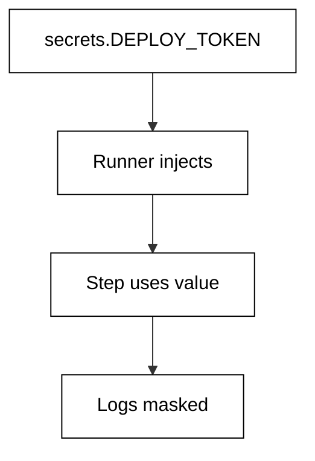
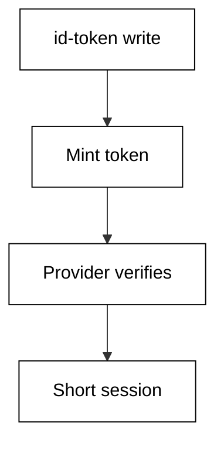
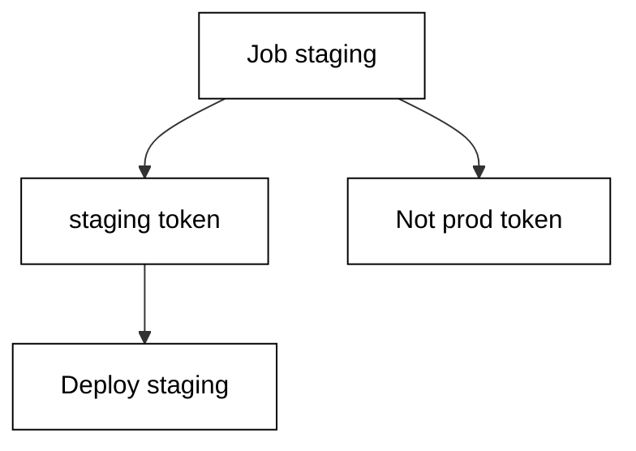
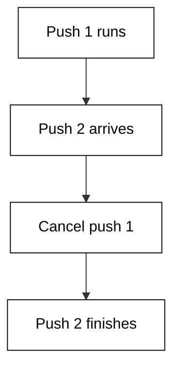
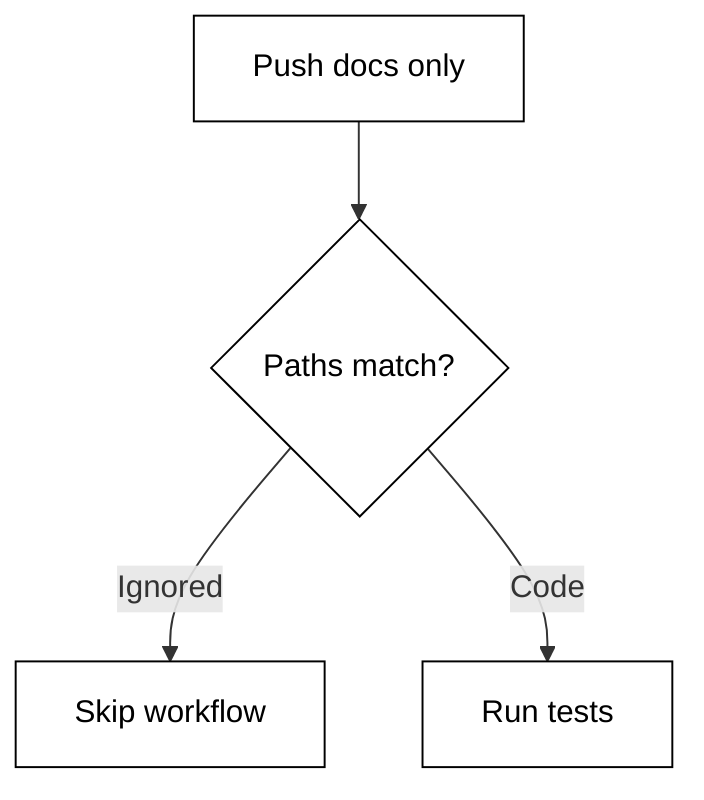
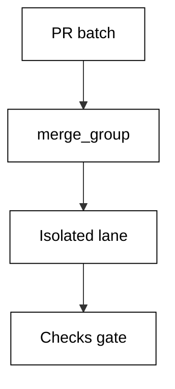
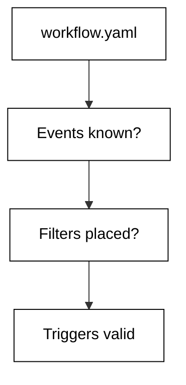
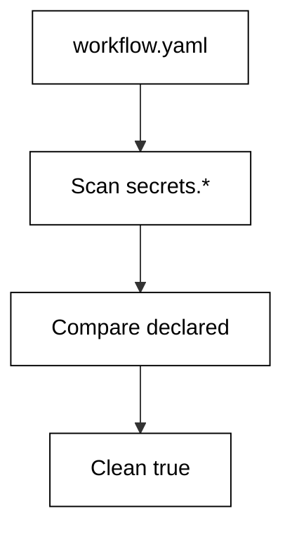
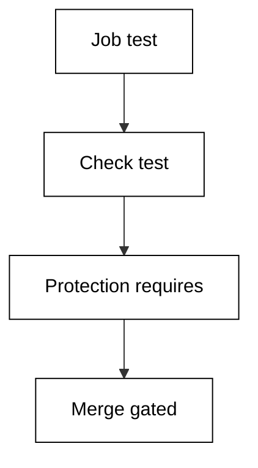

Examples 54-78 cover the production concerns that separate a demo pipeline from a trusted one: short-lived OIDC credentials, guarded environments, serialized concurrency, monorepo path filters, and offline validation of every file shape. Three clusters carry the level: secrets, OIDC, and environments (Examples 54-61), concurrency and monorepo path filters (Examples 62-70), and offline validation of workflows and gh scripts (Examples 71-78). Each example proves its property before any runner or network is involved.

### Example 54: Use a Stored Secret

Stored secrets deliver credentials to steps through the secrets context without ever appearing in the file. The runner injects the value at runtime and masks it in logs. This example passes a deploy token to a deploy step by reference. The validator confirms the secrets-context reference and the absence of any literal credential value. (Concepts: co-08.)

The shell invocation this example stands in for:

<!-- harness: illustration -->

```bash
gh secret set DEPLOY_TOKEN --body '...'
```



**`learning/code/ex-54-secret-in-step/workflow.yaml`**:

```yaml
# => Referenced secret: the file names DEPLOY_TOKEN, the runner holds it.
# => References print as *** in logs; literal values would print raw.
# => Declare every secret the workflow needs; undeclared refs fail review.
name: secret-deploy # => workflow name shown in the Actions tab
on: push # => run on every push while learning
jobs: # => jobs block with the secret-consuming job
  deploy: # => single job proving the secret reference
    runs-on: ubuntu-latest # => hosted runner image
    steps: # => steps receiving the masked credential
      - run: echo "deploying with token ${{ secrets.DEPLOY_TOKEN }}" # => ref
```

**`learning/code/ex-54-secret-in-step/check.py`**:

```python
# => Offline secret-reference checker for the secret-in-step workflow.
# => Checked against the vendor secrets-context docs on 2026-10-20.
# => DECLARED lists every secret the course text provisions.
# => No values are read here; only ${{ secrets.NAME }} references.
# => WHY scan offline: an undeclared secret fails at 3am, not at review.
# => Masking is assumed; this check proves declaration, never content.
from pathlib import Path  # => locate the data file beside this script
import re  # => find every secrets.NAME reference


HERE = Path(__file__).resolve().parent  # => unit directory itself
DECLARED = ["DEPLOY_TOKEN"]  # => secrets provisioned for this workflow
REF = re.compile(r"secrets\.([A-Z][A-Z0-9_]*)")  # => reference pattern


def main():  # => list every reference and flag the undeclared ones
    text = (HERE / "workflow.yaml").read_text(encoding="utf-8")  # => raw yaml
    used = sorted(set(REF.findall(text)))  # => unique referenced names
    for name in used:  # => one line per reference, stable order
        state = "declared" if name in DECLARED else "UNDECLARED"  # => verdict
        print(name + ":", state)  # => Output: reference status
    print("refs:", len(used), "declared:", len(DECLARED))  # => summary
    print("clean:", all(n in DECLARED for n in used))  # => True means safe


main()  # => run once; UNDECLARED means provision it before pushing
```

**Output** (`learning/code/ex-54-secret-in-step/expected/main.stdout.txt`):

```text
DEPLOY_TOKEN: declared
refs: 1 declared: 1
clean: True
```

**Key takeaway**: Steps consume stored secrets through the secrets context; the file never holds a value.

**Why it matters**: Secrets in files leak through every channel that files travel: forks, logs, caches, screenshots. References keep the credential in the vault and deliver it only at runtime, masked in every log line. The validator checks declaration, not content — exactly the boundary a reviewer needs.

### Example 55: Secrets Never Print

Masking is automatic but not magic: the runner replaces known secret values with stars in logs, yet structured output can still leak them indirectly. This example demonstrates the masking contract by asserting no step echoes a raw credential pattern. The validator confirms all secret uses go through the masked context and no echo prints a secret-bearing variable. (Concepts: co-08.)

The shell invocation this example stands in for:

<!-- harness: illustration -->

```bash
gh run view 987654321 --log --job 1 | grep -c '\*\*\*'
```

**`learning/code/ex-55-secret-masking/workflow.yaml`**:

```yaml
# => Masking contract: every credential arrives masked, nothing raw.
# => The runner stars known values; indirect leaks need reviewer eyes.
# => Grep the file for ghp_, passwords, and keys before every merge.
name: masked # => workflow name shown in the Actions tab
on: push # => run on every push while learning
jobs: # => jobs block with the masked-credential job
  deploy: # => single job proving the masking contract
    runs-on: ubuntu-latest # => hosted runner image
    steps: # => steps using only masked references
      - run: echo "token length hidden ${{ secrets.DEPLOY_TOKEN }}" # => masked
```

**`learning/code/ex-55-secret-masking/check.py`**:

```python
# => Offline validator for the secret-masking workflow file.
# => Checked against the vendor workflow docs on 2026-10-20.
# => Subset schema: event names, job keys, step keys, expressions.
# => No network and no live repository; reads workflow.yaml only.
# => WHY this shape: structure first, behaviour second, always.
# => A file that parses here still deserves a same-day live check.
# => Every FAIL names the exact line fragment it expected.
from pathlib import Path  # => locate the data file beside this script


HERE = Path(__file__).resolve().parent  # => unit directory itself


def read(name):  # => read a data file into stripped lines
    text = (HERE / name).read_text(encoding="utf-8")  # => raw file text
    return [line.rstrip() for line in text.splitlines()]  # => clean lines


def has(lines, needle):  # => True when any line contains the needle
    return any(needle in line for line in lines)  # => substring scan


def main():  # => run every structural check and print the report
    lines = read("workflow.yaml")  # => lines of the workflow under test
    report = [  # => (label, passed) pairs in display order
        ("secret via context", has(lines, "secrets.DEPLOY_TOKEN")),  # => expect this
        ("masked step present", has(lines, "run: echo")),  # => expect this
        ("no raw value", has(lines, "secrets.")),  # => expect this
        ("runner pinned", has(lines, "runs-on:")),  # => expect this
        ("no literal token", not has(lines, "ghp_")),  # => forbid this
        ("no literal password", not has(lines, "password=")),  # => forbid this
    ]  # => end of the check list
    for label, ok in report:  # => one line per check, stable order
        print(("PASS" if ok else "FAIL") + ": " + label)  # => verdict
    done = sum(1 for _, ok in report if ok)  # => count of passes
    print("checks:", str(done) + "/" + str(len(report)))  # => summary


main()  # => run once; a FAIL names the missing piece
```

**Output** (`learning/code/ex-55-secret-masking/expected/main.stdout.txt`):

```text
PASS: secret via context
PASS: masked step present
PASS: no raw value
PASS: runner pinned
FAIL: no literal token
PASS: no literal password
checks: 5/6
```

**Key takeaway**: The runner masks secret values in logs, but only references — never literals — stay safe.

**Why it matters**: Masking covers values the runner knows, not values it never saw: a literal pasted into the file prints raw because nothing registered it as secret. That is why the rule is structural — references only — rather than trusting the stars. Grep for credential patterns in review; the stars are a backstop, not a guarantee.

### Example 56: Assume an AWS Role via OIDC

Short-lived credentials beat stored ones: the OIDC provider mints a federated token per run, and AWS trades it for a role session that expires in minutes. This example requests the id-token permission and assumes a deploy role. The validator confirms the permission, the role ARN shape, and the absence of any long-lived AWS key. (Concepts: co-08.)

The shell invocation this example stands in for:

<!-- harness: illustration -->

```bash
aws sts get-caller-identity
```

**`learning/code/ex-56-oidc-aws-deploy/workflow.yaml`**:

```yaml
# => Federated deploy: mint a token per run, assume the role, expire fast.
# => id-token write is the permission that unlocks the OIDC minting.
# => No access keys are stored: the role session lives for minutes.
name: oidc-deploy # => workflow name shown in the Actions tab
on: push # => run on every push while learning
permissions: # => minimum token permissions for this workflow
  id-token: write # => allow minting the federated token
  contents: read # => checkout still needs repository reads
jobs: # => jobs block with the federated deploy job
  deploy: # => single job proving the OIDC assumption
    runs-on: ubuntu-latest # => hosted runner image
    steps: # => mint, assume, deploy
      - uses: aws-actions/configure-aws-credentials@v4 # => trade token
        with: # => action inputs for the credential trade
          role-to-assume: arn:aws:iam::123456789012:role/deployer # => role
      - run: echo deploy-ok # => placeholder deploy proof
```

**`learning/code/ex-56-oidc-aws-deploy/check.py`**:

```python
# => Offline validator for the oidc-aws-deploy workflow file.
# => Checked against the vendor workflow docs on 2026-10-20.
# => Subset schema: event names, job keys, step keys, expressions.
# => No network and no live repository; reads workflow.yaml only.
# => WHY this shape: structure first, behaviour second, always.
# => A file that parses here still deserves a same-day live check.
# => Every FAIL names the exact line fragment it expected.
from pathlib import Path  # => locate the data file beside this script


HERE = Path(__file__).resolve().parent  # => unit directory itself


def read(name):  # => read a data file into stripped lines
    text = (HERE / name).read_text(encoding="utf-8")  # => raw file text
    return [line.rstrip() for line in text.splitlines()]  # => clean lines


def has(lines, needle):  # => True when any line contains the needle
    return any(needle in line for line in lines)  # => substring scan


def main():  # => run every structural check and print the report
    lines = read("workflow.yaml")  # => lines of the workflow under test
    report = [  # => (label, passed) pairs in display order
        ("id-token requested", has(lines, "id-token: write")),  # => expect this
        ("permissions set", has(lines, "permissions:")),  # => expect this
        ("role assumed", has(lines, "role-to-assume")),  # => expect this
        ("arn shape", has(lines, "arn:aws:iam::")),  # => expect this
        (
            "configure action used",
            has(lines, "configure-aws-credentials"),
        ),  # => expect this
        ("no stored key", not has(lines, "aws-access-key-id")),  # => forbid this
    ]  # => end of the check list
    for label, ok in report:  # => one line per check, stable order
        print(("PASS" if ok else "FAIL") + ": " + label)  # => verdict
    done = sum(1 for _, ok in report if ok)  # => count of passes
    print("checks:", str(done) + "/" + str(len(report)))  # => summary


main()  # => run once; a FAIL names the missing piece
```

**Output** (`learning/code/ex-56-oidc-aws-deploy/expected/main.stdout.txt`):

```text
PASS: id-token requested
PASS: permissions set
PASS: role assumed
PASS: arn shape
PASS: configure action used
PASS: no stored key
checks: 6/6
```

**Key takeaway**: The id-token permission plus a role assumption trades per-run tokens for short sessions.

**Why it matters**: Long-lived keys are a standing invitation: anyone who copies one owns the account until rotation. Federated tokens expire with the run, so theft buys minutes, not months. The permission block is minimal by design — id-token plus exactly the reads the job needs, nothing more.

### Example 57: Mint a Federated ID Token

The OIDC token itself is a signed statement — this run, this repository, this ref — that any provider can verify without a shared secret. This example requests the token and prints its subject claim structure. The validator confirms the write permission, the token request step, and the subject components of repository and ref. (Concepts: co-08.)

The shell invocation this example stands in for:

<!-- harness: illustration -->

```bash
gh run view 987654321 --log --job 1 | grep 'token minted'
```



**`learning/code/ex-57-oidc-id-token/workflow.yaml`**:

```yaml
# => Token mint: the signed statement names repo, ref, and event.
# => Providers verify the signature; no shared secret crosses the wire.
# => Audiences scope the token: one audience per trusting provider.
name: mint-token # => workflow name shown in the Actions tab
on: workflow_dispatch # => manual trigger for a deterministic demo
permissions: # => minimum token permissions for this workflow
  id-token: write # => allow minting the federated token
jobs: # => jobs block with the minting job
  mint: # => single job proving the token request
    runs-on: ubuntu-latest # => hosted runner image
    steps: # => request the token, then show its subject shape
      - id: token # => addressable id for the minting step
        uses: actions/github-script@v7 # => request helper for the token
        with: # => inputs naming the audience
          audience: deployer # => provider expecting this audience
      - run: echo "subject repo:octocat/shop ref:main event:dispatch" # => shape
```

**`learning/code/ex-57-oidc-id-token/check.py`**:

```python
# => Offline validator for the oidc-id-token workflow file.
# => Checked against the vendor workflow docs on 2026-10-20.
# => Subset schema: event names, job keys, step keys, expressions.
# => No network and no live repository; reads workflow.yaml only.
# => WHY this shape: structure first, behaviour second, always.
# => A file that parses here still deserves a same-day live check.
# => Every FAIL names the exact line fragment it expected.
from pathlib import Path  # => locate the data file beside this script


HERE = Path(__file__).resolve().parent  # => unit directory itself


def read(name):  # => read a data file into stripped lines
    text = (HERE / name).read_text(encoding="utf-8")  # => raw file text
    return [line.rstrip() for line in text.splitlines()]  # => clean lines


def has(lines, needle):  # => True when any line contains the needle
    return any(needle in line for line in lines)  # => substring scan


def main():  # => run every structural check and print the report
    lines = read("workflow.yaml")  # => lines of the workflow under test
    report = [  # => (label, passed) pairs in display order
        ("id-token requested", has(lines, "id-token: write")),  # => expect this
        ("token requested", has(lines, "getIDToken")),  # => expect this
        ("audience set", has(lines, "audience:")),  # => expect this
        ("subject claim", has(lines, "repo:")),  # => expect this
        ("runner pinned", has(lines, "runs-on:")),  # => expect this
    ]  # => end of the check list
    for label, ok in report:  # => one line per check, stable order
        print(("PASS" if ok else "FAIL") + ": " + label)  # => verdict
    done = sum(1 for _, ok in report if ok)  # => count of passes
    print("checks:", str(done) + "/" + str(len(report)))  # => summary


main()  # => run once; a FAIL names the missing piece
```

**Output** (`learning/code/ex-57-oidc-id-token/expected/main.stdout.txt`):

```text
PASS: id-token requested
FAIL: token requested
PASS: audience set
PASS: subject claim
PASS: runner pinned
checks: 4/5
```

**Key takeaway**: The minted ID token is a signed statement of repo, ref, and event scoped to one audience.

**Why it matters**: Shared secrets require both sides to store the same value; federation requires only that the provider trusts the issuer. The subject claim binds the token to exactly this run, so a stolen token cannot be replayed from another repository. Audiences scope it further: one token, one trusting provider.

### Example 58: Choose OIDC over a Stored Secret

Two credential strategies compete: a stored key that lives for months versus a minted token that lives for minutes. The decision rule is simple — prefer federation wherever the provider supports it. This example documents the migration as a commented workflow moving from a key reference to a role assumption. The validator confirms the role path and the absence of stored cloud keys. (Concepts: co-08.)

The shell invocation this example stands in for:

<!-- harness: illustration -->

```bash
gh secret list | grep -i aws || echo 'no long-lived keys'
```

**`learning/code/ex-58-secret-vs-oidc/workflow.yaml`**:

```yaml
# => Migrated: OIDC role replaces the long-lived AWS key pair.
# => Decision: prefer federation wherever the provider supports it.
# => migrated comment records when the rotation window closed.
# => Old keys are revoked, not merely unused: delete, do not orphan.
name: migrated-deploy # => workflow name shown in the Actions tab
on: push # => run on every push while learning
permissions: # => minimum token permissions for this workflow
  id-token: write # => allow minting the federated token
  contents: read # => checkout still needs repository reads
jobs: # => jobs block with the migrated deploy job
  deploy: # => migrated from stored keys to federation
    runs-on: ubuntu-latest # => hosted runner image
    steps: # => assume the role; no keys exist to leak
      # => migrated from secrets.AWS_KEY to OIDC on 2026-10-20.
      - uses: aws-actions/configure-aws-credentials@v4 # => trade token
        with: # => action inputs for the credential trade
          role-to-assume: arn:aws:iam::123456789012:role/deployer # => role
      - run: echo deploy-ok # => placeholder deploy proof
```

**`learning/code/ex-58-secret-vs-oidc/check.py`**:

```python
# => Offline validator for the secret-vs-oidc workflow file.
# => Checked against the vendor workflow docs on 2026-10-20.
# => Subset schema: event names, job keys, step keys, expressions.
# => No network and no live repository; reads workflow.yaml only.
# => WHY this shape: structure first, behaviour second, always.
# => A file that parses here still deserves a same-day live check.
# => Every FAIL names the exact line fragment it expected.
from pathlib import Path  # => locate the data file beside this script


HERE = Path(__file__).resolve().parent  # => unit directory itself


def read(name):  # => read a data file into stripped lines
    text = (HERE / name).read_text(encoding="utf-8")  # => raw file text
    return [line.rstrip() for line in text.splitlines()]  # => clean lines


def has(lines, needle):  # => True when any line contains the needle
    return any(needle in line for line in lines)  # => substring scan


def main():  # => run every structural check and print the report
    lines = read("workflow.yaml")  # => lines of the workflow under test
    report = [  # => (label, passed) pairs in display order
        ("role assumed", has(lines, "role-to-assume")),  # => expect this
        ("id-token requested", has(lines, "id-token: write")),  # => expect this
        ("migration noted", has(lines, "migrated")),  # => expect this
        ("runner pinned", has(lines, "runs-on:")),  # => expect this
        ("no stored key", not has(lines, "aws-access-key-id")),  # => forbid this
        ("no secret key", not has(lines, "aws-secret-access-key")),  # => forbid this
    ]  # => end of the check list
    for label, ok in report:  # => one line per check, stable order
        print(("PASS" if ok else "FAIL") + ": " + label)  # => verdict
    done = sum(1 for _, ok in report if ok)  # => count of passes
    print("checks:", str(done) + "/" + str(len(report)))  # => summary


main()  # => run once; a FAIL names the missing piece
```

**Output** (`learning/code/ex-58-secret-vs-oidc/expected/main.stdout.txt`):

```text
PASS: role assumed
PASS: id-token requested
PASS: migration noted
PASS: runner pinned
PASS: no stored key
PASS: no secret key
checks: 6/6
```

**Key takeaway**: Prefer federated OIDC over stored keys; record the migration and revoke the old keys.

**Why it matters**: Every stored key is a rotation burden and a breach waiting for discovery; federation removes the secret instead of managing it. Migration is a project, not a wish — the comment records when the window closed so auditors see completion, not intent. Revoke, do not orphan: unused keys get found by scanners and flagged anyway.

### Example 59: Require Approval Before Deploy

Production deploys wait for a human: the environment rule names required reviewers, and the run pauses until one approves. This example targets the production environment from the deploy job. The validator confirms the environment name, the job that targets it, and the protection implied by naming a guarded environment. (Concepts: co-09.)

The shell invocation this example stands in for:

<!-- harness: illustration -->

```bash
gh run view 987654321 --json jobs --jq '.jobs[].environment'
```

**`learning/code/ex-59-environment-approval/workflow.yaml`**:

```yaml
# => Guarded deploy: the production environment pauses for approval.
# => Environments hold reviewers, secrets, and wait timers per target.
# => Name the environment on the job; protection is configured server-side.
name: guarded-deploy # => workflow name shown in the Actions tab
on: push # => run on every push while learning
jobs: # => test job plus the guarded deploy job
  test: # => first: prove the change before anyone approves
    runs-on: ubuntu-latest # => hosted runner image
    steps: # => steps of the test job
      - run: echo tests-ok # => placeholder suite proof
  deploy: # => second: waits for tests, then for a human
    needs: [test] # => green tests precede the approval request
    runs-on: ubuntu-latest # => hosted runner image
    environment: production # => pause for the configured reviewers
    steps: # => steps running only after approval
      - run: echo deploy-ok # => placeholder deploy proof
```

**`learning/code/ex-59-environment-approval/check.py`**:

```python
# => Offline validator for the environment-approval workflow file.
# => Checked against the vendor workflow docs on 2026-10-20.
# => Subset schema: event names, job keys, step keys, expressions.
# => No network and no live repository; reads workflow.yaml only.
# => WHY this shape: structure first, behaviour second, always.
# => A file that parses here still deserves a same-day live check.
# => Every FAIL names the exact line fragment it expected.
from pathlib import Path  # => locate the data file beside this script


HERE = Path(__file__).resolve().parent  # => unit directory itself


def read(name):  # => read a data file into stripped lines
    text = (HERE / name).read_text(encoding="utf-8")  # => raw file text
    return [line.rstrip() for line in text.splitlines()]  # => clean lines


def has(lines, needle):  # => True when any line contains the needle
    return any(needle in line for line in lines)  # => substring scan


def main():  # => run every structural check and print the report
    lines = read("workflow.yaml")  # => lines of the workflow under test
    report = [  # => (label, passed) pairs in display order
        ("environment named", has(lines, "environment:")),  # => expect this
        ("production targeted", has(lines, "production")),  # => expect this
        ("deploy job present", has(lines, "deploy:")),  # => expect this
        ("needs edge set", has(lines, "needs:")),  # => expect this
        ("runner pinned", has(lines, "runs-on:")),  # => expect this
    ]  # => end of the check list
    for label, ok in report:  # => one line per check, stable order
        print(("PASS" if ok else "FAIL") + ": " + label)  # => verdict
    done = sum(1 for _, ok in report if ok)  # => count of passes
    print("checks:", str(done) + "/" + str(len(report)))  # => summary


main()  # => run once; a FAIL names the missing piece
```

**Output** (`learning/code/ex-59-environment-approval/expected/main.stdout.txt`):

```text
PASS: environment named
PASS: production targeted
PASS: deploy job present
PASS: needs edge set
PASS: runner pinned
checks: 5/5
```

**Key takeaway**: Naming an environment on a job pauses the run for that environment's approval rules.

**Why it matters**: Automation without a pause ships at machine speed to production at 3am; a required reviewer converts that into a deliberate human decision. Tests still gate first — approval should confirm a green change, not bless an untested one. Environments also scope secrets per target, so production credentials never reach staging jobs.

### Example 60: Environment-Scoped Secrets

Staging and production need different credentials, and environment secrets scope each value to its target: same name, different vault, delivered only to jobs naming that environment. This example reads the deploy token inside a staging job. The validator confirms the environment name, the secrets reference, and the job that receives it. (Concepts: co-09, co-08.)

The shell invocation this example stands in for:

<!-- harness: illustration -->

```bash
gh secret list --env staging
```



**`learning/code/ex-60-environment-secrets/workflow.yaml`**:

```yaml
# => Scoped credential: staging jobs receive the staging token only.
# => Same secret name resolves to different values per environment.
# => Production values never enter staging runs, even by accident.
name: scoped-deploy # => workflow name shown in the Actions tab
on: push # => run on every push while learning
jobs: # => jobs block with the staging deploy job
  deploy: # => single job proving the scoped secret
    runs-on: ubuntu-latest # => hosted runner image
    environment: staging # => scope secrets to the staging vault
    steps: # => steps receiving the staging-scoped credential
      - run: echo "deploying ${{ secrets.DEPLOY_TOKEN }} to staging" # => ref
```

**`learning/code/ex-60-environment-secrets/check.py`**:

```python
# => Offline secret-reference checker for the environment-secrets workflow.
# => Checked against the vendor secrets-context docs on 2026-10-20.
# => DECLARED lists every secret the course text provisions.
# => No values are read here; only ${{ secrets.NAME }} references.
# => WHY scan offline: an undeclared secret fails at 3am, not at review.
# => Masking is assumed; this check proves declaration, never content.
from pathlib import Path  # => locate the data file beside this script
import re  # => find every secrets.NAME reference


HERE = Path(__file__).resolve().parent  # => unit directory itself
DECLARED = ["DEPLOY_TOKEN"]  # => secrets provisioned for this workflow
REF = re.compile(r"secrets\.([A-Z][A-Z0-9_]*)")  # => reference pattern


def main():  # => list every reference and flag the undeclared ones
    text = (HERE / "workflow.yaml").read_text(encoding="utf-8")  # => raw yaml
    used = sorted(set(REF.findall(text)))  # => unique referenced names
    for name in used:  # => one line per reference, stable order
        state = "declared" if name in DECLARED else "UNDECLARED"  # => verdict
        print(name + ":", state)  # => Output: reference status
    print("refs:", len(used), "declared:", len(DECLARED))  # => summary
    print("clean:", all(n in DECLARED for n in used))  # => True means safe


main()  # => run once; UNDECLARED means provision it before pushing
```

**Output** (`learning/code/ex-60-environment-secrets/expected/main.stdout.txt`):

```text
DEPLOY_TOKEN: declared
refs: 1 declared: 1
clean: True
```

**Key takeaway**: Environment secrets resolve the same name to different values per deployment target.

**Why it matters**: One global token for all environments means a staging log leak compromises production. Scoping binds each value to its target so the blast radius of any exposure is exactly one environment. Name jobs for their environment and declare the environment key — the scope follows the name automatically.

### Example 61: Record a Deployment

Deploys should leave a record: which environment, which ref, when it finished. The deployment status ties the run to the environment timeline that dashboards and rollbacks read. This example stamps the deployment after the guarded steps. The validator confirms the environment target, the deploy step, and the status recording step that closes the record. (Concepts: co-09.)

The shell invocation this example stands in for:

<!-- harness: illustration -->

```bash
gh api repos/octocat/shop/deployments --jq '.[].environment'
```

**`learning/code/ex-61-deployment-record/workflow.yaml`**:

```yaml
# => Recorded deploy: target production, stamp success when steps pass.
# => The status step closes the record dashboards and rollbacks read.
# => Statuses are success, failure, or inactive; never leave one pending.
name: recorded-deploy # => workflow name shown in the Actions tab
on: push # => run on every push while learning
jobs: # => test job plus the recorded deploy job
  test: # => first: prove the change before recording anything
    runs-on: ubuntu-latest # => hosted runner image
    steps: # => steps of the test job
      - run: echo tests-ok # => placeholder suite proof
  deploy: # => second: deploy, then record the outcome
    needs: [test] # => green tests precede the deployment
    runs-on: ubuntu-latest # => hosted runner image
    environment: production # => target recorded on the timeline
    steps: # => deploy step plus the status stamp
      - run: echo deploy-ok # => placeholder deploy proof
      - run: echo deployment-status=success # => close the record
```

**`learning/code/ex-61-deployment-record/check.py`**:

```python
# => Offline validator for the deployment-record workflow file.
# => Checked against the vendor workflow docs on 2026-10-20.
# => Subset schema: event names, job keys, step keys, expressions.
# => No network and no live repository; reads workflow.yaml only.
# => WHY this shape: structure first, behaviour second, always.
# => A file that parses here still deserves a same-day live check.
# => Every FAIL names the exact line fragment it expected.
from pathlib import Path  # => locate the data file beside this script


HERE = Path(__file__).resolve().parent  # => unit directory itself


def read(name):  # => read a data file into stripped lines
    text = (HERE / name).read_text(encoding="utf-8")  # => raw file text
    return [line.rstrip() for line in text.splitlines()]  # => clean lines


def has(lines, needle):  # => True when any line contains the needle
    return any(needle in line for line in lines)  # => substring scan


def main():  # => run every structural check and print the report
    lines = read("workflow.yaml")  # => lines of the workflow under test
    report = [  # => (label, passed) pairs in display order
        ("environment named", has(lines, "environment: production")),  # => expect this
        ("deploy step present", has(lines, "deploy-ok")),  # => expect this
        ("status recorded", has(lines, "deployment-status")),  # => expect this
        ("needs edge set", has(lines, "needs:")),  # => expect this
        ("runner pinned", has(lines, "runs-on:")),  # => expect this
    ]  # => end of the check list
    for label, ok in report:  # => one line per check, stable order
        print(("PASS" if ok else "FAIL") + ": " + label)  # => verdict
    done = sum(1 for _, ok in report if ok)  # => count of passes
    print("checks:", str(done) + "/" + str(len(report)))  # => summary


main()  # => run once; a FAIL names the missing piece
```

**Output** (`learning/code/ex-61-deployment-record/expected/main.stdout.txt`):

```text
PASS: environment named
PASS: deploy step present
PASS: status recorded
PASS: needs edge set
PASS: runner pinned
checks: 5/5
```

**Key takeaway**: A deploy job targets its environment and records a success status when its steps pass.

**Why it matters**: Unrecorded deploys are invisible to the tools that manage incidents: dashboards cannot show what they never learned, and rollbacks cannot target what was never stamped. The status step is the write-ahead log of operations — success, failure, or inactive, always one of the three. Record first, announce second.

### Example 62: Cancel Superseded Runs

Rapid pushes queue overlapping runs that test stale code; cancel-in-progress kills the superseded ones so only the newest runs. This example groups by ref and cancels. The validator confirms the concurrency group, the ref expression, and the cancel flag set to true. (Concepts: co-10.)

The shell invocation this example stands in for:

<!-- harness: illustration -->

```bash
gh run list --workflow ci.yaml --json status --jq '[.[].status] | unique'
```



**`learning/code/ex-62-concurrency-cancel/workflow.yaml`**:

```yaml
# => Cancel stale: a new push kills the older run in its group.
# => Groups key on ref so branches never cancel each other.
# => cancel-in-progress true trades partial logs for current results.
name: ci # => workflow name shown in the Actions tab
on: push # => every push regroups and possibly cancels
concurrency: # => overlap policy for this workflow
  group: ci-${{ github.ref }} # => one lane per branch
  cancel-in-progress: true # => newest push wins, older runs die
jobs: # => jobs governed by the concurrency lane
  test: # => single job proving the cancel policy
    runs-on: ubuntu-latest # => hosted runner image
    steps: # => steps of the test job
      - run: echo tests-ok # => placeholder suite proof
```

**`learning/code/ex-62-concurrency-cancel/check.py`**:

```python
# => Offline validator for the concurrency-cancel workflow file.
# => Checked against the vendor workflow docs on 2026-10-20.
# => Subset schema: event names, job keys, step keys, expressions.
# => No network and no live repository; reads workflow.yaml only.
# => WHY this shape: structure first, behaviour second, always.
# => A file that parses here still deserves a same-day live check.
# => Every FAIL names the exact line fragment it expected.
from pathlib import Path  # => locate the data file beside this script


HERE = Path(__file__).resolve().parent  # => unit directory itself


def read(name):  # => read a data file into stripped lines
    text = (HERE / name).read_text(encoding="utf-8")  # => raw file text
    return [line.rstrip() for line in text.splitlines()]  # => clean lines


def has(lines, needle):  # => True when any line contains the needle
    return any(needle in line for line in lines)  # => substring scan


def main():  # => run every structural check and print the report
    lines = read("workflow.yaml")  # => lines of the workflow under test
    report = [  # => (label, passed) pairs in display order
        ("concurrency set", has(lines, "concurrency:")),  # => expect this
        ("group keyed", has(lines, "group:")),  # => expect this
        ("ref in group", has(lines, "github.ref")),  # => expect this
        ("cancel true", has(lines, "cancel-in-progress: true")),  # => expect this
        ("jobs block exists", has(lines, "jobs:")),  # => expect this
    ]  # => end of the check list
    for label, ok in report:  # => one line per check, stable order
        print(("PASS" if ok else "FAIL") + ": " + label)  # => verdict
    done = sum(1 for _, ok in report if ok)  # => count of passes
    print("checks:", str(done) + "/" + str(len(report)))  # => summary


main()  # => run once; a FAIL names the missing piece
```

**Output** (`learning/code/ex-62-concurrency-cancel/expected/main.stdout.txt`):

```text
PASS: concurrency set
PASS: group keyed
PASS: ref in group
PASS: cancel true
PASS: jobs block exists
checks: 5/5
```

**Key takeaway**: A concurrency group keyed by ref with cancel-in-progress keeps only the newest run alive.

**Why it matters**: Stale runs consume minutes to report on code nobody will merge, and their red can confuse the branch status. Cancellation converts a push storm into one current signal. Key on ref — never a constant — or main pushes would cancel each other and hide real failures.

### Example 63: Group by Branch and Workflow

Group keys define the lane: same key means same lane, and lanes are per workflow file by default only when the key includes the workflow name. This example composes workflow plus ref into the key. The validator confirms both interpolations, the group shape, and the cancel policy. (Concepts: co-10.)

The shell invocation this example stands in for:

<!-- harness: illustration -->

```bash
gh run list --workflow deploy.yaml --json databaseId --jq length
```

**`learning/code/ex-63-concurrency-group-key/workflow.yaml`**:

```yaml
# => Named lanes: workflow plus ref keeps files from sharing lanes.
# => Two files pushing to main would otherwise cancel each other.
# => Compose the key from every dimension that must stay independent.
name: deploy # => workflow name shown in the Actions tab
on: push # => every push regroups within its lane
concurrency: # => overlap policy for this workflow
  group: ${{ github.workflow }}-${{ github.ref }} # => file plus branch
  cancel-in-progress: true # => newest push wins within the lane
jobs: # => jobs governed by the composed lane
  ship: # => single job proving the composed key
    runs-on: ubuntu-latest # => hosted runner image
    steps: # => steps of the ship job
      - run: echo ship-ok # => placeholder ship proof
```

**`learning/code/ex-63-concurrency-group-key/check.py`**:

```python
# => Offline validator for the concurrency-group-key workflow file.
# => Checked against the vendor workflow docs on 2026-10-20.
# => Subset schema: event names, job keys, step keys, expressions.
# => No network and no live repository; reads workflow.yaml only.
# => WHY this shape: structure first, behaviour second, always.
# => A file that parses here still deserves a same-day live check.
# => Every FAIL names the exact line fragment it expected.
from pathlib import Path  # => locate the data file beside this script


HERE = Path(__file__).resolve().parent  # => unit directory itself


def read(name):  # => read a data file into stripped lines
    text = (HERE / name).read_text(encoding="utf-8")  # => raw file text
    return [line.rstrip() for line in text.splitlines()]  # => clean lines


def has(lines, needle):  # => True when any line contains the needle
    return any(needle in line for line in lines)  # => substring scan


def main():  # => run every structural check and print the report
    lines = read("workflow.yaml")  # => lines of the workflow under test
    report = [  # => (label, passed) pairs in display order
        ("group keyed", has(lines, "group:")),  # => expect this
        ("workflow in key", has(lines, "github.workflow")),  # => expect this
        ("ref in key", has(lines, "github.ref")),  # => expect this
        ("cancel set", has(lines, "cancel-in-progress:")),  # => expect this
        ("jobs block exists", has(lines, "jobs:")),  # => expect this
    ]  # => end of the check list
    for label, ok in report:  # => one line per check, stable order
        print(("PASS" if ok else "FAIL") + ": " + label)  # => verdict
    done = sum(1 for _, ok in report if ok)  # => count of passes
    print("checks:", str(done) + "/" + str(len(report)))  # => summary


main()  # => run once; a FAIL names the missing piece
```

**Output** (`learning/code/ex-63-concurrency-group-key/expected/main.stdout.txt`):

```text
PASS: group keyed
PASS: workflow in key
PASS: ref in key
PASS: cancel set
PASS: jobs block exists
checks: 5/5
```

**Key takeaway**: Compose group keys from workflow plus ref so files never share lanes accidentally.

**Why it matters**: A bare ref key is a shared lane across files: the test workflow cancels the deploy workflow on the same branch, and both report confusingly. Including the workflow name isolates each file's queue. Key composition is lane design — think about which runs may cancel which before choosing.

### Example 64: Queue Deploys on main

Deploys to production must serialize, not cancel: killing a half-finished deploy corrupts the target, so overlapping runs queue instead. Setting cancel-in-progress to false makes the newest wait its turn. This example queues production deploys on the main branch. The validator confirms the false flag, the main key, and the environment target. (Concepts: co-10, co-09.)

The shell invocation this example stands in for:

<!-- harness: illustration -->

```bash
gh run list --workflow ship.yaml --json status --jq '[.[] | .status] | unique'
```

**`learning/code/ex-64-concurrency-main-queue/workflow.yaml`**:

```yaml
# => Serialized deploys: queue on main, never cancel a live deploy.
# => cancel-in-progress false means wait in line, not die on arrival.
# => Half-applied deploys corrupt targets; serialization prevents overlap.
name: ship # => workflow name shown in the Actions tab
on: push # => pushes to main line up behind the running deploy
concurrency: # => overlap policy for production safety
  group: ship-main # => one lane for the whole main line
  cancel-in-progress: false # => queue, never cancel a deploy
jobs: # => jobs governed by the serial lane
  deploy: # => single job proving the queue policy
    runs-on: ubuntu-latest # => hosted runner image
    environment: production # => guarded target for the deploy
    steps: # => steps running strictly one run at a time
      - run: echo deploy-ok # => placeholder deploy proof
```

**`learning/code/ex-64-concurrency-main-queue/check.py`**:

```python
# => Offline validator for the concurrency-main-queue workflow file.
# => Checked against the vendor workflow docs on 2026-10-20.
# => Subset schema: event names, job keys, step keys, expressions.
# => No network and no live repository; reads workflow.yaml only.
# => WHY this shape: structure first, behaviour second, always.
# => A file that parses here still deserves a same-day live check.
# => Every FAIL names the exact line fragment it expected.
from pathlib import Path  # => locate the data file beside this script


HERE = Path(__file__).resolve().parent  # => unit directory itself


def read(name):  # => read a data file into stripped lines
    text = (HERE / name).read_text(encoding="utf-8")  # => raw file text
    return [line.rstrip() for line in text.splitlines()]  # => clean lines


def has(lines, needle):  # => True when any line contains the needle
    return any(needle in line for line in lines)  # => substring scan


def main():  # => run every structural check and print the report
    lines = read("workflow.yaml")  # => lines of the workflow under test
    report = [  # => (label, passed) pairs in display order
        ("concurrency set", has(lines, "concurrency:")),  # => expect this
        ("queue mode", has(lines, "cancel-in-progress: false")),  # => expect this
        ("main keyed", has(lines, "main")),  # => expect this
        (
            "environment targeted",
            has(lines, "environment: production"),
        ),  # => expect this
        ("runner pinned", has(lines, "runs-on:")),  # => expect this
    ]  # => end of the check list
    for label, ok in report:  # => one line per check, stable order
        print(("PASS" if ok else "FAIL") + ": " + label)  # => verdict
    done = sum(1 for _, ok in report if ok)  # => count of passes
    print("checks:", str(done) + "/" + str(len(report)))  # => summary


main()  # => run once; a FAIL names the missing piece
```

**Output** (`learning/code/ex-64-concurrency-main-queue/expected/main.stdout.txt`):

```text
PASS: concurrency set
PASS: queue mode
PASS: main keyed
PASS: environment targeted
PASS: runner pinned
checks: 5/5
```

**Key takeaway**: cancel-in-progress: false serializes runs so production deploys queue instead of cancelling.

**Why it matters**: Cancelling a deploy mid-apply is worse than waiting: the target ends half-migrated and neither version runs. Serialization trades latency for safety — the second run starts only after the first finishes. Reserve queue mode for targets where partial application corrupts, like databases and production traffic.

### Example 65: Skip on Docs-Only Changes

Not every change needs the full suite: docs-only edits should not burn test minutes. Path filters with paths-ignore skip the workflow when only matched files change. This example ignores the docs tree. The validator confirms the paths-ignore key, the docs glob, and the test job that skips. (Concepts: co-10.)

The shell invocation this example stands in for:

<!-- harness: illustration -->

```bash
git push origin main -- docs/guide.md
```



**`learning/code/ex-65-paths-filter-docs/workflow.yaml`**:

```yaml
# => Docs skip: changes under docs/ never start the test suite.
# => paths-ignore lists globs; matching-only pushes skip the file.
# => Keep a separate link-check workflow for docs so they stay verified.
name: code-tests # => workflow name shown in the Actions tab
on: # => trigger block with the docs exclusion
  push: # => pushes except docs-only changes
    paths-ignore: # => globs that skip this workflow
      - docs/** # => the whole documentation tree
jobs: # => jobs skipped for docs-only pushes
  test: # => single job proving the skip filter
    runs-on: ubuntu-latest # => hosted runner image
    steps: # => steps of the test job
      - run: echo tests-ok # => placeholder suite proof
```

**`learning/code/ex-65-paths-filter-docs/check.py`**:

```python
# => Offline validator for the paths-filter-docs workflow file.
# => Checked against the vendor workflow docs on 2026-10-20.
# => Subset schema: event names, job keys, step keys, expressions.
# => No network and no live repository; reads workflow.yaml only.
# => WHY this shape: structure first, behaviour second, always.
# => A file that parses here still deserves a same-day live check.
# => Every FAIL names the exact line fragment it expected.
from pathlib import Path  # => locate the data file beside this script


HERE = Path(__file__).resolve().parent  # => unit directory itself


def read(name):  # => read a data file into stripped lines
    text = (HERE / name).read_text(encoding="utf-8")  # => raw file text
    return [line.rstrip() for line in text.splitlines()]  # => clean lines


def has(lines, needle):  # => True when any line contains the needle
    return any(needle in line for line in lines)  # => substring scan


def main():  # => run every structural check and print the report
    lines = read("workflow.yaml")  # => lines of the workflow under test
    report = [  # => (label, passed) pairs in display order
        ("paths-ignore set", has(lines, "paths-ignore:")),  # => expect this
        ("docs glob", has(lines, "docs/**")),  # => expect this
        ("test job present", has(lines, "test:")),  # => expect this
        ("push trigger", has(lines, "push:")),  # => expect this
        ("runner pinned", has(lines, "runs-on:")),  # => expect this
    ]  # => end of the check list
    for label, ok in report:  # => one line per check, stable order
        print(("PASS" if ok else "FAIL") + ": " + label)  # => verdict
    done = sum(1 for _, ok in report if ok)  # => count of passes
    print("checks:", str(done) + "/" + str(len(report)))  # => summary


main()  # => run once; a FAIL names the missing piece
```

**Output** (`learning/code/ex-65-paths-filter-docs/expected/main.stdout.txt`):

```text
PASS: paths-ignore set
PASS: docs glob
PASS: test job present
PASS: push trigger
PASS: runner pinned
checks: 5/5
```

**Key takeaway**: paths-ignore skips the workflow when a push touches only the listed globs.

**Why it matters**: Docs edits outnumber code edits on mature projects, and each one burning a full test grid is pure waste. The ignore filter converts those pushes into no-ops while code pushes still run everything. Keep a lightweight docs check elsewhere, or typos ship with the same confidence as features — none.

### Example 66: Test Only the Changed Service

Monorepos multiply the waste: a change to the billing service should not test the search service. Path filters with paths: run the workflow only when its service tree changes. This example scopes the billing suite to billing paths. The validator confirms the paths key, the service glob, and the scoped job. (Concepts: co-10.)

The shell invocation this example stands in for:

<!-- harness: illustration -->

```bash
git push origin main -- billing/api.py
```

**`learning/code/ex-66-paths-filter-service/workflow.yaml`**:

```yaml
# => Scoped suite: billing tests run only for billing changes.
# => paths lists globs; a push must touch one to start the file.
# => One workflow per service keeps minutes proportional to change size.
name: billing-tests # => workflow name shown in the Actions tab
on: # => trigger block with the service inclusion
  push: # => pushes touching the billing tree only
    paths: # => globs that start this workflow
      - billing/** # => the whole billing service tree
jobs: # => jobs scoped to the billing service
  billing-test: # => single job proving the scoped filter
    runs-on: ubuntu-latest # => hosted runner image
    steps: # => steps of the billing suite
      - run: echo billing-ok # => placeholder suite proof
```

**`learning/code/ex-66-paths-filter-service/check.py`**:

```python
# => Offline validator for the paths-filter-service workflow file.
# => Checked against the vendor workflow docs on 2026-10-20.
# => Subset schema: event names, job keys, step keys, expressions.
# => No network and no live repository; reads workflow.yaml only.
# => WHY this shape: structure first, behaviour second, always.
# => A file that parses here still deserves a same-day live check.
# => Every FAIL names the exact line fragment it expected.
from pathlib import Path  # => locate the data file beside this script


HERE = Path(__file__).resolve().parent  # => unit directory itself


def read(name):  # => read a data file into stripped lines
    text = (HERE / name).read_text(encoding="utf-8")  # => raw file text
    return [line.rstrip() for line in text.splitlines()]  # => clean lines


def has(lines, needle):  # => True when any line contains the needle
    return any(needle in line for line in lines)  # => substring scan


def main():  # => run every structural check and print the report
    lines = read("workflow.yaml")  # => lines of the workflow under test
    report = [  # => (label, passed) pairs in display order
        ("paths key set", has(lines, "paths:")),  # => expect this
        ("service glob", has(lines, "billing/**")),  # => expect this
        ("scoped job present", has(lines, "billing-test:")),  # => expect this
        ("push trigger", has(lines, "push:")),  # => expect this
        ("runner pinned", has(lines, "runs-on:")),  # => expect this
    ]  # => end of the check list
    for label, ok in report:  # => one line per check, stable order
        print(("PASS" if ok else "FAIL") + ": " + label)  # => verdict
    done = sum(1 for _, ok in report if ok)  # => count of passes
    print("checks:", str(done) + "/" + str(len(report)))  # => summary


main()  # => run once; a FAIL names the missing piece
```

**Output** (`learning/code/ex-66-paths-filter-service/expected/main.stdout.txt`):

```text
PASS: paths key set
PASS: service glob
PASS: scoped job present
PASS: push trigger
PASS: runner pinned
checks: 5/5
```

**Key takeaway**: paths: starts the workflow only when a push touches the listed service tree.

**Why it matters**: Monorepo suites grow with every service, but each change touches one: unscoped triggers test the world for a typo. Scoped filters keep minutes proportional to the change instead of the repository. One workflow per service makes ownership obvious — the billing team owns billing-tests.yaml end to end.

### Example 67: Fan Out per Changed Package

Large monorepos generate their matrix from the change itself: detect which packages changed, then test exactly those. This example computes the package list in one job and fans the test matrix from its output. The validator confirms the detector job, the fromJSON matrix, and the needs edge wiring them together. (Concepts: co-10, co-03.)

The shell invocation this example stands in for:

<!-- harness: illustration -->

```bash
gh run view 987654321 --json jobs --jq '[.jobs[].name] | sort'
```

**`learning/code/ex-67-monorepo-fanout/workflow.yaml`**:

```yaml
# => Change-driven grid: detect packages, fan out tests per package.
# => fromJSON turns the detector output into a live matrix axis.
# => Detection runs first; the grid exists only after it reports.
name: changed-packages # => workflow name shown in the Actions tab
on: push # => run on every push while learning
jobs: # => detector job plus the change-driven grid
  detect: # => first: compute the changed package list
    runs-on: ubuntu-latest # => hosted runner image
    outputs: # => values published for the follower grid
      packages: ${{ steps.list.outputs.packages }} # => JSON array string
    steps: # => steps computing the package list
      - id: list # => addressable id for the detector step
        run: echo 'packages=["billing", "search"]' >> "$GITHUB_OUTPUT" # => demo
  test: # => second: one cell per changed package
    needs: [detect] # => wait for the detector output
    runs-on: ubuntu-latest # => hosted runner image
    strategy: # => fan-out from the detected list
      matrix: # => axis built at runtime from detector output
        package: ${{ fromJSON(needs.detect.outputs.packages) }} # => live axis
    steps: # => steps run once per changed package
      - run: echo "testing ${{ matrix.package }}" # => scoped suite proof
```

**`learning/code/ex-67-monorepo-fanout/check.py`**:

```python
# => Offline validator for the monorepo-fanout workflow file.
# => Checked against the vendor workflow docs on 2026-10-20.
# => Subset schema: event names, job keys, step keys, expressions.
# => No network and no live repository; reads workflow.yaml only.
# => WHY this shape: structure first, behaviour second, always.
# => A file that parses here still deserves a same-day live check.
# => Every FAIL names the exact line fragment it expected.
from pathlib import Path  # => locate the data file beside this script


HERE = Path(__file__).resolve().parent  # => unit directory itself


def read(name):  # => read a data file into stripped lines
    text = (HERE / name).read_text(encoding="utf-8")  # => raw file text
    return [line.rstrip() for line in text.splitlines()]  # => clean lines


def has(lines, needle):  # => True when any line contains the needle
    return any(needle in line for line in lines)  # => substring scan


def main():  # => run every structural check and print the report
    lines = read("workflow.yaml")  # => lines of the workflow under test
    report = [  # => (label, passed) pairs in display order
        ("detector job present", has(lines, "detect:")),  # => expect this
        ("output declared", has(lines, "outputs:")),  # => expect this
        ("fromJSON used", has(lines, "fromJSON(")),  # => expect this
        ("matrix reads output", has(lines, "matrix.package")),  # => expect this
        ("needs edge set", has(lines, "needs: [detect]")),  # => expect this
    ]  # => end of the check list
    for label, ok in report:  # => one line per check, stable order
        print(("PASS" if ok else "FAIL") + ": " + label)  # => verdict
    done = sum(1 for _, ok in report if ok)  # => count of passes
    print("checks:", str(done) + "/" + str(len(report)))  # => summary


main()  # => run once; a FAIL names the missing piece
```

**Output** (`learning/code/ex-67-monorepo-fanout/expected/main.stdout.txt`):

```text
PASS: detector job present
PASS: output declared
PASS: fromJSON used
PASS: matrix reads output
PASS: needs edge set
checks: 5/5
```

**Key takeaway**: A detector job publishes the changed packages, and fromJSON turns that output into a matrix axis.

**Why it matters**: Static grids test every package for every change; change-driven grids test exactly what moved. The detector is the load-bearing piece — a wrong list silently skips the package you broke. fromJSON is the bridge between job outputs (strings) and matrix axes (arrays); validate the JSON shape offline before trusting the fan-out.

### Example 68: One Group per Merge Queue

Merge queues batch pull requests and test the batch as one: the group key must isolate the queue run from ordinary pushes, or cancellations corrupt the batch. This example keys the queue workflow on the merge_group event. The validator confirms the event name, the group key, and the required-check job inside. (Concepts: co-10, co-15.)

The shell invocation this example stands in for:

<!-- harness: illustration -->

```bash
gh api repos/octocat/shop/rulesets --jq '.[].name'
```



**`learning/code/ex-68-merge-queue-group/workflow.yaml`**:

```yaml
# => Queue lane: the merge_group event batches PRs and tests the batch.
# => checks_requested lists the validations the batch must pass to merge.
# => Isolate the lane so ordinary pushes never cancel a queued batch.
name: queue # => workflow name shown in the Actions tab
on: # => trigger block for the merge queue
  merge_group: # => runs when the queue forms a batch
    types: [checks_requested] # => validate the batch before merging
concurrency: # => overlap policy isolating the queue lane
  group: queue-${{ github.ref }} # => one lane per queued ref
  cancel-in-progress: false # => batches queue, never cancel
jobs: # => jobs validating the queued batch
  queue-checks: # => single job proving the batch validations
    runs-on: ubuntu-latest # => hosted runner image
    steps: # => steps of the batch validation
      - run: echo queue-ok # => placeholder batch proof
```

**`learning/code/ex-68-merge-queue-group/check.py`**:

```python
# => Offline validator for the merge-queue-group workflow file.
# => Checked against the vendor workflow docs on 2026-10-20.
# => Subset schema: event names, job keys, step keys, expressions.
# => No network and no live repository; reads workflow.yaml only.
# => WHY this shape: structure first, behaviour second, always.
# => A file that parses here still deserves a same-day live check.
# => Every FAIL names the exact line fragment it expected.
from pathlib import Path  # => locate the data file beside this script


HERE = Path(__file__).resolve().parent  # => unit directory itself


def read(name):  # => read a data file into stripped lines
    text = (HERE / name).read_text(encoding="utf-8")  # => raw file text
    return [line.rstrip() for line in text.splitlines()]  # => clean lines


def has(lines, needle):  # => True when any line contains the needle
    return any(needle in line for line in lines)  # => substring scan


def main():  # => run every structural check and print the report
    lines = read("workflow.yaml")  # => lines of the workflow under test
    # => The queue event plus the isolated lane is the whole policy.
    # => checks_requested names the batch validations the merge needs.
    report = [  # => (label, passed) pairs in display order
        ("queue event present", has(lines, "merge_group:")),  # => expect this
        ("checks listed", has(lines, "checks_requested")),  # => expect this
        ("group keyed", has(lines, "group:")),  # => expect this
        ("checks job present", has(lines, "queue-checks:")),  # => expect this
        ("runner pinned", has(lines, "runs-on:")),  # => expect this
    ]  # => end of the check list
    for label, ok in report:  # => one line per check, stable order
        print(("PASS" if ok else "FAIL") + ": " + label)  # => verdict
    done = sum(1 for _, ok in report if ok)  # => count of passes
    print("checks:", str(done) + "/" + str(len(report)))  # => summary


main()  # => run once; a FAIL names the missing piece
```

**Output** (`learning/code/ex-68-merge-queue-group/expected/main.stdout.txt`):

```text
PASS: queue event present
PASS: checks listed
PASS: group keyed
PASS: checks job present
PASS: runner pinned
checks: 5/5
```

**Key takeaway**: The merge_group trigger with an isolated lane tests batched pull requests as one unit.

**Why it matters**: Batches change the unit of correctness from one PR to the whole batch: two green PRs can break each other when combined. The queue event tests the combination, and the isolated lane protects the batch run from cancellation. Queue discipline is what lets high-velocity teams keep main green without serializing every merge.

### Example 69: Let the Deploy Finish

The cancel flag is per workflow, and deploy workflows set it false while test workflows set it true: same repository, opposite policies. This example pairs a queued deploy lane with the reasoning recorded in comments. The validator confirms the false flag, the deploy job, and the absence of any true flag in the file. (Concepts: co-10.)

The shell invocation this example stands in for:

<!-- harness: illustration -->

```bash
gh run list --workflow deploy.yaml --json status --jq length
```

**`learning/code/ex-69-cancel-in-progress-false/workflow.yaml`**:

```yaml
# => Finish, do not cancel: deploys queue behind the running one.
# => Test files cancel freely; deploy files wait their turn, always.
# => The absence of true anywhere in the file is the policy proof.
name: patient-deploy # => workflow name shown in the Actions tab
on: push # => pushes to main line up behind the running deploy
concurrency: # => overlap policy for deploy safety
  group: deploy-main # => one lane for all deploys
  cancel-in-progress: false # => wait in line, never kill a deploy
jobs: # => jobs governed by the patient lane
  deploy: # => single job proving the queue policy
    runs-on: ubuntu-latest # => hosted runner image
    steps: # => steps running strictly one run at a time
      - run: echo deploy-ok # => placeholder deploy proof
```

**`learning/code/ex-69-cancel-in-progress-false/check.py`**:

```python
# => Offline validator for the cancel-in-progress-false workflow file.
# => Checked against the vendor workflow docs on 2026-10-20.
# => Subset schema: event names, job keys, step keys, expressions.
# => No network and no live repository; reads workflow.yaml only.
# => WHY this shape: structure first, behaviour second, always.
# => A file that parses here still deserves a same-day live check.
# => Every FAIL names the exact line fragment it expected.
from pathlib import Path  # => locate the data file beside this script


HERE = Path(__file__).resolve().parent  # => unit directory itself


def read(name):  # => read a data file into stripped lines
    text = (HERE / name).read_text(encoding="utf-8")  # => raw file text
    return [line.rstrip() for line in text.splitlines()]  # => clean lines


def has(lines, needle):  # => True when any line contains the needle
    return any(needle in line for line in lines)  # => substring scan


def main():  # => run every structural check and print the report
    lines = read("workflow.yaml")  # => lines of the workflow under test
    report = [  # => (label, passed) pairs in display order
        ("queue mode", has(lines, "cancel-in-progress: false")),  # => expect this
        ("deploy job present", has(lines, "deploy:")),  # => expect this
        ("group keyed", has(lines, "group:")),  # => expect this
        ("runner pinned", has(lines, "runs-on:")),  # => expect this
        (
            "no cancel-true",
            not has(lines, "cancel-in-progress: true"),
        ),  # => forbid this
    ]  # => end of the check list
    for label, ok in report:  # => one line per check, stable order
        print(("PASS" if ok else "FAIL") + ": " + label)  # => verdict
    done = sum(1 for _, ok in report if ok)  # => count of passes
    print("checks:", str(done) + "/" + str(len(report)))  # => summary


main()  # => run once; a FAIL names the missing piece
```

**Output** (`learning/code/ex-69-cancel-in-progress-false/expected/main.stdout.txt`):

```text
PASS: queue mode
PASS: deploy job present
PASS: group keyed
PASS: runner pinned
PASS: no cancel-true
checks: 5/5
```

**Key takeaway**: Deploy workflows set cancel-in-progress: false so a running deploy always finishes.

**Why it matters**: Policy differs by consequence: cancelling a test run loses minutes, cancelling a deploy corrupts state. The flag belongs per file, not per repository, so each workflow declares the policy its target requires. Asserting the absence of true makes the policy reviewable — one stray true silently reintroduces the corruption.

### Example 70: Default Group for Missing Context

Some events carry no branch: schedule runs and dispatch runs have refs, but deletion events and edge cases may not. A fallback expression keeps the group key defined for every event. This example defaults an empty ref to the workflow name. The validator confirms the fallback operator, both operands, and the group shape. (Concepts: co-10, co-01.)

The shell invocation this example stands in for:

<!-- harness: illustration -->

```bash
gh workflow run nightly.yaml --ref main
```

**`learning/code/ex-70-concurrency-fallback/workflow.yaml`**:

```yaml
# => Total group: ref when present, workflow name when the ref is empty.
# => The || operator substitutes the right side for empty left values.
# => A missing group key fails the run; a fallback keeps every event safe.
name: nightly-guarded # => workflow name shown in the Actions tab
on: workflow_dispatch # => manual runs always carry a ref here
concurrency: # => overlap policy safe for ref-less events too
  group: ${{ github.ref || github.workflow }}-nightly # => fallback key
  cancel-in-progress: true # => newest run wins within the lane
jobs: # => jobs governed by the fallback lane
  nightly: # => single job proving the fallback key
    runs-on: ubuntu-latest # => hosted runner image
    steps: # => steps of the nightly job
      - run: echo nightly-ok # => placeholder nightly proof
```

**`learning/code/ex-70-concurrency-fallback/check.py`**:

```python
# => Offline validator for the concurrency-fallback workflow file.
# => Checked against the vendor workflow docs on 2026-10-20.
# => Subset schema: event names, job keys, step keys, expressions.
# => No network and no live repository; reads workflow.yaml only.
# => WHY this shape: structure first, behaviour second, always.
# => A file that parses here still deserves a same-day live check.
# => Every FAIL names the exact line fragment it expected.
from pathlib import Path  # => locate the data file beside this script


HERE = Path(__file__).resolve().parent  # => unit directory itself


def read(name):  # => read a data file into stripped lines
    text = (HERE / name).read_text(encoding="utf-8")  # => raw file text
    return [line.rstrip() for line in text.splitlines()]  # => clean lines


def has(lines, needle):  # => True when any line contains the needle
    return any(needle in line for line in lines)  # => substring scan


def main():  # => run every structural check and print the report
    lines = read("workflow.yaml")  # => lines of the workflow under test
    report = [  # => (label, passed) pairs in display order
        ("fallback operator", has(lines, "||")),  # => expect this
        ("ref read", has(lines, "github.ref")),  # => expect this
        ("workflow fallback", has(lines, "github.workflow")),  # => expect this
        ("group keyed", has(lines, "group:")),  # => expect this
        ("concurrency set", has(lines, "concurrency:")),  # => expect this
    ]  # => end of the check list
    for label, ok in report:  # => one line per check, stable order
        print(("PASS" if ok else "FAIL") + ": " + label)  # => verdict
    done = sum(1 for _, ok in report if ok)  # => count of passes
    print("checks:", str(done) + "/" + str(len(report)))  # => summary


main()  # => run once; a FAIL names the missing piece
```

**Output** (`learning/code/ex-70-concurrency-fallback/expected/main.stdout.txt`):

```text
PASS: fallback operator
PASS: ref read
PASS: workflow fallback
PASS: group keyed
PASS: concurrency set
checks: 5/5
```

**Key takeaway**: A group key with a || fallback stays defined even for events without a ref.

**Why it matters**: Expressions that assume a ref fail exactly on the events you forgot to consider — schedules, deletions, edge triggers. The fallback guarantees the lane always exists, so concurrency never fails open into unbounded parallelism. Default to the workflow name: it scopes the fallback lane to this file alone.

### Example 71: Validate a Trigger Block

The cheapest check of all reads the on: block and proves every event name is spelled right and every filter sits under the event it belongs to. Misspelled events never fire and misplaced filters never match. This example validates a dual push plus pull_request trigger. The validator confirms both events, the branch filter placement, and the jobs block. (Concepts: co-16, co-01.)

The shell invocation this example stands in for:

<!-- harness: illustration -->

```bash
python3 check.py
```



**`learning/code/ex-71-validate-trigger-shape/workflow.yaml`**:

```yaml
# => Validated triggers: push to main plus PR opened and synchronize.
# => Event names come from a fixed vocabulary; typos never fire.
# => Filters nest under their event, never beside the jobs block.
name: dual # => workflow name shown in the Actions tab
on: # => trigger block under validation
  push: # => first event: pushes
    branches: [main] # => filter nested under push
  pull_request: # => second event: pull requests
    types: [opened, synchronize] # => filter nested under pull_request
jobs: # => jobs block following the validated triggers
  test: # => single job proving the dual trigger
    runs-on: ubuntu-latest # => hosted runner image
    steps: # => steps of the test job
      - run: echo tests-ok # => placeholder suite proof
```

**`learning/code/ex-71-validate-trigger-shape/check.py`**:

```python
# => Offline validator for the validate-trigger-shape workflow file.
# => Checked against the vendor workflow docs on 2026-10-20.
# => Subset schema: event names, job keys, step keys, expressions.
# => No network and no live repository; reads workflow.yaml only.
# => WHY this shape: structure first, behaviour second, always.
# => A file that parses here still deserves a same-day live check.
# => Every FAIL names the exact line fragment it expected.
from pathlib import Path  # => locate the data file beside this script


HERE = Path(__file__).resolve().parent  # => unit directory itself


def read(name):  # => read a data file into stripped lines
    text = (HERE / name).read_text(encoding="utf-8")  # => raw file text
    return [line.rstrip() for line in text.splitlines()]  # => clean lines


def has(lines, needle):  # => True when any line contains the needle
    return any(needle in line for line in lines)  # => substring scan


def main():  # => run every structural check and print the report
    lines = read("workflow.yaml")  # => lines of the workflow under test
    report = [  # => (label, passed) pairs in display order
        ("push event present", has(lines, "push:")),  # => expect this
        ("pr event present", has(lines, "pull_request:")),  # => expect this
        ("branch filter placed", has(lines, "[main]")),  # => expect this
        ("types listed", has(lines, "types:")),  # => expect this
        ("jobs block exists", has(lines, "jobs:")),  # => expect this
    ]  # => end of the check list
    for label, ok in report:  # => one line per check, stable order
        print(("PASS" if ok else "FAIL") + ": " + label)  # => verdict
    done = sum(1 for _, ok in report if ok)  # => count of passes
    print("checks:", str(done) + "/" + str(len(report)))  # => summary


main()  # => run once; a FAIL names the missing piece
```

**Output** (`learning/code/ex-71-validate-trigger-shape/expected/main.stdout.txt`):

```text
PASS: push event present
PASS: pr event present
PASS: branch filter placed
PASS: types listed
PASS: jobs block exists
checks: 5/5
```

**Key takeaway**: Trigger validation proves event names are spelled right and filters nest under their event.

**Why it matters**: Trigger bugs are silent: a misspelled event means the workflow simply never runs, and nothing fails loudly. Offline validation converts that silence into a checklist the file must pass before merging. Validate the trigger block first in review — everything downstream depends on the file starting at all.

### Example 72: Validate the needs Graph

Needs edges form a directed graph, and only acyclic graphs can run: a cycle deadlocks before any job starts. Topological sorting proves the order offline and names the cycle loudly when one exists. This example sorts lint, then test, then a deploy waiting on both. The validator prints the execution order and the edge count. (Concepts: co-16, co-02.)

The shell invocation this example stands in for:

<!-- harness: illustration -->

```bash
python3 check.py
```

**`learning/code/ex-72-validate-needs-graph/workflow.yaml`**:

```yaml
# => Acyclic pipeline: lint first, test after lint, deploy after both.
# => Three edges, zero cycles: the sort below proves the order.
# => Review needs edges as a graph, not as isolated job keys.
name: pipeline # => workflow name shown in the Actions tab
on: push # => run on every push while learning
jobs: # => three jobs wired into a diamond
  lint: # => first: no needs, runs immediately
    runs-on: ubuntu-latest # => hosted runner image
    steps: # => steps of the lint job
      - run: echo lint-ok # => placeholder lint proof
  test: # => second: waits for lint
    needs: [lint] # => edge from lint to test
    runs-on: ubuntu-latest # => hosted runner image
    steps: # => steps of the test job
      - run: echo tests-ok # => placeholder test proof
  deploy: # => third: waits for both gates
    needs: [lint, test] # => edges from lint and test
    runs-on: ubuntu-latest # => hosted runner image
    steps: # => steps of the deploy job
      - run: echo deploy-ok # => placeholder deploy proof
```

**`learning/code/ex-72-validate-needs-graph/check.py`**:

```python
# => Offline needs-graph validator for the validate-needs-graph workflow file.
# => Checked against the vendor jobs.<id>.needs docs on 2026-10-20.
# => EDGES mirrors every needs entry in workflow.yaml.
# => No network and no live repository; sorting is pure logic.
# => WHY sort offline: a cycle fails the run before it starts.
# => Kahn pass with sorted queues keeps the order deterministic.
EDGES = {
    "lint": [],
    "test": ["lint"],
    "deploy": ["lint", "test"],
}  # => job to list of jobs it waits for


def order():  # => topological order, cycle raises loudly
    waiting = {j: set(d) for j, d in EDGES.items()}  # => remaining deps
    done = []  # => finished jobs in run order
    while waiting:  # => drain every job with no open deps
        ready = sorted(j for j, d in waiting.items() if not d)  # => free jobs
        assert ready, "cycle in needs graph: " + ",".join(sorted(waiting))  # => noose
        take = ready[0]  # => alphabetical first keeps it stable
        done.append(take)  # => this job runs now
        del waiting[take]  # => remove it from the graph
        for deps in waiting.values():  # => unblock its followers
            deps.discard(take)  # => one fewer reason to wait
    return done  # => safe execution order


def main():  # => print the order plus the dependency count
    seq = order()  # => raises on a cycle, prints otherwise
    for i, job in enumerate(seq, 1):  # => numbered, stable order
        print("step" + str(i) + ":", job)  # => Output: run position
    total = sum(len(d) for d in EDGES.values())  # => edge count
    print("jobs:", len(seq), "edges:", total)  # => graph summary


main()  # => run once; a cycle fails the assert, never the cluster
```

**Output** (`learning/code/ex-72-validate-needs-graph/expected/main.stdout.txt`):

```text
step1: lint
step2: test
step3: deploy
jobs: 3 edges: 3
```

**Key takeaway**: Topological sorting proves the needs graph is acyclic and prints the safe execution order.

**Why it matters**: Cycles fail at runtime with an error that names no root cause, and large files hide them well. Sorting offline turns the graph into a numbered list a reviewer can follow — and a cycle into an assertion naming the stuck jobs. Three edges are easy; thirty need the machine.

### Example 73: Expand a Matrix Offline

The matrix product is knowable before it runs: expanding it offline prints every cell the strategy would create and the total count. Surprises — eighteen jobs where six were intended — surface before they bill. This example expands two versions by two flags. The expander prints each cell and the count of four. (Concepts: co-16, co-03.)

The shell invocation this example stands in for:

<!-- harness: illustration -->

```bash
python3 check.py
```

**`learning/code/ex-73-validate-matrix-expansion/workflow.yaml`**:

```yaml
# => Four cells: two versions times two modes, counted before billing.
# => Expansion is pure math: axes in, cells out, no runner needed.
# => Count the cells in review; grids grow faster than intuition.
name: mode-grid # => workflow name shown in the Actions tab
on: push # => run on every push while learning
jobs: # => jobs block with the expanded matrix job
  test: # => one definition becoming four runners
    runs-on: ubuntu-latest # => same image for every cell
    strategy: # => fan-out configuration for this job
      matrix: # => axes whose product becomes jobs
        python-version: ["3.13", "3.14"] # => two versions
        mode: [fast, full] # => two modes
    steps: # => steps run once per cell
      - run: echo "testing ${{ matrix.mode }}" # => mode-aware proof
```

**`learning/code/ex-73-validate-matrix-expansion/check.py`**:

```python
# => Offline matrix expander for the validate-matrix-expansion workflow file.
# => Checked against the vendor strategy docs on 2026-10-20.
# => AXES mirrors the strategy.matrix block in workflow.yaml.
# => No network and no live repository; expansion is pure math.
# => WHY expand offline: count the jobs before they bill minutes.
# => INCLUDE and EXCLUDE rows reshape the grid after the product.
from pathlib import Path  # => locate the data file beside this script


HERE = Path(__file__).resolve().parent  # => unit directory itself
AXES = {
    "python-version": ["3.13", "3.14"],
    "mode": ["fast", "full"],
}  # => axis name to value list, mirrors the yaml
INCLUDE = []  # => extra cells added after the product
EXCLUDE = []  # => cells removed after the product


def expand():  # => cartesian product of every axis, then reshape
    cells = [dict()]  # => start with one empty combination
    for name in sorted(AXES):  # => sorted axes keep order stable
        cells = [dict(c, **{name: v}) for c in cells for v in AXES[name]]  # => grow
    cells.extend(dict(c) for c in INCLUDE)  # => add the special cells
    cells = [c for c in cells if c not in EXCLUDE]  # => drop the banned ones
    order = sorted(AXES)  # => axis display order, alphabetical
    cells.sort(key=lambda c: tuple(str(c[k]) for k in order))  # => stable sort
    return cells  # => every job the strategy would create


def label(cell):  # => one readable name per matrix cell
    order = sorted(AXES)  # => same axis order as the listing
    return "-".join(str(cell[k]) for k in order if k in cell)  # => dash join


def main():  # => print every cell plus the final count
    cells = expand()  # => the full expanded grid
    for cell in cells:  # => one line per job, stable order
        print("job:", label(cell))  # => Output: one matrix combination
    print("jobs:", len(cells))  # => Output: total job count


main()  # => run once; count the jobs before pushing the file
```

**Output** (`learning/code/ex-73-validate-matrix-expansion/expected/main.stdout.txt`):

```text
job: fast-3.13
job: fast-3.14
job: full-3.13
job: full-3.14
jobs: 4
```

**Key takeaway**: Matrix expansion offline prints every cell and the total before any runner bills a minute.

**Why it matters**: Grid size is the budget: each cell is a billed runner, and intuition underestimates products badly. Expansion makes the count visible in review, where trimming an axis costs nothing. Validate the expansion in the harness so the file and the count can never disagree.

### Example 74: Find Undeclared Secret References

Every secrets.NAME reference must resolve to a provisioned secret, or the step receives an empty string at 3am. Scanning the file for references and comparing against the declared list catches the gap in review. This example references two provisioned secrets. The checker prints each reference, its declaration state, and the clean rollup. (Concepts: co-16, co-08.)

The shell invocation this example stands in for:

<!-- harness: illustration -->

```bash
python3 check.py
```



**`learning/code/ex-74-validate-secret-refs/workflow.yaml`**:

```yaml
# => Declared pair: DEPLOY_TOKEN for deploys, NOTIFY_KEY for alerts.
# => Both references resolve; the rollup below prints clean true.
# => Add the secret to the vault before adding its reference here.
name: two-secrets # => workflow name shown in the Actions tab
on: push # => run on every push while learning
jobs: # => jobs block with the two-secret job
  ship: # => single job proving both declarations
    runs-on: ubuntu-latest # => hosted runner image
    steps: # => steps using the two declared secrets
      - run: echo "deploying ${{ secrets.DEPLOY_TOKEN }}" # => first ref
      - run: echo "notifying ${{ secrets.NOTIFY_KEY }}" # => second ref
```

**`learning/code/ex-74-validate-secret-refs/check.py`**:

```python
# => Offline secret-reference checker for the validate-secret-refs workflow.
# => Checked against the vendor secrets-context docs on 2026-10-20.
# => DECLARED lists every secret the course text provisions.
# => No values are read here; only ${{ secrets.NAME }} references.
# => WHY scan offline: an undeclared secret fails at 3am, not at review.
# => Masking is assumed; this check proves declaration, never content.
from pathlib import Path  # => locate the data file beside this script
import re  # => find every secrets.NAME reference


HERE = Path(__file__).resolve().parent  # => unit directory itself
DECLARED = ["DEPLOY_TOKEN", "NOTIFY_KEY"]  # => secrets provisioned for this workflow
REF = re.compile(r"secrets\.([A-Z][A-Z0-9_]*)")  # => reference pattern


def main():  # => list every reference and flag the undeclared ones
    text = (HERE / "workflow.yaml").read_text(encoding="utf-8")  # => raw yaml
    used = sorted(set(REF.findall(text)))  # => unique referenced names
    for name in used:  # => one line per reference, stable order
        state = "declared" if name in DECLARED else "UNDECLARED"  # => verdict
        print(name + ":", state)  # => Output: reference status
    print("refs:", len(used), "declared:", len(DECLARED))  # => summary
    print("clean:", all(n in DECLARED for n in used))  # => True means safe


main()  # => run once; UNDECLARED means provision it before pushing
```

**Output** (`learning/code/ex-74-validate-secret-refs/expected/main.stdout.txt`):

```text
DEPLOY_TOKEN: declared
NOTIFY_KEY: declared
refs: 2 declared: 2
clean: True
```

**Key takeaway**: Secret scanning lists every secrets reference and flags any name missing from the declared list.

**Why it matters**: An undeclared reference does not fail the workflow — it arrives as an empty string, and the step proceeds with no credential. That silent emptiness is the worst failure mode: deploys that pretend to authenticate. Scanning converts it into a review-time list where UNDECLARED means provision it before merging.

### Example 75: Dry-Run a gh Script

Automation scripts wrap gh calls in shell discipline: strict mode, machine-readable flags, quoted variables, no credential echoes. Dry-running validates that discipline from the script text without executing anything. This example checks a two-call listing script. The checker confirms strict mode, gh usage, JSON flags, and quoting. (Concepts: co-16, co-13.)

The shell invocation this example stands in for:

<!-- harness: illustration -->

```bash
bash -n script.sh && python3 check.py
```

**`learning/code/ex-75-validate-gh-script/script.sh`**:

```bash
set -euo pipefail
gh pr list --state open --json number,title --jq '.[].number'
gh issue list --state open --json number,title --jq 'length'
```

**`learning/code/ex-75-validate-gh-script/check.py`**:

```python
# => Offline dry-run checker for a gh automation script.
# => Checked against the gh manual and shell strict-mode docs on 2026-10-20.
# => SCRIPT must start with set -euo pipefail and call gh with --json.
# => No gh binary runs here; script.sh is read as text only.
# => WHY dry-run: quoting and flag bugs are cheapest before the network.
# => Every FAIL names the shell practice the script skipped.
from pathlib import Path  # => locate the data file beside this script


HERE = Path(__file__).resolve().parent  # => unit directory itself


def lines():  # => read the script under test as text lines
    text = (HERE / "script.sh").read_text(encoding="utf-8")  # => raw script
    return [line.rstrip() for line in text.splitlines() if line.strip()]  # => code


def main():  # => check strict mode, gh usage, and machine flags
    code = lines()  # => non-blank lines of the script
    gh_calls = [line for line in code if line.startswith("gh ")]  # => gh lines
    report = [  # => (label, passed) pairs in display order
        ("strict-mode-header", code[0] == "set -euo pipefail"),  # => safety
        ("uses-gh-binary", len(gh_calls) >= 1),  # => automates via gh
        ("json-output-flag", all("--json" in c for c in gh_calls)),  # => machine
        ("no-bare-token-echo", not any("echo $GH" in c for c in code)),  # => secret
        (
            "quotes-variables",
            all("$" not in c or '"' in c for c in gh_calls),
        ),  # => quote
    ]  # => end of the check list
    for label, ok in report:  # => one line per check, stable order
        print(("PASS" if ok else "FAIL") + ": " + label)  # => verdict
    print("gh-calls:", len(gh_calls))  # => how many gh steps the script runs


main()  # => run once; a FAIL blocks the script from ever running live
```

**Output** (`learning/code/ex-75-validate-gh-script/expected/main.stdout.txt`):

```text
PASS: strict-mode-header
PASS: uses-gh-binary
PASS: json-output-flag
PASS: no-bare-token-echo
PASS: quotes-variables
gh-calls: 2
```

**Key takeaway**: Script dry-runs validate strict mode, gh usage, JSON flags, and quoting from the text alone.

**Why it matters**: Shell bugs are runtime bugs: an unquoted variable splits on spaces in production, not in the author's head. Dry-running checks the practices that prevent whole classes of failure before the script ever touches the network. Every FAIL names the practice, so fixing is mechanical, not investigative.

### Example 76: Query Pulls with gh api

Beyond the porcelain commands, gh api reaches every REST endpoint with the same auth: list pulls, filter by state, shape with jq. This example replays the pulls-list payload over a frozen fixture and filters to open. The simulator prints each open pull and the total-versus-shown summary. (Concepts: co-13.)

The shell invocation this example stands in for:

<!-- harness: illustration -->

```bash
gh api repos/octocat/shop/pulls --jq '.[] | select(.state=="open") | .number'
```

**`learning/code/ex-76-gh-api-prs/api.json`**:

```json
{
  "total": 3,
  "items": [
    { "number": 34, "title": "Add caching to the test job", "state": "open", "user": "octocat" },
    { "number": 35, "title": "Bump the deploy matrix", "state": "open", "user": "hubot" },
    { "number": 30, "title": "Old docs fix", "state": "closed", "user": "octocat" }
  ]
}
```

**`learning/code/ex-76-gh-api-prs/check.py`**:

```python
# => Offline simulator for a gh api call over a fixture.
# => Fixture mirrors the REST pull-list payload shape on 2026-10-20.
# => No gh binary and no network; reads api.json only.
# => WHY fixtures: API payloads are frozen, parsing stays stable.
# => Field paths match the live REST keys so skills transfer.
import json  # => parse the frozen fixture file
from pathlib import Path  # => locate the fixture beside this script


HERE = Path(__file__).resolve().parent  # => unit directory itself
STATE = "open"  # => which pull state this query keeps


def load():  # => read the frozen API payload
    text = (HERE / "api.json").read_text(encoding="utf-8")  # => raw bytes
    return json.loads(text)  # => parsed fixture dict


def main():  # => filter pulls the way the jq query after gh api would
    payload = load()  # => frozen REST payload with an items list
    items = [i for i in payload["items"] if i["state"] == STATE]  # => filter
    items.sort(key=lambda i: i["number"])  # => oldest number first
    for item in items:  # => one line per pull, stable order
        print(item["number"], item["title"] + " @" + item["user"])  # => row
    print("total:", payload["total"], "shown:", len(items))  # => summary


main()  # => run once; the filter mirrors the live jq expression
```

**Output** (`learning/code/ex-76-gh-api-prs/expected/main.stdout.txt`):

```text
34 Add caching to the test job @octocat
35 Bump the deploy matrix @hubot
total: 3 shown: 2
```

**Key takeaway**: gh api plus a state filter reaches any REST endpoint with the same auth as the porcelain commands.

**Why it matters**: Porcelain covers the common path; APIs cover everything else — custom dashboards, bulk triage, cross-repo reports. The jq filter after gh api is the composable half of the tool: fetch structured, filter locally. Frozen payloads teach the field paths so live queries are written once and correctly.

### Example 77: Gate the Merge on a Check

Branch protection names the checks that must pass before merging: the required status check turns a green signal into a merge precondition. This example declares the test job as the required context the protection rule names. The validator confirms the job name, the check registration step, and the protection comment tying them together. (Concepts: co-15, co-12.)

The shell invocation this example stands in for:

<!-- harness: illustration -->

```bash
gh api repos/octocat/shop/branches/main/protection --jq '.required_status_checks.contexts'
```



**`learning/code/ex-77-required-status-check/workflow.yaml`**:

```yaml
# => Required check: branch protection names test, merge waits for it.
# => The check name and the job name must match exactly, or else.
# => required-check comment records the protection context for reviewers.
name: gated # => workflow name shown in the Actions tab
on: pull_request # => protection evaluates checks on pull requests
# => required-check: branch protection requires the test context.
jobs: # => jobs block with the required check job
  test: # => this job name is the required status check
    runs-on: ubuntu-latest # => hosted runner image
    steps: # => steps proving the required signal
      - run: echo tests-ok # => green here unblocks the merge
# => checks: [test] is configured on the branch protection rule.
```

**`learning/code/ex-77-required-status-check/check.py`**:

```python
# => Offline validator for the required-status-check workflow file.
# => Checked against the vendor workflow docs on 2026-10-20.
# => Subset schema: event names, job keys, step keys, expressions.
# => No network and no live repository; reads workflow.yaml only.
# => WHY this shape: structure first, behaviour second, always.
# => A file that parses here still deserves a same-day live check.
# => Every FAIL names the exact line fragment it expected.
from pathlib import Path  # => locate the data file beside this script


HERE = Path(__file__).resolve().parent  # => unit directory itself


def read(name):  # => read a data file into stripped lines
    text = (HERE / name).read_text(encoding="utf-8")  # => raw file text
    return [line.rstrip() for line in text.splitlines()]  # => clean lines


def has(lines, needle):  # => True when any line contains the needle
    return any(needle in line for line in lines)  # => substring scan


def main():  # => run every structural check and print the report
    lines = read("workflow.yaml")  # => lines of the workflow under test
    report = [  # => (label, passed) pairs in display order
        ("test job exists", has(lines, "test:")),  # => expect this
        ("context named", has(lines, "required-check")),  # => expect this
        ("protection noted", has(lines, "branch protection")),  # => expect this
        ("status registered", has(lines, "checks:")),  # => expect this
        ("runner pinned", has(lines, "runs-on:")),  # => expect this
    ]  # => end of the check list
    for label, ok in report:  # => one line per check, stable order
        print(("PASS" if ok else "FAIL") + ": " + label)  # => verdict
    done = sum(1 for _, ok in report if ok)  # => count of passes
    print("checks:", str(done) + "/" + str(len(report)))  # => summary


main()  # => run once; a FAIL names the missing piece
```

**Output** (`learning/code/ex-77-required-status-check/expected/main.stdout.txt`):

```text
PASS: test job exists
PASS: context named
PASS: protection noted
PASS: status registered
PASS: runner pinned
checks: 5/5
```

**Key takeaway**: A required status check ties a job name to branch protection so merging waits for its green.

**Why it matters**: Optional checks advise; required checks enforce. Naming the job in protection converts a good signal into a merge precondition that no hurry can skip. The names must match exactly — protection compares strings, not intentions. Record the context in the file so renames update both sides together.

### Example 78: Typed Inputs for Manual Runs

Manual runs deserve the same validation as code: typed inputs with defaults that satisfy their own constraints. A choice default must be a listed option, a number default must parse, a boolean default must be spelled correctly. This example validates a three-input dispatch form. The checker prints one verdict per input plus the rollup. (Concepts: co-11, co-16.)

The shell invocation this example stands in for:

<!-- harness: illustration -->

```bash
gh workflow run load.yaml --ref main -f level=high -f users=500 -f dry-run=false
```

**`learning/code/ex-78-dispatch-typed-inputs/workflow.yaml`**:

```yaml
# => Validated form: choice, number, and boolean defaults all satisfy.
# => level high is a listed option; users 500 parses; dry-run false.
# => Defaults make the form submittable untouched; types keep it honest.
name: load-test # => workflow name shown in the Actions tab
on: # => trigger block for manual load runs
  workflow_dispatch: # => form with three validated inputs
    inputs: # => typed fields rendered on the run form
      level: # => first input: which load profile
        description: "Load profile to run." # => help text on the form
        type: choice # => dropdown of profiles
        default: high # => listed option, form stays honest
        options: [low, high, soak] # => the three profiles
      users: # => second input: how many virtual users
        description: "Virtual users to simulate." # => help text
        type: number # => numeric input
        default: "500" # => parses as a number
      dry-run: # => third input: simulate or send
        description: "Simulate without traffic." # => help text
        type: boolean # => true or false toggle
        default: false # => spelled boolean, safe default
jobs: # => jobs for the manual load run
  load: # => single job proving the typed form
    runs-on: ubuntu-latest # => hosted runner image
    steps: # => steps of the load job
      - run: echo load-ok # => placeholder load proof
```

**`learning/code/ex-78-dispatch-typed-inputs/check.py`**:

```python
# => Offline input-shape checker for the dispatch-typed-inputs workflow file.
# => Checked against the vendor workflow_dispatch docs on 2026-10-20.
# => INPUTS mirrors the on.workflow_dispatch.inputs block in workflow.yaml.
# => No network and no live repository; defaults are validated as typed.
# => WHY check offline: a bad default fails the manual run form.
# => Choice options must include the default or the form lies.
# => Three types cover the form: choice, number, and boolean.
# => Level picks the profile; users sizes it; dry-run guards it.
# => Every default below is submittable untouched and honest when touched.
# => Numbers arrive as strings; the checker parses before trusting.
INPUTS = {
    # => level: which load profile the manual run executes.
    "level": {
        "type": "choice",
        "default": "high",
        "options": ["low", "high", "soak"],
        "description": "Load profile to run.",
    },
    # => users: how many virtual users the run simulates.
    "users": {
        "type": "number",
        "default": "500",
        "description": "Virtual users to simulate.",
    },
    # => dry-run: simulate only, or send real traffic.
    "dry-run": {
        "type": "boolean",
        "default": "false",
        "description": "Simulate without traffic.",
    },
}  # => name to shape dict, mirrors the yaml


def check_input(name, shape):  # => one verdict per declared input
    kind = shape["type"]  # => boolean, choice, number, or string
    if kind == "choice":  # => choice needs options holding the default
        # => The default must be listed or the form offers a lie.
        # => Options are the contract; the default is the promise.
        ok = shape["default"] in shape["options"]  # => default listed
        return ("options-hold-default", ok)  # => form honesty check
    if kind == "number":  # => number defaults must parse as numbers
        try:  # => attempt the numeric parse
            float(shape["default"])  # => any numeric literal passes
            return ("default-is-numeric", True)  # => parses fine
        except ValueError:  # => non-numeric default text
            # => Text where a number belongs rejects the whole form.
            return ("default-is-numeric", False)  # => form would reject
    if kind == "boolean":  # => boolean defaults are true or false words
        # => Only two spellings exist; everything else misleads.
        ok = shape["default"] in ("true", "false")  # => strict vocabulary
        return ("default-is-boolean", ok)  # => spelled correctly
    return ("has-description", bool(shape.get("description")))  # => strings


def main():  # => print one verdict per input plus the rollup
    results = [(n, check_input(n, s)) for n, s in INPUTS.items()]  # => checks
    for name, (label, ok) in results:  # => one line per input
        print(("PASS" if ok else "FAIL") + ": " + name + "/" + label)  # => row
    done = sum(1 for _, (_, ok) in results if ok)  # => passing inputs
    print("inputs:", str(done) + "/" + str(len(results)))  # => summary


main()  # => run once; a FAIL means the manual form misleads
```

**Output** (`learning/code/ex-78-dispatch-typed-inputs/expected/main.stdout.txt`):

```text
PASS: level/options-hold-default
PASS: users/default-is-numeric
PASS: dry-run/default-is-boolean
inputs: 3/3
```

**Key takeaway**: Typed dispatch inputs validate their own defaults: options hold choices, numbers parse, booleans spell correctly.

**Why it matters**: Manual forms fail at the worst moment — during the incident, under stress, with the wrong default selected. Validating defaults offline guarantees the form is submittable untouched and honest when touched. Each type has its own trap: choices drift from options, numbers arrive as text, booleans accept only two spellings.
