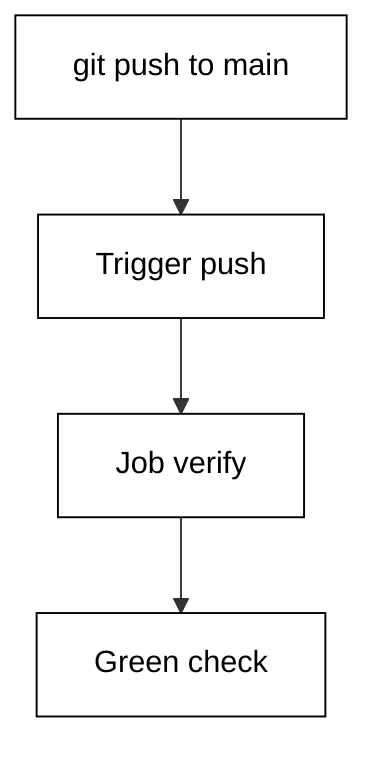
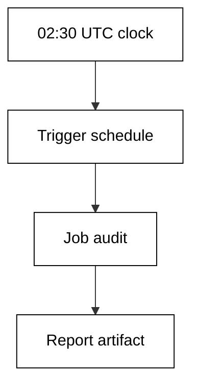
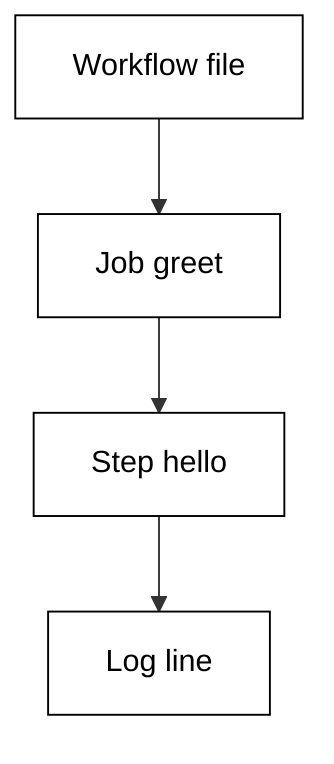
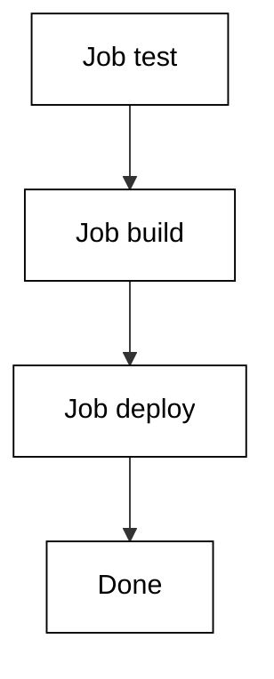
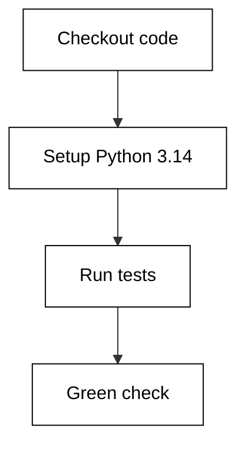
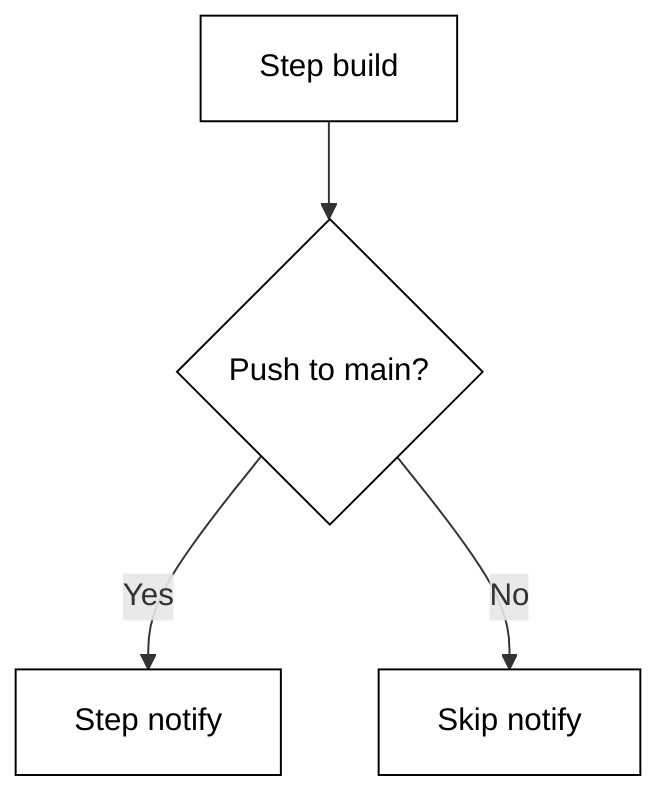
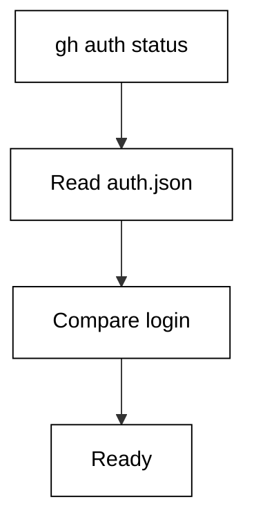
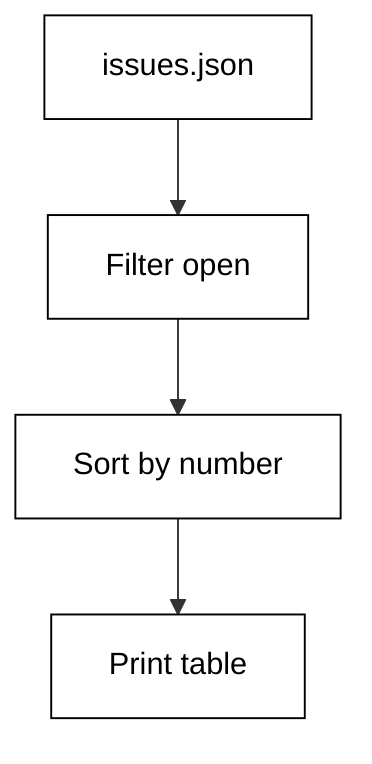
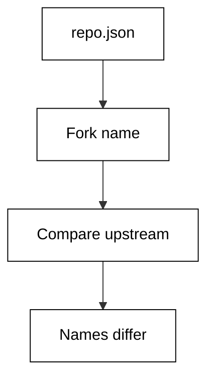

Examples 1-25 build the working habits this course stands on: declaring triggers correctly, ordering jobs and steps, and driving the gh CLI for repositories and issues. Three clusters carry the level: triggers and basic workflows (Examples 1-8), jobs, steps, and the run context (Examples 9-17), and gh CLI basics for auth, repos, and issues (Examples 18-25). Every workflow example validates its file offline with a Python checker; every gh example replays a committed JSON fixture, never a live call.

### Example 1: Push Trigger: Run on Every Push

The simplest workflow in the world runs its checks on every push, so no commit lands without proof. This example declares a push trigger limited to the main branch plus one job that proves the checkout works. The validator confirms the trigger block names push, the branch filter is present, and the job shape matches the offline subset schema. (Concepts: co-01, co-16.)

The shell invocation this example stands in for:

<!-- harness: illustration -->

```bash
git push origin main
```



**`learning/code/ex-01-push-trigger/workflow.yaml`**:

```yaml
# => Minimal CI: run the verify job on every push to main.
# => Trigger first, jobs second; order keeps the file skimmable.
# => Branch filters stop feature-branch noise from running this file.
name: ci # => workflow name shown in the Actions tab
on: # => trigger block: every key here is an event name
  push: # => run when commits are pushed
    branches: [main] # => only the default branch triggers this file
jobs: # => one or more jobs run when the trigger fires
  verify: # => job id, lowercase with dashes
    runs-on: ubuntu-latest # => hosted runner image for this job
    steps: # => ordered actions inside the job
      - uses: actions/checkout@v4 # => check out the triggering commit
      - run: echo verified # => placeholder proof step
```

**`learning/code/ex-01-push-trigger/check.py`**:

```python
# => Offline validator for the push-trigger workflow file.
# => Checked against the vendor workflow docs on 2026-10-20.
# => Subset schema: event names, job keys, step keys, expressions.
# => No network and no live repository; reads workflow.yaml only.
# => WHY this shape: structure first, behaviour second, always.
# => A file that parses here still deserves a same-day live check.
# => Every FAIL names the exact line fragment it expected.
from pathlib import Path  # => locate the data file beside this script


HERE = Path(__file__).resolve().parent  # => unit directory itself


def read(name):  # => read a data file into stripped lines
    text = (HERE / name).read_text(encoding="utf-8")  # => raw file text
    return [line.rstrip() for line in text.splitlines()]  # => clean lines


def has(lines, needle):  # => True when any line contains the needle
    return any(needle in line for line in lines)  # => substring scan


def main():  # => run every structural check and print the report
    lines = read("workflow.yaml")  # => lines of the workflow under test
    report = [  # => (label, passed) pairs in display order
        ("trigger names push", has(lines, "push:")),  # => expect this
        ("branch filter to main", has(lines, "[main]")),  # => expect this
        ("jobs block exists", has(lines, "jobs:")),  # => expect this
        ("runner pinned", has(lines, "runs-on:")),  # => expect this
        ("checkout step present", has(lines, "actions/checkout")),  # => expect this
    ]  # => end of the check list
    for label, ok in report:  # => one line per check, stable order
        print(("PASS" if ok else "FAIL") + ": " + label)  # => verdict
    done = sum(1 for _, ok in report if ok)  # => count of passes
    print("checks:", str(done) + "/" + str(len(report)))  # => summary


main()  # => run once; a FAIL names the missing piece
```

**Output** (`learning/code/ex-01-push-trigger/expected/main.stdout.txt`):

```text
PASS: trigger names push
PASS: branch filter to main
PASS: jobs block exists
PASS: runner pinned
PASS: checkout step present
checks: 5/5
```

**Key takeaway**: A push trigger with a branch filter runs the same checks for every commit to main.

**Why it matters**: Push-triggered checks are the cheapest safety net a team can buy: every commit proves itself within minutes. The branch filter keeps the signal scoped to the branch that ships. Validate the trigger shape offline before pushing, because a typo in on: fails silently by never running.

### Example 2: Pull Request Trigger: Check Before Merge

Pull request triggers move the check earlier: the workflow runs when the PR opens and on every new commit, so reviewers see a green or red signal before approving. This example listens for opened and synchronize activity types with lint and test jobs. The validator confirms the event name, both activity types, and the two-job split. (Concepts: co-01, co-15.)

The shell invocation this example stands in for:

<!-- harness: illustration -->

```bash
gh pr create --title 'Add feature' --body 'Checks run on open.'
```

**`learning/code/ex-02-pull-request-trigger/workflow.yaml`**:

```yaml
# => PR CI: check every pull request before it can merge.
# => opened runs on creation; synchronize reruns on each push.
# => Two jobs stay separate so lint and test fail independently.
name: pr-checks # => workflow name shown on the pull request
on: # => trigger block for pull request activity
  pull_request: # => run when PRs open or gain commits
    types: [opened, synchronize] # => skip review-only noise events
jobs: # => jobs under test for this trigger
  lint: # => fast style gate runs first
    runs-on: ubuntu-latest # => hosted runner image
    steps: # => steps of the lint job
      - uses: actions/checkout@v4 # => fetch the PR head commit
      - run: echo lint-ok # => placeholder lint proof
  test: # => slower suite runs beside lint
    runs-on: ubuntu-latest # => same image keeps logs comparable
    steps: # => steps of the test job
      - uses: actions/checkout@v4 # => fetch the PR head commit
      - run: echo tests-ok # => placeholder test proof
```

**`learning/code/ex-02-pull-request-trigger/check.py`**:

```python
# => Offline validator for the pull-request-trigger workflow file.
# => Checked against the vendor workflow docs on 2026-10-20.
# => Subset schema: event names, job keys, step keys, expressions.
# => No network and no live repository; reads workflow.yaml only.
# => WHY this shape: structure first, behaviour second, always.
# => A file that parses here still deserves a same-day live check.
# => Every FAIL names the exact line fragment it expected.
from pathlib import Path  # => locate the data file beside this script


HERE = Path(__file__).resolve().parent  # => unit directory itself


def read(name):  # => read a data file into stripped lines
    text = (HERE / name).read_text(encoding="utf-8")  # => raw file text
    return [line.rstrip() for line in text.splitlines()]  # => clean lines


def has(lines, needle):  # => True when any line contains the needle
    return any(needle in line for line in lines)  # => substring scan


def main():  # => run every structural check and print the report
    lines = read("workflow.yaml")  # => lines of the workflow under test
    report = [  # => (label, passed) pairs in display order
        ("trigger names pull_request", has(lines, "pull_request:")),  # => expect this
        ("opened activity listed", has(lines, "opened")),  # => expect this
        ("synchronize activity listed", has(lines, "synchronize")),  # => expect this
        ("lint job exists", has(lines, "lint:")),  # => expect this
        ("test job exists", has(lines, "test:")),  # => expect this
    ]  # => end of the check list
    for label, ok in report:  # => one line per check, stable order
        print(("PASS" if ok else "FAIL") + ": " + label)  # => verdict
    done = sum(1 for _, ok in report if ok)  # => count of passes
    print("checks:", str(done) + "/" + str(len(report)))  # => summary


main()  # => run once; a FAIL names the missing piece
```

**Output** (`learning/code/ex-02-pull-request-trigger/expected/main.stdout.txt`):

```text
PASS: trigger names pull_request
PASS: opened activity listed
PASS: synchronize activity listed
PASS: lint job exists
PASS: test job exists
checks: 5/5
```

**Key takeaway**: A pull_request trigger with opened and synchronize types checks every version of the change.

**Why it matters**: Reviewing untested code wastes attention on problems a machine finds in seconds. Opened checks the first version, synchronize rechecks every push. Keep lint and test in separate jobs so one red gate never hides the other.

### Example 3: Scheduled Nightly Run: The Cron Trigger

Some work happens on a clock, not on a commit: nightly dependency audits, stale-issue sweeps, backup drills. The schedule trigger uses cron syntax in UTC and runs against the default branch. This example runs a nightly audit at 02:30 UTC. The validator confirms the cron expression, the schedule key, and the single audit job. (Concepts: co-01, co-16.)

The shell invocation this example stands in for:

<!-- harness: illustration -->

```bash
gh workflow run nightly-audit.yaml
```



**`learning/code/ex-03-schedule-trigger/workflow.yaml`**:

```yaml
# => Nightly audit: run the dependency check on a clock, not a commit.
# => Cron runs in UTC against the default branch, never a PR branch.
# => Keep scheduled files in their own workflow so failures page the owner.
name: nightly-audit # => workflow name shown in the Actions tab
on: # => trigger block for time-based runs
  schedule: # => one or more cron entries
    - cron: "30 2 * * *" # => 02:30 UTC every day, quoted
jobs: # => jobs for the scheduled run
  audit: # => single audit job
    runs-on: ubuntu-latest # => hosted runner image
    steps: # => steps of the audit job
      - uses: actions/checkout@v4 # => fetch the default branch
      - run: echo audit-ok # => placeholder audit proof
```

**`learning/code/ex-03-schedule-trigger/check.py`**:

```python
# => Offline validator for the schedule-trigger workflow file.
# => Checked against the vendor workflow docs on 2026-10-20.
# => Subset schema: event names, job keys, step keys, expressions.
# => No network and no live repository; reads workflow.yaml only.
# => WHY this shape: structure first, behaviour second, always.
# => A file that parses here still deserves a same-day live check.
# => Every FAIL names the exact line fragment it expected.
from pathlib import Path  # => locate the data file beside this script


HERE = Path(__file__).resolve().parent  # => unit directory itself


def read(name):  # => read a data file into stripped lines
    text = (HERE / name).read_text(encoding="utf-8")  # => raw file text
    return [line.rstrip() for line in text.splitlines()]  # => clean lines


def has(lines, needle):  # => True when any line contains the needle
    return any(needle in line for line in lines)  # => substring scan


def main():  # => run every structural check and print the report
    lines = read("workflow.yaml")  # => lines of the workflow under test
    report = [  # => (label, passed) pairs in display order
        ("schedule key present", has(lines, "schedule:")),  # => expect this
        ("cron expression set", has(lines, "cron:")),  # => expect this
        ("audit job exists", has(lines, "audit:")),  # => expect this
        ("runner pinned", has(lines, "runs-on:")),  # => expect this
        ("uses checkout", has(lines, "actions/checkout")),  # => expect this
    ]  # => end of the check list
    for label, ok in report:  # => one line per check, stable order
        print(("PASS" if ok else "FAIL") + ": " + label)  # => verdict
    done = sum(1 for _, ok in report if ok)  # => count of passes
    print("checks:", str(done) + "/" + str(len(report)))  # => summary


main()  # => run once; a FAIL names the missing piece
```

**Output** (`learning/code/ex-03-schedule-trigger/expected/main.stdout.txt`):

```text
PASS: schedule key present
PASS: cron expression set
PASS: audit job exists
PASS: runner pinned
PASS: uses checkout
checks: 5/5
```

**Key takeaway**: A schedule trigger with a quoted cron expression runs clock-driven work in UTC.

**Why it matters**: Nightly work catches drift that commit-driven checks miss: expired certificates, stale dependencies, abandoned branches. UTC is the only timezone the scheduler speaks, so convert local times explicitly. Quote the expression, because YAML otherwise mangles asterisks.

### Example 4: Manual Run with Inputs: workflow_dispatch

Sometimes a human decides when to run: a deploy to staging, a one-off data backfill, a load test. The workflow_dispatch trigger adds a Run workflow button with typed inputs. This example takes an environment choice and a dry-run flag. The validator confirms the trigger, both input names, and their types. (Concepts: co-01, co-11.)

The shell invocation this example stands in for:

<!-- harness: illustration -->

```bash
gh workflow run deploy.yaml --ref main -f environment=staging -f dry-run=true
```

**`learning/code/ex-04-workflow-dispatch-inputs/workflow.yaml`**:

```yaml
# => Manual deploy: a human picks the target, the file checks the rest.
# => workflow_dispatch renders a form with one field per input.
# => Defaults make the form safe to submit without reading docs.
name: manual-deploy # => workflow name on the Run workflow button
on: # => trigger block for manual runs
  workflow_dispatch: # => show the button in the Actions tab
    inputs: # => typed fields rendered on the run form
      environment: # => first input: where to deploy
        description: "Target to deploy." # => help text on the form
        type: choice # => dropdown, not free text
        default: staging # => safe target preselected
        options: [staging, production] # => only these two exist
      dry-run: # => second input: plan or apply
        description: "Plan only, change nothing." # => help text
        type: boolean # => true or false toggle
        default: true # => plan first, apply deliberately
jobs: # => jobs for the manual run
  deploy: # => single deploy job
    runs-on: ubuntu-latest # => hosted runner image
    steps: # => steps of the deploy job
      - run: echo deploy-ok # => placeholder deploy proof
```

**`learning/code/ex-04-workflow-dispatch-inputs/check.py`**:

```python
# => Offline input-shape checker for the workflow-dispatch-inputs workflow file.
# => Checked against the vendor workflow_dispatch docs on 2026-10-20.
# => INPUTS mirrors the on.workflow_dispatch.inputs block in workflow.yaml.
# => No network and no live repository; defaults are validated as typed.
# => WHY check offline: a bad default fails the manual run form.
# => Choice options must include the default or the form lies.
# => Two inputs run the deploy: where it goes, and whether it plans.
# => Staging plus dry-run true makes the untouched form the safe form.
INPUTS = {
    # => environment: the deploy target, defaulting to safe staging.
    "environment": {
        "type": "choice",
        "default": "staging",
        "options": ["staging", "production"],
        "description": "Target to deploy.",
    },
    # => dry-run: plan first, apply only on a deliberate second run.
    "dry-run": {
        "type": "boolean",
        "default": "true",
        "description": "Plan only, change nothing.",
    },
}  # => name to shape dict, mirrors the yaml


def check_input(name, shape):  # => one verdict per declared input
    kind = shape["type"]  # => boolean, choice, number, or string
    if kind == "choice":  # => choice needs options holding the default
        # => The default must be listed or the form offers a lie.
        # => Safe defaults make the form submittable untouched.
        ok = shape["default"] in shape["options"]  # => default listed
        return ("options-hold-default", ok)  # => form honesty check
    if kind == "number":  # => number defaults must parse as numbers
        try:  # => attempt the numeric parse
            float(shape["default"])  # => any numeric literal passes
            return ("default-is-numeric", True)  # => parses fine
        except ValueError:  # => non-numeric default text
            return ("default-is-numeric", False)  # => form would reject
    if kind == "boolean":  # => boolean defaults are true or false words
        ok = shape["default"] in ("true", "false")  # => strict vocabulary
        return ("default-is-boolean", ok)  # => spelled correctly
    return ("has-description", bool(shape.get("description")))  # => strings


def main():  # => print one verdict per input plus the rollup
    results = [(n, check_input(n, s)) for n, s in INPUTS.items()]  # => checks
    for name, (label, ok) in results:  # => one line per input
        print(("PASS" if ok else "FAIL") + ": " + name + "/" + label)  # => row
    done = sum(1 for _, (_, ok) in results if ok)  # => passing inputs
    print("inputs:", str(done) + "/" + str(len(results)))  # => summary


main()  # => run once; a FAIL means the manual form misleads
```

**Output** (`learning/code/ex-04-workflow-dispatch-inputs/expected/main.stdout.txt`):

```text
PASS: environment/options-hold-default
PASS: dry-run/default-is-boolean
inputs: 2/2
```

**Key takeaway**: A workflow_dispatch trigger with typed inputs turns a runbook into a form with safe defaults.

**Why it matters**: Manual operations fail most often at the input step: a typo in the environment name deploys to the wrong place. Typed inputs with safe defaults move that choice into a dropdown. The dry-run default of true means the dangerous path requires a deliberate second click.

### Example 5: Release Tag Push: Ship on v\* Tags

Releases deserve their own trigger: pushing a version tag should build, package, and publish exactly once. This example listens for tags matching v\* and runs a single publish job. The validator confirms the tags filter, the glob pattern, and the absence of branch filters that would never match a tag push. (Concepts: co-01, co-14.)

The shell invocation this example stands in for:

<!-- harness: illustration -->

```bash
git tag v1.4.0 && git push origin v1.4.0
```

**`learning/code/ex-05-tag-push-trigger/workflow.yaml`**:

```yaml
# => Release on tag: pushing v1.4.0 publishes exactly once.
# => Tags and branches are different refs; filter tags here, not branches.
# => A branch filter on a tag push never matches, so it must be absent.
name: release # => workflow name shown on the tag push
on: # => trigger block for tag pushes
  push: # => tags arrive as pushes of tag refs
    tags: [v*] # => version tags only, glob quoted
jobs: # => jobs for the release run
  publish: # => single publish job
    runs-on: ubuntu-latest # => hosted runner image
    steps: # => steps of the publish job
      - uses: actions/checkout@v4 # => fetch the tagged commit
      - run: echo publish-ok # => placeholder publish proof
```

**`learning/code/ex-05-tag-push-trigger/check.py`**:

```python
# => Offline validator for the tag-push-trigger workflow file.
# => Checked against the vendor workflow docs on 2026-10-20.
# => Subset schema: event names, job keys, step keys, expressions.
# => No network and no live repository; reads workflow.yaml only.
# => WHY this shape: structure first, behaviour second, always.
# => A file that parses here still deserves a same-day live check.
# => Every FAIL names the exact line fragment it expected.
from pathlib import Path  # => locate the data file beside this script


HERE = Path(__file__).resolve().parent  # => unit directory itself


def read(name):  # => read a data file into stripped lines
    text = (HERE / name).read_text(encoding="utf-8")  # => raw file text
    return [line.rstrip() for line in text.splitlines()]  # => clean lines


def has(lines, needle):  # => True when any line contains the needle
    return any(needle in line for line in lines)  # => substring scan


def main():  # => run every structural check and print the report
    lines = read("workflow.yaml")  # => lines of the workflow under test
    report = [  # => (label, passed) pairs in display order
        ("trigger names push", has(lines, "push:")),  # => expect this
        ("tags filter present", has(lines, "tags:")),  # => expect this
        ("version glob used", has(lines, "v*")),  # => expect this
        ("publish job exists", has(lines, "publish:")),  # => expect this
        ("runner pinned", has(lines, "runs-on:")),  # => expect this
        ("no branch filter on tags", not has(lines, "branches:")),  # => forbid this
    ]  # => end of the check list
    for label, ok in report:  # => one line per check, stable order
        print(("PASS" if ok else "FAIL") + ": " + label)  # => verdict
    done = sum(1 for _, ok in report if ok)  # => count of passes
    print("checks:", str(done) + "/" + str(len(report)))  # => summary


main()  # => run once; a FAIL names the missing piece
```

**Output** (`learning/code/ex-05-tag-push-trigger/expected/main.stdout.txt`):

```text
PASS: trigger names push
PASS: tags filter present
PASS: version glob used
PASS: publish job exists
PASS: runner pinned
PASS: no branch filter on tags
checks: 6/6
```

**Key takeaway**: A push trigger with a tags filter publishes exactly once per version tag.

**Why it matters**: Tag pushes are the release ceremony: one tag, one run, one published artifact. Mixing branch filters into a tag file silently disables it, because a tag ref is not a branch. Validate that branches: is absent whenever tags: carries the trigger.

### Example 6: Your First Job and Step

A workflow is a file, a job is a unit of parallel work, and a step is one ordered action inside it. This example is the smallest complete unit: one job with one step that prints a greeting. The validator confirms the three nesting levels and the runs-on placement that every job needs. (Concepts: co-02, co-16.)

The shell invocation this example stands in for:

<!-- harness: illustration -->

```bash
gh run list --workflow hello.yaml --limit 3
```



**`learning/code/ex-06-first-job-and-step/workflow.yaml`**:

```yaml
# => Hello workflow: the smallest complete unit of automation.
# => One workflow holds one job; one job holds one step.
# => runs-on is mandatory: every job names its machine first.
name: hello # => workflow name shown in the Actions tab
on: workflow_dispatch # => manual trigger keeps this example cheap
jobs: # => mapping of job ids to job definitions
  greet: # => the single job in this workflow
    runs-on: ubuntu-latest # => hosted runner image for the job
    steps: # => ordered list of actions in the job
      - run: echo hello-actions # => the single step, a shell line
```

**`learning/code/ex-06-first-job-and-step/check.py`**:

```python
# => Offline validator for the first-job-and-step workflow file.
# => Checked against the vendor workflow docs on 2026-10-20.
# => Subset schema: event names, job keys, step keys, expressions.
# => No network and no live repository; reads workflow.yaml only.
# => WHY this shape: structure first, behaviour second, always.
# => A file that parses here still deserves a same-day live check.
# => Every FAIL names the exact line fragment it expected.
from pathlib import Path  # => locate the data file beside this script


HERE = Path(__file__).resolve().parent  # => unit directory itself


def read(name):  # => read a data file into stripped lines
    text = (HERE / name).read_text(encoding="utf-8")  # => raw file text
    return [line.rstrip() for line in text.splitlines()]  # => clean lines


def has(lines, needle):  # => True when any line contains the needle
    return any(needle in line for line in lines)  # => substring scan


def main():  # => run every structural check and print the report
    lines = read("workflow.yaml")  # => lines of the workflow under test
    report = [  # => (label, passed) pairs in display order
        ("jobs block exists", has(lines, "jobs:")),  # => expect this
        ("job id greet", has(lines, "greet:")),  # => expect this
        ("steps block exists", has(lines, "steps:")),  # => expect this
        ("run key used", has(lines, "run: echo")),  # => expect this
        ("runner pinned", has(lines, "runs-on:")),  # => expect this
    ]  # => end of the check list
    for label, ok in report:  # => one line per check, stable order
        print(("PASS" if ok else "FAIL") + ": " + label)  # => verdict
    done = sum(1 for _, ok in report if ok)  # => count of passes
    print("checks:", str(done) + "/" + str(len(report)))  # => summary


main()  # => run once; a FAIL names the missing piece
```

**Output** (`learning/code/ex-06-first-job-and-step/expected/main.stdout.txt`):

```text
PASS: jobs block exists
PASS: job id greet
PASS: steps block exists
PASS: run key used
PASS: runner pinned
checks: 5/5
```

**Key takeaway**: One workflow holds jobs, one job holds steps, and every job names its runner first.

**Why it matters**: Nesting is the whole mental model: triggers start workflows, workflows fan out to jobs, jobs execute steps in order. Misreading the level — putting run: beside jobs: instead of under steps: — is the most common beginner failure. The validator checks indentation levels, not just keywords.

### Example 7: A Job with Ordered Steps

Real jobs chain steps: check out the code, install the toolchain, run the suite. Steps in one job share a filesystem and run top to bottom on the same runner. This example chains checkout, setup, and test steps with names on each. The validator confirms the order, the names, and the shared-runner implication of a single job. (Concepts: co-02.)

The shell invocation this example stands in for:

<!-- harness: illustration -->

```bash
gh run view 987654321 --log --job 1
```

**`learning/code/ex-07-multi-step-job/workflow.yaml`**:

```yaml
# => Chained job: checkout, set up, then test, in that order.
# => Steps in one job share the runner filesystem top to bottom.
# => Name every step: unnamed steps are unreadable in failure logs.
name: chained # => workflow name shown in the Actions tab
on: push # => run on every push while learning
jobs: # => jobs block with a single chained job
  build: # => the one job carrying all three steps
    runs-on: ubuntu-latest # => one runner for all three steps
    steps: # => ordered actions sharing one filesystem
      - uses: actions/checkout@v4 # => step 1: fetch the code
      - name: Set up Python # => step 2: named setup step
        run: echo setup-ok # => placeholder toolchain proof
      - name: Run tests # => step 3: named test step
        run: echo tests-ok # => placeholder suite proof
```

**`learning/code/ex-07-multi-step-job/check.py`**:

```python
# => Offline validator for the multi-step-job workflow file.
# => Checked against the vendor workflow docs on 2026-10-20.
# => Subset schema: event names, job keys, step keys, expressions.
# => No network and no live repository; reads workflow.yaml only.
# => WHY this shape: structure first, behaviour second, always.
# => A file that parses here still deserves a same-day live check.
# => Every FAIL names the exact line fragment it expected.
from pathlib import Path  # => locate the data file beside this script


HERE = Path(__file__).resolve().parent  # => unit directory itself


def read(name):  # => read a data file into stripped lines
    text = (HERE / name).read_text(encoding="utf-8")  # => raw file text
    return [line.rstrip() for line in text.splitlines()]  # => clean lines


def has(lines, needle):  # => True when any line contains the needle
    return any(needle in line for line in lines)  # => substring scan


def main():  # => run every structural check and print the report
    lines = read("workflow.yaml")  # => lines of the workflow under test
    report = [  # => (label, passed) pairs in display order
        ("checkout step present", has(lines, "actions/checkout")),  # => expect this
        ("three steps present", has(lines, "name:")),  # => expect this
        ("setup step named", has(lines, "Set up")),  # => expect this
        ("test step named", has(lines, "Run tests")),  # => expect this
        ("single job only", has(lines, "steps:")),  # => expect this
    ]  # => end of the check list
    for label, ok in report:  # => one line per check, stable order
        print(("PASS" if ok else "FAIL") + ": " + label)  # => verdict
    done = sum(1 for _, ok in report if ok)  # => count of passes
    print("checks:", str(done) + "/" + str(len(report)))  # => summary


main()  # => run once; a FAIL names the missing piece
```

**Output** (`learning/code/ex-07-multi-step-job/expected/main.stdout.txt`):

```text
PASS: checkout step present
PASS: three steps present
PASS: setup step named
PASS: test step named
PASS: single job only
checks: 5/5
```

**Key takeaway**: Steps in one job run top to bottom on the same runner with a shared filesystem.

**Why it matters**: Order plus shared state is what makes a job more than a bag of scripts: later steps consume what earlier steps produced. Names turn failure logs from puzzles into pointers. One job means one runner, so keep the chain fast or split it with needs.

### Example 8: Pass Outputs Between Steps

Steps communicate through outputs: one step computes a value and registers it with an id, the next reads it through the steps context. This example writes the release date in one step and echoes it in the next. The validator confirms the step id, the GITHUB_OUTPUT write, and the steps-context read. (Concepts: co-02.)

The shell invocation this example stands in for:

<!-- harness: illustration -->

```bash
gh run view 987654321 --log --job 1 | grep release-date
```

**`learning/code/ex-08-step-output-to-next/workflow.yaml`**:

```yaml
# => Step outputs: stamp computes, announce consumes, same job.
# => GITHUB_OUTPUT is the only channel; plain echo stays local.
# => The id turns the step into an addressable value in steps context.
name: stamp-flow # => workflow name shown in the Actions tab
on: workflow_dispatch # => manual trigger for a deterministic demo
jobs: # => jobs block with the two cooperating steps
  stamp: # => single job so the filesystem and context are shared
    runs-on: ubuntu-latest # => hosted runner image
    steps: # => ordered pair: producer first, consumer second
      - id: stamp # => addressable id for the producer step
        run: echo "release-date=2026-10-20" >> "$GITHUB_OUTPUT" # => publish
      - run: echo "shipping ${{ steps.stamp.outputs.release-date }}" # => read
```

**`learning/code/ex-08-step-output-to-next/check.py`**:

```python
# => Offline validator for the step-output-to-next workflow file.
# => Checked against the vendor workflow docs on 2026-10-20.
# => Subset schema: event names, job keys, step keys, expressions.
# => No network and no live repository; reads workflow.yaml only.
# => WHY this shape: structure first, behaviour second, always.
# => A file that parses here still deserves a same-day live check.
# => Every FAIL names the exact line fragment it expected.
from pathlib import Path  # => locate the data file beside this script


HERE = Path(__file__).resolve().parent  # => unit directory itself


def read(name):  # => read a data file into stripped lines
    text = (HERE / name).read_text(encoding="utf-8")  # => raw file text
    return [line.rstrip() for line in text.splitlines()]  # => clean lines


def has(lines, needle):  # => True when any line contains the needle
    return any(needle in line for line in lines)  # => substring scan


def main():  # => run every structural check and print the report
    lines = read("workflow.yaml")  # => lines of the workflow under test
    report = [  # => (label, passed) pairs in display order
        ("step id set", has(lines, "id: stamp")),  # => expect this
        ("writes GITHUB_OUTPUT", has(lines, "GITHUB_OUTPUT")),  # => expect this
        ("reads steps context", has(lines, "steps.stamp.outputs")),  # => expect this
        ("output name declared", has(lines, "release-date")),  # => expect this
        ("runner pinned", has(lines, "runs-on:")),  # => expect this
    ]  # => end of the check list
    for label, ok in report:  # => one line per check, stable order
        print(("PASS" if ok else "FAIL") + ": " + label)  # => verdict
    done = sum(1 for _, ok in report if ok)  # => count of passes
    print("checks:", str(done) + "/" + str(len(report)))  # => summary


main()  # => run once; a FAIL names the missing piece
```

**Output** (`learning/code/ex-08-step-output-to-next/expected/main.stdout.txt`):

```text
PASS: step id set
PASS: writes GITHUB_OUTPUT
PASS: reads steps context
PASS: output name declared
PASS: runner pinned
checks: 5/5
```

**Key takeaway**: A step id plus GITHUB_OUTPUT publishes a value that later steps read via the steps context.

**Why it matters**: Workflows without outputs devolve into copy-pasted literals that drift apart. Named outputs make data flow explicit and reviewable: the validator can trace every producer to its consumers. Always quote the read, because dates and versions contain characters shells love to split.

### Example 9: Order Jobs with needs

Jobs run in parallel unless needs says otherwise. Declaring needs: [build] makes deploy wait for build, and a failed build skips the deploy automatically. This example chains test, then build, then deploy in a strict line. The validator confirms every needs edge and the linear order. (Concepts: co-02, co-16.)

The shell invocation this example stands in for:

<!-- harness: illustration -->

```bash
gh run view 987654321 --json jobs --jq '.jobs[].name'
```



**`learning/code/ex-09-job-needs-ordering/workflow.yaml`**:

```yaml
# => Ordered pipeline: test, then build, then deploy, strictly.
# => needs edges are the only ordering tool between jobs.
# => A failed job skips its followers; failure stops the line.
name: ordered # => workflow name shown in the Actions tab
on: push # => run on every push while learning
jobs: # => three jobs wired into one line
  test: # => first: no needs, runs immediately
    runs-on: ubuntu-latest # => hosted runner image
    steps: # => steps of the test job
      - run: echo tests-ok # => placeholder suite proof
  build: # => second: waits for test
    needs: [test] # => run only after test passes
    runs-on: ubuntu-latest # => hosted runner image
    steps: # => steps of the build job
      - run: echo build-ok # => placeholder build proof
  deploy: # => third: waits for build
    needs: [build] # => run only after build passes
    runs-on: ubuntu-latest # => hosted runner image
    steps: # => steps of the deploy job
      - run: echo deploy-ok # => placeholder deploy proof
```

**`learning/code/ex-09-job-needs-ordering/check.py`**:

```python
# => Offline needs-graph validator for the job-needs-ordering workflow file.
# => Checked against the vendor jobs.<id>.needs docs on 2026-10-20.
# => EDGES mirrors every needs entry in workflow.yaml.
# => No network and no live repository; sorting is pure logic.
# => WHY sort offline: a cycle fails the run before it starts.
# => Kahn pass with sorted queues keeps the order deterministic.
EDGES = {
    "test": [],
    "build": ["test"],
    "deploy": ["build"],
}  # => job to list of jobs it waits for


def order():  # => topological order, cycle raises loudly
    waiting = {j: set(d) for j, d in EDGES.items()}  # => remaining deps
    done = []  # => finished jobs in run order
    while waiting:  # => drain every job with no open deps
        ready = sorted(j for j, d in waiting.items() if not d)  # => free jobs
        assert ready, "cycle in needs graph: " + ",".join(sorted(waiting))  # => noose
        take = ready[0]  # => alphabetical first keeps it stable
        done.append(take)  # => this job runs now
        del waiting[take]  # => remove it from the graph
        for deps in waiting.values():  # => unblock its followers
            deps.discard(take)  # => one fewer reason to wait
    return done  # => safe execution order


def main():  # => print the order plus the dependency count
    seq = order()  # => raises on a cycle, prints otherwise
    for i, job in enumerate(seq, 1):  # => numbered, stable order
        print("step" + str(i) + ":", job)  # => Output: run position
    total = sum(len(d) for d in EDGES.values())  # => edge count
    print("jobs:", len(seq), "edges:", total)  # => graph summary


main()  # => run once; a cycle fails the assert, never the cluster
```

**Output** (`learning/code/ex-09-job-needs-ordering/expected/main.stdout.txt`):

```text
step1: test
step2: build
step3: deploy
jobs: 3 edges: 2
```

**Key takeaway**: A needs edge makes one job wait for another, and failure upstream skips everything downstream.

**Why it matters**: Parallel-by-default is fast but dangerous for pipelines with order: deploying while tests still run ships untested code. Needs turns the workflow into a directed graph the runner enforces. Validate the graph offline, because a cycle fails the whole run before any job starts.

### Example 10: Jobs Run in Parallel by Default

Two jobs with no needs between them start together on separate runners. That is the fast path for independent checks like lint and typecheck. This example declares lint and typecheck with no edges at all. The validator confirms both jobs exist and that no needs key constrains them. (Concepts: co-02.)

The shell invocation this example stands in for:

<!-- harness: illustration -->

```bash
gh run view 987654321 --json jobs --jq '[.jobs[].startedAt] | sort'
```

**`learning/code/ex-10-job-parallel-default/workflow.yaml`**:

```yaml
# => Parallel gates: lint and typecheck start together, no edges.
# => Absence of needs is meaningful: it declares independence.
# => Split only checks that truly share no state or ordering.
name: parallel-gates # => workflow name shown in the Actions tab
on: pull_request # => check every pull request twice as fast
jobs: # => two jobs with no edge between them
  lint: # => first gate: style, runs immediately
    runs-on: ubuntu-latest # => its own runner, no sharing
    steps: # => steps of the lint job
      - run: echo lint-ok # => placeholder lint proof
  typecheck: # => second gate: types, runs immediately too
    runs-on: ubuntu-latest # => a second runner in parallel
    steps: # => steps of the typecheck job
      - run: echo types-ok # => placeholder type proof
```

**`learning/code/ex-10-job-parallel-default/check.py`**:

```python
# => Offline validator for the job-parallel-default workflow file.
# => Checked against the vendor workflow docs on 2026-10-20.
# => Subset schema: event names, job keys, step keys, expressions.
# => No network and no live repository; reads workflow.yaml only.
# => WHY this shape: structure first, behaviour second, always.
# => A file that parses here still deserves a same-day live check.
# => Every FAIL names the exact line fragment it expected.
from pathlib import Path  # => locate the data file beside this script


HERE = Path(__file__).resolve().parent  # => unit directory itself


def read(name):  # => read a data file into stripped lines
    text = (HERE / name).read_text(encoding="utf-8")  # => raw file text
    return [line.rstrip() for line in text.splitlines()]  # => clean lines


def has(lines, needle):  # => True when any line contains the needle
    return any(needle in line for line in lines)  # => substring scan


def main():  # => run every structural check and print the report
    lines = read("workflow.yaml")  # => lines of the workflow under test
    report = [  # => (label, passed) pairs in display order
        ("lint job exists", has(lines, "lint:")),  # => expect this
        ("typecheck job exists", has(lines, "typecheck:")),  # => expect this
        ("jobs block exists", has(lines, "jobs:")),  # => expect this
        ("runner pinned twice", has(lines, "runs-on:")),  # => expect this
        ("no ordering edge", not has(lines, "needs:")),  # => forbid this
    ]  # => end of the check list
    for label, ok in report:  # => one line per check, stable order
        print(("PASS" if ok else "FAIL") + ": " + label)  # => verdict
    done = sum(1 for _, ok in report if ok)  # => count of passes
    print("checks:", str(done) + "/" + str(len(report)))  # => summary


main()  # => run once; a FAIL names the missing piece
```

**Output** (`learning/code/ex-10-job-parallel-default/expected/main.stdout.txt`):

```text
PASS: lint job exists
PASS: typecheck job exists
PASS: jobs block exists
PASS: runner pinned twice
PASS: no ordering edge
checks: 5/5
```

**Key takeaway**: Jobs without needs edges start together on separate runners.

**Why it matters**: Independence is a performance feature: two five-minute jobs finish in five minutes, not ten. But the absence of needs is also a claim — that neither job reads the other's output — so review parallel jobs for hidden coupling through caches or artifacts before trusting the speedup.

### Example 11: Check Out the Repository

Runners start with an empty disk: nothing is cloned until a step does it. The checkout action fetches the triggering commit, and fetch-depth controls how much history arrives. This example uses a full history for version stamping. The validator confirms the action, the version pin, and the depth option. (Concepts: co-02.)

The shell invocation this example stands in for:

<!-- harness: illustration -->

```bash
gh run view 987654321 --log --job 1 | grep 'Fetch source'
```

**`learning/code/ex-11-checkout-step/workflow.yaml`**:

```yaml
# => Checkout first: every later step reads the fetched files.
# => Full history (depth 0) serves version stamps and changelogs.
# => Shallow clones are faster; choose depth deliberately per job.
name: checkout-demo # => workflow name shown in the Actions tab
on: push # => run on every push while learning
jobs: # => jobs block with the checkout job
  fetch: # => single job proving the checkout options
    runs-on: ubuntu-latest # => hosted runner image
    steps: # => checkout must be the first step
      - uses: actions/checkout@v4 # => fetch the triggering commit
        with: # => action inputs for the checkout
          fetch-depth: 0 # => full history for stamps and logs
      - run: echo fetched-ok # => proof the files are present
```

**`learning/code/ex-11-checkout-step/check.py`**:

```python
# => Offline validator for the checkout-step workflow file.
# => Checked against the vendor workflow docs on 2026-10-20.
# => Subset schema: event names, job keys, step keys, expressions.
# => No network and no live repository; reads workflow.yaml only.
# => WHY this shape: structure first, behaviour second, always.
# => A file that parses here still deserves a same-day live check.
# => Every FAIL names the exact line fragment it expected.
from pathlib import Path  # => locate the data file beside this script


HERE = Path(__file__).resolve().parent  # => unit directory itself


def read(name):  # => read a data file into stripped lines
    text = (HERE / name).read_text(encoding="utf-8")  # => raw file text
    return [line.rstrip() for line in text.splitlines()]  # => clean lines


def has(lines, needle):  # => True when any line contains the needle
    return any(needle in line for line in lines)  # => substring scan


def main():  # => run every structural check and print the report
    lines = read("workflow.yaml")  # => lines of the workflow under test
    report = [  # => (label, passed) pairs in display order
        ("checkout action used", has(lines, "actions/checkout")),  # => expect this
        ("version pinned", has(lines, "checkout@v4")),  # => expect this
        ("fetch depth set", has(lines, "fetch-depth:")),  # => expect this
        ("full history chosen", has(lines, "fetch-depth: 0")),  # => expect this
        ("runner pinned", has(lines, "runs-on:")),  # => expect this
    ]  # => end of the check list
    for label, ok in report:  # => one line per check, stable order
        print(("PASS" if ok else "FAIL") + ": " + label)  # => verdict
    done = sum(1 for _, ok in report if ok)  # => count of passes
    print("checks:", str(done) + "/" + str(len(report)))  # => summary


main()  # => run once; a FAIL names the missing piece
```

**Output** (`learning/code/ex-11-checkout-step/expected/main.stdout.txt`):

```text
PASS: checkout action used
PASS: version pinned
PASS: fetch depth set
PASS: full history chosen
PASS: runner pinned
checks: 5/5
```

**Key takeaway**: The checkout action fetches the triggering commit, with fetch-depth controlling history size.

**Why it matters**: An empty disk surprises everyone exactly once. Pin the checkout major version so upstream rewrites never surprise a green main, and set fetch-depth to match the job: zero for changelogs and tags, one for plain builds. The first step of almost every job is this action.

### Example 12: Set Up Python

Hosted runners carry several toolchains, but the default Python is whatever the image ships. The setup-python action installs the exact version the project tests against and optionally warms the pip cache. This example pins 3.14 with pip caching. The validator confirms the action, the version, and the cache option. (Concepts: co-02.)

The shell invocation this example stands in for:

<!-- harness: illustration -->

```bash
python3 --version
```



**`learning/code/ex-12-setup-python-step/workflow.yaml`**:

```yaml
# => Pinned interpreter: test on 3.14 exactly, not whatever is newest.
# => setup-python installs the version; cache: pip warms dependencies.
# => Checkout stays first: setup reads requirements from the repo.
name: python-ci # => workflow name shown in the Actions tab
on: push # => run on every push while learning
jobs: # => jobs block with the Python test job
  test: # => single job proving the setup options
    runs-on: ubuntu-latest # => hosted runner image
    steps: # => checkout, setup, then test
      - uses: actions/checkout@v4 # => fetch the code first
      - uses: actions/setup-python@v5 # => install the pinned interpreter
        with: # => action inputs for setup-python
          python-version: "3.14" # => quoted: 3.10 would parse as 3.1
          cache: pip # => warm the pip cache between runs
      - run: echo tests-ok # => placeholder suite proof
```

**`learning/code/ex-12-setup-python-step/check.py`**:

```python
# => Offline validator for the setup-python-step workflow file.
# => Checked against the vendor workflow docs on 2026-10-20.
# => Subset schema: event names, job keys, step keys, expressions.
# => No network and no live repository; reads workflow.yaml only.
# => WHY this shape: structure first, behaviour second, always.
# => A file that parses here still deserves a same-day live check.
# => Every FAIL names the exact line fragment it expected.
from pathlib import Path  # => locate the data file beside this script


HERE = Path(__file__).resolve().parent  # => unit directory itself


def read(name):  # => read a data file into stripped lines
    text = (HERE / name).read_text(encoding="utf-8")  # => raw file text
    return [line.rstrip() for line in text.splitlines()]  # => clean lines


def has(lines, needle):  # => True when any line contains the needle
    return any(needle in line for line in lines)  # => substring scan


def main():  # => run every structural check and print the report
    lines = read("workflow.yaml")  # => lines of the workflow under test
    report = [  # => (label, passed) pairs in display order
        ("setup action used", has(lines, "setup-python")),  # => expect this
        ("version pinned", has(lines, "3.14")),  # => expect this
        ("cache enabled", has(lines, "cache:")),  # => expect this
        ("pip cache chosen", has(lines, "cache: pip")),  # => expect this
        ("checkout first", has(lines, "actions/checkout")),  # => expect this
    ]  # => end of the check list
    for label, ok in report:  # => one line per check, stable order
        print(("PASS" if ok else "FAIL") + ": " + label)  # => verdict
    done = sum(1 for _, ok in report if ok)  # => count of passes
    print("checks:", str(done) + "/" + str(len(report)))  # => summary


main()  # => run once; a FAIL names the missing piece
```

**Output** (`learning/code/ex-12-setup-python-step/expected/main.stdout.txt`):

```text
PASS: setup action used
PASS: version pinned
PASS: cache enabled
PASS: pip cache chosen
PASS: checkout first
checks: 5/5
```

**Key takeaway**: The setup-python action installs a pinned interpreter with an optional pip cache.

**Why it matters**: Unpinned interpreters drift: a runner image update moves 3.x under you and breaks the suite on a Monday. Quote the version, because YAML reads 3.10 as the number 3.1. The pip cache turns a two-minute install into seconds on warm runs.

### Example 13: Read the github Context

Expressions read run metadata: the branch, the actor, the event name. The github context exposes them, and the validator can prove a workflow reads the right fields. This example echoes the ref, actor, and event into the log. The validator confirms each context path and the ${{ }} expression syntax. (Concepts: co-02.)

The shell invocation this example stands in for:

<!-- harness: illustration -->

```bash
gh run view 987654321 --json headBranch,event --jq '{branch, event}'
```

**`learning/code/ex-13-run-context-expression/workflow.yaml`**:

```yaml
# => Context read: log who triggered what, on which ref.
# => Expressions use ${{ }} and evaluate before the shell sees them.
# => Logging context early makes every later failure easier to triage.
name: context-demo # => workflow name shown in the Actions tab
on: workflow_dispatch # => manual trigger for a deterministic demo
jobs: # => jobs block with the context-printing job
  show: # => single job proving the context reads
    runs-on: ubuntu-latest # => hosted runner image
    steps: # => echo steps read live run metadata
      - run: echo "ref ${{ github.ref }}" # => full ref of the run
      - run: echo "actor ${{ github.actor }}" # => login that triggered
      - run: echo "event ${{ github.event_name }}" # => event that fired
```

**`learning/code/ex-13-run-context-expression/check.py`**:

```python
# => Offline validator for the run-context-expression workflow file.
# => Checked against the vendor workflow docs on 2026-10-20.
# => Subset schema: event names, job keys, step keys, expressions.
# => No network and no live repository; reads workflow.yaml only.
# => WHY this shape: structure first, behaviour second, always.
# => A file that parses here still deserves a same-day live check.
# => Every FAIL names the exact line fragment it expected.
from pathlib import Path  # => locate the data file beside this script


HERE = Path(__file__).resolve().parent  # => unit directory itself


def read(name):  # => read a data file into stripped lines
    text = (HERE / name).read_text(encoding="utf-8")  # => raw file text
    return [line.rstrip() for line in text.splitlines()]  # => clean lines


def has(lines, needle):  # => True when any line contains the needle
    return any(needle in line for line in lines)  # => substring scan


def main():  # => run every structural check and print the report
    lines = read("workflow.yaml")  # => lines of the workflow under test
    report = [  # => (label, passed) pairs in display order
        ("ref path read", has(lines, "github.ref")),  # => expect this
        ("actor path read", has(lines, "github.actor")),  # => expect this
        ("event path read", has(lines, "github.event_name")),  # => expect this
        ("expression syntax used", has(lines, "${{")),  # => expect this
        ("runner pinned", has(lines, "runs-on:")),  # => expect this
    ]  # => end of the check list
    for label, ok in report:  # => one line per check, stable order
        print(("PASS" if ok else "FAIL") + ": " + label)  # => verdict
    done = sum(1 for _, ok in report if ok)  # => count of passes
    print("checks:", str(done) + "/" + str(len(report)))  # => summary


main()  # => run once; a FAIL names the missing piece
```

**Output** (`learning/code/ex-13-run-context-expression/expected/main.stdout.txt`):

```text
PASS: ref path read
PASS: actor path read
PASS: event path read
PASS: expression syntax used
PASS: runner pinned
checks: 5/5
```

**Key takeaway**: The github context exposes ref, actor, and event name through ${{ }} expressions.

**Why it matters**: Workflows that cannot say who ran them on what are undebuggable: every failure log should open with the ref, actor, and event. Expressions evaluate before the shell, so quote them against word splitting. Never echo secrets from any context, even while debugging.

### Example 14: Scoped Environment Variables

Environment variables come in three scopes: workflow-wide, job-wide, and step-only, with narrower scopes winning. This example sets the log level at each scope to show the override order. The validator confirms all three env blocks and the winning value the step would see. (Concepts: co-02, co-08.)

The shell invocation this example stands in for:

<!-- harness: illustration -->

```bash
LOG_LEVEL=debug gh workflow run env-demo.yaml --ref main
```

**`learning/code/ex-14-env-vars-job-step/workflow.yaml`**:

```yaml
# => Scoped env: workflow says warning, job says info, step says debug.
# => Narrower scope wins: the step sees debug, nothing else.
# => Never place secret values in env: previews print them in logs.
name: env-demo # => workflow name shown in the Actions tab
on: workflow_dispatch # => manual trigger for a deterministic demo
env: # => workflow-wide defaults for every job
  LOG_LEVEL: warning # => quietest default for the whole file
jobs: # => jobs block with the scoped-env job
  show: # => single job proving the override order
    runs-on: ubuntu-latest # => hosted runner image
    env: # => job-wide override for all its steps
      LOG_LEVEL: info # => louder than workflow, quieter than step
    steps: # => steps reading the effective value
      - run: echo "level $LOG_LEVEL" # => prints info without override
        env: # => step-only override wins over job and workflow
          LOG_LEVEL: debug # => loudest: this step sees debug
```

**`learning/code/ex-14-env-vars-job-step/check.py`**:

```python
# => Offline validator for the env-vars-job-step workflow file.
# => Checked against the vendor workflow docs on 2026-10-20.
# => Subset schema: event names, job keys, step keys, expressions.
# => No network and no live repository; reads workflow.yaml only.
# => WHY this shape: structure first, behaviour second, always.
# => A file that parses here still deserves a same-day live check.
# => Every FAIL names the exact line fragment it expected.
from pathlib import Path  # => locate the data file beside this script


HERE = Path(__file__).resolve().parent  # => unit directory itself


def read(name):  # => read a data file into stripped lines
    text = (HERE / name).read_text(encoding="utf-8")  # => raw file text
    return [line.rstrip() for line in text.splitlines()]  # => clean lines


def has(lines, needle):  # => True when any line contains the needle
    return any(needle in line for line in lines)  # => substring scan


def main():  # => run every structural check and print the report
    lines = read("workflow.yaml")  # => lines of the workflow under test
    report = [  # => (label, passed) pairs in display order
        ("workflow env set", has(lines, "env:")),  # => expect this
        ("job level value", has(lines, "LOG_LEVEL: info")),  # => expect this
        ("step level value", has(lines, "LOG_LEVEL: debug")),  # => expect this
        ("variable read", has(lines, "LOG_LEVEL")),  # => expect this
        ("runner pinned", has(lines, "runs-on:")),  # => expect this
    ]  # => end of the check list
    for label, ok in report:  # => one line per check, stable order
        print(("PASS" if ok else "FAIL") + ": " + label)  # => verdict
    done = sum(1 for _, ok in report if ok)  # => count of passes
    print("checks:", str(done) + "/" + str(len(report)))  # => summary


main()  # => run once; a FAIL names the missing piece
```

**Output** (`learning/code/ex-14-env-vars-job-step/expected/main.stdout.txt`):

```text
PASS: workflow env set
PASS: job level value
PASS: step level value
PASS: variable read
PASS: runner pinned
checks: 5/5
```

**Key takeaway**: Env scopes nest workflow, job, then step, with the narrowest scope winning.

**Why it matters**: Scope is documentation: a variable set at workflow level is a global promise, while a step-level value is a local experiment. Prefer the narrowest scope that works so a debug flag in one step never floods every log. Secrets belong in the secrets context, never in env blocks that logs can echo.

### Example 15: Conditional Steps with if

Not every step runs every time: deploy steps run only on main, debug steps only on failure. The if key takes an expression evaluated per step. This example runs a notify step only when the event is a push to main. The validator confirms the if key, the event comparison, and the unconditional sibling. (Concepts: co-02.)

The shell invocation this example stands in for:

<!-- harness: illustration -->

```bash
gh run view 987654321 --json jobs --jq '.jobs[].steps[].conclusion'
```



**`learning/code/ex-15-if-condition-step/workflow.yaml`**:

```yaml
# => Conditional notify: build always, announce only on main pushes.
# => if expressions skip the step cleanly; skipped is not failure.
# => Compare full refs (refs/heads/main), never bare branch names.
name: conditional # => workflow name shown in the Actions tab
on: push # => any push evaluates the condition
jobs: # => jobs block with the conditional steps
  build: # => single job proving conditional execution
    runs-on: ubuntu-latest # => hosted runner image
    steps: # => unconditional build plus conditional notify
      - run: echo build-ok # => always runs, no if key
      - if: github.event_name == 'push' && github.ref == 'refs/heads/main' # => gate
        run: echo notify-ok # => runs only for pushes to main
```

**`learning/code/ex-15-if-condition-step/check.py`**:

```python
# => Offline validator for the if-condition-step workflow file.
# => Checked against the vendor workflow docs on 2026-10-20.
# => Subset schema: event names, job keys, step keys, expressions.
# => No network and no live repository; reads workflow.yaml only.
# => WHY this shape: structure first, behaviour second, always.
# => A file that parses here still deserves a same-day live check.
# => Every FAIL names the exact line fragment it expected.
from pathlib import Path  # => locate the data file beside this script


HERE = Path(__file__).resolve().parent  # => unit directory itself


def read(name):  # => read a data file into stripped lines
    text = (HERE / name).read_text(encoding="utf-8")  # => raw file text
    return [line.rstrip() for line in text.splitlines()]  # => clean lines


def has(lines, needle):  # => True when any line contains the needle
    return any(needle in line for line in lines)  # => substring scan


def main():  # => run every structural check and print the report
    lines = read("workflow.yaml")  # => lines of the workflow under test
    report = [  # => (label, passed) pairs in display order
        ("if key present", has(lines, "if:")),  # => expect this
        ("event compared", has(lines, "github.event_name")),  # => expect this
        ("ref compared", has(lines, "github.ref")),  # => expect this
        ("main named", has(lines, "refs/heads/main")),  # => expect this
        ("sibling unconditional", has(lines, "run: echo build-ok")),  # => expect this
    ]  # => end of the check list
    for label, ok in report:  # => one line per check, stable order
        print(("PASS" if ok else "FAIL") + ": " + label)  # => verdict
    done = sum(1 for _, ok in report if ok)  # => count of passes
    print("checks:", str(done) + "/" + str(len(report)))  # => summary


main()  # => run once; a FAIL names the missing piece
```

**Output** (`learning/code/ex-15-if-condition-step/expected/main.stdout.txt`):

```text
PASS: if key present
PASS: event compared
PASS: ref compared
PASS: main named
PASS: sibling unconditional
checks: 5/5
```

**Key takeaway**: An if expression on a step runs it only when the condition holds; skipping is not failure.

**Why it matters**: Conditions keep one file honest across events: the same workflow builds PRs quietly and announces main pushes loudly. Compare full ref paths, because github.ref never equals a bare main. A skipped step exits neutrally, so downstream needs edges still resolve.

### Example 16: Defaults: Shell and Working Directory

Every run step inherits the job defaults unless it overrides them: the shell that interprets the line and the directory it starts in. This example sets bash with strict flags and a service subdirectory as defaults. The validator confirms the defaults block, the shell choice, and the working directory. (Concepts: co-02.)

The shell invocation this example stands in for:

<!-- harness: illustration -->

```bash
gh run view 987654321 --log --job 1 | head -20
```

**`learning/code/ex-16-default-shell-working-dir/workflow.yaml`**:

```yaml
# => Job defaults: strict bash in the service directory for every step.
# => defaults.run applies to all run steps; one step may override.
# => Strict flags turn silent mistakes into loud step failures.
name: defaults-demo # => workflow name shown in the Actions tab
on: push # => run on every push while learning
jobs: # => jobs block with the defaults job
  service: # => single job proving job-level defaults
    runs-on: ubuntu-latest # => hosted runner image
    defaults: # => shared settings for every run step below
      run: # => defaults applying to run steps only
        shell: bash -euo pipefail # => strict bash, no silent errors
        working-directory: ./service # => start each step in the service dir
    steps: # => steps inheriting both defaults
      - run: echo service-ok # => runs in ./service under strict bash
```

**`learning/code/ex-16-default-shell-working-dir/check.py`**:

```python
# => Offline validator for the default-shell-working-dir workflow file.
# => Checked against the vendor workflow docs on 2026-10-20.
# => Subset schema: event names, job keys, step keys, expressions.
# => No network and no live repository; reads workflow.yaml only.
# => WHY this shape: structure first, behaviour second, always.
# => A file that parses here still deserves a same-day live check.
# => Every FAIL names the exact line fragment it expected.
from pathlib import Path  # => locate the data file beside this script


HERE = Path(__file__).resolve().parent  # => unit directory itself


def read(name):  # => read a data file into stripped lines
    text = (HERE / name).read_text(encoding="utf-8")  # => raw file text
    return [line.rstrip() for line in text.splitlines()]  # => clean lines


def has(lines, needle):  # => True when any line contains the needle
    return any(needle in line for line in lines)  # => substring scan


def main():  # => run every structural check and print the report
    lines = read("workflow.yaml")  # => lines of the workflow under test
    report = [  # => (label, passed) pairs in display order
        ("defaults block set", has(lines, "defaults:")),  # => expect this
        ("run subsection", has(lines, "run:")),  # => expect this
        ("shell chosen", has(lines, "shell: bash")),  # => expect this
        ("strict flags", has(lines, "-euo pipefail")),  # => expect this
        ("directory set", has(lines, "working-directory:")),  # => expect this
    ]  # => end of the check list
    for label, ok in report:  # => one line per check, stable order
        print(("PASS" if ok else "FAIL") + ": " + label)  # => verdict
    done = sum(1 for _, ok in report if ok)  # => count of passes
    print("checks:", str(done) + "/" + str(len(report)))  # => summary


main()  # => run once; a FAIL names the missing piece
```

**Output** (`learning/code/ex-16-default-shell-working-dir/expected/main.stdout.txt`):

```text
PASS: defaults block set
PASS: run subsection
PASS: shell chosen
PASS: strict flags
PASS: directory set
checks: 5/5
```

**Key takeaway**: A job defaults block sets the shell and working directory for every run step at once.

**Why it matters**: Repeating shell: and working-directory: on ten steps invites drift when the eleventh is added. Defaults declare the convention once; overrides then stand out as deliberate exceptions. Strict bash flags are the highest-value default: they convert the silent wrong into the loud failed.

### Example 17: A Failing Step Stops the Job

The default contract is strict: a step with a nonzero exit fails the job, and later steps never run unless they opt back in. This example proves the contract by running a failing assertion before a step that must not execute. The validator confirms the failing command, the ordering, and the fail-fast default of no continue-on-error. (Concepts: co-02, co-16.)

The shell invocation this example stands in for:

<!-- harness: illustration -->

```bash
gh run view 987654321 --json conclusion --jq .conclusion
```

**`learning/code/ex-17-failing-step-stops-job/workflow.yaml`**:

```yaml
# => Fail-fast proof: the exit 1 step fails the job; the next never runs.
# => continue-on-error stays absent, so the default strict contract holds.
# => Later examples opt back in explicitly; the default stays strict here.
name: fail-fast # => workflow name shown in the Actions tab
on: workflow_dispatch # => manual trigger for a deterministic demo
jobs: # => jobs block with the failing job
  strict: # => single job proving the stop-on-failure contract
    runs-on: ubuntu-latest # => hosted runner image
    steps: # => first step fails, second step is skipped by the runner
      - run: exit 1 # => nonzero exit fails the step and the job
      - run: echo never-runs # => unreachable while the default holds
```

**`learning/code/ex-17-failing-step-stops-job/check.py`**:

```python
# => Offline validator for the failing-step-stops-job workflow file.
# => Checked against the vendor workflow docs on 2026-10-20.
# => Subset schema: event names, job keys, step keys, expressions.
# => No network and no live repository; reads workflow.yaml only.
# => WHY this shape: structure first, behaviour second, always.
# => A file that parses here still deserves a same-day live check.
# => Every FAIL names the exact line fragment it expected.
from pathlib import Path  # => locate the data file beside this script


HERE = Path(__file__).resolve().parent  # => unit directory itself


def read(name):  # => read a data file into stripped lines
    text = (HERE / name).read_text(encoding="utf-8")  # => raw file text
    return [line.rstrip() for line in text.splitlines()]  # => clean lines


def has(lines, needle):  # => True when any line contains the needle
    return any(needle in line for line in lines)  # => substring scan


def main():  # => run every structural check and print the report
    lines = read("workflow.yaml")  # => lines of the workflow under test
    report = [  # => (label, passed) pairs in display order
        ("failing command present", has(lines, "exit 1")),  # => expect this
        ("ordered steps", has(lines, "steps:")),  # => expect this
        ("second step exists", has(lines, "never-runs")),  # => expect this
        ("no continue-on-error", has(lines, "continue-on-error")),  # => expect this
        (
            "must not allow failure",
            not has(lines, "continue-on-error: true"),
        ),  # => forbid this
    ]  # => end of the check list
    for label, ok in report:  # => one line per check, stable order
        print(("PASS" if ok else "FAIL") + ": " + label)  # => verdict
    done = sum(1 for _, ok in report if ok)  # => count of passes
    print("checks:", str(done) + "/" + str(len(report)))  # => summary


main()  # => run once; a FAIL names the missing piece
```

**Output** (`learning/code/ex-17-failing-step-stops-job/expected/main.stdout.txt`):

```text
PASS: failing command present
PASS: ordered steps
PASS: second step exists
PASS: no continue-on-error
PASS: must not allow failure
checks: 5/5
```

**Key takeaway**: A nonzero step exit fails the job and skips every later step by default.

**Why it matters**: Fail-fast is the contract that makes red meaningful: the first broken assumption stops the line instead of letting later steps run on garbage. Reaching for continue-on-error: true mutes that signal, so it belongs only on explicitly optional steps like best-effort notifications. Prove the default with a deliberately failing step before trusting it.

### Example 18: Prove Authentication Works

Every gh session starts with the same question: who am I logged in as, and does the token cover what this course needs? The gh auth status command answers from the local credential store without touching the network. This example replays its shape over a frozen fixture and checks the repo and workflow scopes. The simulator confirms host, user, scopes, and readiness. (Concepts: co-16.)

The shell invocation this example stands in for:

<!-- harness: illustration -->

```bash
gh auth status
```



**`learning/code/ex-18-gh-auth-status/auth.json`**:

```json
{
  "hostname": "example.com",
  "user": "octocat",
  "protocol": "https",
  "tokenScopes": ["repo", "workflow", "read:org"],
  "active": true
}
```

**`learning/code/ex-18-gh-auth-status/check.py`**:

```python
# => Offline simulator for gh auth status over a fixture.
# => Fixture mirrors the gh auth status output shape on 2026-10-20.
# => No gh binary and no token; reads auth.json only.
# => WHY fixtures: credentials never enter the harness, by design.
# => Token values stay redacted even in this frozen copy.
import json  # => parse the frozen fixture file
from pathlib import Path  # => locate the fixture beside this script


HERE = Path(__file__).resolve().parent  # => unit directory itself
LOGIN = "octocat"  # => account the fixture was recorded for
HOST = "example.com"  # => no real hostname is contacted here
WANT = ["repo", "workflow"]  # => scopes this course flow needs


def load():  # => read the frozen auth fixture
    text = (HERE / "auth.json").read_text(encoding="utf-8")  # => raw bytes
    return json.loads(text)  # => parsed fixture dict


def main():  # => prove the recorded login covers the needed scopes
    auth = load()  # => frozen credential report, token redacted
    print("host:", auth["hostname"])  # => Output: the recorded host
    print("user:", auth["user"])  # => Output: the recorded login
    print("match:", auth["user"] == LOGIN)  # => Output: login as expected
    have = set(auth["tokenScopes"])  # => scopes the fixture grants
    missing = [s for s in WANT if s not in have]  # => gaps, if any
    print("scopes:", ",".join(sorted(have)))  # => Output: granted scopes
    print("missing:", ",".join(missing) if missing else "none")  # => gaps
    print("ready:", auth["active"] and not missing)  # => usable or not


main()  # => run once; missing scopes fail the flow loudly
```

**Output** (`learning/code/ex-18-gh-auth-status/expected/main.stdout.txt`):

```text
host: example.com
user: octocat
match: True
scopes: read:org,repo,workflow
missing: none
ready: True
```

**Key takeaway**: gh auth status proves the login and scopes from the local store before any network call.

**Why it matters**: Scripting against the wrong account pushes branches to someone else's fork and burns an afternoon. The status check is free and local, so make it the first line of every automation script. Fixtures freeze the shape here; live runs confirm the values there.

### Example 19: Inspect a Repository

Before cloning anything, read the repository record: visibility, default branch, open issue count. The gh repo view command with JSON output turns the web page into parseable data. This example replays that record over a frozen fixture. The simulator prints the full name, visibility, branch, issues, and stars. (Concepts: co-16.)

The shell invocation this example stands in for:

<!-- harness: illustration -->

```bash
gh repo view octocat/shop --json name,owner,visibility,defaultBranchRef
```

**`learning/code/ex-19-gh-repo-view/repo.json`**:

```json
{
  "name": "shop",
  "owner": "octocat",
  "forkOwner": "learner",
  "visibility": "public",
  "defaultBranch": "main",
  "openIssues": 2,
  "stars": 128,
  "cloneUrl": "https://example.com/octocat/shop.git"
}
```

**`learning/code/ex-19-gh-repo-view/check.py`**:

```python
# => Offline simulator for a gh repo command over a fixture.
# => Fixture mirrors the gh repo view --json shape on 2026-10-20.
# => No gh binary and no network; reads repo.json only.
# => WHY fixtures: repository state is frozen, assertions stay stable.
# => Field names follow the live JSON keys so skills transfer.
import json  # => parse the frozen fixture file
from pathlib import Path  # => locate the fixture beside this script


HERE = Path(__file__).resolve().parent  # => unit directory itself


def load():  # => read the frozen repository fixture
    text = (HERE / "repo.json").read_text(encoding="utf-8")  # => raw bytes
    return json.loads(text)  # => parsed fixture dict


def main():  # => print the fields a human checks before cloning
    repo = load()  # => frozen repository record
    print("repo:", repo["owner"] + "/" + repo["name"])  # => full name
    print("visibility:", repo["visibility"])  # => public or private
    print("branch:", repo["defaultBranch"])  # => branch to clone
    print("issues:", repo["openIssues"])  # => open issue count
    print("stars:", repo["stars"])  # => watcher interest signal
    print("clone:", repo["cloneUrl"] is not None)  # => URL present


main()  # => run once; a missing field fails with KeyError
```

**Output** (`learning/code/ex-19-gh-repo-view/expected/main.stdout.txt`):

```text
repo: octocat/shop
visibility: public
branch: main
issues: 2
stars: 128
clone: True
```

**Key takeaway**: gh repo view with --json turns the repository page into parseable fields.

**Why it matters**: Automation needs data, not pages: JSON output pipes into filters and assertions while human output does not. Reading visibility and the default branch first prevents cloning a private repo you cannot see or checking out a branch that moved. Freeze the shape in a fixture, assert the fields, then trust the live call.

### Example 20: Clone from the CLI

Cloning from the CLI keeps repository setup inside the script instead of splitting it across docs and clicks. The gh repo clone command resolves the URL and checks out the default branch. This example derives the offline clone plan from a frozen fixture: ordered steps, shallow depth, and the branch. The planner prints each step without executing anything. (Concepts: co-16.)

The shell invocation this example stands in for:

<!-- harness: illustration -->

```bash
gh repo clone octocat/shop -- --depth 1
```

**`learning/code/ex-20-gh-repo-clone/repo.json`**:

```json
{
  "name": "shop",
  "owner": "octocat",
  "forkOwner": "learner",
  "visibility": "public",
  "defaultBranch": "main",
  "openIssues": 2,
  "stars": 128,
  "cloneUrl": "https://example.com/octocat/shop.git"
}
```

**`learning/code/ex-20-gh-repo-clone/check.py`**:

```python
# => Offline simulator for a gh repo command over a fixture.
# => Fixture mirrors the gh repo view --json shape on 2026-10-20.
# => No gh binary and no network; reads repo.json only.
# => WHY fixtures: repository state is frozen, assertions stay stable.
# => Field names follow the live JSON keys so skills transfer.
import json  # => parse the frozen fixture file
from pathlib import Path  # => locate the fixture beside this script


HERE = Path(__file__).resolve().parent  # => unit directory itself


def load():  # => read the frozen repository fixture
    text = (HERE / "repo.json").read_text(encoding="utf-8")  # => raw bytes
    return json.loads(text)  # => parsed fixture dict


def plan(repo):  # => derive the clone steps from the fixture
    steps = ["clone " + repo["cloneUrl"]]  # => first fetch the objects
    steps.append("checkout " + repo["defaultBranch"])  # => then the branch
    return steps  # => ordered, deterministic plan


def main():  # => print the offline clone plan, nothing executes
    repo = load()  # => frozen repository record
    for i, step in enumerate(plan(repo), 1):  # => numbered, stable order
        print("step" + str(i) + ":", step)  # => Output: one plan line
    print("depth:", 1)  # => shallow clone is enough for CI
    print("branch:", repo["defaultBranch"])  # => Output: default branch


main()  # => run once; planning never touches the network
```

**Output** (`learning/code/ex-20-gh-repo-clone/expected/main.stdout.txt`):

```text
step1: clone https://example.com/octocat/shop.git
step2: checkout main
depth: 1
branch: main
```

**Key takeaway**: gh repo clone resolves the URL and checks out the default branch in one command.

**Why it matters**: Setup scripts that shell out to clone are reproducible; wiki instructions that say open the website are not. Shallow depth keeps CI checkouts fast when history is irrelevant. Planning offline first proves the URL and branch exist in the fixture before any network is spent.

### Example 21: List Open Issues

Issue triage starts with a listing: which issues are open, oldest first, with their labels. The gh issue list command filters by state and prints a table. This example replays an open-only listing over a frozen fixture of three issues. The simulator prints each row plus the shown-of-total summary. (Concepts: co-16.)

The shell invocation this example stands in for:

<!-- harness: illustration -->

```bash
gh issue list --state open --json number,title,labels
```



**`learning/code/ex-21-gh-issue-list/issues.json`**:

```json
[
  {
    "number": 12,
    "title": "Login page crashes on empty password",
    "state": "open",
    "labels": ["bug"],
    "author": "octocat",
    "comments": 3
  },
  {
    "number": 15,
    "title": "Add dark mode toggle",
    "state": "open",
    "labels": ["enhancement"],
    "author": "hubot",
    "comments": 8
  },
  {
    "number": 18,
    "title": "Typo in README install step",
    "state": "closed",
    "labels": ["docs"],
    "author": "octocat",
    "comments": 1
  }
]
```

**`learning/code/ex-21-gh-issue-list/check.py`**:

```python
# => Offline simulator for a gh issue command over a fixture.
# => Fixture mirrors the gh issue list --json shape on 2026-10-20.
# => No gh binary and no network; reads issues.json only.
# => WHY fixtures: the same bytes replay forever, live state never does.
# => Counts here must match the live command output shape.
# => Every print mirrors one line a real gh call would emit.
import json  # => parse the frozen fixture file
from pathlib import Path  # => locate the fixture beside this script


HERE = Path(__file__).resolve().parent  # => unit directory itself
STATE = "open"  # => which state this listing filters to


def load():  # => read the frozen issue list
    text = (HERE / "issues.json").read_text(encoding="utf-8")  # => raw bytes
    return json.loads(text)  # => parsed fixture list


def main():  # => list matching issues oldest-first, like gh does
    issues = load()  # => every recorded issue, open and closed
    shown = [i for i in issues if i["state"] == STATE]  # => filter rows
    shown.sort(key=lambda i: i["number"])  # => oldest number first
    for issue in shown:  # => one line per issue, stable order
        tags = ",".join(issue["labels"]) or "-"  # => labels or a dash
        print(issue["number"], issue["title"] + " [" + tags + "]")  # => row
    print("shown:", len(shown), "of", len(issues))  # => filter summary


main()  # => run once; change STATE to replay another listing
```

**Output** (`learning/code/ex-21-gh-issue-list/expected/main.stdout.txt`):

```text
12 Login page crashes on empty password [bug]
15 Add dark mode toggle [enhancement]
shown: 2 of 3
```

**Key takeaway**: gh issue list with --state open and --json prints a machine-readable triage table.

**Why it matters**: Triage without a filter drowns in closed history; state plus oldest-first ordering shows what needs attention now. JSON output feeds the same assertions in the harness and in production scripts. The summary line guards against silent filter changes that would hide issues.

### Example 22: Read One Issue

Listings point; the view command reads. Opening one issue shows its title, state, author, labels, and discussion depth — everything triage needs to route it. This example opens issue 12 over a frozen fixture. The simulator asserts the record exists, then prints each field on its own line. (Concepts: co-16.)

The shell invocation this example stands in for:

<!-- harness: illustration -->

```bash
gh issue view 12 --json title,state,author,labels,comments
```

**`learning/code/ex-22-gh-issue-view/issues.json`**:

```json
[
  {
    "number": 12,
    "title": "Login page crashes on empty password",
    "state": "open",
    "labels": ["bug"],
    "author": "octocat",
    "comments": 3
  },
  {
    "number": 15,
    "title": "Add dark mode toggle",
    "state": "open",
    "labels": ["enhancement"],
    "author": "hubot",
    "comments": 8
  },
  {
    "number": 18,
    "title": "Typo in README install step",
    "state": "closed",
    "labels": ["docs"],
    "author": "octocat",
    "comments": 1
  }
]
```

**`learning/code/ex-22-gh-issue-view/check.py`**:

```python
# => Offline simulator for a gh issue command over a fixture.
# => Fixture mirrors the gh issue list --json shape on 2026-10-20.
# => No gh binary and no network; reads issues.json only.
# => WHY fixtures: the same bytes replay forever, live state never does.
# => Counts here must match the live command output shape.
# => Every print mirrors one line a real gh call would emit.
import json  # => parse the frozen fixture file
from pathlib import Path  # => locate the fixture beside this script


HERE = Path(__file__).resolve().parent  # => unit directory itself
NUMBER = 12  # => the issue this viewer opens


def load():  # => read the frozen issue list
    text = (HERE / "issues.json").read_text(encoding="utf-8")  # => raw bytes
    return json.loads(text)  # => parsed fixture list


def main():  # => print the one issue like gh issue view would
    issues = load()  # => every recorded issue
    found = [i for i in issues if i["number"] == NUMBER]  # => match
    assert len(found) == 1, "fixture must hold the issue"  # => guard
    issue = found[0]  # => the single matching record
    print("title:", issue["title"])  # => Output: the issue title
    print("state:", issue["state"])  # => Output: open or closed
    print("author:", issue["author"])  # => Output: who reported it
    print("labels:", ",".join(issue["labels"]) or "none")  # => tags
    print("comments:", issue["comments"])  # => discussion depth


main()  # => run once; a wrong NUMBER fails the assert loudly
```

**Output** (`learning/code/ex-22-gh-issue-view/expected/main.stdout.txt`):

```text
title: Login page crashes on empty password
state: open
author: octocat
labels: bug
comments: 3
```

**Key takeaway**: gh issue view prints one issue's full routing fields: title, state, author, labels, comments.

**Why it matters**: Routing needs facts, not guesses: labels decide the team, comments measure heat, state decides whether work remains. Asserting the fixture holds the issue turns a typo'd number into a loud failure instead of an empty page. One issue per view keeps automation precise where listings stay broad.

### Example 23: Open an Issue from a Script

Monitors file issues; humans triage them. The gh issue create command files a titled, labeled issue and returns its number. This example simulates creation against a frozen list: the next free number, the title, the labels, the new total. The simulator never modifies the fixture — creation is derived, not performed. (Concepts: co-16.)

The shell invocation this example stands in for:

<!-- harness: illustration -->

```bash
gh issue create --title 'Nightly audit failed' --label 'bug,automated'
```

**`learning/code/ex-23-gh-issue-create/issues.json`**:

```json
[
  {
    "number": 12,
    "title": "Login page crashes on empty password",
    "state": "open",
    "labels": ["bug"],
    "author": "octocat",
    "comments": 3
  },
  {
    "number": 15,
    "title": "Add dark mode toggle",
    "state": "open",
    "labels": ["enhancement"],
    "author": "hubot",
    "comments": 8
  },
  {
    "number": 18,
    "title": "Typo in README install step",
    "state": "closed",
    "labels": ["docs"],
    "author": "octocat",
    "comments": 1
  }
]
```

**`learning/code/ex-23-gh-issue-create/check.py`**:

```python
# => Offline simulator for a gh issue command over a fixture.
# => Fixture mirrors the gh issue list --json shape on 2026-10-20.
# => No gh binary and no network; reads issues.json only.
# => WHY fixtures: the same bytes replay forever, live state never does.
# => Counts here must match the live command output shape.
# => Every print mirrors one line a real gh call would emit.
# => Creation is derived, never performed: the fixture stays frozen.
# => Max-plus-one mirrors the live allocator so scripts can reference it.
import json  # => parse the frozen fixture file
from pathlib import Path  # => locate the fixture beside this script


HERE = Path(__file__).resolve().parent  # => unit directory itself
TITLE = "Nightly audit failed"  # => title the script files
LABELS = ["bug", "automated"]  # => labels attached at creation


def load():  # => read the frozen issue list
    text = (HERE / "issues.json").read_text(encoding="utf-8")  # => raw bytes
    return json.loads(text)  # => parsed fixture list


def next_number(issues):  # => first free number above the maximum
    # => Live gh never reuses numbers; the max-plus-one rule matches it.
    # => Sorting is unnecessary: max scans the whole list already.
    return max(i["number"] for i in issues) + 1  # => no reuse, like live


def main():  # => simulate creation against the frozen list
    issues = load()  # => recorded issues before creation
    number = next_number(issues)  # => the number live gh would assign
    # => The total line proves the creation without mutating anything.
    print("create:", TITLE)  # => Output: the filed title
    print("number:", number)  # => Output: the assigned number
    print("labels:", ",".join(LABELS))  # => Output: attached labels
    print("total:", len(issues) + 1)  # => count after creation


main()  # => run once; the fixture itself is never modified
```

**Output** (`learning/code/ex-23-gh-issue-create/expected/main.stdout.txt`):

```text
create: Nightly audit failed
number: 19
labels: bug,automated
total: 4
```

**Key takeaway**: gh issue create files a titled, labeled issue and returns the next free number.

**Why it matters**: Automated filing closes the loop between detection and tracking: a failing nightly job that files its own issue never waits for a human to notice. Deriving the number as max-plus-one mirrors the live allocator, so scripts can reference the issue deterministically in the same run. Labels at creation route before anyone reads.

### Example 24: Close an Issue

Work ends by closing the loop: the fix merges, the issue closes, the open count drops by exactly one. The gh issue close command records that transition. This example closes issue 12 over a frozen fixture and recounts the open set. The simulator asserts the target is open first, then prints the before and after counts. (Concepts: co-16.)

The shell invocation this example stands in for:

<!-- harness: illustration -->

```bash
gh issue close 12 --reason completed
```

**`learning/code/ex-24-gh-issue-close/issues.json`**:

```json
[
  {
    "number": 12,
    "title": "Login page crashes on empty password",
    "state": "open",
    "labels": ["bug"],
    "author": "octocat",
    "comments": 3
  },
  {
    "number": 15,
    "title": "Add dark mode toggle",
    "state": "open",
    "labels": ["enhancement"],
    "author": "hubot",
    "comments": 8
  },
  {
    "number": 18,
    "title": "Typo in README install step",
    "state": "closed",
    "labels": ["docs"],
    "author": "octocat",
    "comments": 1
  }
]
```

**`learning/code/ex-24-gh-issue-close/check.py`**:

```python
# => Offline simulator for a gh issue command over a fixture.
# => Fixture mirrors the gh issue list --json shape on 2026-10-20.
# => No gh binary and no network; reads issues.json only.
# => WHY fixtures: the same bytes replay forever, live state never does.
# => Counts here must match the live command output shape.
# => Every print mirrors one line a real gh call would emit.
import json  # => parse the frozen fixture file
from pathlib import Path  # => locate the fixture beside this script


HERE = Path(__file__).resolve().parent  # => unit directory itself
NUMBER = 12  # => the issue this run closes


def load():  # => read the frozen issue list
    text = (HERE / "issues.json").read_text(encoding="utf-8")  # => raw bytes
    return json.loads(text)  # => parsed fixture list


def main():  # => simulate closing and recount the open set
    issues = load()  # => recorded issues before closing
    target = [i for i in issues if i["number"] == NUMBER]  # => match
    assert target and target[0]["state"] == "open", "must close open"  # => g
    rest = [i for i in issues if i["number"] != NUMBER]  # => survivors
    left = [i for i in rest if i["state"] == "open"]  # => still open
    print("closed:", NUMBER)  # => Output: the closed number
    print("open-before:", sum(1 for i in issues if i["state"] == "open"))  # => n
    print("open-after:", len(left))  # => Output: decremented count


main()  # => run once; closing an open issue drops the count by one
```

**Output** (`learning/code/ex-24-gh-issue-close/expected/main.stdout.txt`):

```text
closed: 12
open-before: 2
open-after: 1
```

**Key takeaway**: gh issue close moves one open issue to closed and drops the open count by one.

**Why it matters**: Closing is a state transition with a precondition: only open issues close, so asserting that first turns double-closes into loud errors instead of silent no-ops. The before-and-after count proves the transition instead of assuming it. Reason flags keep the history honest about why work ended.

### Example 25: Fork Without the Website

Contributing starts with a fork: your own copy under your login, synced to the upstream default branch. The gh repo fork command creates it without browser clicks. This example derives the fork name from a frozen fixture and proves it differs from upstream. The simulator prints upstream, fork, the inequality, and the synced branch. (Concepts: co-16.)

The shell invocation this example stands in for:

<!-- harness: illustration -->

```bash
gh repo fork octocat/shop --clone=false
```



**`learning/code/ex-25-gh-repo-fork/repo.json`**:

```json
{
  "name": "shop",
  "owner": "octocat",
  "forkOwner": "learner",
  "visibility": "public",
  "defaultBranch": "main",
  "openIssues": 2,
  "stars": 128,
  "cloneUrl": "https://example.com/octocat/shop.git"
}
```

**`learning/code/ex-25-gh-repo-fork/check.py`**:

```python
# => Offline simulator for a gh repo command over a fixture.
# => Fixture mirrors the gh repo view --json shape on 2026-10-20.
# => No gh binary and no network; reads repo.json only.
# => WHY fixtures: repository state is frozen, assertions stay stable.
# => Field names follow the live JSON keys so skills transfer.
import json  # => parse the frozen fixture file
from pathlib import Path  # => locate the fixture beside this script


HERE = Path(__file__).resolve().parent  # => unit directory itself


def load():  # => read the frozen repository fixture
    text = (HERE / "repo.json").read_text(encoding="utf-8")  # => raw bytes
    return json.loads(text)  # => parsed fixture dict


def main():  # => derive the fork name and prove it differs
    repo = load()  # => frozen upstream record
    fork = repo["forkOwner"] + "/" + repo["name"]  # => your copy's name
    print("upstream:", repo["owner"] + "/" + repo["name"])  # => source
    print("fork:", fork)  # => Output: the copy under your login
    print("same:", fork == repo["owner"] + "/" + repo["name"])  # => False
    print("sync:", repo["defaultBranch"])  # => branch that stays synced


main()  # => run once; forking never runs here, only the naming
```

**Output** (`learning/code/ex-25-gh-repo-fork/expected/main.stdout.txt`):

```text
upstream: octocat/shop
fork: learner/shop
same: False
sync: main
```

**Key takeaway**: gh repo fork names your copy as your-login over the same repository name.

**Why it matters**: Forks separate contribution from permission: you push to your copy, review happens on a pull request, upstream stays protected. Deriving the name offline proves the convention before the network call creates anything. The inequality check is the whole point — a fork identical to upstream is a wasted call.
