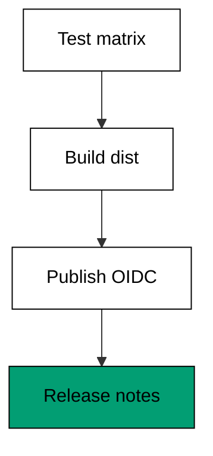
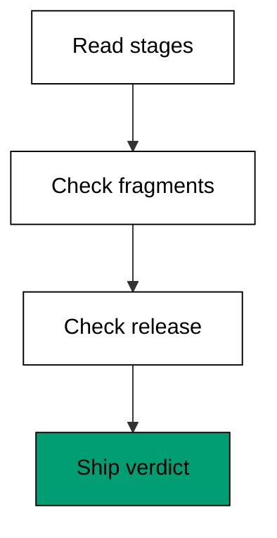

Ship a commit-to-release pipeline the way a team would: a test stage that gates every change, a build stage that packages the artifact, and a publish stage that assumes a cloud role over OIDC, pauses for a human approval, and creates the release with notes. Then validate the whole set offline with one report that must agree before anything ships. The pipeline lives in `learning/capstone/code/` as three workflow files, one release-notes fixture, and a single `pipeline.py` checker that produces the golden report.

## What you build

Three stage files plus one validator. `test.yaml` runs the matrix over Python 3.13 and 3.14 with a warm pip cache, and its job name doubles as the required status check that branch protection gates the merge on. `build.yaml` waits for the test stage, packages the `dist` directory, and uploads it as a named artifact with a thirty-day retention window suited to releases. `publish.yaml` triggers only on version tags, mints a federated token with the `id-token: write` permission, assumes the deployer role, targets the production environment so a reviewer approves before anything ships, downloads the `dist` handoff by its contract name, and records the release. `release.json` freezes the release the publish stage would create: tag `v1.4.0`, headline notes, and two assets with nonzero sizes.

## How the validator judges the pipeline

`pipeline.py` reads the three stage files as text and checks the fragments each stage must contain: the matrix and pip cache in test, the artifact upload and contract name in build, the OIDC permission and production environment in publish. It then parses the release fixture and proves the tag shape plus nonzero asset sizes. Four checks, one verdict line: `ship: True` means the stages agree and the release is well-formed. The recorded report at `expected/main/main.stdout.txt` is the golden file — byte-identical agreement between the validator and the fixture is what the harness enforces on every run.





## The shell invocations this capstone stands in for

<!-- harness: illustration -->

```bash
git tag v1.4.0 && git push origin v1.4.0
gh run watch --workflow publish.yaml
gh release create v1.4.0 --notes-file notes.md dist/*
```

No live repository exists in the harness, so these commands carry the illustration marker. The validator replays their offline equivalents: the tag push becomes the tags filter in `publish.yaml`, the watch becomes the stage-by-stage PASS lines, and the release creation becomes the fixture check on tag and assets.

## Stage files under test

**`learning/capstone/code/test.yaml`**:

```yaml
# => Capstone test workflow: matrix across 3.13 and 3.14, pip cache warm.
# => Required check named test: branch protection gates the merge on it.
# => Cache key hashes requirements: new deps miss once, then warm again.
name: test # => workflow name shown as the required check
on: # => trigger block for the test stage
  push: # => every push proves the change before anything else
    branches: [main] # => default branch only
  pull_request: # => every PR proves itself before review
    types: [opened, synchronize] # => new and updated versions
jobs: # => matrix job plus the artifact-producing test job
  test: # => required check consumed by branch protection
    runs-on: ubuntu-latest # => hosted runner image
    strategy: # => fan-out configuration
      matrix: # => two supported interpreters
        python-version: ["3.13", "3.14"] # => quoted versions
    steps: # => checkout, cache, setup, test
      - uses: actions/checkout@v4 # => fetch the change
      - uses: actions/setup-python@v5 # => pinned interpreter per cell
        with: # => inputs reading the matrix cell
          python-version: ${{ matrix.python-version }} # => cell value
          cache: pip # => warm dependencies between runs
      - run: echo tests-ok # => placeholder suite proof
```

**`learning/capstone/code/build.yaml`**:

```yaml
# => Capstone build workflow: waits for test, packages dist, uploads it.
# => needs test means build never packages an untested change.
# => The dist artifact is the handoff the publish stage consumes.
name: build # => workflow name for the packaging stage
on: # => trigger block for the build stage
  push: # => runs after pushes that passed the test stage
    branches: [main] # => default branch only
    tags: [v*] # => release tags also build the shippable artifact
jobs: # => single packaging job
  build: # => job producing the dist artifact
    runs-on: ubuntu-latest # => hosted runner image
    steps: # => build then upload the handoff
      - uses: actions/checkout@v4 # => fetch the tested commit
      - run: echo built-ok # => placeholder build proof
      - uses: actions/upload-artifact@v4 # => store the handoff
        with: # => inputs for the upload
          name: dist # => contract name publish downloads
          path: dist/ # => packaged output directory
          retention-days: 30 # => release window keeps it longer
```

**`learning/capstone/code/publish.yaml`**:

```yaml
# => Capstone publish: OIDC role, production approval, release notes.
# => No stored cloud keys: id-token mints per run, the role expires fast.
# => environment production pauses for a reviewer before anything ships.
name: publish # => workflow name for the release stage
on: # => trigger block for release tags only
  push: # => tag pushes publish exactly once
    tags: [v*] # => version tags, never branches
permissions: # => minimum token permissions for this workflow
  id-token: write # => mint the federated token for the role
  contents: write # => create the release and upload assets
jobs: # => deploy job guarded by the production environment
  publish: # => single job proving the OIDC publish path
    runs-on: ubuntu-latest # => hosted runner image
    environment: production # => pause for the configured reviewers
    steps: # => assume role, download, publish, note
      - uses: aws-actions/configure-aws-credentials@v4 # => trade token
        with: # => inputs for the credential trade
          role-to-assume: arn:aws:iam::123456789012:role/deployer # => role
      - uses: actions/download-artifact@v4 # => fetch the handoff by name
        with: # => inputs for the download
          name: dist # => identical spelling to the upload
      - run: echo release-ok # => placeholder for gh release create
```

**`learning/capstone/code/release.json`**:

```json
{
  "tag": "v1.4.0",
  "name": "Commit-to-release pipeline",
  "draft": false,
  "prerelease": false,
  "notes": "Test matrix green, dist packaged, OIDC publish approved.\n\nShipped by the capstone pipeline.",
  "assets": [
    { "name": "shop-1.4.0.tar.gz", "size": 48210, "downloads": 0 },
    { "name": "checksums.txt", "size": 128, "downloads": 0 }
  ]
}
```

**`learning/capstone/code/pipeline.py`**:

```python
# => Capstone validator: test, build, and publish must agree before release.
# => Checked against the vendor workflow docs on 2026-10-20.
# => Reads the three workflow files plus the release-notes fixture.
# => No network and no live repository; agreement is checked as text.
# => WHY one report: the pipeline ships only when every stage agrees.
# => Golden file expected/main/main.stdout.txt records the agreement.
import json  # => parse the release-notes fixture
from pathlib import Path  # => locate the stage files beside this script


HERE = Path(__file__).resolve().parent  # => capstone code directory
STAGES = ["test.yaml", "build.yaml", "publish.yaml"]  # => stages in order


def read(name):  # => read a stage file into one searchable string
    return (HERE / name).read_text(encoding="utf-8")  # => raw file text


def stage_ok(name, text):  # => one verdict per pipeline stage
    needs = {  # => fragment each stage must contain
        "test.yaml": ["matrix:", "cache: pip"],
        "build.yaml": ["upload-artifact", "name: dist"],
        "publish.yaml": ["id-token: write", "environment: production"],
    }  # => end of the per-stage expectations
    missing = [f for f in needs[name] if f not in text]  # => gaps
    return (not missing, missing)  # => verdict plus evidence


def release_ok():  # => the release fixture must match the tag pipeline
    rel = json.loads((HERE / "release.json").read_text(encoding="utf-8"))  # => fix
    tag_ok = rel["tag"].startswith("v")  # => version tag shape
    assets_ok = all(a["size"] > 0 for a in rel["assets"])  # => real bytes
    return (tag_ok and assets_ok, rel["tag"], len(rel["assets"]))  # => verdict


def main():  # => print one line per stage plus the release verdict
    good = 0  # => stages passing so far
    for name in STAGES:  # => stages in pipeline order
        ok, missing = stage_ok(name, read(name))  # => check the stage
        good += 1 if ok else 0  # => count the passes
        extra = "" if ok else " missing " + ",".join(missing)  # => evidence
        print(("PASS" if ok else "FAIL") + ": " + name + extra)  # => row
    ok, tag, assets = release_ok()  # => check the release fixture
    good += 1 if ok else 0  # => count the release check too
    print(("PASS" if ok else "FAIL") + ": release " + tag)  # => release row
    print("assets:", assets)  # => files the release would attach
    print("stages:", str(good) + "/4")  # => overall pipeline verdict
    print("ship:", good == 4)  # => True only when everything agrees


main()  # => run once; ship True means the pipeline may run live
```

**Output** (`learning/capstone/code/expected/main/main.stdout.txt`):

```text
PASS: test.yaml
PASS: build.yaml
PASS: publish.yaml
PASS: release v1.4.0
assets: 2
stages: 4/4
ship: True
```

## Why this shape ships safely

Each stage owns one decision and proves it before the next begins: test proves the change, build proves the package, publish proves the authorization. The needs edges plus the tags filter mean untested code can never reach the publish stage and ordinary pushes can never trigger a release. OIDC removes the standing credential that would otherwise be the pipeline's most valuable secret, and the production environment inserts the human pause that automation must never skip. Validate the whole set offline first, because a pipeline whose stages disagree fails at the worst moment — during the release, under attention, with users waiting. When the golden report reads `ship: True`, the file set may run live the same day with confidence earned offline.

## References

- GitHub Actions documentation (workflows, events, jobs, runners). Accessed 2026-10-20. [Actions docs](https://docs.github.com/en/actions)
- Events that trigger workflows (push, pull_request, schedule, workflow_dispatch). Accessed 2026-10-20. [Trigger events](https://docs.github.com/en/actions/using-workflows/events-that-trigger-workflows)
- Using a matrix for your jobs (axes, include, exclude, fail-fast). Accessed 2026-10-20. [Matrix strategies](https://docs.github.com/en/actions/using-jobs/using-a-matrix-for-your-jobs)
- Caching dependencies to speed up workflows (cache action, keys, restore-keys). Accessed 2026-10-20. [Dependency caching](https://docs.github.com/en/actions/using-workflows/caching-dependencies-to-speed-up-workflows)
- Reusing workflows (workflow_call, inputs, secrets, outputs). Accessed 2026-10-20. [Reusable workflows](https://docs.github.com/en/actions/using-workflows/reusing-workflows)
- Creating a composite action (action.yaml, inputs, outputs, runs.composite). Accessed 2026-10-20. [Composite actions](https://docs.github.com/en/actions/creating-actions/creating-a-composite-action)
- Using secrets in GitHub Actions (secrets context, masking, environments). Accessed 2026-10-20. [Secrets](https://docs.github.com/en/actions/security-guides/using-secrets-in-github-actions)
- About security hardening with OpenID Connect (id-token, cloud roles). Accessed 2026-10-20. [OIDC hardening](https://docs.github.com/en/actions/deployment/security-hardening-your-deployments/about-security-hardening-with-openid-connect)
- Using environments for deployment (reviewers, environment secrets). Accessed 2026-10-20. [Environments](https://docs.github.com/en/actions/deployment/targeting-different-environments/using-environments-for-deployment)
- Evaluate expressions (github context, needs context, functions). Accessed 2026-10-20. [Expressions](https://docs.github.com/en/actions/learn-github-actions/expressions)
- GitHub CLI manual (gh auth, repo, issue, pr, release, api, run). Accessed 2026-10-20. [gh manual](https://cli.github.com/manual/)
- GitHub REST API reference (payloads used by gh api examples). Accessed 2026-10-20. [REST reference](https://docs.github.com/en/rest)
