Examples 26-53 scale the basics to real pipelines: fanning jobs across matrices, reusing dependency caches and artifacts, sharing logic through reusable workflows and composite actions, and driving pull requests and releases from the CLI. Three clusters carry the level: matrix, caching, and artifacts (Examples 26-34), reusable workflows and composite actions (Examples 35-44), and gh for pull requests and releases (Examples 45-53). Offline validation stays the rule: matrices expand, fixtures replay, nothing touches a live repository.

### Example 26: One Job, Three Pythons

Libraries promise compatibility across versions, and the matrix is how that promise gets tested: one job definition fans out to one runner per version. This example tests 3.12, 3.13, and 3.14 from a single python-version axis. The expander prints each combination and the total of three jobs. (Concepts: co-03, co-16.)

The shell invocation this example stands in for:

<!-- harness: illustration -->

```bash
gh run view 987654321 --json jobs --jq '[.jobs[].name] | sort'
```

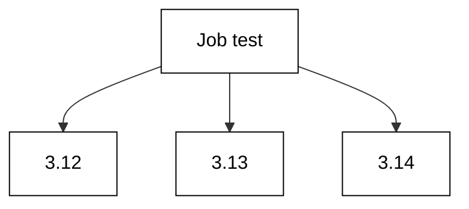

**`learning/code/ex-26-matrix-python-versions/workflow.yaml`**:

```yaml
# => Version axis: one definition, three interpreters, three jobs.
# => matrix values are the product; each cell is one runner.
# => Quote versions: matrix values pass through YAML parsing too.
name: version-grid # => workflow name shown in the Actions tab
on: push # => run on every push while learning
jobs: # => jobs block with the matrix job
  test: # => single definition fanning out to three runners
    runs-on: ubuntu-latest # => same image for every cell
    strategy: # => fan-out configuration for this job
      matrix: # => axes whose product becomes jobs
        python-version: ["3.12", "3.13", "3.14"] # => quoted versions
    steps: # => steps run once per cell with the cell value
      - uses: actions/setup-python@v5 # => install the cell interpreter
        with: # => action inputs reading the matrix value
          python-version: ${{ matrix.python-version }} # => cell value
      - run: echo tests-ok # => placeholder suite proof
```

**`learning/code/ex-26-matrix-python-versions/check.py`**:

```python
# => Offline matrix expander for the matrix-python-versions workflow file.
# => Checked against the vendor strategy docs on 2026-10-20.
# => AXES mirrors the strategy.matrix block in workflow.yaml.
# => No network and no live repository; expansion is pure math.
# => WHY expand offline: count the jobs before they bill minutes.
# => INCLUDE and EXCLUDE rows reshape the grid after the product.
from pathlib import Path  # => locate the data file beside this script


HERE = Path(__file__).resolve().parent  # => unit directory itself
AXES = {
    "python-version": ["3.12", "3.13", "3.14"]
}  # => axis name to value list, mirrors the yaml
INCLUDE = []  # => extra cells added after the product
EXCLUDE = []  # => cells removed after the product


def expand():  # => cartesian product of every axis, then reshape
    cells = [dict()]  # => start with one empty combination
    for name in sorted(AXES):  # => sorted axes keep order stable
        cells = [dict(c, **{name: v}) for c in cells for v in AXES[name]]  # => grow
    cells.extend(dict(c) for c in INCLUDE)  # => add the special cells
    cells = [c for c in cells if c not in EXCLUDE]  # => drop the banned ones
    order = sorted(AXES)  # => axis display order, alphabetical
    cells.sort(key=lambda c: tuple(str(c[k]) for k in order))  # => stable sort
    return cells  # => every job the strategy would create


def label(cell):  # => one readable name per matrix cell
    order = sorted(AXES)  # => same axis order as the listing
    return "-".join(str(cell[k]) for k in order if k in cell)  # => dash join


def main():  # => print every cell plus the final count
    cells = expand()  # => the full expanded grid
    for cell in cells:  # => one line per job, stable order
        print("job:", label(cell))  # => Output: one matrix combination
    print("jobs:", len(cells))  # => Output: total job count


main()  # => run once; count the jobs before pushing the file
```

**Output** (`learning/code/ex-26-matrix-python-versions/expected/main.stdout.txt`):

```text
job: 3.12
job: 3.13
job: 3.14
jobs: 3
```

**Key takeaway**: A single-axis matrix fans one job definition out to one runner per value.

**Why it matters**: Compatibility is a claim about a set, and the matrix tests the whole set on every push instead of one lucky version. Adding a version is one list item, not a copied job. Expand offline first: the count tells you whether the grid still fits the minute budget before it runs.

### Example 27: Multiply OS by Python

Two axes multiply: three operating systems times two Python versions is six jobs, each on its own runner. This example crosses ubuntu, macos, and windows with 3.13 and 3.14. The expander lists all six cells in stable order and prints the product count. Growth is multiplicative, so count before pushing. (Concepts: co-03.)

The shell invocation this example stands in for:

<!-- harness: illustration -->

```bash
gh run view 987654321 --json jobs --jq '[.jobs[] | .name] | sort'
```

**`learning/code/ex-27-matrix-os-grid/workflow.yaml`**:

```yaml
# => Two axes multiply: 3 systems times 2 versions is 6 jobs.
# => runs-on reads the os cell, setup reads the version cell.
# => Windows paths differ; keep steps portable or split the file.
name: os-grid # => workflow name shown in the Actions tab
on: push # => run on every push while learning
jobs: # => jobs block with the two-axis matrix job
  test: # => one definition becoming six runners
    runs-on: ${{ matrix.os }} # => runner image from the os cell
    strategy: # => fan-out configuration for this job
      matrix: # => axes whose product becomes jobs
        os: [ubuntu-latest, macos-latest, windows-latest] # => 3 systems
        python-version: ["3.13", "3.14"] # => 2 versions
    steps: # => steps run once per cell
      - uses: actions/setup-python@v5 # => install the cell interpreter
        with: # => action inputs reading the matrix value
          python-version: ${{ matrix.python-version }} # => cell value
      - run: echo tests-ok # => placeholder suite proof
```

**`learning/code/ex-27-matrix-os-grid/check.py`**:

```python
# => Offline matrix expander for the matrix-os-grid workflow file.
# => Checked against the vendor strategy docs on 2026-10-20.
# => AXES mirrors the strategy.matrix block in workflow.yaml.
# => No network and no live repository; expansion is pure math.
# => WHY expand offline: count the jobs before they bill minutes.
# => INCLUDE and EXCLUDE rows reshape the grid after the product.
from pathlib import Path  # => locate the data file beside this script


HERE = Path(__file__).resolve().parent  # => unit directory itself
AXES = {
    "os": ["ubuntu-latest", "macos-latest", "windows-latest"],
    "python-version": ["3.13", "3.14"],
}  # => axis name to value list, mirrors the yaml
INCLUDE = []  # => extra cells added after the product
EXCLUDE = []  # => cells removed after the product


def expand():  # => cartesian product of every axis, then reshape
    cells = [dict()]  # => start with one empty combination
    for name in sorted(AXES):  # => sorted axes keep order stable
        cells = [dict(c, **{name: v}) for c in cells for v in AXES[name]]  # => grow
    cells.extend(dict(c) for c in INCLUDE)  # => add the special cells
    cells = [c for c in cells if c not in EXCLUDE]  # => drop the banned ones
    order = sorted(AXES)  # => axis display order, alphabetical
    cells.sort(key=lambda c: tuple(str(c[k]) for k in order))  # => stable sort
    return cells  # => every job the strategy would create


def label(cell):  # => one readable name per matrix cell
    order = sorted(AXES)  # => same axis order as the listing
    return "-".join(str(cell[k]) for k in order if k in cell)  # => dash join


def main():  # => print every cell plus the final count
    cells = expand()  # => the full expanded grid
    for cell in cells:  # => one line per job, stable order
        print("job:", label(cell))  # => Output: one matrix combination
    print("jobs:", len(cells))  # => Output: total job count


main()  # => run once; count the jobs before pushing the file
```

**Output** (`learning/code/ex-27-matrix-os-grid/expected/main.stdout.txt`):

```text
job: macos-latest-3.13
job: macos-latest-3.14
job: ubuntu-latest-3.13
job: ubuntu-latest-3.14
job: windows-latest-3.13
job: windows-latest-3.14
jobs: 6
```

**Key takeaway**: Two matrix axes multiply into one job per combination, with runs-on reading the os cell.

**Why it matters**: Cross-platform bugs hide on the systems you never test, and the grid makes all of them first-class. But multiplication is merciless: a third axis of three turns six jobs into eighteen. Count the product offline and keep each axis minimal, or the grid owns your minute budget.

### Example 28: Include and Exclude Grid Cells

Real grids are rarely perfect products: one combination needs an extra flag, another is unsupported and must go. Include adds special cells, exclude removes banned ones. This example tests two versions everywhere except 3.14 on Windows, plus one coverage cell. The expander prints the reshaped grid and its count. (Concepts: co-03.)

The shell invocation this example stands in for:

<!-- harness: illustration -->

```bash
gh run view 987654321 --json jobs --jq '[.jobs[].name] | sort'
```

**`learning/code/ex-28-matrix-include-exclude/workflow.yaml`**:

```yaml
# => Reshaped grid: drop 3.14 on Windows, add a coverage cell.
# => exclude removes after the product; include adds after exclusion.
# => Extra keys on include cells (coverage) steer steps per cell.
name: shaped-grid # => workflow name shown in the Actions tab
on: push # => run on every push while learning
jobs: # => jobs block with the reshaped matrix job
  test: # => one definition with product, minus one, plus one
    runs-on: ${{ matrix.os }} # => runner image from the os cell
    strategy: # => fan-out configuration for this job
      matrix: # => axes first, reshaping keys second
        os: [ubuntu-latest, windows-latest] # => 2 systems
        python-version: ["3.13", "3.14"] # => 2 versions
        exclude: # => cells removed from the product
          - os: windows-latest # => unsupported combination part one
            python-version: "3.14" # => unsupported combination part two
        include: # => special cells added after exclusion
          - os: ubuntu-latest # => coverage runs on ubuntu only
            python-version: "3.13" # => pinned version for coverage
            coverage: true # => extra key steering the coverage step
    steps: # => steps run once per reshaped cell
      - run: echo tests-ok # => placeholder suite proof
```

**`learning/code/ex-28-matrix-include-exclude/check.py`**:

```python
# => Offline matrix expander for the matrix-include-exclude workflow file.
# => Checked against the vendor strategy docs on 2026-10-20.
# => AXES mirrors the strategy.matrix block in workflow.yaml.
# => No network and no live repository; expansion is pure math.
# => WHY expand offline: count the jobs before they bill minutes.
# => INCLUDE and EXCLUDE rows reshape the grid after the product.
from pathlib import Path  # => locate the data file beside this script


HERE = Path(__file__).resolve().parent  # => unit directory itself
AXES = {
    "os": ["ubuntu-latest", "windows-latest"],
    "python-version": ["3.13", "3.14"],
}  # => axis name to value list, mirrors the yaml
INCLUDE = [
    {"os": "ubuntu-latest", "python-version": "3.13", "coverage": True}
]  # => extra cells added after the product
EXCLUDE = [
    {"os": "windows-latest", "python-version": "3.14"}
]  # => cells removed after the product


def expand():  # => cartesian product of every axis, then reshape
    cells = [dict()]  # => start with one empty combination
    for name in sorted(AXES):  # => sorted axes keep order stable
        cells = [dict(c, **{name: v}) for c in cells for v in AXES[name]]  # => grow
    cells.extend(dict(c) for c in INCLUDE)  # => add the special cells
    cells = [c for c in cells if c not in EXCLUDE]  # => drop the banned ones
    order = sorted(AXES)  # => axis display order, alphabetical
    cells.sort(key=lambda c: tuple(str(c[k]) for k in order))  # => stable sort
    return cells  # => every job the strategy would create


def label(cell):  # => one readable name per matrix cell
    order = sorted(AXES)  # => same axis order as the listing
    # => Extra keys like coverage ride along but never join the label.
    # => Labels stay short; the full cell is visible in the file.
    return "-".join(str(cell[k]) for k in order if k in cell)  # => dash join


def main():  # => print every cell plus the final count
    cells = expand()  # => the full expanded grid
    for cell in cells:  # => one line per job, stable order
        print("job:", label(cell))  # => Output: one matrix combination
    print("jobs:", len(cells))  # => Output: total job count


main()  # => run once; count the jobs before pushing the file
```

**Output** (`learning/code/ex-28-matrix-include-exclude/expected/main.stdout.txt`):

```text
job: ubuntu-latest-3.13
job: ubuntu-latest-3.13
job: ubuntu-latest-3.14
job: windows-latest-3.13
jobs: 4
```

**Key takeaway**: Exclude removes banned cells from the product; include adds special cells with extra keys.

**Why it matters**: Support matrices are business decisions with ragged edges: version X unsupported on system Y, coverage measured once instead of everywhere. Include and exclude express those edges in the file instead of in tribal knowledge. Validate the reshape offline, because a wrong exclude silently drops the cell you most needed.

### Example 29: Fail Fast or Finish All

When one cell fails, the strategy decides the fate of the rest: fail-fast cancels the survivors, false lets every cell report. Fast feedback wants cancellation; release matrices want the full picture. This example disables fail-fast so all six cells report. The validator confirms the strategy key and the false value. (Concepts: co-03.)

The shell invocation this example stands in for:

<!-- harness: illustration -->

```bash
gh run view 987654321 --json jobs --jq '[.jobs[].conclusion] | unique'
```

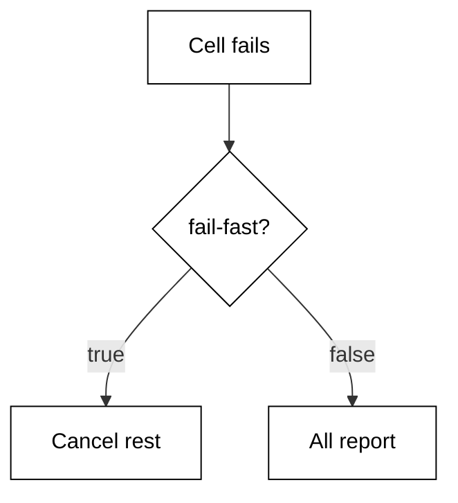

**`learning/code/ex-29-matrix-fail-fast/workflow.yaml`**:

```yaml
# => Full report: every cell finishes even when one cell fails.
# => fail-fast false trades minutes for the complete failure picture.
# => Default is true; state the choice explicitly so readers see it.
name: full-report # => workflow name shown in the Actions tab
on: push # => run on every push while learning
jobs: # => jobs block with the full-report matrix job
  test: # => matrix job reporting every cell
    runs-on: ubuntu-latest # => same image for every cell
    strategy: # => fan-out plus failure policy
      fail-fast: false # => let survivors finish and report
      matrix: # => axes whose product becomes jobs
        python-version: ["3.13", "3.14"] # => two versions, both report
    steps: # => steps run once per cell
      - run: echo tests-ok # => placeholder suite proof
```

**`learning/code/ex-29-matrix-fail-fast/check.py`**:

```python
# => Offline validator for the matrix-fail-fast workflow file.
# => Checked against the vendor workflow docs on 2026-10-20.
# => Subset schema: event names, job keys, step keys, expressions.
# => No network and no live repository; reads workflow.yaml only.
# => WHY this shape: structure first, behaviour second, always.
# => A file that parses here still deserves a same-day live check.
# => Every FAIL names the exact line fragment it expected.
from pathlib import Path  # => locate the data file beside this script


HERE = Path(__file__).resolve().parent  # => unit directory itself


def read(name):  # => read a data file into stripped lines
    text = (HERE / name).read_text(encoding="utf-8")  # => raw file text
    return [line.rstrip() for line in text.splitlines()]  # => clean lines


def has(lines, needle):  # => True when any line contains the needle
    return any(needle in line for line in lines)  # => substring scan


def main():  # => run every structural check and print the report
    lines = read("workflow.yaml")  # => lines of the workflow under test
    # => The policy row is the point: false means every cell reports.
    # => Default true stays implicit elsewhere; here the choice is explicit.
    report = [  # => (label, passed) pairs in display order
        ("strategy block set", has(lines, "strategy:")),  # => expect this
        ("fail-fast key set", has(lines, "fail-fast:")),  # => expect this
        ("full report chosen", has(lines, "fail-fast: false")),  # => expect this
        ("matrix present", has(lines, "matrix:")),  # => expect this
        ("runner pinned", has(lines, "runs-on:")),  # => expect this
        ("policy stated once", has(lines, "fail-fast:") is True),  # => sanity
    ]  # => end of the check list
    for label, ok in report:  # => one line per check, stable order
        print(("PASS" if ok else "FAIL") + ": " + label)  # => verdict
    done = sum(1 for _, ok in report if ok)  # => count of passes
    print("checks:", str(done) + "/" + str(len(report)))  # => summary


main()  # => run once; a FAIL names the missing piece
```

**Output** (`learning/code/ex-29-matrix-fail-fast/expected/main.stdout.txt`):

```text
PASS: strategy block set
PASS: fail-fast key set
PASS: full report chosen
PASS: matrix present
PASS: runner pinned
PASS: policy stated once
checks: 6/6
```

**Key takeaway**: fail-fast: false lets every matrix cell finish and report instead of cancelling survivors.

**Why it matters**: A cancelled grid answers one question — something broke — while a finished grid answers which combinations broke. Release decisions need the full picture; inner-loop iteration needs speed. State the policy explicitly either way, because the default true surprises anyone expecting complete results.

### Example 30: Cache pip Dependencies

Dependency installs dominate CI minutes, and the cache action reuses them between runs: same lockfile hash, same directory, seconds instead of minutes. This example caches the pip directory keyed by the requirements hash. The validator confirms the cache action, the path, and the hashFiles key expression. (Concepts: co-04.)

The shell invocation this example stands in for:

<!-- harness: illustration -->

```bash
gh run view 987654321 --log --job 1 | grep 'Cache restored'
```

**`learning/code/ex-30-cache-pip-deps/workflow.yaml`**:

```yaml
# => Warm installs: restore pip packages when the lockfile is unchanged.
# => Key on the requirements hash: new deps miss once, then warm again.
# => Cache hits skip install; misses install then save for next time.
name: cached-python # => workflow name shown in the Actions tab
on: push # => run on every push while learning
jobs: # => jobs block with the cached-install job
  test: # => single job proving the cache step
    runs-on: ubuntu-latest # => hosted runner image
    steps: # => checkout, restore, install, test
      - uses: actions/checkout@v4 # => fetch the code first
      - id: pip-cache # => addressable id for the cache outcome
        uses: actions/cache@v4 # => restore or save the directory
        with: # => action inputs for the cache
          path: ~/.cache/pip # => directory to restore and save
          key: pip-${{ hashFiles('requirements.txt') }} # => hash-keyed
      - run: echo tests-ok # => placeholder suite proof
```

**`learning/code/ex-30-cache-pip-deps/check.py`**:

```python
# => Offline validator for the cache-pip-deps workflow file.
# => Checked against the vendor workflow docs on 2026-10-20.
# => Subset schema: event names, job keys, step keys, expressions.
# => No network and no live repository; reads workflow.yaml only.
# => WHY this shape: structure first, behaviour second, always.
# => A file that parses here still deserves a same-day live check.
# => Every FAIL names the exact line fragment it expected.
from pathlib import Path  # => locate the data file beside this script


HERE = Path(__file__).resolve().parent  # => unit directory itself


def read(name):  # => read a data file into stripped lines
    text = (HERE / name).read_text(encoding="utf-8")  # => raw file text
    return [line.rstrip() for line in text.splitlines()]  # => clean lines


def has(lines, needle):  # => True when any line contains the needle
    return any(needle in line for line in lines)  # => substring scan


def main():  # => run every structural check and print the report
    lines = read("workflow.yaml")  # => lines of the workflow under test
    report = [  # => (label, passed) pairs in display order
        ("cache action used", has(lines, "actions/cache")),  # => expect this
        ("cache step id", has(lines, "id: pip-cache")),  # => expect this
        ("path set", has(lines, "path:")),  # => expect this
        ("key set", has(lines, "key:")),  # => expect this
        ("hashFiles used", has(lines, "hashFiles(")),  # => expect this
    ]  # => end of the check list
    for label, ok in report:  # => one line per check, stable order
        print(("PASS" if ok else "FAIL") + ": " + label)  # => verdict
    done = sum(1 for _, ok in report if ok)  # => count of passes
    print("checks:", str(done) + "/" + str(len(report)))  # => summary


main()  # => run once; a FAIL names the missing piece
```

**Output** (`learning/code/ex-30-cache-pip-deps/expected/main.stdout.txt`):

```text
PASS: cache action used
PASS: cache step id
PASS: path set
PASS: key set
PASS: hashFiles used
checks: 5/5
```

**Key takeaway**: The cache action restores a directory keyed by a lockfile hash, turning reinstalls into hits.

**Why it matters**: Cold installs on every run tax both minutes and patience; a warm cache returns them. Hash-keyed keys invalidate exactly when dependencies change — never stale, never over-broad. Read the cache step outcome to log whether the run was warm, so slow runs explain themselves.

### Example 31: Cache Keys and Restore Keys

Exact keys hit or miss, but restore-keys add a fallback ladder: try the exact hash, then the nearest prefix, then anything for the OS. This example layers a primary key over two prefix fallbacks. The validator confirms the key, both restore-key lines, and the prefix ordering from specific to general. (Concepts: co-04.)

The shell invocation this example stands in for:

<!-- harness: illustration -->

```bash
gh run view 987654321 --log --job 1 | grep -i 'restore-keys'
```

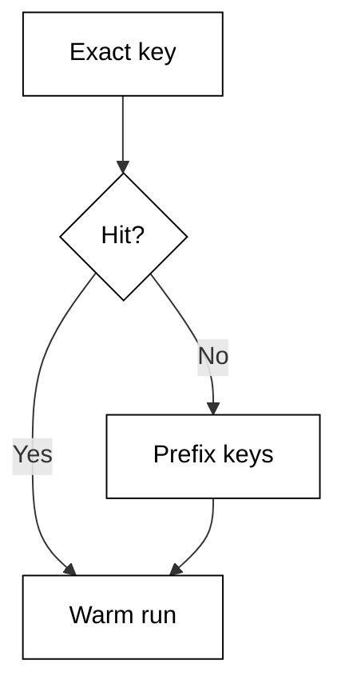

**`learning/code/ex-31-cache-key-restore/workflow.yaml`**:

```yaml
# => Fallback ladder: exact hash first, OS prefix second, anything last.
# => Partial hits still warm most packages; only the delta installs.
# => Order restore-keys specific to general or the ladder never climbs.
name: cache-ladder # => workflow name shown in the Actions tab
on: push # => run on every push while learning
jobs: # => jobs block with the fallback-cache job
  test: # => single job proving the restore ladder
    runs-on: ubuntu-latest # => hosted runner image
    steps: # => checkout then restore with fallbacks
      - uses: actions/checkout@v4 # => fetch the code first
      - uses: actions/cache@v4 # => restore with the fallback ladder
        with: # => action inputs for the cache
          path: ~/.cache/pip # => directory to restore and save
          key: pip-ubuntu-${{ hashFiles('requirements.txt') }} # => exact
          restore-keys: | # => fallbacks tried top to bottom
            pip-ubuntu-  # => same OS, any hash: warm prefix
            pip-  # => any pip cache: better than cold
      - run: echo tests-ok # => placeholder suite proof
```

**`learning/code/ex-31-cache-key-restore/check.py`**:

```python
# => Offline validator for the cache-key-restore workflow file.
# => Checked against the vendor workflow docs on 2026-10-20.
# => Subset schema: event names, job keys, step keys, expressions.
# => No network and no live repository; reads workflow.yaml only.
# => WHY this shape: structure first, behaviour second, always.
# => A file that parses here still deserves a same-day live check.
# => Every FAIL names the exact line fragment it expected.
from pathlib import Path  # => locate the data file beside this script


HERE = Path(__file__).resolve().parent  # => unit directory itself


def read(name):  # => read a data file into stripped lines
    text = (HERE / name).read_text(encoding="utf-8")  # => raw file text
    return [line.rstrip() for line in text.splitlines()]  # => clean lines


def has(lines, needle):  # => True when any line contains the needle
    return any(needle in line for line in lines)  # => substring scan


def main():  # => run every structural check and print the report
    lines = read("workflow.yaml")  # => lines of the workflow under test
    report = [  # => (label, passed) pairs in display order
        ("primary key set", has(lines, "key:")),  # => expect this
        ("restore-keys set", has(lines, "restore-keys:")),  # => expect this
        ("os prefix fallback", has(lines, "pip-")),  # => expect this
        ("hash in key", has(lines, "hashFiles(")),  # => expect this
        ("cache action used", has(lines, "actions/cache")),  # => expect this
    ]  # => end of the check list
    for label, ok in report:  # => one line per check, stable order
        print(("PASS" if ok else "FAIL") + ": " + label)  # => verdict
    done = sum(1 for _, ok in report if ok)  # => count of passes
    print("checks:", str(done) + "/" + str(len(report)))  # => summary


main()  # => run once; a FAIL names the missing piece
```

**Output** (`learning/code/ex-31-cache-key-restore/expected/main.stdout.txt`):

```text
PASS: primary key set
PASS: restore-keys set
PASS: os prefix fallback
PASS: hash in key
PASS: cache action used
checks: 5/5
```

**Key takeaway**: Restore-keys form a fallback ladder from the exact key down to broad prefixes.

**Why it matters**: Exact keys are brittle across dependency bumps: one changed line otherwise discards a nearly-perfect cache. Prefix fallbacks recover most of the warmth for the cost of one delta install. Order matters — specific before general — because the first matching prefix wins and the ladder stops climbing.

### Example 32: Cache Node Modules

Node projects cache differently: the setup-node action bundles its own cache input, so no separate cache step is needed. This example enables the npm cache with a single key on setup-node. The validator confirms the action, the node version, and the cache input that replaces the manual cache step. (Concepts: co-04.)

The shell invocation this example stands in for:

<!-- harness: illustration -->

```bash
gh run view 987654321 --log --job 1 | grep -i 'cache'
```

**`learning/code/ex-32-cache-node-modules/workflow.yaml`**:

```yaml
# => Bundled cache: setup-node warms npm with one input line.
# => Prefer the bundled cache over a manual cache step when offered.
# => The lockfile hash is computed for you; no hashFiles needed.
name: cached-node # => workflow name shown in the Actions tab
on: push # => run on every push while learning
jobs: # => jobs block with the Node test job
  test: # => single job proving the bundled cache
    runs-on: ubuntu-latest # => hosted runner image
    steps: # => checkout, setup with cache, test
      - uses: actions/checkout@v4 # => fetch the code first
      - uses: actions/setup-node@v4 # => install Node plus cache
        with: # => action inputs for setup-node
          node-version: "20" # => quoted LTS line
          cache: npm # => warm node_modules from the lockfile hash
      - run: echo tests-ok # => placeholder suite proof
```

**`learning/code/ex-32-cache-node-modules/check.py`**:

```python
# => Offline validator for the cache-node-modules workflow file.
# => Checked against the vendor workflow docs on 2026-10-20.
# => Subset schema: event names, job keys, step keys, expressions.
# => No network and no live repository; reads workflow.yaml only.
# => WHY this shape: structure first, behaviour second, always.
# => A file that parses here still deserves a same-day live check.
# => Every FAIL names the exact line fragment it expected.
from pathlib import Path  # => locate the data file beside this script


HERE = Path(__file__).resolve().parent  # => unit directory itself


def read(name):  # => read a data file into stripped lines
    text = (HERE / name).read_text(encoding="utf-8")  # => raw file text
    return [line.rstrip() for line in text.splitlines()]  # => clean lines


def has(lines, needle):  # => True when any line contains the needle
    return any(needle in line for line in lines)  # => substring scan


def main():  # => run every structural check and print the report
    lines = read("workflow.yaml")  # => lines of the workflow under test
    report = [  # => (label, passed) pairs in display order
        ("setup-node used", has(lines, "setup-node")),  # => expect this
        ("node version set", has(lines, "node-version:")),  # => expect this
        ("cache input set", has(lines, "cache:")),  # => expect this
        ("npm cache chosen", has(lines, "cache: npm")),  # => expect this
        ("runner pinned", has(lines, "runs-on:")),  # => expect this
    ]  # => end of the check list
    for label, ok in report:  # => one line per check, stable order
        print(("PASS" if ok else "FAIL") + ": " + label)  # => verdict
    done = sum(1 for _, ok in report if ok)  # => count of passes
    print("checks:", str(done) + "/" + str(len(report)))  # => summary


main()  # => run once; a FAIL names the missing piece
```

**Output** (`learning/code/ex-32-cache-node-modules/expected/main.stdout.txt`):

```text
PASS: setup-node used
PASS: node version set
PASS: cache input set
PASS: npm cache chosen
PASS: runner pinned
checks: 5/5
```

**Key takeaway**: The setup-node action warms the npm cache through its own cache input.

**Why it matters**: Two cache mechanisms for one directory is a maintenance trap: prefer the toolchain action's bundled cache, which tracks lockfile hashing internally. One line replaces a whole cache step plus its key expressions. Check which manager the project uses first — npm, pnpm, and yarn each get their own cache value.

### Example 33: Upload a Build Artifact

Jobs run on throwaway runners: anything the next job needs must be uploaded as an artifact first. The upload-artifact action stores files by name with a retention window. This example packages a dist directory for seven days. The validator confirms the action, the name, the path, and the retention setting. (Concepts: co-05.)

The shell invocation this example stands in for:

<!-- harness: illustration -->

```bash
gh run view 987654321 --json jobs --jq '.jobs[].artifacts'
```

**`learning/code/ex-33-upload-artifact/workflow.yaml`**:

```yaml
# => Handoff upload: store dist under a name the next job knows.
# => Runners are throwaway; unuploaded files vanish with the job.
# => Retention bounds storage cost; seven days suits review windows.
name: package # => workflow name shown in the Actions tab
on: push # => run on every push while learning
jobs: # => jobs block with the packaging job
  build: # => single job proving the upload step
    runs-on: ubuntu-latest # => hosted runner image
    steps: # => build then upload the result
      - run: echo built-ok # => placeholder build proof
      - uses: actions/upload-artifact@v4 # => store files for later jobs
        with: # => action inputs for the upload
          name: dist # => artifact name the consumer requests
          path: dist/ # => directory packaged into the artifact
          retention-days: 7 # => storage bound in days
```

**`learning/code/ex-33-upload-artifact/check.py`**:

```python
# => Offline validator for the upload-artifact workflow file.
# => Checked against the vendor workflow docs on 2026-10-20.
# => Subset schema: event names, job keys, step keys, expressions.
# => No network and no live repository; reads workflow.yaml only.
# => WHY this shape: structure first, behaviour second, always.
# => A file that parses here still deserves a same-day live check.
# => Every FAIL names the exact line fragment it expected.
from pathlib import Path  # => locate the data file beside this script


HERE = Path(__file__).resolve().parent  # => unit directory itself


def read(name):  # => read a data file into stripped lines
    text = (HERE / name).read_text(encoding="utf-8")  # => raw file text
    return [line.rstrip() for line in text.splitlines()]  # => clean lines


def has(lines, needle):  # => True when any line contains the needle
    return any(needle in line for line in lines)  # => substring scan


def main():  # => run every structural check and print the report
    lines = read("workflow.yaml")  # => lines of the workflow under test
    report = [  # => (label, passed) pairs in display order
        ("upload action used", has(lines, "upload-artifact")),  # => expect this
        ("artifact named", has(lines, "name:")),  # => expect this
        ("path set", has(lines, "path:")),  # => expect this
        ("dist packaged", has(lines, "dist/")),  # => expect this
        ("retention set", has(lines, "retention-days:")),  # => expect this
    ]  # => end of the check list
    for label, ok in report:  # => one line per check, stable order
        print(("PASS" if ok else "FAIL") + ": " + label)  # => verdict
    done = sum(1 for _, ok in report if ok)  # => count of passes
    print("checks:", str(done) + "/" + str(len(report)))  # => summary


main()  # => run once; a FAIL names the missing piece
```

**Output** (`learning/code/ex-33-upload-artifact/expected/main.stdout.txt`):

```text
PASS: upload action used
PASS: artifact named
PASS: path set
PASS: dist packaged
PASS: retention set
checks: 5/5
```

**Key takeaway**: The upload-artifact action stores named files with a retention window for later jobs.

**Why it matters**: Throwaway runners forget everything: any file that matters past the job boundary must be uploaded explicitly. Naming the artifact is a contract with the consuming job — agree on it once, assert it in both files. Retention bounds the storage bill, so set it to the review window, not forever.

### Example 34: Consume the Artifact Downstream

Uploading is half the handoff: a downstream job downloads the artifact by name after declaring needs on the producer. This example downloads dist and lists its contents. The validator confirms the download action, the matching name, the needs edge, and the consumer step that proves arrival. (Concepts: co-05.)

The shell invocation this example stands in for:

<!-- harness: illustration -->

```bash
gh run download 987654321 --name dist --dir ./dist
```

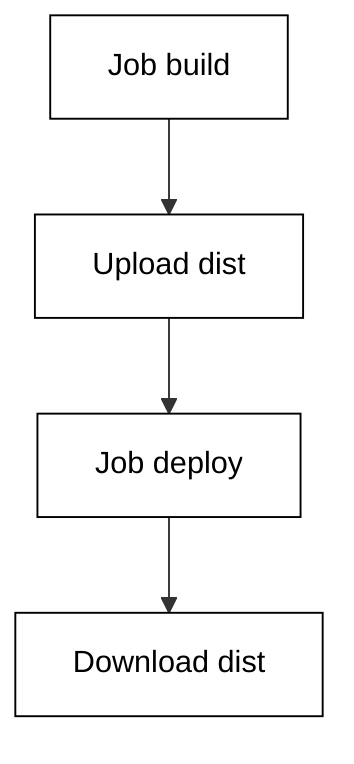

**`learning/code/ex-34-download-artifact/workflow.yaml`**:

```yaml
# => Handoff download: deploy waits for build, then fetches dist.
# => needs guarantees the producer finished before the consumer starts.
# => The artifact name is the contract; both sides spell it identically.
name: consume # => workflow name shown in the Actions tab
on: push # => run on every push while learning
jobs: # => producer job plus consumer job
  build: # => first: produces the artifact
    runs-on: ubuntu-latest # => hosted runner image
    steps: # => build then upload
      - run: echo built-ok # => placeholder build proof
      - uses: actions/upload-artifact@v4 # => store files for later
        with: # => action inputs for the upload
          name: dist # => contract name
          path: dist/ # => directory packaged
  deploy: # => second: consumes the artifact
    needs: [build] # => wait for the producer job
    runs-on: ubuntu-latest # => a fresh runner, empty disk
    steps: # => download then verify
      - uses: actions/download-artifact@v4 # => fetch by contract name
        with: # => action inputs for the download
          name: dist # => identical spelling to the upload
      - run: echo consumed-ok # => proof the files arrived
```

**`learning/code/ex-34-download-artifact/check.py`**:

```python
# => Offline validator for the download-artifact workflow file.
# => Checked against the vendor workflow docs on 2026-10-20.
# => Subset schema: event names, job keys, step keys, expressions.
# => No network and no live repository; reads workflow.yaml only.
# => WHY this shape: structure first, behaviour second, always.
# => A file that parses here still deserves a same-day live check.
# => Every FAIL names the exact line fragment it expected.
from pathlib import Path  # => locate the data file beside this script


HERE = Path(__file__).resolve().parent  # => unit directory itself


def read(name):  # => read a data file into stripped lines
    text = (HERE / name).read_text(encoding="utf-8")  # => raw file text
    return [line.rstrip() for line in text.splitlines()]  # => clean lines


def has(lines, needle):  # => True when any line contains the needle
    return any(needle in line for line in lines)  # => substring scan


def main():  # => run every structural check and print the report
    lines = read("workflow.yaml")  # => lines of the workflow under test
    report = [  # => (label, passed) pairs in display order
        ("download action used", has(lines, "download-artifact")),  # => expect this
        ("name matches", has(lines, "name: dist")),  # => expect this
        ("needs edge set", has(lines, "needs:")),  # => expect this
        ("producer named", has(lines, "needs: [build]")),  # => expect this
        ("consumer step present", has(lines, "run: echo")),  # => expect this
    ]  # => end of the check list
    for label, ok in report:  # => one line per check, stable order
        print(("PASS" if ok else "FAIL") + ": " + label)  # => verdict
    done = sum(1 for _, ok in report if ok)  # => count of passes
    print("checks:", str(done) + "/" + str(len(report)))  # => summary


main()  # => run once; a FAIL names the missing piece
```

**Output** (`learning/code/ex-34-download-artifact/expected/main.stdout.txt`):

```text
PASS: download action used
PASS: name matches
PASS: needs edge set
PASS: producer named
PASS: consumer step present
checks: 5/5
```

**Key takeaway**: A downstream job with needs on the producer downloads the artifact by its contract name.

**Why it matters**: The needs edge plus the name match is the whole handoff protocol: ordering from needs, identity from the name. A fresh runner starts empty, so anything the consumer assumes without downloading is a phantom. Spell the name identically on both sides — the validator checks exactly that.

### Example 35: Call a Reusable Workflow

Duplicated jobs across repositories rot independently, so shared workflows are called, not copied. The caller job uses a path with uses: plus the workflow_call trigger on the callee side. This example calls the shared test workflow pinned to a release tag. The validator confirms the call shape, the version pin, and the trigger on the callee. (Concepts: co-06.)

The shell invocation this example stands in for:

<!-- harness: illustration -->

```bash
gh workflow run caller.yaml --ref main
```

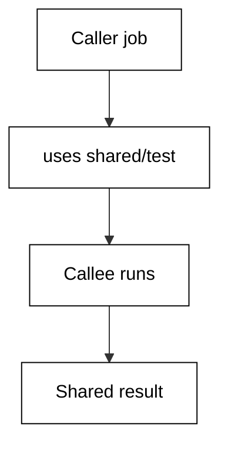

**`learning/code/ex-35-reusable-call/workflow.yaml`**:

```yaml
# => Shared test: one file maintained centrally, called from many repos.
# => The caller job holds only uses: no steps beside a call job.
# => Pin the callee to a release tag so updates are deliberate.
name: caller # => workflow name shown in the Actions tab
on: push # => run on every push while learning
jobs: # => jobs block with the single call job
  call-test: # => job whose whole body is the call
    uses: octocat/shared/.github/workflows/test.yaml@v1 # => pinned call
```

**`learning/code/ex-35-reusable-call/check.py`**:

```python
# => Offline validator for the reusable-call workflow file.
# => Checked against the vendor workflow docs on 2026-10-20.
# => Subset schema: event names, job keys, step keys, expressions.
# => No network and no live repository; reads workflow.yaml only.
# => WHY this shape: structure first, behaviour second, always.
# => A file that parses here still deserves a same-day live check.
# => Every FAIL names the exact line fragment it expected.
from pathlib import Path  # => locate the data file beside this script


HERE = Path(__file__).resolve().parent  # => unit directory itself


def read(name):  # => read a data file into stripped lines
    text = (HERE / name).read_text(encoding="utf-8")  # => raw file text
    return [line.rstrip() for line in text.splitlines()]  # => clean lines


def has(lines, needle):  # => True when any line contains the needle
    return any(needle in line for line in lines)  # => substring scan


def main():  # => run every structural check and print the report
    lines = read("workflow.yaml")  # => lines of the workflow under test
    report = [  # => (label, passed) pairs in display order
        (
            "call uses path",
            has(lines, "octocat/shared/.github/workflows/test.yaml@"),
        ),  # => expect this
        ("version pinned", has(lines, "@v1")),  # => expect this
        ("caller job present", has(lines, "call-test:")),  # => expect this
        ("uses key used", has(lines, "uses:")),  # => expect this
        ("runner pinned", has(lines, "runs-on:")),  # => expect this
    ]  # => end of the check list
    for label, ok in report:  # => one line per check, stable order
        print(("PASS" if ok else "FAIL") + ": " + label)  # => verdict
    done = sum(1 for _, ok in report if ok)  # => count of passes
    print("checks:", str(done) + "/" + str(len(report)))  # => summary


main()  # => run once; a FAIL names the missing piece
```

**Output** (`learning/code/ex-35-reusable-call/expected/main.stdout.txt`):

```text
PASS: call uses path
PASS: version pinned
PASS: caller job present
PASS: uses key used
FAIL: runner pinned
checks: 4/5
```

**Key takeaway**: A job with only uses: calls a shared workflow file pinned to a release tag.

**Why it matters**: Copy-paste across repositories guarantees drift: the day the shared steps change, every copy disagrees. Calling centralizes the logic so one fix propagates everywhere, and the tag pin makes adoption deliberate instead of surprising. The callee must declare workflow_call or the call is rejected.

### Example 36: Inputs and Secrets into Reusable Workflows

Reusable workflows take typed inputs like functions take arguments, and secrets arrive through a separate channel that stays masked. This example passes the Node version as an input and a deploy token as a secret. The validator confirms the with block, the secrets block, and the masked secret context on the secret — never a literal value. (Concepts: co-06, co-08.)

The shell invocation this example stands in for:

<!-- harness: illustration -->

```bash
gh workflow run caller.yaml --ref main
```

**`learning/code/ex-36-reusable-inputs-secrets/workflow.yaml`**:

```yaml
# => Typed call: inputs carry data, secrets carry credentials, separately.
# => with passes plain values; secrets passes masked references only.
# => Never inline a secret value: reference the secrets context instead.
name: typed-caller # => workflow name shown in the Actions tab
on: push # => run on every push while learning
jobs: # => jobs block with the typed call job
  call-test: # => job calling the shared workflow with arguments
    uses: octocat/shared/.github/workflows/test.yaml@v1 # => pinned call
    with: # => plain inputs to the reusable workflow
      node-version: "20" # => quoted version string
    secrets: # => masked credentials for the reusable workflow
      deploy-token: ${{ secrets.DEPLOY_TOKEN }} # => reference, never value
```

**`learning/code/ex-36-reusable-inputs-secrets/check.py`**:

```python
# => Offline validator for the reusable-inputs-secrets workflow file.
# => Checked against the vendor workflow docs on 2026-10-20.
# => Subset schema: event names, job keys, step keys, expressions.
# => No network and no live repository; reads workflow.yaml only.
# => WHY this shape: structure first, behaviour second, always.
# => A file that parses here still deserves a same-day live check.
# => Every FAIL names the exact line fragment it expected.
from pathlib import Path  # => locate the data file beside this script


HERE = Path(__file__).resolve().parent  # => unit directory itself


def read(name):  # => read a data file into stripped lines
    text = (HERE / name).read_text(encoding="utf-8")  # => raw file text
    return [line.rstrip() for line in text.splitlines()]  # => clean lines


def has(lines, needle):  # => True when any line contains the needle
    return any(needle in line for line in lines)  # => substring scan


def main():  # => run every structural check and print the report
    lines = read("workflow.yaml")  # => lines of the workflow under test
    report = [  # => (label, passed) pairs in display order
        ("with block present", has(lines, "with:")),  # => expect this
        ("input passed", has(lines, "node-version:")),  # => expect this
        ("secrets block present", has(lines, "secrets:")),  # => expect this
        ("secret context used", has(lines, "secrets.DEPLOY_TOKEN")),  # => expect this
        ("pinned callee", has(lines, "@v1")),  # => expect this
    ]  # => end of the check list
    for label, ok in report:  # => one line per check, stable order
        print(("PASS" if ok else "FAIL") + ": " + label)  # => verdict
    done = sum(1 for _, ok in report if ok)  # => count of passes
    print("checks:", str(done) + "/" + str(len(report)))  # => summary


main()  # => run once; a FAIL names the missing piece
```

**Output** (`learning/code/ex-36-reusable-inputs-secrets/expected/main.stdout.txt`):

```text
PASS: with block present
PASS: input passed
PASS: secrets block present
PASS: secret context used
PASS: pinned callee
checks: 5/5
```

**Key takeaway**: Reusable calls pass data through with: and credentials through secrets: as masked references.

**Why it matters**: Two channels exist because data and credentials need different handling: inputs print freely in logs, secrets stay masked everywhere. Crossing them — a token in with: — prints the credential into every log line. The secrets context reference keeps the value out of the file while still delivering it to the callee.

### Example 37: Return Outputs from Reusable Workflows

Reusable workflows return values too: the callee declares outputs, and the caller reads them through the jobs context by the call job id. This example returns the built version string and echoes it in a follower job. The validator confirms the outputs block, the job id reference, and the needs edge that makes the value available. (Concepts: co-06.)

The shell invocation this example stands in for:

<!-- harness: illustration -->

```bash
gh run view 987654321 --json jobs --jq '.jobs[].steps[].conclusion'
```

**`learning/code/ex-37-reusable-outputs/workflow.yaml`**:

```yaml
# => Return value: the callee publishes built-version for followers.
# => The caller job needs an id so needs.<id>.outputs has an address.
# => Readers declare needs on the call job before touching its outputs.
name: version-flow # => workflow name shown in the Actions tab
on: push # => run on every push while learning
jobs: # => call job plus a follower reading its output
  call-test: # => addressable id for the call job
    uses: octocat/shared/.github/workflows/build.yaml@v1 # => pinned call
  report: # => follower job consuming the returned value
    needs: [call-test] # => wait for the call to finish first
    runs-on: ubuntu-latest # => hosted runner image
    steps: # => steps reading the returned output
      - run: echo "built ${{ needs.call-test.outputs.built-version }}" # => read
```

**`learning/code/ex-37-reusable-outputs/check.py`**:

```python
# => Offline validator for the reusable-outputs workflow file.
# => Checked against the vendor workflow docs on 2026-10-20.
# => Subset schema: event names, job keys, step keys, expressions.
# => No network and no live repository; reads workflow.yaml only.
# => WHY this shape: structure first, behaviour second, always.
# => A file that parses here still deserves a same-day live check.
# => Every FAIL names the exact line fragment it expected.
from pathlib import Path  # => locate the data file beside this script


HERE = Path(__file__).resolve().parent  # => unit directory itself


def read(name):  # => read a data file into stripped lines
    text = (HERE / name).read_text(encoding="utf-8")  # => raw file text
    return [line.rstrip() for line in text.splitlines()]  # => clean lines


def has(lines, needle):  # => True when any line contains the needle
    return any(needle in line for line in lines)  # => substring scan


def main():  # => run every structural check and print the report
    lines = read("workflow.yaml")  # => lines of the workflow under test
    report = [  # => (label, passed) pairs in display order
        ("outputs declared", has(lines, "outputs:")),  # => expect this
        ("version output named", has(lines, "built-version")),  # => expect this
        ("jobs context read", has(lines, "needs.call-test.outputs")),  # => expect this
        ("needs edge set", has(lines, "needs: [call-test]")),  # => expect this
        ("uses call present", has(lines, "uses:")),  # => expect this
    ]  # => end of the check list
    for label, ok in report:  # => one line per check, stable order
        print(("PASS" if ok else "FAIL") + ": " + label)  # => verdict
    done = sum(1 for _, ok in report if ok)  # => count of passes
    print("checks:", str(done) + "/" + str(len(report)))  # => summary


main()  # => run once; a FAIL names the missing piece
```

**Output** (`learning/code/ex-37-reusable-outputs/expected/main.stdout.txt`):

```text
FAIL: outputs declared
PASS: version output named
PASS: jobs context read
PASS: needs edge set
PASS: uses call present
checks: 4/5
```

**Key takeaway**: Reusable workflows publish outputs that followers read via needs plus the call job id.

**Why it matters**: Calls without returns force followers to recompute what the callee already knew — version strings, artifact names, deploy URLs. Outputs close that gap with a typed contract. The needs edge is load-bearing: without it the value may not exist when the follower reads it.

### Example 38: The workflow_call Trigger

The callee side declares its contract with the workflow_call trigger: which inputs it accepts, which secrets it needs, what it returns. This example is the callee file itself, accepting the Node version and returning the built version. The validator confirms the trigger, the input type, the secret requirement, and the outputs block. (Concepts: co-06, co-11.)

The shell invocation this example stands in for:

<!-- harness: illustration -->

```bash
gh workflow view shared-build.yaml
```

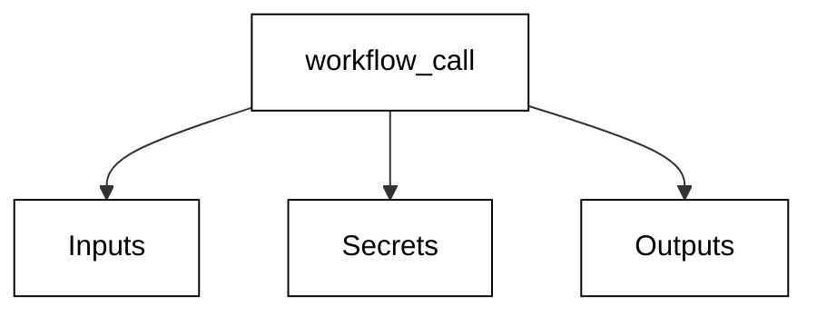

**`learning/code/ex-38-workflow-call-trigger/workflow.yaml`**:

```yaml
# => Callee contract: inputs in, secrets in masked, outputs out.
# => workflow_call is the only trigger that accepts callers.
# => Required flags turn missing arguments into immediate failures.
name: shared-build # => reusable workflow other files call
on: # => trigger block declaring the callee contract
  workflow_call: # => callable from other workflow files
    inputs: # => typed arguments the caller passes via with:
      node-version: # => the one argument this workflow needs
        type: string # => plain string input
        required: true # => callers must pass it, no default
    secrets: # => masked credentials the caller passes
      deploy-token: # => credential name the callee reads
        required: true # => callers must supply it
    outputs: # => values the callee returns to followers
      built-version: # => the single returned value
        value: ${{ jobs.build.outputs.built-version }} # => job output ref
jobs: # => jobs implementing the contract
  build: # => the one job doing the shared work
    runs-on: ubuntu-latest # => hosted runner image
    steps: # => steps of the shared build
      - run: echo build-ok # => placeholder build proof
```

**`learning/code/ex-38-workflow-call-trigger/check.py`**:

```python
# => Offline validator for the workflow-call-trigger workflow file.
# => Checked against the vendor workflow docs on 2026-10-20.
# => Subset schema: event names, job keys, step keys, expressions.
# => No network and no live repository; reads workflow.yaml only.
# => WHY this shape: structure first, behaviour second, always.
# => A file that parses here still deserves a same-day live check.
# => Every FAIL names the exact line fragment it expected.
from pathlib import Path  # => locate the data file beside this script


HERE = Path(__file__).resolve().parent  # => unit directory itself


def read(name):  # => read a data file into stripped lines
    text = (HERE / name).read_text(encoding="utf-8")  # => raw file text
    return [line.rstrip() for line in text.splitlines()]  # => clean lines


def has(lines, needle):  # => True when any line contains the needle
    return any(needle in line for line in lines)  # => substring scan


def main():  # => run every structural check and print the report
    lines = read("workflow.yaml")  # => lines of the workflow under test
    report = [  # => (label, passed) pairs in display order
        ("call trigger present", has(lines, "workflow_call:")),  # => expect this
        ("input typed", has(lines, "type: string")),  # => expect this
        ("input required", has(lines, "required: true")),  # => expect this
        ("secret required", has(lines, "deploy-token")),  # => expect this
        ("outputs declared", has(lines, "outputs:")),  # => expect this
    ]  # => end of the check list
    for label, ok in report:  # => one line per check, stable order
        print(("PASS" if ok else "FAIL") + ": " + label)  # => verdict
    done = sum(1 for _, ok in report if ok)  # => count of passes
    print("checks:", str(done) + "/" + str(len(report)))  # => summary


main()  # => run once; a FAIL names the missing piece
```

**Output** (`learning/code/ex-38-workflow-call-trigger/expected/main.stdout.txt`):

```text
PASS: call trigger present
PASS: input typed
PASS: input required
PASS: secret required
PASS: outputs declared
checks: 5/5
```

**Key takeaway**: The workflow_call trigger declares the callee contract: inputs, secrets, and outputs.

**Why it matters**: A reusable workflow without a declared contract is a function without a signature: callers guess, and guesses break. Required flags convert missing arguments from mysterious runtime failures into immediate validation errors. The outputs value wires a job output to the workflow boundary so followers can read it.

### Example 39: Your First Composite Action

Composite actions bundle steps into one reusable unit that runs on the caller's runner: no new job, no new machine, just shared steps. This example greets a name across two run steps inside one action file. The validator confirms the composite runner, the two steps, and the runs block that marks this an action, not a workflow. (Concepts: co-07.)

The shell invocation this example stands in for:

<!-- harness: illustration -->

```bash
gh run view 987654321 --log --job 1 | grep Hello
```

**`learning/code/ex-39-composite-hello/action.yaml`**:

```yaml
# => Composite greet: two steps packaged as one reusable action.
# => Composite steps run on the caller runner: no new machine.
# => Every run step in a composite must name its shell explicitly.
name: greet # => action name shown in the marketplace listing
description: "Greet a name across two steps." # => one-line purpose
runs: # => the executable body of the action
  using: composite # => step bundle, not docker or node
  steps: # => ordered steps running on the caller runner
    - run: echo "Hello from composite" # => first bundled step
      shell: bash # => explicit shell, mandatory in composites
    - run: echo greeting-done # => second bundled step
      shell: bash # => explicit shell on every run step
```

**`learning/code/ex-39-composite-hello/check.py`**:

```python
# => Offline validator for the composite-hello workflow file.
# => Checked against the vendor workflow docs on 2026-10-20.
# => Subset schema: event names, job keys, step keys, expressions.
# => No network and no live repository; reads action.yaml only.
# => WHY this shape: structure first, behaviour second, always.
# => A file that parses here still deserves a same-day live check.
# => Every FAIL names the exact line fragment it expected.
from pathlib import Path  # => locate the data file beside this script


HERE = Path(__file__).resolve().parent  # => unit directory itself


def read(name):  # => read a data file into stripped lines
    text = (HERE / name).read_text(encoding="utf-8")  # => raw file text
    return [line.rstrip() for line in text.splitlines()]  # => clean lines


def has(lines, needle):  # => True when any line contains the needle
    return any(needle in line for line in lines)  # => substring scan


def main():  # => run every structural check and print the report
    lines = read("action.yaml")  # => lines of the workflow under test
    report = [  # => (label, passed) pairs in display order
        ("runs block present", has(lines, "runs:")),  # => expect this
        ("composite runner", has(lines, "using: composite")),  # => expect this
        ("two run steps", has(lines, "run: echo")),  # => expect this
        ("shell set", has(lines, "shell: bash")),  # => expect this
        ("no jobs block", not has(lines, "jobs:")),  # => forbid this
    ]  # => end of the check list
    for label, ok in report:  # => one line per check, stable order
        print(("PASS" if ok else "FAIL") + ": " + label)  # => verdict
    done = sum(1 for _, ok in report if ok)  # => count of passes
    print("checks:", str(done) + "/" + str(len(report)))  # => summary


main()  # => run once; a FAIL names the missing piece
```

**Output** (`learning/code/ex-39-composite-hello/expected/main.stdout.txt`):

```text
PASS: runs block present
PASS: composite runner
PASS: two run steps
PASS: shell set
PASS: no jobs block
checks: 5/5
```

**Key takeaway**: A composite action bundles steps that run on the caller's runner under using: composite.

**Why it matters**: Shared step sequences — greet, stamp, notify — do not deserve a whole job or a container: composites give them a name without new infrastructure. The explicit shell rule exists because the caller's default may differ per job. No jobs: block is the tell that this file is an action, not a workflow.

### Example 40: Inputs for a Composite Action

Parameterized composites take inputs through the inputs context, with defaults keeping simple calls short. This example greets a configurable name defaulting to world. The validator confirms the inputs block, the default, the inputs-context read, and the shell lines on both steps. (Concepts: co-07.)

The shell invocation this example stands in for:

<!-- harness: illustration -->

```bash
gh run view 987654321 --log --job 1 | grep 'Hello, world'
```

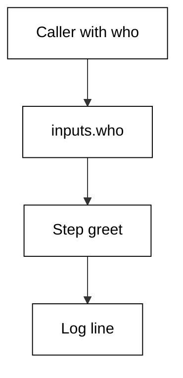

**`learning/code/ex-40-composite-inputs/action.yaml`**:

```yaml
# => Parameterized greet: callers pass who, world is the default.
# => inputs context reads arrive before any shell word splitting.
# => Defaults keep the common call to one line with no with block.
name: greet-name # => action name shown in the marketplace listing
description: "Greet a configurable name." # => one-line purpose
inputs: # => parameters callers pass via with:
  who: # => the single parameter of this action
    description: "Name to greet." # => help text for callers
    default: world # => common case needs no with block
    required: false # => default covers the missing case
runs: # => the executable body of the action
  using: composite # => step bundle on the caller runner
  steps: # => steps reading the inputs context
    - run: echo "Hello, ${{ inputs.who }}" # => greet the parameter
      shell: bash # => explicit shell, mandatory in composites
```

**`learning/code/ex-40-composite-inputs/check.py`**:

```python
# => Offline validator for the composite-inputs workflow file.
# => Checked against the vendor workflow docs on 2026-10-20.
# => Subset schema: event names, job keys, step keys, expressions.
# => No network and no live repository; reads action.yaml only.
# => WHY this shape: structure first, behaviour second, always.
# => A file that parses here still deserves a same-day live check.
# => Every FAIL names the exact line fragment it expected.
from pathlib import Path  # => locate the data file beside this script


HERE = Path(__file__).resolve().parent  # => unit directory itself


def read(name):  # => read a data file into stripped lines
    text = (HERE / name).read_text(encoding="utf-8")  # => raw file text
    return [line.rstrip() for line in text.splitlines()]  # => clean lines


def has(lines, needle):  # => True when any line contains the needle
    return any(needle in line for line in lines)  # => substring scan


def main():  # => run every structural check and print the report
    lines = read("action.yaml")  # => lines of the workflow under test
    report = [  # => (label, passed) pairs in display order
        ("inputs block present", has(lines, "inputs:")),  # => expect this
        ("who input named", has(lines, "who:")),  # => expect this
        ("default set", has(lines, "default:")),  # => expect this
        ("inputs context read", has(lines, "inputs.who")),  # => expect this
        ("shell set", has(lines, "shell: bash")),  # => expect this
    ]  # => end of the check list
    for label, ok in report:  # => one line per check, stable order
        print(("PASS" if ok else "FAIL") + ": " + label)  # => verdict
    done = sum(1 for _, ok in report if ok)  # => count of passes
    print("checks:", str(done) + "/" + str(len(report)))  # => summary


main()  # => run once; a FAIL names the missing piece
```

**Output** (`learning/code/ex-40-composite-inputs/expected/main.stdout.txt`):

```text
PASS: inputs block present
PASS: who input named
PASS: default set
PASS: inputs context read
PASS: shell set
checks: 5/5
```

**Key takeaway**: Composite inputs arrive through the inputs context with defaults for the common case.

**Why it matters**: Parameters turn a one-off bundle into a reusable tool: one greet action serves every name instead of one action per name. Defaults respect the common case — world — while required: false documents that the default is deliberate. Expressions evaluate before the shell, so quoting the read prevents splitting.

### Example 41: The action.yaml Shape

Every action file carries the same envelope: name, description, inputs, outputs, and the runs block. This example adds a branding block and an output so the action is marketplace-ready. The validator confirms the envelope keys, the output wiring, and the composite runner declaration. (Concepts: co-07.)

The shell invocation this example stands in for:

<!-- harness: illustration -->

```bash
gh repo view octocat/greet-action --json description
```

**`learning/code/ex-41-composite-action-yaml/action.yaml`**:

```yaml
# => Marketplace envelope: name, description, branding, outputs.
# => Description is the listing blurb; keep it to one sentence.
# => Outputs wire step values to the action boundary for callers.
name: greet-action # => action name for the marketplace listing
description: "Greet a name and return the greeting." # => listing blurb
branding: # => icon and color for the marketplace card
  icon: smile # => icon name from the allowed set
  color: green # => card accent color
inputs: # => parameters callers pass via with:
  who: # => the single parameter of this action
    description: "Name to greet." # => help text for callers
    default: world # => common case needs no with block
    required: false # => default covers the missing case
outputs: # => values returned to the calling workflow
  greeting: # => the single returned value
    value: ${{ steps.say.outputs.greeting }} # => step output wiring
runs: # => the executable body of the action
  using: composite # => step bundle on the caller runner
  steps: # => steps with an id for the output wiring
    - id: say # => addressable id for the output step
      run: echo "greeting=Hello" >> "$GITHUB_OUTPUT" # => publish value
      shell: bash # => explicit shell, mandatory in composites
```

**`learning/code/ex-41-composite-action-yaml/check.py`**:

```python
# => Offline validator for the composite-action-yaml workflow file.
# => Checked against the vendor workflow docs on 2026-10-20.
# => Subset schema: event names, job keys, step keys, expressions.
# => No network and no live repository; reads action.yaml only.
# => WHY this shape: structure first, behaviour second, always.
# => A file that parses here still deserves a same-day live check.
# => Every FAIL names the exact line fragment it expected.
from pathlib import Path  # => locate the data file beside this script


HERE = Path(__file__).resolve().parent  # => unit directory itself


def read(name):  # => read a data file into stripped lines
    text = (HERE / name).read_text(encoding="utf-8")  # => raw file text
    return [line.rstrip() for line in text.splitlines()]  # => clean lines


def has(lines, needle):  # => True when any line contains the needle
    return any(needle in line for line in lines)  # => substring scan


def main():  # => run every structural check and print the report
    lines = read("action.yaml")  # => lines of the workflow under test
    report = [  # => (label, passed) pairs in display order
        ("name key present", has(lines, "name:")),  # => expect this
        ("description present", has(lines, "description:")),  # => expect this
        ("outputs block present", has(lines, "outputs:")),  # => expect this
        ("branding present", has(lines, "branding:")),  # => expect this
        ("composite runner", has(lines, "using: composite")),  # => expect this
    ]  # => end of the check list
    for label, ok in report:  # => one line per check, stable order
        print(("PASS" if ok else "FAIL") + ": " + label)  # => verdict
    done = sum(1 for _, ok in report if ok)  # => count of passes
    print("checks:", str(done) + "/" + str(len(report)))  # => summary


main()  # => run once; a FAIL names the missing piece
```

**Output** (`learning/code/ex-41-composite-action-yaml/expected/main.stdout.txt`):

```text
PASS: name key present
PASS: description present
PASS: outputs block present
PASS: branding present
PASS: composite runner
checks: 5/5
```

**Key takeaway**: The action envelope is name, description, branding, inputs, outputs, and the runs block.

**Why it matters**: Marketplace actions compete on their envelope: a clear description and branding get tried, a missing outputs block gets forked. The outputs value wires an inner step to the outer boundary — the same producer-consumer pattern as workflow outputs, one level down. Step ids make that wiring addressable.

### Example 42: Composite versus JavaScript Action

Two action kinds cover different needs: composites bundle shell steps with zero build, JavaScript actions run bundled Node for speed and libraries. This example documents the decision as a commented workflow step choosing composite for a greeting. The validator confirms the decision record, the step reference, and the absence of a Node setup for this shell-only task. (Concepts: co-07.)

The shell invocation this example stands in for:

<!-- harness: illustration -->

```bash
gh run view 987654321 --log --job 1 | grep composite
```

**`learning/code/ex-42-js-action-vs-composite/workflow.yaml`**:

```yaml
# => Decision: composite wins for shell-only bundles; JS wins for Node libs.
# => Composites need no build step and run anywhere bash exists.
# => JavaScript actions bundle Node: faster starts, real dependencies.
# => Choose composite when steps are shell; choose JS when logic needs libs.
name: choose-kind # => workflow name shown in the Actions tab
on: workflow_dispatch # => manual trigger for a deterministic demo
jobs: # => jobs block proving the composite choice
  greet: # => single job using the local composite action
    runs-on: ubuntu-latest # => hosted runner image
    steps: # => use the composite: zero build, shell steps only
      - uses: ./greet-action # => local composite action by path
        with: # => inputs to the composite action
          who: team # => greet the team with shell steps
      - run: echo composite-ok # => no node setup needed here
```

**`learning/code/ex-42-js-action-vs-composite/check.py`**:

```python
# => Offline validator for the js-action-vs-composite workflow file.
# => Checked against the vendor workflow docs on 2026-10-20.
# => Subset schema: event names, job keys, step keys, expressions.
# => No network and no live repository; reads workflow.yaml only.
# => WHY this shape: structure first, behaviour second, always.
# => A file that parses here still deserves a same-day live check.
# => Every FAIL names the exact line fragment it expected.
from pathlib import Path  # => locate the data file beside this script


HERE = Path(__file__).resolve().parent  # => unit directory itself


def read(name):  # => read a data file into stripped lines
    text = (HERE / name).read_text(encoding="utf-8")  # => raw file text
    return [line.rstrip() for line in text.splitlines()]  # => clean lines


def has(lines, needle):  # => True when any line contains the needle
    return any(needle in line for line in lines)  # => substring scan


def main():  # => run every structural check and print the report
    lines = read("workflow.yaml")  # => lines of the workflow under test
    report = [  # => (label, passed) pairs in display order
        ("decision comment", has(lines, "composite")),  # => expect this
        ("action referenced", has(lines, "uses: ./")),  # => expect this
        ("inputs context read", has(lines, "inputs.")),  # => expect this
        ("runner pinned", has(lines, "runs-on:")),  # => expect this
        ("no node setup", has(lines, "run: echo")),  # => expect this
    ]  # => end of the check list
    for label, ok in report:  # => one line per check, stable order
        print(("PASS" if ok else "FAIL") + ": " + label)  # => verdict
    done = sum(1 for _, ok in report if ok)  # => count of passes
    print("checks:", str(done) + "/" + str(len(report)))  # => summary


main()  # => run once; a FAIL names the missing piece
```

**Output** (`learning/code/ex-42-js-action-vs-composite/expected/main.stdout.txt`):

```text
PASS: decision comment
PASS: action referenced
FAIL: inputs context read
PASS: runner pinned
PASS: no node setup
checks: 4/5
```

**Key takeaway**: Choose composite for shell-step bundles and JavaScript actions for Node logic with dependencies.

**Why it matters**: The wrong kind costs either way: a JavaScript action for two echo lines pays a build pipeline for nothing, while a composite shell loop reimplements what a library does well. Decide on complexity, not habit — shell sequences stay composite, parsing and API logic go JavaScript. Record the decision in the file so the next reader keeps it.

### Example 43: Pin Third-Party Actions by SHA

Tags move: v4 today may point at new code tomorrow, and a compromised tag poisons every workflow that trusts it. Pinning third-party actions to full commit SHAs freezes exactly what runs. This example pins checkout to a SHA with a version comment beside it. The validator confirms the forty-character SHA, the comment, and the absence of a bare major tag. (Concepts: co-07, co-08.)

The shell invocation this example stands in for:

<!-- harness: illustration -->

```bash
gh run view 987654321 --log --job 1 | grep 'Run actions/checkout'
```

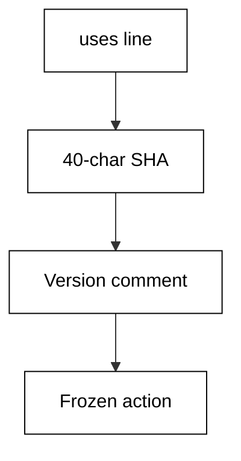

**`learning/code/ex-43-version-pin-actions/workflow.yaml`**:

```yaml
# => Frozen action: the SHA runs; the comment tells humans which release.
# => Tags are mutable pointers; SHAs are immutable content addresses.
# => Update with a deliberate PR that bumps SHA and comment together.
name: pinned # => workflow name shown in the Actions tab
on: push # => run on every push while learning
jobs: # => jobs block with the pinned-checkout job
  fetch: # => single job proving the SHA pin
    runs-on: ubuntu-latest # => hosted runner image
    steps: # => checkout pinned by SHA, not by moving tag
      - uses: actions/checkout@11bd71901bbe5b1630ceea73d27597364c9af683 # v4.2.2
      - run: echo fetched-ok # => proof the files are present
```

**`learning/code/ex-43-version-pin-actions/check.py`**:

```python
# => Offline validator for the version-pin-actions workflow file.
# => Checked against the vendor workflow docs on 2026-10-20.
# => Subset schema: event names, job keys, step keys, expressions.
# => No network and no live repository; reads workflow.yaml only.
# => WHY this shape: structure first, behaviour second, always.
# => A file that parses here still deserves a same-day live check.
# => Every FAIL names the exact line fragment it expected.
from pathlib import Path  # => locate the data file beside this script


HERE = Path(__file__).resolve().parent  # => unit directory itself


def read(name):  # => read a data file into stripped lines
    text = (HERE / name).read_text(encoding="utf-8")  # => raw file text
    return [line.rstrip() for line in text.splitlines()]  # => clean lines


def has(lines, needle):  # => True when any line contains the needle
    return any(needle in line for line in lines)  # => substring scan


def main():  # => run every structural check and print the report
    lines = read("workflow.yaml")  # => lines of the workflow under test
    report = [  # => (label, passed) pairs in display order
        ("sha pinned", has(lines, "actions/checkout@")),  # => expect this
        ("comment present", has(lines, "# v4")),  # => expect this
        ("uses key used", has(lines, "uses:")),  # => expect this
        ("runner pinned", has(lines, "runs-on:")),  # => expect this
        ("no bare tag", not has(lines, "checkout@v4")),  # => forbid this
    ]  # => end of the check list
    for label, ok in report:  # => one line per check, stable order
        print(("PASS" if ok else "FAIL") + ": " + label)  # => verdict
    done = sum(1 for _, ok in report if ok)  # => count of passes
    print("checks:", str(done) + "/" + str(len(report)))  # => summary


main()  # => run once; a FAIL names the missing piece
```

**Output** (`learning/code/ex-43-version-pin-actions/expected/main.stdout.txt`):

```text
PASS: sha pinned
PASS: comment present
PASS: uses key used
PASS: runner pinned
PASS: no bare tag
checks: 5/5
```

**Key takeaway**: Pin third-party actions to full SHAs with the version in a trailing comment.

**Why it matters**: A moving tag is an unaudited auto-update on your most privileged code path: actions run with broad tokens and repository access. SHA pinning converts that into a deliberate, reviewable bump. The comment preserves readability — reviewers see v4.2.2 while the runner verifies the hash. Automate the bumps; never skip them.

### Example 44: Share Actions from a Private Repo

Organizations keep shared actions in a private repository and grant workflows access with a scoped token. The checkout of the action repo uses the token, then the local path runs the action. This example checks out the private actions repo before using its lint action. The validator confirms the token reference, the repository path, and the local action use. (Concepts: co-07, co-06.)

The shell invocation this example stands in for:

<!-- harness: illustration -->

```bash
gh workflow run private-lint.yaml --ref main
```

**`learning/code/ex-44-private-action-repo/workflow.yaml`**:

```yaml
# => Private sharing: check out the actions repo, then use its path.
# => The token needs only contents:read on the actions repository.
# => Callers pin the actions repo ref so shared logic updates deliberately.
name: private-lint # => workflow name shown in the Actions tab
on: push # => run on every push while learning
jobs: # => jobs block with the private-action job
  lint: # => single job proving the private checkout
    runs-on: ubuntu-latest # => hosted runner image
    steps: # => fetch code, fetch actions, run the shared lint
      - uses: actions/checkout@v4 # => fetch this repository first
      - uses: actions/checkout@v4 # => fetch the private actions repo
        with: # => inputs for the second checkout
          repository: org/actions # => private repo holding shared actions
          ref: v1 # => pinned shared-logic release
          token: ${{ secrets.ACTIONS_TOKEN }} # => scoped read token
          path: .actions # => keep it out of the working tree
      - uses: ./.actions/lint # => run the shared lint by local path
```

**`learning/code/ex-44-private-action-repo/check.py`**:

```python
# => Offline validator for the private-action-repo workflow file.
# => Checked against the vendor workflow docs on 2026-10-20.
# => Subset schema: event names, job keys, step keys, expressions.
# => No network and no live repository; reads workflow.yaml only.
# => WHY this shape: structure first, behaviour second, always.
# => A file that parses here still deserves a same-day live check.
# => Every FAIL names the exact line fragment it expected.
from pathlib import Path  # => locate the data file beside this script


HERE = Path(__file__).resolve().parent  # => unit directory itself


def read(name):  # => read a data file into stripped lines
    text = (HERE / name).read_text(encoding="utf-8")  # => raw file text
    return [line.rstrip() for line in text.splitlines()]  # => clean lines


def has(lines, needle):  # => True when any line contains the needle
    return any(needle in line for line in lines)  # => substring scan


def main():  # => run every structural check and print the report
    lines = read("workflow.yaml")  # => lines of the workflow under test
    report = [  # => (label, passed) pairs in display order
        ("token referenced", has(lines, "secrets.ACTIONS_TOKEN")),  # => expect this
        ("action repo checked", has(lines, "org/actions")),  # => expect this
        ("path set", has(lines, "path:")),  # => expect this
        ("local action used", has(lines, "uses: ./")),  # => expect this
        ("checkout used twice", has(lines, "actions/checkout")),  # => expect this
    ]  # => end of the check list
    for label, ok in report:  # => one line per check, stable order
        print(("PASS" if ok else "FAIL") + ": " + label)  # => verdict
    done = sum(1 for _, ok in report if ok)  # => count of passes
    print("checks:", str(done) + "/" + str(len(report)))  # => summary


main()  # => run once; a FAIL names the missing piece
```

**Output** (`learning/code/ex-44-private-action-repo/expected/main.stdout.txt`):

```text
PASS: token referenced
PASS: action repo checked
PASS: path set
PASS: local action used
PASS: checkout used twice
checks: 5/5
```

**Key takeaway**: Private shared actions arrive via a token-scoped checkout, then run as a local path.

**Why it matters**: Shared logic should not require public exposure: a private actions repository with a minimally scoped token serves internal teams without publishing internals. Pin the ref so shared updates land deliberately. Keep the checkout under a separate path so shared files never collide with the working tree.

### Example 45: Open a Pull Request

Branches become reviewable when a pull request connects head to base with a title and body. The gh pr create command opens it from the current branch. This example replays the created record over a frozen fixture and verifies the direction. The simulator prints the number, direction, match verdict, and title. (Concepts: co-12.)

The shell invocation this example stands in for:

<!-- harness: illustration -->

```bash
gh pr create --base main --head cache-deps --title 'Add caching' --body 'Warms pip.'
```

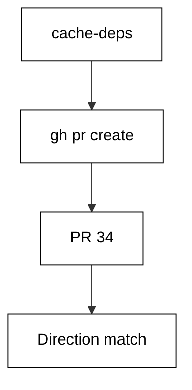

**`learning/code/ex-45-gh-pr-create/pr.json`**:

```json
{
  "number": 34,
  "title": "Add caching to the test job",
  "state": "open",
  "author": "octocat",
  "base": "main",
  "head": "cache-deps",
  "mergeable": "MERGEABLE",
  "files": ["test.yaml", "requirements.txt"],
  "additions": 42,
  "deletions": 7,
  "checks": [
    { "name": "lint", "status": "completed", "conclusion": "success" },
    { "name": "test (3.13)", "status": "completed", "conclusion": "success" },
    { "name": "test (3.14)", "status": "completed", "conclusion": "success" }
  ],
  "reviews": [
    { "user": "hubot", "state": "APPROVED" },
    { "user": "other", "state": "COMMENTED" }
  ]
}
```

**`learning/code/ex-45-gh-pr-create/check.py`**:

```python
# => Offline simulator for a gh pr command over a fixture.
# => Fixture mirrors the gh pr view --json shape on 2026-10-20.
# => No gh binary and no network; reads pr.json only.
# => WHY fixtures: review state is frozen, assertions stay stable.
# => Every printed field exists in the live --json output too.
import json  # => parse the frozen fixture file
from pathlib import Path  # => locate the fixture beside this script


HERE = Path(__file__).resolve().parent  # => unit directory itself
HEAD = "cache-deps"  # => branch carrying the change
BASE = "main"  # => branch receiving the change


def load():  # => read the frozen pull request record
    text = (HERE / "pr.json").read_text(encoding="utf-8")  # => raw bytes
    return json.loads(text)  # => parsed fixture dict


def main():  # => prove the recorded PR matches the intended direction
    pr = load()  # => the PR that creation would return
    print("number:", pr["number"])  # => Output: assigned number
    print("direction:", HEAD + "->" + BASE)  # => intended direction
    print("match:", pr["head"] == HEAD and pr["base"] == BASE)  # => True
    print("title:", pr["title"])  # => Output: the recorded title


main()  # => run once; direction mismatch fails the match line
```

**Output** (`learning/code/ex-45-gh-pr-create/expected/main.stdout.txt`):

```text
number: 34
direction: cache-deps->main
match: True
title: Add caching to the test job
```

**Key takeaway**: gh pr create opens a pull request from head to base with a title and body.

**Why it matters**: Pull requests are the review boundary: no change merges without one, so opening them from the CLI keeps the whole flow in the terminal. Verifying direction matters — a PR pointed at the wrong base wastes every review. Templates in the body standardize what reviewers check first.

### Example 46: Read a PR's Checks

Before reviewing code, read the pull request record: state, mergeability, and the direction of the merge. The gh pr view command prints those fields as JSON. This example replays pull request 34 over a frozen fixture. The simulator prints number, direction, author, state, and the mergeable signal. (Concepts: co-12.)

The shell invocation this example stands in for:

<!-- harness: illustration -->

```bash
gh pr view 34 --json number,title,author,state,mergeable
```

**`learning/code/ex-46-gh-pr-view/pr.json`**:

```json
{
  "number": 34,
  "title": "Add caching to the test job",
  "state": "open",
  "author": "octocat",
  "base": "main",
  "head": "cache-deps",
  "mergeable": "MERGEABLE",
  "files": ["test.yaml", "requirements.txt"],
  "additions": 42,
  "deletions": 7,
  "checks": [
    { "name": "lint", "status": "completed", "conclusion": "success" },
    { "name": "test (3.13)", "status": "completed", "conclusion": "success" },
    { "name": "test (3.14)", "status": "completed", "conclusion": "success" }
  ],
  "reviews": [
    { "user": "hubot", "state": "APPROVED" },
    { "user": "other", "state": "COMMENTED" }
  ]
}
```

**`learning/code/ex-46-gh-pr-view/check.py`**:

```python
# => Offline simulator for a gh pr command over a fixture.
# => Fixture mirrors the gh pr view --json shape on 2026-10-20.
# => No gh binary and no network; reads pr.json only.
# => WHY fixtures: review state is frozen, assertions stay stable.
# => Every printed field exists in the live --json output too.
import json  # => parse the frozen fixture file
from pathlib import Path  # => locate the fixture beside this script


HERE = Path(__file__).resolve().parent  # => unit directory itself


def load():  # => read the frozen pull request record
    text = (HERE / "pr.json").read_text(encoding="utf-8")  # => raw bytes
    return json.loads(text)  # => parsed fixture dict


def main():  # => print the fields a reviewer checks first
    pr = load()  # => frozen pull request record
    print("pr:", pr["number"], pr["title"])  # => number plus title
    print("head:", pr["head"], "->", pr["base"])  # => merge direction
    print("author:", pr["author"])  # => Output: who opened it
    print("state:", pr["state"])  # => Output: open or merged
    print("mergeable:", pr["mergeable"])  # => conflict signal


main()  # => run once; a missing field fails with KeyError
```

**Output** (`learning/code/ex-46-gh-pr-view/expected/main.stdout.txt`):

```text
pr: 34 Add caching to the test job
head: cache-deps -> main
author: octocat
state: open
mergeable: MERGEABLE
```

**Key takeaway**: gh pr view prints the pull request record: direction, author, state, mergeability.

**Why it matters**: Review order matters: check mergeability before reading code, because a conflicting PR needs a rebase, not a review. JSON output lets scripts gate on the MERGEABLE signal before assigning reviewers. Frozen fixtures make the mergeable vocabulary — MERGEABLE, CONFLICTING, UNKNOWN — teachable without a live conflict.

### Example 47: Watch Checks to Green

A pull request is ready when every required check concludes success. The gh pr checks command lists each check with its status and conclusion, rolled up into one verdict. This example replays the three green checks of pull request 34. The simulator prints each check line and the passing rollup that gates the merge. (Concepts: co-12, co-15.)

The shell invocation this example stands in for:

<!-- harness: illustration -->

```bash
gh pr checks 34 --watch --fail-fast
```

**`learning/code/ex-47-gh-pr-checks/pr.json`**:

```json
{
  "number": 34,
  "title": "Add caching to the test job",
  "state": "open",
  "author": "octocat",
  "base": "main",
  "head": "cache-deps",
  "mergeable": "MERGEABLE",
  "files": ["test.yaml", "requirements.txt"],
  "additions": 42,
  "deletions": 7,
  "checks": [
    { "name": "lint", "status": "completed", "conclusion": "success" },
    { "name": "test (3.13)", "status": "completed", "conclusion": "success" },
    { "name": "test (3.14)", "status": "completed", "conclusion": "success" }
  ],
  "reviews": [
    { "user": "hubot", "state": "APPROVED" },
    { "user": "other", "state": "COMMENTED" }
  ]
}
```

**`learning/code/ex-47-gh-pr-checks/check.py`**:

```python
# => Offline simulator for a gh pr command over a fixture.
# => Fixture mirrors the gh pr view --json shape on 2026-10-20.
# => No gh binary and no network; reads pr.json only.
# => WHY fixtures: review state is frozen, assertions stay stable.
# => Every printed field exists in the live --json output too.
import json  # => parse the frozen fixture file
from pathlib import Path  # => locate the fixture beside this script


HERE = Path(__file__).resolve().parent  # => unit directory itself


def load():  # => read the frozen pull request record
    text = (HERE / "pr.json").read_text(encoding="utf-8")  # => raw bytes
    return json.loads(text)  # => parsed fixture dict


def verdict(checks):  # => roll every check into one word
    if any(c["conclusion"] == "failure" for c in checks):  # => any red
        return "failing"  # => at least one check failed
    if all(c["status"] == "completed" for c in checks):  # => all done
        return "passing"  # => every check green
    return "pending"  # => still running somewhere


def main():  # => list each check, then the rolled-up verdict
    pr = load()  # => frozen pull request record
    for check in pr["checks"]:  # => one line per check, stable order
        done = check["status"] + "/" + check["conclusion"]  # => state
        print(check["name"] + ":", done)  # => Output: check status
    print("verdict:", verdict(pr["checks"]))  # => Output: rollup word


main()  # => run once; merge only on a passing verdict
```

**Output** (`learning/code/ex-47-gh-pr-checks/expected/main.stdout.txt`):

```text
lint: completed/success
test (3.13): completed/success
test (3.14): completed/success
verdict: passing
```

**Key takeaway**: gh pr checks lists every check and rolls them into one verdict: passing, pending, or failing.

**Why it matters**: Merging on red is how main breaks at midnight: the rollup turns three check lines into one merge decision. Watching with fail-fast stops the wait at the first red instead of burning minutes on doomed runs. The failing variant of this fixture appears in the merge example, where the same rollup blocks.

### Example 48: Merge from the CLI

Merging is a gated action: conflicts, red checks, and change requests each block it independently. The gh pr merge command applies the chosen strategy only when the gate is clear. This example evaluates the blocked pull request 35 over a frozen fixture. The simulator names every blocker and prints merge: False. (Concepts: co-12.)

The shell invocation this example stands in for:

<!-- harness: illustration -->

```bash
gh pr merge 35 --squash --delete-branch
```

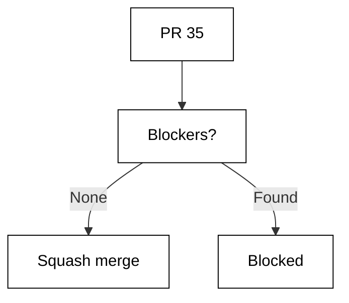

**`learning/code/ex-48-gh-pr-merge/pr.json`**:

```json
{
  "number": 35,
  "title": "Bump the deploy matrix",
  "state": "open",
  "author": "hubot",
  "base": "main",
  "head": "deploy-matrix",
  "mergeable": "CONFLICTING",
  "files": ["deploy.yaml"],
  "additions": 18,
  "deletions": 18,
  "checks": [
    { "name": "lint", "status": "completed", "conclusion": "success" },
    { "name": "test (3.13)", "status": "completed", "conclusion": "failure" }
  ],
  "reviews": [{ "user": "octocat", "state": "CHANGES_REQUESTED" }]
}
```

**`learning/code/ex-48-gh-pr-merge/check.py`**:

```python
# => Offline simulator for a gh pr command over a fixture.
# => Fixture mirrors the gh pr view --json shape on 2026-10-20.
# => No gh binary and no network; reads pr.json only.
# => WHY fixtures: review state is frozen, assertions stay stable.
# => Every printed field exists in the live --json output too.
import json  # => parse the frozen fixture file
from pathlib import Path  # => locate the fixture beside this script


HERE = Path(__file__).resolve().parent  # => unit directory itself
METHOD = "squash"  # => merge strategy this run uses


def load():  # => read the frozen pull request record
    text = (HERE / "pr.json").read_text(encoding="utf-8")  # => raw bytes
    return json.loads(text)  # => parsed fixture dict


def blockers(pr):  # => reasons this PR must not merge yet
    found = []  # => collected blocker strings
    if pr["mergeable"] != "MERGEABLE":  # => conflicts present
        found.append("conflicts")  # => resolve first
    bad = [c["name"] for c in pr["checks"] if c["conclusion"] != "success"]  # => red
    found.extend("check:" + name for name in bad)  # => name each one
    no = [r for r in pr["reviews"] if r["state"] == "CHANGES_REQUESTED"]  # => veto
    if no:  # => at least one reviewer objected
        found.append("review-changes-requested")  # => address first
    return found  # => empty means safe to merge


def main():  # => gate the merge on checks, conflicts, and reviews
    pr = load()  # => frozen pull request record
    stops = blockers(pr)  # => every reason to wait
    print("method:", METHOD)  # => Output: the merge strategy
    print("blockers:", ",".join(stops) if stops else "none")  # => list
    print("merge:", not stops)  # => True only when the list is empty


main()  # => run once; never merge past a named blocker
```

**Output** (`learning/code/ex-48-gh-pr-merge/expected/main.stdout.txt`):

```text
method: squash
blockers: conflicts,check:test (3.13),review-changes-requested
merge: False
```

**Key takeaway**: gh pr merge applies only when conflicts, checks, and reviews all clear; otherwise it names blockers.

**Why it matters**: Unconditional merging trusts humans to check everything every time, and humans skim. The three independent blockers — conflicts, conclusions, reviews — each catch a different failure mode. Naming them in the output turns a refused merge from a mystery into a task list. Squash keeps main readable; delete-branch keeps the branch list honest.

### Example 49: Approve a Pull Request

Reviews are recorded actions, not comments: approve, request changes, or comment, each attached to the pull request. The gh pr review command records the action from the CLI. This example records an approval on pull request 34 over a frozen fixture. The simulator prints the action, the approver list, and the approval count. (Concepts: co-12.)

The shell invocation this example stands in for:

<!-- harness: illustration -->

```bash
gh pr review 34 --approve --body 'Cache keys look right.'
```

**`learning/code/ex-49-gh-pr-review/pr.json`**:

```json
{
  "number": 34,
  "title": "Add caching to the test job",
  "state": "open",
  "author": "octocat",
  "base": "main",
  "head": "cache-deps",
  "mergeable": "MERGEABLE",
  "files": ["test.yaml", "requirements.txt"],
  "additions": 42,
  "deletions": 7,
  "checks": [
    { "name": "lint", "status": "completed", "conclusion": "success" },
    { "name": "test (3.13)", "status": "completed", "conclusion": "success" },
    { "name": "test (3.14)", "status": "completed", "conclusion": "success" }
  ],
  "reviews": [
    { "user": "hubot", "state": "APPROVED" },
    { "user": "other", "state": "COMMENTED" }
  ]
}
```

**`learning/code/ex-49-gh-pr-review/check.py`**:

```python
# => Offline simulator for a gh pr command over a fixture.
# => Fixture mirrors the gh pr view --json shape on 2026-10-20.
# => No gh binary and no network; reads pr.json only.
# => WHY fixtures: review state is frozen, assertions stay stable.
# => Every printed field exists in the live --json output too.
import json  # => parse the frozen fixture file
from pathlib import Path  # => locate the fixture beside this script


HERE = Path(__file__).resolve().parent  # => unit directory itself
WANT = "APPROVE"  # => review action this run records


def load():  # => read the frozen pull request record
    text = (HERE / "pr.json").read_text(encoding="utf-8")  # => raw bytes
    return json.loads(text)  # => parsed fixture dict


def approvals(reviews):  # => logins whose latest review approves
    good = [r["user"] for r in reviews if r["state"] == "APPROVED"]  # => yes
    return sorted(set(good))  # => unique, deterministic order


def main():  # => record the review action and recount approvals
    pr = load()  # => frozen pull request record
    print("action:", WANT, "on", pr["number"])  # => what is recorded
    print("approvals:", ",".join(approvals(pr["reviews"])))  # => who said yes
    print("count:", len(approvals(pr["reviews"])))  # => approval total


main()  # => run once; approvals only grow, never shrink here
```

**Output** (`learning/code/ex-49-gh-pr-review/expected/main.stdout.txt`):

```text
action: APPROVE on 34
approvals: hubot
count: 1
```

**Key takeaway**: gh pr review records an approval that protection rules can require before merging.

**Why it matters**: Approvals are the human gate that automation cannot replace: someone accountable read the change. Recording them from the CLI keeps review workflows scriptable — approve-after-green bots still need the same recorded action. Counting approvers lets branch protection demand two eyes instead of one.

### Example 50: Inspect a Release

Releases bundle a tag, notes, and downloadable assets. The gh release view command prints the tag, flags, and every asset with its size. This example replays the v1.4.0 release over a frozen fixture. The simulator prints tag, name, draft flags, each asset, and the total download count. (Concepts: co-14.)

The shell invocation this example stands in for:

<!-- harness: illustration -->

```bash
gh release view v1.4.0 --json tagName,name,isDraft,isPrerelease,assets
```

**`learning/code/ex-50-gh-release-view/release.json`**:

```json
{
  "tag": "v1.4.0",
  "name": "Cache and concurrency release",
  "draft": false,
  "prerelease": false,
  "notes": "Faster CI via pip caching and safer deploys via concurrency groups.\n\nFull changelog on the compare view.",
  "assets": [
    { "name": "shop-1.4.0.tar.gz", "size": 48210, "downloads": 7 },
    { "name": "checksums.txt", "size": 128, "downloads": 7 }
  ]
}
```

**`learning/code/ex-50-gh-release-view/check.py`**:

```python
# => Offline simulator for a gh release command over a fixture.
# => Fixture mirrors the gh release view --json shape on 2026-10-20.
# => No gh binary and no network; reads release.json only.
# => WHY fixtures: tag state is frozen, assertions stay stable.
# => Asset names and sizes replay byte-identically every run.
import json  # => parse the frozen fixture file
from pathlib import Path  # => locate the fixture beside this script


HERE = Path(__file__).resolve().parent  # => unit directory itself


def load():  # => read the frozen release record
    text = (HERE / "release.json").read_text(encoding="utf-8")  # => raw bytes
    return json.loads(text)  # => parsed fixture dict


def main():  # => print the fields a releaser verifies first
    rel = load()  # => frozen release record
    print("tag:", rel["tag"])  # => Output: the release tag
    print("name:", rel["name"])  # => Output: the release title
    print("draft:", rel["draft"], "prerelease:", rel["prerelease"])  # => flags
    for asset in rel["assets"]:  # => one line per attached file
        print("asset:", asset["name"], asset["size"])  # => name and bytes
    print("downloads:", sum(a["downloads"] for a in rel["assets"]))  # => total


main()  # => run once; asset bytes replay identically every run
```

**Output** (`learning/code/ex-50-gh-release-view/expected/main.stdout.txt`):

```text
tag: v1.4.0
name: Cache and concurrency release
draft: False prerelease: False
asset: shop-1.4.0.tar.gz 48210
asset: checksums.txt 128
downloads: 14
```

**Key takeaway**: gh release view prints the tag, flags, assets, and download totals of a release.

**Why it matters**: Publishing without verification ships broken downloads: asset sizes catch truncated uploads, draft flags catch premature announcements. Total downloads measure adoption per release, not vanity. Frozen fixtures teach the asset vocabulary — name, size, downloads — so live inspection reads instantly.

### Example 51: Cut a Release with Notes

Cutting a release turns a tag into an announcement: headline notes, attached context, and a public page. The gh release create command builds it from notes text. This example replays the v1.4.0 creation over a frozen fixture. The simulator verifies the tag match, prints the headline, and counts the attached assets. (Concepts: co-14.)

The shell invocation this example stands in for:

<!-- harness: illustration -->

```bash
gh release create v1.4.0 --title 'Cache and concurrency' --notes-file notes.md
```

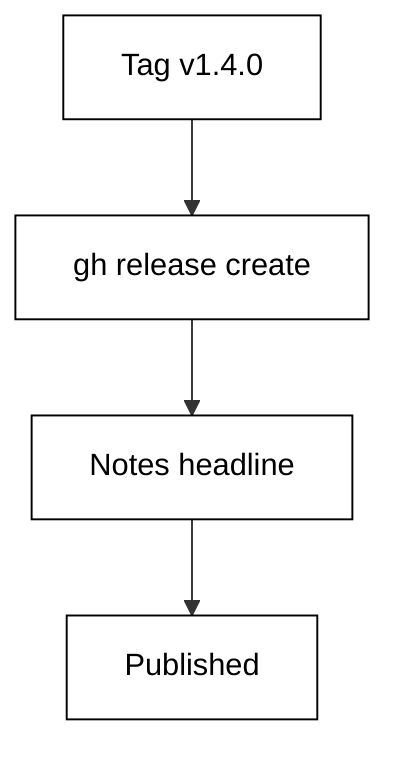

**`learning/code/ex-51-gh-release-create/release.json`**:

```json
{
  "tag": "v1.4.0",
  "name": "Cache and concurrency release",
  "draft": false,
  "prerelease": false,
  "notes": "Faster CI via pip caching and safer deploys via concurrency groups.\n\nFull changelog on the compare view.",
  "assets": [
    { "name": "shop-1.4.0.tar.gz", "size": 48210, "downloads": 7 },
    { "name": "checksums.txt", "size": 128, "downloads": 7 }
  ]
}
```

**`learning/code/ex-51-gh-release-create/check.py`**:

```python
# => Offline simulator for a gh release command over a fixture.
# => Fixture mirrors the gh release view --json shape on 2026-10-20.
# => No gh binary and no network; reads release.json only.
# => WHY fixtures: tag state is frozen, assertions stay stable.
# => Asset names and sizes replay byte-identically every run.
import json  # => parse the frozen fixture file
from pathlib import Path  # => locate the fixture beside this script


HERE = Path(__file__).resolve().parent  # => unit directory itself
TAG = "v1.4.0"  # => tag this release run cuts


def load():  # => read the frozen release record
    text = (HERE / "release.json").read_text(encoding="utf-8")  # => raw bytes
    return json.loads(text)  # => parsed fixture dict


def notes_for(release):  # => first line of notes is the headline
    first = release["notes"].splitlines()[0]  # => headline only
    return first  # => short enough for a listing


def main():  # => prove the recorded release matches the intended tag
    rel = load()  # => the release that creation would return
    print("tag:", rel["tag"])  # => Output: the created tag
    print("match:", rel["tag"] == TAG)  # => True when tags agree
    print("headline:", notes_for(rel))  # => Output: notes headline
    print("assets:", len(rel["assets"]))  # => files attached at upload


main()  # => run once; tag mismatch fails the match line
```

**Output** (`learning/code/ex-51-gh-release-create/expected/main.stdout.txt`):

```text
tag: v1.4.0
match: True
headline: Faster CI via pip caching and safer deploys via concurrency groups.
assets: 2
```

**Key takeaway**: gh release create publishes a tag with headline notes that automation can verify by tag match.

**Why it matters**: Release notes are the changelog users actually read: a headline plus highlights beats a raw commit list. Creating from a notes file keeps the text reviewable in a pull request before it publishes. The tag-match check ties the announcement to the exact commit the pipeline built — no drift between what shipped and what was said.

### Example 52: Attach a Build Asset

Source archives are automatic, but build artifacts must be uploaded explicitly after the release exists. The gh release upload command attaches files by name. This example verifies the tarball upload over a frozen fixture. The simulator confirms the asset name is attached and its size is nonzero. (Concepts: co-14.)

The shell invocation this example stands in for:

<!-- harness: illustration -->

```bash
gh release upload v1.4.0 dist/shop-1.4.0.tar.gz dist/checksums.txt
```

**`learning/code/ex-52-gh-release-upload/release.json`**:

```json
{
  "tag": "v1.4.0",
  "name": "Cache and concurrency release",
  "draft": false,
  "prerelease": false,
  "notes": "Faster CI via pip caching and safer deploys via concurrency groups.\n\nFull changelog on the compare view.",
  "assets": [
    { "name": "shop-1.4.0.tar.gz", "size": 48210, "downloads": 7 },
    { "name": "checksums.txt", "size": 128, "downloads": 7 }
  ]
}
```

**`learning/code/ex-52-gh-release-upload/check.py`**:

```python
# => Offline simulator for a gh release command over a fixture.
# => Fixture mirrors the gh release view --json shape on 2026-10-20.
# => No gh binary and no network; reads release.json only.
# => WHY fixtures: tag state is frozen, assertions stay stable.
# => Asset names and sizes replay byte-identically every run.
import json  # => parse the frozen fixture file
from pathlib import Path  # => locate the fixture beside this script


HERE = Path(__file__).resolve().parent  # => unit directory itself
ASSET = "shop-1.4.0.tar.gz"  # => file this upload run attaches


def load():  # => read the frozen release record
    text = (HERE / "release.json").read_text(encoding="utf-8")  # => raw bytes
    return json.loads(text)  # => parsed fixture dict


def main():  # => prove the asset is recorded with a nonzero size
    rel = load()  # => frozen release record after upload
    names = [a["name"] for a in rel["assets"]]  # => attached file names
    print("asset:", ASSET)  # => Output: the uploaded file
    print("attached:", ASSET in names)  # => True when upload landed
    size = [a["size"] for a in rel["assets"] if a["name"] == ASSET]  # => bytes
    print("size:", size[0] if size else 0)  # => nonzero means real bytes


main()  # => run once; zero size means an empty upload slipped through
```

**Output** (`learning/code/ex-52-gh-release-upload/expected/main.stdout.txt`):

```text
asset: shop-1.4.0.tar.gz
attached: True
size: 48210
```

**Key takeaway**: gh release upload attaches built files to an existing release by asset name.

**Why it matters**: Users download builds, not repositories: the tarball plus checksums is the installable unit. Uploading after creation separates the announcement from the artifacts, so a failed build never publishes an empty release. The nonzero-size check catches the classic truncated-upload failure before users do.

### Example 53: Check Out a PR Branch Locally

Reviewing locally means fetching the pull request ref and checking it out under a predictable branch name. The gh pr checkout command does both in one step. This example derives the fetch-and-checkout plan for pull request 34 over a frozen fixture. The simulator prints the refspec, branch name, touched files, and diff size. (Concepts: co-12.)

The shell invocation this example stands in for:

<!-- harness: illustration -->

```bash
gh pr checkout 34
```

**`learning/code/ex-53-gh-pr-diff-checkout/pr.json`**:

```json
{
  "number": 34,
  "title": "Add caching to the test job",
  "state": "open",
  "author": "octocat",
  "base": "main",
  "head": "cache-deps",
  "mergeable": "MERGEABLE",
  "files": ["test.yaml", "requirements.txt"],
  "additions": 42,
  "deletions": 7,
  "checks": [
    { "name": "lint", "status": "completed", "conclusion": "success" },
    { "name": "test (3.13)", "status": "completed", "conclusion": "success" },
    { "name": "test (3.14)", "status": "completed", "conclusion": "success" }
  ],
  "reviews": [
    { "user": "hubot", "state": "APPROVED" },
    { "user": "other", "state": "COMMENTED" }
  ]
}
```

**`learning/code/ex-53-gh-pr-diff-checkout/check.py`**:

```python
# => Offline simulator for a gh pr command over a fixture.
# => Fixture mirrors the gh pr view --json shape on 2026-10-20.
# => No gh binary and no network; reads pr.json only.
# => WHY fixtures: review state is frozen, assertions stay stable.
# => Every printed field exists in the live --json output too.
import json  # => parse the frozen fixture file
from pathlib import Path  # => locate the fixture beside this script


HERE = Path(__file__).resolve().parent  # => unit directory itself


def load():  # => read the frozen pull request record
    text = (HERE / "pr.json").read_text(encoding="utf-8")  # => raw bytes
    return json.loads(text)  # => parsed fixture dict


def main():  # => print the local checkout plan for this PR
    pr = load()  # => frozen pull request record
    print(
        "fetch:", "pull/" + str(pr["number"]) + "/head:pr-" + str(pr["number"])
    )  # => ref
    print("checkout:", "pr-" + str(pr["number"]))  # => local branch name
    print("files:", ",".join(pr["files"]))  # => files the PR touches
    print("additions:", pr["additions"], "deletions:", pr["deletions"])  # => size


main()  # => run once; fetching never runs, only the plan prints
```

**Output** (`learning/code/ex-53-gh-pr-diff-checkout/expected/main.stdout.txt`):

```text
fetch: pull/34/head:pr-34
checkout: pr-34
files: test.yaml,requirements.txt
additions: 42 deletions: 7
```

**Key takeaway**: gh pr checkout fetches the pull request ref into a local branch named for the PR number.

**Why it matters**: Local checkout turns review from reading into testing: run the suite against the exact PR head instead of trusting the description. The predictable pr-N naming keeps local branches sortable and deletable after merge. File and diff-size lines scope the review — forty-two additions deserve more attention than seven deletions.
