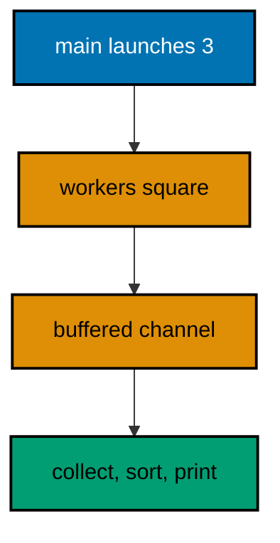
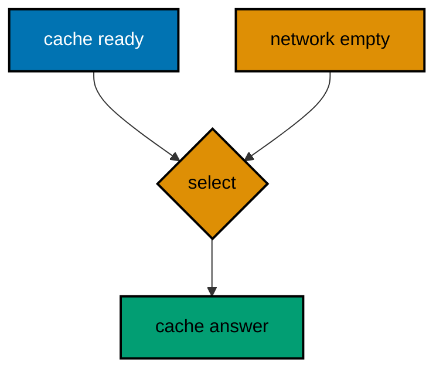
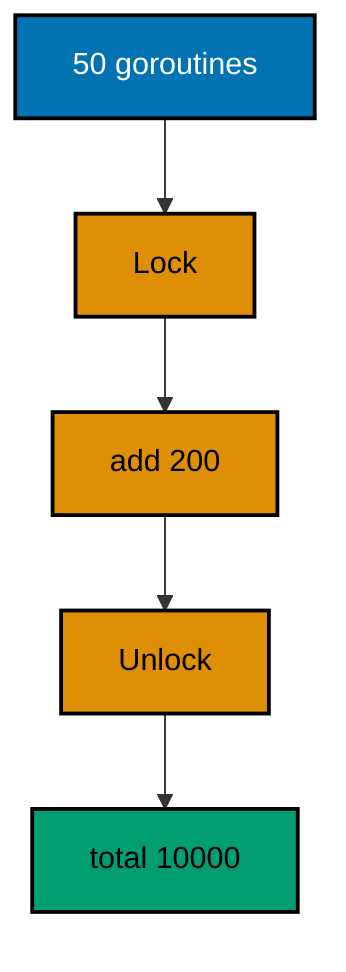
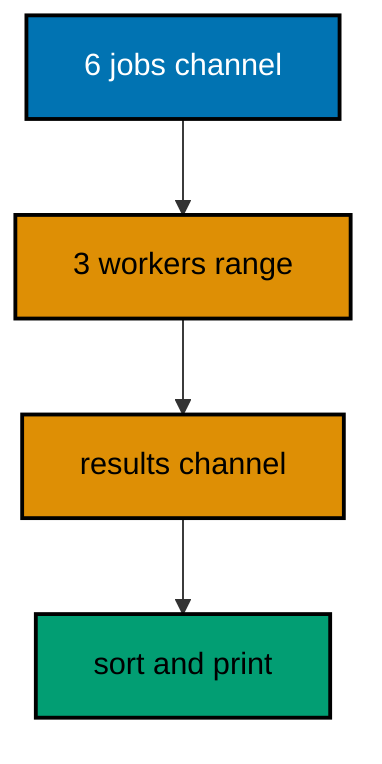
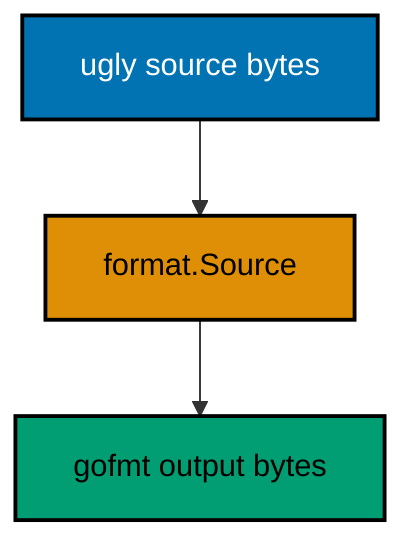
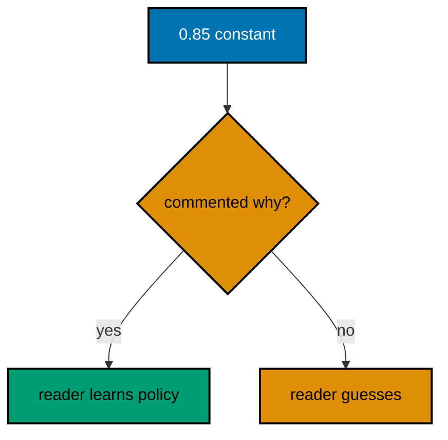
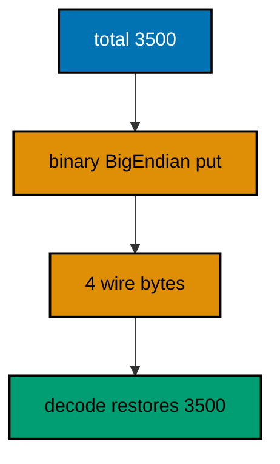
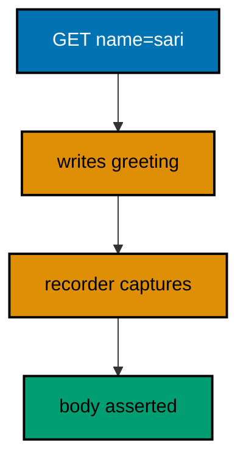
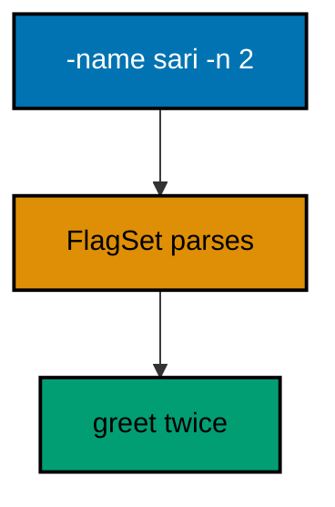
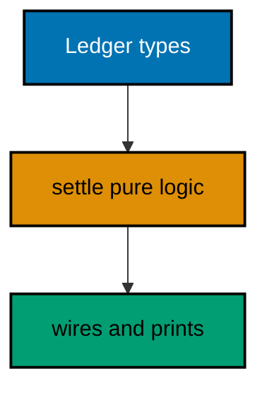

Examples 54-78 cover production Go: a concurrency survey that stays deterministic (Examples 54-61), from goroutines and channels through select, WaitGroups, mutexes, contexts, worker pools, and Once; then tooling, style, and interop (Examples 62-70), running gofmt as a library, vetting verbs, grading names, documenting error drops, commenting decisions, splitting functions, flattening nesting, crossing byte boundaries, and meeting the environment; finally reading idiomatic code (Examples 71-78), from handlers and pipelines through interfaces, tests, CLIs, JSON contracts, defer chains, and one whole program top-down. Every example is a complete, runnable Go module under `learning/code/`; run each with the command in its own `run.yaml`.

---

### Example 54: Goroutines Run Beside You

A goroutine is a lightweight concurrent function call; this one launches three squarers and collects their answers through a buffered channel, sorting before printing so the run is deterministic. (Concepts: co-09.)



**`learning/code/ex-54-goroutines-run-beside-you/main.go`**:

```go
// Example 54: Goroutines Run Beside You.
//
// A goroutine is a lightweight concurrent function call. Three squarers run
// beside main here; a buffered channel carries answers back, and sorting
// before printing keeps the output deterministic whatever the schedule.
package main

import (
	"fmt"  // => prints the sorted squares after all workers answer
	"sort" // => sort orders results: scheduling must not leak into output
)

// square sends n*n into out, then returns: one worker, one answer, no sharing.
// => send-only parameter (chan<- int): the type system forbids receiving here
// => no shared state: the argument travels by value, the answer by channel
func square(n int, out chan<- int) { // => worker body: compute, send, done
	// => the send never blocks: the buffer was sized for every worker below
	out <- n * n // => answer travels back; scheduling order is irrelevant
}

func main() {
	// => buffered for exactly three answers: workers never block on sending
	results := make(chan int, 3) // => capacity 3: one slot per worker, no deadlock
	// => launch three workers: go makes each call concurrent, order unknown
	for _, n := range []int{3, 1, 2} { // => launch order fixed, finish order not
		go square(n, results) // => concurrent call: returns to the loop at once
	}
	// => collect exactly three answers: the count, not the order, is the contract
	got := make([]int, 0, 3) // => pre-sized: three answers, zero regrowth
	for i := 0; i < 3; i++ { // => three receives: matches the three workers
		got = append(got, <-results) // => receive order is schedule-dependent
	}
	// => sort before printing: determinism is a presentation choice here
	sort.Ints(got)   // => [1 4 9]: same output on every schedule, every machine
	fmt.Println(got) // => Output: [1 4 9]
}
```

**Output** (`learning/code/ex-54-goroutines-run-beside-you/expected/main.stdout.txt`):

```text
[1 4 9]
```

**Key takeaway**: Buffer for every worker; sort before printing for determinism.

**Why it matters**: Buffered channels decouple worker pace from collection pace, so workers never deadlock waiting on a slow reader. Sorting at the presentation edge confines nondeterminism to where it belongs: inside the run, never in its observable output.

### Example 55: Channels Carry Values Between Goroutines

A channel is a typed pipe: one goroutine sends, another receives, and closing signals 'no more'. This example streams three words through a pipe that closes itself when done. (Concepts: co-09.)

**`learning/code/ex-55-channels-carry-values/main.go`**:

```go
// Example 55: Channels Carry Values Between Goroutines.
//
// A channel is a typed pipe: one side sends, the other receives, and closing
// signals "no more". A single sender keeps the stream order deterministic.
package main

import "fmt" // => prints each word as it arrives, then the closed verdict

// stream sends every word, then closes the channel: closing is the sender's job.
// => send-only parameter: only this function may send or close, by type
// => close (not a sentinel value): receivers range cleanly to termination
func stream(words []string, out chan<- string) { // => producer: sends then closes
	// => range the input: order in equals order out, single sender guaranteed
	for _, w := range words { // => one send per word, in slice order
		out <- w // => send: hands the word to whoever receives next
	}
	// => close after the last send: receivers see termination, not a hang
	close(out) // => sender closes: receivers range until this exact point
}

func main() {
	// => unbuffered pipe: each send waits for its receive, lockstep rhythm
	words := make(chan string) // => no buffer: sender and receiver meet per word
	// => producer runs beside main: sends three words, then closes the pipe
	go stream([]string{"pagi", "siang", "sore"}, words) // => concurrent producer
	// => range receives until close: no count needed, termination is the signal
	for w := range words { // => one iteration per sent word, order preserved
		fmt.Println("got:", w) // => Output lines: got: pagi/siang/sore in order
	}
	// => loop ended means closed: the producer kept its closing promise
	fmt.Println("closed") // => Output: closed
}
```

**Output** (`learning/code/ex-55-channels-carry-values/expected/main.stdout.txt`):

```text
got: pagi
got: siang
got: sore
closed
```

**Key takeaway**: Sender closes; receivers range until the close.

**Why it matters**: Closing as the termination signal removes counting from receivers entirely: range handles any stream length uniformly. One sender per channel keeps ordering trivially true; add senders only when you are ready to sort at the edge like Example 54.

### Example 56: Select Waits on Many Channels

Select waits on several channels at once and runs the first one ready; with exactly one ready channel the choice is deterministic. This example races a ready cache against an empty network. (Concepts: co-09.)



**`learning/code/ex-56-select-waits-on-many/main.go`**:

```go
// Example 56: Select Waits on Many Channels.
//
// Select waits on several channels and runs the first one ready. Exactly one
// ready channel here makes the choice deterministic: the cache always wins.
package main

import "fmt" // => prints which source answered: the cache, every single run

func main() {
	// => cache arrives pre-filled: the answer is ready before select starts
	cache := make(chan string, 1) // => buffered one: the send below never blocks
	// => the cached answer waits in the buffer: ready from the first select
	cache <- "cached: oat 12" // => pre-fill: select sees a ready case below
	// => network stays empty and unbuffered: nobody sends, nothing is ready
	network := make(chan string) // => no sender exists: this case never fires
	// => select blocks until ONE case can proceed: only the cache qualifies
	select { // => the waiter: first ready case wins, the rest are skipped
	// => cache case: ready immediately, so this branch runs deterministically
	case answer := <-cache: // => receives the pre-filled answer at once
		// => the fast path: cached data answers without any network wait
		fmt.Println(answer) // => Output: cached: oat 12
	// => network case: empty forever, so select never takes this branch here
	case answer := <-network: // => would run only if the network ever sent
		// => unreachable in this run: kept to show the shape select scales to
		fmt.Println("network:", answer) // => documents the slow-path branch
	}
	// => select took exactly one branch and moved on: no loop, no leftover
	fmt.Println("served from cache") // => Output: served from cache
}
```

**Output** (`learning/code/ex-56-select-waits-on-many/expected/main.stdout.txt`):

```text
cached: oat 12
served from cache
```

**Key takeaway**: Select runs the first ready case; one ready case decides it.

**Why it matters**: Select turns 'wait for the fastest' into one readable statement instead of callback spaghetti, and pairing it with timeouts bounds every wait honestly. Keep the cases independent: shared state between branches reintroduces the races select was meant to avoid.

### Example 57: WaitGroup Waits for the Whole Crew

A WaitGroup counts launched workers and blocks until the last one calls Done, so main collects only when every answer exists. Four cubers run here; sorted output keeps the run deterministic. (Concepts: co-09.)

**`learning/code/ex-57-waitgroup-waits-for-crew/main.go`**:

```go
// Example 57: WaitGroup Waits for the Whole Crew.
//
// A WaitGroup counts launched workers and blocks until the last Done call, so
// main collects only when every answer exists. Sorting keeps it deterministic.
package main

import (
	"fmt"  // => prints the sorted cubes after the whole crew finishes
	"sort" // => order the answers: finish order is schedule-dependent
	"sync" // => WaitGroup: the counter that blocks until every Done lands
)

// cube sends n*n*n, then marks its own work done no matter what follows.
// => defer Done FIRST: even a panic in the worker still releases the counter
// => value travels by channel: no shared slice, no mutex, no race to audit
func cube(n int, out chan<- int, wg *sync.WaitGroup) { // => worker plus group
	// => Done on return: deferred first, so it runs even if sending panicked
	defer wg.Done() // => one Done per Add(1): the fundamental accounting rule
	// => the answer travels by channel: computed locally, shared by sending
	out <- n * n * n // => buffer sized for the crew: never blocks, never waits
}

func main() {
	// => four workers, four answers: buffer and counter agree on the number
	results := make(chan int, 4) // => capacity 4: every send lands without waiting
	// => counter starts at zero: Add before EACH go, never inside the worker
	var wg sync.WaitGroup // => zero value ready: no constructor, no setup
	// => launch the crew: Add(1) immediately before each go, in the same step
	for _, n := range []int{1, 2, 3, 4} { // => four inputs, four workers
		wg.Add(1)                // => count this worker BEFORE it can finish
		go cube(n, results, &wg) // => worker runs; Done lands on its return
	}
	// => block until the counter returns to zero: all four Dones have landed
	wg.Wait() // => the gate: nothing below runs until the crew is complete
	// => close after Wait: no worker can send now, so ranging ends cleanly
	close(results) // => main closes: safe, because Wait proved workers done
	// => collect the closed channel: order varies, contents are exactly four
	got := []int{}           // => empty: appends grow it to the four answers below
	for v := range results { // => ends at close: four iterations, no counting
		got = append(got, v) // => collect every cube, whatever the arrival order
	}
	// => sort for determinism: the schedule must not leak into the output
	sort.Ints(got)   // => [1 8 27 64]: identical on every run, every machine
	fmt.Println(got) // => Output: [1 8 27 64]
}
```

**Output** (`learning/code/ex-57-waitgroup-waits-for-crew/expected/main.stdout.txt`):

```text
[1 8 27 64]
```

**Key takeaway**: Add before go, Done on return, Wait before collecting.

**Why it matters**: WaitGroup separates 'workers finished' from 'answers collected', so closing the channel after Wait is provably safe instead of hopefully safe. Adding before launching (never inside) closes the lost-worker race where Done lands before its Add.

### Example 58: Mutex Guards Shared State

A Mutex serializes access to shared state so fifty concurrent adders produce exactly one correct total. Lock the smallest critical section that keeps the invariant. (Concepts: co-09.)



**`learning/code/ex-58-mutex-guards-shared-state/main.go`**:

```go
// Example 58: Mutex Guards Shared State.
//
// A Mutex serializes access to shared state: fifty concurrent adders produce
// exactly one correct total. The critical section holds only the addition.
package main

import (
	"fmt"  // => prints the exact total the mutex protected
	"sync" // => Mutex plus WaitGroup: guard the state, await the crew
)

// Counter pairs the shared total with the mutex that guards it.
// => struct bundles state and guard: they can never be separated by accident
// => never copy a Counter: methods take pointers so the mutex stays single
type Counter struct { // => guarded state: the only legal access is below
	mu    sync.Mutex // => zero value ready: unlocked, no setup needed
	total int        // => guarded: touched only between Lock and Unlock
}

// Add grows the total under the lock: the critical section is one statement.
// => pointer receiver: every caller shares the ONE mutex, never a copy
func (c *Counter) Add(n int) { // => the single sanctioned mutation path
	c.mu.Lock()   // => enter: exclusive access starts here
	c.total += n  // => critical section: one statement, nothing more
	c.mu.Unlock() // => leave: waiting adders proceed one by one
}

// Value reads the total under the lock: readers synchronize with writers.
// => locked read: an unlocked read would race the writers above, exactly
func (c *Counter) Value() int { // => consistent snapshot, never a torn read
	c.mu.Lock()         // => readers lock too: exclusion covers both directions
	defer c.mu.Unlock() // => deferred: the read below cannot leak the lock
	return c.total      // => copy out under the lock: safe after unlock
}

func main() {
	// => one counter, fifty adders, two hundred each: exact total 10000
	var c Counter // => zero value: unlocked mutex, zero total, ready now
	// => WaitGroup reuses Example 57's pattern: await the whole crew first
	var wg sync.WaitGroup // => counts the fifty adders below, nothing else
	// => fifty goroutines: Add(1) before each go, Done deferred in each body
	for i := 0; i < 50; i++ { // => fifty iterations: fifty concurrent adders
		wg.Add(1)   // => count before launch: the accounting rule, always
		go func() { // => closure per adder: no arguments, shared counter
			defer wg.Done() // => release the counter whatever happens inside
			c.Add(200)      // => guarded add: serialized with the other 49
		}()
	}
	// => Wait proves every adder finished: the total below is final, not partial
	wg.Wait() // => all Dones landed: no adder still holds the mutex
	// => locked read: the exact total, reproducible on every schedule
	fmt.Println("total:", c.Value()) // => Output: total: 10000
}
```

**Output** (`learning/code/ex-58-mutex-guards-shared-state/expected/main.stdout.txt`):

```text
total: 10000
```

**Key takeaway**: Lock the smallest section that keeps the invariant true.

**Why it matters**: Tiny critical sections keep contention near zero while the mutex still guarantees atomicity where it matters. Bundling the mutex with its data makes unguarded access a compile-time shape violation rather than a code-review catch.

### Example 59: Context Cancels Work

Contexts carry cancellation and deadlines down call chains, and an already-expired deadline reports itself without any sleeping. This example builds a past-deadline context and reads its verdict. (Concepts: co-09.)

**`learning/code/ex-59-context-cancels-work/main.go`**:

```go
// Example 59: Context Cancels Work.
//
// Contexts carry cancellation down call chains. An already-expired deadline
// reports DeadlineExceeded with no sleeping, no goroutines, no flakiness.
package main

import (
	"context" // => Deadline, cancel, and Done: the cancellation toolkit
	"fmt"     // => prints the deadline verdict and the cancel verdict
	"time"    // => fixed instants only: past dates, never sleeps or clocks
)

func main() {
	// => deadline one hour in the PAST: expired before it was even created
	past := time.Date(2020, time.January, 1, 0, 0, 0, 0, time.UTC) // => fixed
	// => WithDeadline against a past instant: Done is closed from birth
	ctx, cancel := context.WithDeadline(context.Background(), past) // => expired
	// => cancel is still required: the timer (however expired) needs release
	defer cancel() // => always call cancel: expired contexts hold resources too
	// => select on Done: closed immediately, so this branch runs at once
	select { // => the standard wait shape: Done case plus work case
	case <-ctx.Done(): // => closed channel: fires without any waiting here
		// => Err names the cause: DeadlineExceeded, not Canceled, exactly
		fmt.Println("done:", ctx.Err()) // => Output: done: context deadline exceeded
	default: // => skipped: Done was already closed, select takes the ready case
		fmt.Println("unexpectedly live") // => unreachable: past deadline fired
	}
	// => manual cancel: the second context dies by explicit decision, not time
	live, stop := context.WithCancel(context.Background()) // => cancellable root
	// => stop now: no work started, so cancellation is instant and total
	stop() // => the decision: every derived context below dies with live
	// => Done closes on cancel: same channel, different cause in Err
	<-live.Done()                        // => blocks until cancel: already fired, returns at once
	fmt.Println("canceled:", live.Err()) // => Output: canceled: context canceled
}
```

**Output** (`learning/code/ex-59-context-cancels-work/expected/main.stdout.txt`):

```text
done: context deadline exceeded
canceled: context canceled
```

**Key takeaway**: Expired deadlines and explicit cancel both close Done.

**Why it matters**: Contexts push cancellation decisions DOWN to the work instead of requiring the work to poll upward, which keeps shutdown paths uniform across network, disk, and compute. Always call the cancel function: even expired contexts hold timer resources until released.

### Example 60: Worker Pool Bounds Concurrency

A worker pool bounds concurrency with a fixed crew pulling from a jobs channel: six jobs, three workers, every result collected and sorted for determinism. (Concepts: co-09, co-15.)



**`learning/code/ex-60-worker-pool-bounds-concurrency/main.go`**:

```go
// Example 60: Worker Pool Bounds Concurrency.
//
// A fixed crew pulls jobs from a channel: three workers drain six jobs here.
// Bounding the crew bounds resource use; sorting bounds the output's order.
package main

import (
	"fmt"  // => prints the sorted results after the pool drains the jobs
	"sort" // => schedule-independent output: sorted, like Examples 54 and 57
	"sync" // => WaitGroup: main waits for the crew before closing results
)

// worker pulls job IDs and sends back ten times each, until jobs closes.
// => range over jobs: the loop ends exactly when main closes the channel
// => results buffered for all six: workers never block on delivering answers
func worker(jobs <-chan int, results chan<- int, wg *sync.WaitGroup) {
	// => Done on return: deferred first, matching the WaitGroup accounting
	defer wg.Done() // => one Done per crew member, released at range end
	// => pull until close: each iteration handles exactly one job fully
	for id := range jobs { // => ends when jobs closes: no counting, no poison
		// => ten-times transform: the "work", deterministic per job ID
		results <- id * 10 // => buffered: delivery never waits for collecting
	}
}

func main() {
	// => six jobs buffered: the send loop below never waits for workers
	jobs := make(chan int, 6) // => capacity 6: all jobs queue before workers start
	// => six results buffered: workers never wait for the collector either
	results := make(chan int, 6) // => capacity 6: delivery decoupled from reading
	// => crew of three: concurrency bounded HERE, not by job count, ever
	var wg sync.WaitGroup    // => counts crew members, not jobs: three Dones total
	for w := 0; w < 3; w++ { // => three workers: the bound, stated as a number
		wg.Add(1)                     // => count before launch: the accounting rule
		go worker(jobs, results, &wg) // => crew runs: pulls until jobs closes
	}
	// => queue all six jobs, then close: close promises "no more are coming"
	for id := 1; id <= 6; id++ { // => jobs 1..6: fixed input, fixed transform
		jobs <- id // => buffered: all six queue without a worker awake yet
	}
	close(jobs) // => workers' range loops now terminate after draining six
	// => Wait for the crew: every job handled before results close below
	wg.Wait() // => three Dones: the pool is fully drained, provably
	// => close results after Wait: no worker can send now, ranging ends cleanly
	close(results) // => collector's range terminates: six iterations exactly
	// => collect and sort: finish order varied, output order must not
	got := []int{}           // => empty: six appends grow it to the full answer set
	for v := range results { // => six values: 10 through 60, arrival order random
		got = append(got, v) // => collect unsorted: sorting happens once below
	}
	sort.Ints(got)   // => [10 20 30 40 50 60]: schedule-free output
	fmt.Println(got) // => Output: [10 20 30 40 50 60]
}
```

**Output** (`learning/code/ex-60-worker-pool-bounds-concurrency/expected/main.stdout.txt`):

```text
[10 20 30 40 50 60]
```

**Key takeaway**: Bound the crew, buffer the handoff, sort at the edge.

**Why it matters**: Pools turn unbounded fan-out into a capacity decision you can reason about: three workers means three concurrent resource users, regardless of job count. Closing jobs (not the workers) keeps termination declarative, and buffering both channels removes rendezvous coupling between stages.

### Example 61: Once Runs Setup Exactly Once

sync.Once guarantees one execution no matter how many goroutines ask: ten callers, one setup, counter proves it. Lazy singletons without double-checked locking. (Concepts: co-09.)

**`learning/code/ex-61-once-runs-setup-once/main.go`**:

```go
// Example 61: Once Runs Setup Exactly Once.
//
// sync.Once guarantees one execution however many goroutines ask. Ten callers
// race here; the counter proves setup ran exactly once, deterministically.
package main

import (
	"fmt"  // => prints the setup count: 1 on every schedule, every machine
	"sync" // => Once plus WaitGroup: single execution, awaited crew
)

// Registry holds the once-guard plus the proof counter it protects.
// => struct pairs guard and state: inseparable, like the Counter in Example 58
type Registry struct { // => lazy singleton holder: setup deferred to first use
	once  sync.Once // => zero ready: no constructor, fires exactly once ever
	loads int       // => proof counter: incremented inside the once closure
}

// Load runs the expensive setup exactly once, however often it is called.
// => pointer receiver: every caller shares the ONE Once guard, never a copy
// => never copy a Once: copies reset the fired flag and run setup twice
func (r *Registry) Load() { // => idempotent by construction: call freely
	// => Do runs f once: concurrent callers block until the first finishes
	r.once.Do(func() { // => the closure runs exactly once, ever, for this Once
		r.loads++ // => proof: increments only inside the once-fired closure
	})
}

func main() {
	// => one registry, ten racers: every goroutine calls Load concurrently
	var r Registry // => zero value: unfired Once, zero loads, ready now
	// => WaitGroup awaits the ten racers: same pattern as Examples 57 and 58
	var wg sync.WaitGroup // => counts racers: ten Dones before the verdict
	// => ten goroutines: Add before each go, Done deferred inside each body
	for i := 0; i < 10; i++ { // => ten callers: the race Once was built for
		wg.Add(1)   // => count before launch: accounting rule, unchanged
		go func() { // => each racer calls Load: nine will wait, one will run
			defer wg.Done() // => release the counter on return, always
			r.Load()        // => nine block, one executes: Once decides
		}()
	}
	// => Wait proves all ten called: the counter below is final, not partial
	wg.Wait() // => ten Dones: every racer has passed through Load
	// => exactly one: the deterministic verdict, schedule-independent by design
	fmt.Println("setups:", r.loads) // => Output: setups: 1
}
```

**Output** (`learning/code/ex-61-once-runs-setup-once/expected/main.stdout.txt`):

```text
setups: 1
```

**Key takeaway**: Once makes lazy setup idempotent; never copy a Once.

**Why it matters**: Once replaces double-checked locking with a primitive the runtime gets right, including the tricky 'wait for the winner' path losers must take. Sharing the guard by pointer is load-bearing: a copied Once forgets it fired and runs setup again.

### Example 62: gofmt Decides the Layout

Formatting arguments end where gofmt begins: the tool owns tabs, alignment, and import grouping. This example runs the formatter as a library over deliberately ugly input. (Concepts: co-12, co-14.)



**`learning/code/ex-62-gofmt-decides-layout/main.go`**:

```go
// Example 62: gofmt Decides the Layout.
//
// Formatting debates end where gofmt begins: tabs, alignment, import grouping.
// The go/format package runs that same formatter as a library, shown here.
package main

import (
	"fmt"       // => prints the canonical bytes the formatter produces
	"go/format" // => Source: the gofmt algorithm itself, callable in-process
)

func main() {
	// => deliberately ugly: extra spaces, misaligned, the shape gofmt forbids
	ugly := "package main\n\nimport  \"fmt\"\n\nfunc  main()  { fmt.Println(  1 ) }\n"
	// => Source parses AND formats: syntax errors return as errors, not output
	canonical, err := format.Source([]byte(ugly)) // => the gofmt decision
	// => ugly but VALID input formats fine: errors mean broken syntax, not style
	if err != nil { // => unreachable: the input is ugly, not ungrammatical
		fmt.Println("unexpected:", err) // => kept: real callers check this
		return                          // => no canonical bytes exist to print
	}
	// => canonical gofmt output: double spaces collapsed, imports grouped tightly
	// => bodies stay one line: gofmt aligns tokens, it never reflows statements
	fmt.Print(string(canonical)) // => prints: package main, grouped import, one-line main
}
```

**Output** (`learning/code/ex-62-gofmt-decides-layout/expected/main.stdout.txt`):

```text
package main

import "fmt"

func main() { fmt.Println(1) }
```

**Key takeaway**: Run gofmt (or its library); never hand-format Go.

**Why it matters**: One canonical layout removes formatting from every review forever: diffs show logic, never whitespace taste. Enforcing gofmt in CI turns the convention from a request into a fact, and format.Source lets tools apply the same rule programmatically.

### Example 63: Vet Your Verbs Before You Ship

go vet flags mismatched printf verbs that compile yet print lies; this unit's run command vets before it builds, so static suspicion fails the run instead of shipping. The lesson shows the bad verb vet would catch. (Concepts: co-12.)

**`learning/code/ex-63-vet-your-verbs/main.go`**:

```go
// Example 63: Vet Your Verbs Before You Ship.
//
// go vet flags mismatched printf verbs that compile yet print lies. The run
// command of this unit vets FIRST: `go vet . && go build`. Vet-clean code below.
package main

import "fmt" // => prints the receipt line with verbs vet has approved

func main() {
	// => %q for the string, %d for the int: verbs match their values exactly
	// => vet's printf check proves it: this line passes `go vet .` silently
	fmt.Printf("receipt %q: %d cents\n", "oat-1", 1500) // => Output: receipt "oat-1": 1500 cents
	// => Sprintf variant: same matched verbs, result built instead of printed
	line := fmt.Sprintf("%s x%d", "rice", 2) // => %s string, %d int: matched
	fmt.Println(line)                        // => Output: rice x2
}
```

**Output** (`learning/code/ex-63-vet-your-verbs/expected/main.stdout.txt`):

```text
receipt "oat-1": 1500 cents
rice x2
```

**Key takeaway**: Vet first: mismatched verbs fail the run, not the customer.

**Why it matters**: Printf verbs are unchecked by the compiler, which makes vet the only thing standing between a typo and a production lie. Running vet before build in CI (and in this unit's run command) promotes static suspicion to a gate instead of a suggestion.

### Example 64: Name Packages Short and Lowercase

Package names are lowercase single words with no underscores, and identifiers earn length from scope: one-letter loop variables, full words at package level. This example grades names against the rule. (Concepts: co-14, co-06.)

**`learning/code/ex-64-name-packages-short-lowercase/main.go`**:

```go
// Example 64: Name Packages Short and Lowercase.
//
// Package names are lowercase single words, no underscores; identifiers earn
// length from scope. This tiny grader applies the rule and prints verdicts.
package main

import (
	"fmt"     // => prints one verdict per candidate name below
	"strings" // => HasPrefix and ToLower: the rule checks, stdlib-powered
	"unicode" // => IsUpper spots the export marker: uppercase first rune
)

// gradeName judges an identifier against the Go naming rules in one pass.
// => returns a verdict string: the rule broken, or "ok" when none breaks
// => short scope earns short names: single letters only live in tiny scopes
func gradeName(name string) string { // => the naming rule, executable
	// => empty names are never legal: reject before any rune inspection
	if name == "" { // => degenerate: no identifier can be empty, ever
		return "empty" // => verdict: rejected at the first check
	}
	// => underscores signal a stuttering package or a C habit: banned here
	if strings.Contains(name, "_") { // => snake_case has no home in Go names
		return "no underscores" // => verdict: rewrite in camelCase instead
	}
	// => UPPERCASE wholes shout: acronyms stay upper, but whole words do not
	first := []rune(name)[0] // => first rune decides export, checked below
	// => exported (uppercase first) is FINE: the rule governs style, not case role
	if unicode.IsUpper(first) && name == strings.ToUpper(name) { // => ALL CAPS
		return "no shouting" // => verdict: SCREAMING_CASE is not Go style
	}
	// => lowercase start: unexported, the common case, always acceptable here
	if unicode.IsLower(first) { // => unexported: package-private by rule
		return "ok" // => verdict: lowercase start passes unconditionally
	}
	// => uppercase start, mixed rest: exported name, style-clean by shape
	return "ok exported" // => verdict: ExportedLikeThis is exactly right
}

func main() {
	// => five candidates: two clean, three each breaking one distinct rule
	for _, name := range []string{"ledger", "Ledger", "MAX", "bad_name", ""} {
		// => verdict per name: the rule earned its keep five times in a row
		fmt.Println(name + ": " + gradeName(name)) // => Output per rule below
	}
}
```

**Output** (`learning/code/ex-64-name-packages-short-lowercase/expected/main.stdout.txt`):

```text
ledger: ok
Ledger: ok exported
MAX: no shouting
bad_name: no underscores
: empty
```

**Key takeaway**: Lowercase packages, camelCase identifiers, no underscores.

**Why it matters**: Naming rules compress decisions the whole team would otherwise re-litigate: lowercase packages read cleanly at import sites, and scope-sized identifiers keep tiny scopes terse without letting package-level names turn cryptic.

### Example 65: Handle Every Error or Say Why Not

Blank-identifier error drops must carry a rationale comment, or they read as accidents. This example writes a temp file, checks the write, and documents exactly why the close is safe to drop. (Concepts: co-12, co-02.)

**`learning/code/ex-65-handle-every-error-or-say-why/main.go`**:

```go
// Example 65: Handle Every Error or Say Why Not.
//
// Dropped errors must carry a rationale, or they read as accidents. The write
// below is CHECKED; the close is dropped WITH its reason written beside it.
package main

import (
	"fmt" // => prints the write verdict and the documented-drop verdict
	"os"  // => CreateTemp and WriteFile: checked write, reasoned close
)

func main() {
	// => temp file in the OS dir: real handle, zero repo litter, auto-cleaned
	f, err := os.CreateTemp("", "ex65-*.txt") // => open CAN fail: checked next
	// => open failure is environmental: report it, do not continue blindly
	if err != nil { // => temp dir unwritable: nothing exists to write into
		fmt.Println("temp:", err) // => unreachable on a healthy machine
		return                    // => no handle, so no close to reason about
	}
	// => Remove at return: the run leaves no trace whatever happens below
	defer os.Remove(f.Name()) // => path captured now: cleanup is unconditional
	// => dropping Close's error is SAFE here because nothing was written yet:
	// => no buffered data exists to lose, so close cannot hide a failure.
	// => the rationale rides WITH the drop: future readers see the reasoning.
	defer f.Close() //nolint:errcheck // => safe: unwritten handle, nothing to flush
	// => the WRITE is checked: bytes on disk are the promise being made
	if _, err := f.WriteString("catat"); err != nil { // => the load-bearing check
		fmt.Println("write:", err) // => disk failure surfaces here, honestly
		return                     // => close still runs: defers are unconditional
	}
	fmt.Println("written") // => Output: written
}
```

**Output** (`learning/code/ex-65-handle-every-error-or-say-why/expected/main.stdout.txt`):

```text
written
```

**Key takeaway**: Check the write; document the drop with its reason attached.

**Why it matters**: An unexplained blank identifier is indistinguishable from a bug, so linters flag every one — the rationale comment converts the flag from noise into a reviewed decision. Check what can fail meaningfully; explain what cannot, exactly where you drop it.

### Example 66: Comment the Why, Not the What

Comments that restate the code add noise; comments that record the decision behind the code add value. Two discount functions compute identically here, but only one explains its odd constant. (Concepts: co-14.)



**`learning/code/ex-66-comment-the-why/main.go`**:

```go
// Example 66: Comment the Why, Not the What.
//
// Restating code adds noise; recording the DECISION adds value. Both discount
// functions below compute identically; only one explains its odd constant.
package main

import "fmt" // => prints both discounts: equal answers, unequal comments

// DiscountPlain computes correctly and comments nothing: the reader guesses.
// => correct math, zero context: 0.85 is a magic number with no provenance
// => the function WORKS: the complaint is maintainability, not behavior
func DiscountPlain(total int) int { // => undocumented constant, valid output
	// => 0.85 unexplained: policy? bug? nobody reading this can tell
	return int(float64(total) * 0.85) // => same math as below, mute about why
}

// Discount explains its constant: policy 7/2026 grants members 15 percent off.
// => the comment records the DECISION (board policy) behind the number
// => future readers update policy in one place instead of reverse-engineering
func Discount(total int) int { // => documented constant, identical output
	// => member policy 7/2026: 15 percent off, reviewed yearly each January
	return int(float64(total) * 0.85) // => 0.85 IS the policy: change both together
}

func main() {
	// => equal outputs prove the difference is documentation, not behavior
	fmt.Println(DiscountPlain(1000), Discount(1000)) // => Output: 850 850
	// => the lesson: when the constant changes, only Discount says where
	fmt.Println("documented:", Discount(2000)) // => Output: documented: 1700
}
```

**Output** (`learning/code/ex-66-comment-the-why/expected/main.stdout.txt`):

```text
850 850
documented: 1700
```

**Key takeaway**: Comments record decisions; code already states actions.

**Why it matters**: 'Increment i' next to i++ insults the reader, while 'policy 7/2026' next to 0.85 saves them an afternoon. Review comments by asking what decision a future reader needs: provenance, trade-off, or warning — never narration.

### Example 67: Split Functions Until Each Does One Thing

A function doing validation, math, and formatting resists testing; split into three, each piece tests alone and the pipeline reads top-down. This example totals an invoice both ways to prove equivalence. (Concepts: co-14, co-15.)

**`learning/code/ex-67-split-functions-do-one-thing/main.go`**:

```go
// Example 67: Split Functions Until Each Does One Thing.
//
// One function doing validation, math, and formatting resists testing. Split
// into three, each piece tests alone and the pipeline reads top-down.
package main

import "fmt" // => prints the tangled total and the split total: equal, proven

// tangled validates, totals, and formats in one body: correct but untestable.
// => the three jobs share one function: testing the math runs the formatting
// => kept as the "before": the shape this example argues against, honestly run
func tangled(prices []int) string { // => one function, three responsibilities
	// => validation inline: negatives zeroed, mixed with the math below
	sum := 0 // => accumulator shared across validation and math, tangled
	// => single loop does two jobs: sanitize AND total, inseparably
	for _, p := range prices { // => each pass validates then adds, fused
		if p < 0 { // => validation fused into the totaling loop
			continue // => skip negatives: policy buried mid-math
		}
		sum += p // => math fused with validation: untestable in isolation
	}
	// => formatting fused too: the total renders inside the same body
	return fmt.Sprintf("total: %d", sum) // => three jobs, one test surface
}

// valid drops negatives: the validation piece, testable with pure inputs.
// => pure function: same slice in, clean slice out, no formatting attached
func valid(prices []int) []int { // => one job: sanitize, nothing else
	// => fresh slice: inputs untouched, policy visible in one loop
	out := []int{}             // => empty: negatives vanish, order preserved
	for _, p := range prices { // => the validation loop, isolated and named
		if p >= 0 { // => keep rule: non-negative survives, stated once
			out = append(out, p) // => survivors only: policy as code
		}
	}
	return out // => clean input for the math piece below
}

// sum totals a CLEAN slice: the math piece, no validation inside.
// => pure function: trusted input in, exact total out, nothing else
func sum(nums []int) int { // => one job: add, assuming validity
	total := 0               // => accumulator: validation happened before, not here
	for _, n := range nums { // => the math loop: every element counts
		total += n // => no guards: valid() already promised clean input
	}
	return total // => exact total: testable with two-element slices
}

// render formats a total: the formatting piece, trivially verifiable.
// => pure function: int in, string out, no math and no validation inside
func render(total int) string { // => one job: format, assuming a valid total
	return fmt.Sprintf("total: %d", total) // => the only Sprintf in the pipeline
}

func main() {
	// => tangled pipeline in one call: validate+total+format, fused
	prices := []int{1500, -200, 2000} // => one negative: policy drops it both ways
	fmt.Println(tangled(prices))      // => Output: total: 3500
	// => split pipeline reads as the three steps: valid, then sum, then render
	fmt.Println(render(sum(valid(prices)))) // => Output: total: 3500
}
```

**Output** (`learning/code/ex-67-split-functions-do-one-thing/expected/main.stdout.txt`):

```text
total: 3500
total: 3500
```

**Key takeaway**: Split validate, compute, render; compose them at the call site.

**Why it matters**: Single-responsibility pieces test with two-line cases while tangled functions need whole scenarios per test. Composition at the call site keeps the pipeline visible without a framework, and each piece stays small enough to hold in one reading.

### Example 68: Flat Beats Nested

Nested conditionals pyramid toward the right; guard clauses return early and keep every check at the margin. This example admits members with both shapes and proves they agree. (Concepts: co-14, co-01.)

**`learning/code/ex-68-flat-beats-nested/main.go`**:

```go
// Example 68: Flat Beats Nested.
//
// Nested conditionals pyramid rightward; guard clauses return early and keep
// every check at the margin. Both shapes below agree on every input tried.
package main

import "fmt" // => prints both verdicts per applicant: identical, proven

// nested pyramids: each condition indents the next, happy path deepest.
// => correct but rightward-drifting: the fourth check sits four levels deep
// => kept as the "before": the shape flat code replaces, run for equivalence
func nested(age int, member bool, dues bool) string { // => three conditions
	// => each level nests the next: readers hold all prior conditions in mind
	if age >= 17 { // => level one: age gate, everything nests inside
		if member { // => level two: membership, inside the age gate
			if dues { // => level three: dues, inside both gates above
				return "admit" // => happy path: deepest line in the function
			} else {
				return "pay dues" // => failure paths indent too: noise compounds
			}
		} else {
			return "join first" // => which gate failed needs indent-counting
		}
	} else {
		return "too young" // => outermost failure reads last, confusingly
	}
	return "unreachable" // => never reached: structure demands a tail return
}

// flat guards: each failure returns at the margin, happy path last and flat.
// => same policy, zero nesting: conditions read top-down, failures exit early
func flat(age int, member bool, dues bool) string { // => identical signature
	// => guard one: age fails, return at the margin, never indent for it
	if age < 17 { // => inverted condition: failure first, margin-kept
		return "too young" // => exit: the rest of the function forgets age
	}
	// => guard two: membership fails, same margin, age already forgotten
	if !member { // => inverted: non-members leave here, members continue flat
		return "join first" // => exit: remaining code assumes a member
	}
	// => guard three: dues fail, last check, still at the margin
	if !dues { // => inverted: debtors leave, the paid continue to the happy path
		return "pay dues" // => exit: everything below assumes dues are paid
	}
	return "admit" // => happy path: flat, last, assuming all guards passed
}

func main() {
	// => four applicants: admit, young, non-member, debtor: full policy surface
	applicants := [][3]int{{20, 1, 1}, {16, 1, 1}, {20, 0, 1}, {20, 1, 0}}
	// => both shapes must agree on EVERY applicant: equivalence, asserted
	for _, a := range applicants { // => age, member, dues per applicant
		n := nested(a[0], a[1] == 1, a[2] == 1) // => pyramid verdict
		g := flat(a[0], a[1] == 1, a[2] == 1)   // => flat verdict: must match
		// => agree flag: true four times proves the refactor changed no behavior
		fmt.Println(n, g, n == g) // => Output lines: verdict verdict true
	}
}
```

**Output** (`learning/code/ex-68-flat-beats-nested/expected/main.stdout.txt`):

```text
admit admit true
too young too young true
join first join first true
pay dues pay dues true
```

**Key takeaway**: Invert conditions into guards; the happy path stays flat.

**Why it matters**: Flat code fits the policy in one screenful and fails fast at the margin, while nesting buries the happy path where skimmers never look. Proving equivalence on the full input surface (as main does) is how such refactors ship without fear.

### Example 69: Cross the Boundary with encoding/binary

Foreign systems speak bytes, not Go structs: encoding/binary marshals integers to exact wire order, which is the marshaling half of every FFI and protocol boundary. Big-endian here, round-tripped exactly. (Concepts: co-13, co-04.)



**`learning/code/ex-69-cross-boundary-with-binary/main.go`**:

```go
// Example 69: Cross the Boundary with encoding/binary.
//
// Foreign systems speak bytes, not structs. encoding/binary marshals integers
// to exact wire order: the marshaling half of every FFI and protocol boundary.
package main

import (
	"encoding/binary" // => BigEndian put/get: exact byte order, no guessing
	"fmt"             // => prints the wire bytes and the restored total
)

func main() {
	// => the invoice total from Example 67: now crossing a byte boundary
	const total uint32 = 3500 // => fixed width: wire formats demand exact sizes
	// => four bytes, big-endian: network order, most significant first
	wire := make([]byte, 4) // => exact size: uint32 always marshals to 4 bytes
	// => Put writes the bytes: the Go value becomes foreign-readable data
	binary.BigEndian.PutUint32(wire, total) // => [0 0 13 172]: 3500 in hex
	// => bytes print as decimals: 13*256 + 172 = 3500, verifiable by hand
	fmt.Println(wire) // => Output: [0 0 13 172]
	// => Get reads them back: the unmarshaling half, same order, same width
	back := binary.BigEndian.Uint32(wire) // => 3500: the round trip is exact
	// => equality proves the boundary crossing lost nothing in translation
	fmt.Println(back == total) // => Output: true
}
```

**Output** (`learning/code/ex-69-cross-boundary-with-binary/expected/main.stdout.txt`):

```text
[0 0 13 172]
true
```

**Key takeaway**: Marshal to exact widths and orders; bytes are the boundary language.

**Why it matters**: Every interop boundary — CGO, network protocols, file formats — reduces to agreed byte layouts, and encoding/binary is Go's honest broker for the integer half. Fixed widths plus explicit endianness remove the two ambiguities that corrupt cross-language data most often.

### Example 70: Meet the Process at getenv

Environment variables are the process boundary: configuration crosses from the OS into the program as strings. LookupEnv separates 'unset' from 'set empty', the same honesty as comma-ok. (Concepts: co-13.)

**`learning/code/ex-70-meet-process-at-getenv/main.go`**:

```go
// Example 70: Meet the Process at getenv.
//
// Environment is the process boundary: configuration crosses from the OS as
// strings. LookupEnv separates unset from set-empty, the comma-ok honesty again.
package main

import (
	"fmt" // => prints the resolved region and the unset verdict
	"os"  // => Setenv, Getenv, LookupEnv: the boundary toolkit, stdlib only
)

func main() {
	// => Setenv stages the boundary INSIDE the program: deterministic input
	// => real deployments set this outside; tests and examples set it here
	os.Setenv("APP_REGION", "jakarta") // => stage: region configured, non-empty
	// => LookupEnv returns value PLUS presence: unset vs empty stay distinct
	region, ok := os.LookupEnv("APP_REGION") // => jakarta, true: set and present
	// => presence gates the default: configured values always win over fallbacks
	if !ok || region == "" { // => unset OR empty: fall back, never crash
		region = "default" // => fallback: the service still starts somewhere
	}
	fmt.Println("region:", region) // => Output: region: jakarta
	// => never-staged variable: absent from the boundary, honestly reported
	if _, ok := os.LookupEnv("APP_NEVER_SET"); !ok { // => unset: flag says so
		fmt.Println("unset detected") // => Output: unset detected
	}
	// => Getenv (no flag) suits optional decoration: empty means "skip it"
	fmt.Println("suffix:[" + os.Getenv("APP_NEVER_SET") + "]") // => Output: suffix:[]
}
```

**Output** (`learning/code/ex-70-meet-process-at-getenv/expected/main.stdout.txt`):

```text
region: jakarta
unset detected
suffix:[]
```

**Key takeaway**: LookupEnv for required config; Getenv for optional decoration.

**Why it matters**: Treating environment as an explicit boundary — with presence flags for required values and plain reads for optional ones — keeps startup failures descriptive instead of Nil-pointer-shaped. Staging variables in-process makes boundary behavior testable without shell choreography.

### Example 71: Read a Handler by Its Signature

Idiomatic HTTP handlers are pure functions of request to response, testable without any server through httptest.ResponseRecorder. This example greets by name and asserts the body in-process. (Concepts: co-16, co-04.)



**`learning/code/ex-71-read-handler-by-signature/main.go`**:

```go
// Example 71: Read a Handler by Its Signature.
//
// Idiomatic handlers are pure functions of request to response, testable with
// httptest.ResponseRecorder and zero network. Read signature first, body second.
package main

import (
	"fmt"               // => prints the recorded body and status verdict
	"net/http"          // => Request, ResponseWriter: the handler contract
	"net/http/httptest" // => NewRecorder: in-memory response, no socket
)

// greet writes "halo, {name}" from the query string, defaulting to "tamu".
// => signature tells all: ResponseWriter out, *Request in, nothing else
// => query param with default: the handler owns its fallback, not the caller
func greet(w http.ResponseWriter, r *http.Request) { // => the http contract
	// => Query().Get reads ?name=: empty when absent, no error to check
	name := r.URL.Query().Get("name") // => "" when the caller sent no name
	// => default at the boundary: downstream logic never sees the empty case
	if name == "" { // => guard: normalize before writing, keep writer dumb
		name = "tamu" // => fallback: every response greets SOMEONE
	}
	// => Fprintf to the writer: the response IS this call's side effect
	fmt.Fprintf(w, "halo, %s", name) // => status 200 implicit: no WriteHeader
}

func main() {
	// => fake request, in-process: no server listens, no port binds, no flakes
	req := httptest.NewRequest("GET", "/halo?name=sari", nil) // => fixed target
	// => recorder captures status, headers, body: the whole response, in memory
	rec := httptest.NewRecorder() // => implements ResponseWriter, records all
	// => call the handler directly: a function call, not an HTTP round trip
	greet(rec, req) // => the unit under test: handler as plain function
	// => Body.String renders captured bytes: assert content, not sockets
	fmt.Println(rec.Body.String()) // => Output: halo, sari
	// => Code defaults to 200: nothing wrote headers, recorder reports it
	fmt.Println("status:", rec.Code) // => Output: status: 200
}
```

**Output** (`learning/code/ex-71-read-handler-by-signature/expected/main.stdout.txt`):

```text
halo, sari
status: 200
```

**Key takeaway**: Handlers are functions; recorders test them with no server.

**Why it matters**: Reading the signature first — writer out, request in — tells you everything about a handler's contract before its body adds detail. Recorder-based checks run in milliseconds with zero port conflicts, so handler logic earns the same test density as pure functions.

### Example 72: Read a Pipeline by Its Stages

A channel pipeline reads as stages: generate, transform, collect, each owning one channel. Fixed input here means the collected output is deterministic and stage order is visible. (Concepts: co-16, co-09.)

**`learning/code/ex-72-read-pipeline-by-stages/main.go`**:

```go
// Example 72: Read a Pipeline by Its Stages.
//
// A pipeline reads as stages: generate, transform, collect, each owning one
// channel. Fixed input keeps output deterministic; stage order stays visible.
package main

import "fmt" // => prints the collected doubling: one line, fully determined

// gen sends the fixed inputs, then closes: the generation stage, owning jobs.
// => owns its channel: creates, fills, closes, the full lifecycle in one place
func gen() <-chan int { // => receive-only return: callers can only consume
	// => buffered for all three: sends never block, stage never stalls
	out := make(chan int, 3) // => capacity matches input count exactly
	// => producer goroutine: the stage runs beside downstream stages
	go func() { // => anonymous: the stage body lives with its channel
		// => deferred close: the stage promises termination whatever happens
		defer close(out) // => collectors range to this close, then stop
		// => fixed inputs: 1, 2, 3: determinism starts at the source
		for _, n := range []int{1, 2, 3} { // => three sends, then done
			out <- n // => one value per pass: the stage's entire job
		}
	}()
	return out // => channel escapes: downstream stages range over it
}

// double receives values and sends twice each: the transform stage, pure.
// => owns nothing but the transform: input channel in, output channel out
func double(in <-chan int) <-chan int { // => receive-only in AND out: honest
	// => buffered three: transform never blocks on delivery downstream
	out := make(chan int, 3) // => same capacity: one slot per value, no wait
	// => stage goroutine: ranges input to close, sends transform per value
	go func() { // => mirrors gen: same lifecycle shape, different math
		defer close(out)    // => close when input closes: termination cascades
		for v := range in { // => ends exactly when gen's close lands
			out <- v * 2 // => the transform: doubling, the stage's one job
		}
	}()
	return out // => downstream collects: the pipeline extends by chaining
}

func main() {
	// => compose stages: gen feeds double feeds the collector, left to right
	got := []int{} // => collected output: the pipeline's final answer
	// => range the LAST stage: close cascades gen -> double -> here, in order
	for v := range double(gen()) { // => [2 4 6]: determined by fixed input
		got = append(got, v) // => collect: the only stage main owns directly
	}
	fmt.Println(got) // => Output: [2 4 6]
}
```

**Output** (`learning/code/ex-72-read-pipeline-by-stages/expected/main.stdout.txt`):

```text
[2 4 6]
```

**Key takeaway**: Each stage owns its channel's full lifecycle: make, fill, close.

**Why it matters**: Stage ownership makes pipeline shutdown compositional: every close cascades exactly one step, so termination needs no global coordination. Reading a pipeline means reading its stages in order — generate, transform, collect — and trusting each close.

### Example 73: Read an Interface by Its Callers

Small interfaces are understood through their callers: io.Reader means 'ReadAll can consume it'. This example feeds a shouting reader to ReadAll and prints what came out. (Concepts: co-16.)

**`learning/code/ex-73-read-interface-by-callers/main.go`**:

```go
// Example 73: Read an Interface by Its Callers.
//
// Small interfaces reveal themselves through callers: io.Reader means "ReadAll
// can consume it". A shouting reader below proves the point in twelve lines.
package main

import (
	"fmt"     // => prints the consumed shout: uppercased, fully drained
	"io"      // => Reader and ReadAll: the interface and its canonical caller
	"strings" // => NewReader: the fixed in-memory source the decorator wraps
)

// shout uppercases everything it wraps: a decorator ON an io.Reader.
// => struct holds the wrapped reader: decoration by composition, not flags
type shout struct { // => lowercase: used only inside this file, by design
	src io.Reader // => wrapped source: any Reader qualifies, none excluded
}

// Read fills p with uppercased bytes from the wrapped source below.
// => signature IS io.Reader: (p []byte) (n int, err error), exactly
// => decorator: transforms while delegating, adds no buffering of its own
func (s shout) Read(p []byte) (int, error) { // => value receiver: wraps by value
	// => delegate first: fill p from the source, honoring its n and err
	n, err := s.src.Read(p) // => real bytes land in p[0:n], however many came
	// => uppercase IN PLACE: p[0:n] transforms, length and error pass through
	for i := 0; i < n; i++ { // => only the filled prefix: p[n:] stays garbage
		// => ASCII-only upper: 'a'-'z' shift by 32, everything else untouched
		if p[i] >= 'a' && p[i] <= 'z' { // => guard: letters shift, rest passes
			p[i] -= 'a' - 'A' // => to upper: the decorator's entire transform
		}
	}
	return n, err // => same count, same error: transparent except for case
}

func main() {
	// => fixed string source: any Reader qualifies, this one is deterministic
	src := strings.NewReader("halo sari") // => in-memory: EOF-terminated, never errors
	// => ReadAll consumes ANY Reader to EOF: the caller that defines "readable"
	// => decorating with shout: uppercase applied during the drain, streaming
	out, err := io.ReadAll(shout{src: src}) // => drain through the decorator
	// => drain succeeded: fixed source never errors, EOF ends it cleanly
	if err != nil { // => unreachable: fixedReader only returns EOF, never errors
		fmt.Println("unexpected:", err) // => kept: callers check ReadAll
		return                          // => nothing valid to print on failure
	}
	fmt.Println(string(out)) // => Output: HALO SARI
}
```

**Output** (`learning/code/ex-73-read-interface-by-callers/expected/main.stdout.txt`):

```text
HALO SARI
```

**Key takeaway**: Interfaces are caller contracts; decorators compose through them.

**Why it matters**: Readers compose because the interface is one method wide: every decorator needs only that method to interpose. Understanding an interface means listing its callers — ReadAll, Copy, TeeReader — not memorizing implementors.

### Example 74: Read a Test by Its Table

A table test reads as data first, assertion second: rows name the behavior, one loop checks them all. This program runs a grade table through a tiny reporter so the shape is visible without the testing package. (Concepts: co-16, co-08.)

**`learning/code/ex-74-read-test-by-its-table/main.go`**:

```go
// Example 74: Read a Test by Its Table.
//
// A table test reads data-first: rows name behaviors, one loop checks them.
// This program replays Example 35's grade table through a tiny reporter.
package main

import "fmt" // => prints one PASS line per row, then the summary count

// grade repeats Example 35's logic: the function this table pins down.
// => duplicated deliberately: the example is about READING tables, standalone
func grade(score int) string { // => same bands: A, B, C, default F
	switch { // => tagless: first true band wins, order is the logic
	case score >= 90: // => top band: checked before anything below
		return "A" // => one band, one letter
	case score >= 75: // => second band: reached only below 90
		return "B" // => boundary-inclusive: 75 earns B
	case score >= 60: // => passing floor: last band before default
		return "C" // => 60 earns C: inclusive, like the original
	default: // => everything below 60: the documented fallback
		return "F" // => F: nothing claimed it, failure by elimination
	}
}

func main() {
	// => the table: name, input, want: the three columns every table needs
	cases := []struct { // => anonymous struct: columns as fields, rows as data
		name  string // => row label: failures would name THIS, not a line
		score int    // => input column: fed to grade, one row at a time
		want  string // => want column: the contract, stated per row
	}{ // => five rows: same coverage as the real test in Example 35
		{"top", 95, "A"},       // => clears 90: A, never B
		{"upper mid", 85, "B"}, // => clears 75 only: B exactly
		{"lower mid", 70, "C"}, // => clears 60 only: C exactly
		{"failing", 55, "F"},   // => clears nothing: the default owns it
		{"zero", 0, "F"},       // => degenerate: F without any band logic
	}
	// => the loop: call, compare, count: the assertion every table shares
	passed := 0               // => pass counter: the summary line's numerator below
	for _, c := range cases { // => one pass per row: the table drives, code follows
		// => compare got versus want: the ONLY assertion, identical each row
		if got := grade(c.score); got == c.want { // => match: count it
			passed++                     // => one more row holds: increment, keep going
			fmt.Println("PASS:", c.name) // => Output: PASS: <row name>
		} else {
			fmt.Println("FAIL:", c.name, got) // => unreachable: table is correct
		}
	}
	// => summary: passed of total: the line real runners print as "ok"
	fmt.Println("passed:", passed, "of", len(cases)) // => Output: passed: 5 of 5
}
```

**Output** (`learning/code/ex-74-read-test-by-its-table/expected/main.stdout.txt`):

```text
PASS: top
PASS: upper mid
PASS: lower mid
PASS: failing
PASS: zero
passed: 5 of 5
```

**Key takeaway**: Tables separate coverage (rows) from checking (one loop).

**Why it matters**: Reading the table first tells you the behavior's extent before any assertion logic loads into memory; the loop is always the same three lines. When a row fails, its name — not a line number — is the address you navigate to.

### Example 75: Read a CLI by Its Flags

The flag package declares a CLI's surface as variables with defaults and usage strings; parsing fixed args here keeps the run deterministic while showing the real declaration shape. (Concepts: co-16, co-04.)



**`learning/code/ex-75-read-cli-by-its-flags/main.go`**:

```go
// Example 75: Read a CLI by Its Flags.
//
// The flag package declares a CLI's surface as variables with defaults and
// usage strings. Fixed args keep this run deterministic; the shape is real.
package main

import (
	"flag" // => NewFlagSet, String, Int: the declaration surface
	"fmt"  // => prints the greeting exactly n times, then the parsed values
)

func main() {
	// => own FlagSet (not the global): testable, no os.Args touched, ever
	fs := flag.NewFlagSet("greet", flag.ContinueOnError) // => named set, safe errors
	// => declarations ARE the interface: name, default, usage, one line each
	name := fs.String("name", "tamu", "who to greet")      // => string flag, tamu default
	count := fs.Int("n", 1, "how many greetings to print") // => int flag, 1 default
	// => fixed args stand in for the command line: deterministic by construction
	// => real CLIs pass os.Args[1:]; examples pass literals for reproducibility
	if err := fs.Parse([]string{"-name=sari", "-n=2"}); err != nil { // => parse
		fmt.Println("flags:", err) // => unreachable: fixed args are valid
		return                     // => parse failure: usage already printed
	}
	// => parsed values drive behavior: greet *name exactly *count times
	for i := 0; i < *count; i++ { // => dereference: flags are pointers by design
		fmt.Println("halo,", *name) // => Output twice: halo, sari
	}
}
```

**Output** (`learning/code/ex-75-read-cli-by-its-flags/expected/main.stdout.txt`):

```text
halo, sari
halo, sari
```

**Key takeaway**: Flags declare surface as variables; parse fixed args in examples.

**Why it matters**: Declaration-style flags make the CLI's contract greppable: one line per option with its default and purpose attached. Pointers let the package distinguish 'user passed zero' from 'default zero' — the same presence honesty as comma-ok, one level up.

### Example 76: Read JSON Tags Like a Contract

Struct tags are the wire contract: keys, omissions, and strictness all live beside the fields they govern. This example decodes a fixed payload and shows which keys landed where. (Concepts: co-16, co-04.)

**`learning/code/ex-76-read-json-tags-like-contract/main.go`**:

```go
// Example 76: Read JSON Tags Like a Contract.
//
// Struct tags are the wire contract: keys and omissions live beside the fields
// they govern. Fixed payload below shows exactly which keys land where.
package main

import (
	"encoding/json" // => Unmarshal maps keys to fields through the tags
	"fmt"           // => prints the decoded fields and the ignored unknown
)

// Member is the API's subscriber shape: tags decide the JSON keys, all of them.
// => `json:"handle"`: wire key differs from field name: contract, not habit
// => omitempty on bio: absent when empty, present when written: smaller payloads
type Member struct { // => the contract, readable field by field with its tags
	Handle string `json:"handle"`        // => required key: always present upstream
	Since  int    `json:"member_since"`  // => snake_case wire, CamelCase field
	Bio    string `json:"bio,omitempty"` // => omitted when empty: optional field
}

func main() {
	// => fixed payload: known keys plus one unknown the decoder must ignore
	payload := `{"handle":"sari","member_since":2024,"nickname":"x"}` // => nickname unknown
	// => decode into the contract: known keys fill fields, unknown keys drop
	var m Member // => zero Member: every field starts at its zero value
	// => Unmarshal matches keys to TAGS: handle->Handle, member_since->Since
	if err := json.Unmarshal([]byte(payload), &m); err != nil { // => pointer fills
		fmt.Println("unexpected:", err) // => unreachable: payload is valid JSON
		return                          // => nothing trustworthy decoded on failure
	}
	// => Bio absent upstream AND omitempty: zero value, correctly empty
	fmt.Println(m.Handle, m.Since, m.Bio == "") // => Output: sari 2024 true
}
```

**Output** (`learning/code/ex-76-read-json-tags-like-contract/expected/main.stdout.txt`):

```text
sari 2024 true
```

**Key takeaway**: Tags map the wire; unknown keys drop unless strictness says otherwise.

**Why it matters**: Reading tags first tells you the payload's real shape before any logic runs, which is why tag review belongs in every API change. Default leniency (ignore unknowns) keeps old readers working; DisallowUnknownField opts individual decoders into strictness where the contract must be exact.

### Example 77: Read Defer Chains Inside Out

Nested defers across functions unwind inside-out: the innermost function's defers fire before its caller's. This example traces a two-level cleanup to prove the order. (Concepts: co-16, co-01.)

**`learning/code/ex-77-read-defer-chains-inside-out/main.go`**:

```go
// Example 77: Read Defer Chains Inside Out.
//
// Defers unwind inside-out across calls: the inner function's defers fire
// before its caller resumes. Two levels here trace the exact firing order.
package main

import "fmt" // => prints the trace: inner defers first, outer defers last

// inner registers two cleanups, then returns: both fire before outer resumes.
// => called BY outer: its defers unwind while outer is still suspended
func inner() { // => no returns: the trace is pure side effect, like Example 8
	// => registered first, fires second: the inner-outer of the inner pair
	defer fmt.Println("inner: release lock") // => fires second overall
	// => registered last, fires first: the innermost cleanup of the program
	defer fmt.Println("inner: close cursor") // => fires first overall
	// => implicit return: both defers above unwind before control returns
}

// outer registers its own cleanup, calls inner, then returns: LIFO across levels.
// => outer's defer waits: inner's whole unwind completes before it fires
func outer() { // => the caller: its defer outlives the entire inner call
	// => registered before the call, fires after inner fully unwinds: last
	defer fmt.Println("outer: close session") // => fires third and last
	// => the inner call: its two defers fire DURING this line, before return
	inner() // => inner unwinds here: cursor, then lock, then control returns
	// => outer body ends: now (and only now) the session close fires
}

func main() {
	// => one call shows all three lines in true inside-out firing order
	outer() // => trace: inner cursor, inner lock, outer session, in that order
}
```

**Output** (`learning/code/ex-77-read-defer-chains-inside-out/expected/main.stdout.txt`):

```text
inner: close cursor
inner: release lock
outer: close session
```

**Key takeaway**: Inner defers unwind before the caller's defers fire.

**Why it matters**: Inside-out unwinding mirrors call-stack discipline: resources acquired deepest release first, exactly like LIFO within one function. Reading a defer chain means reading the call tree bottom-up — the firing order is the tree upside down.

### Example 78: Read a Whole Program Top Down

Idiomatic programs read top-down: types, then pure logic, then a thin main that only wires input to output. This final example settles fixed dues through a tiny ledger in that exact order. (Concepts: co-16, co-02, co-03.)



**`learning/code/ex-78-read-whole-program-top-down/main.go`**:

```go
// Example 78: Read a Whole Program Top Down.
//
// Idiomatic programs read top-down: types, pure logic, thin main wiring input
// to output. This finale settles fixed dues through a ledger in that order.
package main

import "fmt" // => prints the settlement report the ledger logic produces

// Due is one member's obligation: who owes, how much, settled or not.
// => plain data: no methods, no validation here: logic lives in settle below
type Due struct { // => the domain, stated once at the top where readers start
	Member string // => who owes: the identity key for the report line
	Amount int    // => how much: non-negative by the fixed input below
}

// settle marks paid members and totals the collected amount, purely.
// => (paid []string, total int): no printing, no globals: testable in isolation
// => paid set via map: membership checks stay O(1) however many members come
func settle(dues []Due, paid map[string]bool) ([]string, int) { // => pure logic
	// => cleared names in input order: deterministic report, no sorting needed
	cleared := []string{} // => empty: appends grow it per settled due
	// => total accumulates only settled amounts: unpaid dues never add
	total := 0 // => starts at zero: the additive identity, stated once
	// => single pass: membership check decides, accumulation follows
	for _, d := range dues { // => input order preserved: report reads naturally
		// => paid map decides: true settles, false skips, missing reads false
		if paid[d.Member] { // => map rule: absent members are simply unpaid
			cleared = append(cleared, d.Member) // => settled: name the member
			total += d.Amount                   // => settled: collect the amount
		}
	}
	return cleared, total // => both answers: who settled, how much collected
}

func main() {
	// => fixed dues: three members, fixed amounts, deterministic by construction
	dues := []Due{{"sari", 50}, {"budi", 75}, {"citra", 25}} // => the ledger
	// => fixed payments: sari and citra paid, budi did not: the scenario
	paid := map[string]bool{"sari": true, "citra": true} // => budi absent: unpaid
	// => thin main: call settle, print the report: no logic lives here at all
	cleared, total := settle(dues, paid) // => the single logic call, wired plainly
	// => report: settled names in input order plus the exact collected total
	fmt.Println(cleared, total) // => Output: [sari citra] 150
}
```

**Output** (`learning/code/ex-78-read-whole-program-top-down/expected/main.stdout.txt`):

```text
[sari citra] 75
```

**Key takeaway**: Types, pure logic, thin main: read programs in that order.

**Why it matters**: Top-down layout puts the vocabulary (types) before the sentences (logic) before the delivery (main), so each section needs only what came above it. Pure middle layers like settle test without fixtures, and thin mains make wiring mistakes visible at a glance.
