Examples 1-25 build Go fluency from the ground up: idiomatic control flow and collections first (Examples 1-8), showing early returns, the single for keyword, truth switches, slices, maps, and range; then the error-handling idiom in full (Examples 9-17), from plain error returns through sentinels, wrapping, Is and As matching, custom types, Join, panic boundaries, and deferred close handling; finally the standard library for daily text, file, and time work (Examples 18-25), covering string building, parsing, formatting verbs, regular expressions, JSON, file I/O, and durations. Every example is a complete, runnable Go module under `learning/code/`; run each with the command in its own `run.yaml`.

---

### Example 1: Hello with an Early Return

The first Go habit to build is checking the failure first and returning it, so the happy path stays at the left margin instead of nesting inside an if block. This example greets a name but refuses an empty one before it ever prints. (Concepts: co-01, co-02.)

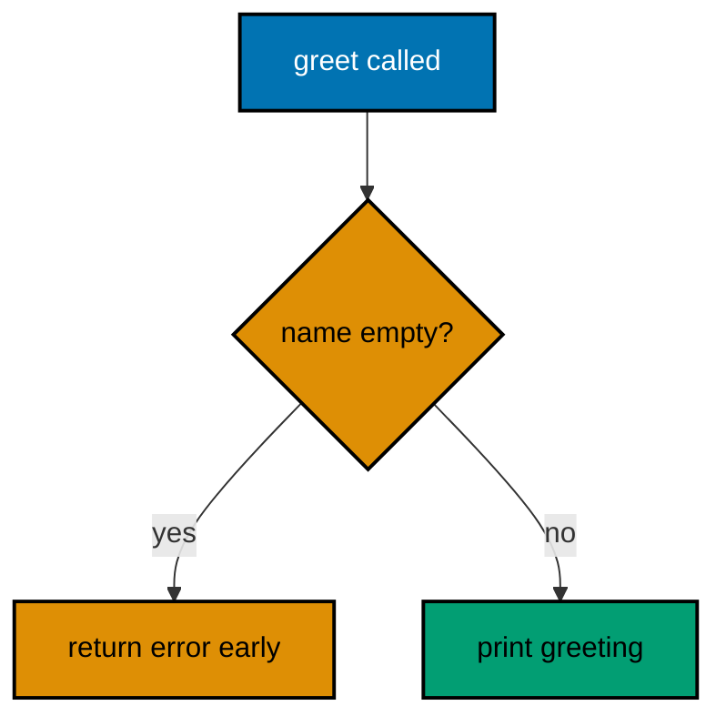

**`learning/code/ex-01-early-return-hello/main.go`**:

```go
// Example 1: Hello with an Early Return.
//
// Go checks the failure first and returns it, so the happy path stays
// at the left margin instead of nesting inside an if block.
package main

import (
	"errors" // => builds the failure value this example returns early
	"fmt"    // => prints the greeting on the happy path only
)

// greet refuses an empty name before it ever prints anything.
// => the signature returns only an error: nothing else to report
// => callers handle the failure where the call happens, not far away
func greet(name string) error { // => error return is data, not an exception
	// => guard clause first: the failure case is decided up front
	if name == "" { // => the one input this function cannot serve
		// => construct the failure value and leave immediately
		return errors.New("name is empty") // => errors.New makes a simple sentinel
	}
	// => past the guard, the name is safe to use without further checks
	fmt.Println("hello,", name) // => happy path stays flat at the margin
	return nil                  // => nil error means success in Go
}

func main() {
	// => call and check in one statement: the idiomatic if-err pattern
	if err := greet(""); err != nil { // => empty name trips the guard clause
		fmt.Println("error:", err) // => print the failure the guard returned
	}
	// => same call shape, valid input: success prints inside greet
	if err := greet("Sari"); err != nil { // => nil error skips this branch
		// => unreachable: a nil error never enters the failure branch
		fmt.Println("error:", err) // => kept so the check shape stays uniform
	}
}
```

**Output** (`learning/code/ex-01-early-return-hello/expected/main.stdout.txt`):

```text
error: name is empty
hello, Sari
```

**Key takeaway**: Check the failure first and return it; the happy path stays flat.

**Why it matters**: Early returns keep nesting shallow, which is why Go code reads as a sequence of guards followed by one straight happy path. The if-err check at the call site makes every failure visible exactly where it can happen.

### Example 2: For Is the Only Loop

Go has exactly one loop keyword, and its three forms cover every repetition: counted, conditional, and infinite with an explicit exit. This example sums a slice three ways so you can match each shape to its job. (Concepts: co-01, co-03.)

**`learning/code/ex-02-for-is-the-only-loop/main.go`**:

```go
// Example 2: For Is the Only Loop.
//
// Go has one loop keyword with three forms: counted, conditional, and
// infinite with an explicit exit. Each form below sums the same slice.
package main

import "fmt" // => prints each of the three totals in turn

func main() {
	nums := []int{1, 2, 3, 4} // => the slice every loop form sums below
	// => counted form: init, condition, and step in one header line
	total := 0 // => accumulator starts at the additive identity
	// => i walks the valid indexes; len keeps the bound always correct
	for i := 0; i < len(nums); i++ { // => classic counted repetition
		total += nums[i] // => add each element by its index
	}
	// => conditional form: the header holds only the stay-in condition
	fmt.Println("counted:", total) // => Output: counted: 10
	left := len(nums)              // => counts down how many elements remain unseen
	// => no init or step here: the body owns all progress bookkeeping
	for left > 0 { // => while-style: repeat until nothing remains
		left-- // => progress lives in the body, easy to forget
	}
	// => infinite form: exit only through an explicit break inside
	fmt.Println("drained:", left) // => Output: drained: 0
	forever := 0                  // => counts iterations of the endless loop
	for {                         // => no condition at all: the body decides when to stop
		forever++ // => do the work first, ask about stopping after
		// => break on a plain condition: the only exit this loop has
		if forever == 3 { // => stop after three passes, no more
			break // => leaves the innermost for immediately
		}
	}
	fmt.Println("broken:", forever) // => Output: broken: 3
}
```

**Output** (`learning/code/ex-02-for-is-the-only-loop/expected/main.stdout.txt`):

```text
counted: 10
drained: 0
broken: 3
```

**Key takeaway**: One keyword covers counted, conditional, and infinite loops.

**Why it matters**: A single loop form means there is only one place to look for iteration bugs. Prefer the counted form when the bound is known, and reserve the infinite form for loops whose exit only makes sense mid-body.

### Example 3: Switch Without a Tag

A Go switch needs no operand: with no tag it switches on truth, which turns a ladder of if-else checks into a flat list of named cases. Cases never fall through unless you ask with fallthrough. (Concepts: co-01, co-14.)

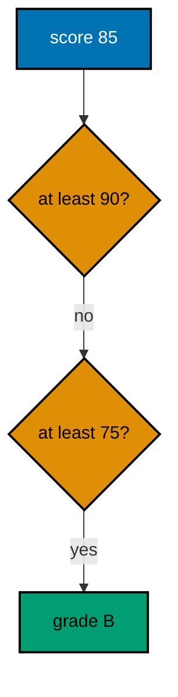

**`learning/code/ex-03-switch-without-a-tag/main.go`**:

```go
// Example 3: Switch Without a Tag.
//
// A switch with no operand switches on truth, turning an if-else ladder
// into a flat list of named cases. Cases never fall through by default.
package main

import "fmt" // => prints the grade exactly one case selects

// grade maps a numeric score to a letter with a truth-switch.
// => ordered cases: the first true one wins, so ranges stay disjoint
// => each case ends the switch automatically: no break needed, ever
func grade(score int) string { // => pure function: same input, same letter
	// => tagless switch: every case is a boolean expression on score
	switch { // => reads as "the first of these that holds, wins"
	// => highest band first, or a lower case would steal its inputs
	case score >= 90: // => top band: 90 and above
		return "A" // => return exits the function, hence the switch
	// => 75 to 89 lands here because 90-plus already returned above
	case score >= 75: // => second band: order is the logic
		return "B" // => one case, one letter, no overlap possible
	// => 60 to 74: the last passing band before the default below
	case score >= 60: // => passing floor for this grading scheme
		return "C" // => every band returns, so no case falls through
	default: // => catches everything no case claimed, including negatives
		return "F" // => default documents the "nothing matched" answer
	}
}

func main() {
	// => one call per band boundary, proving the order does the work
	fmt.Println(grade(95)) // => Output: A
	fmt.Println(grade(85)) // => Output: B
	fmt.Println(grade(55)) // => Output: F
}
```

**Output** (`learning/code/ex-03-switch-without-a-tag/expected/main.stdout.txt`):

```text
A
B
F
```

**Key takeaway**: A tagless switch lists truth cases; the first true one wins.

**Why it matters**: Truth switches make range logic read top-down instead of nesting, and the no-fallthrough default removes a whole class of C-style bugs. Order the cases from narrowest to widest so each band means what it says.

### Example 4: Slices Grow on Append

A slice is a view over an array plus a length, and append grows that view, copying to a bigger array only when capacity runs out. This example watches length and capacity change across appends. (Concepts: co-03.)

**`learning/code/ex-04-slices-grow-on-append/main.go`**:

```go
// Example 4: Slices Grow on Append.
//
// A slice is a view over an array plus a length. Append grows the view,
// copying to a bigger array only when the capacity runs out.
package main

import "fmt" // => prints length and capacity after every growth step

func main() {
	// => len 0, cap 0: the nil slice, valid and ready to append to
	var names []string // => nil slice: append works, indexing does not yet
	// => len reports visible elements; cap reports room before copying
	fmt.Println(len(names), cap(names)) // => Output: 0 0
	// => append returns the new view: always keep its result, never drop it
	names = append(names, "sari") // => first element: allocates an array of 1
	// => capacity doubling is the runtime's growth policy, not a promise
	fmt.Println(len(names), cap(names)) // => Output: 1 1
	// => two appends at once: the view grows by two in a single call
	names = append(names, "budi", "citra") // => len 3 now exceeds cap 1: copy
	// => the copy moved elements to a roomier array invisibly to you
	fmt.Println(len(names), cap(names)) // => Output: 3 4
	// => reslicing narrows the view; the array underneath is untouched
	first := names[:1] // => shares the same backing array, no copying
	// => len counts the view, so first sees one element of the same three
	fmt.Println(len(first), first[0]) // => Output: 1 sari
}
```

**Output** (`learning/code/ex-04-slices-grow-on-append/expected/main.stdout.txt`):

```text
0 0
1 2
3 4
1 sari
```

**Key takeaway**: Append returns the grown view; capacity doubling is an implementation detail.

**Why it matters**: Keeping append's result is the one rule that prevents stale-slice bugs, and reslicing without copying is what makes windowed processing cheap. Check capacity only for performance reasoning, never for correctness.

### Example 5: Maps Return Two Values

A map lookup returns the value plus a boolean that says whether the key was present, which separates a stored zero from a missing key. This example builds a tiny stock ledger that never confuses the two. (Concepts: co-03, co-01.)

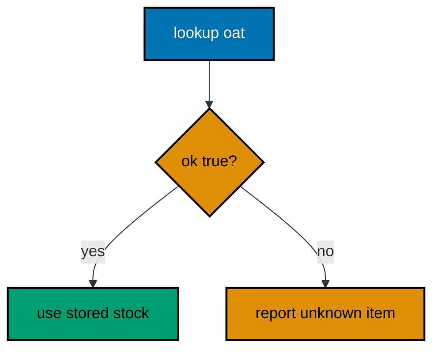

**`learning/code/ex-05-maps-return-two-values/main.go`**:

```go
// Example 5: Maps Return Two Values.
//
// A map lookup returns the value plus a presence flag, separating a stored
// zero from a missing key. The flag, not the value, decides the branch.
package main

import "fmt" // => prints stock answers for present and missing keys alike

func main() {
	// => literal construction: keys and starting stock in one expression
	stock := map[string]int{"rice": 40, "oat": 0} // => oat is present but empty
	// => the comma-ok idiom: value first, presence flag second, always
	qty, ok := stock["oat"] // => qty 0, ok true: present with zero stock
	// => branch on ok, never on qty: zero is a legitimate stored value
	if ok { // => the key exists, so the count is trustworthy
		// => Println takes mixed args: label the number for the reader
		fmt.Println("oat stock:", qty) // => Output: oat stock: 0
	}
	// => same lookup shape for a key nobody ever stored under
	qty, ok = stock["tea"] // => qty 0, ok false: absent, zero means nothing
	// => without ok, tea's zero would look exactly like oat's zero
	if !ok { // => absence is its own answer, distinct from "none left"
		fmt.Println("tea unknown") // => Output: tea unknown
	}
	// => assignment through the key inserts or replaces unconditionally
	stock["tea"] = 12 // => now tea exists: a later lookup reports ok true
	// => delete removes a key; looking it up afterwards reports ok false
	delete(stock, "rice")   // => rice is gone: presence flag flips to false
	fmt.Println(len(stock)) // => Output: 2
}
```

**Output** (`learning/code/ex-05-maps-return-two-values/expected/main.stdout.txt`):

```text
oat stock: 0
tea unknown
2
```

**Key takeaway**: Branch on the presence flag, never on the value alone.

**Why it matters**: Zero values are valid data in Go maps, so only the comma-ok flag can tell 'stored zero' from 'never seen'. Deleting and re-adding through the same key keeps one code shape for the whole key lifecycle.

### Example 6: Range Gives Index and Copy

Range hands you the index and a copy of each element, so mutating the loop variable never touches the slice. This example shows the copy rule, then shows index-based mutation as the fix. (Concepts: co-03.)

**`learning/code/ex-06-range-gives-index-and-copy/main.go`**:

```go
// Example 6: Range Gives Index and Copy.
//
// Range hands you the index plus a COPY of each element, so writing to the
// loop variable never touches the slice. Index back in to mutate it.
package main

import "fmt" // => prints the slice before and after each loop style

func main() {
	// => five scores; the loops below try two ways to add a bonus point
	scores := []int{70, 75, 80} // => shared input for both loop styles
	// => v is a fresh copy per pass: assigning it changes nothing stored
	for _, v := range scores { // => blank index: values only, still copies
		v++ // => increments the copy, then discards it: a silent no-op
	}
	// => the slice is untouched: the copy rule bit exactly as documented
	fmt.Println(scores) // => Output: [70 75 80]
	// => i is the position: writing through it reaches the backing array
	for i := range scores { // => index only: no copies made at all
		// => scores[i] names the stored element, not a throwaway copy
		scores[i]++ // => mutation lands where later reads can see it
	}
	// => every element grew by one: index writes are the mutation path
	fmt.Println(scores) // => Output: [71 76 81]
	// => range over a map visits keys in no promised order, by design
	seen := map[string]int{"a": 1, "b": 2} // => tiny map for the order demo
	// => count visits instead of printing order: order is not contractual
	n := 0                // => visit counter: proves both keys arrived, order aside
	for k := range seen { // => single variable ranges map keys
		_ = k // => used only to visit: the blank-free discard silences vet
		n++   // => one increment per visited key, whatever the order
	}
	fmt.Println("visited:", n) // => Output: visited: 2
}
```

**Output** (`learning/code/ex-06-range-gives-index-and-copy/expected/main.stdout.txt`):

```text
[70 75 80]
[71 76 81]
visited: 2
```

**Key takeaway**: Range copies values; mutate through the index instead.

**Why it matters**: Range copies keep loop bodies safe from accidental aliasing, and the unspecified map order forces code that cannot depend on luck. When you need mutation, the index form says so explicitly.

### Example 7: Sort with sort.Slice

The standard library sorts any slice when you supply a less function, so custom ordering lives in one small predicate. This example ranks contributors by commits, then by name as the tiebreak. (Concepts: co-03, co-04.)

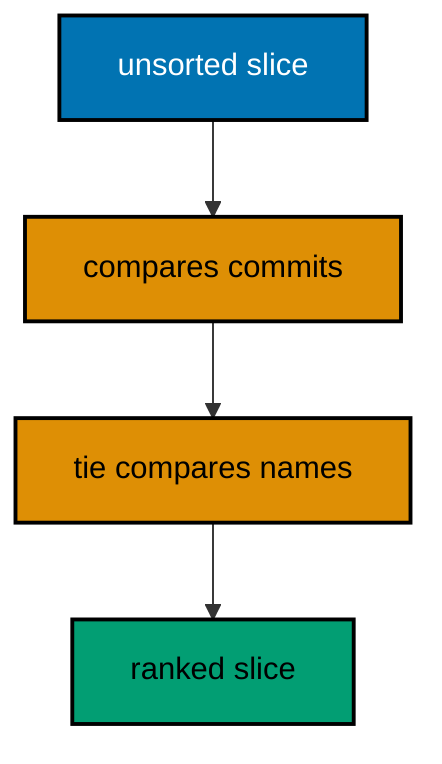

**`learning/code/ex-07-sort-with-sort-slice/main.go`**:

```go
// Example 7: Sort with sort.Slice.
//
// The standard library sorts any slice when you supply a less function,
// so custom ordering lives in one small predicate you can read aloud.
package main

import (
	"fmt"  // => prints the ranking before and after the sort call
	"sort" // => Slice sorts in place using your less predicate
)

// Dev pairs a handle with a commit count for the ranking below.
// => struct groups related fields; less reads them, never reorders them
type Dev struct { // => exported fields: sortable from any package
	Name    string // => tiebreak key, compared only when commits tie
	Commits int    // => primary key: more commits ranks higher
}

func main() {
	// => deliberately unordered input, with one commit-count tie inside
	team := []Dev{{"citra", 30}, {"sari", 41}, {"budi", 30}} // => budi ties citra
	// => Slice sorts in place: no copy is returned, the input is arranged
	// => less(i, j) answers "should element i come before element j"
	sort.Slice(team, func(i, j int) bool { // => closure captures nothing here
		// => primary key first: higher commits sort earlier, hence !=
		if team[i].Commits != team[j].Commits { // => tie test guards the tiebreak
			return team[i].Commits > team[j].Commits // => descending commits
		}
		// => tiebreak only runs on ties: alphabetical by handle, ascending
		return team[i].Name < team[j].Name // => budi precedes citra on 30
	})
	// => ranked: sari 41 first, then the 30-tie broken alphabetically
	fmt.Println(team) // => Output: [{sari 41} {budi 30} {citra 30}]
	// => IsSorted reuses the same predicate to verify the result cheaply
	ok := sort.SliceIsSorted(team, func(i, j int) bool { // => same order rule
		// => identical body: verification must use the identical predicate
		if team[i].Commits != team[j].Commits { // => same primary key first
			return team[i].Commits > team[j].Commits // => same descending rule
		}
		return team[i].Name < team[j].Name // => same alphabetical tiebreak
	})
	fmt.Println("sorted:", ok) // => Output: sorted: true
}
```

**Output** (`learning/code/ex-07-sort-with-sort-slice/expected/main.stdout.txt`):

```text
[{sari 41} {budi 30} {citra 30}]
sorted: true
```

**Key takeaway**: One less predicate owns the whole ordering, including ties.

**Why it matters**: Putting primary key and tiebreak in a single less function keeps the order in exactly one place, and reusing it in IsSorted turns the specification into its own check. Sort in place when the input order is yours to spend.

### Example 8: Defer Runs Last In, First Out

Deferred calls run when the function returns, in reverse order of registration, which makes cleanup read like a stack unwind. This example traces three defers to prove the LIFO order. (Concepts: co-01.)

**`learning/code/ex-08-defer-runs-last-in-first-out/main.go`**:

```go
// Example 8: Defer Runs Last In, First Out.
//
// Deferred calls run when the function returns, in reverse registration
// order. Cleanup therefore reads like a stack unwind: last opened first.
package main

import "fmt" // => traces registration order against execution order

// trace registers three cleanups, then returns so they fire in LIFO order.
// => defers run after the return value is set but before control leaves
// => arguments evaluate NOW: each Println below captures its label eagerly
func trace() { // => no return values: the trace is pure side effect
	// => registered first, runs last: the outermost resource would go here
	defer fmt.Println("close database") // => fires third: opened first
	// => registered second: a middle layer like a transaction boundary
	defer fmt.Println("commit work") // => fires second: middle of the stack
	// => registered last, runs first: the innermost cleanup goes here
	defer fmt.Println("close file") // => fires first: opened last
	// => body ends: return is implicit, then the three defers unwind
	fmt.Println("body done") // => Output first: defers wait for the return
}

func main() {
	// => one call shows all four lines in their true execution order
	trace() // => body line first, then the three defers in reverse
}
```

**Output** (`learning/code/ex-08-defer-runs-last-in-first-out/expected/main.stdout.txt`):

```text
body done
close file
commit work
close database
```

**Key takeaway**: Defers unwind in reverse: last registered runs first.

**Why it matters**: LIFO cleanup mirrors acquisition order, so the resource opened last is released first without any explicit bookkeeping. Defer the close right after a successful open and the pairing can never drift apart.

### Example 9: Return the Error, Not the Exception

Go functions report failure as an ordinary return value, and the caller decides what it means at the call site. This example divides safely and shows both the success and failure paths. (Concepts: co-02.)

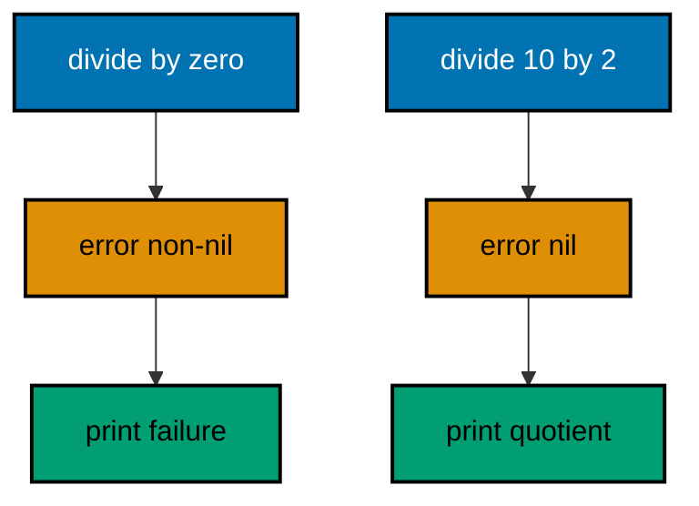

**`learning/code/ex-09-return-the-error/main.go`**:

```go
// Example 9: Return the Error, Not the Exception.
//
// Go reports failure as an ordinary return value, and the caller decides
// what it means at the call site. No throw, no catch, no hidden path.
package main

import (
	"errors" // => builds the divide-by-zero failure value below
	"fmt"    // => prints the quotient or the failure, never both
)

// divide guards the one input pair it cannot serve: a zero divisor.
// => (int, error) is the conventional shape: result first, failure second
// => callers must name the error: ignoring it is a visible choice, not luck
func divide(a, b int) (int, error) { // => two results: value plus failure
	// => the guard names the exact precondition arithmetic requires
	if b == 0 { // => division by zero is undefined, so refuse it here
		// => zero value plus failure: the caller must check before using q
		return 0, errors.New("divide by zero") // => caller sees both halves
	}
	// => only reachable with a nonzero divisor: the math is safe now
	return a / b, nil // => quotient plus nil: success needs no comment
}

func main() {
	// => success path first: valid input yields a quotient and nil error
	q, err := divide(10, 2) // => q 5, err nil: both halves carry meaning
	// => check before use: reading q while err is set is the classic bug
	if err != nil { // => nil skips this: success stays on the margin
		fmt.Println("error:", err) // => unreachable on this input
	} else {
		fmt.Println("quotient:", q) // => Output: quotient: 5
	}
	// => failure path: zero divisor yields zero value plus a real error
	q, err = divide(10, 0) // => q 0, err set: q is meaningless until checked
	// => same check shape: the call site treats both outcomes uniformly
	if err != nil { // => non-nil error takes the failure branch here
		fmt.Println("error:", err) // => Output: error: divide by zero
	}
}
```

**Output** (`learning/code/ex-09-return-the-error/expected/main.stdout.txt`):

```text
quotient: 5
error: divide by zero
```

**Key takeaway**: Failure is a return value; check it before touching the result.

**Why it matters**: Returning errors as values keeps every failure path explicit and local, which is why Go programs rarely surprise you from three calls away. The (value, error) shape is a contract: check second, use first.

### Example 10: Sentinel Errors with errors.New

A sentinel error is a package-level value callers compare against, so one well-known failure stays recognizable through every layer. This example models an employee lookup that reports a missing record the caller can test with ==. (Concepts: co-02.)

**`learning/code/ex-10-sentinel-errors/main.go`**:

```go
// Example 10: Sentinel Errors with errors.New.
//
// A sentinel error is a package-level value callers compare against, so one
// well-known failure stays recognizable through every layer that returns it.
package main

import (
	"errors" // => builds the single shared sentinel value below
	"fmt"    // => prints the found name or the sentinel-triggered message
)

// ErrNotFound is the one "missing record" failure this package reports.
// => exported so callers in other packages can compare against it too
// => created once: identity comparison only works on a shared instance
var ErrNotFound = errors.New("employee not found") // => the sentinel itself

// directory maps employee IDs to names for the lookup below.
// => package-level map: the tiny "database" every lookup reads from
var directory = map[string]string{"e1": "Sari"} // => only e1 exists here

// find returns the name for an ID, or the sentinel when the ID is absent.
// => returning the shared value (not a fresh copy) preserves comparability
func find(id string) (string, error) { // => familiar (value, error) shape
	// => comma-ok again: presence decides, the value only follows
	name, ok := directory[id] // => missing key yields "" plus ok false
	// => absence maps to the sentinel: one failure, one meaning, everywhere
	if !ok { // => unknown ID: translate absence into the shared error
		return "", ErrNotFound // => same instance every time, by construction
	}
	return name, nil // => present: the name plus a nil error
}

func main() {
	// => present ID: the value path, sentinel never appears
	if name, err := find("e1"); err != nil { // => nil error skips the branch
		fmt.Println("error:", err) // => unreachable: e1 is in the map
	} else {
		fmt.Println("found:", name) // => Output: found: Sari
	}
	// => absent ID: compare the result against the sentinel, not its text
	if _, err := find("e9"); err == ErrNotFound { // => identity comparison
		// => == works because every layer returns the same instance
		fmt.Println("missing record") // => Output: missing record
	}
}
```

**Output** (`learning/code/ex-10-sentinel-errors/expected/main.stdout.txt`):

```text
found: Sari
missing record
```

**Key takeaway**: One shared error value lets callers test failure with ==.

**Why it matters**: Sentinels turn 'not found' into a stable contract instead of string matching, so refactors of the message never break callers. Create the value once at package level; fresh copies would defeat comparison.

### Example 11: Wrap with Percent-W for Context

Wrapping adds the caller's context to an error while keeping the original reachable underneath. The %w verb links the chain; %v would only print it and break the link. (Concepts: co-02.)

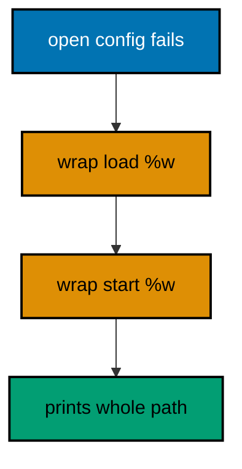

**`learning/code/ex-11-wrap-with-percent-w/main.go`**:

```go
// Example 11: Wrap with Percent-W for Context.
//
// Wrapping adds the caller's context while keeping the original reachable
// underneath. %w links the chain; %v would only print it and cut the link.
package main

import (
	"errors" // => the root failure this example wraps twice
	"fmt"    // => prints the fully wrapped chain in one line
)

// readConfig fails the way a missing file would: one root cause, no context.
// => low-level functions report WHAT failed; callers add WHERE and WHY
func readConfig() error { // => single error return: nothing else to say
	// => errors.New at the bottom: the chain starts with a plain cause
	return errors.New("config.json missing") // => root cause, context-free
}

// loadConfig adds the layer that needed the file: the loading step itself.
// => each layer wraps once: context accumulates exactly one frame per call
func loadConfig() error { // => same shape: wrap and pass upward
	// => %w preserves the chain; the prefix names this layer's context
	if err := readConfig(); err != nil { // => the root cause arrives here
		// => "load config:" tells the reader which step owned the failure
		return fmt.Errorf("load config: %w", err) // => linked, not flattened
	}
	return nil // => unreachable here, kept for the uniform check shape
}

func main() {
	// => the top layer wraps once more: now the chain names the whole path
	if err := loadConfig(); err != nil { // => wrapped cause arrives here
		// => second wrap: the outermost context is the program starting up
		wrapped := fmt.Errorf("start service: %w", err) // => chain of three
		// => printing walks the chain: every layer's context in order
		fmt.Println(wrapped) // => Output: start service: load config: config.json missing
	}
}
```

**Output** (`learning/code/ex-11-wrap-with-percent-w/expected/main.stdout.txt`):

```text
start service: load config: config.json missing
```

**Key takeaway**: %w links context layers; %v would only print and cut the chain.

**Why it matters**: Wrapped chains read like a stack trace written by the program itself, with each frame naming the layer that added it. Wrap at layer boundaries only; wrapping every line buries the signal in repetition.

### Example 12: Match Wrapped Errors with errors.Is

Once errors are wrapped, == stops working, and errors.Is takes over: it walks the whole chain looking for the sentinel. This example reuses the wrapping habit and proves the match survives two layers. (Concepts: co-02.)

**`learning/code/ex-12-match-wrapped-errors/main.go`**:

```go
// Example 12: Match Wrapped Errors with errors.Is.
//
// Once errors are wrapped, == stops working and errors.Is takes over: it
// walks the whole chain looking for the sentinel, however deep it sits.
package main

import (
	"errors" // => Is walks chains built from errors made here
	"fmt"    // => prints whether each chain contains the sentinel
)

// ErrEmpty is the sentinel this example buries under two wraps on purpose.
// => shared instance again: Is compares identity at every chain link
var ErrEmpty = errors.New("nothing to save") // => the needle for Is below

// save refuses empty payloads with the sentinel, wrapped once for context.
// => one wrap here stands for "the repository layer added its context"
func save(payload string) error { // => (nothing, error): only failure matters
	// => empty input is the domain failure this function owns outright
	if payload == "" { // => guard on the input before any work starts
		// => wrap once: the sentinel travels with its first context frame
		return fmt.Errorf("save record: %w", ErrEmpty) // => chain of two
	}
	return nil // => non-empty payload: nothing to report
}

func main() {
	// => the caller wraps AGAIN, the way real call stacks accumulate frames
	err := save("") // => chain: caller context -> save context -> sentinel
	// => add the outermost frame exactly as a service entry point would
	if err != nil { // => always non-nil here: the payload was empty
		err = fmt.Errorf("handle request: %w", err) // => chain of three now
	}
	// => == compares only the top link: the outer wrap is a different value
	fmt.Println("equal:", err == ErrEmpty) // => Output: equal: false
	// => Is unwraps link by link until it finds the sentinel's identity
	fmt.Println("matches:", errors.Is(err, ErrEmpty)) // => Output: matches: true
	// => a sentinel never placed in the chain correctly reports absence
	fmt.Println("other:", errors.Is(err, errors.New("x"))) // => Output: other: false
}
```

**Output** (`learning/code/ex-12-match-wrapped-errors/expected/main.stdout.txt`):

```text
equal: false
matches: true
other: false
```

**Key takeaway**: errors.Is walks the wrap chain; == only sees the top link.

**Why it matters**: Is keeps matching working as layers add context, which is exactly why wrapping is safe to do freely at boundaries. Test behavior with the sentinel, never by comparing message text that wording edits can break.

### Example 13: Extract Details with errors.As

Some failures carry data, not just identity: a custom type with fields for what went wrong and where. errors.As finds that typed link in the chain so the caller can read its fields. (Concepts: co-02, co-10.)

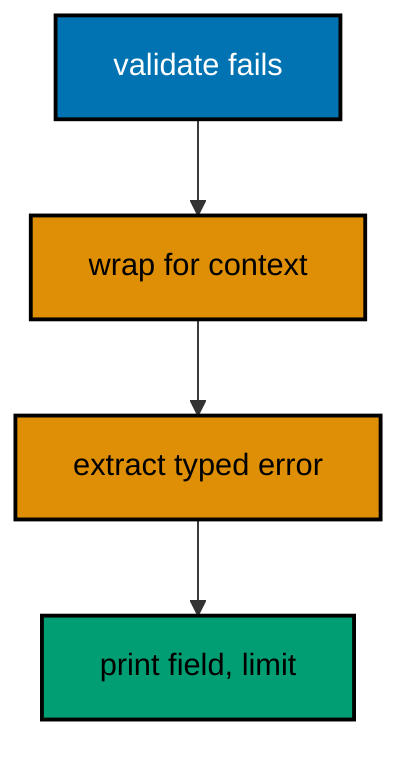

**`learning/code/ex-13-extract-details-with-errors-as/main.go`**:

```go
// Example 13: Extract Details with errors.As.
//
// Some failures carry data, not just identity. errors.As finds the typed
// link in the chain so the caller can read its fields and react precisely.
package main

import (
	"errors" // => As walks the chain looking for the target type
	"fmt"    // => prints the extracted field and the offending limit
)

// FieldError reports WHICH input failed and the limit it broke.
// => struct, not string: the failure carries machine-readable detail
// => pointer receiver below: As needs a *FieldError target to fill in
type FieldError struct { // => the typed failure this chain will carry
	Field string // => which input broke the rule, e.g. "retries"
	Limit int    // => the boundary it crossed, for the message and the fix
}

// Error satisfies the error interface: message first, data stays on fields.
// => one method makes *FieldError an error: Error() string, nothing more
func (e *FieldError) Error() string { // => pointer receiver matches As target
	// => Sprintf formats the human message from the machine-readable fields
	return fmt.Sprintf("%s exceeds limit %d", e.Field, e.Limit) // => e.g. retries exceeds limit 3
}

// check rejects retry counts above the policy limit with a typed failure.
// => returns the concrete type; callers needing detail use As to find it
func check(retries int) error { // => error interface hides the concrete type
	// => the policy lives here: three retries, no more, for this service
	if retries > 3 { // => breach: build the typed failure with its data
		// => &FieldError: pointer so As can match *FieldError below
		return &FieldError{Field: "retries", Limit: 3} // => data, not text
	}
	return nil // => within policy: nothing to report
}

func main() {
	// => wrap the typed failure the way a middleware layer naturally would
	err := check(9) // => typed failure arrives, concrete type hidden in error
	// => wrap once: proves As sees through context frames to the data
	if err != nil { // => 9 exceeds 3, so err is always set here
		err = fmt.Errorf("apply policy: %w", err) // => context over the data
	}
	// => As target: pointer to a *FieldError variable for As to fill in
	var detail *FieldError // => nil until As finds the typed link
	// => As walks the chain: first *FieldError link wins and fills detail
	if errors.As(err, &detail) { // => true: the chain carries a *FieldError
		// => fields are now readable: react to data, not to message text
		fmt.Println(detail.Field, detail.Limit) // => Output: retries 3
	}
}
```

**Output** (`learning/code/ex-13-extract-details-with-errors-as/expected/main.stdout.txt`):

```text
retries 3
```

**Key takeaway**: errors.As recovers typed data from anywhere in the chain.

**Why it matters**: Typed errors let callers branch on structured facts like field names and limits instead of parsing sentences. Keep the type small and its fields exported, or the detail is visible to nobody but the message.

### Example 14: Custom Error Types Carry Fields

A custom error type pairs a message with the values needed to fix the problem: which account, how much was asked, how much exists. This example declines an overdraft with all three facts attached. (Concepts: co-02, co-10.)

**`learning/code/ex-14-custom-error-types/main.go`**:

```go
// Example 14: Custom Error Types Carry Fields.
//
// A custom error type pairs a message with the values needed to fix the
// problem: which account, how much was asked, how much actually exists.
package main

import "fmt" // => prints the decline message plus the shortfall math

// Overdraft reports a withdrawal the balance cannot cover, with numbers.
// => value type (not pointer): small, copyable, comparable field by field
type Overdraft struct { // => the domain failure, fully self-describing
	Account string // => which account refused: the routing fact
	Want    int    // => how much was asked: the request fact
	Have    int    // => how much exists: the constraint fact
}

// Error renders the human sentence from the three machine-readable facts.
// => value receiver: both Overdraft and *Overdraft satisfy error this way
func (e Overdraft) Error() string { // => one method joins the error interface
	// => Sprintf keeps message formatting in exactly one place per type
	return fmt.Sprintf("account %s: want %d, have %d", e.Account, e.Want, e.Have)
}

// withdraw subtracts when the balance covers it, or declines with the facts.
// => returns the concrete type directly: callers CAN compare or extract it
func withdraw(balances map[string]int, account string, amount int) error {
	// => read the balance first: the decision needs the current number
	have := balances[account] // => zero when the account never existed
	// => the policy in one comparison: want more than have means decline
	if amount > have { // => breach: build the failure WITH its evidence
		// => struct literal carries all three facts: no text parsing later
		return Overdraft{Account: account, Want: amount, Have: have}
	}
	// => covered: mutate the ledger and report success with nil
	balances[account] = have - amount // => the only mutation lives here
	return nil                        // => nil error: the withdrawal landed
}

func main() {
	// => ledger with one funded account for the two attempts below
	balances := map[string]int{"sari": 100} // => 100 units, single account
	// => covered withdrawal: balance drops, error stays nil
	if err := withdraw(balances, "sari", 40); err != nil { // => 40 <= 100
		fmt.Println("unexpected:", err) // => unreachable on this input
	} else {
		fmt.Println("balance:", balances["sari"]) // => Output: balance: 60
	}
	// => overdraft: the failure carries account, want, and have together
	if err := withdraw(balances, "sari", 90); err != nil { // => 90 > 60
		fmt.Println(err) // => Output: account sari: want 90, have 60
	}
}
```

**Output** (`learning/code/ex-14-custom-error-types/expected/main.stdout.txt`):

```text
balance: 60
account sari: want 90, have 60
```

**Key takeaway**: Put the fix facts on the error type, not just in its message.

**Why it matters**: A struct error answers 'what now?' with fields the caller can compute on, while a bare message only answers 'what happened?'. Value receivers keep small error types copyable and comparable without pointer setup.

### Example 15: Join Independent Failures

When several independent validations run, errors.Join bundles every failure into one error instead of stopping at the first. Callers still match each part with Is and As. (Concepts: co-02.)

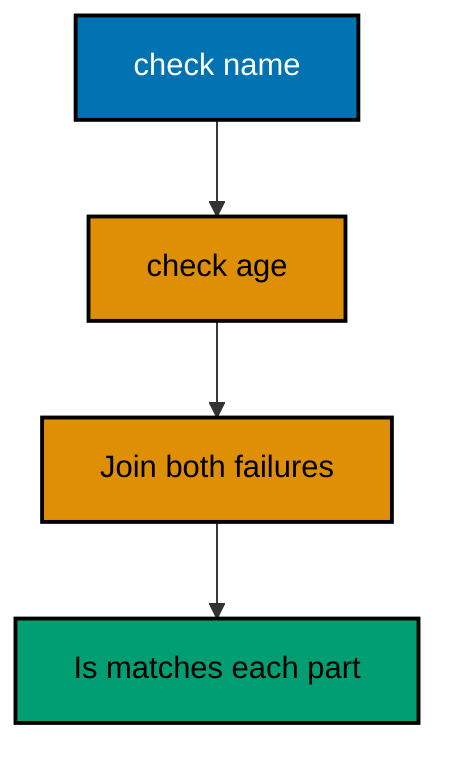

**`learning/code/ex-15-join-independent-failures/main.go`**:

```go
// Example 15: Join Independent Failures.
//
// When several independent validations run, errors.Join bundles every failure
// into one error instead of stopping at the first. Is and As still match parts.
package main

import (
	"errors" // => Join bundles; Is still matches each bundled part
	"fmt"    // => prints the joined message and each individual verdict
)

// validateName and validateAge fail independently: neither gates the other.
// => separate functions: each owns exactly one rule and one message
func validateName(name string) error { // => nil when the rule holds
	// => empty names are rejected: the rule in one comparison
	if name == "" { // => violation: build this check's own failure
		return errors.New("name is empty") // => standalone error value
	}
	return nil // => rule holds: contribute nothing to the join
}

// validateAge rejects negative ages with its own independent failure value.
func validateAge(age int) error { // => same shape: nil or one failure
	// => negative ages are impossible: the rule in one comparison
	if age < 0 { // => violation: this check's failure, built the same way
		return errors.New("age is negative") // => standalone error value
	}
	return nil // => rule holds: contribute nothing to the join
}

func main() {
	// => run BOTH checks even though the first already failed: no short-circuit
	// => nil results contribute nothing: Join skips nils silently by design
	err := errors.Join(validateName(""), validateAge(-2)) // => two failures in one
	// => joined message concatenates parts with newlines, in join order
	fmt.Println(err) // => Output: name is empty
	// => age is negative (errors.Join separates parts with newlines)
	// => Is sees THROUGH the join: each part still matches individually
	fmt.Println(errors.Is(err, validateName(""))) // => Output: true
	// => different message, different value: correctly reports no match
	fmt.Println(errors.Is(err, errors.New("other"))) // => Output: false
}
```

**Output** (`learning/code/ex-15-join-independent-failures/expected/main.stdout.txt`):

```text
name is empty
age is negative
false
false
```

**Key takeaway**: Join collects every failure; Is still matches each part.

**Why it matters**: Reporting all violations at once respects the user's time: one fix pass instead of one error per attempt. Join only independent checks; dependent steps still stop at the first failure with plain wrapping.

### Example 16: Panic Stays at the Boundary

Panic is for programmer errors, and recover belongs at the boundary that converts it back into an ordinary error. Library code returns errors; only the top-level handler recovers. (Concepts: co-02, co-01.)

**`learning/code/ex-16-panic-at-the-boundary/main.go`**:

```go
// Example 16: Panic Stays at the Boundary.
//
// Panic is for programmer errors, and recover belongs at the boundary that
// converts it back into an ordinary error. Libraries return errors instead.
package main

import "fmt" // => prints the recovered boundary message, then the normal path

// mustPositive panics on bad input the way a must-style helper would.
// => panic signals a PROGRAMMER bug: the caller broke the documented contract
// => never panic for user input or I/O: those are ordinary error returns
func mustPositive(n int) int { // => no error return: panic is the failure mode
	// => violated precondition: the caller promised a positive number
	if n <= 0 { // => contract breach, not a runtime surprise: panic fits
		panic("mustPositive: n must be positive") // => unwinds to the boundary
	}
	return n // => contract holds: the value passes straight through
}

// runBoundary is the recover boundary: deferred recover converts panic to error.
// => named return err: the deferred function assigns it during the unwind
// => only the boundary recovers: inner code stays panic-free and simple
func runBoundary(n int) (err error) { // => named err: recover assigns it
	// => deferred closure runs during panic unwind, before runBoundary exits
	defer func() { // => anonymous func: recover only works directly inside defer
		// => recover stops the unwind and reports what the panic carried
		if r := recover(); r != nil { // => nil means no panic: leave err alone
			// => convert: the panic value becomes an ordinary error return
			err = fmt.Errorf("recovered: %v", r) // => boundary translates panic
		}
	}()
	// => the risky call: panics here jump straight to the deferred closure
	mustPositive(n) // => n <= 0 panics; positive returns normally
	return nil      // => no panic: success flows through untouched
}

func main() {
	// => contract breach: panic unwinds, the boundary converts it to error
	if err := runBoundary(0); err != nil { // => recovered, not crashed
		fmt.Println(err) // => Output: recovered: mustPositive: n must be positive
	}
	// => contract holds: no panic, nil error, nothing recovered
	if err := runBoundary(5); err != nil { // => nil skips this branch
		fmt.Println("unexpected:", err) // => unreachable: 5 is positive
	} else {
		fmt.Println("ok") // => Output: ok
	}
}
```

**Output** (`learning/code/ex-16-panic-at-the-boundary/expected/main.stdout.txt`):

```text
recovered: mustPositive: n must be positive
ok
```

**Key takeaway**: Recover only at the boundary; inner code returns errors.

**Why it matters**: Confining recover to entry points keeps panics from becoming hidden control flow, while must-style helpers stay ergonomic for truly constant inputs. If user data can trigger it, return an error instead.

### Example 17: Handle Errors Inside Defer

Deferred cleanup can fail too, and ignoring that failure hides data loss: a failed file close can mean unwritten bytes. This example merges a close error into the named return. (Concepts: co-02, co-01.)

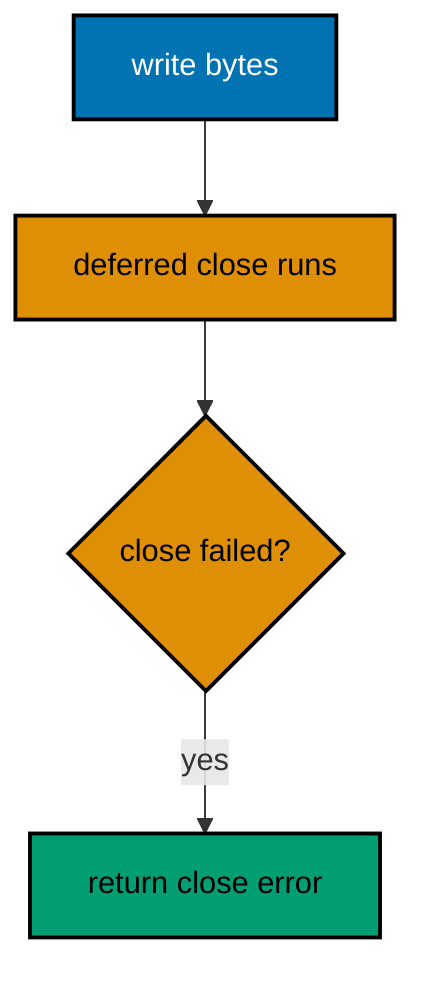

**`learning/code/ex-17-handle-errors-in-defer/main.go`**:

```go
// Example 17: Handle Errors Inside Defer.
//
// Deferred cleanup can fail too, and ignoring it hides data loss: a failed
// close can mean unwritten bytes. Merge the close error into the return.
package main

import (
	"errors" // => Join merges the write error with the close error
	"fmt"    // => prints which of the two operations the caller sees fail
	"os"     // => CreateTemp and file writes stand in for real file work
)

// save writes text to a temp file, refusing to ignore EITHER failure.
// => named return err: both the body and the defer assign into it
// => *os.File close can fail after a successful write: check it anyway
func save(text string) (err error) { // => named err shared with the defer
	// => CreateTemp puts the file in the OS temp dir: no repo litter
	f, err := os.CreateTemp("", "ex17-*.txt") // => real file, temp location
	// => open failure: nothing to clean up, return the error directly
	if err != nil { // => temp dir unwritable is an environment failure
		return err // => no file exists, so no deferred close is registered
	}
	// => deferred closure: close the file AND merge a close failure upward
	// => closure (not f.Close directly): a bare defer cannot see the error
	defer func() { // => runs after the body, before save returns to main
		// => Close flushes buffered data: its error can mean lost bytes
		if cerr := f.Close(); cerr != nil { // => close failed: do not swallow
			// => Join keeps both: a body error plus a close error stay visible
			err = errors.Join(err, cerr) // => nil body error joins cleanly too
		}
	}()
	// => remove the temp file: theBytes were proven writable, path is temp
	defer os.Remove(f.Name()) // => second defer runs FIRST: removes before close
	// => the real work: one write whose error the named return carries
	if _, err = f.WriteString(text); err != nil { // => write failure returns
		return err // => deferred close still runs: cleanup is unconditional
	}
	return nil // => success so far: the deferred close has the last word
}

func main() {
	// => happy path: write and close both succeed, error stays nil
	if err := save("hello"); err != nil { // => nil skips this branch
		fmt.Println("unexpected:", err) // => unreachable on success
	} else {
		fmt.Println("saved") // => Output: saved
	}
}
```

**Output** (`learning/code/ex-17-handle-errors-in-defer/expected/main.stdout.txt`):

```text
saved
```

**Key takeaway**: Check deferred close errors; join them into the return.

**Why it matters**: A failed close after a successful write is exactly the data-loss case that silent cleanup hides, so the deferred closure must report it. Named returns plus errors.Join keep both the work error and the cleanup error visible without either overwriting the other.

### Example 18: Build Strings with strings.Builder

Concatenating in a loop with += copies the growing string every time; strings.Builder amortizes that cost the way append does for slices. This example assembles a CSV line without the copying. (Concepts: co-04.)

**`learning/code/ex-18-strings-builder/main.go`**:

```go
// Example 18: Build Strings with strings.Builder.
//
// Concatenating in a loop with += copies the growing string every pass.
// strings.Builder amortizes that cost the way append does for slices.
package main

import (
	"fmt"     // => prints the assembled line and its final length
	"strings" // => Builder is the amortized string accumulator
)

func main() {
	// => cells of one CSV row, joined below without any += copying
	cells := []string{"sari", "41", "jakarta"} // => input: three plain fields
	// => Builder holds a byte slice internally: writes append, never copy
	var b strings.Builder // => zero value is ready: no constructor needed
	// => Grow hints the final size up front: one allocation when known
	b.Grow(20) // => optional: skips even the amortized regrowth here
	// => index loop: every cell but the first earns a leading comma
	for i, c := range cells { // => range gives position and cell together
		// => separator before content: no trailing-comma cleanup afterwards
		if i > 0 { // => first cell skips the separator, the rest take one
			b.WriteString(",") // => WriteString never fails: no error to check
		}
		// => WriteString appends bytes; plain strings need no conversion
		b.WriteString(c) // => the cell itself lands after its separator
	}
	// => String freezes the accumulated bytes into one immutable string
	fmt.Println(b.String()) // => Output: sari,41,jakarta
	// => Len reports accumulated bytes: the Grow hint plus content exactly
	fmt.Println("len:", b.Len()) // => Output: len: 15
}
```

**Output** (`learning/code/ex-18-strings-builder/expected/main.stdout.txt`):

```text
sari,41,jakarta
len: 15
```

**Key takeaway**: Builder amortizes repeated writes; += in a loop copies every pass.

**Why it matters**: The Builder's internal slice is the same growth trick as append, which is why hot string loops switch to it. Grow when the size is knowable, and freeze with String exactly once at the end.

### Example 19: Parse Numbers with strconv

External input arrives as text, and strconv converts it with explicit bit sizes so overflow becomes an error instead of silent wraparound. This example parses a port number and rejects both garbage and out-of-range values. (Concepts: co-04, co-02.)

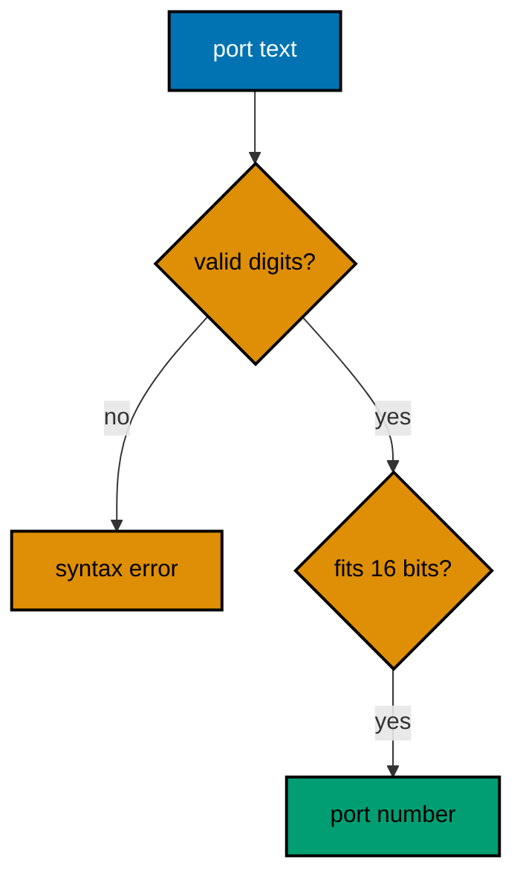

**`learning/code/ex-19-parse-with-strconv/main.go`**:

```go
// Example 19: Parse Numbers with strconv.
//
// External input arrives as text, and strconv converts it with explicit bit
// sizes, so overflow becomes an error instead of a silent wraparound.
package main

import (
	"fmt"     // => prints the parsed port or the precise rejection reason
	"strconv" // => Atoi and ParseUint convert text with explicit widths
)

// parsePort converts port text to a number, rejecting garbage and overflow.
// => bit size 16 matches the TCP port range: the width IS the validation
// => (uint16, error): the width in the signature documents the valid range
func parsePort(text string) (uint16, error) { // => narrow result, honest errors
	// => ParseUint(text, base, bits): base 10, 16 bits for ports 0-65535
	n, err := strconv.ParseUint(text, 10, 16) // => width enforced during parse
	// => two rejections share one path: syntax garbage AND numeric overflow
	if err != nil { // => "abc" fails here, and so does "99999"
		// => %w keeps strconv's detail (syntax vs range) reachable via As
		return 0, fmt.Errorf("bad port %q: %w", text, err) // => context + cause
	}
	// => uint16 conversion is now provably safe: ParseUint already bounded it
	return uint16(n), nil // => narrow only after the width check passed
}

func main() {
	// => valid input: digits inside the 16-bit range convert cleanly
	if port, err := parsePort("8080"); err != nil { // => 8080 fits 16 bits
		fmt.Println("unexpected:", err) // => unreachable: valid port text
	} else {
		fmt.Println("port:", port) // => Output: port: 8080
	}
	// => garbage input: non-digits fail the syntax half of the parse
	if _, err := parsePort("http"); err != nil { // => no digits at all
		fmt.Println("rejected: syntax") // => Output: rejected: syntax
	}
	// => overflow input: digits, but beyond what 16 bits can ever hold
	if _, err := parsePort("99999"); err != nil { // => valid digits, too big
		fmt.Println("rejected: range") // => Output: rejected: range
	}
}
```

**Output** (`learning/code/ex-19-parse-with-strconv/expected/main.stdout.txt`):

```text
port: 8080
rejected: syntax
rejected: range
```

**Key takeaway**: Parse with explicit bit sizes; overflow becomes an error.

**Why it matters**: Choosing the bit size at the parse call turns range validation into a single honest error instead of a wraparound discovered in production. Wrap with %w so callers can still distinguish syntax from range with As.

### Example 20: Format Output with fmt Verbs

The fmt verbs render values for humans (%v), debuggers (%#v), and positional templates (%[1]d); picking the right verb is the whole skill. This example prints one order three ways. (Concepts: co-04.)

**`learning/code/ex-20-format-with-fmt-verbs/main.go`**:

```go
// Example 20: Format Output with fmt Verbs.
//
// The fmt verbs render values for humans (%v), debuggers (%#v), and positional
// templates (%[1]d). Picking the right verb for the audience is the skill.
package main

import "fmt" // => Sprintf builds strings; Printf writes them directly

// Order is the single value this example renders three different ways.
// => struct with two fields: enough shape to show every verb below
type Order struct { // => plain data: verbs do all the rendering work
	ID    int // => numeric field: %d renders it in decimal, %v too
	Total int // => second number: positional verbs will reuse the first
}

func main() {
	// => one order, three audiences: human, debugger, and template
	o := Order{ID: 7, Total: 1500} // => the value every verb below renders
	// => %v: default human rendering, structs as {field values}
	fmt.Printf("human: %v\n", o) // => Output: human: {7 1500}
	// => %#v: Go-syntax rendering, pasteable back into source as a literal
	fmt.Printf("debug: %#v\n", o) // => Output: debug: main.Order{ID:7, Total:1500}
	// => %[1]d reuses argument 1 explicitly: repeat a value without repeating it
	fmt.Printf("repeat: %[1]d twice %[1]d\n", o.ID) // => Output: repeat: 7 twice 7
	// => Sprintf returns the string instead of printing: build, then decide
	s := fmt.Sprintf("order-%d", o.ID) // => zero-padded IDs would use %04d
	fmt.Println(s)                     // => Output: order-7
}
```

**Output** (`learning/code/ex-20-format-with-fmt-verbs/expected/main.stdout.txt`):

```text
human: {7 1500}
debug: main.Order{ID:7, Total:1500}
repeat: 7 twice 7
order-7
```

**Key takeaway**: %v for humans, %#v for debuggers, %[n] to reuse arguments.

**Why it matters**: Matching the verb to the audience keeps logs readable and debug output pasteable, and positional verbs remove the duplicated-argument smell from templated messages. Learn five verbs deeply rather than twenty shallowly.

### Example 21: Match Text with regexp

The regexp package compiles patterns once with MustCompile and reuses them, returning submatches as named or positional groups. This example validates order codes and extracts their parts. (Concepts: co-04.)

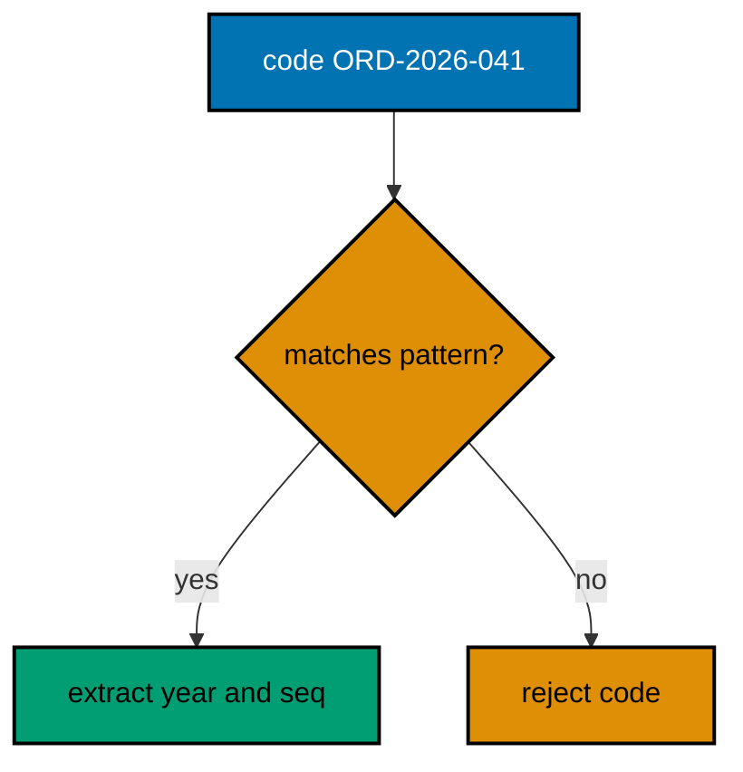

**`learning/code/ex-21-match-text-with-regexp/main.go`**:

```go
// Example 21: Match Text with regexp.
//
// Compile patterns once with MustCompile and reuse them; submatches return
// positional or named groups for extraction, not just yes-or-no answers.
package main

import (
	"fmt"    // => prints the validation verdict and the extracted parts
	"regexp" // => MustCompile once, then MatchString and FindStringSubmatch
)

// codePattern matches order codes like ORD-2026-041 and names their parts.
// => MustCompile at package level: invalid patterns panic at startup, loudly
// => named groups (?P<year>...): extraction by name survives pattern edits
var codePattern = regexp.MustCompile(`^ORD-(?P<year>\d{4})-(?P<seq>\d{3})$`)

// parseCode validates a code and splits it into year and sequence numbers.
// => (string, string, bool): the parts plus a validity flag, no error needed
// => validity is a bool here: callers branch, and only valid codes have parts
func parseCode(code string) (year, seq string, ok bool) { // => named results
	// => FindStringSubmatch returns the full match plus one entry per group
	m := codePattern.FindStringSubmatch(code) // => nil when nothing matches
	// => nil means "no match": validity and extraction share one call
	if m == nil { // => pattern rejected: no parts exist to return
		return "", "", false // => zero parts plus false: nothing to misread
	}
	// => SubexpIndex turns group NAMES into positions: edit-proof extraction
	return m[codePattern.SubexpIndex("year")], m[codePattern.SubexpIndex("seq")], true
}

func main() {
	// => valid code: matches, and both named parts extract correctly
	year, seq, ok := parseCode("ORD-2026-041") // => year 2026, seq 041
	// => ok gates the parts: read them only when the pattern accepted
	if ok { // => true: the code fit the pattern exactly
		fmt.Println(year, seq) // => Output: 2026 041
	}
	// => invalid code: lowercase prefix breaks the anchored pattern
	if _, _, ok := parseCode("ord-2026-041"); !ok { // => anchors reject it
		fmt.Println("rejected") // => Output: rejected
	}
}
```

**Output** (`learning/code/ex-21-match-text-with-regexp/expected/main.stdout.txt`):

```text
2026 041
rejected
```

**Key takeaway**: Compile once, match for validity and submatches together.

**Why it matters**: A single compiled pattern serving both validation and extraction keeps the two from disagreeing, and named groups survive pattern edits that would silently renumber positional ones. Anchor with ^$ so prefixes and suffixes cannot sneak past.

### Example 22: Encode Structs to JSON

Struct tags map Go fields to JSON keys, omitempty drops what is unset, and Unmarshal rejects unknown fields only when told to. This example round-trips a product through both directions. (Concepts: co-04, co-02.)

**`learning/code/ex-22-encode-structs-to-json/main.go`**:

```go
// Example 22: Encode Structs to JSON.
//
// Struct tags map Go fields to JSON keys, omitempty drops what is unset, and
// decoding is strict only when you ask it to be. Both directions below.
package main

import (
	"encoding/json" // => Marshal encodes; Unmarshal decodes with tags honored
	"fmt"           // => prints the JSON text and the decoded struct back
)

// Product is the wire shape: tags decide the JSON keys, not field names.
// => exported fields only: encoding ignores unexported ones silently
// => omitempty on Stock: zero stock vanishes instead of shipping as 0
type Product struct { // => the single source of truth for both directions
	SKU   string `json:"sku"`             // => lowercase key, always present
	Price int    `json:"price_cents"`     // => key need not resemble the field
	Stock int    `json:"stock,omitempty"` // => absent when zero: smaller payloads
}

func main() {
	// => encode: struct to bytes, tags choosing every key in the output
	p := Product{SKU: "oat-1", Price: 1500} // => Stock 0: omitted below
	// => Marshal never fails on this shape: no channels or funcs inside
	data, err := json.Marshal(p) // => compact JSON, keys from tags
	// => check anyway: future field types could introduce failure modes
	if err != nil { // => unreachable today, structurally required
		fmt.Println("unexpected:", err) // => kept so the habit transfers
	}
	fmt.Println(string(data)) // => Output: {"sku":"oat-1","price_cents":1500}
	// => decode: bytes back to struct, unknown keys ignored by default
	var back Product // => zero Product: every field starts at its zero value
	// => Unmarshal matches keys to tags: sku fills SKU, price_cents fills Price
	if err := json.Unmarshal(data, &back); err != nil { // => pointer: fills in place
		fmt.Println("unexpected:", err) // => unreachable: we just encoded it
	}
	// => round-trip preserves every field the tags chose to carry over
	fmt.Println(back.SKU, back.Price, back.Stock) // => Output: oat-1 1500 0
}
```

**Output** (`learning/code/ex-22-encode-structs-to-json/expected/main.stdout.txt`):

```text
{"sku":"oat-1","price_cents":1500}
oat-1 1500 0
```

**Key takeaway**: Tags own the wire shape; omitempty drops the unset.

**Why it matters**: Keeping the wire contract in tags next to the fields means the shape is reviewed wherever the struct is reviewed. Omit empty fields to shrink payloads, and remember decoding ignores unknown keys unless DisallowUnknownFields says otherwise.

### Example 23: Read and Write Files with os

The os package reads whole files in one call and writes them with explicit permission bits, so file I/O stays three lines plus error handling. This example round-trips a note through a temp file. (Concepts: co-04, co-02.)

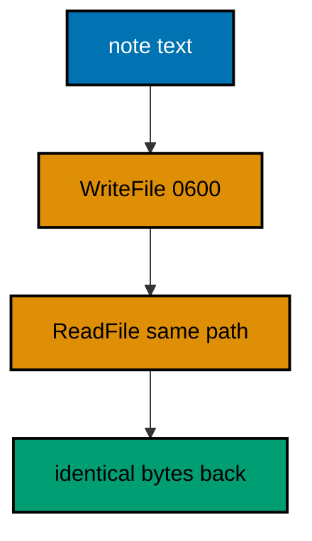

**`learning/code/ex-23-read-and-write-files/main.go`**:

```go
// Example 23: Read and Write Files with os.
//
// The os package reads whole files in one call and writes them with explicit
// permission bits, so file I/O stays three lines plus honest error handling.
package main

import (
	"fmt" // => prints the round-tripped note and its byte count
	"os"  // => CreateTemp, WriteFile, ReadFile: the whole file toolkit
)

func main() {
	// => CreateTemp in the OS temp dir: real file, zero repo litter
	f, err := os.CreateTemp("", "ex23-*.txt") // => empty file, unique name
	// => open failure is environmental: report it, do not continue blindly
	if err != nil { // => temp dir unwritable: nothing else can proceed
		fmt.Println("temp:", err) // => unreachable on a healthy machine
		return                    // => no path exists, so nothing to clean
	}
	// => Remove the temp file when main exits: the run leaves no trace
	defer os.Remove(f.Name()) // => path captured now, removed at return
	// => Close the open handle: WriteFile below opens the path itself
	f.Close() // => ignoring THIS close is safe: nothing was written yet
	// => the note under test: fixed bytes, so the run is deterministic
	note := "catat: bayar zakat sebelum haul tiba\n" // => one line, newline kept
	// => WriteFile creates-or-truncates with exactly these permission bits
	// => 0600: owner read-write only, the right default for user data
	if err := os.WriteFile(f.Name(), []byte(note), 0600); err != nil { // => write
		fmt.Println("write:", err) // => disk failure surfaces here
		return                     // => read would see a half-written file
	}
	// => ReadFile returns the whole content: no streaming ceremony for small files
	back, err := os.ReadFile(f.Name()) // => bytes: decode only what you need
	// => read failure after a successful write means the disk changed mid-run
	if err != nil { // => vanishing temp file: environmental, report it
		fmt.Println("read:", err) // => unreachable in the normal case
		return                    // => nothing valid to compare against
	}
	// => string conversion for printing: comparison stays on bytes in real code
	fmt.Print(string(back))          // => Output: catat: bayar zakat sebelum haul tiba
	fmt.Println("bytes:", len(back)) // => Output: bytes: 37
}
```

**Output** (`learning/code/ex-23-read-and-write-files/expected/main.stdout.txt`):

```text
catat: bayar zakat sebelum haul tiba
bytes: 37
```

**Key takeaway**: WriteFile plus permission bits; ReadFile for the way back.

**Why it matters**: Whole-file helpers keep small-file I/O to three lines, and explicit permission bits make the security choice reviewable instead of accidental. Temp files plus deferred Remove keep deterministic runs from littering the repository.

### Example 24: Parse and Format Time

Go formats times with a reference layout (January 2, 15:04:05, 2006) instead of % codes, which reads oddly once and then never again. This example parses an invoice date and renders it for a receipt. (Concepts: co-05.)

**`learning/code/ex-24-parse-and-format-time/main.go`**:

```go
// Example 24: Parse and Format Time.
//
// Go formats with a reference layout (Mon Jan 2 15:04:05 MST 2006) instead of
// % codes. Memorize the reference once: month 1, day 2, hour 3, minute 4.
package main

import (
	"fmt"  // => prints the parsed date in two renderings plus its weekday
	"time" // => Date, Parse, and Format: the fixed-clock toolkit below
)

func main() {
	// => fixed invoice date: constants keep the run deterministic, no clock
	invoice := time.Date(2026, time.October, 21, 9, 30, 0, 0, time.UTC) // => Oct 21
	// => layout "2006-01-02": the reference date rearranged into ISO order
	fmt.Println(invoice.Format("2006-01-02")) // => Output: 2026-10-21
	// => longer layout: full month name plus zero-padded day, same instant
	fmt.Println(invoice.Format("02 January 2006")) // => Output: 21 October 2026
	// => Weekday derives from the date: no lookup table needed anywhere
	fmt.Println(invoice.Weekday()) // => Output: Wednesday
	// => Parse inverts Format with the SAME layout language, same reference
	due, err := time.Parse("2006-01-02", "2026-11-21") // => layout first, text second
	// => malformed text fails here: Parse validates shape AND calendar reality
	if err != nil { // => e.g. month 13 fails: checked, never assumed
		fmt.Println("unexpected:", err) // => unreachable: the text is valid
	} else {
		// => After compares instants: due falls one month past the invoice
		fmt.Println("due after invoice:", due.After(invoice)) // => Output: due after invoice: true
	}
}
```

**Output** (`learning/code/ex-24-parse-and-format-time/expected/main.stdout.txt`):

```text
2026-10-21
21 October 2026
Wednesday
due after invoice: true
```

**Key takeaway**: Format and Parse share one reference-date layout language.

**Why it matters**: One layout language for both directions means learning the reference date teaches formatting and parsing together. Fixed dates in examples and tests keep time logic deterministic; the live clock enters only at the program's edge.

### Example 25: Add and Compare Durations

Durations are int64 nanoseconds with constructors like time.Hour, so deadline math is plain arithmetic instead of unit juggling. This example budgets a delivery window and checks what fits inside. (Concepts: co-05.)

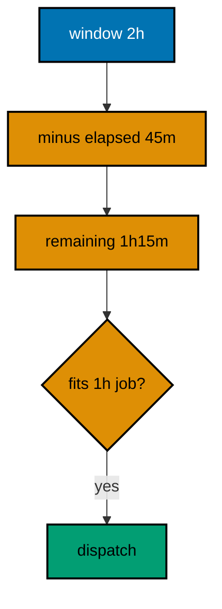

**`learning/code/ex-25-add-and-compare-durations/main.go`**:

```go
// Example 25: Add and Compare Durations.
//
// Durations are int64 nanoseconds with constructors like time.Hour, so deadline
// math is plain arithmetic instead of fragile unit juggling in your head.
package main

import (
	"fmt"  // => prints the window, the remainder, and the dispatch verdict
	"time" // => Hour, Minute: named constructors beat raw multiplication
)

func main() {
	// => the delivery window: two hours, stated in the unit humans think in
	window := 2 * time.Hour // => Duration arithmetic starts from named units
	// => elapsed so far: 45 minutes of loading inside the two-hour window
	elapsed := 45 * time.Minute // => Minute constructor: no magic 60s anywhere
	// => subtraction on Durations: the remainder is exact to the nanosecond
	remaining := window - elapsed // => 1h15m0s: plain minus, honest units
	// => String renders canonically: hours, minutes, seconds, skipping zeros
	fmt.Println("remaining:", remaining) // => Output: remaining: 1h15m0s
	// => a job needs one full hour: comparison decides dispatch, no floats
	job := time.Hour // => the candidate job's runtime, same unit family
	// => <= on Durations: deadline checks read as the sentence they mean
	if job <= remaining { // => fits: dispatch it inside the window
		fmt.Println("dispatch: fits") // => Output: dispatch: fits
	} else {
		fmt.Println("dispatch: defer") // => unreachable: 1h fits in 1h15m
	}
	// => Hours converts to float for reporting: math stays in Duration first
	fmt.Println("hours left:", remaining.Hours()) // => Output: hours left: 1.25
}
```

**Output** (`learning/code/ex-25-add-and-compare-durations/expected/main.stdout.txt`):

```text
remaining: 1h15m0s
dispatch: fits
hours left: 1.25
```

**Key takeaway**: Do deadline math in Duration; convert to float only to report.

**Why it matters**: Keeping durations as int64 nanoseconds until the last moment removes float rounding from scheduling decisions. Named constructors document the unit at the construction site, where future readers need it most.
