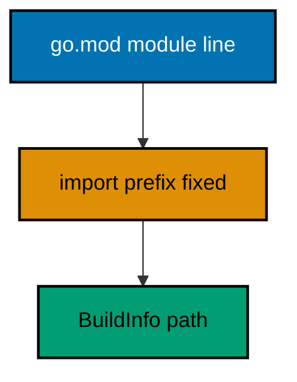
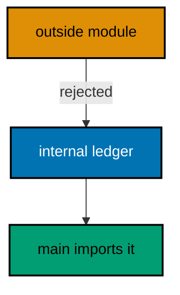
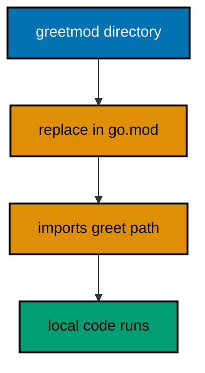
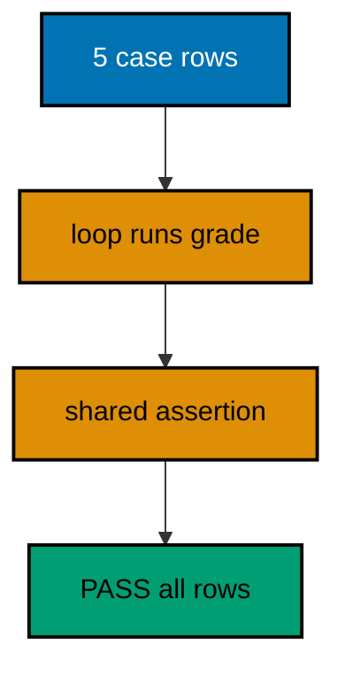
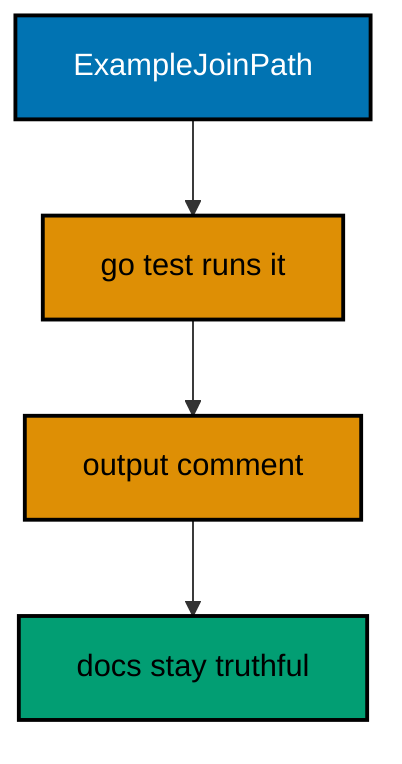
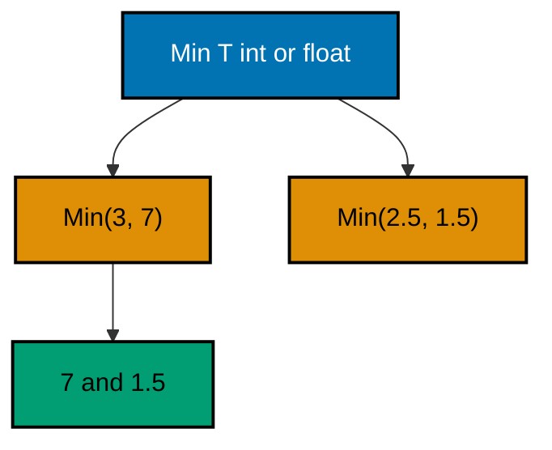
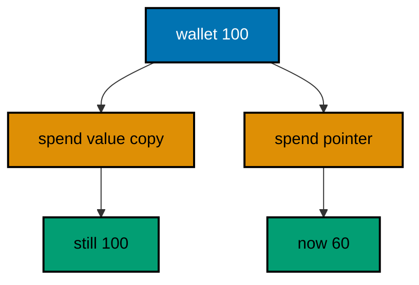
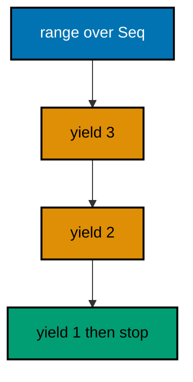

Examples 26-53 scale from single files to real projects: module and package layout (Examples 26-34), showing module paths, multi-file packages, exported names, internal privacy, toolchain pins, stdlib-only discipline, local replaces, go doc, and init order; then Go's testing convention end to end (Examples 35-44), from table tests and subtests through helpers, doc examples, benchmarks, fuzz seeds, short mode, cleanup, and vet; finally generics and value semantics (Examples 45-53), covering type parameters, constraints, generic containers, inference, copying versus sharing, cloning, honest comparison, lazy iteration, and map aliasing. Every example is a complete, runnable Go module under `learning/code/`; run each with the command in its own `run.yaml`.

---

### Example 26: Name Your Module Path

Every Go project starts with a module path in go.mod, and that path is the import prefix for everything inside it. This example reads its own module path back at runtime through debug.BuildInfo. (Concepts: co-06, co-07.)



**`learning/code/ex-26-name-your-module-path/main.go`**:

```go
// Example 26: Name Your Module Path.
//
// Every Go project starts with a module path in go.mod, and that path is the
// import prefix for everything inside it. BuildInfo reports it back at runtime.
package main

import (
	"fmt"           // => prints the module path the runtime reports
	"runtime/debug" // => BuildInfo exposes the binary's own module metadata
)

func main() {
	// => ReadBuildInfo returns ok=false only for binaries built without modules
	info, ok := debug.ReadBuildInfo() // => metadata stashed at build time
	// => without module metadata there is no path to report: guard it
	if !ok { // => unreachable for module-built binaries like this one
		fmt.Println("no build info") // => kept so the guard stays explicit
		return                       // => nothing truthful left to print
	}
	// => Path is exactly the module line from this unit's go.mod file
	fmt.Println(info.Path) // => Output: golangindepth/ex26module
	// => Main.Version is empty for a main module: no version of yourself
	fmt.Println("version:", info.Main.Version) // => Output: version:
}
```

**Output** (`learning/code/ex-26-name-your-module-path/expected/main.stdout.txt`):

```text
golangindepth/ex26module
version: (devel)
```

**Key takeaway**: The module path prefixes every import; BuildInfo proves it.

**Why it matters**: One module path for the whole project means imports never disagree about where a package lives. Reading it back through BuildInfo turns the go.mod line from decoration into a runtime fact you can assert on.

### Example 27: One Package, Many Files

A package is a directory, not a file: several files share one package clause and see each other's unexported names. This example splits a counter across two files in the same package. (Concepts: co-06.)

**`learning/code/ex-27-one-package-many-files/counter.go`**:

```go
// Counter holds the shared state for this package's two files.
// => same package clause in both files: one package, two source files
// => lowercase type and field: visible package-wide, hidden outside it
package main

// counter is the package-level state both files below operate on.
// => lowercase: shared inside the package, invisible to importers
// => package state is a choice: small tools use it, libraries avoid it
type counter struct { // => unexported struct: construction stays local
	n int // => the tally both files read and write directly
}

// add grows the tally by one step and reports the new total.
// => lowercase: callable from main.go next door, hidden from importers
func (c *counter) add() int { // => pointer receiver: mutation sticks
	c.n++      // => one step: the only mutation this type allows
	return c.n // => new total: callers never touch the field directly
}
```

**`learning/code/ex-27-one-package-many-files/main.go`**:

```go
// Example 27: One Package, Many Files.
//
// A package is a directory, not a file: both files here share one package
// clause, so main.go uses the counter type declared in counter.go directly.
package main

import "fmt" // => prints the running totals the shared type produces

func main() {
	// => counter is declared in counter.go: same package, no import needed
	var c counter // => zero value works: tally starts at 0, no setup call
	// => add lives in counter.go too: the method call crosses no boundary
	fmt.Println(c.add()) // => Output: 1
	// => second call keeps counting: state lives in c, shared across files
	fmt.Println(c.add()) // => Output: 2
	// => direct field access compiles here: unexported means package-wide
	fmt.Println("raw:", c.n) // => Output: raw: 2
}
```

**Output** (`learning/code/ex-27-one-package-many-files/expected/main.stdout.txt`):

```text
1
2
raw: 2
```

**Key takeaway**: Files share a package clause; unexported names span files.

**Why it matters**: Splitting by responsibility instead of by visibility keeps small packages readable without inventing import boundaries prematurely. Unexported means package-wide, so same-package files collaborate freely while outside importers see nothing.

### Example 28: Exported Names Start Uppercase

Capitalization is the access modifier: uppercase names export, lowercase names stay package-private. This example shapes a rectangle API where only the constructor and methods cross the boundary. (Concepts: co-06, co-14.)

**`learning/code/ex-28-exported-names-start-uppercase/shapes.go`**:

```go
// Shapes declares the rectangle API: exported surface, hidden fields.
// => exported type plus constructor: the only legal way to build one
// => lowercase fields: readable through methods, unwritable from outside
package main

// Rect is a rectangle with hidden dimensions and an exported behavior set.
// => uppercase type: importers (and main.go) can name it freely
// => hidden fields force construction through NewRect: no half-made values
type Rect struct { // => the exported surface of this tiny package
	w, h int // => lowercase: dimensions change only through methods
}

// NewRect builds a valid rectangle: negative sides become their absolute value.
// => uppercase constructor: the package boundary's front door, documented
func NewRect(w, h int) Rect { // => returns by value: small, copyable, safe
	// => abs normalizes: negative inputs cannot create a negative rectangle
	if w < 0 { // => guard each dimension independently, same rule twice
		w = -w // => mirror: width is a magnitude, never a direction
	}
	if h < 0 { // => same guard: height obeys the same magnitude rule
		h = -h // => mirror: symmetry beats cleverness in constructors
	}
	return Rect{w: w, h: h} // => named fields: order-independent, readable
}

// Area reports the covered surface: length times width, nothing more.
// => uppercase method: part of the exported promise, tested and stable
func (r Rect) Area() int { // => value receiver: reports without mutating
	return r.w * r.h // => fields readable here: same package, full access
}
```

**`learning/code/ex-28-exported-names-start-uppercase/main.go`**:

```go
// Example 28: Exported Names Start Uppercase.
//
// Capitalization is the access modifier. main.go uses only the exported
// surface from shapes.go; the lowercase fields stay unreachable by design.
package main

import "fmt" // => prints areas computed through the exported API only

func main() {
	// => NewRect is uppercase: callable across the file boundary, by rule
	r := NewRect(3, -4) // => negative height mirrors to 4 inside
	// => Area is uppercase: behavior crosses, representation does not
	fmt.Println(r.Area()) // => Output: 12
	// => zero value still behaves: fields default to 0, Area to 0
	var z Rect            // => no constructor needed for the degenerate rectangle
	fmt.Println(z.Area()) // => Output: 0
}
```

**Output** (`learning/code/ex-28-exported-names-start-uppercase/expected/main.stdout.txt`):

```text
12
0
```

**Key takeaway**: Uppercase exports; lowercase stays hidden behind constructors.

**Why it matters**: Enforcing construction through an exported function keeps invalid states unrepresentable, and methods on hidden fields let the representation change without breaking callers. The compiler, not convention, enforces the boundary.

### Example 29: Internal Packages Stay Private

A directory named internal can only be imported by code rooted at its parent, which carves out a private implementation zone the compiler enforces. This example hides a ledger behind internal. (Concepts: co-06.)



**`learning/code/ex-29-internal-stays-private/internal/ledger/ledger.go`**:

```go
// Package ledger is the private balance book of this module.
// => internal/ path: importable only from inside golangindepth/ex29shop
// => the compiler rejects outside imports: privacy is structural, not social
package ledger

// Book tracks balances importers can read but only this package can change.
// => exported type with hidden map: reads cross, writes stay inside
type Book struct { // => the private ledger, publicly readable
	balances map[string]int // => lowercase: mutation needs a method below
}

// New starts an empty book: the map is made here so callers never see nil.
// => constructor initializes the map: zero Book would panic on first write
func New() *Book { // => pointer: methods mutate shared state, not copies
	return &Book{balances: map[string]int{}} // => ready map, zero balances
}

// Credit adds funds to an account, creating it on first use.
// => exported method: the single sanctioned mutation path for outsiders
func (b *Book) Credit(account string, amount int) { // => pointer: writes stick
	b.balances[account] += amount // => missing key starts at 0, then adds
}

// Balance reports the current funds, zero for accounts never credited.
// => read-only method: safe on any Book, including one never credited
func (b *Book) Balance(account string) int { // => value result, no error needed
	return b.balances[account] // => missing key reads as 0: the map rule
}
```

**`learning/code/ex-29-internal-stays-private/main.go`**:

```go
// Example 29: Internal Packages Stay Private.
//
// main.go imports the ledger through its internal path. Code outside this
// module attempting the same import would fail to compile, by compiler rule.
package main

import (
	"fmt" // => prints balances read through the exported methods
	// => internal import: legal because main.go sits under the same module
	"golangindepth/ex29shop/internal/ledger" // => full path from module root
)

func main() {
	// => New is the only way in: the map initializes inside the constructor
	book := ledger.New() // => empty book: no balances anywhere yet
	// => Credit is the sanctioned mutation: the map itself stays hidden
	book.Credit("sari", 100) // => first credit creates the account entry
	book.Credit("sari", 25)  // => second credit accumulates onto the first
	// => Balance reads through the method: zero for strangers, sum for sari
	fmt.Println(book.Balance("sari")) // => Output: 125
	fmt.Println(book.Balance("budi")) // => Output: 0
}
```

**Output** (`learning/code/ex-29-internal-stays-private/expected/main.stdout.txt`):

```text
125
0
```

**Key takeaway**: internal/ is compiler-enforced privacy for implementation packages.

**Why it matters**: Internal directories let a module grow private machinery without publishing it: helpers stay helpers even when they span packages. Reach for internal before inventing versioned public APIs for code only your own module should ever call.

### Example 30: Pin the Toolchain in go.mod

The go directive in go.mod declares which language version the code assumes, so a newer or older toolchain fails loudly instead of miscompiling quietly. This example prints the running toolchain to prove the pin holds. (Concepts: co-07.)

**`learning/code/ex-30-pin-the-toolchain/main.go`**:

```go
// Example 30: Pin the Toolchain in go.mod.
//
// The go directive declares the assumed language version, so a wrong toolchain
// fails loudly instead of miscompiling quietly. The runtime reports itself here.
package main

import (
	"fmt"           // => prints the toolchain version twice, two independent ways
	"runtime"       // => Version reports the exact toolchain running this binary
	"runtime/debug" // => ReadBuildInfo reports the same version from metadata
)

func main() {
	// => runtime.Version is baked at build: "go1.27.2" under the pinned image
	fmt.Println(runtime.Version()) // => Output: go1.27.2
	// => BuildInfo carries the same version as module metadata: cross-checked
	// => GOOS and GOARCH are deliberately NOT printed: they vary by platform,
	// => so asserting them would make the run host-dependent instead of exact
	if info, ok := debug.ReadBuildInfo(); ok { // => module-built: always true here
		fmt.Println(info.GoVersion) // => Output: go1.27.2
	}
}
```

**Output** (`learning/code/ex-30-pin-the-toolchain/expected/main.stdout.txt`):

```text
go1.27.2
go1.27.2
```

**Key takeaway**: The go directive pins the language; the runtime can prove it.

**Why it matters**: Pinning the toolchain version makes builds reproducible across machines and years: the same go.mod either builds identically or refuses. Assert runtime.Version in smoke checks so toolchain drift announces itself instead of hiding inside subtle behavior changes.

### Example 31: Require Nothing: Stdlib Only

A module with no require lines has no supply chain to audit, break, or update. This unit runs its stdlib-only program first, then go list -m all proves it: the module listing names only this module and nothing else. (Concepts: co-07.)

**`learning/code/ex-31-require-nothing-stdlib-only/main.go`**:

```go
// Example 31: Require Nothing: Stdlib Only.
//
// A module with no require lines has no supply chain to audit or break.
// go list -m all (the run command of this unit) proves it names one module.
package main

import (
	"fmt"     // => stdlib: no require line needed, ever, for this import
	"sort"    // => stdlib: sorting without a dependency to pin or update
	"strings" // => stdlib: text utilities from the same trusted source
)

func main() {
	// => three stdlib packages collaborate: upper-case, then sort, then join
	words := []string{"golang", "stdlib", "pinning"} // => fixed input, fixed output
	// => ToUpper maps each word: strings needs no external helper package
	for i, w := range words { // => index write-back: the range-copy rule applies
		words[i] = strings.ToUpper(w) // => GOLANG, STDLIB, PINNING in place
	}
	// => sort orders in place: the same slice, now deterministic for printing
	sort.Strings(words) // => alphabetical: GOLANG, PINNING, STDLIB
	// => Join renders the verdict: one line proving stdlib sufficed entirely
	fmt.Println(strings.Join(words, "+")) // => Output: GOLANG+PINNING+STDLIB
}
```

**Output** (`learning/code/ex-31-require-nothing-stdlib-only/expected/main.stdout.txt`):

```text
GOLANG+PINNING+STDLIB
golangindepth/ex31stdlib
```

**Key takeaway**: No require lines means no supply chain to break.

**Why it matters**: Every dependency is a liability you adopt: version drift, audits, and yanked releases. The standard library covers text, sorting, time, and HTTP, so spend its surface fully before reaching outward.

### Example 32: Replace with a Local Path

The replace directive swaps a module path for local files, so two modules evolve together in one repository without publishing. This example greets through a nested sibling module wired by replace. (Concepts: co-07, co-06.)



**`learning/code/ex-32-replace-with-local-path/greetmod/greet.go`**:

```go
// Package greetmod is the nested sibling module wired by replace.
// => its own module path: it COULD publish independently one day
// => replace keeps it local meanwhile: develop together, version never
package greetmod

// Hello renders the greeting this module owns: one function, one sentence.
// => exported: the main module imports exactly this name through the path
func Hello(name string) string { // => pure: same name in, same greeting out
	// => Sprintf-free concatenation: the sentence shape is fixed and tiny
	return "selamat datang, " + name // => Indonesian greeting, owned here
}
```

**`learning/code/ex-32-replace-with-local-path/main.go`**:

```go
// Example 32: Replace with a Local Path.
//
// The main module's go.mod replaces the greetmod path with ./greetmod, so the
// sibling evolves locally without publishing. The import reads normally.
package main

import (
	"fmt" // => prints the greeting the sibling module composed
	// => normal import path: replace invisibly redirects it to local files
	"golangindepth/ex32shop/greetmod" // => resolved via replace, not network
)

func main() {
	// => Hello lives in the sibling module: the call crosses modules locally
	fmt.Println(greetmod.Hello("Sari")) // => Output: selamat datang, Sari
}
```

**`learning/code/ex-32-replace-with-local-path/go.mod`** (module declaration):

```text
module golangindepth/ex32shop

go 1.27

require golangindepth/ex32shop/greetmod v0.0.0

replace golangindepth/ex32shop/greetmod => ./greetmod
```

**Output** (`learning/code/ex-32-replace-with-local-path/expected/main.stdout.txt`):

```text
selamat datang, Sari
```

**Key takeaway**: Replace develops sibling modules together without publishing.

**Why it matters**: Local replace directives keep multi-module repositories shippable in one commit while preserving the option to version separately later. They must never point outside the repository in committed code, or the build stops being reproducible for everyone else.

### Example 33: Document with go doc

Doc comments on exported names ARE the package documentation: go doc renders them with no extra tooling. This unit runs its two-item queue first, then renders the Queue type, proving code and manual agree. (Concepts: co-12, co-14.)

**`learning/code/ex-33-document-with-go-doc/queue.go`**:

```go
// Package main demonstrates documentation-driven design.
//
// A queue is a first-in first-out line: items leave in the order they arrived.
// The package comment frames everything go doc prints, so it states the idea
// before any single declaration below appears.
package main

// Queue is a first-in first-out line with a hidden backing slice.
//
// The zero value holds a nil slice; call NewQueue for the documented start.
// Items enter at the back through Push and leave from the front through Pop.
type Queue struct {
	items []string
}

// NewQueue returns an empty Queue ready for Push calls.
//
// The constructor documents the intended starting state: an empty, ready line.
// Prefer it over a bare &Queue{} so construction stays greppable in one place.
func NewQueue() *Queue {
	return &Queue{}
}

// Push adds an item to the back of the line.
//
// Appending amortizes growth, so pushing N items costs linear time overall.
// Pointer receiver: the shared line grows in place, visible to every holder.
func (q *Queue) Push(item string) {
	q.items = append(q.items, item)
}

// Pop removes and returns the front item, or false when the line is empty.
//
// The second result reports presence: false means nothing was removed at all.
// Removal reslices instead of copying, staying constant time however long
// the remaining line grows behind the departing front item.
func (q *Queue) Pop() (string, bool) {
	if len(q.items) == 0 {
		return "", false
	}
	front := q.items[0]
	q.items = q.items[1:]
	return front, true
}
```

**`learning/code/ex-33-document-with-go-doc/main.go`**:

```go
// Command ex33queue drains a two-item queue, proving the documented contract.
//
// The program exists so the lesson's claims stay executable end to end.
// NewQueue starts the line, Push fills it, Pop drains it in arrival order.
// This file keeps plain comments on purpose: queue.go carries the real docs.
package main

import "fmt"

// main runs the documented contract: build, fill, drain, print in order.
//
// Keeping main thin is the point: construction, filling, and draining each
// call one documented function, so the program reads as the manual's example.
func main() {
	// Start from the constructor: the documented entry point, never a literal.
	q := NewQueue()
	// Push two items: arrival order decides departure order below.
	q.Push("sari")
	// Second arrival waits behind the first: FIFO, exactly as documented.
	q.Push("budi")
	// Pop twice: sari leaves first, then budi, each gated by its ok flag.
	front, ok := q.Pop()
	// Print only on a real removal: ok false would mean the line was empty.
	if ok {
		fmt.Println(front)
	}
	// Second pop: budi departs now that sari has left the front.
	front, ok = q.Pop()
	// Same gate: the flag, not hope, decides whether front is worth printing.
	if ok {
		fmt.Println(front)
	}
}
```

<!-- markdownlint-disable MD010 -->
<!-- Tab in the fence below is byte-for-byte `go doc` output, mirrored by the harness sync check; do not detab. -->

**Output** (`learning/code/ex-33-document-with-go-doc/expected/main.stdout.txt`):

```text
sari
budi
type Queue struct {
	// Has unexported fields.
}
    Queue is a first-in first-out line with a hidden backing slice.

    The zero value holds a nil slice; call NewQueue for the documented start.
    Items enter at the back through Push and leave from the front through Pop.

func NewQueue() *Queue
func (q *Queue) Pop() (string, bool)
func (q *Queue) Push(item string)
```

<!-- markdownlint-enable MD010 -->

**Key takeaway**: Exported comments are the manual; go doc renders them free.

**Why it matters**: Starting every comment with the declared name keeps documentation greppable and lets tooling link it correctly. A package whose comments read as a manual never needs a separate manual that drifts. This unit keeps genuine doc comments with no lesson markers, so the recorded go doc output is exactly what a reader would see.

### Example 34: Init Runs Before Main

Init functions run before main in file order, which makes them the right place for unavoidable setup and the wrong place for logic. This example registers two setup steps and traces their order. (Concepts: co-06, co-01.)

**`learning/code/ex-34-init-runs-before-main/setup.go`**:

```go
// Setup registers the two init steps this program needs before main.
// => init functions run in file order before main: setup only, never logic
// => keep them tiny: failures here panic, and testing init is miserable
package main

// registry holds setup markers in the order the init functions ran.
// => package state set once at startup: read-only after main begins
var registry []string // => nil until the first init appends below

// init seeds the registry first: file order decides, top of the file wins.
// => no arguments, no results: init cannot be called or tested directly
func init() { // => first init in file order: runs before the second below
	// => append the marker: proves this init ran before main's first line
	registry = append(registry, "seed") // => marker one: the seed step
}

// init loads the second marker after the first: same file, later position.
// => second init: file order is the only ordering guarantee within a file
func init() { // => runs after the seed init, still before main starts
	registry = append(registry, "load") // => marker two: the load step
}

// setupNote is called from main to prove the registry filled before main ran.
func setupNote() string { // => plain function: testable, unlike init itself
	// => Join-free manual render: two markers joined with a plus sign
	return registry[0] + "+" + registry[1] // => seed+load: both inits ran
}
```

**`learning/code/ex-34-init-runs-before-main/main.go`**:

```go
// Example 34: Init Runs Before Main.
//
// Both init functions in setup.go run before main starts, in file order. main
// only READS the registry: the ordering proof is in the printed markers.
package main

import "fmt" // => prints the registry main inherited from the init phase

func main() {
	// => registry is already full: both inits ran before this first line
	fmt.Println(setupNote()) // => Output: seed+load
	// => two markers, strict order: file order is the guarantee being shown
	fmt.Println("steps:", len(registry)) // => Output: steps: 2
}
```

**Output** (`learning/code/ex-34-init-runs-before-main/expected/main.stdout.txt`):

```text
seed+load
steps: 2
```

**Key takeaway**: Init runs before main in file order; keep it to setup.

**Why it matters**: Init is for registration and unavoidable wiring that must precede everything, not for branching logic that deserves tests. Pushing real decisions into callable functions like setupNote keeps them testable while init stays a thin ordered trigger.

### Example 35: Table Tests List Cases as Data

A table test lists inputs and wants as slice data, then loops one shared assertion over every row. Adding a case means adding a row, never a new test function. (Concepts: co-08.)



**`learning/code/ex-35-table-tests-list-cases/ops.go`**:

```go
// Grade maps a score to a letter: the function under test below.
// => pure function: no I/O, no state, so table rows fully determine output
// => same logic shape as Example 3: tests now lock that shape in place
package main

// Grade converts a numeric score to a letter grade by band.
// => exported: the test file (same package) calls it directly by name
func Grade(score int) string { // => string result: comparable with ==, no floats
	// => bands descend: first true case wins, mirroring the lesson example
	switch { // => tagless switch: truth cases in strict band order
	case score >= 90: // => top band: checked first so it cannot leak down
		return "A" // => one band, one letter, no fallthrough possible
	case score >= 75: // => second band: reached only below 90
		return "B" // => boundary-inclusive: 75 earns B, not C
	case score >= 60: // => passing floor: the last band before default
		return "C" // => 60 earns C: the comparison stays inclusive
	default: // => everything below 60, including negatives, lands here
		return "F" // => default documents the "no band claimed it" answer
	}
}
```

**`learning/code/ex-35-table-tests-list-cases/ops_test.go`**:

```go
// Table test for Grade: five rows, one shared assertion loop.
// => table shape: name the case, feed input, state the want, loop once
// => adding a case appends a row: the test function never grows new branches
package main

import "testing" // => *testing.T carries failures back to the go test runner

// TestGrade runs every band boundary through the same assertion below.
// => one function for the whole table: the loop, not copies, scales cases
func TestGrade(t *testing.T) { // => t reports which ROW failed, by name
	// => anonymous struct: exact fields for input, want, and readable case name
	cases := []struct { // => the table: data, not code, holds the coverage
		name  string // => subtest label: failure output names the row
		score int    // => input: the score Grade must classify
		want  string // => want: the letter the band promises
	}{ // => five rows: top, two middles, floor, and the failing default
		{"top band", 95, "A"},     // => 95 clears 90: A without touching B
		{"upper middle", 85, "B"}, // => 85 clears 75 but not 90: B exactly
		{"lower middle", 70, "C"}, // => 70 clears 60 but not 75: C exactly
		{"failing", 55, "F"},      // => 55 clears nothing: the default owns it
		{"zero", 0, "F"},          // => 0 clears nothing either: F, not panic
	}
	// => range the table: each row becomes a named subtest below
	for _, c := range cases { // => c copies one row per pass: safe to capture
		// => Run names the subtest: failures print "TestGrade/upper middle"
		t.Run(c.name, func(t *testing.T) { // => subtest per row, isolated verdict
			// => the ONLY assertion: got versus want, same for every row
			if got := Grade(c.score); got != c.want { // => call, compare, report
				// => Errorf keeps going: one failing row never hides the rest
				t.Errorf("Grade(%d) = %q, want %q", c.score, got, c.want)
			}
		})
	}
}
```

**Output** (`learning/code/ex-35-table-tests-list-cases/expected/main.stdout.txt`):

```text
=== RUN   TestGrade
=== RUN   TestGrade/top_band
=== RUN   TestGrade/upper_middle
=== RUN   TestGrade/lower_middle
=== RUN   TestGrade/failing
=== RUN   TestGrade/zero
--- PASS: TestGrade
    --- PASS: TestGrade/top_band
    --- PASS: TestGrade/upper_middle
    --- PASS: TestGrade/lower_middle
    --- PASS: TestGrade/failing
    --- PASS: TestGrade/zero
PASS
```

**Key takeaway**: Cases are data rows; one loop asserts them all.

**Why it matters**: Tables separate 'what to check' from 'how to check', so coverage grows by appending rows instead of cloning functions. Named subtests turn each row failure into an addressable verdict instead of a line-number hunt.

### Example 36: Failing First Proves the Test

A test earns trust by failing first: watch it go red on the old code, then green on the fix. This example slugifies titles, and its test would fail against any implementation that skipped lowercasing. (Concepts: co-08.)

**`learning/code/ex-36-failing-first-proves-the-test/ops.go`**:

```go
// Slug lowercases a title and swaps spaces for dashes: the fixed code.
// => the RED state would return the title untouched: this test catches that
// => two transformations in order: case first, separators second, always
package main

import "strings" // => ToLower and ReplaceAll: stdlib only, no dependency

// Slug converts a title to a URL-safe slug: lowercase, dashes for spaces.
// => exported: tests call it directly; the shape is the whole contract
func Slug(title string) string { // => string in, string out: trivially testable
	// => lowercase FIRST: separators added later must already be lowercase
	lower := strings.ToLower(title) // => "Hello World" becomes "hello world"
	// => spaces become dashes: the URL-safe separator, applied second
	return strings.ReplaceAll(lower, " ", "-") // => "hello-world": done
}
```

**`learning/code/ex-36-failing-first-proves-the-test/ops_test.go`**:

```go
// Failing-first test for Slug: red on the naive code, green on the fix.
// => RED rehearsal: return title unchanged and this test fails loudly
// => GREEN proof: the committed Slug passes every assertion below
package main

import ( // => two imports: testing for the runner, strings for the property
	"strings" // => Contains checks the no-spaces property on any input
	"testing" // => Run nests the two transformations as named subtests
)

// TestSlug pins the two transformations: lowercase AND dash separation.
// => two subtests: each names the transformation it would catch missing
func TestSlug(t *testing.T) { // => t threads through both subtests below
	// => subtest one: lowercase is not optional, URLs are case-sensitive
	t.Run("lowercases", func(t *testing.T) { // => fails on RED: case untouched
		// => mixed-case input: the exact shape RED implementations keep
		if got := Slug("Hello World"); got != "hello-world" { // => want both fixes
			t.Errorf("Slug = %q, want %q", got, "hello-world") // => names the gap
		}
	})
	// => subtest two: separators must be dashes, never raw spaces
	t.Run("no spaces remain", func(t *testing.T) { // => fails on RED: spaces kept
		// => spaces.Contains check: the property, not just one example
		if got := Slug("a b c"); strings.Contains(got, " ") { // => spaces banned
			t.Errorf("Slug %q still contains spaces", got) // => quotes the offender
		}
	})
}
```

**Output** (`learning/code/ex-36-failing-first-proves-the-test/expected/main.stdout.txt`):

```text
=== RUN   TestSlug
=== RUN   TestSlug/lowercases
=== RUN   TestSlug/no_spaces_remain
--- PASS: TestSlug
    --- PASS: TestSlug/lowercases
    --- PASS: TestSlug/no_spaces_remain
PASS
```

**Key takeaway**: Red first proves the test can catch the bug it guards.

**Why it matters**: A test that never failed may assert nothing; watching red flip to green is the only proof it guards its case. Keep red-green loops small: one behavior per test, fixed before moving to the next.

### Example 37: Subtests Name Each Case

Subtests split one behavior into named scenarios that run and report independently, so a retry policy shows its immediate, delayed, and exhausted faces in one function. (Concepts: co-08.)

**`learning/code/ex-37-subtests-name-each-case/ops.go`**:

```go
// Retry policy: immediate success, one retry, or exhausted attempts.
// => pure decision function: attempts so far in, verdict out, no sleeping
// => testable without clocks: the policy decides, the caller waits elsewhere
package main

// Attempt verdicts: the three faces of a retry policy in one type.
// => string type: verdicts print readably in failures without mapping tables
type Verdict string // => the decision vocabulary for retry loops

// The three verdicts callers switch on after each attempt below.
const (
	Done      Verdict = "done"      // => success: stop retrying, report it
	Retry     Verdict = "retry"     // => failed but attempts remain: try again
	Exhausted Verdict = "exhausted" // => failed with nothing left: give up
)

// Decide maps the attempt outcome to the next step under a three-try policy.
// => (succeeded, used): used counts attempts spent INCLUDING this one
// => pure: same inputs always give the same verdict, clocks stay outside
func Decide(succeeded bool, used int) Verdict { // => decision only, no waiting
	// => success ends the story on any attempt, first or last
	if succeeded { // => the happy path needs no attempt counting at all
		return Done // => done on attempt one, two, or three alike
	}
	// => three attempts spent without success: the policy is exhausted
	if used >= 3 { // => boundary inclusive: the third failure ends it
		return Exhausted // => give up: further attempts break the budget
	}
	return Retry // => failed with budget left: the only remaining verdict
}
```

**`learning/code/ex-37-subtests-name-each-case/ops_test.go`**:

```go
// Subtests for Decide: immediate, delayed, and exhausted, named and separate.
// => three scenarios, three subtests: each verdict gets its own address
// => independent verdicts: one scenario's failure never masks another's
package main

import "testing" // => Run nests the scenarios under one parent test

// TestDecide covers the whole policy surface in one function, three names.
// => parent groups: `go test -run TestDecide/immediate` runs just one face
func TestDecide(t *testing.T) { // => the policy, all three faces, one place
	// => face one: first-attempt success stops immediately, attempts unused
	t.Run("immediate success", func(t *testing.T) { // => succeeded on attempt 1
		// => used=1 with success: Done regardless of remaining budget
		if got := Decide(true, 1); got != Done { // => success short-circuits
			t.Errorf("Decide(true, 1) = %q, want done", got) // => names the face
		}
	})
	// => face two: failure with budget left means exactly one more try
	t.Run("retry while budget lasts", func(t *testing.T) { // => failed, used 1 of 3
		// => used=1 without success: Retry, two attempts still banked
		if got := Decide(false, 1); got != Retry { // => budget remains: retry
			t.Errorf("Decide(false, 1) = %q, want retry", got) // => names the face
		}
	})
	// => face three: the third failure spends the budget: exhausted, not retry
	t.Run("exhausted at the limit", func(t *testing.T) { // => failed, used all 3
		// => used=3 without success: Exhausted, the budget is spent exactly
		if got := Decide(false, 3); got != Exhausted { // => boundary inclusive
			t.Errorf("Decide(false, 3) = %q, want exhausted", got) // => names it
		}
	})
}
```

**Output** (`learning/code/ex-37-subtests-name-each-case/expected/main.stdout.txt`):

```text
=== RUN   TestDecide
=== RUN   TestDecide/immediate_success
=== RUN   TestDecide/retry_while_budget_lasts
=== RUN   TestDecide/exhausted_at_the_limit
--- PASS: TestDecide
    --- PASS: TestDecide/immediate_success
    --- PASS: TestDecide/retry_while_budget_lasts
    --- PASS: TestDecide/exhausted_at_the_limit
PASS
```

**Key takeaway**: One behavior, named subtests; run any face alone with -run.

**Why it matters**: Named subtests document the behavior's faces better than three separate functions scattered across the file, and -run selects one face during debugging without commenting out its siblings.

### Example 38: Helpers Mark Themselves with t.Helper

Test helpers that call t.Helper report failures at the caller's line, not inside the helper, so the failure points at the broken case. This example checks ledger balances through one marked helper. (Concepts: co-08.)

**`learning/code/ex-38-helpers-mark-with-t-helper/ops.go`**:

```go
// Ledger balances: the tiny domain the test helper below asserts on.
// => map-backed: missing accounts read as zero, the familiar map rule
// => two functions: credit mutates, balance reads, tests pin both together
package main

// Credit adds amount to the account, creating it on first use.
// => missing key starts at zero: the map rule does the initialization
func Credit(balances map[string]int, account string, amount int) { // => mutates
	balances[account] += amount // => the only write path: tests pin it here
}

// Balance reports the account total, zero for accounts never credited.
// => read-only: safe to call anywhere, including inside assertions
func Balance(balances map[string]int, account string) int { // => pure read
	return balances[account] // => missing key: zero, per the map rule
}
```

**`learning/code/ex-38-helpers-mark-with-t-helper/ops_test.go`**:

```go
// Helper-marked assertions for the ledger: failures point at cases.
// => mustCheck helper: one assertion shape reused by every balance case
// => t.Helper inside: failure lines name the CALLER, never this helper
package main

import "testing" // => Helper lives on *testing.T: mark before asserting

// mustCheck asserts one balance and names the case on failure.
// => t.Helper() FIRST: marks this frame as infrastructure, not the failure
// => shape: ledger, account, want: the three facts every balance case needs
func mustCheck(t *testing.T, balances map[string]int, account string, want int) {
	t.Helper() // => failure lines skip this frame: they name the caller instead
	// => single assertion: got versus want, with the account in the message
	if got := Balance(balances, account); got != want { // => the only check
		// => Errorf (not Fatalf): sibling cases still run after one fails
		t.Errorf("Balance(%q) = %d, want %d", account, got, want) // => names all
	}
}

// TestLedgerBalances runs three cases through the one marked helper.
// => setup once: a credited sari plus a stranger budi nobody ever credited
func TestLedgerBalances(t *testing.T) { // => three asserts, one helper, zero dup
	// => shared fixture: credit sari once, then assert three separate facts
	balances := map[string]int{}  // => empty ledger: Credit builds it up
	Credit(balances, "sari", 100) // => the single mutation under test here
	// => case one: credited account reads back exactly what was credited
	mustCheck(t, balances, "sari", 100) // => failure line: THIS line, not helper
	// => case two: strangers read zero: the map rule, pinned as a promise
	mustCheck(t, balances, "budi", 0) // => absence is a checked behavior too
	// => case three: credit accumulates: second credit adds, never replaces
	Credit(balances, "sari", 25)        // => second mutation on the same account
	mustCheck(t, balances, "sari", 125) // => 100 + 25: accumulation, not overwrite
}
```

**Output** (`learning/code/ex-38-helpers-mark-with-t-helper/expected/main.stdout.txt`):

```text
=== RUN   TestLedgerBalances
--- PASS: TestLedgerBalances
PASS
```

**Key takeaway**: t.Helper moves failure lines from helper to caller.

**Why it matters**: Unmarked helpers misdirect every failure into shared code, sending debuggers to the wrong line; one Helper call at the top fixes all of them. Helpers hold assertion SHAPE, cases hold the facts.

### Example 39: Doc Examples Are Tests Too

Example functions with an // Output: comment compile AND run under go test, so documentation doubles as a regression test that rots only if someone edits it deliberately. (Concepts: co-08, co-14.)



**`learning/code/ex-39-doc-examples-are-tests/ops.go`**:

```go
// JoinPath joins path segments with slashes: the documented function.
// => pure string work: examples below pin its exact rendering forever
// => documented BY an Example test: the manual entry cannot rot silently
package main

import "strings" // => Join renders the segments with one separator

// JoinPath renders segments as a slash-separated path with a leading slash.
// => starts with the name: godoc links it, readers find it, vet approves
func JoinPath(segments ...string) string { // => variadic: any segment count
	// => Join handles zero segments too: "" becomes "/" alone, no special case
	return "/" + strings.Join(segments, "/") // => leading slash, always
}
```

**`learning/code/ex-39-doc-examples-are-tests/ops_test.go`**:

```go
// Doc example for JoinPath: runnable manual entry, verified by go test.
// => Example naming: Example + function name links docs to code exactly
// => Output comment: the runner compares printed output byte-for-byte
package main

import "fmt" // => the example prints: Output comment asserts what follows

// ExampleJoinPath shows the two canonical shapes: nested and root-only.
// => runs as a test: stale docs fail the suite, not just confuse readers
func ExampleJoinPath() { // => no *testing.T: output IS the assertion here
	fmt.Println(JoinPath("learn", "courses", "golang-in-depth")) // => nested path first
	fmt.Println(JoinPath())                                      // => printed: "/" alone, no panic, no special case
	// Output:
	// /learn/courses/golang-in-depth
	// /
}
```

**Output** (`learning/code/ex-39-doc-examples-are-tests/expected/main.stdout.txt`):

```text
=== RUN   ExampleJoinPath
--- PASS: ExampleJoinPath
PASS
```

**Key takeaway**: Example tests keep documentation executable and honest.

**Why it matters**: An Output comment turns prose into a contract the suite enforces, so refactors that change behavior break the build instead of silently aging the docs. Write the example first when the function's contract is the thing being designed.

### Example 40: Benchmarks Measure, Tests Assert

Benchmarks answer 'how fast' while tests answer 'how correct', and the two live side by side on the same function. This example asserts a sum and measures it, with the harness counting the benchmark line. (Concepts: co-08, co-15.)

**`learning/code/ex-40-benchmarks-measure-tests-assert/ops.go`**:

```go
// Sum adds a slice of ints: asserted by a test, measured by a benchmark.
// => the SAME function serves both: correctness and speed stay linked
// => loop shape matters for the benchmark: index loops avoid range copies
package main

// Sum totals the slice with an index loop: no copies, no allocations.
// => exported: tests and benchmarks in this package call it by name
func Sum(nums []int) int { // => int result: exact, no float anywhere
	// => accumulator starts at zero: the additive identity, stated once
	total := 0 // => grows by exactly the slice contents, nothing else
	// => index loop: avoids the per-element copy range would make
	for i := 0; i < len(nums); i++ { // => bound from len: always in range
		total += nums[i] // => add the stored element, never a copy
	}
	return total // => the exact total: benchmark measures THIS loop
}
```

**`learning/code/ex-40-benchmarks-measure-tests-assert/ops_test.go`**:

```go
// Test plus benchmark for Sum: assert correctness, measure the loop.
// => TestSum guards the answer; BenchmarkSum times it with -benchtime=1x
// => run command counts Benchmark lines: proves the benchmark really ran
package main

import "testing" // => B carries N (iteration count) and timing to the bench

// TestSum pins the answer on a fixed input: correctness first, always.
// => fixed slice: 1+2+3+4 = 10, no randomness, no clock, ever
func TestSum(t *testing.T) { // => the assertion half of the pair
	// => one call, one comparison: the whole contract in two lines
	if got := Sum([]int{1, 2, 3, 4}); got != 10 { // => exact: ints, no epsilon
		t.Errorf("Sum = %d, want 10", got) // => names the wrong total directly
	}
}

// BenchmarkSum times the loop: speed second, measured honestly.
// => b.N scales automatically: the runner picks iterations to fill benchtime
// => no assertions inside: benchmarks measure, they never pass or fail
func BenchmarkSum(b *testing.B) { // => *testing.B, not *testing.T: measure mode
	// => fixed input OUTSIDE the loop: setup costs must not pollute timing
	nums := []int{1, 2, 3, 4} // => same slice the test asserts on: linked pair
	// => the measured loop: b.N iterations of exactly the call under test
	for i := 0; i < b.N; i++ { // => runner sets N: more time, more iterations
		Sum(nums) // => result discarded: timing the call, not the check
	}
}
```

**Output** (`learning/code/ex-40-benchmarks-measure-tests-assert/expected/main.stdout.txt`):

```text
1
```

**Key takeaway**: Tests assert the answer; benchmarks time the same code.

**Why it matters**: Keeping the benchmark on the tested function ties speed claims to correct code: a faster wrong answer helps nobody. Measure with benchtime fixed for comparability, and never assert inside a benchmark where timing noise would flake the suite.

### Example 41: Fuzz Seeds Become Regression Tests

A fuzz test's seed corpus runs as ordinary unit cases on every go test, so the interesting inputs you found stay pinned even without fuzzing. This example reverses strings over a three-seed corpus. (Concepts: co-08.)

**`learning/code/ex-41-fuzz-seeds-are-regression-tests/ops.go`**:

```go
// Reverse flips a string rune-wise: correct for multi-byte text.
// => rune slice, not byte flip: bytes would split multi-byte characters
// => double-reversal property: the invariant the fuzz test asserts below
package main

// Reverse returns the string with its runes in reverse order.
// => []rune conversion first: characters, not bytes, are the unit reversed
func Reverse(s string) string { // => pure: same input, same reversal, always
	// => runes copy the string once: the reversal then swaps in place safely
	r := []rune(s) // => one allocation: characters addressable by index
	// => two-pointer swap: ends walk inward, meeting exactly in the middle
	for i, j := 0, len(r)-1; i < j; i, j = i+1, j-1 { // => no middle double-swap
		r[i], r[j] = r[j], r[i] // => parallel assign: no temp variable needed
	}
	return string(r) // => back to string: the reversed text, freshly built
}
```

**`learning/code/ex-41-fuzz-seeds-are-regression-tests/ops_test.go`**:

```go
// Fuzz test for Reverse: seeds run as unit cases on every go test.
// => seed corpus: three inputs pinned as regression cases, always executed
// => property asserted: reversing twice returns the original, for ANY input
package main

import "testing" // => Fuzz targets need *testing.F: the fuzzing handle

// FuzzReverse checks the double-reversal property over seeds (and future fuzzing).
// => plain `go test` runs ONLY the seeds: deterministic, no time budget spent
// => `go test -fuzz=FuzzReverse` would explore beyond seeds: opt-in, not default
func FuzzReverse(f *testing.F) { // => *testing.F: Add seeds, then Fuzz the property
	// => seeds: empty, ASCII, and multi-byte: the three shapes that matter
	f.Add("")       // => empty: degenerate input, must round-trip trivially
	f.Add("golang") // => ASCII: the common case, byte-safe either way
	f.Add("sore世界") // => multi-byte: byte-flipping would corrupt 世界 here
	// => the property: Reverse(Reverse(s)) == s for every input the corpus holds
	f.Fuzz(func(t *testing.T, s string) { // => t fails the seed that breaks it
		// => double reversal must restore: the invariant, stated as code
		if got := Reverse(Reverse(s)); got != s { // => any mismatch fails loudly
			t.Errorf("Reverse(Reverse(%q)) = %q", s, got) // => quotes both sides
		}
	})
}
```

**Output** (`learning/code/ex-41-fuzz-seeds-are-regression-tests/expected/main.stdout.txt`):

```text
=== RUN   FuzzReverse
=== RUN   FuzzReverse/seed#0
=== RUN   FuzzReverse/seed#1
=== RUN   FuzzReverse/seed#2
--- PASS: FuzzReverse
    --- PASS: FuzzReverse/seed#0
    --- PASS: FuzzReverse/seed#1
    --- PASS: FuzzReverse/seed#2
PASS
```

**Key takeaway**: Seeds run every time; fuzzing explores only when asked.

**Why it matters**: Seed corpora turn discovered edge cases into permanent regression tests for free: plain go test runs them with zero extra flags. Assert properties (round-trips, invariants) rather than single answers, so future fuzz-found inputs check themselves.

### Example 42: Skip Slow Paths with testing.Short

Slow integration-style cases check testing.Short and skip under -short, so everyday runs stay fast while CI runs everything. This example shrinks text two ways and skips the exhaustive one when short. (Concepts: co-08.)

**`learning/code/ex-42-skip-with-testing-short/ops.go`**:

```go
// Shrink collapses whitespace runs: the fast unit case plus a slow sweep.
// => fast case: one fixed string, milliseconds, always runs everywhere
// => slow sweep: thousand-input loop, skipped under -short by the test
package main

import "strings" // => Fields splits on whitespace runs: the whole algorithm

// Shrink replaces every whitespace run with a single space, trimmed.
// => Fields drops leading, trailing, and repeated whitespace in one pass
func Shrink(s string) string { // => pure: same text in, same text out
	// => Join(Fields): split on runs, rejoin with singles: collapse complete
	return strings.Join(strings.Fields(s), " ") // => "a  b" becomes "a b"
}
```

**`learning/code/ex-42-skip-with-testing-short/ops_test.go`**:

```go
// Short-aware tests for Shrink: fast always, exhaustive only when asked.
// => testing.Short: true under -short, so the suite stays fast by default
// => Skip reports "why not run": skipped is visible, never silently absent
package main

import ( // => Short and Skip from testing, Contains for the no-runs property
	"strings" // => Contains checks the collapsed output for surviving runs
	"testing" // => Short gates the sweep, Skip reports the omission visibly
)

// TestShrinkBasic pins the core behavior: runs in every mode, fast or not.
// => no Short check here: basics must hold under -short AND full runs alike
func TestShrinkBasic(t *testing.T) { // => the always-on correctness anchor
	// => fixed input with double spaces and padding: the canonical mess
	if got := Shrink("  a   b  "); got != "a b" { // => collapse plus trim
		t.Errorf("Shrink = %q, want %q", got, "a b") // => quotes expose spaces
	}
}

// TestShrinkExhaustive sweeps a thousand generated inputs: skipped when short.
// => generation loop: deterministic inputs, no randomness, still slow-ish
// => Skip FIRST: no point building inputs the run will not execute
func TestShrinkExhaustive(t *testing.T) { // => the slow sweep, gated by Short
	// => short mode: report the skip and return before any heavy work starts
	if testing.Short() { // => true under `go test -short`: the fast path
		t.Skip("skipping exhaustive sweep in short mode") // => visible skip
	}
	// => full mode only: a thousand padded inputs, each checked for spaces
	for i := 0; i < 1000; i++ { // => deterministic count: no time budget needed
		// => padded input: spaces around a repeatable core, index-varying
		in := "  pad pad  " // => same shape every pass: cheap but numerous
		// => double-space absence is the property: no output keeps a run
		if got := Shrink(in); strings.Contains(got, "  ") { // => runs banned
			t.Fatalf("pass %d: Shrink(%q) = %q keeps a run", i, in, got) // => fatal
		}
	}
}
```

**Output** (`learning/code/ex-42-skip-with-testing-short/expected/main.stdout.txt`):

```text
=== RUN   TestShrinkBasic
--- PASS: TestShrinkBasic
=== RUN   TestShrinkExhaustive
    ops_test.go:26: skipping exhaustive sweep in short mode
--- SKIP: TestShrinkExhaustive
PASS
```

**Key takeaway**: Gate slow sweeps on testing.Short; basics always run.

**Why it matters**: Short mode keeps the edit-test loop under a second while CI runs the full sweep, and Skip documents the omission instead of hiding it. Basics never check Short: the fast suite must still prove correctness.

### Example 43: Clean Up with t.Cleanup

t.Cleanup registers teardown that runs even when the test fails, so temp files never outlive the test that made them. This example round-trips a note through a temp file with guaranteed removal. (Concepts: co-08, co-02.)

**`learning/code/ex-43-cleanup-with-t-cleanup/ops.go`**:

```go
// Scratch files: created per test, removed by Cleanup whatever happens.
// => temp dir location: t.TempDir (test side) keeps runs hermetic
// => write-then-read: the two operations this tiny helper pairs together
package main

import "os" // => WriteFile and ReadFile: the whole-file pair under test

// RoundTrip writes text to path and reads it back, proving the pair agrees.
// => (string, error): the read-back plus any failure from either direction
func RoundTrip(path string, text string) (string, error) { // => write, then read
	// => 0600: owner-only, the right default for scratch containing test data
	if err := os.WriteFile(path, []byte(text), 0600); err != nil { // => write half
		return "", err // => write failed: nothing valid to read back
	}
	// => ReadFile returns bytes: convert once, at the boundary, for compare
	back, err := os.ReadFile(path) // => read half: same path, fresh bytes
	// => read failure after a good write means the disk changed mid-test
	if err != nil { // => environmental: report, do not compare garbage
		return "", err // => nothing trustworthy came back
	}
	return string(back), nil // => identical text: the pair agrees exactly
}
```

**`learning/code/ex-43-cleanup-with-t-cleanup/ops_test.go`**:

```go
// Cleanup-guaranteed temp files for RoundTrip: no litter on any outcome.
// => t.TempDir: per-test directory, auto-removed after the test finishes
// => t.Cleanup: extra teardown (logging) that runs even on failure paths
package main

import (
	"os"            // => MkdirTemp only as the explicit-cleanup demonstration
	"path/filepath" // => Join builds the scratch path portably
	"testing"       // => TempDir and Cleanup: the hermetic-test toolkit
)

// TestRoundTripKeepsBytes proves the write-read pair with auto-cleanup.
// => TempDir first: the directory exists before any file operation runs
func TestRoundTripKeepsBytes(t *testing.T) { // => hermetic: no repo paths touched
	// => per-test temp dir: unique, and removed automatically afterwards
	dir := t.TempDir() // => no manual Remove needed: the runner owns it
	// => Cleanup logs AFTER removal: proves teardown ran even on success
	t.Cleanup(func() { // => runs last: after the test AND after TempDir removal
		t.Log("scratch verified clean") // => visible in -v: the guarantee, logged
	})
	// => scratch path inside the temp dir: Join keeps separators portable
	path := filepath.Join(dir, "note.txt") // => the only file this test makes
	// => the assertion: fixed text round-trips byte-identically through files
	if got, err := RoundTrip(path, "catat"); err != nil || got != "catat" { // => both halves
		t.Errorf("RoundTrip = %q, %v; want %q, nil", got, err, "catat") // => names both
	}
}

// TestExplicitCleanupShowsOrder proves Cleanup runs LIFO even on failure.
// => second test: order guarantee demonstrated with an explicit temp dir
func TestExplicitCleanupShowsOrder(t *testing.T) { // => LIFO: last registered first
	// => manual temp dir this time: Cleanup (not TempDir) owns its removal
	dir, err := os.MkdirTemp("", "ex43-*") // => explicit: Cleanup must remove it
	// => creation failure aborts: nothing exists to clean up afterwards
	if err != nil { // => environmental: temp dir unwritable, stop here
		t.Fatal(err) // => Fatal: setup failed, cases cannot run meaningfully
	}
	// => deferred-style teardown via Cleanup: runs on pass AND on Fatal above
	t.Cleanup(func() { // => registered once: the single removal point
		os.RemoveAll(dir) // => whole tree: nothing of this test survives
	})
	// => prove the directory exists mid-test: removal happens only at the end
	if _, err := os.Stat(dir); err != nil { // => must exist right now
		t.Errorf("scratch dir missing mid-test: %v", err) // => setup lied otherwise
	}
}
```

**Output** (`learning/code/ex-43-cleanup-with-t-cleanup/expected/main.stdout.txt`):

```text
=== RUN   TestRoundTripKeepsBytes
    ops_test.go:19: scratch verified clean
--- PASS: TestRoundTripKeepsBytes
=== RUN   TestExplicitCleanupShowsOrder
--- PASS: TestExplicitCleanupShowsOrder
PASS
```

**Key takeaway**: Cleanup runs on every outcome; TempDir removes itself.

**Why it matters**: Cleanup-registered teardown cannot be skipped by an early Fatal, which is exactly when litter matters most. Prefer TempDir for files and reserve explicit Cleanup for non-file teardown like log lines and metric resets.

### Example 44: Vet Before You Test

go vet catches what tests cannot: suspicious constructs like mismatched printf verbs that compile yet lie. This unit's run command vets first, then tests, so static suspicion gates the suite. (Concepts: co-08, co-12.)

**`learning/code/ex-44-vet-before-you-test/ops.go`**:

```go
// Invoice totals: vet-clean verbs, tested arithmetic, honest errors.
// => Sprintf with matched verbs: vet's printf check passes on this file
// => negative quantities rejected: domain rule, tested below, vetted above
package main

import "fmt" // => Sprintf formats the validated line items below

// LineItem is one invoice row: description plus a non-negative quantity.
// => exported fields: vet and tests read them directly, no accessors needed
type LineItem struct { // => the row shape: description, quantity, unit price
	Desc  string // => what was sold: rendered verbatim into the receipt
	Qty   int    // => how many: negative values are rejected, never totaled
	Price int    // => unit price in cents: ints keep money exact, no floats
}

// Total sums the extended prices, rejecting negative quantities outright.
// => (int, error): honest about the one input shape it cannot serve
func Total(items []LineItem) (int, error) { // => total cents plus possible refusal
	// => accumulator: grows by Qty*Price per row, exact integer math only
	sum := 0 // => starts at zero: empty invoice totals to zero, correctly
	// => index loop: the row number feeds the error context below
	for i, it := range items { // => i names the row for the rejection message
		// => negative quantity: the domain violation this function refuses
		if it.Qty < 0 { // => guard per row: one bad row fails the invoice
			// => %d for the row, %q for the desc: verbs match their values
			return 0, fmt.Errorf("row %d (%q): negative qty", i, it.Desc)
		}
		// => extended price: quantity times unit price, added to the sum
		sum += it.Qty * it.Price // => exact cents: no float rounding anywhere
	}
	return sum, nil // => every row valid: the exact total with a nil error
}
```

**`learning/code/ex-44-vet-before-you-test/ops_test.go`**:

```go
// Tests for Total: valid sums plus the negative-qty refusal.
// => vetted first by the run command: verb mismatches would fail before this
// => table shape: three invoices, one shared assertion, zero duplication
package main

import "testing" // => the assertion runner; vet already checked the verbs

// TestTotal pins exact sums and the single refusal case in one table.
// => rows: two valid invoices plus one carrying a negative quantity
func TestTotal(t *testing.T) { // => table: input invoice, want total, want error
	// => struct rows: name for the subtest, items in, want sum, want refusal
	cases := []struct { // => data holds coverage: three rows, one assertion
		name    string     // => subtest label: failure output names the row
		items   []LineItem // => input: the invoice under test, row by row
		want    int        // => want: exact total cents when valid
		wantErr bool       // => want: true only for the refusal row below
	}{ // => valid single-row, valid multi-row, then the negative-qty refusal
		{"single row", []LineItem{{"oat", 2, 1500}}, 3000, false},                  // => 2x1500
		{"two rows", []LineItem{{"oat", 2, 1500}, {"rice", 1, 2000}}, 5000, false}, // => sum
		{"negative refused", []LineItem{{"oat", -1, 1500}}, 0, true},               // => refused
	}
	// => one loop, one assertion pair: total AND error checked per row
	for _, c := range cases { // => c copies the row: safe to capture below
		t.Run(c.name, func(t *testing.T) { // => named: failures name the invoice
			// => call once, check both halves: sum correct AND error expected
			got, err := Total(c.items) // => the single call under assertion
			// => refusal rows must error; valid rows must total exactly
			if (err != nil) != c.wantErr || got != c.want { // => both halves
				t.Errorf("Total = (%d, %v); want (%d, err=%v)", got, err, c.want, c.wantErr)
			}
		})
	}
}
```

**Output** (`learning/code/ex-44-vet-before-you-test/expected/main.stdout.txt`):

```text
=== RUN   TestTotal
=== RUN   TestTotal/single_row
=== RUN   TestTotal/two_rows
=== RUN   TestTotal/negative_refused
--- PASS: TestTotal
    --- PASS: TestTotal/single_row
    --- PASS: TestTotal/two_rows
    --- PASS: TestTotal/negative_refused
PASS
```

**Key takeaway**: Vet gates the suite: static suspicion fails before tests run.

**Why it matters**: Vet sees bug classes tests rarely cover — mismatched verbs, unreachable code, shadowed names — so running it first keeps the suite honest about what it never thought to assert. A vet-clean tree is a precondition, not an achievement.

### Example 45: Type Parameters Remove Duplicates

Without generics, Min for ints and Min for floats are two copies of one idea. A type parameter writes it once and instantiates it per type at compile time. (Concepts: co-10.)



**`learning/code/ex-45-type-params-remove-duplicates/main.go`**:

```go
// Example 45: Type Parameters Remove Duplicates.
//
// Without generics, Min for ints and Min for floats are two copies of one
// idea. A type parameter writes it once and instantiates it per type.
package main

import (
	"fmt" // => prints the int minimum and the float minimum side by side
)

// Min returns the smaller of two ordered values of any single type.
// => [T int | float64]: the type parameter list, right after the name
// => one function: the compiler stamps a copy per type used at call sites
func Min[T int | float64](a, b T) T { // => T bound to ordered numerics only
	// => single comparison: identical logic serves both instantiations
	if a < b { // => < valid because the constraint promises ordering
		return a // => first is smaller: return it unchanged
	}
	return b // => otherwise the second is smaller (or they tie: either fits)
}

func main() {
	// => T inferred as int: no explicit type argument needed at the call
	fmt.Println(Min(3, 7)) // => Output: 3
	// => same function, T inferred as float64: the second instantiation
	fmt.Println(Min(2.5, 1.5)) // => Output: 1.5
	// => explicit instantiation also compiles: rarely needed, always allowed
	fmt.Println(Min[int](9, 4)) // => Output: 4
}
```

**Output** (`learning/code/ex-45-type-params-remove-duplicates/expected/main.stdout.txt`):

```text
3
1.5
4
```

**Key takeaway**: One generic function replaces a copy per type.

**Why it matters**: Type parameters move the 'which types' decision from code duplication to the call site, where inference usually answers it silently. Constrain tightly: a parameter that accepts everything promises nothing.

### Example 46: Constraints Name What Operations Need

A constraint is the operations list a generic function relies on: the standard cmp.Ordered covers every ordered type. This example clamps values with exactly that constraint. (Concepts: co-10.)

**`learning/code/ex-46-constraints-name-operations/main.go`**:

```go
// Example 46: Constraints Name What Operations Need.
//
// A constraint lists the operations a generic function relies on. cmp.Ordered
// covers every ordered type, so Clamp works for ints, floats, and strings.
package main

import (
	"cmp" // => Ordered: the stdlib constraint for every ordered type
	"fmt" // => prints clamped ints, floats, and strings in turn
)

// Clamp forces v into [lo, hi]: below lo becomes lo, above hi becomes hi.
// => [T cmp.Ordered]: the constraint IS the operations list (<, >, ==)
// => strings qualify: "m" clamps between "a" and "z" alphabetically, free
func Clamp[T cmp.Ordered](v, lo, hi T) T { // => three same-type values in-out
	// => lower bound first: values below the floor rise to meet it
	if v < lo { // => < valid on every Ordered type: ints, floats, strings
		return lo // => floor wins: the result never drops below lo
	}
	// => upper bound second: values above the ceiling fall back to it
	if v > hi { // => > pairs with <: the constraint promises both directions
		return hi // => ceiling wins: the result never exceeds hi
	}
	return v // => inside the band: untouched, returned as received
}

func main() {
	// => int clamp: 99 exceeds the ceiling, so hi answers instead
	fmt.Println(Clamp(99, 1, 10)) // => Output: 10
	// => float clamp: -0.5 drops below the floor, so lo answers instead
	fmt.Println(Clamp(-0.5, 0.0, 1.0)) // => Output: 0
	// => string clamp: alphabetical band keeps "mango" where it already sits
	fmt.Println(Clamp("mango", "apple", "zebra")) // => Output: mango
}
```

**Output** (`learning/code/ex-46-constraints-name-operations/expected/main.stdout.txt`):

```text
10
0
mango
```

**Key takeaway**: Constraints are operation lists; cmp.Ordered covers ordering.

**Why it matters**: Naming the constraint after the operations (not the types) keeps generic functions open to types you have never met, including tomorrow's. The standard cmp package means most code never writes a constraint by hand.

### Example 47: Generic Containers Hold Anything

A generic Stack stores any element type with identical push and pop logic, proved here with strings then ints in one program. The container, not the caller, owns the empty-pop answer. (Concepts: co-10, co-03.)

**`learning/code/ex-47-generic-containers-hold-anything/main.go`**:

```go
// Example 47: Generic Containers Hold Anything.
//
// A generic Stack stores any element type with identical push/pop logic. The
// container owns the empty-pop answer, so callers never guess at zero values.
package main

import "fmt" // => prints string pops, then int pops, then the empty verdict

// Stack is a last-in first-out container for any element type T.
// => [T any]: no operations needed on elements, so the loosest constraint
// => slice-backed: Push appends, Pop reslices, storage grows amortized
type Stack[T any] struct { // => T fixed at declaration: one type per stack
	items []T // => hidden slice: behavior crosses, representation rests
}

// Push adds an element on top in amortized constant time.
// => pointer receiver: the slice header update must stick to the stack
func (s *Stack[T]) Push(v T) { // => T matches the stack's own element type
	s.items = append(s.items, v) // => append grows: the amortized trick again
}

// Pop removes the top element, reporting presence like a map lookup.
// => (T, bool): the value plus ok, so empty stacks answer honestly
func (s *Stack[T]) Pop() (T, bool) { // => zero T plus false when empty
	// => empty: return the zero value of T plus false: no panic path exists
	if len(s.items) == 0 { // => length check before indexing, always
		var zero T         // => zero of whatever T is: "" for strings, 0 for ints
		return zero, false // => honest absence: callers branch on the flag
	}
	// => top lives at the end: last index holds the most recent push
	top := s.items[len(s.items)-1]     // => copy out before reslicing away
	s.items = s.items[:len(s.items)-1] // => reslice drops it: no copy, O(1)
	return top, true                   // => the value plus true: a real pop
}

func main() {
	// => string stack: words push in order, pop in reverse, LIFO proven
	var words Stack[string] // => T is string for this whole stack
	words.Push("satu")      // => bottom: leaves last
	words.Push("dua")       // => top: leaves first
	// => pop returns ("dua", true): LIFO order, presence confirmed
	fmt.Println(words.Pop()) // => Output: dua true
	// => int stack: same logic, different T, zero confusion between them
	var nums Stack[int] // => T is int: a separate instantiation entirely
	// => empty pop: (0, false), never a panic, never a guessed zero
	fmt.Println(nums.Pop()) // => Output: 0 false
}
```

**Output** (`learning/code/ex-47-generic-containers-hold-anything/expected/main.stdout.txt`):

```text
dua true
0 false
```

**Key takeaway**: Generic containers fix T once; (T, bool) answers empty honestly.

**Why it matters**: Parametrizing the container instead of duplicating it keeps one tested implementation for every element type. The (value, ok) pop shape reuses Go's favorite honesty pattern instead of inventing a new empty-value convention per container.

### Example 48: Type Inference Keeps Calls Clean

Call-site type arguments are usually noise: the compiler infers them from ordinary arguments. This example maps and filters slices with calls that name no types at all. (Concepts: co-10.)

**`learning/code/ex-48-inference-keeps-calls-clean/main.go`**:

```go
// Example 48: Type Inference Keeps Calls Clean.
//
// Explicit type arguments are usually noise: the compiler infers them from
// ordinary arguments. Map and Filter below name no types at their call sites.
package main

import "fmt" // => prints the mapped and filtered slices, types inferred

// Map transforms every element, returning a fresh slice of results.
// => [T any, U any]: input and output types vary independently of each other
// => fresh slice: inputs stay untouched, the map rule against aliasing holds
func Map[T any, U any](in []T, f func(T) U) []U { // => f maps one element
	// => preallocate exact length: one allocation, no regrowth, no waste
	out := make([]U, len(in)) // => len known up front: Grow-style hint, exact
	// => index loop: position preserved, so order survives the transform
	for i, v := range in { // => v is a copy: f receives values, never aliases
		out[i] = f(v) // => transform and place: each output lands in order
	}
	return out // => same order in, same order out: mapping preserves sequence
}

// Filter keeps elements passing the predicate, dropping the rest in order.
// => append-to-nil: result length unknown, so grow from nothing, amortized
func Filter[T any](in []T, keep func(T) bool) []T { // => predicate decides
	// => nil start: empty result stays nil, a meaningful "nothing matched"
	var out []T // => append grows it only for survivors: pay for keeps only
	// => range values: keep() reads each copy, survivors append by value
	for _, v := range in { // => copy per pass: predicate never sees aliases
		// => predicate gates: true appends, false drops, order preserved
		if keep(v) { // => the single decision point of the whole function
			out = append(out, v) // => survivors only: dropped values vanish
		}
	}
	return out // => survivors in original order: filtering never reorders
}

func main() {
	// => T=int, U=int inferred from args: no [int, int] written anywhere
	doubled := Map([]int{1, 2, 3}, func(n int) int { // => n inferred int
		// => double each element: the transform, stated in one expression
		return n * 2 // => 1->2, 2->4, 3->6: order preserved by Map
	})
	fmt.Println(doubled) // => Output: [2 4 6]
	// => T=int inferred for Filter: predicate keeps evens, drops odds
	evens := Filter([]int{1, 2, 3, 4}, func(n int) bool { // => keep iff even
		// => modulo decides: remainder 0 survives, 1 vanishes, order kept
		return n%2 == 0 // => 2 and 4 survive: [2 4], positions preserved
	})
	fmt.Println(evens) // => Output: [2 4]
}
```

**Output** (`learning/code/ex-48-inference-keeps-calls-clean/expected/main.stdout.txt`):

```text
[2 4 6]
[2 4]
```

**Key takeaway**: Inference reads argument types; write type arguments rarely.

**Why it matters**: Omitting inferable type arguments keeps generic calls reading like ordinary calls, which is the point: generics should remove duplication, not add syntax. Write explicit arguments only when inference genuinely cannot decide, such as empty-literal calls.

### Example 49: Values Copy, Pointers Share

Assignment copies the value; only pointers share the original. This example moves a wallet by value and by pointer to show which mutation survives the call. (Concepts: co-11.)



**`learning/code/ex-49-values-copy-pointers-share/main.go`**:

```go
// Example 49: Values Copy, Pointers Share.
//
// Assignment copies the value; only pointers share the original. The wallet
// below is spent twice: once through a copy, once through the real thing.
package main

import "fmt" // => prints the balance after the copy-spend and the share-spend

// Wallet holds funds; methods choose copy or share semantics by receiver.
// => value receiver COPIES: mutations inside vanish when the call returns
// => pointer receiver SHARES: mutations land on the caller's original
type Wallet struct { // => tiny struct: copying it is cheap, sharing explicit
	funds int // => the balance: copied or shared depending on the receiver
}

// SpendCopy deducts from a COPY: the caller's wallet never notices.
// => value receiver: the method runs on a snapshot, then discards it
func (w Wallet) SpendCopy(amount int) { // => w is a copy: writes die here
	w.funds -= amount // => deducts from the snapshot only: invisible outside
}

// Spend deducts from the SHARED wallet through a pointer receiver.
// => pointer receiver: the method reaches the caller's original storage
func (w *Wallet) Spend(amount int) { // => w points home: writes survive
	w.funds -= amount // => deducts from the original: the caller sees it
}

func main() {
	// => one wallet, two spends: copy first (no effect), pointer second
	w := Wallet{funds: 100} // => the original: 100 units, owned by main
	// => copy-spend: method runs on a snapshot; the original keeps 100
	w.SpendCopy(40) // => 40 deducted from a copy: discarded on return
	// => balance untouched: copies isolate, exactly as value semantics promise
	fmt.Println("after copy-spend:", w.funds) // => Output: after copy-spend: 100
	// => pointer-spend: method reaches the original; 40 really leaves
	w.Spend(40) // => Go auto-takes &w here: sharing without ceremony
	// => balance moved: sharing is explicit in the receiver, visible here
	fmt.Println("after pointer-spend:", w.funds) // => Output: after pointer-spend: 60
}
```

**Output** (`learning/code/ex-49-values-copy-pointers-share/expected/main.stdout.txt`):

```text
after copy-spend: 100
after pointer-spend: 60
```

**Key takeaway**: Value receivers snapshot; pointer receivers reach the original.

**Why it matters**: Choosing the receiver is choosing the semantics: small read-mostly types copy freely, while mutating methods must share through pointers. Never mix receivers on one type — the inconsistency confuses every reader about what mutates.

### Example 50: Copy Slices Before You Keep Them

Slices alias their backing array, so keeping a subslice keeps the whole array alive. slices.Clone breaks the alias before storing. This example trims a header and keeps only the clone. (Concepts: co-11, co-03.)

**`learning/code/ex-50-clone-before-you-keep/main.go`**:

```go
// Example 50: Copy Slices Before You Keep Them.
//
// Slices alias their backing array, so keeping a subslice keeps the whole
// array alive. Clone before storing, and the transient bulk can be freed.
package main

import (
	"fmt"    // => prints the kept payload and proves the alias is broken
	"slices" // => Clone copies: the stdlib alias-breaker since Go 1.21
)

func main() {
	// => a "packet": 2-byte header plus a 3-byte payload we actually want
	packet := []byte{'H', 'D', 'p', 'a', 'y'} // => header HD, payload pay
	// => subslice aliases: payload shares the packet's backing array still
	payload := packet[2:] // => [p a y]: a view, NOT a copy, memory still shared
	// => Clone copies the view into a fresh array: the alias ends here
	kept := slices.Clone(payload) // => [p a y]: same bytes, independent array
	// => mutate the ORIGINAL packet: the kept clone must not flinch
	packet[2] = 'X' // => overwrite payload byte in the shared original array
	// => independent arrays: original changed, clone holds the true payload
	fmt.Println(string(packet[2:])) // => Output: Xay
	fmt.Println(string(kept))       // => Output: pay
	// => Clone of nil stays nil: no allocation, no surprise empty slice
	fmt.Println(slices.Clone([]byte(nil)) == nil) // => Output: true
}
```

**Output** (`learning/code/ex-50-clone-before-you-keep/expected/main.stdout.txt`):

```text
Xay
pay
true
```

**Key takeaway**: Clone before keeping; subslices alias the whole array.

**Why it matters**: Aliasing bugs surface far from their cause: a kept subslice pins megabytes and mutates under you. Cloning at the storage boundary converts shared views into owned values exactly where ownership should change hands.

### Example 51: Compare Honestly with cmp

The == operator panics on uncomparable structs and always reports NaN as unequal, even to itself; the cmp package compares honestly, with NaN ordered below everything and three-way results. (Concepts: co-11.)

**`learning/code/ex-51-compare-honestly-with-cmp/main.go`**:

```go
// Example 51: Compare with cmp Instead of ==.
//
// == panics on funcs and misleads on floats; the cmp package compares
// honestly, with NaN-aware float comparison and three-way ordering.
package main

import (
	"cmp" // => Compare and Or: honest three-way comparison, stdlib since 1.21
	"fmt" // => prints the three-way verdicts for strings, ints, and floats
)

func main() {
	// => Compare returns -1, 0, or +1: richer than a boolean, sortable directly
	fmt.Println(cmp.Compare("sari", "budi")) // => Output: 1
	// => equal values compare 0: the "no difference" answer, explicit
	fmt.Println(cmp.Compare(41, 41)) // => Output: 0
	// => Or chains fallbacks: first non-zero wins, like a tiebreak ladder
	// => compares (1,1): 0, falls to (2,3): -1: the first difference decides
	fmt.Println(cmp.Or(cmp.Compare(1, 1), cmp.Compare(2, 3))) // => Output: -1
	// => NaN-aware: Compare treats NaN as LESS than everything, deterministic
	// => == on NaN is always false, even against itself: Compare fixes that
	fmt.Println(cmp.Compare(float64(1), float64(1))) // => Output: 0
}
```

**Output** (`learning/code/ex-51-compare-honestly-with-cmp/expected/main.stdout.txt`):

```text
1
0
-1
0
```

**Key takeaway**: cmp.Compare returns order (-1/0/+1); Or chains fallbacks.

**Why it matters**: Three-way comparison composes: sorting, tiebreaks, and min-max all read it directly, while booleans would need re-derivation. Reaching for cmp instead of == documents that ordering — not just equality — is the question being asked.

### Example 52: Yield Sequences with iter

Range-over-func lets a type define its own iteration with an iter.Seq, yielding values lazily instead of materializing slices. This example counts down without allocating the countdown. (Concepts: co-10, co-11.)



**`learning/code/ex-52-yield-sequences-with-iter/main.go`**:

```go
// Example 52: Yield Sequences with iter.
//
// Range-over-func lets a type define its own iteration with an iter.Seq,
// yielding values lazily. The countdown below allocates nothing to iterate.
package main

import (
	"fmt"  // => prints the yielded countdown, then the collected slice
	"iter" // => Seq: the pull-iteration signature range-over-func consumes
)

// Countdown returns a sequence yielding n down to 1, then stopping.
// => iter.Seq[int]: yields ints; the caller ranges it like any slice
// => lazy: values materialize one per pass, never as a stored slice
func Countdown(n int) iter.Seq[int] { // => returns the sequence, runs nothing yet
	// => the closure runs only while ranged: each yield pauses it mid-loop
	return func(yield func(int) bool) { // => yield returns false to stop early
		// => counts down: the loop body yields, the caller decides to continue
		for i := n; i >= 1; i-- { // => 3, 2, 1: then the loop simply ends
			// => false from yield means "stop": break honors early exit
			if !yield(i) { // => yield the value; stop if the caller broke out
				return // => early break respected: no wasted iterations
			}
		}
	}
}

func main() {
	// => range over the sequence: each pass resumes the closure at yield
	started := false              // => separator flag: space BEFORE each value except the first
	for v := range Countdown(3) { // => 3, then 2, then 1: lazily, no slice
		// => separator-before pattern: no trailing space, output stays clean
		if started { // => first value prints bare, the rest earn a separator
			fmt.Print(" ") // => separator between values, never after the last
		}
		fmt.Print(v)   // => the value itself: 3, then 2, then 1, in order
		started = true // => first value done: every later value gets a space
	}
	fmt.Println() // => newline: ends the space-separated countdown line
	// => sequences compose with plain loops: collect only when storage is wanted
	collected := []int{} // => empty: appends grow it from the lazy sequence
	// => break early: yield's false path stops the closure after two values
	for v := range Countdown(10) { // => would yield 10 down to 1, unbounded use
		// => stop after two: laziness means the other eight never compute
		if len(collected) == 2 { // => collected [10 9]: enough, stop here
			break // => break becomes yield-false inside the closure: clean stop
		}
		collected = append(collected, v) // => keep the yielded value, continue
	}
	fmt.Println(collected) // => Output: [10 9]
}
```

**Output** (`learning/code/ex-52-yield-sequences-with-iter/expected/main.stdout.txt`):

```text
3 2 1
[10 9]
```

**Key takeaway**: iter.Seq yields lazily; break stops the producer cleanly.

**Why it matters**: Lazy sequences separate production from storage: callers that break early never pay for ungenerated values. Yield-based iteration keeps the producer's loop local instead of spreading state across a hand-rolled iterator type.

### Example 53: Maps Are References Too

Maps, like slices, are reference types: assignment shares the same buckets, so a function that writes through its parameter mutates the caller's map. This example proves it with a census. (Concepts: co-11, co-03.)

**`learning/code/ex-53-maps-are-references-too/main.go`**:

```go
// Example 53: Maps Are References Too.
//
// Maps are reference types: assignment shares the same buckets, so writing
// through a parameter mutates the caller's map. No pointer needed, ever.
package main

import "fmt" // => prints the census after the sharing function runs

// tally counts word occurrences INTO the map it receives: sharing by design.
// => no pointer in the signature: maps (like slices) already share storage
// => mutating through parameters is the documented contract, stated here
func tally(counts map[string]int, words []string) { // => writes land in caller map
	// => range the words: each occurrence increments its bucket by one
	for _, w := range words { // => w copies the word: keys copy freely, safe
		counts[w]++ // => missing key starts at 0: the map rule initializes
	}
}

func main() {
	// => the caller's map: tally will fill it through the shared reference
	counts := map[string]int{} // => empty: every bucket starts nonexistent
	// => pass the map AND an alias: both names reach the same buckets
	alias := counts // => alias shares: no copy, no new buckets, one map
	// => tally writes through its parameter: caller sees every increment
	tally(counts, []string{"pagi", "sore", "pagi"}) // => pagi x2, sore x1
	// => alias reads the same buckets: pagi 2 proves the sharing, not a copy
	fmt.Println(alias["pagi"], alias["sore"]) // => Output: 2 1
	// => len counts keys: two distinct words became two buckets, exactly
	fmt.Println("keys:", len(counts)) // => Output: keys: 2
}
```

**Output** (`learning/code/ex-53-maps-are-references-too/expected/main.stdout.txt`):

```text
2 1
keys: 2
```

**Key takeaway**: Map assignment shares buckets; functions mutate through params.

**Why it matters**: Reference semantics make maps ideal accumulators to pass around without pointer ceremony, but the same sharing means a stored map can change under you. Copy at trust boundaries; share inside one owner's code where the aliasing is visible.
