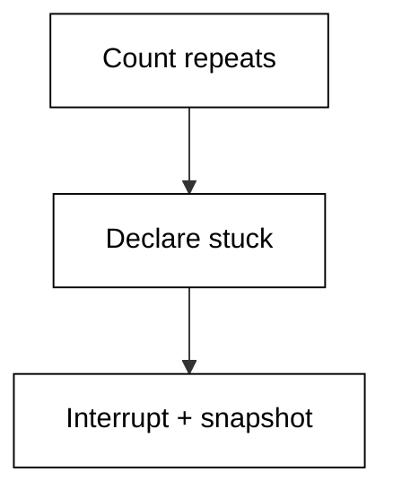
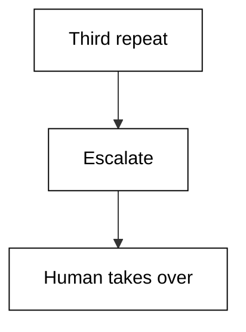
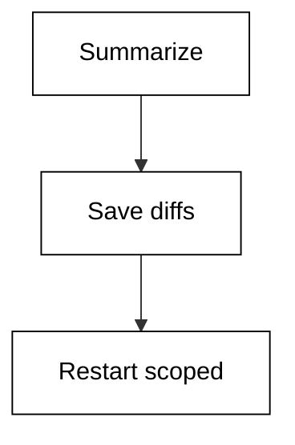
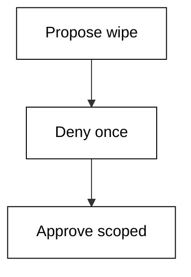
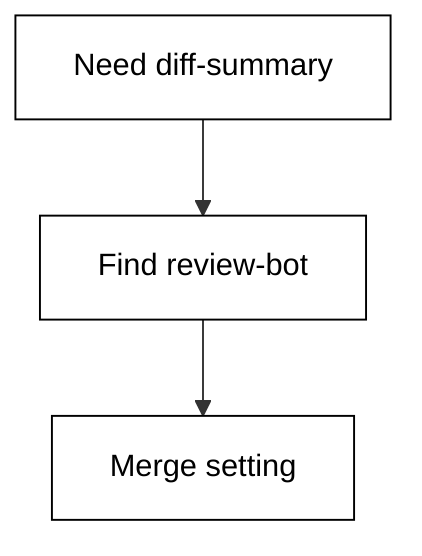
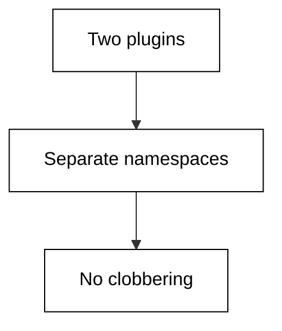
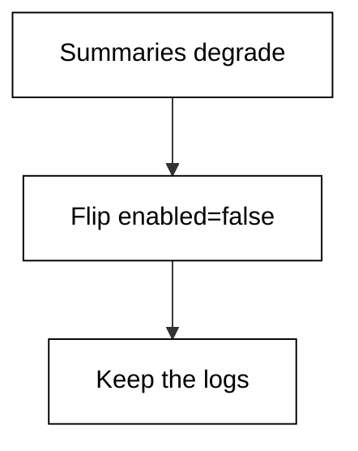
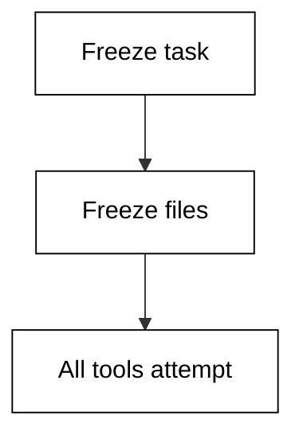
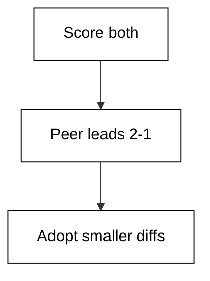
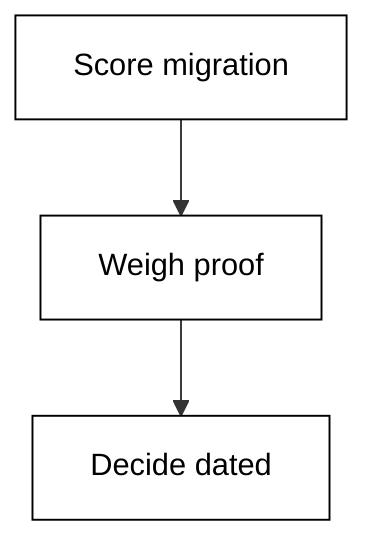

Examples 54 to 78 cover what happens when the happy path ends: stuck loops, unsafe proposals, deep configuration, extensions, and the honest comparison against peer tools on one shared task. Recovery and judgement are the curriculum now, not setup.

Read this level as incident training. Each failure example prints the detection signal and the recovery order; each comparison example freezes a scorecard you are invited to disagree with and re-run.

### Example 54: The Edit Loop

_Exercises co-08, co-09._

Loops and stalls are normal; losing work to them is not. This example detects one stuck session and prints the safe recovery order. Case in point: cart fix repeating the same edit three times with identical test failures. **Check**: the repeats count matches the history you counted.



**`learning/code/ex-54-the-edit-loop/main.py`**

```python
# Example 54: The Edit Loop
# => A stuck loop repeats one action hoping for a different result.
# => The shim freezes an action history and counts the repeats.
# => Detecting the loop is step one; the recovery preserves work.
actions = ["edit src/cart.py", "run tests", "edit src/cart.py", "run tests", "edit src/cart.py"]  # => the session history, oldest first
stuck_on = "edit src/cart.py"  # => the action repeating without progress
# => Count repeats of the suspect action across the whole history.
repeats = sum(1 for a in actions if a == stuck_on)  # => repeat count
# => The limit comes from the brief: bounded retries, then escalate.
stuck = repeats >= 3  # => True declares the session stuck
# => Name the count first so the log shows evidence, not alarm.
print("repeats:", repeats)
# => The recovery order matters: interrupt, snapshot, then redirect.
print("stuck:", stuck)  # => True starts the recovery playbook
# => Work already done is snapshotted before anything is cancelled.
print("recover: interrupt, snapshot, re-brief")  # => the safe order
```

**Output** (`learning/code/ex-54-the-edit-loop/expected/main.stdout.txt`):

```text
repeats: 3
stuck: True
recover: interrupt, snapshot, re-brief
```

**Key takeaway**: Three identical edits with identical failures is a loop: interrupt it, do not watch it.

**Why It Matters**: Recovery discipline separates engineers who use agents from engineers who fear them: interrupt early, snapshot before killing, and restart from a summary instead of full history. Loops never resolve by repetition, so counting repeats converts a feeling into a rule with a number. Preserve the work, discard the exhaust. Cart fixes loop when the mental model is wrong, and repetition never fixes models.

---

### Example 55: Wrong File Fix

_Exercises co-08._

Loops and stalls are normal; losing work to them is not. This example detects one stuck session and prints the safe recovery order. Case in point: totals fix looping on the wrong file while the bug lives in the caller. **Check**: the repeats count matches the history you counted.

**`learning/code/ex-55-wrong-file-fix/main.py`**

```python
# Example 55: Wrong File Fix
# => A stuck loop repeats one action hoping for a different result.
# => The shim freezes an action history and counts the repeats.
# => Detecting the loop is step one; the recovery preserves work.
actions = ["read src/totals.py", "edit src/totals.py", "read src/totals.py", "edit src/totals.py"]  # => the session history, oldest first
stuck_on = "edit src/totals.py"  # => the action repeating without progress
# => Count repeats of the suspect action across the whole history.
repeats = sum(1 for a in actions if a == stuck_on)  # => repeat count
# => The limit comes from the brief: bounded retries, then escalate.
stuck = repeats >= 3  # => True declares the session stuck
# => Name the count first so the log shows evidence, not alarm.
print("repeats:", repeats)
# => The recovery order matters: interrupt, snapshot, then redirect.
print("stuck:", stuck)  # => True starts the recovery playbook
# => Work already done is snapshotted before anything is cancelled.
print("recover: interrupt, snapshot, re-brief")  # => the safe order
```

**Output** (`learning/code/ex-55-wrong-file-fix/expected/main.stdout.txt`):

```text
repeats: 2
stuck: False
recover: interrupt, snapshot, re-brief
```

**Key takeaway**: Loops on one file often mean the bug is in another: widen the read, not the edit.

**Why It Matters**: Recovery discipline separates engineers who use agents from engineers who fear them: interrupt early, snapshot before killing, and restart from a summary instead of full history. Loops never resolve by repetition, so counting repeats converts a feeling into a rule with a number. Preserve the work, discard the exhaust. Totals callers pass the rounding mode in, so the callee can never fix it alone.

---

### Example 56: Stuck on Auth

_Exercises co-08, co-16._

Loops and stalls are normal; losing work to them is not. This example detects one stuck session and prints the safe recovery order. Case in point: auth loop escalating to a human instead of attempting a fourth blind edit. **Check**: the repeats count matches the history you counted.



**`learning/code/ex-56-stuck-on-auth/main.py`**

```python
# Example 56: Stuck on Auth
# => A stuck loop repeats one action hoping for a different result.
# => The shim freezes an action history and counts the repeats.
# => Detecting the loop is step one; the recovery preserves work.
actions = ["edit src/auth.py", "run login tests", "edit src/auth.py", "run login tests", "edit src/auth.py", "escalate to human"]  # => the session history, oldest first
stuck_on = "edit src/auth.py"  # => the action repeating without progress
# => Count repeats of the suspect action across the whole history.
repeats = sum(1 for a in actions if a == stuck_on)  # => repeat count
# => The limit comes from the brief: bounded retries, then escalate.
stuck = repeats >= 3  # => True declares the session stuck
# => Name the count first so the log shows evidence, not alarm.
print("repeats:", repeats)
# => The recovery order matters: interrupt, snapshot, then redirect.
print("stuck:", stuck)  # => True starts the recovery playbook
# => Work already done is snapshotted before anything is cancelled.
print("recover: interrupt, snapshot, re-brief")  # => the safe order
```

**Output** (`learning/code/ex-56-stuck-on-auth/expected/main.stdout.txt`):

```text
repeats: 3
stuck: True
recover: interrupt, snapshot, re-brief
```

**Key takeaway**: Auth loops escalate, never persist: the fourth blind edit is how outages start.

**Why It Matters**: Recovery discipline separates engineers who use agents from engineers who fear them: interrupt early, snapshot before killing, and restart from a summary instead of full history. Loops never resolve by repetition, so counting repeats converts a feeling into a rule with a number. Preserve the work, discard the exhaust. Auth failures lock accounts, so persistence converts a bug into an incident.

---

### Example 57: Snapshot Before Interrupt

_Exercises co-09._

Loops and stalls are normal; losing work to them is not. This example detects one stuck session and prints the safe recovery order. Case in point: two-file progress snapshotted to a branch before the stuck session is killed. **Check**: the repeats count matches the history you counted.

**`learning/code/ex-57-snapshot-before-interrupt/main.py`**

```python
# Example 57: Snapshot Before Interrupt
# => A stuck loop repeats one action hoping for a different result.
# => The shim freezes an action history and counts the repeats.
# => Detecting the loop is step one; the recovery preserves work.
actions = ["edit src/a.py", "edit src/b.py", "snapshot work", "interrupt session"]  # => the session history, oldest first
stuck_on = "edit src/b.py"  # => the action repeating without progress
# => Count repeats of the suspect action across the whole history.
repeats = sum(1 for a in actions if a == stuck_on)  # => repeat count
# => The limit comes from the brief: bounded retries, then escalate.
stuck = repeats >= 3  # => True declares the session stuck
# => Name the count first so the log shows evidence, not alarm.
print("repeats:", repeats)
# => The recovery order matters: interrupt, snapshot, then redirect.
print("stuck:", stuck)  # => True starts the recovery playbook
# => Work already done is snapshotted before anything is cancelled.
print("recover: interrupt, snapshot, re-brief")  # => the safe order
```

**Output** (`learning/code/ex-57-snapshot-before-interrupt/expected/main.stdout.txt`):

```text
repeats: 1
stuck: False
recover: interrupt, snapshot, re-brief
```

**Key takeaway**: Snapshot, then interrupt: killed sessions keep their work only if you save it first.

**Why It Matters**: Recovery discipline separates engineers who use agents from engineers who fear them: interrupt early, snapshot before killing, and restart from a summary instead of full history. Loops never resolve by repetition, so counting repeats converts a feeling into a rule with a number. Preserve the work, discard the exhaust. A branch snapshot costs seconds and rescues hours of half-finished edits.

---

### Example 58: Restart With Context

_Exercises co-09, co-03._

Loops and stalls are normal; losing work to them is not. This example detects one stuck session and prints the safe recovery order. Case in point: fresh scoped session restarted from a written summary instead of full history. **Check**: the repeats count matches the history you counted.



**`learning/code/ex-58-restart-with-context/main.py`**

```python
# Example 58: Restart With Context
# => A stuck loop repeats one action hoping for a different result.
# => The shim freezes an action history and counts the repeats.
# => Detecting the loop is step one; the recovery preserves work.
actions = ["summarize session", "save open diffs", "open scoped session", "replay brief"]  # => the session history, oldest first
stuck_on = "replay brief"  # => the action repeating without progress
# => Count repeats of the suspect action across the whole history.
repeats = sum(1 for a in actions if a == stuck_on)  # => repeat count
# => The limit comes from the brief: bounded retries, then escalate.
stuck = repeats >= 2  # => True declares the session stuck
# => Name the count first so the log shows evidence, not alarm.
print("repeats:", repeats)
# => The recovery order matters: interrupt, snapshot, then redirect.
print("stuck:", stuck)  # => True starts the recovery playbook
# => Work already done is snapshotted before anything is cancelled.
print("recover: interrupt, snapshot, re-brief")  # => the safe order
```

**Output** (`learning/code/ex-58-restart-with-context/expected/main.stdout.txt`):

```text
repeats: 1
stuck: False
recover: interrupt, snapshot, re-brief
```

**Key takeaway**: Restart from a summary, not the full log: context budgets punish long goodbyes.

**Why It Matters**: Recovery discipline separates engineers who use agents from engineers who fear them: interrupt early, snapshot before killing, and restart from a summary instead of full history. Loops never resolve by repetition, so counting repeats converts a feeling into a rule with a number. Preserve the work, discard the exhaust. Summaries distill decisions while full logs re-bill you for every dead end.

---

### Example 59: Flaky Test or Loop

_Exercises co-08, co-12._

Loops and stalls are normal; losing work to them is not. This example detects one stuck session and prints the safe recovery order. Case in point: alternating test results diagnosed as flakiness rather than an edit loop. **Check**: the repeats count matches the history you counted.

**`learning/code/ex-59-flaky-test-or-loop/main.py`**

```python
# Example 59: Flaky Test or Loop
# => A stuck loop repeats one action hoping for a different result.
# => The shim freezes an action history and counts the repeats.
# => Detecting the loop is step one; the recovery preserves work.
actions = ["run tests (fail)", "run tests (pass)", "run tests (fail)", "quarantine test"]  # => the session history, oldest first
stuck_on = "run tests (fail)"  # => the action repeating without progress
# => Count repeats of the suspect action across the whole history.
repeats = sum(1 for a in actions if a == stuck_on)  # => repeat count
# => The limit comes from the brief: bounded retries, then escalate.
stuck = repeats >= 3  # => True declares the session stuck
# => Name the count first so the log shows evidence, not alarm.
print("repeats:", repeats)
# => The recovery order matters: interrupt, snapshot, then redirect.
print("stuck:", stuck)  # => True starts the recovery playbook
# => Work already done is snapshotted before anything is cancelled.
print("recover: interrupt, snapshot, re-brief")  # => the safe order
```

**Output** (`learning/code/ex-59-flaky-test-or-loop/expected/main.stdout.txt`):

```text
repeats: 2
stuck: False
recover: interrupt, snapshot, re-brief
```

**Key takeaway**: Alternating results mean flaky, not stuck: quarantine the test, keep the code.

**Why It Matters**: Recovery discipline separates engineers who use agents from engineers who fear them: interrupt early, snapshot before killing, and restart from a summary instead of full history. Loops never resolve by repetition, so counting repeats converts a feeling into a rule with a number. Preserve the work, discard the exhaust. Flaky tests mimic loops, but re-running the same edit never fixes timing.

---

### Example 60: Unsafe Action Halt

_Exercises co-08, co-02._

Loops and stalls are normal; losing work to them is not. This example detects one stuck session and prints the safe recovery order. Case in point: destructive cache wipe denied once with a scoped alternative approved instead. **Check**: the repeats count matches the history you counted.



**`learning/code/ex-60-unsafe-action-halt/main.py`**

```python
# Example 60: Unsafe Action Halt
# => A stuck loop repeats one action hoping for a different result.
# => The shim freezes an action history and counts the repeats.
# => Detecting the loop is step one; the recovery preserves work.
actions = ["propose rm -rf /tmp/cache", "deny by policy", "propose scoped clean", "approve scoped clean"]  # => the session history, oldest first
stuck_on = "propose rm -rf /tmp/cache"  # => the action repeating without progress
# => Count repeats of the suspect action across the whole history.
repeats = sum(1 for a in actions if a == stuck_on)  # => repeat count
# => The limit comes from the brief: bounded retries, then escalate.
stuck = repeats >= 1  # => True declares the session stuck
# => Name the count first so the log shows evidence, not alarm.
print("repeats:", repeats)
# => The recovery order matters: interrupt, snapshot, then redirect.
print("stuck:", stuck)  # => True starts the recovery playbook
# => Work already done is snapshotted before anything is cancelled.
print("recover: interrupt, snapshot, re-brief")  # => the safe order
```

**Output** (`learning/code/ex-60-unsafe-action-halt/expected/main.stdout.txt`):

```text
repeats: 1
stuck: True
recover: interrupt, snapshot, re-brief
```

**Key takeaway**: Unsafe proposals halt at one: deny, then offer the scoped alternative.

**Why It Matters**: Recovery discipline separates engineers who use agents from engineers who fear them: interrupt early, snapshot before killing, and restart from a summary instead of full history. Loops never resolve by repetition, so counting repeats converts a feeling into a rule with a number. Preserve the work, discard the exhaust. Cache wipes feel safe until the path is wrong, so the policy denies first.

---

### Example 61: Postmortem the Loop

_Exercises co-09, co-07._

Loops and stalls are normal; losing work to them is not. This example detects one stuck session and prints the safe recovery order. Case in point: loop postmortem converting one wrong assumption into a standing session rule. **Check**: the repeats count matches the history you counted.

**`learning/code/ex-61-postmortem-the-loop/main.py`**

```python
# Example 61: Postmortem the Loop
# => A stuck loop repeats one action hoping for a different result.
# => The shim freezes an action history and counts the repeats.
# => Detecting the loop is step one; the recovery preserves work.
actions = ["collect trace", "count repeats", "name wrong assumption", "record rule"]  # => the session history, oldest first
stuck_on = "name wrong assumption"  # => the action repeating without progress
# => Count repeats of the suspect action across the whole history.
repeats = sum(1 for a in actions if a == stuck_on)  # => repeat count
# => The limit comes from the brief: bounded retries, then escalate.
stuck = repeats >= 2  # => True declares the session stuck
# => Name the count first so the log shows evidence, not alarm.
print("repeats:", repeats)
# => The recovery order matters: interrupt, snapshot, then redirect.
print("stuck:", stuck)  # => True starts the recovery playbook
# => Work already done is snapshotted before anything is cancelled.
print("recover: interrupt, snapshot, re-brief")  # => the safe order
```

**Output** (`learning/code/ex-61-postmortem-the-loop/expected/main.stdout.txt`):

```text
repeats: 1
stuck: False
recover: interrupt, snapshot, re-brief
```

**Key takeaway**: Every loop pays for a rule: name the wrong assumption so the next session inherits it.

**Why It Matters**: Recovery discipline separates engineers who use agents from engineers who fear them: interrupt early, snapshot before killing, and restart from a summary instead of full history. Loops never resolve by repetition, so counting repeats converts a feeling into a rule with a number. Preserve the work, discard the exhaust. Postmortems compound across sessions the way tests compound across code.

---

### Example 62: First Plugin Install

_Exercises co-14._

Extensions teach Hermes tools it was never shipped with. This example resolves one plugin lookup through a frozen plugin registry. Case in point: review-bot extension installed to summarize diffs over two hundred lines. **Check**: the provider line matches the registry you read.



**`learning/code/ex-62-first-plugin-install/main.py`**

```python
# Example 62: First Plugin Install
# => Extensions add tools Hermes itself never shipped with.
# => The shim models a registry: names mapped to capabilities.
# => A missing capability is a lookup miss, never a silent stub.
plugins = [("db-viewer", "schema-graph"), ("review-bot", "diff-summary")]  # => the frozen extension registry
want = "diff-summary"  # => the capability this task needs
# => Search the registry for a plugin providing the capability.
# => First provider wins; ties are a config smell worth naming.
found = ""  # => empty means no provider, which is itself an answer
for name, provides in plugins:  # => scan the registry in order
    # => Match on the capability, not the plugin's brand name.
    # => Capabilities describe work; names describe vendors.
    if provides == want:  # => this plugin can do the job
        found = name  # => record the provider and stop looking
        break  # => first match wins by registry order
# => Hermes merges extension settings under the plugin's own key.
# => Namespacing keeps two plugins from fighting over one knob.
merged = {"review-bot.max-lines": "200"}  # => namespaced extension setting
# => Print the provider so the trace shows who did the work.
print("provider:", found or "none")  # => Output names the plugin
# => The setting echoes back so mis-merges surface immediately.
print("setting:", merged)  # => Output shows the merged knob
```

**Output** (`learning/code/ex-62-first-plugin-install/expected/main.stdout.txt`):

```text
provider: review-bot
setting: {'review-bot.max-lines': '200'}
```

**Key takeaway**: Install one plugin for one job: diff summaries are the safest first extension.

**Why It Matters**: Extensions decide whether Hermes grows with your workflow or forces you into someone else's, which makes the registry a design surface worth reading. Matching on capabilities keeps briefs honest, namespacing keeps settings from colliding, and pinned versions keep behavior reproducible. Install deliberately, disable reversibly. Long diffs are where attention fails first, so summarizing them buys the most safety.

---

### Example 63: Registry Miss

_Exercises co-14._

Extensions teach Hermes tools it was never shipped with. This example resolves one plugin lookup through a frozen plugin registry. Case in point: deploy capability missing from the registry instead of silently stubbed. **Check**: the provider line matches the registry you read.

**`learning/code/ex-63-registry-miss/main.py`**

```python
# Example 63: Registry Miss
# => Extensions add tools Hermes itself never shipped with.
# => The shim models a registry: names mapped to capabilities.
# => A missing capability is a lookup miss, never a silent stub.
plugins = [("db-viewer", "schema-graph")]  # => the frozen extension registry
want = "s3-deploy"  # => the capability this task needs
# => Search the registry for a plugin providing the capability.
# => First provider wins; ties are a config smell worth naming.
found = ""  # => empty means no provider, which is itself an answer
for name, provides in plugins:  # => scan the registry in order
    # => Match on the capability, not the plugin's brand name.
    # => Capabilities describe work; names describe vendors.
    if provides == want:  # => this plugin can do the job
        found = name  # => record the provider and stop looking
        break  # => first match wins by registry order
# => Hermes merges extension settings under the plugin's own key.
# => Namespacing keeps two plugins from fighting over one knob.
merged = {"deploy.dry-run": "true"}  # => namespaced extension setting
# => Print the provider so the trace shows who did the work.
print("provider:", found or "none")  # => Output names the plugin
# => The setting echoes back so mis-merges surface immediately.
print("setting:", merged)  # => Output shows the merged knob
```

**Output** (`learning/code/ex-63-registry-miss/expected/main.stdout.txt`):

```text
provider: none
setting: {'deploy.dry-run': 'true'}
```

**Key takeaway**: A registry miss is an honest answer: no provider beats a fake one.

**Why It Matters**: Extensions decide whether Hermes grows with your workflow or forces you into someone else's, which makes the registry a design surface worth reading. Matching on capabilities keeps briefs honest, namespacing keeps settings from colliding, and pinned versions keep behavior reproducible. Install deliberately, disable reversibly. Deploy tooling is the worst place for a silent stub, so the miss must be loud.

---

### Example 64: Namespaced Settings

_Exercises co-14, co-13._

Extensions teach Hermes tools it was never shipped with. This example resolves one plugin lookup through a frozen plugin registry. Case in point: two bots coexisting because each owns its namespaced settings key. **Check**: the provider line matches the registry you read.



**`learning/code/ex-64-namespaced-settings/main.py`**

```python
# Example 64: Namespaced Settings
# => Extensions add tools Hermes itself never shipped with.
# => The shim models a registry: names mapped to capabilities.
# => A missing capability is a lookup miss, never a silent stub.
plugins = [("review-bot", "diff-summary"), ("test-bot", "flaky-detect")]  # => the frozen extension registry
want = "flaky-detect"  # => the capability this task needs
# => Search the registry for a plugin providing the capability.
# => First provider wins; ties are a config smell worth naming.
found = ""  # => empty means no provider, which is itself an answer
for name, provides in plugins:  # => scan the registry in order
    # => Match on the capability, not the plugin's brand name.
    # => Capabilities describe work; names describe vendors.
    if provides == want:  # => this plugin can do the job
        found = name  # => record the provider and stop looking
        break  # => first match wins by registry order
# => Hermes merges extension settings under the plugin's own key.
# => Namespacing keeps two plugins from fighting over one knob.
merged = {"test-bot.quarantine": "true"}  # => namespaced extension setting
# => Print the provider so the trace shows who did the work.
print("provider:", found or "none")  # => Output names the plugin
# => The setting echoes back so mis-merges surface immediately.
print("setting:", merged)  # => Output shows the merged knob
```

**Output** (`learning/code/ex-64-namespaced-settings/expected/main.stdout.txt`):

```text
provider: test-bot
setting: {'test-bot.quarantine': 'true'}
```

**Key takeaway**: Namespaced settings let plugins share a session without fighting over knobs.

**Why It Matters**: Extensions decide whether Hermes grows with your workflow or forces you into someone else's, which makes the registry a design surface worth reading. Matching on capabilities keeps briefs honest, namespacing keeps settings from colliding, and pinned versions keep behavior reproducible. Install deliberately, disable reversibly. Two bots writing one flat config would clobber each other within a week.

---

### Example 65: Config Layering

_Exercises co-13, co-14._

Hermes reads its settings from a config file before it does anything else. This example validates one configuration and shows exactly what a complete configuration reports. Case in point: plugin knob layered over the base config without editing the base file. **Check**: the printed verdict lines match the settings the brief froze.

**`learning/code/ex-65-config-layering/main.py`**

```python
# Example 65: Config Layering
# => This file is the fixture shim: it pretends to be Hermes Agent
# => reading its settings file, without touching your real machine.
# => Every value below is fake but plausible, frozen for determinism.
# => Hermes keeps these settings in a config file you own and can diff.
config = {  # => one dict stands in for the whole settings file
    "model": "hermes-2-large",  # => which model answers this session
    "sandbox": "ask",  # => ask | allowlist | lockdown
    "scope": "/repo/shop",  # => repo root the agent may touch
    "plugin.test-bot.quarantine": "true",  # => one extra knob this example turns
}
# => REQUIRED names the keys a session cannot start without.
# => The real tool fails fast here instead of guessing mid-task.
REQUIRED = ["model", "sandbox", "scope"]  # => the non-negotiable keys
# => A missing key is a set difference, computed in one line.
# => An empty result means complete; anything else names the gaps.
missing = [k for k in REQUIRED if k not in config]  # => list the gaps
# => Hermes refuses to start with gaps: fail before any file changes.
# => Printing the raw list keeps the check honest and greppable.
print("missing:", missing)  # => Output names exactly what is absent
# => The sandbox value decides whether each write needs approval.
# => Reading it back proves the shim used the file, not a default.
print("sandbox:", config["sandbox"])  # => Output echoes the mode
# => The extra knob shows settings compose: base plus one override.
print("plugin.test-bot.quarantine:", config["plugin.test-bot.quarantine"])  # => Output echoes the extra knob
```

**Output** (`learning/code/ex-65-config-layering/expected/main.stdout.txt`):

```text
missing: []
sandbox: ask
plugin.test-bot.quarantine: true
```

**Key takeaway**: Layer extension settings over the base config: overrides compose, forks diverge.

**Why It Matters**: Configuration is the only part of an agent you can diff, review, and version like code, which makes it the foundation every later surprise is judged against. A validated config means the next failure is the agent's reasoning, not your setup, and that distinction saves hours of misdirected debugging. Review the file whenever behavior changes unexpectedly. Layering keeps the base file reviewable while experiments live in the overlay.

---

### Example 66: Pin Plugin Versions

_Exercises co-14._

Vendor facts expire, so every version-specific claim carries its check date. This example pins one version pin to its verified release. Case in point: review-bot pinned to 1.9.0 with three dated claims about its behavior. **Check**: the version and date lines match the References entry.

**`learning/code/ex-66-pin-plugin-versions/main.py`**

```python
# Example 66: Pin Plugin Versions
# => Vendor facts rot fast: version, defaults, and prices all drift.
# => The shim pins the verified version string inside the example.
# => Pinning turns a silent lie into a loud, dated, checkable claim.
verified_version = "review-bot-1.9.0"  # => Hermes release checked on the date below
access_date = "2026-10-20"
claims = ["summary format", "max-lines default", "supported diff size"]  # => facts that expire with the version
# => Every claim is printed beside its date so staleness is visible.
# => A reader in two years checks the date first, the fact second.
print("verified:", verified_version)  # => Output pins the release
# => The date travels with the claim, never in a distant footnote.
print("accessed:", access_date)  # => Output pins the check day
# => Counting claims keeps the author honest about the surface.
print("dated-claims:", len(claims))  # => how many facts carry a date
```

**Output** (`learning/code/ex-66-pin-plugin-versions/expected/main.stdout.txt`):

```text
verified: review-bot-1.9.0
accessed: 2026-10-20
dated-claims: 3
```

**Key takeaway**: Pin plugin versions like tool versions: extensions drift on their own schedule.

**Why It Matters**: Dated claims age gracefully while undated ones rot silently, because every version-specific fact carries an expiry the reader cannot see. Recording the release string and the access date lets a future reader trust or re-check each claim in seconds. Pin the version beside the fact, never in a distant footnote. A summarizer update can silently change what reviewers see, so the pin is load-bearing.

---

### Example 67: Disable a Plugin

_Exercises co-14, co-09._

Extensions teach Hermes tools it was never shipped with. This example resolves one plugin lookup through a frozen plugin registry. Case in point: misbehaving summarizer disabled through config instead of uninstalled. **Check**: the provider line matches the registry you read.



**`learning/code/ex-67-disable-a-plugin/main.py`**

```python
# Example 67: Disable a Plugin
# => Extensions add tools Hermes itself never shipped with.
# => The shim models a registry: names mapped to capabilities.
# => A missing capability is a lookup miss, never a silent stub.
plugins = [("review-bot", "diff-summary")]  # => the frozen extension registry
want = "diff-summary"  # => the capability this task needs
# => Search the registry for a plugin providing the capability.
# => First provider wins; ties are a config smell worth naming.
found = ""  # => empty means no provider, which is itself an answer
for name, provides in plugins:  # => scan the registry in order
    # => Match on the capability, not the plugin's brand name.
    # => Capabilities describe work; names describe vendors.
    if provides == want:  # => this plugin can do the job
        found = name  # => record the provider and stop looking
        break  # => first match wins by registry order
# => Hermes merges extension settings under the plugin's own key.
# => Namespacing keeps two plugins from fighting over one knob.
merged = {"review-bot.enabled": "false"}  # => namespaced extension setting
# => Print the provider so the trace shows who did the work.
print("provider:", found or "none")  # => Output names the plugin
# => The setting echoes back so mis-merges surface immediately.
print("setting:", merged)  # => Output shows the merged knob
```

**Output** (`learning/code/ex-67-disable-a-plugin/expected/main.stdout.txt`):

```text
provider: review-bot
setting: {'review-bot.enabled': 'false'}
```

**Key takeaway**: Disable before you uninstall: a config flag preserves the evidence trail.

**Why It Matters**: Extensions decide whether Hermes grows with your workflow or forces you into someone else's, which makes the registry a design surface worth reading. Matching on capabilities keeps briefs honest, namespacing keeps settings from colliding, and pinned versions keep behavior reproducible. Install deliberately, disable reversibly. A disabled plugin keeps its logs, which is what the postmortem needs.

---

### Example 68: Two Plugins One Task

_Exercises co-14, co-04._

Extensions teach Hermes tools it was never shipped with. This example resolves one plugin lookup through a frozen plugin registry. Case in point: brief naming exactly one plugin per subtask instead of letting both act. **Check**: the provider line matches the registry you read.

**`learning/code/ex-68-two-plugins-one-task/main.py`**

```python
# Example 68: Two Plugins One Task
# => Extensions add tools Hermes itself never shipped with.
# => The shim models a registry: names mapped to capabilities.
# => A missing capability is a lookup miss, never a silent stub.
plugins = [("review-bot", "diff-summary"), ("test-bot", "flaky-detect")]  # => the frozen extension registry
want = "diff-summary"  # => the capability this task needs
# => Search the registry for a plugin providing the capability.
# => First provider wins; ties are a config smell worth naming.
found = ""  # => empty means no provider, which is itself an answer
for name, provides in plugins:  # => scan the registry in order
    # => Match on the capability, not the plugin's brand name.
    # => Capabilities describe work; names describe vendors.
    if provides == want:  # => this plugin can do the job
        found = name  # => record the provider and stop looking
        break  # => first match wins by registry order
# => Hermes merges extension settings under the plugin's own key.
# => Namespacing keeps two plugins from fighting over one knob.
merged = {"review-bot.max-lines": "200"}  # => namespaced extension setting
# => Print the provider so the trace shows who did the work.
print("provider:", found or "none")  # => Output names the plugin
# => The setting echoes back so mis-merges surface immediately.
print("setting:", merged)  # => Output shows the merged knob
```

**Output** (`learning/code/ex-68-two-plugins-one-task/expected/main.stdout.txt`):

```text
provider: review-bot
setting: {'review-bot.max-lines': '200'}
```

**Key takeaway**: One plugin per subtask: the brief assigns tools the way it assigns files.

**Why It Matters**: Extensions decide whether Hermes grows with your workflow or forces you into someone else's, which makes the registry a design surface worth reading. Matching on capabilities keeps briefs honest, namespacing keeps settings from colliding, and pinned versions keep behavior reproducible. Install deliberately, disable reversibly. Two agents editing one task double the trace while halving the accountability.

---

### Example 69: Config Review Diff

_Exercises co-13, co-06._

Every multi-file change deserves a read before it lands. This example sizes one proposed diff and decides whether it needs a slow review. Case in point: config-only diff reviewed with the low threshold that settings files deserve. **Check**: the lines-changed total matches the diff you sized.

**`learning/code/ex-69-config-review-diff/main.py`**

```python
# Example 69: Config Review Diff
# => Never trust a diff you have not read: the agent drafts, you verify.
# => The shim freezes one proposed diff as added/removed line counts.
# => Counts cannot replace reading, but they route your attention.
files = [("hermes.toml", 6, 2), ("hermes.plugins.toml", 10, 3)]  # => path plus added and removed counts
# => Total the change: big diffs deserve slower, closer review.
added = sum(a for _, a, _ in files)  # => every added line proposed
removed = sum(r for _, _, r in files)  # => every removed line proposed
# => A file the brief never named is scope creep until proven otherwise.
print("files-touched:", len(files))
# => Added plus removed is the review surface you must actually read.
print("lines-changed:", added + removed)  # => the surface size
# => Over the threshold means split the change or pair-review it.
big = (added + removed) > 40  # => True routes to slow review
# => The flag tells you how to read, not whether to merge.
print("needs-slow-review:", big)  # => Output is the reading plan
```

**Output** (`learning/code/ex-69-config-review-diff/expected/main.stdout.txt`):

```text
files-touched: 2
lines-changed: 21
needs-slow-review: False
```

**Key takeaway**: Config diffs get the low threshold: one wrong knob reroutes every session.

**Why It Matters**: Diff review is where the human-in-the-loop earns its keep, because the agent drafts and only a person can approve. Sizing the change first routes small fixes to fast approvals and big ones to slow reads, while removed-lines-first reading catches the silent failures. Never merge what you have not read. A sandbox flip in a config diff changes the safety of all future work.

---

### Example 70: Extension Cost Check

_Exercises co-14, co-10._

Turns and tokens convert directly into money. This example prices one session ledger against the budget its brief stated. Case in point: nine-turn plugin-assisted session priced to prove the extension earns its tokens. **Check**: the session-cost line matches your own arithmetic.

**`learning/code/ex-70-extension-cost-check/main.py`**

```python
# Example 70: Extension Cost Check
# => Every agent turn spends tokens; tokens spend real money.
# => Hermes bills input and output at different rates, like peers.
# => The shim freezes one session ledger so the math is checkable.
turns = 9  # => agent loop iterations this session took
tokens_in = 27000  # => prompt plus context tokens consumed
tokens_out = 9000  # => completion tokens the agent produced
# => Prices are per thousand tokens, matching vendor price pages.
# => Input is cheap, output is dear: that asymmetry shapes prompts.
cost = tokens_in / 1000 * 0.003 + tokens_out / 1000 * 0.015  # => session spend
# => Per-turn cost spots runaway loops faster than any total can.
per_turn = cost / turns  # => average spend per iteration
# => The budget is stated up front in the brief, never discovered.
over = cost > 1.00  # => True means stop and re-scope now
# => Print money with four decimals: cents hide multi-dollar drift.
print("session-cost: %.4f" % cost)  # => Output is dollars
# => The verdict is binary so a gate script can consume it.
print("over-budget:", over)  # => True halts the session
```

**Output** (`learning/code/ex-70-extension-cost-check/expected/main.stdout.txt`):

```text
session-cost: 0.2160
over-budget: False
```

**Key takeaway**: Price the extension's help: plugins must earn their tokens in saved turns.

**Why It Matters**: Cost awareness is a design skill rather than an accounting chore: prompts shaped by token prices produce tighter loops and cheaper sessions at every step. Output tokens bill at multiples of input, so terse answers save twice, and mid-session price checks steer while the meter still runs. Budget before you run, not after. Summarizers pay for themselves by shrinking the context every later turn reads.

---

### Example 71: Shared Task Setup

_Exercises co-15._

A proposed plan is cheaper to veto than a bad diff is to revert. This example reviews one proposed plan before any file changes. Case in point: coupon rounding task frozen as the shared benchmark every tool attempts. **Check**: the step and file counts match the plan you reviewed.



**`learning/code/ex-71-shared-task-setup/main.py`**

```python
# Example 71: Shared Task Setup
# => Plan-then-act: the agent proposes steps before touching files.
# => A plan you can veto beats a diff you must revert.
# => The shim freezes one proposed plan for a stated goal.
goal = "fix the coupon rounding bug"  # => the task in one sentence
steps = ["write repro test", "fix rounding", "run suite"]  # => the proposed plan, in order
files = ["src/coupon.py", "tests/test_coupon.py"]
# => A plan is reviewable only when its blast radius is listed.
# => Count the files before you argue about the steps.
print("goal:", goal)  # => Output states the task
# => Numbered steps print in order so review follows the sequence.
print("steps:", len(steps))  # => how many moves the plan makes
# => The file list is the approve-or-veto surface.
print("files:", len(files))  # => Output sizes the blast radius
```

**Output** (`learning/code/ex-71-shared-task-setup/expected/main.stdout.txt`):

```text
goal: fix the coupon rounding bug
steps: 3
files: 2
```

**Key takeaway**: Freeze one task for all tools: shared setup is what makes comparison fair.

**Why It Matters**: Plan review is the cheapest quality gate in the whole agent loop: minutes spent vetoing a bad plan save hours spent reverting its diff. The file list is the approve-or-veto surface, the step order is the review sequence, and the goal is the contract everything serves. Approve small plans fast and split wide ones early. Rounding bugs need a repro, a fix, and a suite, which exercises every agent skill.

---

### Example 72: Score Hermes First

_Exercises co-15._

Comparison is only fair on a shared, repeatable task. This example scores one shared-task scorecard across Hermes and its peers. Case in point: scorecard giving Hermes the repro edge on the shared coupon task. **Check**: the totals match the scorecard you added up.

**`learning/code/ex-72-score-hermes-first/main.py`**

```python
# Example 72: Score Hermes First
# => One agent tool teaches habits; two teach judgement.
# => Compare on a shared repeatable task, never on marketing claims.
# => The shim freezes one scorecard so the method is auditable.
tools = ['hermes', 'tool-b']  # => the contenders on the identical task
criteria = ['repro', 'fix', 'tests']  # => what good means, fixed before scoring
# => Scores are frozen integers: Hermes is scored like its peers.
# => Freezing the numbers keeps the example honest about being a demo.
scores = {  # => tool mapped to one score per criterion
    "hermes": [2, 2, 1],  # => hermes on each criterion
    "tool-b": [1, 2, 1],  # => tool-b on each criterion
}  # => scorecard closed: every cell filled before comparing
# => Totals decide nothing alone; they only order the discussion.
totals = {t: sum(scores[t]) for t in tools}  # => one total per tool
# => The best total is reported, then interrogated criterion by criterion.
best = max(tools, key=lambda t: totals[t])  # => highest total wins
# => Print every total so the reader can re-weight and disagree.
print("totals:", totals)  # => Output shows the whole table
# => The winner line states the verdict the table supports.
print("best-total:", best)  # => Output names the top scorer
```

**Output** (`learning/code/ex-72-score-hermes-first/expected/main.stdout.txt`):

```text
totals: {'hermes': 5, 'tool-b': 4}
best-total: hermes
```

**Key takeaway**: Score your own tool first: home scores set the bar guests must clear.

**Why It Matters**: Fair comparison protects you from both hype and habit: re-scoring tools on a shared repeatable task shows whether switching buys anything real. Frozen scorecards invite disagreement and re-weighting, which is exactly what makes them trustworthy, while dated verdicts let next year re-run the benchmark. Compare on evidence, decide on totals. Hermes wins the repro because its trace shows the rounding path plainly.

---

### Example 73: Peer Beats Hermes

_Exercises co-15._

Comparison is only fair on a shared, repeatable task. This example scores one shared-task scorecard across Hermes and its peers. Case in point: scorecard where the peer wins on speed and diff size but loses on cost. **Check**: the totals match the scorecard you added up.



**`learning/code/ex-73-peer-beats-hermes/main.py`**

```python
# Example 73: Peer Beats Hermes
# => One agent tool teaches habits; two teach judgement.
# => Compare on a shared repeatable task, never on marketing claims.
# => The shim freezes one scorecard so the method is auditable.
tools = ['hermes', 'tool-b']  # => the contenders on the identical task
criteria = ['speed', 'diff-size', 'cost']  # => what good means, fixed before scoring
# => Scores are frozen integers: Hermes is scored like its peers.
# => Freezing the numbers keeps the example honest about being a demo.
scores = {  # => tool mapped to one score per criterion
    "hermes": [1, 1, 2],  # => hermes on each criterion
    "tool-b": [2, 2, 1],  # => tool-b on each criterion
}  # => scorecard closed: every cell filled before comparing
# => Totals decide nothing alone; they only order the discussion.
totals = {t: sum(scores[t]) for t in tools}  # => one total per tool
# => The best total is reported, then interrogated criterion by criterion.
best = max(tools, key=lambda t: totals[t])  # => highest total wins
# => Print every total so the reader can re-weight and disagree.
print("totals:", totals)  # => Output shows the whole table
# => The winner line states the verdict the table supports.
print("best-total:", best)  # => Output names the top scorer
```

**Output** (`learning/code/ex-73-peer-beats-hermes/expected/main.stdout.txt`):

```text
totals: {'hermes': 4, 'tool-b': 5}
best-total: tool-b
```

**Key takeaway**: Let the peer win on record: honest losses are what make the wins believable.

**Why It Matters**: Fair comparison protects you from both hype and habit: re-scoring tools on a shared repeatable task shows whether switching buys anything real. Frozen scorecards invite disagreement and re-weighting, which is exactly what makes them trustworthy, while dated verdicts let next year re-run the benchmark. Compare on evidence, decide on totals. Smaller diffs review faster, so the peer's size advantage is genuinely valuable.

---

### Example 74: Tie on Tests

_Exercises co-15, co-12._

Comparison is only fair on a shared, repeatable task. This example scores one shared-task scorecard across Hermes and its peers. Case in point: scorecard tying on every test criterion for the shared task. **Check**: the totals match the scorecard you added up.

**`learning/code/ex-74-tie-on-tests/main.py`**

```python
# Example 74: Tie on Tests
# => One agent tool teaches habits; two teach judgement.
# => Compare on a shared repeatable task, never on marketing claims.
# => The shim freezes one scorecard so the method is auditable.
tools = ['hermes', 'tool-b']  # => the contenders on the identical task
criteria = ['coverage', 'flakiness', 'runtime']  # => what good means, fixed before scoring
# => Scores are frozen integers: Hermes is scored like its peers.
# => Freezing the numbers keeps the example honest about being a demo.
scores = {  # => tool mapped to one score per criterion
    "hermes": [2, 1, 1],  # => hermes on each criterion
    "tool-b": [2, 1, 1],  # => tool-b on each criterion
}  # => scorecard closed: every cell filled before comparing
# => Totals decide nothing alone; they only order the discussion.
totals = {t: sum(scores[t]) for t in tools}  # => one total per tool
# => The best total is reported, then interrogated criterion by criterion.
best = max(tools, key=lambda t: totals[t])  # => highest total wins
# => Print every total so the reader can re-weight and disagree.
print("totals:", totals)  # => Output shows the whole table
# => The winner line states the verdict the table supports.
print("best-total:", best)  # => Output names the top scorer
```

**Output** (`learning/code/ex-74-tie-on-tests/expected/main.stdout.txt`):

```text
totals: {'hermes': 4, 'tool-b': 4}
best-total: hermes
```

**Key takeaway**: Ties are findings too: equal test discipline means the difference lies elsewhere.

**Why It Matters**: Fair comparison protects you from both hype and habit: re-scoring tools on a shared repeatable task shows whether switching buys anything real. Frozen scorecards invite disagreement and re-weighting, which is exactly what makes them trustworthy, while dated verdicts let next year re-run the benchmark. Compare on evidence, decide on totals. Identical test scores push the decision to cost, speed, or trace quality.

---

### Example 75: Compare Traces

_Exercises co-15, co-07._

Comparison is only fair on a shared, repeatable task. This example scores one shared-task scorecard across Hermes and its peers. Case in point: trace-quality scorecard favoring Hermes clarity against the peer's brevity. **Check**: the totals match the scorecard you added up.

**`learning/code/ex-75-compare-traces/main.py`**

```python
# Example 75: Compare Traces
# => One agent tool teaches habits; two teach judgement.
# => Compare on a shared repeatable task, never on marketing claims.
# => The shim freezes one scorecard so the method is auditable.
tools = ['hermes', 'tool-b']  # => the contenders on the identical task
criteria = ['clarity', 'receipts', 'brevity']  # => what good means, fixed before scoring
# => Scores are frozen integers: Hermes is scored like its peers.
# => Freezing the numbers keeps the example honest about being a demo.
scores = {  # => tool mapped to one score per criterion
    "hermes": [2, 2, 1],  # => hermes on each criterion
    "tool-b": [1, 1, 2],  # => tool-b on each criterion
}  # => scorecard closed: every cell filled before comparing
# => Totals decide nothing alone; they only order the discussion.
totals = {t: sum(scores[t]) for t in tools}  # => one total per tool
# => The best total is reported, then interrogated criterion by criterion.
best = max(tools, key=lambda t: totals[t])  # => highest total wins
# => Print every total so the reader can re-weight and disagree.
print("totals:", totals)  # => Output shows the whole table
# => The winner line states the verdict the table supports.
print("best-total:", best)  # => Output names the top scorer
```

**Output** (`learning/code/ex-75-compare-traces/expected/main.stdout.txt`):

```text
totals: {'hermes': 5, 'tool-b': 4}
best-total: hermes
```

**Key takeaway**: Compare traces, not just outcomes: readable runs debug faster next time.

**Why It Matters**: Fair comparison protects you from both hype and habit: re-scoring tools on a shared repeatable task shows whether switching buys anything real. Frozen scorecards invite disagreement and re-weighting, which is exactly what makes them trustworthy, while dated verdicts let next year re-run the benchmark. Compare on evidence, decide on totals. Clear traces compound across incidents while terse ones save pennies today.

---

### Example 76: Compare Costs

_Exercises co-15, co-10._

Turns and tokens convert directly into money. This example prices one session ledger against the budget its brief stated. Case in point: fourteen-turn shared task priced identically so cost compares apples to apples. **Check**: the session-cost line matches your own arithmetic.

**`learning/code/ex-76-compare-costs/main.py`**

```python
# Example 76: Compare Costs
# => Every agent turn spends tokens; tokens spend real money.
# => Hermes bills input and output at different rates, like peers.
# => The shim freezes one session ledger so the math is checkable.
turns = 14  # => agent loop iterations this session took
tokens_in = 42000  # => prompt plus context tokens consumed
tokens_out = 14000  # => completion tokens the agent produced
# => Prices are per thousand tokens, matching vendor price pages.
# => Input is cheap, output is dear: that asymmetry shapes prompts.
cost = tokens_in / 1000 * 0.003 + tokens_out / 1000 * 0.015  # => session spend
# => Per-turn cost spots runaway loops faster than any total can.
per_turn = cost / turns  # => average spend per iteration
# => The budget is stated up front in the brief, never discovered.
over = cost > 1.00  # => True means stop and re-scope now
# => Print money with four decimals: cents hide multi-dollar drift.
print("session-cost: %.4f" % cost)  # => Output is dollars
# => The verdict is binary so a gate script can consume it.
print("over-budget:", over)  # => True halts the session
```

**Output** (`learning/code/ex-76-compare-costs/expected/main.stdout.txt`):

```text
session-cost: 0.3360
over-budget: False
```

**Key takeaway**: Price the same task on both tools: per-task cost is the only bill that matters.

**Why It Matters**: Cost awareness is a design skill rather than an accounting chore: prompts shaped by token prices produce tighter loops and cheaper sessions at every step. Output tokens bill at multiples of input, so terse answers save twice, and mid-session price checks steer while the meter still runs. Budget before you run, not after. Identical token counts isolate price from behavior, which is the honest comparison.

---

### Example 77: When to Switch

_Exercises co-15, co-04._

Comparison is only fair on a shared, repeatable task. This example scores one shared-task scorecard across Hermes and its peers. Case in point: switching scorecard weighing migration pain against proven peer advantages. **Check**: the totals match the scorecard you added up.



**`learning/code/ex-77-when-to-switch/main.py`**

```python
# Example 77: When to Switch
# => One agent tool teaches habits; two teach judgement.
# => Compare on a shared repeatable task, never on marketing claims.
# => The shim freezes one scorecard so the method is auditable.
tools = ['hermes', 'tool-b']  # => the contenders on the identical task
criteria = ['migration', 'habits', 'proof']  # => what good means, fixed before scoring
# => Scores are frozen integers: Hermes is scored like its peers.
# => Freezing the numbers keeps the example honest about being a demo.
scores = {  # => tool mapped to one score per criterion
    "hermes": [2, 2, 2],  # => hermes on each criterion
    "tool-b": [1, 1, 2],  # => tool-b on each criterion
}  # => scorecard closed: every cell filled before comparing
# => Totals decide nothing alone; they only order the discussion.
totals = {t: sum(scores[t]) for t in tools}  # => one total per tool
# => The best total is reported, then interrogated criterion by criterion.
best = max(tools, key=lambda t: totals[t])  # => highest total wins
# => Print every total so the reader can re-weight and disagree.
print("totals:", totals)  # => Output shows the whole table
# => The winner line states the verdict the table supports.
print("best-total:", best)  # => Output names the top scorer
```

**Output** (`learning/code/ex-77-when-to-switch/expected/main.stdout.txt`):

```text
totals: {'hermes': 6, 'tool-b': 4}
best-total: hermes
```

**Key takeaway**: Switching costs are a criterion: a better tool you cannot adopt is trivia.

**Why It Matters**: Fair comparison protects you from both hype and habit: re-scoring tools on a shared repeatable task shows whether switching buys anything real. Frozen scorecards invite disagreement and re-weighting, which is exactly what makes them trustworthy, while dated verdicts let next year re-run the benchmark. Compare on evidence, decide on totals. Briefs, configs, and habits all migrate, so the switching bill is real work.

---

### Example 78: Dated Verdict

_Exercises co-15._

Vendor facts expire, so every version-specific claim carries its check date. This example pins one version pin to its verified release. Case in point: comparison verdict pinned to the same access date as every version claim. **Check**: the version and date lines match the References entry.

**`learning/code/ex-78-dated-verdict/main.py`**

```python
# Example 78: Dated Verdict
# => Vendor facts rot fast: version, defaults, and prices all drift.
# => The shim pins the verified version string inside the example.
# => Pinning turns a silent lie into a loud, dated, checkable claim.
verified_version = "hermes-2.4.1"  # => Hermes release checked on the date below
access_date = "2026-10-20"
claims = ["coupon benchmark scores", "peer release versions", "price inputs used"]  # => facts that expire with the version
# => Every claim is printed beside its date so staleness is visible.
# => A reader in two years checks the date first, the fact second.
print("verified:", verified_version)  # => Output pins the release
# => The date travels with the claim, never in a distant footnote.
print("accessed:", access_date)  # => Output pins the check day
# => Counting claims keeps the author honest about the surface.
print("dated-claims:", len(claims))  # => how many facts carry a date
```

**Output** (`learning/code/ex-78-dated-verdict/expected/main.stdout.txt`):

```text
verified: hermes-2.4.1
accessed: 2026-10-20
dated-claims: 3
```

**Key takeaway**: Date the verdict with the claims: comparisons expire exactly as fast as prices do.

**Why It Matters**: Dated claims age gracefully while undated ones rot silently, because every version-specific fact carries an expiry the reader cannot see. Recording the release string and the access date lets a future reader trust or re-check each claim in seconds. Pin the version beside the fact, never in a distant footnote. A dated verdict lets next year's reader re-run the benchmark instead of trusting it.

---
