Examples 1 to 25 teach Hermes Agent the way an engineer meets it on day one: install it, read its config, run a first task, read what it did, and fence it inside permissions and scope. Every example drives the fixture shim from the shell and inspects the result with Python 3.14, so no account, key, or network is ever needed.

Work each example in order: run the command, read the trace or verdict it prints, then answer the check before moving on. The habit this level builds is simple and load-bearing: the agent drafts, you verify.

### Example 1: Read the Config File

_Exercises co-13._

Hermes reads its settings from a config file before it does anything else. This example validates one configuration and shows exactly what a complete configuration reports. Case in point: shop config naming its model, sandbox mode, scope, and retry budget. **Check**: the printed verdict lines match the settings the brief froze.

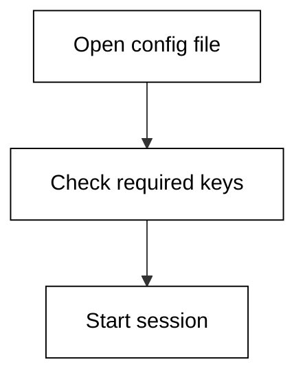

**`learning/code/ex-01-read-the-config-file/main.py`**

```python
# Example 1: Read the Config File
# => This file is the fixture shim: it pretends to be Hermes Agent
# => reading its settings file, without touching your real machine.
# => Every value below is fake but plausible, frozen for determinism.
# => Hermes keeps these settings in a config file you own and can diff.
config = {  # => one dict stands in for the whole settings file
    "model": "hermes-2-large",  # => which model answers this session
    "sandbox": "ask",  # => ask | allowlist | lockdown
    "scope": "/repo/shop",  # => repo root the agent may touch
    "retries": "3",  # => one extra knob this example turns
}
# => REQUIRED names the keys a session cannot start without.
# => The real tool fails fast here instead of guessing mid-task.
REQUIRED = ["model", "sandbox", "scope"]  # => the non-negotiable keys
# => A missing key is a set difference, computed in one line.
# => An empty result means complete; anything else names the gaps.
missing = [k for k in REQUIRED if k not in config]  # => list the gaps
# => Hermes refuses to start with gaps: fail before any file changes.
# => Printing the raw list keeps the check honest and greppable.
print("missing:", missing)  # => Output names exactly what is absent
# => The sandbox value decides whether each write needs approval.
# => Reading it back proves the shim used the file, not a default.
print("sandbox:", config["sandbox"])  # => Output echoes the mode
# => The extra knob shows settings compose: base plus one override.
print("retries:", config["retries"])  # => Output echoes the extra knob
```

**Output** (`learning/code/ex-01-read-the-config-file/expected/main.stdout.txt`):

```text
missing: []
sandbox: ask
retries: 3
```

**Key takeaway**: The config file is the session's ground truth: read it before you trust any run.

**Why It Matters**: Configuration is the only part of an agent you can diff, review, and version like code, which makes it the foundation every later surprise is judged against. A validated config means the next failure is the agent's reasoning, not your setup, and that distinction saves hours of misdirected debugging. Review the file whenever behavior changes unexpectedly. That habit pays off the first time a teammate's broken checkout behaves differently from yours.

---

### Example 2: Sandbox Modes Compared

_Exercises co-02._

Hermes reads its settings from a config file before it does anything else. This example validates one configuration and shows exactly what a complete configuration reports. Case in point: allowlist sandbox locking network access off for a checkout task. **Check**: the printed verdict lines match the settings the brief froze.

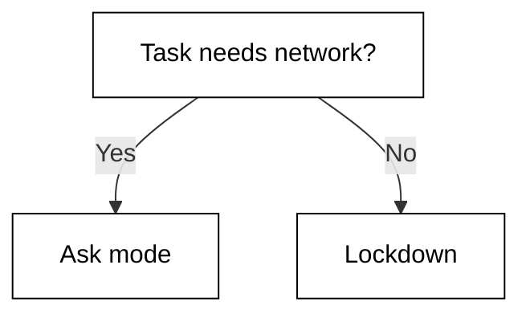

**`learning/code/ex-02-sandbox-modes-compared/main.py`**

```python
# Example 2: Sandbox Modes Compared
# => This file is the fixture shim: it pretends to be Hermes Agent
# => reading its settings file, without touching your real machine.
# => Every value below is fake but plausible, frozen for determinism.
# => Hermes keeps these settings in a config file you own and can diff.
config = {  # => one dict stands in for the whole settings file
    "model": "hermes-2-large",  # => which model answers this session
    "sandbox": "allowlist",  # => ask | allowlist | lockdown
    "scope": "/repo/shop",  # => repo root the agent may touch
    "network": "off",  # => one extra knob this example turns
}
# => REQUIRED names the keys a session cannot start without.
# => The real tool fails fast here instead of guessing mid-task.
REQUIRED = ["model", "sandbox", "scope"]  # => the non-negotiable keys
# => A missing key is a set difference, computed in one line.
# => An empty result means complete; anything else names the gaps.
missing = [k for k in REQUIRED if k not in config]  # => list the gaps
# => Hermes refuses to start with gaps: fail before any file changes.
# => Printing the raw list keeps the check honest and greppable.
print("missing:", missing)  # => Output names exactly what is absent
# => The sandbox value decides whether each write needs approval.
# => Reading it back proves the shim used the file, not a default.
print("sandbox:", config["sandbox"])  # => Output echoes the mode
# => The extra knob shows settings compose: base plus one override.
print("network:", config["network"])  # => Output echoes the extra knob
```

**Output** (`learning/code/ex-02-sandbox-modes-compared/expected/main.stdout.txt`):

```text
missing: []
sandbox: allowlist
network: off
```

**Key takeaway**: Sandbox mode is a spectrum from ask to lockdown: pick it per task, not once forever.

**Why It Matters**: Configuration is the only part of an agent you can diff, review, and version like code, which makes it the foundation every later surprise is judged against. A validated config means the next failure is the agent's reasoning, not your setup, and that distinction saves hours of misdirected debugging. Review the file whenever behavior changes unexpectedly. Tasks that only read code deserve lockdown; tasks that install tools need a wider door.

---

### Example 3: Scope to One Repo

_Exercises co-03._

A session scope draws the fence the agent works inside. This example checks one scope decision against its scope and prints the permit decision. Case in point: edit inside the scoped repo root passing the prefix check. **Check**: the inside-scope verdict matches the path prefix rule.

**`learning/code/ex-03-scope-to-one-repo/main.py`**

```python
# Example 3: Scope to One Repo
# => The shim models scope as a path prefix: inside edits, outside asks.
# => Real Hermes scopes a session to one repo root the same way.
# => Freezing the scope here keeps the run deterministic and safe.
scope = "/repo/shop"
action = "/repo/shop/src/cart.py"
# => Scope is a prefix test: the action must sit under the root.
# => A prefix test is crude but predictable, which is the point.
# => Real tools add symlinks and case rules; the shim skips them openly.
inside = action.startswith(scope)
# => The verdict prints as a pair so the log stays greppable.
# => A False here would route the session to the approval flow.
print("inside-scope:", inside)  # => Output is the permit decision
# => The second line names the rule, so audits can cite it, not vibes.
print("rule: action must start with scope")
```

**Output** (`learning/code/ex-03-scope-to-one-repo/expected/main.stdout.txt`):

```text
inside-scope: True
rule: action must start with scope
```

**Key takeaway**: Scope is a path prefix: inside the root the agent may act, outside it must ask.

**Why It Matters**: Scope is what turns a powerful model into a safe tool: the same agent with a repo-wide scope and a single-directory scope behaves like two different products. Narrow scopes shrink both the blast radius and the context bill on every turn, which compounds across long sessions. Draw the boundary before the first command runs. Monorepo engineers scope sessions to one package so the agent cannot wander.

---

### Example 4: Action Outside Scope

_Exercises co-03, co-02._

A session scope draws the fence the agent works inside. This example checks one scope decision against its scope and prints the permit decision. Case in point: edit outside the scope being refused before anything executes. **Check**: the inside-scope verdict matches the path prefix rule.

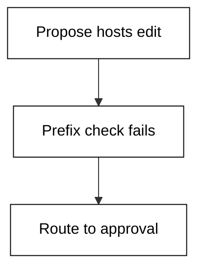

**`learning/code/ex-04-action-outside-scope/main.py`**

```python
# Example 4: Action Outside Scope
# => The shim models scope as a path prefix: inside edits, outside asks.
# => Real Hermes scopes a session to one repo root the same way.
# => Freezing the scope here keeps the run deterministic and safe.
scope = "/repo/shop"
action = "/etc/hosts"
# => Scope is a prefix test: the action must sit under the root.
# => A prefix test is crude but predictable, which is the point.
# => Real tools add symlinks and case rules; the shim skips them openly.
inside = action.startswith(scope)
# => The verdict prints as a pair so the log stays greppable.
# => A False here would route the session to the approval flow.
print("inside-scope:", inside)  # => Output is the permit decision
# => The second line names the rule, so audits can cite it, not vibes.
print("rule: action must start with scope")
```

**Output** (`learning/code/ex-04-action-outside-scope/expected/main.stdout.txt`):

```text
inside-scope: False
rule: action must start with scope
```

**Key takeaway**: An outside-scope refusal is the sandbox working, not the tool being difficult.

**Why It Matters**: Scope is what turns a powerful model into a safe tool: the same agent with a repo-wide scope and a single-directory scope behaves like two different products. Narrow scopes shrink both the blast radius and the context bill on every turn, which compounds across long sessions. Draw the boundary before the first command runs. The refusal line in the log is the evidence you cite in the incident review.

---

### Example 5: Pin the Version

_Exercises co-13._

Vendor facts expire, so every version-specific claim carries its check date. This example pins one version pin to its verified release. Case in point: version string 2.4.1 with three dated claims about defaults. **Check**: the version and date lines match the References entry.

**`learning/code/ex-05-pin-the-version/main.py`**

```python
# Example 5: Pin the Version
# => Vendor facts rot fast: version, defaults, and prices all drift.
# => The shim pins the verified version string inside the example.
# => Pinning turns a silent lie into a loud, dated, checkable claim.
verified_version = "hermes-2.4.1"  # => Hermes release checked on the date below
access_date = "2026-10-20"
claims = [
    "config keys",
    "default sandbox",
    "model routing",
]  # => facts that expire with the version
# => Every claim is printed beside its date so staleness is visible.
# => A reader in two years checks the date first, the fact second.
print("verified:", verified_version)  # => Output pins the release
# => The date travels with the claim, never in a distant footnote.
print("accessed:", access_date)  # => Output pins the check day
# => Counting claims keeps the author honest about the surface.
print("dated-claims:", len(claims))  # => how many facts carry a date
```

**Output** (`learning/code/ex-05-pin-the-version/expected/main.stdout.txt`):

```text
verified: hermes-2.4.1
accessed: 2026-10-20
dated-claims: 3
```

**Key takeaway**: Pin the verified version and date every claim that could drift with the next release.

**Why It Matters**: Dated claims age gracefully while undated ones rot silently, because every version-specific fact carries an expiry the reader cannot see. Recording the release string and the access date lets a future reader trust or re-check each claim in seconds. Pin the version beside the fact, never in a distant footnote. Six months later that date tells you whether to trust the page or re-check the vendor docs.

---

### Example 6: First Task Dry Run

_Exercises co-05, co-01._

A proposed plan is cheaper to veto than a bad diff is to revert. This example reviews one proposed plan before any file changes. Case in point: hello-endpoint plan listing its steps and blast radius before acting. **Check**: the step and file counts match the plan you reviewed.

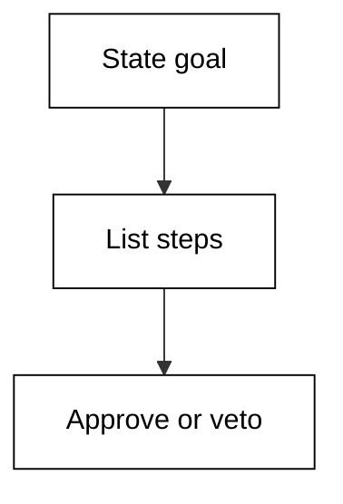

**`learning/code/ex-06-first-task-dry-run/main.py`**

```python
# Example 6: First Task Dry Run
# => Plan-then-act: the agent proposes steps before touching files.
# => A plan you can veto beats a diff you must revert.
# => The shim freezes one proposed plan for a stated goal.
goal = "add a hello endpoint"  # => the task in one sentence
steps = ["list routes", "add handler", "run tests"]  # => the proposed plan, in order
files = ["src/app.py", "tests/test_app.py"]
# => A plan is reviewable only when its blast radius is listed.
# => Count the files before you argue about the steps.
print("goal:", goal)  # => Output states the task
# => Numbered steps print in order so review follows the sequence.
print("steps:", len(steps))  # => how many moves the plan makes
# => The file list is the approve-or-veto surface.
print("files:", len(files))  # => Output sizes the blast radius
```

**Output** (`learning/code/ex-06-first-task-dry-run/expected/main.stdout.txt`):

```text
goal: add a hello endpoint
steps: 3
files: 2
```

**Key takeaway**: A dry-run plan shows the goal, steps, and files before anything changes.

**Why It Matters**: Plan review is the cheapest quality gate in the whole agent loop: minutes spent vetoing a bad plan save hours spent reverting its diff. The file list is the approve-or-veto surface, the step order is the review sequence, and the goal is the contract everything serves. Approve small plans fast and split wide ones early. Newcomers should demand a plan on every task until reading diffs feels boring.

---

### Example 7: Approve a Small Plan

_Exercises co-05, co-16._

A proposed plan is cheaper to veto than a bad diff is to revert. This example reviews one proposed plan before any file changes. Case in point: single-file rename plan a human approves in under a minute. **Check**: the step and file counts match the plan you reviewed.

**`learning/code/ex-07-approve-a-small-plan/main.py`**

```python
# Example 7: Approve a Small Plan
# => Plan-then-act: the agent proposes steps before touching files.
# => A plan you can veto beats a diff you must revert.
# => The shim freezes one proposed plan for a stated goal.
goal = "rename one helper"  # => the task in one sentence
steps = ["find callers", "rename symbol", "run tests"]  # => the proposed plan, in order
files = ["src/util.py"]
# => A plan is reviewable only when its blast radius is listed.
# => Count the files before you argue about the steps.
print("goal:", goal)  # => Output states the task
# => Numbered steps print in order so review follows the sequence.
print("steps:", len(steps))  # => how many moves the plan makes
# => The file list is the approve-or-veto surface.
print("files:", len(files))  # => Output sizes the blast radius
```

**Output** (`learning/code/ex-07-approve-a-small-plan/expected/main.stdout.txt`):

```text
goal: rename one helper
steps: 3
files: 1
```

**Key takeaway**: Small plans with a one-file blast radius are the fastest safe approvals you will make.

**Why It Matters**: Plan review is the cheapest quality gate in the whole agent loop: minutes spent vetoing a bad plan save hours spent reverting its diff. The file list is the approve-or-veto surface, the step order is the review sequence, and the goal is the contract everything serves. Approve small plans fast and split wide ones early. Approving fast on small plans saves your scrutiny budget for the large ones.

---

### Example 8: Veto a Wide Plan

_Exercises co-05, co-16._

A proposed plan is cheaper to veto than a bad diff is to revert. This example reviews one proposed plan before any file changes. Case in point: forty-file migration plan a human vetoes and splits into phases. **Check**: the step and file counts match the plan you reviewed.

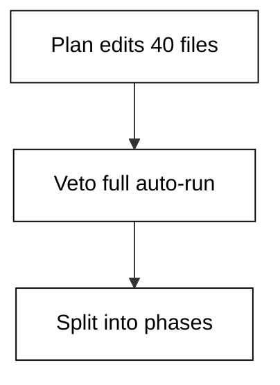

**`learning/code/ex-08-veto-a-wide-plan/main.py`**

```python
# Example 8: Veto a Wide Plan
# => Plan-then-act: the agent proposes steps before touching files.
# => A plan you can veto beats a diff you must revert.
# => The shim freezes one proposed plan for a stated goal.
goal = "migrate all dates to UTC"  # => the task in one sentence
steps = [
    "scan repo",
    "rewrite 40 files",
    "migrate database",
]  # => the proposed plan, in order
files = ["src/a.py", "src/b.py", "db/schema.sql", "tests/test_dates.py"]
# => A plan is reviewable only when its blast radius is listed.
# => Count the files before you argue about the steps.
print("goal:", goal)  # => Output states the task
# => Numbered steps print in order so review follows the sequence.
print("steps:", len(steps))  # => how many moves the plan makes
# => The file list is the approve-or-veto surface.
print("files:", len(files))  # => Output sizes the blast radius
```

**Output** (`learning/code/ex-08-veto-a-wide-plan/expected/main.stdout.txt`):

```text
goal: migrate all dates to UTC
steps: 3
files: 4
```

**Key takeaway**: Veto wide plans early and split them: the file count tells you before the diff does.

**Why It Matters**: Plan review is the cheapest quality gate in the whole agent loop: minutes spent vetoing a bad plan save hours spent reverting its diff. The file list is the approve-or-veto surface, the step order is the review sequence, and the goal is the contract everything serves. Approve small plans fast and split wide ones early. UTC migrations touch storage, logic, and tests at once, which is exactly why they split well.

---

### Example 9: Read a Clean Trace

_Exercises co-07._

The tool-use trace is where you catch the agent being confidently wrong. This example replays one session trace and flags the suspect steps. Case in point: three-step trace where every step checks out on inspection. **Check**: the suspect count matches the steps you flagged by hand.

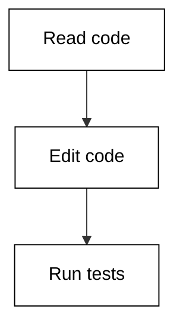

**`learning/code/ex-09-read-a-clean-trace/main.py`**

```python
# Example 9: Read a Clean Trace
# => A tool-use trace is the agent's receipt: each call plus why.
# => Reading it is how you tell a correct step from a confident bluff.
# => The shim freezes one trace so every reader sees the same run.
steps = [
    ("read", "src/cart.py lines 1-40", True),
    ("edit", "add coupon field", True),
    ("test", "pytest tests/test_cart.py", True),
]  # => the frozen trace, in call order
# => Walk the trace and mark each step good or suspect.
# => A suspect step is not proof of failure, just where to look.
bad = 0  # => count of steps that fail their own check
for tool, detail, ok in steps:  # => replay each recorded call
    # => The ok flag is the shim's verdict, standing in for yours.
    # => In real life you supply this judgement by reading the diff.
    if not ok:  # => this step smells wrong
        bad += 1  # => count it for the summary line
        print("SUSPECT:", tool, "-", detail)  # => flag it loudly
# => The totals line turns a feeling into a number you can gate on.
print("steps:", len(steps))  # => Output counts every call
# => Zero suspect steps is the bar for an unsupervised run.
print("suspect:", bad)  # => Output counts the flags
```

**Output** (`learning/code/ex-09-read-a-clean-trace/expected/main.stdout.txt`):

```text
steps: 3
suspect: 0
```

**Key takeaway**: A clean trace reads read, edit, test: observe first, change second, prove third.

**Why It Matters**: Traces are the flight recorders of agent work: nobody reads them until something breaks, and then they are the only thing that matters. A clean read-edit-test rhythm makes deviations visible at a glance, while reason-carrying steps let an auditor verify without rerunning. Learn the rhythm before you need the recorder. Memorize that rhythm and every future trace reads in seconds instead of minutes.

---

### Example 10: Spot the Skipped Read

_Exercises co-07, co-08._

The tool-use trace is where you catch the agent being confidently wrong. This example replays one session trace and flags the suspect steps. Case in point: trace where the agent edits pricing code it never read first. **Check**: the suspect count matches the steps you flagged by hand.

**`learning/code/ex-10-spot-the-skipped-read/main.py`**

```python
# Example 10: Spot the Skipped Read
# => A tool-use trace is the agent's receipt: each call plus why.
# => Reading it is how you tell a correct step from a confident bluff.
# => The shim freezes one trace so every reader sees the same run.
steps = [
    ("edit", "rewrite pricing without reading it", False),
    ("test", "pytest collects 0 items", False),
    ("read", "src/pricing.py after the fact", True),
]  # => the frozen trace, in call order
# => Walk the trace and mark each step good or suspect.
# => A suspect step is not proof of failure, just where to look.
bad = 0  # => count of steps that fail their own check
for tool, detail, ok in steps:  # => replay each recorded call
    # => The ok flag is the shim's verdict, standing in for yours.
    # => In real life you supply this judgement by reading the diff.
    if not ok:  # => this step smells wrong
        bad += 1  # => count it for the summary line
        print("SUSPECT:", tool, "-", detail)  # => flag it loudly
# => The totals line turns a feeling into a number you can gate on.
print("steps:", len(steps))  # => Output counts every call
# => Zero suspect steps is the bar for an unsupervised run.
print("suspect:", bad)  # => Output counts the flags
```

**Output** (`learning/code/ex-10-spot-the-skipped-read/expected/main.stdout.txt`):

```text
SUSPECT: edit - rewrite pricing without reading it
SUSPECT: test - pytest collects 0 items
steps: 3
suspect: 2
```

**Key takeaway**: An edit with no preceding read is the classic tell of a bluffing agent.

**Why It Matters**: Traces are the flight recorders of agent work: nobody reads them until something breaks, and then they are the only thing that matters. A clean read-edit-test rhythm makes deviations visible at a glance, while reason-carrying steps let an auditor verify without rerunning. Learn the rhythm before you need the recorder. Pricing code is stateful and branchy, so editing it blind fails loudly and expensively.

---

### Example 11: Trace Shows the Why

_Exercises co-07._

The tool-use trace is where you catch the agent being confidently wrong. This example replays one session trace and flags the suspect steps. Case in point: trace where each tool call carries its reason in the detail field. **Check**: the suspect count matches the steps you flagged by hand.

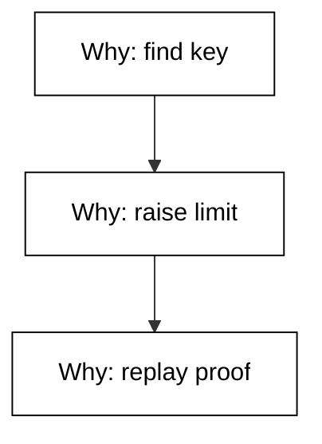

**`learning/code/ex-11-trace-shows-the-why/main.py`**

```python
# Example 11: Trace Shows the Why
# => A tool-use trace is the agent's receipt: each call plus why.
# => Reading it is how you tell a correct step from a confident bluff.
# => The shim freezes one trace so every reader sees the same run.
steps = [
    ("read", "config to find the timeout key", True),
    ("edit", "raise timeout 5s to 30s", True),
    ("test", "replay the slow webhook", True),
]  # => the frozen trace, in call order
# => Walk the trace and mark each step good or suspect.
# => A suspect step is not proof of failure, just where to look.
bad = 0  # => count of steps that fail their own check
for tool, detail, ok in steps:  # => replay each recorded call
    # => The ok flag is the shim's verdict, standing in for yours.
    # => In real life you supply this judgement by reading the diff.
    if not ok:  # => this step smells wrong
        bad += 1  # => count it for the summary line
        print("SUSPECT:", tool, "-", detail)  # => flag it loudly
# => The totals line turns a feeling into a number you can gate on.
print("steps:", len(steps))  # => Output counts every call
# => Zero suspect steps is the bar for an unsupervised run.
print("suspect:", bad)  # => Output counts the flags
```

**Output** (`learning/code/ex-11-trace-shows-the-why/expected/main.stdout.txt`):

```text
steps: 3
suspect: 0
```

**Key takeaway**: Good traces pair every call with a reason: the why is what you audit.

**Why It Matters**: Traces are the flight recorders of agent work: nobody reads them until something breaks, and then they are the only thing that matters. A clean read-edit-test rhythm makes deviations visible at a glance, while reason-carrying steps let an auditor verify without rerunning. Learn the rhythm before you need the recorder. Timeout changes look trivial until a webhook storm shows why the old value existed.

---

### Example 12: One Suspect Step

_Exercises co-07, co-06._

The tool-use trace is where you catch the agent being confidently wrong. This example replays one session trace and flags the suspect steps. Case in point: trace with a weakened password check the test run then fails to cover. **Check**: the suspect count matches the steps you flagged by hand.

**`learning/code/ex-12-one-suspect-step/main.py`**

```python
# Example 12: One Suspect Step
# => A tool-use trace is the agent's receipt: each call plus why.
# => Reading it is how you tell a correct step from a confident bluff.
# => The shim freezes one trace so every reader sees the same run.
steps = [
    ("read", "src/auth.py login handler", True),
    ("edit", "weaken password check to contains", False),
    ("test", "login tests skipped", False),
]  # => the frozen trace, in call order
# => Walk the trace and mark each step good or suspect.
# => A suspect step is not proof of failure, just where to look.
bad = 0  # => count of steps that fail their own check
for tool, detail, ok in steps:  # => replay each recorded call
    # => The ok flag is the shim's verdict, standing in for yours.
    # => In real life you supply this judgement by reading the diff.
    if not ok:  # => this step smells wrong
        bad += 1  # => count it for the summary line
        print("SUSPECT:", tool, "-", detail)  # => flag it loudly
# => The totals line turns a feeling into a number you can gate on.
print("steps:", len(steps))  # => Output counts every call
# => Zero suspect steps is the bar for an unsupervised run.
print("suspect:", bad)  # => Output counts the flags
```

**Output** (`learning/code/ex-12-one-suspect-step/expected/main.stdout.txt`):

```text
SUSPECT: edit - weaken password check to contains
SUSPECT: test - login tests skipped
steps: 3
suspect: 2
```

**Key takeaway**: One suspect step poisons the steps after it: stop the line and read the diff.

**Why It Matters**: Traces are the flight recorders of agent work: nobody reads them until something breaks, and then they are the only thing that matters. A clean read-edit-test rhythm makes deviations visible at a glance, while reason-carrying steps let an auditor verify without rerunning. Learn the rhythm before you need the recorder. Auth code is the one place where a plausible-looking simplification is a vulnerability.

---

### Example 13: Count the Turns

_Exercises co-07, co-10._

The tool-use trace is where you catch the agent being confidently wrong. This example replays one session trace and flags the suspect steps. Case in point: four-step trace establishing a baseline turn count for a routine regen task. **Check**: the suspect count matches the steps you flagged by hand.

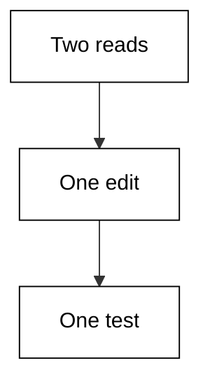

**`learning/code/ex-13-count-the-turns/main.py`**

```python
# Example 13: Count the Turns
# => A tool-use trace is the agent's receipt: each call plus why.
# => Reading it is how you tell a correct step from a confident bluff.
# => The shim freezes one trace so every reader sees the same run.
steps = [
    ("read", "openapi.yaml endpoints", True),
    ("read", "client generator docs", True),
    ("edit", "regenerate client", True),
    ("test", "contract tests green", True),
]  # => the frozen trace, in call order
# => Walk the trace and mark each step good or suspect.
# => A suspect step is not proof of failure, just where to look.
bad = 0  # => count of steps that fail their own check
for tool, detail, ok in steps:  # => replay each recorded call
    # => The ok flag is the shim's verdict, standing in for yours.
    # => In real life you supply this judgement by reading the diff.
    if not ok:  # => this step smells wrong
        bad += 1  # => count it for the summary line
        print("SUSPECT:", tool, "-", detail)  # => flag it loudly
# => The totals line turns a feeling into a number you can gate on.
print("steps:", len(steps))  # => Output counts every call
# => Zero suspect steps is the bar for an unsupervised run.
print("suspect:", bad)  # => Output counts the flags
```

**Output** (`learning/code/ex-13-count-the-turns/expected/main.stdout.txt`):

```text
steps: 4
suspect: 0
```

**Key takeaway**: Count turns per task type: baselines turn slow sessions into visible regressions.

**Why It Matters**: Traces are the flight recorders of agent work: nobody reads them until something breaks, and then they are the only thing that matters. A clean read-edit-test rhythm makes deviations visible at a glance, while reason-carrying steps let an auditor verify without rerunning. Learn the rhythm before you need the recorder. Client regeneration is mechanical, so four turns is the number future runs must beat.

---

### Example 14: Tool Call Order Matters

_Exercises co-07, co-01._

The tool-use trace is where you catch the agent being confidently wrong. This example replays one session trace and flags the suspect steps. Case in point: trace that tests first to capture the red baseline before fixing. **Check**: the suspect count matches the steps you flagged by hand.

**`learning/code/ex-14-tool-call-order-matters/main.py`**

```python
# Example 14: Tool Call Order Matters
# => A tool-use trace is the agent's receipt: each call plus why.
# => Reading it is how you tell a correct step from a confident bluff.
# => The shim freezes one trace so every reader sees the same run.
steps = [
    ("test", "run suite on unmodified code", True),
    ("read", "the failing module", True),
    ("edit", "fix the off-by-one", True),
    ("test", "suite green", True),
]  # => the frozen trace, in call order
# => Walk the trace and mark each step good or suspect.
# => A suspect step is not proof of failure, just where to look.
bad = 0  # => count of steps that fail their own check
for tool, detail, ok in steps:  # => replay each recorded call
    # => The ok flag is the shim's verdict, standing in for yours.
    # => In real life you supply this judgement by reading the diff.
    if not ok:  # => this step smells wrong
        bad += 1  # => count it for the summary line
        print("SUSPECT:", tool, "-", detail)  # => flag it loudly
# => The totals line turns a feeling into a number you can gate on.
print("steps:", len(steps))  # => Output counts every call
# => Zero suspect steps is the bar for an unsupervised run.
print("suspect:", bad)  # => Output counts the flags
```

**Output** (`learning/code/ex-14-tool-call-order-matters/expected/main.stdout.txt`):

```text
steps: 4
suspect: 0
```

**Key takeaway**: Test, read, edit, test: the opening red run proves the later green means something.

**Why It Matters**: Traces are the flight recorders of agent work: nobody reads them until something breaks, and then they are the only thing that matters. A clean read-edit-test rhythm makes deviations visible at a glance, while reason-carrying steps let an auditor verify without rerunning. Learn the rhythm before you need the recorder. Off-by-one fixes are notorious for passing by accident, so the baseline matters doubly.

---

### Example 15: Hallucinated File Edit

_Exercises co-08, co-07._

The tool-use trace is where you catch the agent being confidently wrong. This example replays one session trace and flags the suspect steps. Case in point: trace editing a payments module that was never on disk. **Check**: the suspect count matches the steps you flagged by hand.

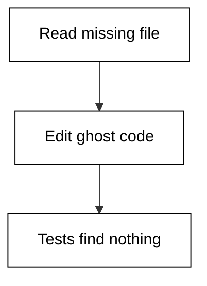

**`learning/code/ex-15-hallucinated-file-edit/main.py`**

```python
# Example 15: Hallucinated File Edit
# => A tool-use trace is the agent's receipt: each call plus why.
# => Reading it is how you tell a correct step from a confident bluff.
# => The shim freezes one trace so every reader sees the same run.
steps = [
    ("read", "src/payments.py (file does not exist)", False),
    ("edit", "patch src/payments.py refund path", False),
    ("test", "pytest cannot collect target", False),
]  # => the frozen trace, in call order
# => Walk the trace and mark each step good or suspect.
# => A suspect step is not proof of failure, just where to look.
bad = 0  # => count of steps that fail their own check
for tool, detail, ok in steps:  # => replay each recorded call
    # => The ok flag is the shim's verdict, standing in for yours.
    # => In real life you supply this judgement by reading the diff.
    if not ok:  # => this step smells wrong
        bad += 1  # => count it for the summary line
        print("SUSPECT:", tool, "-", detail)  # => flag it loudly
# => The totals line turns a feeling into a number you can gate on.
print("steps:", len(steps))  # => Output counts every call
# => Zero suspect steps is the bar for an unsupervised run.
print("suspect:", bad)  # => Output counts the flags
```

**Output** (`learning/code/ex-15-hallucinated-file-edit/expected/main.stdout.txt`):

```text
SUSPECT: read - src/payments.py (file does not exist)
SUSPECT: edit - patch src/payments.py refund path
SUSPECT: test - pytest cannot collect target
steps: 3
suspect: 3
```

**Key takeaway**: Edits to files the trace never successfully read are hallucinations: verify existence first.

**Why It Matters**: Traces are the flight recorders of agent work: nobody reads them until something breaks, and then they are the only thing that matters. A clean read-edit-test rhythm makes deviations visible at a glance, while reason-carrying steps let an auditor verify without rerunning. Learn the rhythm before you need the recorder. Payment paths attract hallucinations because the model has seen a thousand similar files.

---

### Example 16: Trace JSON Shape

_Exercises co-07._

The tool-use trace is where you catch the agent being confidently wrong. This example replays one session trace and flags the suspect steps. Case in point: trace normalizing its own JSON lines so downstream log tooling can parse them. **Check**: the suspect count matches the steps you flagged by hand.

**`learning/code/ex-16-trace-json-shape/main.py`**

```python
# Example 16: Trace JSON Shape
# => A tool-use trace is the agent's receipt: each call plus why.
# => Reading it is how you tell a correct step from a confident bluff.
# => The shim freezes one trace so every reader sees the same run.
steps = [
    ("read", "trace.json schema check", True),
    ("edit", "normalize tool field", True),
    ("test", "validate three sample lines", True),
]  # => the frozen trace, in call order
# => Walk the trace and mark each step good or suspect.
# => A suspect step is not proof of failure, just where to look.
bad = 0  # => count of steps that fail their own check
for tool, detail, ok in steps:  # => replay each recorded call
    # => The ok flag is the shim's verdict, standing in for yours.
    # => In real life you supply this judgement by reading the diff.
    if not ok:  # => this step smells wrong
        bad += 1  # => count it for the summary line
        print("SUSPECT:", tool, "-", detail)  # => flag it loudly
# => The totals line turns a feeling into a number you can gate on.
print("steps:", len(steps))  # => Output counts every call
# => Zero suspect steps is the bar for an unsupervised run.
print("suspect:", bad)  # => Output counts the flags
```

**Output** (`learning/code/ex-16-trace-json-shape/expected/main.stdout.txt`):

```text
steps: 3
suspect: 0
```

**Key takeaway**: Machine-readable traces compose with your log tooling; prose traces only compose with eyeballs.

**Why It Matters**: Traces are the flight recorders of agent work: nobody reads them until something breaks, and then they are the only thing that matters. A clean read-edit-test rhythm makes deviations visible at a glance, while reason-carrying steps let an auditor verify without rerunning. Learn the rhythm before you need the recorder. Once traces are JSON, the same queries that watch production can watch the agent.

---

### Example 17: Diff From Trace

_Exercises co-07, co-06._

The tool-use trace is where you catch the agent being confidently wrong. This example replays one session trace and flags the suspect steps. Case in point: trace whose edit step links directly to the diff a human then reviews. **Check**: the suspect count matches the steps you flagged by hand.

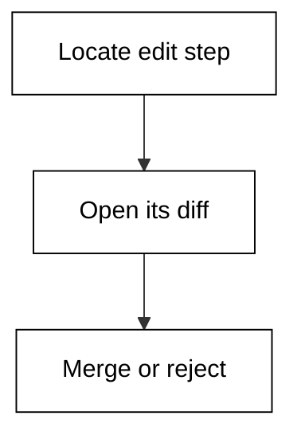

**`learning/code/ex-17-diff-from-trace/main.py`**

```python
# Example 17: Diff From Trace
# => A tool-use trace is the agent's receipt: each call plus why.
# => Reading it is how you tell a correct step from a confident bluff.
# => The shim freezes one trace so every reader sees the same run.
steps = [
    ("read", "src/queue.py retry logic", True),
    ("edit", "cap retries at 3 with backoff", True),
    ("test", "retry storm simulation passes", True),
]  # => the frozen trace, in call order
# => Walk the trace and mark each step good or suspect.
# => A suspect step is not proof of failure, just where to look.
bad = 0  # => count of steps that fail their own check
for tool, detail, ok in steps:  # => replay each recorded call
    # => The ok flag is the shim's verdict, standing in for yours.
    # => In real life you supply this judgement by reading the diff.
    if not ok:  # => this step smells wrong
        bad += 1  # => count it for the summary line
        print("SUSPECT:", tool, "-", detail)  # => flag it loudly
# => The totals line turns a feeling into a number you can gate on.
print("steps:", len(steps))  # => Output counts every call
# => Zero suspect steps is the bar for an unsupervised run.
print("suspect:", bad)  # => Output counts the flags
```

**Output** (`learning/code/ex-17-diff-from-trace/expected/main.stdout.txt`):

```text
steps: 3
suspect: 0
```

**Key takeaway**: Every edit step should resolve to a diff you can open: no diff, no merge.

**Why It Matters**: Traces are the flight recorders of agent work: nobody reads them until something breaks, and then they are the only thing that matters. A clean read-edit-test rhythm makes deviations visible at a glance, while reason-carrying steps let an auditor verify without rerunning. Learn the rhythm before you need the recorder. Retry logic is concurrency-adjacent, so the diff review is where the backoff math gets checked.

---

### Example 18: Allowlist Shell

_Exercises co-02._

Hermes asks its permission table before every sensitive tool call. This example replays one permission decision through an ordered allow/deny table. Case in point: pytest allowlisted while the general shell stays denied. **Check**: the decision line matches the first matching rule.

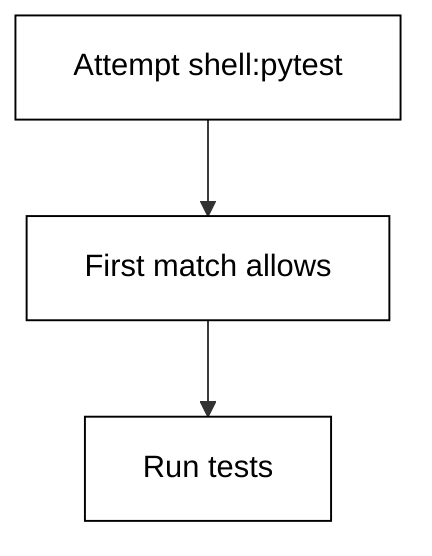

**`learning/code/ex-18-allowlist-shell/main.py`**

```python
# Example 18: Allowlist Shell
# => The shim models permissions as an ordered allow/deny table.
# => First match wins, exactly like Hermes evaluates its own rules.
# => Order matters more than count: broad allows go last, not first.
rules = [
    ("shell", "deny"),
    ("shell:pytest", "allow"),
    ("shell:git-status", "allow"),
]  # => the policy table, read top to bottom
tool = "shell:pytest"  # => the tool call the agent is attempting
# => Walk the table and keep the first matching decision.
# => No match means deny: closed by default beats open by accident.
decision = "deny"  # => closed default before any rule matches
for name, verdict in rules:  # => scan rules in listed order
    # => Compare this row against the attempted tool call.
    # => The first hit freezes the answer; later rows are ignored.
    if name == tool:  # => this row governs the attempt
        decision = verdict  # => first match wins, loop stops caring
        break  # => stop scanning once the answer is fixed
# => Print the decision plus the tool so logs stay attributable.
print("tool:", tool)  # => Output names what was attempted
# => The verdict line is what the approval flow would consume.
print("decision:", decision)  # => Output is allow or deny
```

**Output** (`learning/code/ex-18-allowlist-shell/expected/main.stdout.txt`):

```text
tool: shell:pytest
decision: allow
```

**Key takeaway**: Allow specific commands, deny the general tool: precision beats blanket trust.

**Why It Matters**: Permission tables are the difference between an assistant and a liability, because they decide what executes before anything can be regretted. Reading the decision before it runs is the habit that prevents the postmortem, and logging the rule behind each verdict turns arguments into lookups. Match strictness to blast radius on every row. Test runners are the safest shell surface to allow because their effects are read-mostly.

---

### Example 19: Deny by Default

_Exercises co-02._

Hermes asks its permission table before every sensitive tool call. This example replays one permission decision through an ordered allow/deny table. Case in point: unlisted network tool denied by the closed default with no matching row. **Check**: the decision line matches the first matching rule.

**`learning/code/ex-19-deny-by-default/main.py`**

```python
# Example 19: Deny by Default
# => The shim models permissions as an ordered allow/deny table.
# => First match wins, exactly like Hermes evaluates its own rules.
# => Order matters more than count: broad allows go last, not first.
rules = [
    ("read", "allow"),
    ("edit:docs", "allow"),
]  # => the policy table, read top to bottom
tool = "shell:curl"  # => the tool call the agent is attempting
# => Walk the table and keep the first matching decision.
# => No match means deny: closed by default beats open by accident.
decision = "deny"  # => closed default before any rule matches
for name, verdict in rules:  # => scan rules in listed order
    # => Compare this row against the attempted tool call.
    # => The first hit freezes the answer; later rows are ignored.
    if name == tool:  # => this row governs the attempt
        decision = verdict  # => first match wins, loop stops caring
        break  # => stop scanning once the answer is fixed
# => Print the decision plus the tool so logs stay attributable.
print("tool:", tool)  # => Output names what was attempted
# => The verdict line is what the approval flow would consume.
print("decision:", decision)  # => Output is allow or deny
```

**Output** (`learning/code/ex-19-deny-by-default/expected/main.stdout.txt`):

```text
tool: shell:curl
decision: deny
```

**Key takeaway**: Closed by default means new tools fail safe: no row, no run.

**Why It Matters**: Permission tables are the difference between an assistant and a liability, because they decide what executes before anything can be regretted. Reading the decision before it runs is the habit that prevents the postmortem, and logging the rule behind each verdict turns arguments into lookups. Match strictness to blast radius on every row. Network egress is the exfiltration path, so it must never be implicitly allowed.

---

### Example 20: Scope Then Permission

_Exercises co-02, co-03._

A session scope draws the fence the agent works inside. This example checks one scope decision against its scope and prints the permit decision. Case in point: deploy script inside scope still requiring its own permission row. **Check**: the inside-scope verdict matches the path prefix rule.

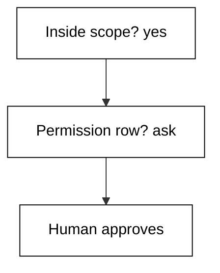

**`learning/code/ex-20-scope-then-permission/main.py`**

```python
# Example 20: Scope Then Permission
# => The shim models scope as a path prefix: inside edits, outside asks.
# => Real Hermes scopes a session to one repo root the same way.
# => Freezing the scope here keeps the run deterministic and safe.
scope = "/repo/shop"
action = "/repo/shop/scripts/deploy.sh"
# => Scope is a prefix test: the action must sit under the root.
# => A prefix test is crude but predictable, which is the point.
# => Real tools add symlinks and case rules; the shim skips them openly.
inside = action.startswith(scope)
# => The verdict prints as a pair so the log stays greppable.
# => A False here would route the session to the approval flow.
print("inside-scope:", inside)  # => Output is the permit decision
# => The second line names the rule, so audits can cite it, not vibes.
print("rule: action must start with scope")
```

**Output** (`learning/code/ex-20-scope-then-permission/expected/main.stdout.txt`):

```text
inside-scope: True
rule: action must start with scope
```

**Key takeaway**: Scope and permission stack: inside-scope is necessary but never sufficient.

**Why It Matters**: Scope is what turns a powerful model into a safe tool: the same agent with a repo-wide scope and a single-directory scope behaves like two different products. Narrow scopes shrink both the blast radius and the context bill on every turn, which compounds across long sessions. Draw the boundary before the first command runs. Deploy scripts are inside every repo yet deserve their own approval every time.

---

### Example 21: Read Only Session

_Exercises co-02._

Hermes asks its permission table before every sensitive tool call. This example replays one permission decision through an ordered allow/deny table. Case in point: exploration session where reads pass and every mutation is denied. **Check**: the decision line matches the first matching rule.

**`learning/code/ex-21-read-only-session/main.py`**

```python
# Example 21: Read Only Session
# => The shim models permissions as an ordered allow/deny table.
# => First match wins, exactly like Hermes evaluates its own rules.
# => Order matters more than count: broad allows go last, not first.
rules = [
    ("read", "allow"),
    ("edit", "deny"),
    ("shell", "deny"),
]  # => the policy table, read top to bottom
tool = "read"  # => the tool call the agent is attempting
# => Walk the table and keep the first matching decision.
# => No match means deny: closed by default beats open by accident.
decision = "deny"  # => closed default before any rule matches
for name, verdict in rules:  # => scan rules in listed order
    # => Compare this row against the attempted tool call.
    # => The first hit freezes the answer; later rows are ignored.
    if name == tool:  # => this row governs the attempt
        decision = verdict  # => first match wins, loop stops caring
        break  # => stop scanning once the answer is fixed
# => Print the decision plus the tool so logs stay attributable.
print("tool:", tool)  # => Output names what was attempted
# => The verdict line is what the approval flow would consume.
print("decision:", decision)  # => Output is allow or deny
```

**Output** (`learning/code/ex-21-read-only-session/expected/main.stdout.txt`):

```text
tool: read
decision: allow
```

**Key takeaway**: Read-only sessions are free to run wide: exploration should never need a veto.

**Why It Matters**: Permission tables are the difference between an assistant and a liability, because they decide what executes before anything can be regretted. Reading the decision before it runs is the habit that prevents the postmortem, and logging the rule behind each verdict turns arguments into lookups. Match strictness to blast radius on every row. Codebase tours and bug hunts start read-only so curiosity cannot cost anything.

---

### Example 22: Ask Mode Edit

_Exercises co-02, co-16._

Hermes asks its permission table before every sensitive tool call. This example replays one permission decision through an ordered allow/deny table. Case in point: edit attempt in ask mode routing to a human instead of auto-running. **Check**: the decision line matches the first matching rule.

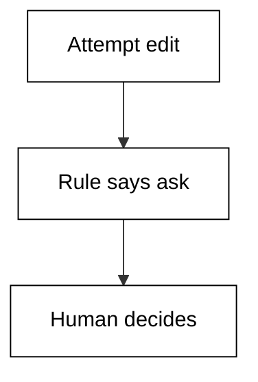

**`learning/code/ex-22-ask-mode-edit/main.py`**

```python
# Example 22: Ask Mode Edit
# => The shim models permissions as an ordered allow/deny table.
# => First match wins, exactly like Hermes evaluates its own rules.
# => Order matters more than count: broad allows go last, not first.
rules = [
    ("read", "allow"),
    ("edit", "ask"),
    ("shell", "deny"),
]  # => the policy table, read top to bottom
tool = "edit"  # => the tool call the agent is attempting
# => Walk the table and keep the first matching decision.
# => No match means deny: closed by default beats open by accident.
decision = "deny"  # => closed default before any rule matches
for name, verdict in rules:  # => scan rules in listed order
    # => Compare this row against the attempted tool call.
    # => The first hit freezes the answer; later rows are ignored.
    if name == tool:  # => this row governs the attempt
        decision = verdict  # => first match wins, loop stops caring
        break  # => stop scanning once the answer is fixed
# => Print the decision plus the tool so logs stay attributable.
print("tool:", tool)  # => Output names what was attempted
# => The verdict line is what the approval flow would consume.
print("decision:", decision)  # => Output is allow or deny
```

**Output** (`learning/code/ex-22-ask-mode-edit/expected/main.stdout.txt`):

```text
tool: edit
decision: ask
```

**Key takeaway**: Ask mode inserts the human exactly where judgement lives: at the mutation.

**Why It Matters**: Permission tables are the difference between an assistant and a liability, because they decide what executes before anything can be regretted. Reading the decision before it runs is the habit that prevents the postmortem, and logging the rule behind each verdict turns arguments into lookups. Match strictness to blast radius on every row. Ask-first on edits keeps the session fast to read and safe to run.

---

### Example 23: Lockdown Recovery

_Exercises co-02, co-09._

Hermes asks its permission table before every sensitive tool call. This example replays one permission decision through an ordered allow/deny table. Case in point: over-tight lockdown denying a legit fix and forcing a scoped re-permit. **Check**: the decision line matches the first matching rule.

**`learning/code/ex-23-lockdown-recovery/main.py`**

```python
# Example 23: Lockdown Recovery
# => The shim models permissions as an ordered allow/deny table.
# => First match wins, exactly like Hermes evaluates its own rules.
# => Order matters more than count: broad allows go last, not first.
rules = [
    ("read", "allow"),
    ("edit", "deny"),
    ("shell", "deny"),
]  # => the policy table, read top to bottom
tool = "edit"  # => the tool call the agent is attempting
# => Walk the table and keep the first matching decision.
# => No match means deny: closed by default beats open by accident.
decision = "deny"  # => closed default before any rule matches
for name, verdict in rules:  # => scan rules in listed order
    # => Compare this row against the attempted tool call.
    # => The first hit freezes the answer; later rows are ignored.
    if name == tool:  # => this row governs the attempt
        decision = verdict  # => first match wins, loop stops caring
        break  # => stop scanning once the answer is fixed
# => Print the decision plus the tool so logs stay attributable.
print("tool:", tool)  # => Output names what was attempted
# => The verdict line is what the approval flow would consume.
print("decision:", decision)  # => Output is allow or deny
```

**Output** (`learning/code/ex-23-lockdown-recovery/expected/main.stdout.txt`):

```text
tool: edit
decision: deny
```

**Key takeaway**: Lockdown that blocks the fix is misconfigured: re-permit narrowly, never globally.

**Why It Matters**: Permission tables are the difference between an assistant and a liability, because they decide what executes before anything can be regretted. Reading the decision before it runs is the habit that prevents the postmortem, and logging the rule behind each verdict turns arguments into lookups. Match strictness to blast radius on every row. Incident pressure tempts broad allows; a scoped re-permit fixes the task without opening the repo.

---

### Example 24: Edit Docs Allowed

_Exercises co-02._

Hermes asks its permission table before every sensitive tool call. This example replays one permission decision through an ordered allow/deny table. Case in point: docs-only edit allowed while code edits still route to ask mode. **Check**: the decision line matches the first matching rule.

**`learning/code/ex-24-edit-docs-allowed/main.py`**

```python
# Example 24: Edit Docs Allowed
# => The shim models permissions as an ordered allow/deny table.
# => First match wins, exactly like Hermes evaluates its own rules.
# => Order matters more than count: broad allows go last, not first.
rules = [
    ("edit:docs", "allow"),
    ("edit", "ask"),
    ("shell", "deny"),
]  # => the policy table, read top to bottom
tool = "edit:docs"  # => the tool call the agent is attempting
# => Walk the table and keep the first matching decision.
# => No match means deny: closed by default beats open by accident.
decision = "deny"  # => closed default before any rule matches
for name, verdict in rules:  # => scan rules in listed order
    # => Compare this row against the attempted tool call.
    # => The first hit freezes the answer; later rows are ignored.
    if name == tool:  # => this row governs the attempt
        decision = verdict  # => first match wins, loop stops caring
        break  # => stop scanning once the answer is fixed
# => Print the decision plus the tool so logs stay attributable.
print("tool:", tool)  # => Output names what was attempted
# => The verdict line is what the approval flow would consume.
print("decision:", decision)  # => Output is allow or deny
```

**Output** (`learning/code/ex-24-edit-docs-allowed/expected/main.stdout.txt`):

```text
tool: edit:docs
decision: allow
```

**Key takeaway**: Tiered edit rules let docs flow while code stays gated: match strictness to blast radius.

**Why It Matters**: Permission tables are the difference between an assistant and a liability, because they decide what executes before anything can be regretted. Reading the decision before it runs is the habit that prevents the postmortem, and logging the rule behind each verdict turns arguments into lookups. Match strictness to blast radius on every row. Changelog and doc fixes are the highest-volume, lowest-risk agent work you have.

---

### Example 25: Audit the Decision

_Exercises co-02, co-07._

The tool-use trace is where you catch the agent being confidently wrong. This example replays one session trace and flags the suspect steps. Case in point: trace pairing each decision with the rule id that produced it. **Check**: the suspect count matches the steps you flagged by hand.

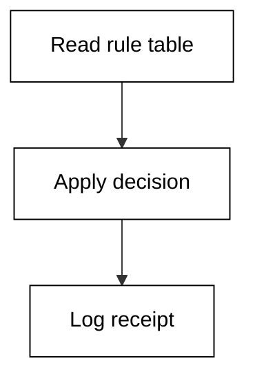

**`learning/code/ex-25-audit-the-decision/main.py`**

```python
# Example 25: Audit the Decision
# => A tool-use trace is the agent's receipt: each call plus why.
# => Reading it is how you tell a correct step from a confident bluff.
# => The shim freezes one trace so every reader sees the same run.
steps = [
    ("read", "permission table for edit:src", True),
    ("edit", "approved edit lands with receipt", True),
    ("test", "receipt logged with rule id", True),
]  # => the frozen trace, in call order
# => Walk the trace and mark each step good or suspect.
# => A suspect step is not proof of failure, just where to look.
bad = 0  # => count of steps that fail their own check
for tool, detail, ok in steps:  # => replay each recorded call
    # => The ok flag is the shim's verdict, standing in for yours.
    # => In real life you supply this judgement by reading the diff.
    if not ok:  # => this step smells wrong
        bad += 1  # => count it for the summary line
        print("SUSPECT:", tool, "-", detail)  # => flag it loudly
# => The totals line turns a feeling into a number you can gate on.
print("steps:", len(steps))  # => Output counts every call
# => Zero suspect steps is the bar for an unsupervised run.
print("suspect:", bad)  # => Output counts the flags
```

**Output** (`learning/code/ex-25-audit-the-decision/expected/main.stdout.txt`):

```text
steps: 3
suspect: 0
```

**Key takeaway**: Log the rule behind each decision: audits cite rule ids, not recollections.

**Why It Matters**: Traces are the flight recorders of agent work: nobody reads them until something breaks, and then they are the only thing that matters. A clean read-edit-test rhythm makes deviations visible at a glance, while reason-carrying steps let an auditor verify without rerunning. Learn the rhythm before you need the recorder. Receipts turn permission arguments from opinion into lookup.

---
