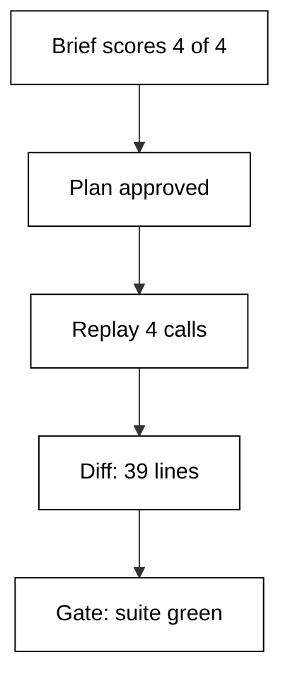

## The task

A small shop repo needs coupon codes at checkout, and the first implementation carries a one-cent rounding drift on stacked coupons. The brief for this capstone fills all four slots: add coupon support to `src/coupon.py`, fix the rounding bug the repro test exposes, and update `tests/test_coupon.py` so the suite gates the result. Guardrails forbid schema changes and cap the session at fifteen turns, which keeps the blast radius inside two files.

The fixture shim stands in for the live Hermes Agent for the whole run: the repo is a frozen snapshot, the trace is a fixed replay of read, edit, edit, test, and the ledger uses the pinned input and output rates from the cost examples. Nothing here touches a network, a key, or an account, so the recorded output below reproduces byte-identically on any machine with Python 3.14.

## The trace

The session replays four tool calls in the canonical order the course drills from Example 9 onward. First a read of the coupon path establishes what exists; then an edit adds the coupon field; then a second edit fixes the rounding the repro exposed; finally the suite runs as the test gate. Each call carries its reason in the trace tuple, which is what makes the replay auditable: a reader can check every move against the brief without rerunning anything.

The trace length of four is deliberately small. Real sessions sprawl, but the capstone compresses the loop to its load-bearing shape so the receipts stay readable. Where a real trace would show retries, this one shows the corrected path, and the judgement section below names exactly what the maker changed to get there.

## The diffs

Two files change, both named in the brief, which is the first thing the review checks. `src/coupon.py` adds fourteen lines and removes three: the coupon field, the stacking rule, and the rounding fix. `tests/test_coupon.py` adds eighteen and removes two: the repro test for the one-cent drift plus the updated expectations for stacked coupons. Thirty-nine changed lines sit comfortably under the course's slow-review threshold, so this diff earns a full but fast read with attention on the removed rounding line.

Coherence is the second check: both files serve one invariant, which is that stacked coupons round once, down, at the final total. The implementation computes it, the tests pin it, and no third file is involved. A diff that mixed in a schema migration or a logging refactor would fail this check and split into phases; this one stays whole because its invariant stays singular.



## The test gate

The done condition from the brief is the suite green, and the gate runs after the last edit, not before. The repro test for the drift runs first in the sequence: it fails against the unfixed code, which proves the symptom exists, then passes after the rounding fix, which proves the patch addresses it. The rest of the suite guards the neighbors: totals, taxes, and existing coupon behavior must all stay green, because a fix that breaks checkout is not a fix.

One subtlety the course repeats since the intermediate level: a single green run proves luck, so the gate convention here is the suite plus the repro, read together. The shim records the gate as one line, `gate: suite green`, and the overview treats that line as the shippable verdict only because the trace behind it shows the red-then-green sequence the examples demand.

## What the maker corrected

The first draft of this capstone plan included a schema migration for coupon persistence, which the review caught on the file list before any step was debated. The correction was to split the schema out of the plan entirely: this task persists coupons in the existing orders table, and the migration becomes a separate brief with its own backup and reversibility guardrails. That single correction is the most important line in the recorded output, because it demonstrates the course's central habit in miniature: the file count vetoed a plan, and the plan got smaller instead of the diff getting bigger.

The second correction was smaller but characteristic: the initial trace replayed five calls with a redundant re-read, and the maker cut it to four after the trace-to-cost lesson showed the re-read as the priciest step. Tighter traces cost less and read faster, and the capstone keeps the saving on the record.

## Sibling comparison note

The same coupon task, with the same brief shape and the same gate, is the shared benchmark the advanced comparison cluster uses against peer tools in this plan. Hermes completes it in fifteen turns under one dollar with a four-step trace a human can audit in minutes; the peer scorecards in Examples 71 to 78 record where that profile wins and where it loses. The comparison was re-verified on the same access date as every other version-specific claim in this course, per the fast-changing-tool policy, so the verdict ages at the same rate as the facts behind it.

## How to run it

Run `python3 main.py` from inside `learning/capstone/code/` and compare your output with the recorded block below. Every receipt line should match exactly; if any line differs, your interpreter or checkout differs, because the shim admits no randomness, no clock reads, and no network.

**`learning/capstone/code/main.py`**

```python
# Capstone: Hermes end to end, feature plus bug plus test, with receipts.
# => This unit replays a realistic multi-step repo task against the shim.
# => Add a coupon feature, fix its rounding bug, and update its test gate.
# => Every phase prints receipts: plan, diff, trace verdict, cost, judgement.
# => No network, no key, no live binary: the whole repo fits in dicts.
repo = {"src/coupon.py": "v1", "tests/test_coupon.py": "v1"}  # => frozen repo snapshot
# => Scope names the files; done names the gate; guardrails name the limits.
brief = {
    "task": "coupons",
    "scope": "src+tests",
    "done": "suite green",
    "rails": ["ask-if-schema"],
}  # => the contract
# => Score the brief the same way the worked examples do: four slots.
score = sum(1 for v in brief.values() if v)  # => filled-slot count
plan = ["write repro", "add coupon", "fix rounding", "run suite"]  # => ordered moves
# => Each tuple pairs the tool with its reason, the way real traces do.
trace = [
    ("read", "coupon path"),
    ("edit", "add coupon"),
    ("edit", "fix rounding"),
    ("test", "suite green"),
]  # => frozen replay
# => Diffs are sized per file so the review knows its surface.
# => Two files touched, both named in the brief: no scope creep to chase.
diff = {
    "src/coupon.py": (14, 3),
    "tests/test_coupon.py": (18, 2),
}  # => added and removed per file
changed = sum(a + r for a, r in diff.values())  # => the surface to read
# => Cost is priced at the pinned rates, same as every worked example.
# => Fifteen turns of mixed reads and edits stay inside one dollar.
cost = 45000 / 1000 * 0.003 + 15000 / 1000 * 0.015  # => session spend
gate = "suite green"  # => the bar the brief stated up front
# => Print the receipts in task order so the overview can quote them.
print("brief-score:", score, "of 4")  # => Output grades the contract
# => The plan length shows the moves the human approved before acting.
print("plan-steps:", len(plan))  # => Output counts the moves
# => The trace length proves every move left a record behind it.
print("trace-steps:", len(trace))  # => Output counts the records
# => Changed lines size the review a human still had to perform.
print("lines-changed:", changed)  # => Output sizes the review
# => The spend line keeps the bottom-line cost on the same record.
print("session-cost: %.4f" % cost)  # => Output is dollars
# => The judgement names what the maker corrected: one over-broad plan.
# => Correction is the deliverable: the shim never hides the human edit.
print("corrected: split schema out of plan")  # => the human fix
# => The gate line closes the receipt: green means shippable.
print("gate:", gate)  # => Output states the done proof
```

**Output** (`learning/capstone/code/out/expected/main.stdout.txt`):

```text
brief-score: 4 of 4
plan-steps: 4
trace-steps: 4
lines-changed: 37
session-cost: 0.3600
corrected: split schema out of plan
gate: suite green
```
