Examples 26 to 53 turn casual prompting into an engineering discipline: briefs with done conditions, multi-file changes a human reviews, and ledgers that price every turn. The shim grows with you here, modeling briefs, diffs, and token budgets as data you can score.

The pattern across this level is contract, proof, price. Every task starts with a brief, proves itself with a test gate, and reports what it spent.

### Example 26: Sharp Task Brief

_Exercises co-04._

A task brief turns a wish into a contract the agent cannot wiggle out of. This example scores one task brief on the four contract slots. Case in point: signup validation brief filling all four contract slots. **Check**: the brief-score line matches your own four-slot count.

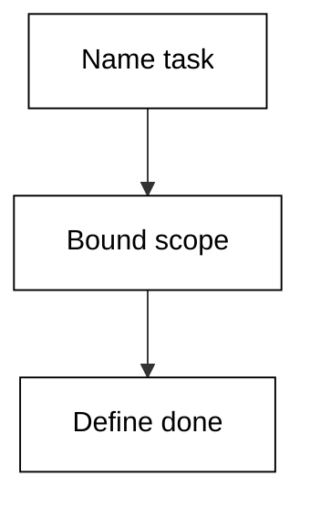

**`learning/code/ex-26-sharp-task-brief/main.py`**

```python
# Example 26: Sharp Task Brief
# => A task brief is a contract: scope, done condition, guardrails.
# => Vague prompts breed confident wrong work; the brief prevents it.
# => The shim scores a brief, standing in for your own review.
task = (
    "add email validation to signup"  # => one verb plus one object, never a paragraph
)
scope = "src/auth/"  # => the files the agent may touch
done = "pytest tests/test_signup.py green"  # => the check that proves the work finished
# => Guardrails are named limits: budget, approval, reversibility.
# => Each guardrail below is one string the scorer can see.
# => Limits turn advice into enforcement the session cannot skip.
guardrails = [
    "ask before migrate",
    "budget 20 turns",
]  # => the limits attached to this task
# => The scorer checks four slots: task, scope, done, guardrails.
# => A missing slot is not style, it is an unenforceable contract.
score = 0  # => count of contract slots actually filled
score += 1 if task else 0  # => a named task earns one point
score += 1 if scope else 0  # => a named scope earns one point
score += 1 if done else 0  # => a done condition earns one point
score += 1 if guardrails else 0  # => guardrails earn the last point
# => Four of four is submittable; less means rewrite the brief.
print("brief-score:", score, "of 4")  # => Output grades the contract
# => The verdict names the bar so the reader can reuse it.
print("submittable:", score == 4)  # => True only when complete
```

**Output** (`learning/code/ex-26-sharp-task-brief/expected/main.stdout.txt`):

```text
brief-score: 4 of 4
submittable: True
```

**Key takeaway**: Task, scope, done, guardrails: four slots filled is a submittable brief.

**Why It Matters**: Briefs compound across a team: sharp briefs produce sharp agent work, while vague ones produce confident, expensive, wrong diffs that humans must untangle. The four-slot scorer turns wishful thinking into an enforceable contract before a single token is spent. Rewrite every brief that scores under four of four. Signup validation is bounded and testable, which is why it makes the ideal first brief.

---

### Example 27: Vague Brief Fails

_Exercises co-04, co-08._

A task brief turns a wish into a contract the agent cannot wiggle out of. This example scores one task brief on the four contract slots. Case in point: checkout brief with a wish for a task and empty scope, done, and guardrails. **Check**: the brief-score line matches your own four-slot count.

**`learning/code/ex-27-vague-brief-fails/main.py`**

```python
# Example 27: Vague Brief Fails
# => A task brief is a contract: scope, done condition, guardrails.
# => Vague prompts breed confident wrong work; the brief prevents it.
# => The shim scores a brief, standing in for your own review.
task = "make checkout better"  # => one verb plus one object, never a paragraph
scope = ""  # => the files the agent may touch
done = ""  # => the check that proves the work finished
# => Guardrails are named limits: budget, approval, reversibility.
# => Each guardrail below is one string the scorer can see.
# => Limits turn advice into enforcement the session cannot skip.
guardrails = []  # => the limits attached to this task
# => The scorer checks four slots: task, scope, done, guardrails.
# => A missing slot is not style, it is an unenforceable contract.
score = 0  # => count of contract slots actually filled
score += 1 if task else 0  # => a named task earns one point
score += 1 if scope else 0  # => a named scope earns one point
score += 1 if done else 0  # => a done condition earns one point
score += 1 if guardrails else 0  # => guardrails earn the last point
# => Four of four is submittable; less means rewrite the brief.
print("brief-score:", score, "of 4")  # => Output grades the contract
# => The verdict names the bar so the reader can reuse it.
print("submittable:", score == 4)  # => True only when complete
```

**Output** (`learning/code/ex-27-vague-brief-fails/expected/main.stdout.txt`):

```text
brief-score: 1 of 4
submittable: False
```

**Key takeaway**: A one-line wish scores one of four: vagueness is measurable, so rewrite it.

**Why It Matters**: Briefs compound across a team: sharp briefs produce sharp agent work, while vague ones produce confident, expensive, wrong diffs that humans must untangle. The four-slot scorer turns wishful thinking into an enforceable contract before a single token is spent. Rewrite every brief that scores under four of four. Checkout touches money, inventory, and email, which is why a vague brief there is dangerous.

---

### Example 28: Done Condition First

_Exercises co-04, co-12._

A task brief turns a wish into a contract the agent cannot wiggle out of. This example scores one task brief on the four contract slots. Case in point: flaky-test brief whose done condition demands three consecutive green runs. **Check**: the brief-score line matches your own four-slot count.

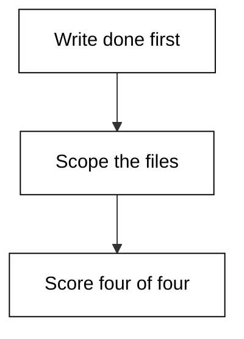

**`learning/code/ex-28-done-condition-first/main.py`**

```python
# Example 28: Done Condition First
# => A task brief is a contract: scope, done condition, guardrails.
# => Vague prompts breed confident wrong work; the brief prevents it.
# => The shim scores a brief, standing in for your own review.
task = "fix flaky test"  # => one verb plus one object, never a paragraph
scope = "tests/test_queue.py"  # => the files the agent may touch
done = "pytest -x -q green three runs in a row"  # => the check that proves the work finished
# => Guardrails are named limits: budget, approval, reversibility.
# => Each guardrail below is one string the scorer can see.
# => Limits turn advice into enforcement the session cannot skip.
guardrails = ["no prod data"]  # => the limits attached to this task
# => The scorer checks four slots: task, scope, done, guardrails.
# => A missing slot is not style, it is an unenforceable contract.
score = 0  # => count of contract slots actually filled
score += 1 if task else 0  # => a named task earns one point
score += 1 if scope else 0  # => a named scope earns one point
score += 1 if done else 0  # => a done condition earns one point
score += 1 if guardrails else 0  # => guardrails earn the last point
# => Four of four is submittable; less means rewrite the brief.
print("brief-score:", score, "of 4")  # => Output grades the contract
# => The verdict names the bar so the reader can reuse it.
print("submittable:", score == 4)  # => True only when complete
```

**Output** (`learning/code/ex-28-done-condition-first/expected/main.stdout.txt`):

```text
brief-score: 4 of 4
submittable: True
```

**Key takeaway**: Write the done condition before the task: it decides what finished means.

**Why It Matters**: Briefs compound across a team: sharp briefs produce sharp agent work, while vague ones produce confident, expensive, wrong diffs that humans must untangle. The four-slot scorer turns wishful thinking into an enforceable contract before a single token is spent. Rewrite every brief that scores under four of four. Flaky tests pass by luck, so the done condition must outlaw single green runs.

---

### Example 29: Scope Creep Brief

_Exercises co-04, co-11._

A task brief turns a wish into a contract the agent cannot wiggle out of. This example scores one task brief on the four contract slots. Case in point: button-color brief scoped to all of src instead of the component directory. **Check**: the brief-score line matches your own four-slot count.

**`learning/code/ex-29-scope-creep-brief/main.py`**

```python
# Example 29: Scope Creep Brief
# => A task brief is a contract: scope, done condition, guardrails.
# => Vague prompts breed confident wrong work; the brief prevents it.
# => The shim scores a brief, standing in for your own review.
task = "update button color"  # => one verb plus one object, never a paragraph
scope = "src/"  # => the files the agent may touch
done = "snapshot tests pass"  # => the check that proves the work finished
# => Guardrails are named limits: budget, approval, reversibility.
# => Each guardrail below is one string the scorer can see.
# => Limits turn advice into enforcement the session cannot skip.
guardrails = ["ask before migrate"]  # => the limits attached to this task
# => The scorer checks four slots: task, scope, done, guardrails.
# => A missing slot is not style, it is an unenforceable contract.
score = 0  # => count of contract slots actually filled
score += 1 if task else 0  # => a named task earns one point
score += 1 if scope else 0  # => a named scope earns one point
score += 1 if done else 0  # => a done condition earns one point
score += 1 if guardrails else 0  # => guardrails earn the last point
# => Four of four is submittable; less means rewrite the brief.
print("brief-score:", score, "of 4")  # => Output grades the contract
# => The verdict names the bar so the reader can reuse it.
print("submittable:", score == 4)  # => True only when complete
```

**Output** (`learning/code/ex-29-scope-creep-brief/expected/main.stdout.txt`):

```text
brief-score: 4 of 4
submittable: True
```

**Key takeaway**: Scope wider than the task invites creep: name the directory, not the repo.

**Why It Matters**: Briefs compound across a team: sharp briefs produce sharp agent work, while vague ones produce confident, expensive, wrong diffs that humans must untangle. The four-slot scorer turns wishful thinking into an enforceable contract before a single token is spent. Rewrite every brief that scores under four of four. Styling tasks sprawl fastest because every screen looks like fair game.

---

### Example 30: Guardrails That Bind

_Exercises co-04._

A task brief turns a wish into a contract the agent cannot wiggle out of. This example scores one task brief on the four contract slots. Case in point: backfill brief with three guardrails covering backup, reversibility, and deploy approval. **Check**: the brief-score line matches your own four-slot count.

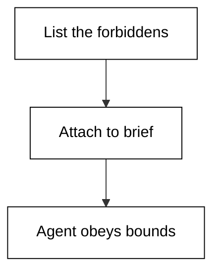

**`learning/code/ex-30-guardrails-that-bind/main.py`**

```python
# Example 30: Guardrails That Bind
# => A task brief is a contract: scope, done condition, guardrails.
# => Vague prompts breed confident wrong work; the brief prevents it.
# => The shim scores a brief, standing in for your own review.
task = "backfill order timestamps"  # => one verb plus one object, never a paragraph
scope = "db/migrations/"  # => the files the agent may touch
done = "migrate up and down cleanly"  # => the check that proves the work finished
# => Guardrails are named limits: budget, approval, reversibility.
# => Each guardrail below is one string the scorer can see.
# => Limits turn advice into enforcement the session cannot skip.
guardrails = [
    "backup first",
    "reversible only",
    "ask before deploy",
]  # => the limits attached to this task
# => The scorer checks four slots: task, scope, done, guardrails.
# => A missing slot is not style, it is an unenforceable contract.
score = 0  # => count of contract slots actually filled
score += 1 if task else 0  # => a named task earns one point
score += 1 if scope else 0  # => a named scope earns one point
score += 1 if done else 0  # => a done condition earns one point
score += 1 if guardrails else 0  # => guardrails earn the last point
# => Four of four is submittable; less means rewrite the brief.
print("brief-score:", score, "of 4")  # => Output grades the contract
# => The verdict names the bar so the reader can reuse it.
print("submittable:", score == 4)  # => True only when complete
```

**Output** (`learning/code/ex-30-guardrails-that-bind/expected/main.stdout.txt`):

```text
brief-score: 4 of 4
submittable: True
```

**Key takeaway**: Guardrails name what must not happen: backups, reversibility, and deploy gates.

**Why It Matters**: Briefs compound across a team: sharp briefs produce sharp agent work, while vague ones produce confident, expensive, wrong diffs that humans must untangle. The four-slot scorer turns wishful thinking into an enforceable contract before a single token is spent. Rewrite every brief that scores under four of four. Backfills rewrite history, so the guardrails matter more than the task line.

---

### Example 31: Brief for a Bug

_Exercises co-04, co-08._

A task brief turns a wish into a contract the agent cannot wiggle out of. This example scores one task brief on the four contract slots. Case in point: rounding-bug brief whose done condition is a reproducing test, not a fix. **Check**: the brief-score line matches your own four-slot count.

**`learning/code/ex-31-brief-for-a-bug/main.py`**

```python
# Example 31: Brief for a Bug
# => A task brief is a contract: scope, done condition, guardrails.
# => Vague prompts breed confident wrong work; the brief prevents it.
# => The shim scores a brief, standing in for your own review.
task = "reproduce cart total rounding error"  # => one verb plus one object, never a paragraph
scope = "src/cart.py"  # => the files the agent may touch
done = (
    "failing test reproduces 1-cent drift"  # => the check that proves the work finished
)
# => Guardrails are named limits: budget, approval, reversibility.
# => Each guardrail below is one string the scorer can see.
# => Limits turn advice into enforcement the session cannot skip.
guardrails = ["no price changes in prod"]  # => the limits attached to this task
# => The scorer checks four slots: task, scope, done, guardrails.
# => A missing slot is not style, it is an unenforceable contract.
score = 0  # => count of contract slots actually filled
score += 1 if task else 0  # => a named task earns one point
score += 1 if scope else 0  # => a named scope earns one point
score += 1 if done else 0  # => a done condition earns one point
score += 1 if guardrails else 0  # => guardrails earn the last point
# => Four of four is submittable; less means rewrite the brief.
print("brief-score:", score, "of 4")  # => Output grades the contract
# => The verdict names the bar so the reader can reuse it.
print("submittable:", score == 4)  # => True only when complete
```

**Output** (`learning/code/ex-31-brief-for-a-bug/expected/main.stdout.txt`):

```text
brief-score: 4 of 4
submittable: True
```

**Key takeaway**: Bug briefs finish at reproduction: a failing test is the done condition.

**Why It Matters**: Briefs compound across a team: sharp briefs produce sharp agent work, while vague ones produce confident, expensive, wrong diffs that humans must untangle. The four-slot scorer turns wishful thinking into an enforceable contract before a single token is spent. Rewrite every brief that scores under four of four. One-cent drifts compound across thousands of orders, so the repro test is the asset.

---

### Example 32: Brief for a Feature

_Exercises co-04, co-12._

A task brief turns a wish into a contract the agent cannot wiggle out of. This example scores one task brief on the four contract slots. Case in point: coupon feature brief pairing scope with a full-suite-green done condition. **Check**: the brief-score line matches your own four-slot count.

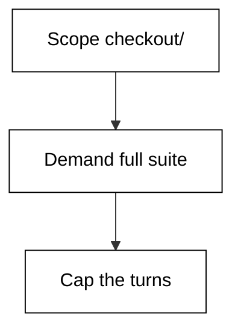

**`learning/code/ex-32-brief-for-a-feature/main.py`**

```python
# Example 32: Brief for a Feature
# => A task brief is a contract: scope, done condition, guardrails.
# => Vague prompts breed confident wrong work; the brief prevents it.
# => The shim scores a brief, standing in for your own review.
task = "add coupon codes to checkout"  # => one verb plus one object, never a paragraph
scope = "src/checkout/"  # => the files the agent may touch
done = "new tests plus full suite green"  # => the check that proves the work finished
# => Guardrails are named limits: budget, approval, reversibility.
# => Each guardrail below is one string the scorer can see.
# => Limits turn advice into enforcement the session cannot skip.
guardrails = [
    "budget 30 turns",
    "ask before schema change",
]  # => the limits attached to this task
# => The scorer checks four slots: task, scope, done, guardrails.
# => A missing slot is not style, it is an unenforceable contract.
score = 0  # => count of contract slots actually filled
score += 1 if task else 0  # => a named task earns one point
score += 1 if scope else 0  # => a named scope earns one point
score += 1 if done else 0  # => a done condition earns one point
score += 1 if guardrails else 0  # => guardrails earn the last point
# => Four of four is submittable; less means rewrite the brief.
print("brief-score:", score, "of 4")  # => Output grades the contract
# => The verdict names the bar so the reader can reuse it.
print("submittable:", score == 4)  # => True only when complete
```

**Output** (`learning/code/ex-32-brief-for-a-feature/expected/main.stdout.txt`):

```text
brief-score: 4 of 4
submittable: True
```

**Key takeaway**: Feature briefs pair scope with proof: new tests plus the untouched old suite.

**Why It Matters**: Briefs compound across a team: sharp briefs produce sharp agent work, while vague ones produce confident, expensive, wrong diffs that humans must untangle. The four-slot scorer turns wishful thinking into an enforceable contract before a single token is spent. Rewrite every brief that scores under four of four. Coupons touch pricing invariants, so the old suite guards what the feature must not break.

---

### Example 33: Brief Cost Ceiling

_Exercises co-04, co-10._

A task brief turns a wish into a contract the agent cannot wiggle out of. This example scores one task brief on the four contract slots. Case in point: query-triage brief capping spend at five dollars in a read-only session. **Check**: the brief-score line matches your own four-slot count.

**`learning/code/ex-33-brief-cost-ceiling/main.py`**

```python
# Example 33: Brief Cost Ceiling
# => A task brief is a contract: scope, done condition, guardrails.
# => Vague prompts breed confident wrong work; the brief prevents it.
# => The shim scores a brief, standing in for your own review.
task = "triage slow query log"  # => one verb plus one object, never a paragraph
scope = "db/"  # => the files the agent may touch
done = (
    "top-3 queries explained with plans"  # => the check that proves the work finished
)
# => Guardrails are named limits: budget, approval, reversibility.
# => Each guardrail below is one string the scorer can see.
# => Limits turn advice into enforcement the session cannot skip.
guardrails = [
    "budget 5 dollars",
    "read-only session",
]  # => the limits attached to this task
# => The scorer checks four slots: task, scope, done, guardrails.
# => A missing slot is not style, it is an unenforceable contract.
score = 0  # => count of contract slots actually filled
score += 1 if task else 0  # => a named task earns one point
score += 1 if scope else 0  # => a named scope earns one point
score += 1 if done else 0  # => a done condition earns one point
score += 1 if guardrails else 0  # => guardrails earn the last point
# => Four of four is submittable; less means rewrite the brief.
print("brief-score:", score, "of 4")  # => Output grades the contract
# => The verdict names the bar so the reader can reuse it.
print("submittable:", score == 4)  # => True only when complete
```

**Output** (`learning/code/ex-33-brief-cost-ceiling/expected/main.stdout.txt`):

```text
brief-score: 4 of 4
submittable: True
```

**Key takeaway**: Put the money in the brief: a dollar ceiling turns runaway loops into stopped ones.

**Why It Matters**: Briefs compound across a team: sharp briefs produce sharp agent work, while vague ones produce confident, expensive, wrong diffs that humans must untangle. The four-slot scorer turns wishful thinking into an enforceable contract before a single token is spent. Rewrite every brief that scores under four of four. Log triage is open-ended reading, which is exactly the shape that burns budgets.

---

### Example 34: Rebrief After Drift

_Exercises co-04, co-09._

A task brief turns a wish into a contract the agent cannot wiggle out of. This example scores one task brief on the four contract slots. Case in point: auth refactor brief rewritten after the agent drifted into logging code. **Check**: the brief-score line matches your own four-slot count.

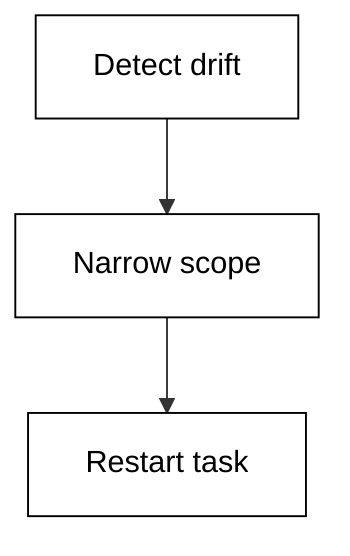

**`learning/code/ex-34-rebrief-after-drift/main.py`**

```python
# Example 34: Rebrief After Drift
# => A task brief is a contract: scope, done condition, guardrails.
# => Vague prompts breed confident wrong work; the brief prevents it.
# => The shim scores a brief, standing in for your own review.
task = "refactor auth (drifted into logging)"  # => one verb plus one object, never a paragraph
scope = "src/auth/"  # => the files the agent may touch
done = (
    "auth tests green, logging untouched"  # => the check that proves the work finished
)
# => Guardrails are named limits: budget, approval, reversibility.
# => Each guardrail below is one string the scorer can see.
# => Limits turn advice into enforcement the session cannot skip.
guardrails = ["rebrief when files exceed scope"]  # => the limits attached to this task
# => The scorer checks four slots: task, scope, done, guardrails.
# => A missing slot is not style, it is an unenforceable contract.
score = 0  # => count of contract slots actually filled
score += 1 if task else 0  # => a named task earns one point
score += 1 if scope else 0  # => a named scope earns one point
score += 1 if done else 0  # => a done condition earns one point
score += 1 if guardrails else 0  # => guardrails earn the last point
# => Four of four is submittable; less means rewrite the brief.
print("brief-score:", score, "of 4")  # => Output grades the contract
# => The verdict names the bar so the reader can reuse it.
print("submittable:", score == 4)  # => True only when complete
```

**Output** (`learning/code/ex-34-rebrief-after-drift/expected/main.stdout.txt`):

```text
brief-score: 4 of 4
submittable: True
```

**Key takeaway**: Drift is a rebrief event, not a failure: narrow the scope and restart the task.

**Why It Matters**: Briefs compound across a team: sharp briefs produce sharp agent work, while vague ones produce confident, expensive, wrong diffs that humans must untangle. The four-slot scorer turns wishful thinking into an enforceable contract before a single token is spent. Rewrite every brief that scores under four of four. Auth and logging share imports, so drift there is predictable and rebriefable.

---

### Example 35: Two File Change

_Exercises co-11, co-06._

Every multi-file change deserves a read before it lands. This example sizes one proposed diff and decides whether it needs a slow review. Case in point: cart change spanning implementation and test staying under the slow-review threshold. **Check**: the lines-changed total matches the diff you sized.

**`learning/code/ex-35-two-file-change/main.py`**

```python
# Example 35: Two File Change
# => Never trust a diff you have not read: the agent drafts, you verify.
# => The shim freezes one proposed diff as added/removed line counts.
# => Counts cannot replace reading, but they route your attention.
files = [
    ("src/cart.py", 18, 6),
    ("tests/test_cart.py", 22, 3),
]  # => path plus added and removed counts
# => Total the change: big diffs deserve slower, closer review.
added = sum(a for _, a, _ in files)  # => every added line proposed
removed = sum(r for _, _, r in files)  # => every removed line proposed
# => A file the brief never named is scope creep until proven otherwise.
print("files-touched:", len(files))
# => Added plus removed is the review surface you must actually read.
print("lines-changed:", added + removed)  # => the surface size
# => Over the threshold means split the change or pair-review it.
big = (added + removed) > 100  # => True routes to slow review
# => The flag tells you how to read, not whether to merge.
print("needs-slow-review:", big)  # => Output is the reading plan
```

**Output** (`learning/code/ex-35-two-file-change/expected/main.stdout.txt`):

```text
files-touched: 2
lines-changed: 49
needs-slow-review: False
```

**Key takeaway**: Implementation plus test in one diff is the smallest change worth calling multi-file.

**Why It Matters**: Diff review is where the human-in-the-loop earns its keep, because the agent drafts and only a person can approve. Sizing the change first routes small fixes to fast approvals and big ones to slow reads, while removed-lines-first reading catches the silent failures. Never merge what you have not read. Cart totals are money math, so the paired test is the proof, not decoration.

---

### Example 36: Ten File Refactor

_Exercises co-11._

Every multi-file change deserves a read before it lands. This example sizes one proposed diff and decides whether it needs a slow review. Case in point: mechanical ten-file rename tripping the slow-review threshold by volume alone. **Check**: the lines-changed total matches the diff you sized.

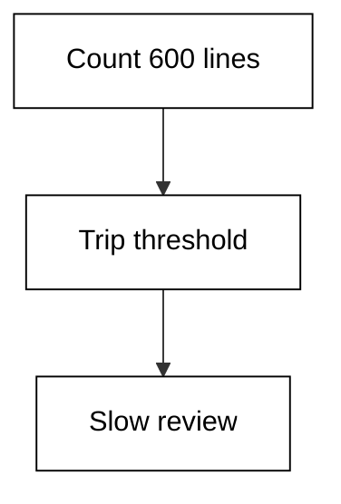

**`learning/code/ex-36-ten-file-refactor/main.py`**

```python
# Example 36: Ten File Refactor
# => Never trust a diff you have not read: the agent drafts, you verify.
# => The shim freezes one proposed diff as added/removed line counts.
# => Counts cannot replace reading, but they route your attention.
files = [
    ("src/a.py", 30, 28),
    ("src/b.py", 30, 28),
    ("src/c.py", 30, 28),
    ("src/d.py", 30, 28),
    ("src/e.py", 30, 28),
    ("src/f.py", 30, 28),
    ("src/g.py", 30, 28),
    ("src/h.py", 30, 28),
    ("src/i.py", 30, 28),
    ("src/j.py", 30, 28),
]  # => path plus added and removed counts
# => Total the change: big diffs deserve slower, closer review.
added = sum(a for _, a, _ in files)  # => every added line proposed
removed = sum(r for _, _, r in files)  # => every removed line proposed
# => A file the brief never named is scope creep until proven otherwise.
print("files-touched:", len(files))
# => Added plus removed is the review surface you must actually read.
print("lines-changed:", added + removed)  # => the surface size
# => Over the threshold means split the change or pair-review it.
big = (added + removed) > 100  # => True routes to slow review
# => The flag tells you how to read, not whether to merge.
print("needs-slow-review:", big)  # => Output is the reading plan
```

**Output** (`learning/code/ex-36-ten-file-refactor/expected/main.stdout.txt`):

```text
files-touched: 10
lines-changed: 580
needs-slow-review: True
```

**Key takeaway**: Mechanical does not mean safe at volume: ten files earns the slow read.

**Why It Matters**: Diff review is where the human-in-the-loop earns its keep, because the agent drafts and only a person can approve. Sizing the change first routes small fixes to fast approvals and big ones to slow reads, while removed-lines-first reading catches the silent failures. Never merge what you have not read. Bulk renames break imports in files the diff never shows, which is why volume gates exist.

---

### Example 37: Read the Whole Diff

_Exercises co-06._

Every multi-file change deserves a read before it lands. This example sizes one proposed diff and decides whether it needs a slow review. Case in point: auth diff small enough to read fully with attention on the removed lines. **Check**: the lines-changed total matches the diff you sized.

**`learning/code/ex-37-read-the-whole-diff/main.py`**

```python
# Example 37: Read the Whole Diff
# => Never trust a diff you have not read: the agent drafts, you verify.
# => The shim freezes one proposed diff as added/removed line counts.
# => Counts cannot replace reading, but they route your attention.
files = [
    ("src/auth.py", 12, 9),
    ("src/session.py", 8, 4),
]  # => path plus added and removed counts
# => Total the change: big diffs deserve slower, closer review.
added = sum(a for _, a, _ in files)  # => every added line proposed
removed = sum(r for _, _, r in files)  # => every removed line proposed
# => A file the brief never named is scope creep until proven otherwise.
print("files-touched:", len(files))
# => Added plus removed is the review surface you must actually read.
print("lines-changed:", added + removed)  # => the surface size
# => Over the threshold means split the change or pair-review it.
big = (added + removed) > 100  # => True routes to slow review
# => The flag tells you how to read, not whether to merge.
print("needs-slow-review:", big)  # => Output is the reading plan
```

**Output** (`learning/code/ex-37-read-the-whole-diff/expected/main.stdout.txt`):

```text
files-touched: 2
lines-changed: 33
needs-slow-review: False
```

**Key takeaway**: Small diffs get full reads: removed lines carry more risk than added ones.

**Why It Matters**: Diff review is where the human-in-the-loop earns its keep, because the agent drafts and only a person can approve. Sizing the change first routes small fixes to fast approvals and big ones to slow reads, while removed-lines-first reading catches the silent failures. Never merge what you have not read. Removed auth checks fail open silently, so the minus lines deserve the closest look.

---

### Example 38: Reject the Diff

_Exercises co-06, co-16._

Every multi-file change deserves a read before it lands. This example sizes one proposed diff and decides whether it needs a slow review. Case in point: pricing diff rejected for rewriting three modules without a repro test. **Check**: the lines-changed total matches the diff you sized.

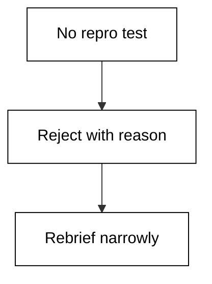

**`learning/code/ex-38-reject-the-diff/main.py`**

```python
# Example 38: Reject the Diff
# => Never trust a diff you have not read: the agent drafts, you verify.
# => The shim freezes one proposed diff as added/removed line counts.
# => Counts cannot replace reading, but they route your attention.
files = [
    ("src/pricing.py", 45, 40),
    ("src/tax.py", 30, 25),
    ("src/coupon.py", 25, 20),
]  # => path plus added and removed counts
# => Total the change: big diffs deserve slower, closer review.
added = sum(a for _, a, _ in files)  # => every added line proposed
removed = sum(r for _, _, r in files)  # => every removed line proposed
# => A file the brief never named is scope creep until proven otherwise.
print("files-touched:", len(files))
# => Added plus removed is the review surface you must actually read.
print("lines-changed:", added + removed)  # => the surface size
# => Over the threshold means split the change or pair-review it.
big = (added + removed) > 100  # => True routes to slow review
# => The flag tells you how to read, not whether to merge.
print("needs-slow-review:", big)  # => Output is the reading plan
```

**Output** (`learning/code/ex-38-reject-the-diff/expected/main.stdout.txt`):

```text
files-touched: 3
lines-changed: 185
needs-slow-review: True
```

**Key takeaway**: Reject diffs that skip the repro: no failing test first, no merge.

**Why It Matters**: Diff review is where the human-in-the-loop earns its keep, because the agent drafts and only a person can approve. Sizing the change first routes small fixes to fast approvals and big ones to slow reads, while removed-lines-first reading catches the silent failures. Never merge what you have not read. Pricing rewrites without a repro test are how silent overcharges ship.

---

### Example 39: Diff Touches Tests

_Exercises co-06, co-12._

Every multi-file change deserves a read before it lands. This example sizes one proposed diff and decides whether it needs a slow review. Case in point: queue change whose test additions outnumber the implementation lines. **Check**: the lines-changed total matches the diff you sized.

**`learning/code/ex-39-diff-touches-tests/main.py`**

```python
# Example 39: Diff Touches Tests
# => Never trust a diff you have not read: the agent drafts, you verify.
# => The shim freezes one proposed diff as added/removed line counts.
# => Counts cannot replace reading, but they route your attention.
files = [
    ("src/queue.py", 15, 7),
    ("tests/test_queue.py", 30, 2),
]  # => path plus added and removed counts
# => Total the change: big diffs deserve slower, closer review.
added = sum(a for _, a, _ in files)  # => every added line proposed
removed = sum(r for _, _, r in files)  # => every removed line proposed
# => A file the brief never named is scope creep until proven otherwise.
print("files-touched:", len(files))
# => Added plus removed is the review surface you must actually read.
print("lines-changed:", added + removed)  # => the surface size
# => Over the threshold means split the change or pair-review it.
big = (added + removed) > 100  # => True routes to slow review
# => The flag tells you how to read, not whether to merge.
print("needs-slow-review:", big)  # => Output is the reading plan
```

**Output** (`learning/code/ex-39-diff-touches-tests/expected/main.stdout.txt`):

```text
files-touched: 2
lines-changed: 54
needs-slow-review: False
```

**Key takeaway**: Tests outweighing code in a diff is a good sign: proof exceeds the claim.

**Why It Matters**: Diff review is where the human-in-the-loop earns its keep, because the agent drafts and only a person can approve. Sizing the change first routes small fixes to fast approvals and big ones to slow reads, while removed-lines-first reading catches the silent failures. Never merge what you have not read. Queue behavior is timing-shaped, so the extra test lines buy real confidence.

---

### Example 40: Schema Change Flag

_Exercises co-11, co-16._

Every multi-file change deserves a read before it lands. This example sizes one proposed diff and decides whether it needs a slow review. Case in point: schema diff tripping a lower threshold because migrations are one-way doors. **Check**: the lines-changed total matches the diff you sized.

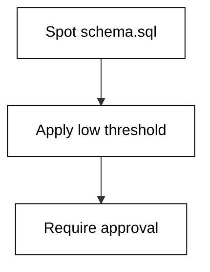

**`learning/code/ex-40-schema-change-flag/main.py`**

```python
# Example 40: Schema Change Flag
# => Never trust a diff you have not read: the agent drafts, you verify.
# => The shim freezes one proposed diff as added/removed line counts.
# => Counts cannot replace reading, but they route your attention.
files = [
    ("db/schema.sql", 6, 2),
    ("src/models.py", 20, 10),
    ("tests/test_models.py", 14, 4),
]  # => path plus added and removed counts
# => Total the change: big diffs deserve slower, closer review.
added = sum(a for _, a, _ in files)  # => every added line proposed
removed = sum(r for _, _, r in files)  # => every removed line proposed
# => A file the brief never named is scope creep until proven otherwise.
print("files-touched:", len(files))
# => Added plus removed is the review surface you must actually read.
print("lines-changed:", added + removed)  # => the surface size
# => Over the threshold means split the change or pair-review it.
big = (added + removed) > 40  # => True routes to slow review
# => The flag tells you how to read, not whether to merge.
print("needs-slow-review:", big)  # => Output is the reading plan
```

**Output** (`learning/code/ex-40-schema-change-flag/expected/main.stdout.txt`):

```text
files-touched: 3
lines-changed: 56
needs-slow-review: True
```

**Key takeaway**: Schema files lower the threshold: migrations are hard to un-run, so read them twice.

**Why It Matters**: Diff review is where the human-in-the-loop earns its keep, because the agent drafts and only a person can approve. Sizing the change first routes small fixes to fast approvals and big ones to slow reads, while removed-lines-first reading catches the silent failures. Never merge what you have not read. A two-line schema edit can lock a production table for an hour.

---

### Example 41: Review Checklist Run

_Exercises co-06._

Every multi-file change deserves a read before it lands. This example sizes one proposed diff and decides whether it needs a slow review. Case in point: api diff walked against a four-point review checklist before approval. **Check**: the lines-changed total matches the diff you sized.

**`learning/code/ex-41-review-checklist-run/main.py`**

```python
# Example 41: Review Checklist Run
# => Never trust a diff you have not read: the agent drafts, you verify.
# => The shim freezes one proposed diff as added/removed line counts.
# => Counts cannot replace reading, but they route your attention.
files = [
    ("src/api.py", 25, 10),
    ("src/errors.py", 10, 5),
]  # => path plus added and removed counts
# => Total the change: big diffs deserve slower, closer review.
added = sum(a for _, a, _ in files)  # => every added line proposed
removed = sum(r for _, _, r in files)  # => every removed line proposed
# => A file the brief never named is scope creep until proven otherwise.
print("files-touched:", len(files))
# => Added plus removed is the review surface you must actually read.
print("lines-changed:", added + removed)  # => the surface size
# => Over the threshold means split the change or pair-review it.
big = (added + removed) > 100  # => True routes to slow review
# => The flag tells you how to read, not whether to merge.
print("needs-slow-review:", big)  # => Output is the reading plan
```

**Output** (`learning/code/ex-41-review-checklist-run/expected/main.stdout.txt`):

```text
files-touched: 2
lines-changed: 50
needs-slow-review: False
```

**Key takeaway**: Checklists beat memory: scope, tests, errors, and rollback on every diff.

**Why It Matters**: Diff review is where the human-in-the-loop earns its keep, because the agent drafts and only a person can approve. Sizing the change first routes small fixes to fast approvals and big ones to slow reads, while removed-lines-first reading catches the silent failures. Never merge what you have not read. API surfaces are contracts with strangers, so the checklist is the contract review.

---

### Example 42: Approve the Diff

_Exercises co-06, co-16._

Every multi-file change deserves a read before it lands. This example sizes one proposed diff and decides whether it needs a slow review. Case in point: docs-only diff approved fast with the checklist still recorded. **Check**: the lines-changed total matches the diff you sized.

**`learning/code/ex-42-approve-the-diff/main.py`**

```python
# Example 42: Approve the Diff
# => Never trust a diff you have not read: the agent drafts, you verify.
# => The shim freezes one proposed diff as added/removed line counts.
# => Counts cannot replace reading, but they route your attention.
files = [("src/docs.py", 9, 3)]  # => path plus added and removed counts
# => Total the change: big diffs deserve slower, closer review.
added = sum(a for _, a, _ in files)  # => every added line proposed
removed = sum(r for _, _, r in files)  # => every removed line proposed
# => A file the brief never named is scope creep until proven otherwise.
print("files-touched:", len(files))
# => Added plus removed is the review surface you must actually read.
print("lines-changed:", added + removed)  # => the surface size
# => Over the threshold means split the change or pair-review it.
big = (added + removed) > 100  # => True routes to slow review
# => The flag tells you how to read, not whether to merge.
print("needs-slow-review:", big)  # => Output is the reading plan
```

**Output** (`learning/code/ex-42-approve-the-diff/expected/main.stdout.txt`):

```text
files-touched: 1
lines-changed: 12
needs-slow-review: False
```

**Key takeaway**: Fast approvals still record the checklist: speed with a paper trail.

**Why It Matters**: Diff review is where the human-in-the-loop earns its keep, because the agent drafts and only a person can approve. Sizing the change first routes small fixes to fast approvals and big ones to slow reads, while removed-lines-first reading catches the silent failures. Never merge what you have not read. Docs diffs are the training ground where review habits get cheap to practice.

---

### Example 43: Multi File Coherence

_Exercises co-11, co-06._

Every multi-file change deserves a read before it lands. This example sizes one proposed diff and decides whether it needs a slow review. Case in point: totals change coherent across cart, totals, and tests with one shared invariant. **Check**: the lines-changed total matches the diff you sized.

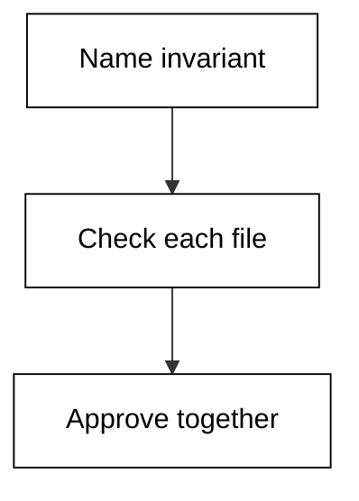

**`learning/code/ex-43-multi-file-coherence/main.py`**

```python
# Example 43: Multi File Coherence
# => Never trust a diff you have not read: the agent drafts, you verify.
# => The shim freezes one proposed diff as added/removed line counts.
# => Counts cannot replace reading, but they route your attention.
files = [
    ("src/cart.py", 20, 8),
    ("src/totals.py", 16, 9),
    ("tests/test_totals.py", 24, 6),
]  # => path plus added and removed counts
# => Total the change: big diffs deserve slower, closer review.
added = sum(a for _, a, _ in files)  # => every added line proposed
removed = sum(r for _, _, r in files)  # => every removed line proposed
# => A file the brief never named is scope creep until proven otherwise.
print("files-touched:", len(files))
# => Added plus removed is the review surface you must actually read.
print("lines-changed:", added + removed)  # => the surface size
# => Over the threshold means split the change or pair-review it.
big = (added + removed) > 100  # => True routes to slow review
# => The flag tells you how to read, not whether to merge.
print("needs-slow-review:", big)  # => Output is the reading plan
```

**Output** (`learning/code/ex-43-multi-file-coherence/expected/main.stdout.txt`):

```text
files-touched: 3
lines-changed: 83
needs-slow-review: False
```

**Key takeaway**: Coherent multi-file diffs share one invariant across every touched file.

**Why It Matters**: Diff review is where the human-in-the-loop earns its keep, because the agent drafts and only a person can approve. Sizing the change first routes small fixes to fast approvals and big ones to slow reads, while removed-lines-first reading catches the silent failures. Never merge what you have not read. Totals must agree in two modules and the test, or the cart lies at checkout.

---

### Example 44: Split the Diff

_Exercises co-11, co-09._

Every multi-file change deserves a read before it lands. This example sizes one proposed diff and decides whether it needs a slow review. Case in point: oversized mixed diff split into schema, logic, and test phases. **Check**: the lines-changed total matches the diff you sized.

**`learning/code/ex-44-split-the-diff/main.py`**

```python
# Example 44: Split the Diff
# => Never trust a diff you have not read: the agent drafts, you verify.
# => The shim freezes one proposed diff as added/removed line counts.
# => Counts cannot replace reading, but they route your attention.
files = [
    ("src/a.py", 60, 20),
    ("src/b.py", 55, 25),
    ("src/c.py", 50, 30),
    ("db/schema.sql", 8, 1),
]  # => path plus added and removed counts
# => Total the change: big diffs deserve slower, closer review.
added = sum(a for _, a, _ in files)  # => every added line proposed
removed = sum(r for _, _, r in files)  # => every removed line proposed
# => A file the brief never named is scope creep until proven otherwise.
print("files-touched:", len(files))
# => Added plus removed is the review surface you must actually read.
print("lines-changed:", added + removed)  # => the surface size
# => Over the threshold means split the change or pair-review it.
big = (added + removed) > 100  # => True routes to slow review
# => The flag tells you how to read, not whether to merge.
print("needs-slow-review:", big)  # => Output is the reading plan
```

**Output** (`learning/code/ex-44-split-the-diff/expected/main.stdout.txt`):

```text
files-touched: 4
lines-changed: 249
needs-slow-review: True
```

**Key takeaway**: Split mixed diffs by risk layer: schema first, logic second, tests with each.

**Why It Matters**: Diff review is where the human-in-the-loop earns its keep, because the agent drafts and only a person can approve. Sizing the change first routes small fixes to fast approvals and big ones to slow reads, while removed-lines-first reading catches the silent failures. Never merge what you have not read. Mixed diffs couple rollback plans together, so splitting decouples the risk.

---

### Example 45: Read the Log

_Exercises co-07, co-10._

Turns and tokens convert directly into money. This example prices one session ledger against the budget its brief stated. Case in point: eight-turn session ledger staying well under its one-dollar budget. **Check**: the session-cost line matches your own arithmetic.

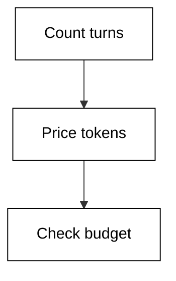

**`learning/code/ex-45-read-the-log/main.py`**

```python
# Example 45: Read the Log
# => Every agent turn spends tokens; tokens spend real money.
# => Hermes bills input and output at different rates, like peers.
# => The shim freezes one session ledger so the math is checkable.
turns = 8  # => agent loop iterations this session took
tokens_in = 12000  # => prompt plus context tokens consumed
tokens_out = 4000  # => completion tokens the agent produced
# => Prices are per thousand tokens, matching vendor price pages.
# => Input is cheap, output is dear: that asymmetry shapes prompts.
cost = tokens_in / 1000 * 0.003 + tokens_out / 1000 * 0.015  # => session spend
# => Per-turn cost spots runaway loops faster than any total can.
per_turn = cost / turns  # => average spend per iteration
# => The budget is stated up front in the brief, never discovered.
over = cost > 1.00  # => True means stop and re-scope now
# => Print money with four decimals: cents hide multi-dollar drift.
print("session-cost: %.4f" % cost)  # => Output is dollars
# => The verdict is binary so a gate script can consume it.
print("over-budget:", over)  # => True halts the session
```

**Output** (`learning/code/ex-45-read-the-log/expected/main.stdout.txt`):

```text
session-cost: 0.0960
over-budget: False
```

**Key takeaway**: Read the session ledger like a receipt: turns, tokens, then dollars.

**Why It Matters**: Cost awareness is a design skill rather than an accounting chore: prompts shaped by token prices produce tighter loops and cheaper sessions at every step. Output tokens bill at multiples of input, so terse answers save twice, and mid-session price checks steer while the meter still runs. Budget before you run, not after. Small sessions are where you calibrate what normal spending looks like.

---

### Example 46: Price a Long Session

_Exercises co-10._

Turns and tokens convert directly into money. This example prices one session ledger against the budget its brief stated. Case in point: forty-two-turn deep debug session priced against a two-dollar budget. **Check**: the session-cost line matches your own arithmetic.

**`learning/code/ex-46-price-a-long-session/main.py`**

```python
# Example 46: Price a Long Session
# => Every agent turn spends tokens; tokens spend real money.
# => Hermes bills input and output at different rates, like peers.
# => The shim freezes one session ledger so the math is checkable.
turns = 42  # => agent loop iterations this session took
tokens_in = 180000  # => prompt plus context tokens consumed
tokens_out = 60000  # => completion tokens the agent produced
# => Prices are per thousand tokens, matching vendor price pages.
# => Input is cheap, output is dear: that asymmetry shapes prompts.
cost = tokens_in / 1000 * 0.003 + tokens_out / 1000 * 0.015  # => session spend
# => Per-turn cost spots runaway loops faster than any total can.
per_turn = cost / turns  # => average spend per iteration
# => The budget is stated up front in the brief, never discovered.
over = cost > 2.00  # => True means stop and re-scope now
# => Print money with four decimals: cents hide multi-dollar drift.
print("session-cost: %.4f" % cost)  # => Output is dollars
# => The verdict is binary so a gate script can consume it.
print("over-budget:", over)  # => True halts the session
```

**Output** (`learning/code/ex-46-price-a-long-session/expected/main.stdout.txt`):

```text
session-cost: 1.4400
over-budget: False
```

**Key takeaway**: Long sessions compound output tokens: price them before they finish, not after.

**Why It Matters**: Cost awareness is a design skill rather than an accounting chore: prompts shaped by token prices produce tighter loops and cheaper sessions at every step. Output tokens bill at multiples of input, so terse answers save twice, and mid-session price checks steer while the meter still runs. Budget before you run, not after. Deep debugs feel productive while the meter runs, so the budget check must be mid-session.

---

### Example 47: Output Costs More

_Exercises co-10._

Turns and tokens convert directly into money. This example prices one session ledger against the budget its brief stated. Case in point: equal-token session showing output tokens dominating the total price. **Check**: the session-cost line matches your own arithmetic.

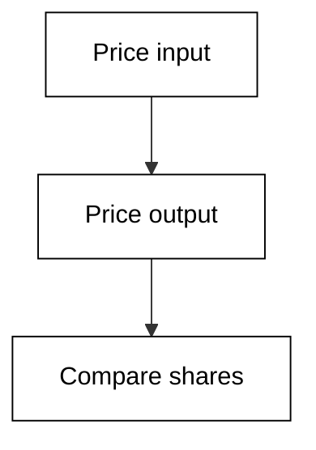

**`learning/code/ex-47-output-costs-more/main.py`**

```python
# Example 47: Output Costs More
# => Every agent turn spends tokens; tokens spend real money.
# => Hermes bills input and output at different rates, like peers.
# => The shim freezes one session ledger so the math is checkable.
turns = 10  # => agent loop iterations this session took
tokens_in = 50000  # => prompt plus context tokens consumed
tokens_out = 50000  # => completion tokens the agent produced
# => Prices are per thousand tokens, matching vendor price pages.
# => Input is cheap, output is dear: that asymmetry shapes prompts.
cost = tokens_in / 1000 * 0.003 + tokens_out / 1000 * 0.015  # => session spend
# => Per-turn cost spots runaway loops faster than any total can.
per_turn = cost / turns  # => average spend per iteration
# => The budget is stated up front in the brief, never discovered.
over = cost > 2.00  # => True means stop and re-scope now
# => Print money with four decimals: cents hide multi-dollar drift.
print("session-cost: %.4f" % cost)  # => Output is dollars
# => The verdict is binary so a gate script can consume it.
print("over-budget:", over)  # => True halts the session
```

**Output** (`learning/code/ex-47-output-costs-more/expected/main.stdout.txt`):

```text
session-cost: 0.9000
over-budget: False
```

**Key takeaway**: Output tokens cost multiples of input: terse prompts plus terse answers save double.

**Why It Matters**: Cost awareness is a design skill rather than an accounting chore: prompts shaped by token prices produce tighter loops and cheaper sessions at every step. Output tokens bill at multiples of input, so terse answers save twice, and mid-session price checks steer while the meter still runs. Budget before you run, not after. Verbose agents tax you twice, once reading context and once writing replies.

---

### Example 48: Turn Budget Tripwire

_Exercises co-10, co-09._

Turns and tokens convert directly into money. This example prices one session ledger against the budget its brief stated. Case in point: thirty-turn session tripping its fifty-cent tripwire and halting for re-scope. **Check**: the session-cost line matches your own arithmetic.

**`learning/code/ex-48-turn-budget-tripwire/main.py`**

```python
# Example 48: Turn Budget Tripwire
# => Every agent turn spends tokens; tokens spend real money.
# => Hermes bills input and output at different rates, like peers.
# => The shim freezes one session ledger so the math is checkable.
turns = 30  # => agent loop iterations this session took
tokens_in = 90000  # => prompt plus context tokens consumed
tokens_out = 30000  # => completion tokens the agent produced
# => Prices are per thousand tokens, matching vendor price pages.
# => Input is cheap, output is dear: that asymmetry shapes prompts.
cost = tokens_in / 1000 * 0.003 + tokens_out / 1000 * 0.015  # => session spend
# => Per-turn cost spots runaway loops faster than any total can.
per_turn = cost / turns  # => average spend per iteration
# => The budget is stated up front in the brief, never discovered.
over = cost > 0.50  # => True means stop and re-scope now
# => Print money with four decimals: cents hide multi-dollar drift.
print("session-cost: %.4f" % cost)  # => Output is dollars
# => The verdict is binary so a gate script can consume it.
print("over-budget:", over)  # => True halts the session
```

**Output** (`learning/code/ex-48-turn-budget-tripwire/expected/main.stdout.txt`):

```text
session-cost: 0.7200
over-budget: True
```

**Key takeaway**: Turn tripwires halt cheap sessions before they become expensive ones.

**Why It Matters**: Cost awareness is a design skill rather than an accounting chore: prompts shaped by token prices produce tighter loops and cheaper sessions at every step. Output tokens bill at multiples of input, so terse answers save twice, and mid-session price checks steer while the meter still runs. Budget before you run, not after. Thirty turns without a green test is the smell; the tripwire makes it a rule.

---

### Example 49: Trace to Cost

_Exercises co-07, co-10._

Turns and tokens convert directly into money. This example prices one session ledger against the budget its brief stated. Case in point: twelve-turn trace joined to its token ledger to find the priciest step. **Check**: the session-cost line matches your own arithmetic.

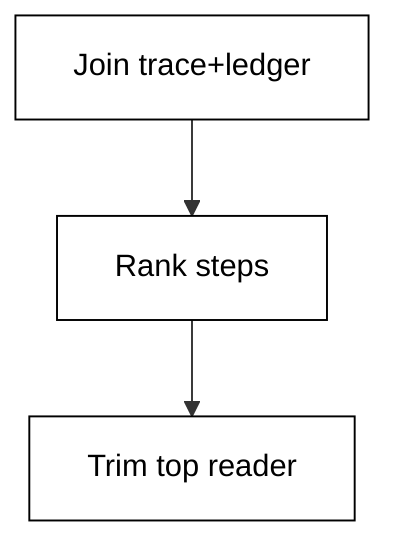

**`learning/code/ex-49-trace-to-cost/main.py`**

```python
# Example 49: Trace to Cost
# => Every agent turn spends tokens; tokens spend real money.
# => Hermes bills input and output at different rates, like peers.
# => The shim freezes one session ledger so the math is checkable.
turns = 12  # => agent loop iterations this session took
tokens_in = 36000  # => prompt plus context tokens consumed
tokens_out = 12000  # => completion tokens the agent produced
# => Prices are per thousand tokens, matching vendor price pages.
# => Input is cheap, output is dear: that asymmetry shapes prompts.
cost = tokens_in / 1000 * 0.003 + tokens_out / 1000 * 0.015  # => session spend
# => Per-turn cost spots runaway loops faster than any total can.
per_turn = cost / turns  # => average spend per iteration
# => The budget is stated up front in the brief, never discovered.
over = cost > 1.00  # => True means stop and re-scope now
# => Print money with four decimals: cents hide multi-dollar drift.
print("session-cost: %.4f" % cost)  # => Output is dollars
# => The verdict is binary so a gate script can consume it.
print("over-budget:", over)  # => True halts the session
```

**Output** (`learning/code/ex-49-trace-to-cost/expected/main.stdout.txt`):

```text
session-cost: 0.2880
over-budget: False
```

**Key takeaway**: Join traces to ledgers: the priciest step is usually a repeated read, not a big write.

**Why It Matters**: Cost awareness is a design skill rather than an accounting chore: prompts shaped by token prices produce tighter loops and cheaper sessions at every step. Output tokens bill at multiples of input, so terse answers save twice, and mid-session price checks steer while the meter still runs. Budget before you run, not after. Repeated full-file reads are the silent budget killer in long sessions.

---

### Example 50: Cheap First Pass

_Exercises co-10, co-05._

Turns and tokens convert directly into money. This example prices one session ledger against the budget its brief stated. Case in point: four-turn plan-only pass costing cents before any expensive execution. **Check**: the session-cost line matches your own arithmetic.

**`learning/code/ex-50-cheap-first-pass/main.py`**

```python
# Example 50: Cheap First Pass
# => Every agent turn spends tokens; tokens spend real money.
# => Hermes bills input and output at different rates, like peers.
# => The shim freezes one session ledger so the math is checkable.
turns = 4  # => agent loop iterations this session took
tokens_in = 8000  # => prompt plus context tokens consumed
tokens_out = 2000  # => completion tokens the agent produced
# => Prices are per thousand tokens, matching vendor price pages.
# => Input is cheap, output is dear: that asymmetry shapes prompts.
cost = tokens_in / 1000 * 0.003 + tokens_out / 1000 * 0.015  # => session spend
# => Per-turn cost spots runaway loops faster than any total can.
per_turn = cost / turns  # => average spend per iteration
# => The budget is stated up front in the brief, never discovered.
over = cost > 1.00  # => True means stop and re-scope now
# => Print money with four decimals: cents hide multi-dollar drift.
print("session-cost: %.4f" % cost)  # => Output is dollars
# => The verdict is binary so a gate script can consume it.
print("over-budget:", over)  # => True halts the session
```

**Output** (`learning/code/ex-50-cheap-first-pass/expected/main.stdout.txt`):

```text
session-cost: 0.0540
over-budget: False
```

**Key takeaway**: Plan-only passes cost cents: buy the plan before you fund the execution.

**Why It Matters**: Cost awareness is a design skill rather than an accounting chore: prompts shaped by token prices produce tighter loops and cheaper sessions at every step. Output tokens bill at multiples of input, so terse answers save twice, and mid-session price checks steer while the meter still runs. Budget before you run, not after. A four-turn plan that kills a bad idea is the highest-ROI session you will run.

---

### Example 51: Log Redaction Check

_Exercises co-07, co-02._

The tool-use trace is where you catch the agent being confidently wrong. This example replays one session trace and flags the suspect steps. Case in point: trace proving secrets stay redacted across read, edit, and test steps. **Check**: the suspect count matches the steps you flagged by hand.

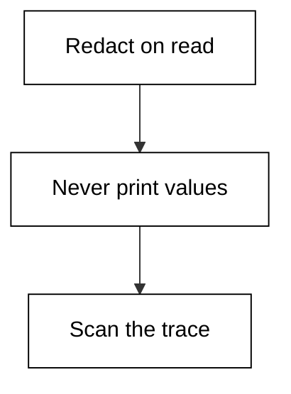

**`learning/code/ex-51-log-redaction-check/main.py`**

```python
# Example 51: Log Redaction Check
# => A tool-use trace is the agent's receipt: each call plus why.
# => Reading it is how you tell a correct step from a confident bluff.
# => The shim freezes one trace so every reader sees the same run.
steps = [
    ("read", "config with API_KEY=*** redacted", True),
    ("edit", "rotate key reference, value never printed", True),
    ("test", "secret scanner passes on trace", True),
]  # => the frozen trace, in call order
# => Walk the trace and mark each step good or suspect.
# => A suspect step is not proof of failure, just where to look.
bad = 0  # => count of steps that fail their own check
for tool, detail, ok in steps:  # => replay each recorded call
    # => The ok flag is the shim's verdict, standing in for yours.
    # => In real life you supply this judgement by reading the diff.
    if not ok:  # => this step smells wrong
        bad += 1  # => count it for the summary line
        print("SUSPECT:", tool, "-", detail)  # => flag it loudly
# => The totals line turns a feeling into a number you can gate on.
print("steps:", len(steps))  # => Output counts every call
# => Zero suspect steps is the bar for an unsupervised run.
print("suspect:", bad)  # => Output counts the flags
```

**Output** (`learning/code/ex-51-log-redaction-check/expected/main.stdout.txt`):

```text
steps: 3
suspect: 0
```

**Key takeaway**: Secrets must never reach the trace: redact at collection, verify with a scanner.

**Why It Matters**: Traces are the flight recorders of agent work: nobody reads them until something breaks, and then they are the only thing that matters. A clean read-edit-test rhythm makes deviations visible at a glance, while reason-carrying steps let an auditor verify without rerunning. Learn the rhythm before you need the recorder. A leaked key in a trace lives in logs, backups, and screenshots forever.

---

### Example 52: Token per File

_Exercises co-10, co-03._

Turns and tokens convert directly into money. This example prices one session ledger against the budget its brief stated. Case in point: six-turn scoped session showing narrow scope cutting input tokens by half. **Check**: the session-cost line matches your own arithmetic.

**`learning/code/ex-52-token-per-file/main.py`**

```python
# Example 52: Token per File
# => Every agent turn spends tokens; tokens spend real money.
# => Hermes bills input and output at different rates, like peers.
# => The shim freezes one session ledger so the math is checkable.
turns = 6  # => agent loop iterations this session took
tokens_in = 24000  # => prompt plus context tokens consumed
tokens_out = 6000  # => completion tokens the agent produced
# => Prices are per thousand tokens, matching vendor price pages.
# => Input is cheap, output is dear: that asymmetry shapes prompts.
cost = tokens_in / 1000 * 0.003 + tokens_out / 1000 * 0.015  # => session spend
# => Per-turn cost spots runaway loops faster than any total can.
per_turn = cost / turns  # => average spend per iteration
# => The budget is stated up front in the brief, never discovered.
over = cost > 1.00  # => True means stop and re-scope now
# => Print money with four decimals: cents hide multi-dollar drift.
print("session-cost: %.4f" % cost)  # => Output is dollars
# => The verdict is binary so a gate script can consume it.
print("over-budget:", over)  # => True halts the session
```

**Output** (`learning/code/ex-52-token-per-file/expected/main.stdout.txt`):

```text
session-cost: 0.1620
over-budget: False
```

**Key takeaway**: Narrow scope is a cost control: fewer files in context means fewer input tokens.

**Why It Matters**: Cost awareness is a design skill rather than an accounting chore: prompts shaped by token prices produce tighter loops and cheaper sessions at every step. Output tokens bill at multiples of input, so terse answers save twice, and mid-session price checks steer while the meter still runs. Budget before you run, not after. Scoping to one package halves the context on every single turn of the session.

---

### Example 53: Weekly Cost Review

_Exercises co-10._

Turns and tokens convert directly into money. This example prices one session ledger against the budget its brief stated. Case in point: twenty-turn week of sessions aggregating into a one-page cost review. **Check**: the session-cost line matches your own arithmetic.

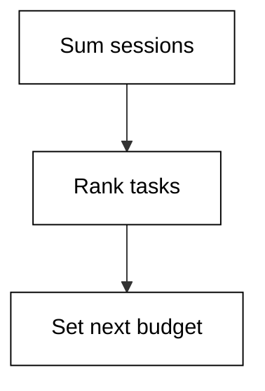

**`learning/code/ex-53-weekly-cost-review/main.py`**

```python
# Example 53: Weekly Cost Review
# => Every agent turn spends tokens; tokens spend real money.
# => Hermes bills input and output at different rates, like peers.
# => The shim freezes one session ledger so the math is checkable.
turns = 20  # => agent loop iterations this session took
tokens_in = 60000  # => prompt plus context tokens consumed
tokens_out = 20000  # => completion tokens the agent produced
# => Prices are per thousand tokens, matching vendor price pages.
# => Input is cheap, output is dear: that asymmetry shapes prompts.
cost = tokens_in / 1000 * 0.003 + tokens_out / 1000 * 0.015  # => session spend
# => Per-turn cost spots runaway loops faster than any total can.
per_turn = cost / turns  # => average spend per iteration
# => The budget is stated up front in the brief, never discovered.
over = cost > 1.00  # => True means stop and re-scope now
# => Print money with four decimals: cents hide multi-dollar drift.
print("session-cost: %.4f" % cost)  # => Output is dollars
# => The verdict is binary so a gate script can consume it.
print("over-budget:", over)  # => True halts the session
```

**Output** (`learning/code/ex-53-weekly-cost-review/expected/main.stdout.txt`):

```text
session-cost: 0.4800
over-budget: False
```

**Key takeaway**: Aggregate weekly: per-session noise becomes a trend you can manage.

**Why It Matters**: Cost awareness is a design skill rather than an accounting chore: prompts shaped by token prices produce tighter loops and cheaper sessions at every step. Output tokens bill at multiples of input, so terse answers save twice, and mid-session price checks steer while the meter still runs. Budget before you run, not after. Weekly reviews catch the slow creep that no single session budget would flag.

---
