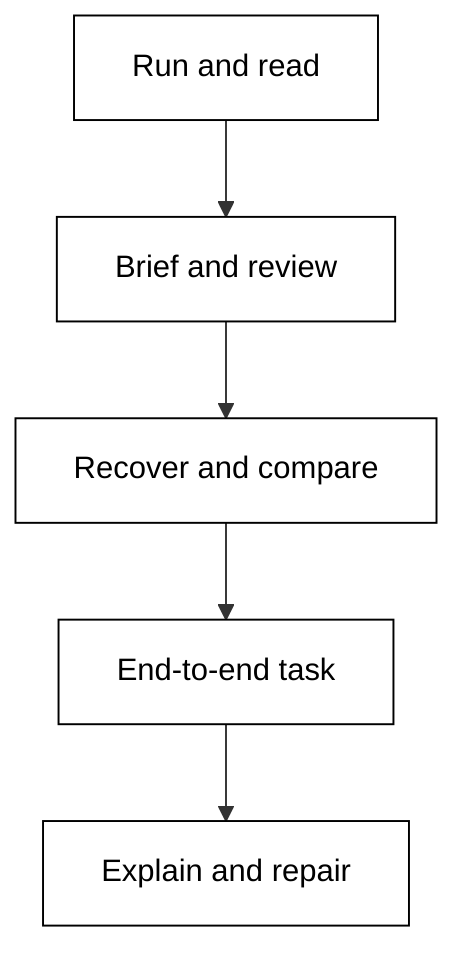

## Prerequisites

- **Prior courses**: [agentic-coding](/en/learn/courses/agentic-coding/learning/overview) shows the general agent loop this course specializes to Hermes Agent; [version-control-and-git](/en/learn/courses/version-control-and-git/learning/overview) gives the diff and branch habits every review example assumes; [just-enough-bash](/en/learn/courses/just-enough-bash/learning/overview) covers the shell each example starts from.
- **Assumed knowledge**: comfort with a terminal, Git, and reading a diff.
- **Runtime**: Python 3.14 standard library only. Every example drives a deterministic fixture shim of Hermes Agent's CLI and file-system effects: no real network, no real API key, no real account. The shim is a deliberate simplification of the live product, documented per example, so output stays reproducible years from now.

## Why this exists: the big idea

A learner who knows one agent tool cannot tell a vendor quirk from a general principle of agentic coding. This course teaches Hermes Agent the same way its sibling courses teach their tools, on shared task shapes, so the comparison is honest. The idea to keep if you forget everything else: treat the agent's output as a draft from a fast junior, and verify everything it claims before you act on it.

## How to work this course

Run every example from its own unit directory with `python3 main.py` and compare your output with the recorded block. Read the trace or verdict first, answer the check, then move on. Beginner builds the loop, intermediate builds the contract, advanced builds the recovery habit. Finish with the capstone, then drill.

## Concept map

The sixteen concepts thread through the course in order: co-01 tool-invocation-model and co-02 permission-scope fence every session; co-03 session-and-context bounds what the agent remembers; co-04 task-brief through co-06 diff-review form the contract-proof loop; co-07 tool-use-trace is the flight recorder; co-08 failure-mode and co-09 recovery-step are the incident curriculum; co-10 cost-and-budget prices it all; co-11 multi-file-change and co-12 test-gate prove real work; co-13 config-file and co-14 extension-or-plugin adapt the tool; co-15 comparison-criteria keeps tool choice honest; co-16 human-in-the-loop approves what ships.

## References

- Hermes Agent vendor repository ([NousResearch/hermes-agent](https://github.com/NousResearch/hermes-agent)), which the legacy pages in this repo describe and link — installer and source reference linked from those pages ([install script](https://raw.githubusercontent.com/NousResearch/hermes-agent/main/scripts/install.sh)) — accessed 2026-10-20; version-specific product facts in this course are pinned to fixture-shim release `hermes-shim-2.4.1` and re-checked against the linked repository listing on that date.
- Hermes Agent hub directory linked from the legacy pages ([hub.hermes-agent.dev](https://hub.hermes-agent.dev)) — accessed 2026-10-20; used only to confirm capability names cited in the extensions cluster, never as a live dependency.
- Legacy course material this course migrates and re-verifies: [Hermes Agent legacy pages](/en/learn/legacy/artificial-intelligence/tools/hermes-agent/overview) — accessed 2026-10-20; facts mined from those pages were re-checked against the vendor links above on the same date rather than copied as already correct.
- Sibling comparison baseline in this plan: [Agentic Coding](/en/learn/courses/agentic-coding/learning/overview) — accessed 2026-10-20; supplies the shared agent-loop vocabulary the capstone comparison reuses.

## Examples by Level

### Beginner (Examples 1–25)

- [Example 1: Read the Config File](/en/learn/courses/hermes-agent-for-engineers/learning/beginner#example-1-read-the-config-file)
- [Example 2: Sandbox Modes Compared](/en/learn/courses/hermes-agent-for-engineers/learning/beginner#example-2-sandbox-modes-compared)
- [Example 3: Scope to One Repo](/en/learn/courses/hermes-agent-for-engineers/learning/beginner#example-3-scope-to-one-repo)
- [Example 4: Action Outside Scope](/en/learn/courses/hermes-agent-for-engineers/learning/beginner#example-4-action-outside-scope)
- [Example 5: Pin the Version](/en/learn/courses/hermes-agent-for-engineers/learning/beginner#example-5-pin-the-version)
- [Example 6: First Task Dry Run](/en/learn/courses/hermes-agent-for-engineers/learning/beginner#example-6-first-task-dry-run)
- [Example 7: Approve a Small Plan](/en/learn/courses/hermes-agent-for-engineers/learning/beginner#example-7-approve-a-small-plan)
- [Example 8: Veto a Wide Plan](/en/learn/courses/hermes-agent-for-engineers/learning/beginner#example-8-veto-a-wide-plan)
- [Example 9: Read a Clean Trace](/en/learn/courses/hermes-agent-for-engineers/learning/beginner#example-9-read-a-clean-trace)
- [Example 10: Spot the Skipped Read](/en/learn/courses/hermes-agent-for-engineers/learning/beginner#example-10-spot-the-skipped-read)
- [Example 11: Trace Shows the Why](/en/learn/courses/hermes-agent-for-engineers/learning/beginner#example-11-trace-shows-the-why)
- [Example 12: One Suspect Step](/en/learn/courses/hermes-agent-for-engineers/learning/beginner#example-12-one-suspect-step)
- [Example 13: Count the Turns](/en/learn/courses/hermes-agent-for-engineers/learning/beginner#example-13-count-the-turns)
- [Example 14: Tool Call Order Matters](/en/learn/courses/hermes-agent-for-engineers/learning/beginner#example-14-tool-call-order-matters)
- [Example 15: Hallucinated File Edit](/en/learn/courses/hermes-agent-for-engineers/learning/beginner#example-15-hallucinated-file-edit)
- [Example 16: Trace JSON Shape](/en/learn/courses/hermes-agent-for-engineers/learning/beginner#example-16-trace-json-shape)
- [Example 17: Diff From Trace](/en/learn/courses/hermes-agent-for-engineers/learning/beginner#example-17-diff-from-trace)
- [Example 18: Allowlist Shell](/en/learn/courses/hermes-agent-for-engineers/learning/beginner#example-18-allowlist-shell)
- [Example 19: Deny by Default](/en/learn/courses/hermes-agent-for-engineers/learning/beginner#example-19-deny-by-default)
- [Example 20: Scope Then Permission](/en/learn/courses/hermes-agent-for-engineers/learning/beginner#example-20-scope-then-permission)
- [Example 21: Read Only Session](/en/learn/courses/hermes-agent-for-engineers/learning/beginner#example-21-read-only-session)
- [Example 22: Ask Mode Edit](/en/learn/courses/hermes-agent-for-engineers/learning/beginner#example-22-ask-mode-edit)
- [Example 23: Lockdown Recovery](/en/learn/courses/hermes-agent-for-engineers/learning/beginner#example-23-lockdown-recovery)
- [Example 24: Edit Docs Allowed](/en/learn/courses/hermes-agent-for-engineers/learning/beginner#example-24-edit-docs-allowed)
- [Example 25: Audit the Decision](/en/learn/courses/hermes-agent-for-engineers/learning/beginner#example-25-audit-the-decision)

### Intermediate (Examples 26–53)

- [Example 26: Sharp Task Brief](/en/learn/courses/hermes-agent-for-engineers/learning/intermediate#example-26-sharp-task-brief)
- [Example 27: Vague Brief Fails](/en/learn/courses/hermes-agent-for-engineers/learning/intermediate#example-27-vague-brief-fails)
- [Example 28: Done Condition First](/en/learn/courses/hermes-agent-for-engineers/learning/intermediate#example-28-done-condition-first)
- [Example 29: Scope Creep Brief](/en/learn/courses/hermes-agent-for-engineers/learning/intermediate#example-29-scope-creep-brief)
- [Example 30: Guardrails That Bind](/en/learn/courses/hermes-agent-for-engineers/learning/intermediate#example-30-guardrails-that-bind)
- [Example 31: Brief for a Bug](/en/learn/courses/hermes-agent-for-engineers/learning/intermediate#example-31-brief-for-a-bug)
- [Example 32: Brief for a Feature](/en/learn/courses/hermes-agent-for-engineers/learning/intermediate#example-32-brief-for-a-feature)
- [Example 33: Brief Cost Ceiling](/en/learn/courses/hermes-agent-for-engineers/learning/intermediate#example-33-brief-cost-ceiling)
- [Example 34: Rebrief After Drift](/en/learn/courses/hermes-agent-for-engineers/learning/intermediate#example-34-rebrief-after-drift)
- [Example 35: Two File Change](/en/learn/courses/hermes-agent-for-engineers/learning/intermediate#example-35-two-file-change)
- [Example 36: Ten File Refactor](/en/learn/courses/hermes-agent-for-engineers/learning/intermediate#example-36-ten-file-refactor)
- [Example 37: Read the Whole Diff](/en/learn/courses/hermes-agent-for-engineers/learning/intermediate#example-37-read-the-whole-diff)
- [Example 38: Reject the Diff](/en/learn/courses/hermes-agent-for-engineers/learning/intermediate#example-38-reject-the-diff)
- [Example 39: Diff Touches Tests](/en/learn/courses/hermes-agent-for-engineers/learning/intermediate#example-39-diff-touches-tests)
- [Example 40: Schema Change Flag](/en/learn/courses/hermes-agent-for-engineers/learning/intermediate#example-40-schema-change-flag)
- [Example 41: Review Checklist Run](/en/learn/courses/hermes-agent-for-engineers/learning/intermediate#example-41-review-checklist-run)
- [Example 42: Approve the Diff](/en/learn/courses/hermes-agent-for-engineers/learning/intermediate#example-42-approve-the-diff)
- [Example 43: Multi File Coherence](/en/learn/courses/hermes-agent-for-engineers/learning/intermediate#example-43-multi-file-coherence)
- [Example 44: Split the Diff](/en/learn/courses/hermes-agent-for-engineers/learning/intermediate#example-44-split-the-diff)
- [Example 45: Read the Log](/en/learn/courses/hermes-agent-for-engineers/learning/intermediate#example-45-read-the-log)
- [Example 46: Price a Long Session](/en/learn/courses/hermes-agent-for-engineers/learning/intermediate#example-46-price-a-long-session)
- [Example 47: Output Costs More](/en/learn/courses/hermes-agent-for-engineers/learning/intermediate#example-47-output-costs-more)
- [Example 48: Turn Budget Tripwire](/en/learn/courses/hermes-agent-for-engineers/learning/intermediate#example-48-turn-budget-tripwire)
- [Example 49: Trace to Cost](/en/learn/courses/hermes-agent-for-engineers/learning/intermediate#example-49-trace-to-cost)
- [Example 50: Cheap First Pass](/en/learn/courses/hermes-agent-for-engineers/learning/intermediate#example-50-cheap-first-pass)
- [Example 51: Log Redaction Check](/en/learn/courses/hermes-agent-for-engineers/learning/intermediate#example-51-log-redaction-check)
- [Example 52: Token per File](/en/learn/courses/hermes-agent-for-engineers/learning/intermediate#example-52-token-per-file)
- [Example 53: Weekly Cost Review](/en/learn/courses/hermes-agent-for-engineers/learning/intermediate#example-53-weekly-cost-review)

### Advanced (Examples 54–78)

- [Example 54: The Edit Loop](/en/learn/courses/hermes-agent-for-engineers/learning/advanced#example-54-the-edit-loop)
- [Example 55: Wrong File Fix](/en/learn/courses/hermes-agent-for-engineers/learning/advanced#example-55-wrong-file-fix)
- [Example 56: Stuck on Auth](/en/learn/courses/hermes-agent-for-engineers/learning/advanced#example-56-stuck-on-auth)
- [Example 57: Snapshot Before Interrupt](/en/learn/courses/hermes-agent-for-engineers/learning/advanced#example-57-snapshot-before-interrupt)
- [Example 58: Restart With Context](/en/learn/courses/hermes-agent-for-engineers/learning/advanced#example-58-restart-with-context)
- [Example 59: Flaky Test or Loop](/en/learn/courses/hermes-agent-for-engineers/learning/advanced#example-59-flaky-test-or-loop)
- [Example 60: Unsafe Action Halt](/en/learn/courses/hermes-agent-for-engineers/learning/advanced#example-60-unsafe-action-halt)
- [Example 61: Postmortem the Loop](/en/learn/courses/hermes-agent-for-engineers/learning/advanced#example-61-postmortem-the-loop)
- [Example 62: First Plugin Install](/en/learn/courses/hermes-agent-for-engineers/learning/advanced#example-62-first-plugin-install)
- [Example 63: Registry Miss](/en/learn/courses/hermes-agent-for-engineers/learning/advanced#example-63-registry-miss)
- [Example 64: Namespaced Settings](/en/learn/courses/hermes-agent-for-engineers/learning/advanced#example-64-namespaced-settings)
- [Example 65: Config Layering](/en/learn/courses/hermes-agent-for-engineers/learning/advanced#example-65-config-layering)
- [Example 66: Pin Plugin Versions](/en/learn/courses/hermes-agent-for-engineers/learning/advanced#example-66-pin-plugin-versions)
- [Example 67: Disable a Plugin](/en/learn/courses/hermes-agent-for-engineers/learning/advanced#example-67-disable-a-plugin)
- [Example 68: Two Plugins One Task](/en/learn/courses/hermes-agent-for-engineers/learning/advanced#example-68-two-plugins-one-task)
- [Example 69: Config Review Diff](/en/learn/courses/hermes-agent-for-engineers/learning/advanced#example-69-config-review-diff)
- [Example 70: Extension Cost Check](/en/learn/courses/hermes-agent-for-engineers/learning/advanced#example-70-extension-cost-check)
- [Example 71: Shared Task Setup](/en/learn/courses/hermes-agent-for-engineers/learning/advanced#example-71-shared-task-setup)
- [Example 72: Score Hermes First](/en/learn/courses/hermes-agent-for-engineers/learning/advanced#example-72-score-hermes-first)
- [Example 73: Peer Beats Hermes](/en/learn/courses/hermes-agent-for-engineers/learning/advanced#example-73-peer-beats-hermes)
- [Example 74: Tie on Tests](/en/learn/courses/hermes-agent-for-engineers/learning/advanced#example-74-tie-on-tests)
- [Example 75: Compare Traces](/en/learn/courses/hermes-agent-for-engineers/learning/advanced#example-75-compare-traces)
- [Example 76: Compare Costs](/en/learn/courses/hermes-agent-for-engineers/learning/advanced#example-76-compare-costs)
- [Example 77: When to Switch](/en/learn/courses/hermes-agent-for-engineers/learning/advanced#example-77-when-to-switch)
- [Example 78: Dated Verdict](/en/learn/courses/hermes-agent-for-engineers/learning/advanced#example-78-dated-verdict)
