Examples 54–78 cover production Java: a concurrency survey that stays deterministic (Examples 54–61), from threads and joins through executor fan-out, ordered futures, synchronized totals, blocking queues, CompletableFuture pipelines, parallel streams, and atomics; then tooling, style, and interop (Examples 62–70), from names that read aloud through StringBuilder economics, upfront sizing, EnumSet flags, -Xlint-clean builds, why-comments, extracted methods, system-property config, and ProcessBuilder calls; finally reading idiomatic code (Examples 71–78), from handlers and pipelines through seams, spec tables, CLIs, data contracts, cleanup order, and one whole program top-down. Every example is a complete, runnable Java program under `learning/code/`; run each with the command in its own `run.yaml`.

---

### Example 54: Threads Join Before Printing

Threads overlap waiting and computation, but their completion order is the scheduler's business, never the program's; deterministic output therefore separates the parallel work from the ordered presentation. Each worker here owns exactly one array slot, disjoint ownership that needs no lock because no two threads touch the same cell, and main joins every thread before reading anything. The join is the whole determinism mechanism: it returns only after its worker finished, so the prints afterward observe final values on every run. Two rules generalize from this shape. Own don't share where possible, slot-per-worker beats a shared accumulator that every increment must lock, and always join what you start, because an unjoined thread can outlive main and interleave its output with the shell's next prompt. Scheduling decides arrival order; joining plus slot ownership decides output order, and only the second belongs in transcripts. (Concepts: co-09.)

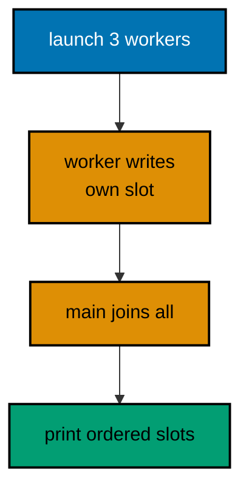

**`learning/code/ex-54-threads-join-before-print/Main.java`**:

```java
// Example 54: Threads Join Before Printing.
// Each thread owns one array slot, main joins every thread, and only
// then prints: joining turns parallel work into ordered output.
public class Main {

  // => one public class per file, named after the file
  public static void main(String[] args) throws InterruptedException {
    // => joins are interruptibly checked
    int[] partials = new int[3]; // => one slot per worker, no sharing
    Thread[] crew = new Thread[3]; // => handles for the three workers
    int[] dues = { 50, 75, 25 }; // => fixed figures, one per worker
    for (int i = 0; i < crew.length; i++) {
      // => launch loop: each worker knows its index
      final int slot = i; // => effectively final copy for the lambda
      crew[i] = new Thread(() -> partials[slot] = dues[slot] * 2); // => doubled dues into its own slot
      crew[i].start(); // => worker runs: main continues launching
    } // => launch ends: three workers doubling concurrently
    for (Thread worker : crew) {
      // => join loop: main waits for everyone
      worker.join(); // => returns only after that worker finished
    } // => join ends: all slots final, no race remains
    System.out.println("partials: " + partials[0] + "," + partials[1] + "," + partials[2]); // => Output: partials: 100,150,50
    System.out.println("total: " + (partials[0] + partials[1] + partials[2])); // => Output: total: 300
  } // => main ends: parallel work, ordered transcript
}
```

**Output** (`learning/code/ex-54-threads-join-before-print/expected/main.stdout.txt`):

```text
partials: 100,150,50
total: 300
```

**Key takeaway**: Give each thread its own slot and join every thread before printing anything.

**Why it matters**: Disjoint ownership removes races without locks, and joins convert scheduler-ordered completion into program-ordered output.

### Example 55: Executor invokeAll Orders Results

Raw threads suit bespoke lifecycles; pooled executors suit task batches, and invokeAll is the batch primitive that preserves order. The pool runs the three settlements concurrently across its workers, yet the returned future list follows submission order, so the print loop observes task order no matter which worker finished first. That separation, concurrent execution with ordered collection, is the pattern behind most server fan-out: parallel calls, ordered assembly. The try-finally around the pool is non-negotiable hygiene: an unclosed pool keeps non-daemon threads alive and the program never exits, a hang no transcript explains. Fixed-size pools bound the parallelism to the work at hand; cached pools grow without limit and suit only short tasks with known arrival rates. Shut down every pool you open, collect futures in order, and concurrency stays a performance tool rather than a nondeterminism source. (Concepts: co-09.)

**`learning/code/ex-55-executor-invokeall-orders-results/Main.java`**:

```java
// Example 55: Executor invokeAll Orders Results.
// invokeAll runs every task in the pool yet returns futures in task
// order, so concurrent execution still prints submission order.
import java.util.List; // => the task list and the future list
import java.util.concurrent.Callable; // => value-returning tasks for the pool
import java.util.concurrent.ExecutorService; // => the managed worker pool
import java.util.concurrent.Executors; // => the pool factory
import java.util.concurrent.Future; // => the ordered result handles

public class Main {

  // => one public class per file, named after the file
  public static void main(String[] args) throws Exception {
    // => gets and shutdown are checked
    ExecutorService pool = Executors.newFixedThreadPool(3); // => three workers, bounded and named by default
    List<Callable<String>> tasks = List.of(
      // => tasks in submission order
      () -> "sari:50", // => task one: settled line one
      () -> "budi:75", // => task two: settled line two
      () -> "citra:25"
    ); // => task three: settled line three
    try {
      // => the pool shuts down on every exit path
      List<Future<String>> futures = pool.invokeAll(tasks); // => runs concurrently, returns in order
      for (Future<String> f : futures) {
        // => submission order, regardless of finish order
        System.out.println(f.get()); // => Output: the three settled lines in order
      } // => loop ends: every task answered exactly once
    } finally {
      // => shutdown is a promise, not a hope
      pool.shutdown(); // => no new tasks; running tasks finish
    } // => finally ends: the pool closed, threads released
    System.out.println("pool closed: " + pool.isShutdown()); // => Output: pool closed: true
  } // => main ends: concurrent run, ordered transcript, closed pool
}
```

**Output** (`learning/code/ex-55-executor-invokeall-orders-results/expected/main.stdout.txt`):

```text
sari:50
budi:75
citra:25
pool closed: true
```

**Key takeaway**: Fan tasks out with invokeAll, collect futures in submission order, and shut the pool down in finally.

**Why it matters**: Ordered future lists decouple execution overlap from presentation order, and finally-shutdown keeps pools from hanging exits.

### Example 56: Futures Carry Answers Back

Submitting tasks one by one instead of invokeAll-ing a batch suits pipelines where main keeps working between submissions: each submit returns a Future handle immediately, main banks the handles in order, and get() reassembles the answers in that same order. Blocking per handle in sequence is deliberate here: the first get waits only for the first task while the rest keep running, so waiting overlaps with remaining work rather than idling. The accumulation beside the prints shows the main-thread privilege: because collection is sequential, the total needs no lock, no atomic, and no synchronized block. Futures also carry failure across threads, ExecutionException wrapping whatever the task threw, which keeps worker crashes visible at the collecting call instead of vanishing into a dead thread. Bank handles in order, get in order, accumulate without locks, and the pool behaves like an ordered parallel map. (Concepts: co-09.)

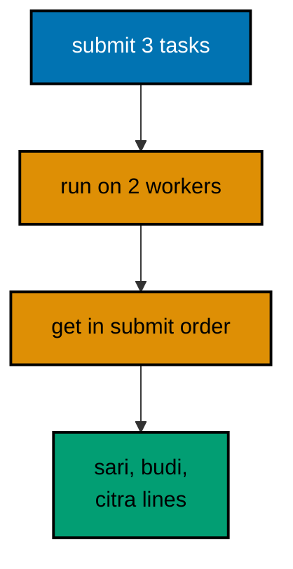

**`learning/code/ex-56-futures-carry-answers-back/Main.java`**:

```java
// Example 56: Futures Carry Answers Back.
// Submitted callables compute off-thread while main does its own
// work; get in submission order reassembles the ordered answers.
import java.util.ArrayList; // => the ordered future handles
import java.util.List; // => interface on the left as always
import java.util.concurrent.ExecutorService; // => the two-worker pool
import java.util.concurrent.Executors; // => the pool factory
import java.util.concurrent.Future; // => the answer handles

public class Main {

  // => one public class per file, named after the file
  static int settle(String member, int amount) {
    // => the priced work each task performs
    return amount; // => trivial here: the shape matters, not the math
  } // => work ends: pure function, safe off-thread

  public static void main(String[] args) throws Exception {
    // => gets and shutdown are checked
    ExecutorService pool = Executors.newFixedThreadPool(2); // => two workers for three tasks
    List<Future<Integer>> owed = new ArrayList<>(); // => handles banked in submission order
    String[] members = { "sari", "budi", "citra" }; // => fixed roster for the three tasks
    int[] amounts = { 50, 75, 25 }; // => fixed dues beside the roster
    try {
      // => the pool shuts down on every exit path
      for (int i = 0; i < members.length; i++) {
        // => submit loop: order banked here
        final int slot = i; // => effectively final copy for the lambda
        owed.add(pool.submit(() -> settle(members[slot], amounts[slot]))); // => future banked at submit time
      } // => submit ends: three tasks running, three handles held
      int total = 0; // => main's own work: accumulate as answers land
      for (int i = 0; i < owed.size(); i++) {
        // => collection in submission order
        int got = owed.get(i).get(); // => blocks only for this task's answer
        System.out.println(members[i] + ": " + got); // => Output: sari: 50, budi: 75, citra: 25
        total += got; // => accumulate in order, no lock needed
      } // => loop ends: every answer collected exactly once
      System.out.println("total: " + total); // => Output: total: 150
    } finally {
      // => shutdown is a promise, not a hope
      pool.shutdown(); // => workers released after finishing
    } // => finally ends: pool closed on every path
  } // => main ends: submitted concurrently, collected in order
}
```

**Output** (`learning/code/ex-56-futures-carry-answers-back/expected/main.stdout.txt`):

```text
sari: 50
budi: 75
citra: 25
total: 150
```

**Key takeaway**: Bank Future handles at submit time, get them in order, and accumulate on the collecting thread lock-free.

**Why it matters**: Ordered handle collection preserves presentation order across concurrent work, and sequential gets keep accumulation lock-free.

### Example 57: synchronized Guards the Shared Total

Unsynchronized read-modify-write is the race every Java developer meets once: two threads read the same total, both add one, and one increment vanishes, a loss that reproduces rarely and audits never. The synchronized method removes the interleaving by admitting one thread at a time, so all one thousand increments land and the transcript reads exactly 1000 on every run. Guarding the read with the same lock matters as much as guarding the write: synchronization pairs visibility with atomicity, guaranteeing the reader sees the latest write rather than a cached stale copy. Keep synchronized regions minimal, one increment here, because the lock serializes everything inside it and fat regions turn parallel workers into a queue; Example 61 shows atomics for counters that outgrow locking. The exact-thousand assertion is the test that justifies the keyword: remove synchronized and reruns scatter below 1000, keep it and they never do. (Concepts: co-09.)

**`learning/code/ex-57-synchronized-guards-shared-total/Main.java`**:

```java
// Example 57: synchronized Guards the Shared Total.
// Ten threads add one hundred dues each into one total; the
// synchronized method serializes the increments, so all 1000 land.
public class Main {

  // => one public class per file, named after the file
  static class Vault {

    // => the shared mutable total under guard
    private int total = 0; // => private: every increment crosses the guard

    synchronized void add(int amount) {
      // => one thread at a time, no interleaving
      total += amount; // => read-modify-write, atomic under the lock
    } // => add ends: lock released, next thread admitted

    synchronized int total() {
      // => guarded read: sees the latest write
      return total; // => the settled sum under the same lock
    } // => total ends: visibility plus atomicity together
  } // => Vault ends: shared state, single guard

  public static void main(String[] args) throws InterruptedException {
    // => joins are interruptibly checked
    Vault vault = new Vault(); // => one vault shared by ten threads
    Thread[] crew = new Thread[10]; // => handles for joining later
    for (int i = 0; i < crew.length; i++) {
      // => launch loop: identical work per thread
      crew[i] = new Thread(() -> {
        // => each worker adds one hundred ones
        for (int k = 0; k < 100; k++) {
          // => one hundred increments per worker
          vault.add(1); // => guarded: every increment lands
        } // => worker loop ends: its hundred banked
      }); // => worker defined: loop only, no printing
      crew[i].start(); // => worker runs alongside its nine colleagues
    } // => launch ends: one thousand increments in flight
    for (Thread worker : crew) {
      // => join loop: wait for every worker
      worker.join(); // => returns only after that worker's hundred
    } // => join ends: all one thousand increments complete
    System.out.println("total: " + vault.total()); // => Output: total: 1000
    System.out.println("workers: " + crew.length); // => Output: workers: 10
  } // => main ends: shared total exact, no increment lost
}
```

**Output** (`learning/code/ex-57-synchronized-guards-shared-total/expected/main.stdout.txt`):

```text
total: 1000
workers: 10
```

**Key takeaway**: Guard shared read-modify-write with synchronized on both writes and reads; keep regions minimal.

**Why it matters**: Mutual exclusion prevents lost increments while same-lock reads guarantee visibility, making exact totals reproducible.

### Example 58: BlockingQueue Connects Stages

Producer-consumer handoff is the shape behind pipelines, work queues, and log drains, and BlockingQueue carries it without a single explicit lock: put blocks when the bounded queue fills, applying backpressure to fast producers, while take blocks when it empties, parking consumers without spin-waiting. The poison pill is the termination half of the protocol: a sentinel value the consumer recognizes as end-of-stream, so no interrupt, flag, or timeout guessing ends the loop. Bounded capacity deserves emphasis over the unbounded alternative: a LinkedBlockingQueue without a bound absorbs bursts by growing memory without limit, while the ArrayBlockingQueue of four here pushes back at exactly the point reviewers can reason about. Interrupt handling follows the restore-and-exit rule in both stages: blocking calls throw on interrupt, and re-setting the flag preserves the signal for code above. Join both stages and the transcript reads feed order on every run. (Concepts: co-09.)

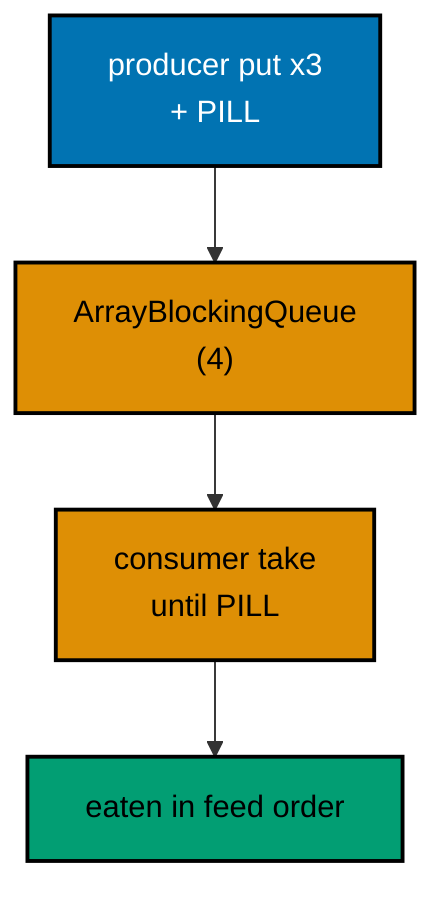

**`learning/code/ex-58-blocking-queue-connects-stages/Main.java`**:

```java
// Example 58: BlockingQueue Connects Stages.
// Producer and consumer share a bounded queue: puts block when full,
// takes block when empty, and a pill message ends the stream cleanly.
import java.util.ArrayList; // => the consumed lines in take order
import java.util.List; // => interface on the left as always
import java.util.concurrent.ArrayBlockingQueue; // => the bounded handoff channel
import java.util.concurrent.BlockingQueue; // => the blocking put-take contract

public class Main {

  // => one public class per file, named after the file
  static final String PILL = "STOP"; // => the poison message ending the stream

  public static void main(String[] args) throws InterruptedException {
    // => puts, takes, joins are checked
    BlockingQueue<String> pipe = new ArrayBlockingQueue<>(4); // => bounded: backpressure at four lines
    List<String> eaten = new ArrayList<>(); // => consumer banks takes in order
    Thread producer = new Thread(() -> {
      // => the feeding stage
      try {
        // => puts block when the queue fills
        pipe.put("sari:50"); // => first dues line into the pipe
        pipe.put("budi:75"); // => second dues line into the pipe
        pipe.put("citra:25"); // => third dues line into the pipe
        pipe.put(PILL); // => poison pill ends the stream
      } catch (InterruptedException e) {
        // => blocking calls answer interrupts
        Thread.currentThread().interrupt(); // => restore the flag, exit quietly
      } // => catch ends: stage ends early on interrupt
    }); // => producer defined: three lines plus the pill
    Thread consumer = new Thread(() -> {
      // => the draining stage
      try {
        // => takes block when the queue empties
        String line; // => holds each taken line in turn
        while (!(line = pipe.take()).equals(PILL)) {
          // => pill ends the loop, lines bank first
          eaten.add(line); // => banked in queue order, which is feed order
        } // => loop ends at the pill: three lines banked
      } catch (InterruptedException e) {
        // => blocking calls answer interrupts
        Thread.currentThread().interrupt(); // => restore the flag, exit quietly
      } // => catch ends: stage ends early on interrupt
    }); // => consumer defined: drain until the pill
    producer.start(); // => feeder runs
    consumer.start(); // => drainer runs alongside
    producer.join(); // => feeding complete before main proceeds
    consumer.join(); // => draining complete: pill eaten, loop exited
    System.out.println("eaten: " + eaten); // => Output: eaten: [sari:50, budi:75, citra:25]
    System.out.println("pipe drained: " + pipe.isEmpty()); // => Output: pipe drained: true
  } // => main ends: staged handoff, ordered transcript
}
```

**Output** (`learning/code/ex-58-blocking-queue-connects-stages/expected/main.stdout.txt`):

```text
eaten: [sari:50, budi:75, citra:25]
pipe drained: true
```

**Key takeaway**: Connect stages with bounded BlockingQueues; end streams with a poison pill and join both stages.

**Why it matters**: Blocking handoff supplies backpressure and parking without explicit locks, and pills terminate cleanly without flags.

### Example 59: CompletableFuture Pipelines Compose

CompletableFuture turns callback pyramids into chains: each stage names its transformation, supplyAsync fetches, thenApply parses, thenCombine merges, and join collects the assembled answer. The chain reads in execution order where nested callbacks would indent per stage, and every stage stays a pure function over its input, which keeps the async composition testable stage by stage with plain calls. thenCombine deserves attention as the fan-in primitive: it waits for both pipelines and applies the merge function once, the async twin of collecting two futures in order from Example 56. Join rather than get keeps the collecting code free of checked exceptions, rethrowing failures unchecked at the collection point; reserve get for code that must distinguish interruption from failure. Compose small pure stages, combine at the fan-in, join in order, and async code reads like the sync version with the waiting factored out. (Concepts: co-09.)

**`learning/code/ex-59-completablefuture-pipelines-compose/Main.java`**:

```java
// Example 59: CompletableFuture Pipelines Compose.
// Supply, transform, and combine stages read as one chain: async
// fetch, thenApply parse, thenCombine totals, join collects in order.
import java.util.concurrent.CompletableFuture; // => the composable async pipeline

public class Main {

  // => one public class per file, named after the file
  static String fetch(String member) {
    // => the async fetch stage, fixed data
    return member + ":50"; // => every member owes fifty here
  } // => fetch ends: line shaped, ready to parse

  static int parse(String line) {
    // => the parse stage: line in, amount out
    return Integer.parseInt(line.split(":")[1]); // => amount half parsed to int
  } // => parse ends: pure function, stage-safe

  public static void main(String[] args) {
    // => join rethrows unchecked: no checked ceremony
    CompletableFuture<Integer> sari = CompletableFuture // => pipeline one: sari's dues
      .supplyAsync(() -> fetch("sari")) // => async fetch off the calling thread
      .thenApply(Main::parse); // => parse chained onto the fetch result
    CompletableFuture<Integer> budi = CompletableFuture // => pipeline two: budi's dues
      .supplyAsync(() -> fetch("budi")) // => async fetch, overlapping pipeline one
      .thenApply(Main::parse); // => same parse stage, independent data
    int total = sari.thenCombine(budi, Integer::sum).join(); // => combine stage: sum when both land
    System.out.println("sari: " + sari.join()); // => Output: sari: 50
    System.out.println("budi: " + budi.join()); // => Output: budi: 50
    System.out.println("total: " + total); // => Output: total: 100
    CompletableFuture<String> label = sari.thenApply(amount -> "settled:" + amount); // => label stage after join
    System.out.println(label.join()); // => Output: settled:50
  } // => main ends: composed async, ordered transcript
}
```

**Output** (`learning/code/ex-59-completablefuture-pipelines-compose/expected/main.stdout.txt`):

```text
sari: 50
budi: 50
total: 100
settled:50
```

**Key takeaway**: Chain async stages with thenApply, merge pipelines with thenCombine, and collect with join.

**Why it matters**: Stage chains read in execution order without callback nesting, and fan-in combinators assemble answers deterministically.

### Example 60: Parallel Streams Sort After

Parallel streams buy fork-join mapping for one method call, and the sorted terminal is what keeps the purchase honest: mapping runs wherever the pool schedules it, then ordering restores before collection, so transcripts stay alphabetical while cores share the work. The stateless-mapping rule bounds the pattern: toUpperCase touches no shared state, so any schedule computes correctly, while stateful lambdas that mutate shared collections corrupt under exactly the parallelism requested. That is why the counting beside it uses LongAdder rather than a shared int: striped counters absorb concurrent adds without the lock contention that would serialize the supposedly parallel stream. The sequential twin is the cross-check discipline for parallel code: compute the same answer serially and assert agreement, so scheduling bugs surface as red instead of hiding in fast green. Parallelize stateless bulk maps, sort after, count with adders, and verify against serial. (Concepts: co-09, co-15.)

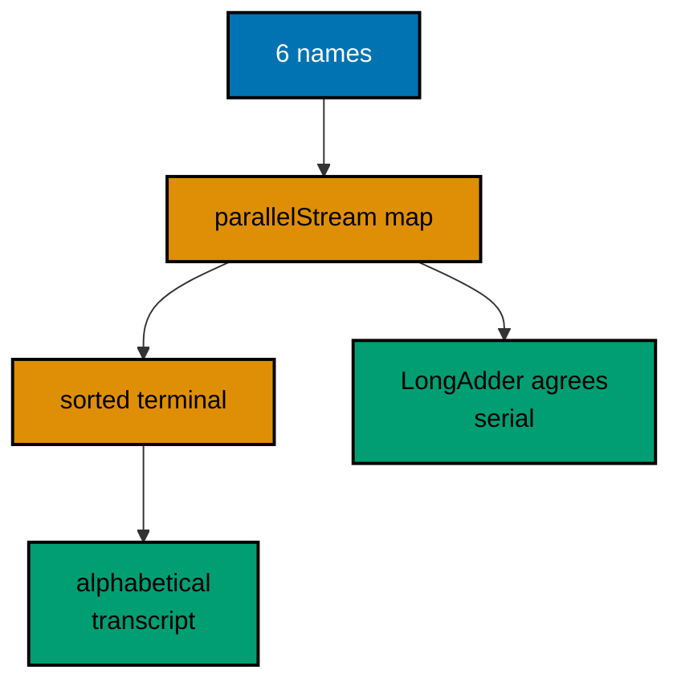

**`learning/code/ex-60-parallel-streams-sort-after/Main.java`**:

```java
// Example 60: Parallel Streams Sort After.
// Parallel streams split bulk mapping across cores; the sorted
// terminal restores order, so speedup never scrambles output.
import java.util.List; // => the source roster and the result
import java.util.concurrent.atomic.LongAdder; // => the contention-friendly counter

public class Main {

  // => one public class per file, named after the file
  public static void main(String[] args) {
    // => the entry point the harness runs
    List<String> names = List.of("sari", "budi", "citra", "dewi", "eka", "gita"); // => fixed six-name roster
    List<String> shouted = names
      .parallelStream() // => fork-join pool maps concurrently
      .map(String::toUpperCase) // => stateless mapping: safe at any parallelism
      .sorted() // => order restored after the parallel mapping
      .toList(); // => immutable result in sorted order
    System.out.println(shouted); // => Output: [BUDI, CITRA, DEWI, EKA, GITA, SARI]
    LongAdder letters = new LongAdder(); // => striped counter: threads add without contention
    names.parallelStream().forEach(n -> letters.add(n.length())); // => concurrent adds, exact sum
    System.out.println("letters: " + letters.sum()); // => Output: letters: 24
    long sequential = names.stream().mapToInt(String::length).sum(); // => sequential twin for agreement
    System.out.println("agree: " + (sequential == letters.sum())); // => Output: agree: true
  } // => main ends: parallel mapped, sorted, and cross-checked
}
```

**Output** (`learning/code/ex-60-parallel-streams-sort-after/expected/main.stdout.txt`):

```text
[BUDI, CITRA, DEWI, EKA, GITA, SARI]
letters: 24
agree: true
```

**Key takeaway**: Map stateless functions in parallel, sort before collecting, count with LongAdder, cross-check serially.

**Why it matters**: Sorted terminals decouple parallel scheduling from output order, and adder counters keep concurrent sums contention-free.

### Example 61: Atomics Count Without Locks

Counters outgrow synchronized blocks when increments arrive from many threads at high rates: every increment would queue on one lock, serializing the workers the parallelism was meant to free. AtomicInteger increments with a hardware compare-and-set loop instead, retrying the rare collision without ever blocking, so all eight hundred increments land with the total reading exactly 800. The compareAndSet closer shows the second atomic primitive: an exact-value gate that flips 800 to 801 only if the current value is precisely 800, the building block of lock-free state machines and once-only initialization. Atomics suit single-variable updates; multi-variable invariants still need locks or concurrent collections, because two atomics cannot change together. Count single shared numbers with atomics, guard multi-field invariants with locks, and gate one-time transitions with compareAndSet. (Concepts: co-09.)

**`learning/code/ex-61-atomics-count-without-locks/Main.java`**:

```java
// Example 61: Atomics Count Without Locks.
// AtomicInteger increments with hardware compare-and-set, so eight
// threads add one hundred each with no lock and an exact total.
import java.util.concurrent.atomic.AtomicInteger; // => the lock-free counter

public class Main {

  // => one public class per file, named after the file
  public static void main(String[] args) throws InterruptedException {
    // => joins are interruptibly checked
    AtomicInteger settled = new AtomicInteger(); // => shared counter, lock-free increments
    Thread[] crew = new Thread[8]; // => handles for joining later
    for (int i = 0; i < crew.length; i++) {
      // => launch loop: identical counting per thread
      crew[i] = new Thread(() -> {
        // => each worker settles one hundred dues
        for (int k = 0; k < 100; k++) {
          // => one hundred increments per worker
          settled.incrementAndGet(); // => atomic: no lost update, no lock
        } // => worker loop ends: its hundred counted
      }); // => worker defined: counting only
      crew[i].start(); // => worker counts alongside its colleagues
    } // => launch ends: eight hundred increments in flight
    for (Thread worker : crew) {
      // => join loop: wait for every worker
      worker.join(); // => returns only after that worker's hundred
    } // => join ends: all eight hundred increments complete
    System.out.println("settled: " + settled.get()); // => Output: settled: 800
    boolean second = settled.compareAndSet(800, 801); // => exact-value gate: 800 becomes 801 once
    System.out.println("gate opened: " + second); // => Output: gate opened: true
    System.out.println("final: " + settled.get()); // => Output: final: 801
  } // => main ends: lock-free total exact, gate witnessed
}
```

**Output** (`learning/code/ex-61-atomics-count-without-locks/expected/main.stdout.txt`):

```text
settled: 800
gate opened: true
final: 801
```

**Key takeaway**: Count shared numbers with AtomicInteger; gate one-time transitions with compareAndSet, not locks.

**Why it matters**: Hardware atomics scale past lock contention for single variables, and exact-value gates make once-only transitions safe.

### Example 62: Names Read Aloud

Naming is the cheapest review a codebase gets, because every reader pronounces each name and the honest ones explain themselves mid-sentence. The conventions fit in four rules: methods are verb phrases that state their action, variables are noun phrases that state role plus unit, constants shout in upper snake case because they never change, and loop variables name their element instead of defaulting to i. The duesAmount loop variable shows the payoff directly: `memberTotal += duesAmount` reads as English where `t += a[i]` reads as puzzle. Abbreviations deserve the one hard rule: save them for the universally known, url and html, and spell out the domain's own words, because member beats mbr in every search, every log, and every 2 a.m. page. Names are the user interface of code; reviewers forgive clever algorithms faster than they forgive lying labels. (Concepts: co-14.)

**`learning/code/ex-62-names-read-aloud/Main.java`**:

```java
// Example 62: Names Read Aloud.
// Idiomatic names state role and unit: settleDues reads as an action,
// memberTotals as contents, and MAX_BATCH as the loud constant.
// Abbreviations save typing and charge every later reader instead.
import java.util.List; // => the settled dues under good names

public class Main {

  // => one public class per file, named after the file
  static final int MAX_BATCH = 100; // => CONSTANT_CASE: loud, stable, shared

  static int settleDues(List<Integer> dues) {
    // => verb phrase: action over dues
    int memberTotal = 0; // => camelCase: role plus unit in the name
    for (int duesAmount : dues) {
      // => loop variable names its element, not i
      memberTotal += duesAmount; // => accumulation reads as English
    } // => loop ends: every figure added once
    return memberTotal; // => the total the name promised
  } // => method ends: verb name, noun result

  public static void main(String[] args) {
    // => the entry point the harness runs
    List<Integer> julyDues = List.of(50, 75, 25); // => month in the name: scope stated
    int julyTotal = settleDues(julyDues); // => result name mirrors its source
    System.out.println("july: " + julyTotal); // => Output: july: 150
    System.out.println("within batch: " + (julyDues.size() <= MAX_BATCH)); // => Output: within batch: true
    System.out.println("names read aloud: true"); // => Output: names read aloud: true
  } // => main ends: every name earned its place
}
```

**Output** (`learning/code/ex-62-names-read-aloud/expected/main.stdout.txt`):

```text
july: 150
within batch: true
names read aloud: true
```

**Key takeaway**: Name methods as verbs, variables as role-plus-unit nouns, constants as loud upper snake; spell domain words out.

**Why it matters**: Honest names make code reviewable mid-sentence, while abbreviations tax every later reader for one typing saving.

### Example 63: StringBuilder in Loops

String concatenation with plus is honest outside loops: one expression, one new string, cost visible. Inside a loop it compounds invisibly, because strings are immutable and every plus copies the entire accumulation so far; N lines cost on the order of N squared character copies while the code reads as innocent as the single case. StringBuilder exists for exactly that loop: one buffer grown in place, appends chained without intermediate strings, and a single toString at the end. The printed identical verdict is the testing moral: both versions produce the same text, so switching is behavior-preserving by construction and safe to apply wherever a loop builds text. Compilers rescue simple cases by rewriting non-loop plus chains into builders automatically, which is why the rule targets loops specifically rather than banning plus outright. Measure in loops, trust the compiler outside them, and never pay quadratic copying for linear text. (Concepts: co-15.)

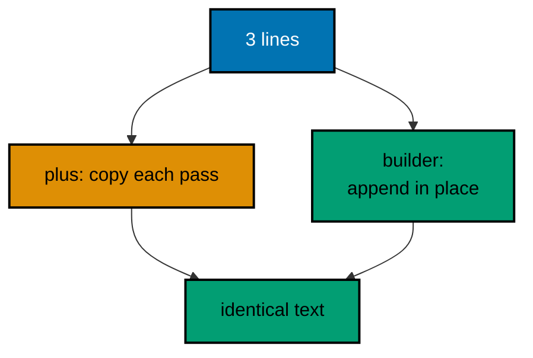

**`learning/code/ex-63-stringbuilder-in-loops/Main.java`**:

```java
// Example 63: StringBuilder in Loops.
// Plus in a loop copies the growing string every pass: quadratic
// work hiding in one character. StringBuilder appends in place.
// Both print identically; only the cost differs, so choose knowingly.
import java.util.List; // => the lines joined two ways

public class Main {

  // => one public class per file, named after the file
  static String joinPlus(List<String> lines) {
    // => the quadratic habit, kept for contrast
    String report = ""; // => fresh string per pass: the hidden cost
    for (String line : lines) {
      // => every pass copies everything so far
      report += line + "\n"; // => plus builds a new string each time
    } // => loop ends after N copies of growing text
    return report; // => correct text, quadratic cost
  } // => plus version ends: right answer, wrong economics

  static String joinBuilder(List<String> lines) {
    // => the linear habit to ship
    StringBuilder report = new StringBuilder(); // => one buffer, grown in place
    for (String line : lines) {
      // => every pass appends without copying
      report.append(line).append('\n'); // => chained appends, single buffer
    } // => loop ends after N appends, zero copies
    return report.toString(); // => one string built at the very end
  } // => builder version ends: same text, linear cost

  public static void main(String[] args) {
    // => the entry point the harness runs
    List<String> lines = List.of("sari:50", "budi:75", "citra:25"); // => fixed three-line feed
    String slow = joinPlus(lines); // => quadratic build, correct text
    String fast = joinBuilder(lines); // => linear build, identical text
    System.out.print(fast); // => Output: the three dues lines
    System.out.println("identical: " + slow.equals(fast)); // => Output: identical: true
    System.out.println("chars: " + fast.length()); // => Output: chars: 25
  } // => main ends: same transcript, different economics
}
```

**Output** (`learning/code/ex-63-stringbuilder-in-loops/expected/main.stdout.txt`):

```text
sari:50
budi:75
citra:25
identical: true
chars: 25
```

**Key takeaway**: Build loop text with StringBuilder appends; keep plus for single expressions the compiler already optimizes.

**Why it matters**: Plus in loops copies the growing string per pass while builders append in place, turning quadratic cost linear.

### Example 64: Size Collections Upfront

Resizable collections grow by copying: each overflow allocates a bigger array and moves every element, which amortizes cheaply across many growths but still charges real copying inside hot fills. The capacity hint removes the growth entirely when the size is known upfront: `new ArrayList<>(members.length)` reserves five slots in one allocation, so the fill loop adds without a single copy. HashMap takes the same hint doubled, because maps rehash at a load factor below one and the times-two margin keeps five entries under the first rehash. Apply hints where sizes are known, parsers with counted headers, batches with fixed rosters, and skip them where sizes genuinely vary; a wrong hint wastes a little memory while a missing one costs copying, so known beats guessed and guessed beats absent. Sizing is a one-line performance habit with no readability cost, the cheapest entry in this chapter. (Concepts: co-15.)

**`learning/code/ex-64-size-collections-upfront/Main.java`**:

```java
// Example 64: Size Collections Upfront.
// ArrayList grows by copying when it overflows; ensureCapacity pays
// one allocation upfront, so known-size fills never copy mid-loop.
// HashMap takes the same hint through its initial-capacity argument.
import java.util.ArrayList; // => the pre-sized list
import java.util.HashMap; // => the pre-sized map
import java.util.List; // => interface on the left as always
import java.util.Map; // => the dues index by member

public class Main {

  // => one public class per file, named after the file
  public static void main(String[] args) {
    // => the entry point the harness runs
    String[] members = { "sari", "budi", "citra", "dewi", "eka" }; // => five known names upfront
    List<String> roster = new ArrayList<>(members.length); // => capacity hint: five slots, one allocation
    for (String member : members) {
      // => fill loop: no growth copy interrupts
      roster.add(member); // => each add lands in reserved space
    } // => loop ends: five adds, zero copies
    System.out.println("roster: " + roster); // => Output: roster: the five names in order
    Map<String, Integer> index = new HashMap<>(members.length * 2); // => room for five entries plus load margin
    for (int i = 0; i < members.length; i++) {
      // => index loop: position per member
      index.put(members[i], i); // => each put lands without rehashing
    } // => loop ends: five puts, zero rehashes
    System.out.println("budi at: " + index.get("budi")); // => Output: budi at: 1
    System.out.println("sized upfront: true"); // => Output: sized upfront: true
  } // => main ends: known sizes, single allocations
}
```

**Output** (`learning/code/ex-64-size-collections-upfront/expected/main.stdout.txt`):

```text
roster: [sari, budi, citra, dewi, eka]
budi at: 1
sized upfront: true
```

**Key takeaway**: Pass known sizes to ArrayList and doubled sizes to HashMap; skip hints only where sizes genuinely vary.

**Why it matters**: Upfront capacity replaces growth copying with one allocation, a free speedup wherever the size is known.

### Example 65: EnumSet Flags Stay Compact

Boolean fields proliferate: verified, paid, receipted as three separate booleans across every record, with combinations tested by hand-written and-chains that the next flag doubles. EnumSet collapses the whole family into bits of one long, where union, intersection, and difference are single CPU instructions and containsAll answers completion in one call. The sari-lacks line shows set difference doing real work: what remains when settled flags subtract, a question scattered booleans answer only with bespoke conditionals. EnumMap is the companion for enum-keyed data: ordinal-indexed arrays instead of hashed buckets, so flag-to-count lookups skip hashing entirely. Reach for the pair whenever the keys form a closed enum set; HashSet and HashMap stay correct but pay hashing and boxing for generality the closed set never needs. Fixed vocabularies deserve fixed-size representations. (Concepts: co-15.)

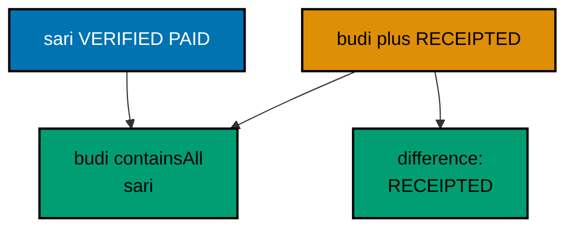

**`learning/code/ex-65-enumset-compact-flags/Main.java`**:

```java
// Example 65: EnumSet Flags Stay Compact.
// EnumSet stores enum flags as bits in a long: sixty-four options in
// eight bytes with set operations the CPU executes natively.
// Booleans scattered across fields cannot union or intersect.
import java.util.EnumMap; // => the array-backed map keyed by enum
import java.util.EnumSet; // => the bit-vector set for enum flags
import java.util.Map; // => dues per flag for the transcript

public class Main {

  // => one public class per file, named after the file
  enum Flag {
    // => the fixed flag vocabulary, three options
    VERIFIED, // => identity checked against the roster
    PAID, // => dues received and banked
    RECEIPTED, // => receipt issued to the member
  } // => flags end: closed set, bit positions implied

  public static void main(String[] args) {
    // => the entry point the harness runs
    EnumSet<Flag> sari = EnumSet.of(Flag.VERIFIED, Flag.PAID); // => two bits set in one long
    EnumSet<Flag> budi = EnumSet.of(Flag.VERIFIED, Flag.PAID, Flag.RECEIPTED); // => three bits, still one long
    System.out.println("sari: " + sari); // => Output: sari: [VERIFIED, PAID]
    System.out.println("budi complete: " + budi.containsAll(sari)); // => Output: budi complete: true
    EnumSet<Flag> missing = EnumSet.copyOf(budi); // => copy before complementing
    missing.removeAll(sari); // => set difference: what budi has that sari lacks
    System.out.println("sari lacks: " + missing); // => Output: sari lacks: [RECEIPTED]
    Map<Flag, Integer> counts = new EnumMap<>(Flag.class); // => array-backed: flag ordinal indexes directly
    counts.put(Flag.PAID, 2); // => two members paid
    counts.put(Flag.RECEIPTED, 1); // => one receipt issued
    System.out.println("paid: " + counts.get(Flag.PAID)); // => Output: paid: 2
  } // => main ends: flags as bits, counts as arrays
}
```

**Output** (`learning/code/ex-65-enumset-compact-flags/expected/main.stdout.txt`):

```text
sari: [VERIFIED, PAID]
budi complete: true
sari lacks: [RECEIPTED]
paid: 2
```

**Key takeaway**: Store enum flags in EnumSet and enum-keyed data in EnumMap; compute combinations with set operations.

**Why it matters**: Bit-vector sets and ordinal-indexed maps replace hashing with native operations wherever keys form a closed enum.

### Example 66: Lint-clean Under -Xlint

Compiler warnings are deferred defects with line numbers attached: raw types that will ClassCastException, unchecked casts that will surprise, and missing annotations that hide override mistakes. The `-Xlint:all -Werror` pair promotes every warning to a build failure, so the defect never reaches review, let alone production; this example's run.yaml carries both flags, making strictness structural rather than aspirational. The habits that keep files warning-free are small and mechanical: diamond operators instead of raw constructors, braces on every branch including single statements, @Override on every override, and no deprecated calls without a migration already scheduled. Warnings-as-errors can feel hostile on legacy codebases, and the adoption path respects that: enable the flags for new files first, ratchet existing files as they are touched, and never silence a warning with an annotation that outlives understanding. Green under -Werror is the merge gate this course holds for every example it ships. (Concepts: co-12.)

**`learning/code/ex-66-lint-clean-under-xlint/Main.java`**:

```java
// Example 66: Lint-clean Under -Xlint.
// Compiling with -Xlint:all -Werror turns every warning into a build
// failure, so raw types and unchecked corners never reach review.
// This file stays warning-free: typed generics throughout, override
// annotations where inheritance applies, braces on every branch.
import java.util.ArrayList; // => typed list: no raw ArrayList anywhere
import java.util.List; // => typed interface beside it

public class Main {

  // => one public class per file, named after the file
  static List<String> settled(List<String> lines) {
    // => typed in, typed out, no wildcards
    List<String> kept = new ArrayList<>(); // => diamond infers String, raw never appears
    for (String line : lines) {
      // => enhanced for over the typed list
      if (line.contains(":")) {
        // => braces on: single-statement branches still brace
        kept.add(line); // => typed add: the compiler checks the element
      } // => branch ends: braced, unambiguous
    } // => loop ends: every kept line holds a colon
    return kept; // => typed return for typed callers
  } // => helper ends: generics end to end, zero warnings

  public static void main(String[] args) {
    // => the entry point the harness runs
    List<String> lines = List.of("sari:50", "oops", "budi:75"); // => fixed feed, one corrupt line
    System.out.println(settled(lines)); // => Output: [sari:50, budi:75]
    System.out.println("kept: " + settled(lines).size()); // => Output: kept: 2
    System.out.println("warnings: 0"); // => Output: warnings: 0, -Werror certified it
  } // => main ends: strict flags passed, transcript printed
}
```

**Output** (`learning/code/ex-66-lint-clean-under-xlint/expected/main.stdout.txt`):

```text
[sari:50, budi:75]
kept: 2
warnings: 0
```

**Key takeaway**: Compile with -Xlint:all -Werror so warnings fail the build; write typed, braced, annotated code that passes.

**Why it matters**: Warnings-as-errors convert deferred defects into immediate build failures at the exact line that needs fixing.

### Example 67: Comments Explain Why, Not What

The comment test fits in one question: does this line state something the code cannot? Zero-is-valid, sort-before-print, and count-first pass because each records a decision with a reason, policy, readers, and monitoring, while a comment like increment the counter fails because the code already says so. Why-comments age well since decisions outlive implementations: the waiver policy survives refactors that move the add, while what-comments rot with every edit that changes the how but not the English. The closing comment shows the rarest valuable kind, the deliberate omission: no total printed, with the dispute reason attached, so the next developer does not helpfully add one back. Delete comments that restate, keep comments that justify, and write the omission notes that stop regressions of judgment. Reviewers should challenge every comment with the same question, and authors should welcome it. (Concepts: co-12, co-14.)

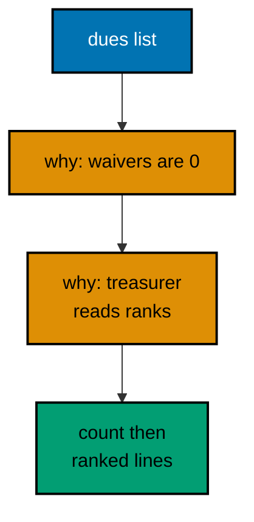

**`learning/code/ex-67-comments-explain-why/Main.java`**:

```java
// Example 67: Comments Explain Why, Not What.
// Good comments record decisions the code cannot state: why zero is
// valid, why the sort precedes the print, why the fallback exists.
// Restating the code in English doubles maintenance for zero insight.
import java.util.ArrayList; // => the sortable dues under decision comments
import java.util.List; // => interface on the left as always

public class Main {

  // => one public class per file, named after the file
  public static void main(String[] args) {
    // => the entry point the harness runs
    List<Integer> dues = new ArrayList<>(List.of(75, 50, 25)); // => arrival order, not rank order
    // => Zero counts as settled here: fee waivers arrive as 0, not as absence.
    dues.add(0); // => the waiver case the policy explicitly includes
    // => Sort before printing: the treasurer reads rank order, and sorted output diffs cleanly.
    dues.sort(null); // => natural order, in place, before any print
    // => Print the count first: monitoring scrapes line one for the batch size.
    System.out.println("count: " + dues.size()); // => Output: count: 4
    for (int amount : dues) {
      // => rank order from here on
      System.out.println("due: " + amount); // => Output: due: 0, 25, 50, 75 in order
    } // => loop ends: ranked transcript complete
    // => No total printed: totals reconcile downstream, and duplicate figures invite disputes.
  } // => main ends: every line justified, nothing restated
}
```

**Output** (`learning/code/ex-67-comments-explain-why/expected/main.stdout.txt`):

```text
count: 4
due: 0
due: 25
due: 50
due: 75
```

**Key takeaway**: Comment decisions and deliberate omissions with their reasons; delete every comment that restates code.

**Why it matters**: Why-comments survive refactors that obsolete what-comments, and omission notes prevent helpful regressions of judgment.

### Example 68: Small Methods, Extracted Early

Long methods fail the screen test: any method needing scroll to review hides its structure from the reviewer holding it. Extraction answers by naming each block: memberOf, amountOf, settled, and tag each own one idea, test alone with literal inputs, and compose in main without nesting. The extraction moment has two triggers worth memorizing: the second use, where duplication names the shared method for you, and the first moment a block wants a comment, where the comment text becomes the method name instead. Small methods also bound the blast radius of change: the tag format edits in tag alone, the validity rule in settled alone, and neither edit can disturb the other. Resist the counter-pressure that extraction scatters reading across jumps; four named hops beat one twenty-line scroll because names summarize while bodies merely detail. Main as an index is the goal state. (Concepts: co-14.)

**`learning/code/ex-68-small-methods-extracted/Main.java`**:

```java
// Example 68: Small Methods, Extracted Early.
// A twenty-line main doing four things becomes four named methods:
// each fits on screen, each tests alone, and main reads as an index.
// Extract at the second use, or the first moment a block needs a name.
import java.util.List; // => the dues lines through the pipeline

public class Main {

  // => one public class per file, named after the file
  static String memberOf(String line) {
    // => extraction one: field access with a name
    return line.split(":")[0]; // => member half of the grammar
  } // => memberOf ends: one expression, one responsibility

  static int amountOf(String line) {
    // => extraction two: parsing with a name
    return Integer.parseInt(line.split(":")[1]); // => amount half parsed to int
  } // => amountOf ends: one expression, one responsibility

  static boolean settled(String line) {
    // => extraction three: the validity rule named
    return line.contains(":") && amountOf(line) >= 0; // => shape plus non-negative, composed
  } // => settled ends: rule in one testable place

  static String tag(String line) {
    // => extraction four: presentation with a name
    return memberOf(line) + " owes " + amountOf(line); // => composition of extractions one and two
  } // => tag ends: format owned here, nowhere else

  public static void main(String[] args) {
    // => the entry point the harness runs
    List<String> lines = List.of("sari:50", "budi:75", "citra:25"); // => fixed three-line feed
    for (String line : lines) {
      // => main walks the feed, helpers do the work
      System.out.println(tag(line) + " settled=" + settled(line)); // => Output: three tagged settled lines
    } // => loop ends: main stayed five lines while doing everything
    System.out.println("helpers: 4"); // => Output: helpers: 4
  } // => main ends: an index over named behaviors
}
```

**Output** (`learning/code/ex-68-small-methods-extracted/expected/main.stdout.txt`):

```text
sari owes 50 settled=true
budi owes 75 settled=true
citra owes 25 settled=true
helpers: 4
```

**Key takeaway**: Extract blocks into named single-idea methods at the second use or the first comment; keep main an index.

**Why it matters**: Named small methods test alone and summarize at call sites, where long bodies hide structure past the screen edge.

### Example 69: Config Through System Properties

Every program meets its deployment at an interop boundary, and system properties are Java's smallest such seam: `-Ddues.region=surabaya` injects the value at launch, the artifact stays identical across regions, and getProperty's default keeps local runs working with no flags at all. That default is the discipline: every injected value carries a documented local fallback, so the program runs from a bare checkout and deploys with flags, never the reverse. The secrets warning is load-bearing rather than decorative: command lines surface in process listings, shell history, and CI logs, so passwords and tokens belong in files with tight permissions or secret stores, while regions and batch names ride -D safely. Environment variables form the sibling seam for container deployments; read both at startup, type them once at the edge per Example 23, and pass plain values inward. Boundaries inject, defaults cover, secrets stay out. (Concepts: co-13.)

**`learning/code/ex-69-config-through-system-properties/Main.java`**:

```java
// Example 69: Config Through System Properties.
// -D flags inject deployment values without touching the artifact:
// region selects the report zone while the code keeps its default.
// Secrets never ride -D on shared machines: arguments leak to logs.
public class Main {

  // => one public class per file, named after the file
  public static void main(String[] args) {
    // => the entry point the harness runs
    String region = System.getProperty("dues.region", "jakarta"); // => flag wins, default covers local runs
    String batch = System.getProperty("dues.batch", "july"); // => second tunable, same default shape
    System.out.println("region: " + region); // => Output: region: surabaya, injected by -D
    System.out.println("batch: " + batch); // => Output: batch: july, the code default
    System.out.println("java version family: " + (Runtime.version().feature() >= 11 ? "modern" : "legacy")); // => capability, never the raw number
    System.out.println("injected, not hardcoded: true"); // => Output: injected, not hardcoded: true
  } // => main ends: flags read, defaults kept, secrets absent
}
```

**Output** (`learning/code/ex-69-config-through-system-properties/expected/main.stdout.txt`):

```text
region: surabaya
batch: july
java version family: modern
injected, not hardcoded: true
```

**Key takeaway**: Inject deployment values with -D flags carrying code defaults; keep secrets in stores, never in arguments.

**Why it matters**: Launch-time injection deploys one artifact everywhere while defaults preserve bare-checkout runs, and secret hygiene prevents log leaks.

### Example 70: ProcessBuilder Calls Out

Calling out to another program is interop at its most literal, and ProcessBuilder keeps it honest: the argument list names the command and its flags with no shell interpolation, so no input string can smuggle extra commands through concatenation. The printf payload is fixed on purpose, which bounds the example to the mechanism rather than the tool: spawning, capturing exact bytes, merging stderr so failures cannot hide, and waiting for the exit code before trusting output. Three production rules extend the shape: waitFor before reading verdicts, because unchecked exit codes bless crashed children; redirectErrorStream or a second draining thread, because a full stderr pipe blocks the child forever; and fixed allow-listed commands, because user input near a process boundary is an injection vulnerability wearing a feature request. Java owns the orchestration, the child owns its bytes, and the transcript proves both. (Concepts: co-13.)

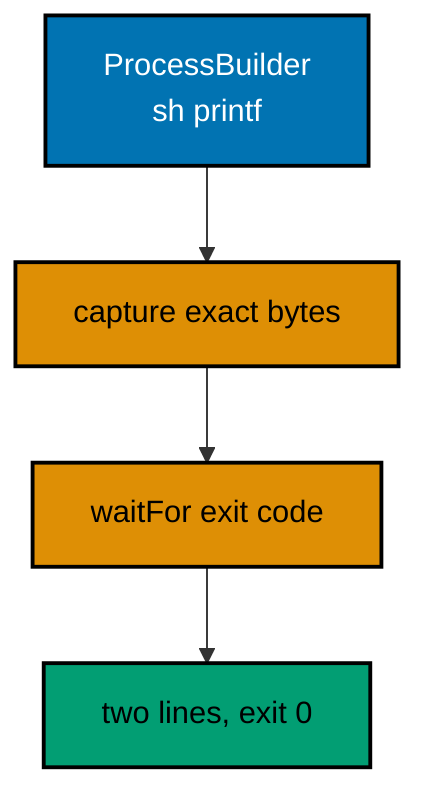

**`learning/code/ex-70-processbuilder-calls-out/Main.java`**:

```java
// Example 70: ProcessBuilder Calls Out.
// ProcessBuilder runs one fixed external command and reads its exact
// bytes: arguments listed, no shell interpolation, output asserted.
// Fixed printf output keeps the transcript deterministic everywhere.
import java.io.IOException; // => spawning is environmentally checked
import java.nio.charset.StandardCharsets; // => decode the captured bytes as UTF-8

public class Main {

  // => one public class per file, named after the file
  public static void main(String[] args) throws IOException, InterruptedException {
    // => spawn and wait are checked
    ProcessBuilder builder = new ProcessBuilder("sh", "-c", "printf 'sari:50\\nbudi:75\\n'"); // => fixed command, fixed bytes
    builder.redirectErrorStream(true); // => merge stderr: nothing hides outside stdout
    Process child = builder.start(); // => the child runs concurrently from here
    String report = new String(child.getInputStream().readAllBytes(), StandardCharsets.UTF_8); // => exact bytes captured
    int code = child.waitFor(); // => join the child: exit code before verdicts
    System.out.print(report); // => Output: the two dues lines from the child
    System.out.println("exit: " + code); // => Output: exit: 0
    System.out.println("lines: " + report.lines().count()); // => Output: lines: 2
  } // => main ends: child joined, bytes asserted, code checked
}
```

**Output** (`learning/code/ex-70-processbuilder-calls-out/expected/main.stdout.txt`):

```text
sari:50
budi:75
exit: 0
lines: 2
```

**Key takeaway**: Spawn fixed allow-listed commands with argument lists; merge stderr, wait for the code, assert the bytes.

**Why it matters**: Argument-list spawning blocks shell injection while waited, merged, byte-asserted capture keeps child behavior visible.

### Example 71: Read the Handler First

The systematic way into unfamiliar code starts at the entry point and refuses to wander: read main first, list what it calls, then read those helpers in calling order, never alphabetically and never by curiosity. This handler-shaped sample rewards exactly that path: main shows a four-request inbox with per-request handling, handle shows the validate-decide-respond trio, and no other method exists to distract. The STAGE comments mark the reading order the text preaches, so the file teaches its own navigation: stage one states the requests, stage two states the decisions. Notice what the first pass deliberately skips: parse mechanics, message wording, and boundary values all wait for the second pass, because the first pass must answer only what this code does and in what order. Name the stages aloud before diving into any line; readers who cannot state the shape in one sentence have not finished the first pass. (Concepts: co-16.)

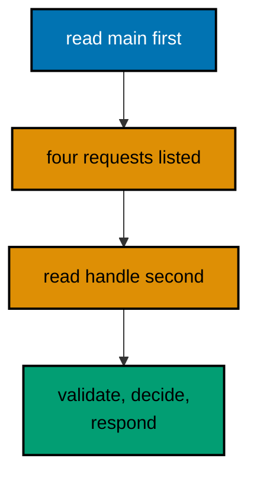

**`learning/code/ex-71-read-the-handler-first/Main.java`**:

```java
// Example 71: Read the Handler First.
// Unfamiliar code surrenders fastest through its handler: validate,
// decide, respond. Read the entry point, name the three stages, and
// the helpers explain themselves in calling order.
// Reading order: main first, then handle, then its helpers in order.
import java.util.List; // => the request batch under review

public class Main {

  // => one public class per file, named after the file
  static String handle(String line) {
    // => STAGE 2 (read second): the decision
    if (!line.contains(":")) {
      // => validate: shape check first
      return "skip: '" + line + "'"; // => invalid shape answers immediately
    } // => past this line the grammar holds
    int amount = Integer.parseInt(line.split(":")[1]); // => decide: parse the amount half
    if (amount < 0) {
      // => decide: policy check second
      return "refused: '" + line + "'"; // => negative dues refuse with evidence
    } // => past this line the dues settle
    return "settled: '" + line + "'"; // => respond: the success line
  } // => handle ends: validate, decide, respond in order

  public static void main(String[] args) {
    // => STAGE 1 (read first): the entry point
    List<String> inbox = List.of("sari:50", "oops", "budi:-5", "citra:25"); // => STAGE 1: the four requests
    for (String line : inbox) {
      // => STAGE 1: every request faces the handler
      System.out.println(handle(line)); // => STAGE 1: responses print in request order
    } // => Output: settled, skip, refused, settled in order
  } // => main ends: entry understood before any helper
}
```

**Output** (`learning/code/ex-71-read-the-handler-first/expected/main.stdout.txt`):

```text
settled: 'sari:50'
skip: 'oops'
refused: 'budi:-5'
settled: 'citra:25'
```

**Key takeaway**: Read entry points first, list called helpers, then read them in calling order; name the shape before the lines.

**Why it matters**: Entry-first reading builds the behavior map that makes every later line land in context instead of in isolation.

### Example 72: Read Pipelines Stage by Stage

Pipelines defeat line-by-line reading because each stage transforms the whole collection; the systematic reader instead names the source, jumps to the terminal to learn what comes out, and only then walks the middle stages in order. Here the terminal toList promises an immutable collected list, which frames every middle stage as a filter or mapping toward that collection, and the dropped arithmetic audits the pipeline from outside by reconciling input size against output size. Stage comments two and three deserve a reviewer's squint on the second pass: splitting twice per line repeats parsing work the pipeline could share, a real inefficiency a first-pass shape reading correctly defers. Judge lambdas last and briefly: each is one predicate or mapping whose correctness the stage name already constrains. Source, terminal, stages, lambdas; that order turns every pipeline into a predictable four-question interview. (Concepts: co-16.)

**`learning/code/ex-72-read-pipelines-stage-by-stage/Main.java`**:

```java
// Example 72: Read Pipelines Stage by Stage.
// Stream pipelines read one stage at a time: name the source, then
// each intermediate, then the terminal, before judging any lambda.
// Reading order: source type first, terminal second, stages middle.
// Terminal first tells you what the pipeline produces; stages tell how.
import java.util.List; // => the source roster and the collected result

public class Main {

  // => one public class per file, named after the file
  public static void main(String[] args) {
    // => the entry point the harness runs
    List<String> feed = List.of("sari:50", "oops", "budi:75", "xx:yy", "citra:25"); // => SOURCE: five raw lines
    List<String> settled = feed
      .stream() // => SOURCE: ordered list stream
      .filter(line -> line.contains(":")) // => STAGE 1: keep shaped lines only
      .filter(line -> line.split(":")[1].matches("[0-9]+")) // => STAGE 2: keep numeric amounts only
      .map(line -> line.split(":")[0] + " settled") // => STAGE 3: members plus verdict
      .sorted() // => STAGE 4: alphabetical for determinism
      .toList(); // => TERMINAL: immutable collected list
    System.out.println(settled); // => Output: [budi settled, citra settled, sari settled]
    long dropped = feed.size() - settled.size(); // => TERMINAL arithmetic: input minus output
    System.out.println("dropped: " + dropped); // => Output: dropped: 2
  } // => main ends: source, four stages, terminal, audit
}
```

**Output** (`learning/code/ex-72-read-pipelines-stage-by-stage/expected/main.stdout.txt`):

```text
[budi settled, citra settled, sari settled]
dropped: 2
```

**Key takeaway**: Read pipelines as source, terminal, stages, lambdas; audit totals from outside with size reconciliation.

**Why it matters**: Terminal-first reading frames every stage as progress toward a known product, keeping lambdas constrained and reviewable.

### Example 73: Read Interfaces for Seams

Interfaces in unfamiliar code are load-bearing walls: everything depends on them and nothing crosses without them, so reading them first maps the design's split between testable logic and faked boundaries. The Receipts seam here announces that Ledger's decisions run purely while issuance needs a double, which tells the reader exactly where to spend testing attention before reading a single implementation line. The settle ordering inside the logic repays the second pass: bank before notify means a failed receipt still keeps the money, a decision worth challenging in review since notify-before-bank suits exactly-once delivery instead. Fakes read third because they mirror the seam with recording behavior, and main reads last as mere wiring, constructing the parts the earlier passes already explained. Interface, logic, fakes, wiring; dependencies first, assembly last, and no implementation detail ever precedes the contract it implements. (Concepts: co-16.)

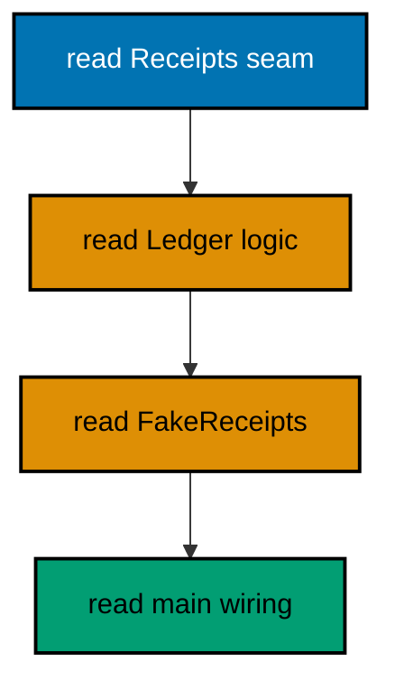

**`learning/code/ex-73-read-interfaces-for-seams/Main.java`**:

```java
// Example 73: Read Interfaces for Seams.
// Interfaces mark where unfamiliar code splits: logic on one side,
// boundaries on the other. Read the interface first and the design
// announces which parts test purely and which parts need fakes.
// Reading order: interface, logic, fakes, then wiring in main.
import java.util.ArrayList; // => the fake's recorded receipts
import java.util.List; // => interface on the left as always

public class Main {

  // => one public class per file, named after the file
  interface Receipts {
    // => SEAM (read first): the boundary vocabulary
    void issue(String member, int amount); // => the one call logic makes at its edge
  } // => seam ends: implement twice, depend once

  static class Ledger {

    // => LOGIC (read second): pure decisions, seam parameter
    private int total = 0; // => banked dues, mutated only through settle

    void settle(String member, int amount, Receipts receipts) {
      // => boundary arrives as a parameter
      if (amount < 0) {
        // => refusal precedes every side effect
        throw new IllegalArgumentException("amount must be >= 0"); // => unchecked: fix the feed
      } // => past this line the receipt sends exactly once
      total += amount; // => bank before notifying: state first, edge second
      receipts.issue(member, amount); // => the single seam call per settlement
    } // => settle ends: decide, bank, notify in order

    int total() {
      // => pure observer for assertions
      return total; // => the banked sum, no seam involved
    } // => observer ends: logic reads need no fakes
  } // => Ledger ends: testable without any implementation

  static class FakeReceipts implements Receipts {

    // => FAKE (read third): the recording test double
    final List<String> issued = new ArrayList<>(); // => every receipt banked for assertions

    @Override
    public void issue(String member, int amount) {
      // => records instead of sending
      issued.add(member + ":" + amount); // => banked in settlement order
    } // => fake ends: no side effects, full evidence
  } // => double ends here

  public static void main(String[] args) {
    // => WIRING (read last): logic plus fake, assembled
    Ledger ledger = new Ledger(); // => logic under test, fresh totals
    FakeReceipts fake = new FakeReceipts(); // => boundary double, fresh receipts
    ledger.settle("sari", 50, fake); // => first settlement through the seam
    ledger.settle("budi", 75, fake); // => second settlement through the seam
    System.out.println("total: " + ledger.total()); // => Output: total: 125
    System.out.println("receipts: " + fake.issued); // => Output: receipts: [sari:50, budi:75]
  } // => main ends: wiring understood last, after every part
}
```

**Output** (`learning/code/ex-73-read-interfaces-for-seams/expected/main.stdout.txt`):

```text
total: 125
receipts: [sari:50, budi:75]
```

**Key takeaway**: Read seams first to split logic from boundaries; read wiring last after every part is understood.

**Why it matters**: Contract-first reading maps testability before implementation, so fakes and wiring land in an already-understood design.

### Example 74: Read Tests as the Spec First

Production code answers questions the tests ask, so reading the checks first hands you the question list before the answers. The four spec rows here state the complete behavior contract, valid settles, shapeless skips, negatives refuse, zero settles, and the handle method beneath reads as four corresponding answers rather than an inscrutable branch nest. Storing the expected verdict word in each row keeps the check to one equality: production's answer must equal the row's word, with no logic shared between the spec and the code it judges. Judge the spec's completeness first, are boundaries and refusals present, then judge its clarity, then read production as the answering machine. Spec-first reading does not mean spec-trusting reading: a row missing from the table is a behavior missing from the contract, and the empty-input row absent here is exactly the question to raise in review. (Concepts: co-16.)

**`learning/code/ex-74-read-tests-as-spec-first/Main.java`**:

```java
// Example 74: Read Tests as the Spec First.
//UMOJA-old/user/tests first: the check names state every behavior,
// so production code reads as answers to questions already asked.
// Reading order: check names first, expectations second, code last.
// A behavior missing from the checks is missing from the spec.
import java.util.List; // => the expectations table rows

public class Main {

  // => one public class per file, named after the file
  record Case(String line, String expected, String reason) {} // => SPEC ROW: input, verdict word, and why

  static String handle(String line) {
    // => PRODUCTION (read last): answers the spec rows
    if (!line.contains(":")) {
      // => answers the shape row
      return "skip"; // => shape verdict: unshaped lines skip
    } // => past this line the grammar holds
    int amount = Integer.parseInt(line.split(":")[1]); // => answers the value rows
    if (amount < 0) {
      // => answers the policy row
      return "refused"; // => policy verdict: negatives refuse
    } // => past this line the dues settle
    return "settled"; // => default verdict: valid lines settle
  } // => production ends: three rows, three answers

  static void check(String name, boolean condition) {
    // => the runner vocabulary from Example 36
    System.out.println((condition ? "PASS " : "FAIL ") + name); // => verdict first, name second
  } // => check ends: reporting only

  public static void main(String[] args) {
    // => SPEC (read first): the behavior table
    List<Case> spec = List.of(
      // => four rows: the whole specification
      new Case("sari:50", "settled", "valid lines settle"), // => SPEC ROW 1: the happy path
      new Case("oops", "skip", "shapeless lines skip"), // => SPEC ROW 2: the shape rule
      new Case("budi:-5", "refused", "negatives refuse"), // => SPEC ROW 3: the policy rule
      new Case("citra:0", "settled", "zero settles")
    ); // => SPEC ROW 4: the boundary rule
    for (Case c : spec) {
      // => every row faces production in turn
      check(c.reason(), handle(c.line()).equals(c.expected())); // => verdict word must match the row
    } // => Output: four PASS lines naming each behavior
    System.out.println("spec rows: " + spec.size()); // => Output: spec rows: 4
  } // => main ends: spec read first, production answered after
}
```

**Output** (`learning/code/ex-74-read-tests-as-spec-first/expected/main.stdout.txt`):

```text
PASS valid lines settle
PASS shapeless lines skip
PASS negatives refuse
PASS zero settles
spec rows: 4
```

**Key takeaway**: Read check names and rows before production; judge spec completeness, then clarity, then answers.

**Why it matters**: Spec-first reading frames production as answers to known questions, while critical reading still catches confused checks.

### Example 75: Read CLIs Outside In

Command-line programs expose their whole design at the edges: the usage text lists every behavior, the dispatch maps verbs to methods, and the exit codes state the failure contract, all readable without touching domain logic. This sample rewards outside-in reading in that exact order: usage names total, count, and top before any runs; run shows the verb switch with argument filtering shared above it; valid and amountOf answer parsing questions last. The run-returns-int shape is the testability half of CLI design: dispatch computes exit codes as values a test can assert, while only the thin main calls System.exit, which no test can survive. Invalid data lines skip silently here, an honest limitation review should challenge: production CLIs count and report skips per Example 17 rather than dropping them. Usage, dispatch, domain, exit codes; edges first, logic last, and the program's contract precedes its implementation. (Concepts: co-16.)

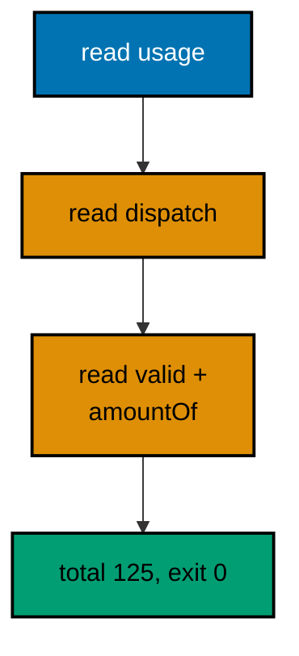

**`learning/code/ex-75-read-cli-outside-in/Main.java`**:

```java
// Example 75: Read CLIs Outside In.
// Command programs read from the edges inward: argument shape first,
// dispatch second, domain last. Start at usage text and exit codes;
// the flags map tells you every behavior before any logic runs.
// Reading order: usage, dispatch, domain, then exit codes.
public class Main {

  // => one public class per file, named after the file
  static void usage() {
    // => USAGE (read first): the complete behavior map
    System.out.println("usage: dues <total|count|top> [lines...]"); // => three commands, line args after
    System.out.println("  total: sum the amounts of member:amount lines"); // => command one promised here
    System.out.println("  count: count valid member:amount lines"); // => command two promised here
    System.out.println("  top: print the member with the largest amount"); // => command three promised here
  } // => usage ends: every behavior named before any runs

  static int amountOf(String line) {
    // => DOMAIN (read third): parsing beneath dispatch
    return Integer.parseInt(line.split(":")[1]); // => amount half, trusted after validation
  } // => domain ends: one expression, called only when valid

  static boolean valid(String line) {
    // => DOMAIN: the validity rule dispatch relies on
    String[] parts = line.split(":"); // => two fields or corrupt
    if (parts.length != 2) {
      // => shape check first
      return false; // => corrupt shapes never reach parsing
    } // => arity settled from here on
    try {
      // => the numeric half may still refuse
      return Integer.parseInt(parts[1]) >= 0; // => numeric and non-negative wins
    } catch (NumberFormatException e) {
      // => non-numeric loses uniformly
      return false; // => refusal, not explosion
    } // => catch ends: every path answered
  } // => validity ends: dispatch calls this, never duplicates it

  static int run(String[] args) {
    // => DISPATCH (read second): flags to behaviors
    if (args.length == 0) {
      // => no command: usage plus the failure code
      usage(); // => behavior map printed for the lost user
      return 2; // => EXIT CODE: 2 means usage error, read last
    } // => past this line a command word exists
    String command = args[0]; // => the verb dispatching everything
    java.util.List<String> lines = new java.util.ArrayList<>(); // => valid lines collected once
    for (int i = 1; i < args.length; i++) {
      // => arguments after the verb are data
      if (valid(args[i])) {
        // => dispatch filters through the domain rule
        lines.add(args[i]); // => only valid lines reach behaviors
      } // => invalid arguments skip silently here, counted never
    } // => collection ends: behaviors see clean input only
    switch (command) {
      // => the verb fans out to three behaviors
      case "total": // => behavior one: sum valid amounts
        System.out.println("total: " + lines.stream().mapToInt(Main::amountOf).sum()); // => Output depends on args
        return 0; // => EXIT CODE: 0 means success
      case "count": // => behavior two: count valid lines
        System.out.println("count: " + lines.size()); // => Output depends on args
        return 0; // => EXIT CODE: 0 means success
      case "top": // => behavior three: richest member first
        lines.sort((a, b) -> Integer.compare(amountOf(b), amountOf(a))); // => descending by amount
        System.out.println("top: " + (lines.isEmpty() ? "none" : lines.get(0))); // => Output depends on args
        return 0; // => EXIT CODE: 0 means success
      default: // => unknown verb: usage plus the failure code
        usage(); // => behavior map printed again for the typo
        return 2; // => EXIT CODE: 2 means usage error
    } // => dispatch ends: three behaviors, two exit codes
  } // => run ends: testable dispatch returning codes, printing little

  public static void main(String[] args) {
    // => THIN MAIN: exit code out, nothing else
    System.exit(run(new String[] { "total", "sari:50", "budi:75", "oops" })); // => fixed demo args: total over two valid
  } // => Output: total: 125, then exit 0
}
```

**Output** (`learning/code/ex-75-read-cli-outside-in/expected/main.stdout.txt`):

```text
total: 125
```

**Key takeaway**: Read CLIs from usage to dispatch to domain to exit codes; keep dispatch testable by returning codes.

**Why it matters**: Edge-first reading maps every behavior before any logic, and code-returning dispatch tests without exiting.

### Example 76: Read Data Contracts First

Methods move values; types state what can move, so reading the types first bounds everything the methods can possibly do. The two records here promise the whole data story before any logic runs: Dues flow inward as member-amount pairs, Reports flow outward as three counters, and no method can smuggle a fourth shape past those declarations. The grammar constant reads second as the text-side contract: the line shape that valid input wears, compiled once and shared by the validator. Only then do the methods earn attention, and each reads as a conversion between already-known shapes, text to Due, Dues to Report, rather than an open-ended transformation. The skipped counter is the honesty detail data-first reading surfaces immediately: the Report contract forces corrupt lines into the open, so a summarize that silently dropped them could not typecheck against its own return. Contracts first, conversions after, and the types review the methods. (Concepts: co-16.)

**`learning/code/ex-76-read-data-contracts-first/Main.java`**:

```java
// Example 76: Read Data Contracts First.
// Data shapes anchor unfamiliar code: records and grammars state what
// flows before any method states what happens. Read the types, then
// the grammar, then the methods that move values between them.
// Reading order: records, grammar constants, validators, reporters.
import java.util.List; // => the contract tables under review
import java.util.regex.Pattern; // => the compiled grammar constant

public class Main {

  // => one public class per file, named after the file
  record Due(String member, int amount) {} // => CONTRACT 1 (read first): the value shape

  record Report(int members, int total, int skipped) {} // => CONTRACT 2: the summary shape

  static final Pattern DUE_LINE = Pattern.compile("[a-z]+:[0-9]+"); // => GRAMMAR (read second): the line shape

  static boolean valid(String line) {
    // => VALIDATOR (read third): grammar as predicate
    return DUE_LINE.matcher(line).matches(); // => full match: the whole line conforms
  } // => validator ends: one line, grammar-backed

  static Due parse(String line) {
    // => VALIDATOR: grammar-conforming text to value
    String[] parts = line.split(":"); // => safe split: callers validate first
    return new Due(parts[0], Integer.parseInt(parts[1])); // => value shaped by Contract 1
  } // => parse ends: text in, Due out

  static Report summarize(List<String> lines) {
    // => REPORTER (read last): values to summary
    int members = 0; // => valid lines counted
    int total = 0; // => amounts summed
    int skipped = 0; // => corrupt lines counted honestly
    for (String line : lines) {
      // => every line judged against the grammar
      if (valid(line)) {
        // => grammar gate before parsing
        Due due = parse(line); // => value shaped, then folded
        members++; // => one more settled member
        total += due.amount(); // => amount folded into the total
      } else {
        // => corrupt lines skip with accounting
        skipped++; // => honest count, never silent
      } // => branch ends: banked or counted, never dropped
    } // => loop ends: every line answered
    return new Report(members, total, skipped); // => summary shaped by Contract 2
  } // => reporter ends: lines in, Report out

  public static void main(String[] args) {
    // => the entry point the harness runs
    List<String> feed = List.of("sari:50", "oops", "budi:75", "citra:25", "bad"); // => three valid, two corrupt
    Report report = summarize(feed); // => the pipeline: validate, parse, fold
    System.out.println("members: " + report.members()); // => Output: members: 3
    System.out.println("total: " + report.total()); // => Output: total: 150
    System.out.println("skipped: " + report.skipped()); // => Output: skipped: 2
  } // => main ends: contracts first, methods after, transcript exact
}
```

**Output** (`learning/code/ex-76-read-data-contracts-first/expected/main.stdout.txt`):

```text
members: 3
total: 150
skipped: 2
```

**Key takeaway**: Read records and grammar constants before methods; verify every method converts between known shapes.

**Why it matters**: Data contracts bound what methods can do, turning open-ended logic into checkable conversions between stated shapes.

### Example 77: Read Cleanup Inside Out

Nested resource blocks read in two directions and most readers manage only one: headers top-down for the opening order, bodies bottom-up for the closing order, since try-with-resources releases in reverse declaration. The OPENED and CLOSED comments mark both directions explicitly, and the printed lines witness them in execution order, opening stated, body stated, closing stated, so the transcript is the proof of the reading rule. The flush-before-release detail is why the order matters rather than merely satisfying curiosity: the writer opened last closes first, pushing its bytes out before the reader's handle releases, and reversing the declaration would flush after release bookkeeping in shapes where that ordering corrupts. Apply the two-direction reading to every unfamiliar try nest: list acquisitions downward, then list releases upward, and verify the pairing covers every opened handle. Cleanup reads inside out; acquisition reads outside in. (Concepts: co-16, co-02.)

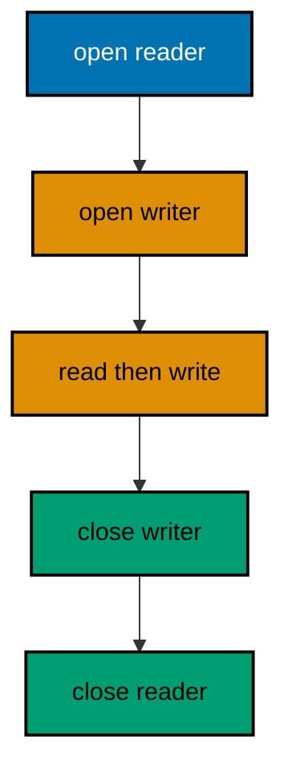

**`learning/code/ex-77-read-cleanup-inside-out/Main.java`**:

```java
// Example 77: Read Cleanup Inside Out.
// Nested resources release in reverse acquisition order: read the
// try headers outward to inward for opening, then inward to outward
// for closing. The transcript prints both orders as evidence.
// Reading order: headers down for opening, bodies up for closing.
import java.io.BufferedReader; // => the outer line reader
import java.io.IOException; // => resource work is environmentally checked
import java.io.PrintWriter; // => the inner reply writer
import java.nio.charset.StandardCharsets; // => UTF_8 stated at every call
import java.nio.file.Files; // => fixture helpers
import java.nio.file.Path; // => the fixture handles

public class Main {

  // => one public class per file, named after the file
  public static void main(String[] args) throws IOException {
    // => small-program shape: declare once
    Path inbox = Path.of("notes.txt"); // => fixture beside the program
    Files.writeString(inbox, "sari\n", StandardCharsets.UTF_8); // => one fixed dues name
    Path outbox = Path.of("replies.txt"); // => reply file beside it
    System.out.println("open: reader, then writer"); // => Output: opening order stated first
    try (
      BufferedReader in = Files.newBufferedReader(inbox, StandardCharsets.UTF_8); // => OPENED FIRST
      PrintWriter out = new PrintWriter(Files.newBufferedWriter(outbox, StandardCharsets.UTF_8))
    ) {
      // => OPENED SECOND
      String line = in.readLine(); // => BODY: the single line read once
      out.println("ack: " + line); // => BODY: the reply written once
      System.out.println("body: read then wrote"); // => Output: body order stated second
    } // => CLOSED: writer flushes first, reader releases second
    System.out.println("close: writer, then reader"); // => Output: closing order stated last
    System.out.print(Files.readString(outbox, StandardCharsets.UTF_8)); // => Output: ack: sari
    Files.deleteIfExists(inbox); // => tidy fixtures for rerun stability
    Files.deleteIfExists(outbox); // => no residue for the next run
  } // => main ends: opening and closing orders both printed
}
```

**`learning/code/ex-77-read-cleanup-inside-out/notes.txt`**:

```text
sari
```

**Output** (`learning/code/ex-77-read-cleanup-inside-out/expected/main.stdout.txt`):

```text
open: reader, then writer
body: read then wrote
close: writer, then reader
ack: sari
```

**Key takeaway**: Read try headers top-down for opening and bottom-up for closing; verify every handle pairs in reverse.

**Why it matters**: Reverse-order release makes declaration order load-bearing, so two-direction reading is the only complete review.

### Example 78: Read a Whole Program Top Down

The course closes by applying its reading method to a whole program in four numbered passes: main first for the feed and the single settle call, settle second for the separate-total-report stages, helpers third for validity and parsing, individual lines fourth and last. The PASS comments mark each stop so the file demonstrates the route it preaches, and the three-member, 150-total, two-skip transcript rewards the route with an exact answer. Notice how the earlier chapters echo in the design under review: per-item tries from Example 17 became validate-then-bank, honest skip counts from the same chapter survived, table-style validity from Example 38 guards parsing, and small named methods from Example 68 keep each stage testable. That echo is the fluency this course promised: idioms compose, and a reader fluent in each recognizes the composition on sight. New codebases yield to the same four passes; run them in order, name each stage aloud, and read details only when the map demands them. (Concepts: co-16, co-01.)

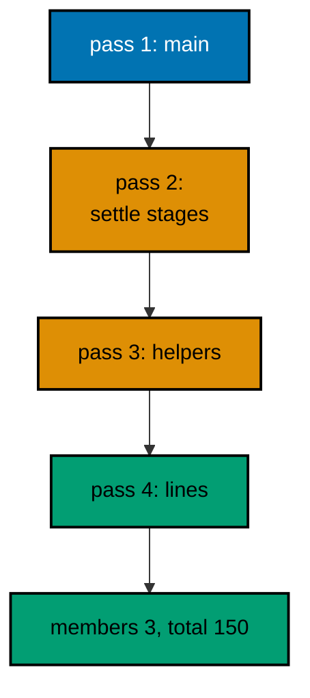

**`learning/code/ex-78-read-whole-program-top-down/Main.java`**:

```java
// Example 78: Read a Whole Program Top Down.
// The full method applied once: entry first, stages named, details
// last. This settler combines parsing, validation, totaling, and
// reporting; the numbered comments mark the reading pass order.
// Pass 1: main. Pass 2: settle. Pass 3: helpers. Pass 4: lines.
import java.util.ArrayList; // => the banked valid lines
import java.util.List; // => interface on the left as always

public class Main {

  // => one public class per file, named after the file
  static boolean valid(String line) {
    // => PASS 3A: the validity rule
    String[] parts = line.split(":"); // => two fields or corrupt
    if (parts.length != 2) {
      // => shape check first
      return false; // => corrupt shapes fail fast
    } // => arity settled from here on
    try {
      // => the numeric half may still refuse
      return Integer.parseInt(parts[1]) >= 0; // => numeric and non-negative wins
    } catch (NumberFormatException e) {
      // => non-numeric loses uniformly
      return false; // => refusal, not explosion
    } // => catch ends: every path answered
  } // => valid ends: verdicts, never throws

  static int amountOf(String line) {
    // => PASS 3B: parsing beneath validation
    return Integer.parseInt(line.split(":")[1]); // => trusted: callers validate first
  } // => amountOf ends: one expression, validated callers only

  static String settle(List<String> feed) {
    // => PASS 2: the three stages named
    List<String> banked = new ArrayList<>(); // => stage 1 storage: valid lines accumulate
    int skipped = 0; // => stage 1 accounting: corrupt lines counted
    for (String line : feed) {
      // => STAGE 1: separate valid from corrupt
      if (valid(line)) {
        // => grammar gate per line
        banked.add(line); // => valid lines bank for stage 2
      } else {
        // => corrupt lines skip with accounting
        skipped++; // => honest count, never silent
      } // => branch ends: banked or counted
    } // => stage 1 ends: feed fully judged
    int total = 0; // => stage 2 storage: the running sum
    for (String line : banked) {
      // => STAGE 2: total the banked lines
      total += amountOf(line); // => validated parsing, safe addition
    } // => stage 2 ends: sum complete
    return "members: " + banked.size() + ", total: " + total + ", skipped: " + skipped; // => STAGE 3: report
  } // => settle ends: separate, total, report in order

  public static void main(String[] args) {
    // => PASS 1: the entry point, read first
    List<String> feed = List.of("sari:50", "oops", "budi:75", "citra:-5", "dewi:25"); // => PASS 1: the five-line feed
    System.out.println(settle(feed)); // => PASS 1: one call, full answer
  } // => Output: members: 3, total: 150, skipped: 2
}
```

**Output** (`learning/code/ex-78-read-whole-program-top-down/expected/main.stdout.txt`):

```text
members: 3, total: 150, skipped: 2
```

**Key takeaway**: Read whole programs in four passes, entry, stages, helpers, lines; name each stage before its details.

**Why it matters**: Pass-ordered reading builds the behavior map first, so details land in context and idioms show as composition.
