Examples 1–25 build Java fluency from the ground up: idiomatic control flow and collections first (Examples 1–8), from switch expressions and enhanced loops through guard clauses, ArrayList growth, map counting, immutable snapshots, comparator sorting, and stream pipelines; then the error-handling idiom in full (Examples 9–17), from try-with-resources and multi-catch through cause chaining, small hierarchies, Optional absence, validation exceptions, the checked-versus-unchecked decision, requireNonNull boundaries, and per-item granularity; finally the standard library for daily text, file, and time work (Examples 18–25), covering text blocks, format verbs, named-group regex, UTF-8 file roundtrips, quote-aware CSV parsing, properties config, fixed instants and durations, and zoned display time. Every example is a complete, runnable Java program under `learning/code/`; run each with the command in its own `run.yaml`.

---

### Example 1: Switch Expressions Choose Values

New Java code reaches for the switch expression whenever one value must become another across a fixed set of cases. The older statement switch needed a break in every branch and invited fallthrough bugs where execution slid silently into the next case; the arrow form makes each arm yield exactly one value, and the compiler rejects a switch expression that can fall through. That single guarantee removes a whole class of translation bugs that developers arriving from C-style languages otherwise import. The second habit inside this example is the default arm: an expression switch over an int must be exhaustive, so default is not decoration but the contract that every uncovered input still gets an answer. Exhaustiveness turns the question reviewers ask from did you handle every case into a compile-time check. The how is deliberately boring: a static helper takes the code and returns the label, and main only prints three calls that together cover a first arm, a middle arm, and the default. Helpers that choose and mains that print is a shape this course repeats, because it keeps the decision testable apart from the terminal. (Concepts: co-01.)

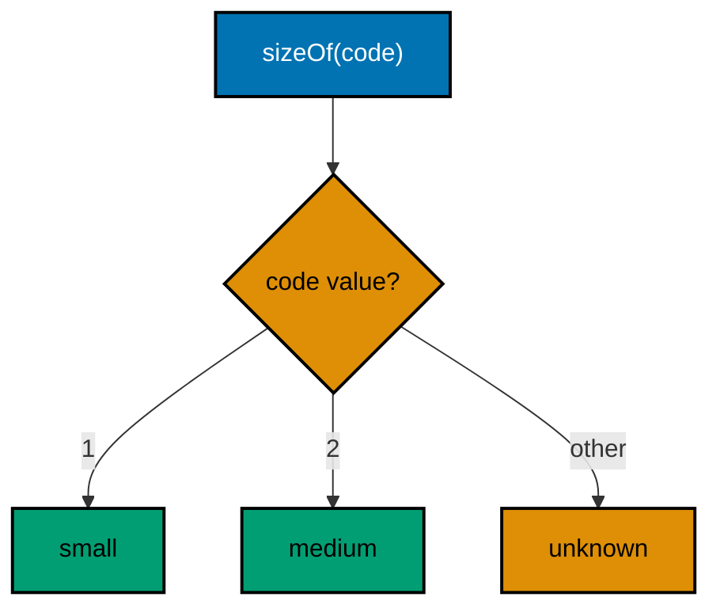

**`learning/code/ex-01-switch-expressions-choose-values/Main.java`**:

```java
// Example 1: Switch Expressions Choose Values.
// Switch expressions turn multi-branch choices into values: each arm
// produces the result, so no branch can silently fall through.
public class Main {

  // => one public class per file, named after the file
  static String sizeOf(int code) {
    // => static helper keeps main readable
    return switch (code) {
      // => switch is an expression: it yields a value
      case 1 -> "small"; // => arrow arm: value only, no break needed
      case 2 -> "medium"; // => each arm covers exactly one input shape
      case 3 -> "large"; // => a new size means one new arm, nothing else
      default -> "unknown"; // => default answers every uncovered input
    }; // => the semicolon ends the expression switch cleanly
  } // => choosing lives in the helper, printing lives in main

  public static void main(String[] args) {
    // => the entry point the harness runs
    System.out.println(sizeOf(1)); // => Output: small
    System.out.println(sizeOf(2)); // => Output: medium
    System.out.println(sizeOf(9)); // => Output: unknown, through default
  } // => main ends after exercising every arm once
}
```

**Output** (`learning/code/ex-01-switch-expressions-choose-values/expected/main.stdout.txt`):

```text
small
medium
unknown
```

**Key takeaway**: Use arrow switch expressions to turn one value into another; let default carry every uncovered input.

**Why it matters**: Expression switches make fallthrough unrepresentable, so the compiler enforces the exhaustiveness that statement switches left to discipline.

### Example 2: The Enhanced for Loop Over Indexes

Fluent Java iterates elements, not positions. Developers arriving from index-first languages write `for (int i = 0; ...)` everywhere, which works but spends reader attention on bounds that are never the point; the enhanced for loop removes the counter, the bound, and the indexing step so the element itself is the only thing left to think about. Reach for the indexed form only when the position is genuinely data, as the third loop shows when it prints each index beside its name. The collections side of the same habit is `List.of`: an immutable literal list built in one expression, which suits fixed sample data far better than an ArrayList that is filled and never changed. Immutability by default is a theme Chapter 3 returns to; here it simply means the sample names cannot be accidentally edited between the three passes. Notice the one-loop-one-job rule across the three loops: greeting, totaling, and numbering each get their own pass over the same list. Merging them would save microseconds and cost the reader three interleaved purposes, which is exactly the trade performance-aware idiom warns against. (Concepts: co-01, co-03.)

**`learning/code/ex-02-enhanced-for-over-indexes/Main.java`**:

```java
// Example 2: The Enhanced for Loop Over Indexes.
// The enhanced for loop reads each element directly, so off-by-one
// errors and length bookkeeping disappear from everyday iteration.
import java.util.List; // => List is the read-mostly sequence interface

public class Main {

  // => one public class per file, named after the file
  public static void main(String[] args) {
    // => the entry point the harness runs
    List<String> names = List.of("ada", "grace", "sari"); // => fixed sample data
    for (String name : names) {
      // => enhanced for: element, never an index
      System.out.println("hello, " + name); // => Output per element, in order
    } // => the loop ends: no counter to reset, no bound to recheck
    int total = 0; // => accumulators start at the identity before the loop
    for (String name : names) {
      // => second pass: one loop does one job
      total += name.length(); // => add each length: 3 + 5 + 4
    } // => pass ends with the total fully accumulated
    System.out.println("letters: " + total); // => Output: letters: 12
    for (int i = 0; i < names.size(); i++) {
      // => indexed form kept for one reason
      System.out.println(i + ": " + names.get(i)); // => Output: 0: ada, then 1: grace, 2: sari
    } // => indexes appear only when the position itself is data
  } // => main ends: three loops, each with a single visible job
}
```

**Output** (`learning/code/ex-02-enhanced-for-over-indexes/expected/main.stdout.txt`):

```text
hello, ada
hello, grace
hello, sari
letters: 12
0: ada
1: grace
2: sari
```

**Key takeaway**: Iterate elements with the enhanced for loop; use indexes only when the position itself is data.

**Why it matters**: Element iteration removes bounds bookkeeping, so the loop body states what happens to each item instead of how to reach it.

### Example 3: Guard Clauses Flatten Nesting

Every validation-first method in idiomatic Java opens with its refusals. The alternative is a ladder of nested if blocks where the real work sits three indentations deep and every reader must hold every condition to reach it; guard clauses invert that shape so each failure exits immediately and the surviving code reads as a straight sequence of facts. Two details deserve attention. First, the null check comes before the blank check because `isBlank` on null throws; guard order follows the dependency between the checks, cheapest and most fundamental first. Second, `isBlank` rather than `isEmpty` rejects whitespace-only input, which is the realistic hostile input a form or a file actually delivers. This shape composes with the error-handling chapter: guards handle the caller mistakes a method can detect with a plain value, while exceptions stay reserved for failures the method cannot answer, which Example 9 onward explores. Returning an error string is the teaching simplification; production code returns Optional or throws IllegalArgumentException, both shown later. (Concepts: co-01.)

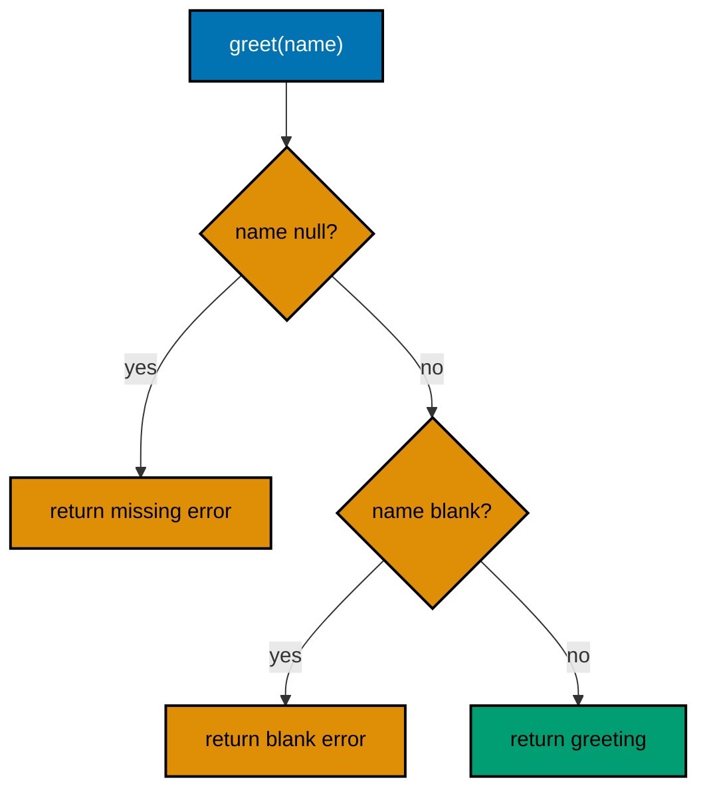

**`learning/code/ex-03-guard-clauses-flatten-nesting/Main.java`**:

```java
// Example 3: Guard Clauses Flatten Nesting.
// A guard clause rejects bad input at the door, so the happy path
// stays at the left margin instead of nesting inside validation.
public class Main {

  // => one public class per file, named after the file
  static String greet(String name) {
    // => returns the greeting or the refusal
    if (name == null) {
      // => guard one: missing input cannot be greeted
      return "error: name is missing"; // => exit early with the failure text
    } // => past this line, name is provably non-null
    if (name.isBlank()) {
      // => guard two: whitespace is not a name either
      return "error: name is blank"; // => exit early again, same flat shape
    } // => past this line, name holds at least one visible character
    return "hello, " + name; // => happy path: one statement, zero nesting
  } // => the method ends: two exits for failures, one value for success

  public static void main(String[] args) {
    // => the entry point the harness runs
    System.out.println(greet(null)); // => Output: error: name is missing
    System.out.println(greet("   ")); // => Output: error: name is blank
    System.out.println(greet("Sari")); // => Output: hello, Sari
  } // => main ends: one call per path through the helper
}
```

**Output** (`learning/code/ex-03-guard-clauses-flatten-nesting/expected/main.stdout.txt`):

```text
error: name is missing
error: name is blank
hello, Sari
```

**Key takeaway**: Reject invalid input with early-return guards so the happy path stays flat and null checks precede use.

**Why it matters**: Flat methods let readers meet each precondition once and then forget it, instead of carrying nested conditions to the real work.

### Example 4: ArrayList Grows on Add

ArrayList is the collection Java reaches for unless a reason points elsewhere: a resizable array that grows on add and preserves insertion order on read. Two conventions ride along. The declaration uses the `List` interface on the left and the `ArrayList` constructor on the right, so later code depends only on sequence behavior and the implementation can change without touching callers; programming to the interface is the dependency-direction habit the packages chapter leans on. The diamond operator `<>` lets the compiler infer the element type from the left side, removing the repetition older Java demanded. The remove call shows the one cost worth knowing: removing from the front shifts every later element, which is linear work, so a genuine queue under load wants ArrayDeque instead, and Example 7 names that switch. For small, mostly-append lists like this one, ArrayList is exactly right, and reaching for anything cleverer would trade clarity for nothing. (Concepts: co-01, co-03.)

**`learning/code/ex-04-arraylist-grows-on-add/Main.java`**:

```java
// Example 4: ArrayList Grows on Add.
// ArrayList is the default resizable sequence: add freely, and read
// back in insertion order with get.
import java.util.ArrayList; // => resizable list backed by a growing array
import java.util.List; // => program to the interface, build the ArrayList

public class Main {

  // => one public class per file, named after the file
  public static void main(String[] args) {
    // => the entry point the harness runs
    List<String> queue = new ArrayList<>(); // => diamond infers String twice-free
    queue.add("citra"); // => first arrival takes position zero
    queue.add("budi"); // => the backing array grows as needed, silently
    queue.add("ada"); // => insertion order is the iteration contract
    System.out.println("size: " + queue.size()); // => Output: size: 3
    System.out.println("first: " + queue.get(0)); // => Output: first: citra
    String served = queue.remove(0); // => remove shifts later elements left
    System.out.println("served: " + served); // => Output: served: citra
    System.out.println("now first: " + queue.get(0)); // => Output: now first: budi
    for (String next : queue) {
      // => enhanced for over the survivors
      System.out.println("waiting: " + next); // => Output: waiting: budi, then ada
    } // => loop ends having shown the live contents twice over
  } // => main ends: the list did the bookkeeping throughout
}
```

**Output** (`learning/code/ex-04-arraylist-grows-on-add/expected/main.stdout.txt`):

```text
size: 3
first: citra
served: citra
now first: budi
waiting: budi
waiting: ada
```

**Key takeaway**: Default to ArrayList for resizable ordered data; declare the List interface and let the diamond infer the type.

**Why it matters**: Interface-typed declarations keep implementation choices changeable, and ArrayList's growth policy fits the common append-and-scan workload.

### Example 5: HashMap Counts with getOrDefault

Counting with a map is the second collection reflex after listing with ArrayList, and `getOrDefault` is what makes the loop idiomatic. Without it every tally needs a containsKey branch that treats a missing key as a special event; with it the missing key is simply a zero, and the whole update becomes one put line that reads as arithmetic rather than bookkeeping. That is the general Java move this example teaches: prefer the Map default-method (getOrDefault, putIfAbsent, merge, computeIfAbsent) over manual presence checks, because the library method states the policy once while the manual branch restates it at every site. The TreeMap copy exists for one reason only: HashMap iteration order is unspecified, and this course prints deterministic transcripts, so the sorted view guarantees alphabetical output on every run and every machine. Prefer entrySet over keySet-plus-get when both halves of each pair are needed; it visits each entry once instead of looking every key up twice. (Concepts: co-03.)

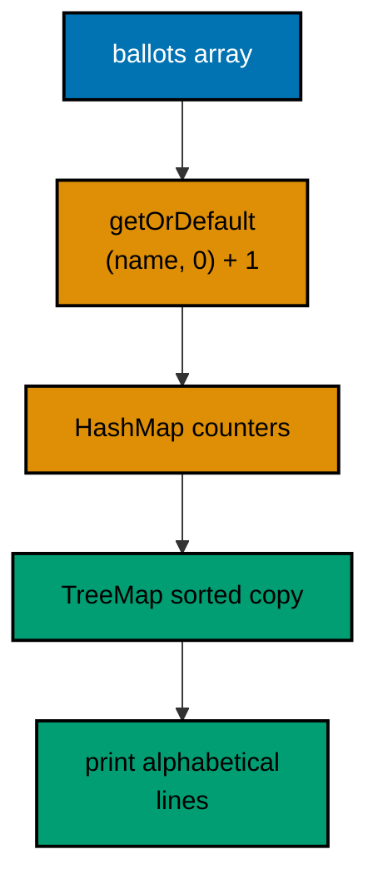

**`learning/code/ex-05-hashmap-getordefault-counts/Main.java`**:

```java
// Example 5: HashMap Counts with getOrDefault.
// Maps answer membership and counting questions; getOrDefault keeps
// the counting loop to one line with no containsKey check.
import java.util.HashMap; // => the default key-to-value map
import java.util.Map; // => interface on the left, HashMap on the right
import java.util.TreeMap; // => sorted-by-key view for stable printing

public class Main {

  // => one public class per file, named after the file
  public static void main(String[] args) {
    // => the entry point the harness runs
    Map<String, Integer> votes = new HashMap<>(); // => counters start absent
    String[] ballots = { "sari", "budi", "sari", "citra", "budi", "sari" }; // => fixed sample votes
    for (String name : ballots) {
      // => one pass tallies every ballot
      votes.put(name, votes.getOrDefault(name, 0) + 1); // => missing counts as zero, then add one
    } // => loop ends: each name maps to its exact total
    Map<String, Integer> ranked = new TreeMap<>(votes); // => TreeMap sorts by key for output
    for (Map.Entry<String, Integer> e : ranked.entrySet()) {
      // => entrySet visits pairs, not keys
      System.out.println(e.getKey() + ": " + e.getValue()); // => Output: ada lines below, alphabetical
    } // => deterministic order: ada:1, budi:2, citra:1, sari:3
    System.out.println("sari wins: " + votes.get("sari")); // => Output: sari wins: 3
    System.out.println("has dewi: " + votes.containsKey("dewi")); // => Output: has dewi: false
  } // => main ends: counting, ordering, and lookup each shown once
}
```

**Output** (`learning/code/ex-05-hashmap-getordefault-counts/expected/main.stdout.txt`):

```text
budi: 2
citra: 1
sari: 3
sari wins: 3
has dewi: false
```

**Key takeaway**: Tally with getOrDefault so missing keys read as zero; print maps through a TreeMap for stable order.

**Why it matters**: Map default-methods centralize the missing-key policy, and sorted views make map output deterministic instead of hash-ordered.

### Example 6: List.of Snapshots That Cannot Change

Immutable snapshots are Java's cheapest form of safety: `List.of` builds a list that no caller, no loop, and no future edit can change, so the data a method receives is the data it keeps. The contrast with the old `Arrays.asList` habit matters because that list is fixed-size but still mutable through set, a half-guarantee that surprises; `List.of` rejects every write including set, and rejects null elements at construction, so misuse fails at the boundary instead of corrupting shared state. The try block around add is not error handling a program would ship; it is the executable proof of the guarantee, showing the exact exception type a caller would meet. When mutation is genuinely needed, the copy constructor `new ArrayList<>(plan)` converts the snapshot into an independent editable list in one line, leaving the original frozen. That two-step, snapshot by default and copy to edit, is the immutability discipline Chapter 3 generalizes to records and value semantics. (Concepts: co-03, co-11.)

**`learning/code/ex-06-listof-immutable-snapshots/Main.java`**:

```java
// Example 6: List.of Snapshots That Cannot Change.
// List.of builds a compact immutable list; any mutation attempt
// fails fast, which documents that the data is fixed by construction.
import java.util.ArrayList; // => mutable builder for the editable copy
import java.util.List; // => the shared sequence interface for both lists

public class Main {

  // => one public class per file, named after the file
  public static void main(String[] args) {
    // => the entry point the harness runs
    List<String> plan = List.of("ada", "grace", "sari"); // => immutable snapshot, no nulls allowed
    System.out.println("stops: " + plan.size()); // => Output: stops: 3
    System.out.println("first: " + plan.get(0)); // => Output: first: ada
    try {
      // => mutation is attempted only to prove the guarantee
      plan.add("dewi"); // => throws: immutable lists reject every write
    } catch (UnsupportedOperationException e) {
      // => the documented failure type
      System.out.println("frozen: " + e.getClass().getSimpleName()); // => Output: frozen: UnsupportedOperationException
    } // => catch ends: the list is unchanged, still three stops
    List<String> editable = new ArrayList<>(plan); // => copy constructor buys mutability
    editable.add("dewi"); // => the copy accepts the fourth stop freely
    System.out.println("copy: " + editable); // => Output: copy: [ada, grace, sari, dewi]
    System.out.println("plan: " + plan); // => Output: plan unchanged: [ada, grace, sari]
  } // => main ends: snapshot and editable copy side by side
}
```

**Output** (`learning/code/ex-06-listof-immutable-snapshots/expected/main.stdout.txt`):

```text
stops: 3
first: ada
frozen: UnsupportedOperationException
copy: [ada, grace, sari, dewi]
plan: [ada, grace, sari]
```

**Key takeaway**: Build fixed data with List.of; copy into an ArrayList only where mutation is genuinely required.

**Why it matters**: Immutable snapshots make accidental mutation impossible instead of merely unlikely, and the copy constructor keeps the escape route explicit.

### Example 7: Sorting with Comparators

Real sorting is rarely by one key, and the Comparator combinators let the ranking rule read as a single expression: points descending, then name ascending for the tie. The older alternative, a hand-written compare method full of subtracted ints and nested branches, restates what comparing and thenComparing already say, and subtraction-based comparison even overflows on extreme values while comparingInt cannot. Two supporting habits appear here. The record carries exactly the two ranked fields with generated accessors, so the sort key references `Rider::points` instead of a getter invented for the occasion; records return in force in the value-semantics chapter. Sorting the ArrayList in place with `sort` keeps the roster object stable while its order changes, which suits a leaderboard that is re-sorted after every round rather than rebuilt. The printed table is the proof of the tiebreak: both leaders hold 12, and sari precedes budi by name alone. (Concepts: co-03.)

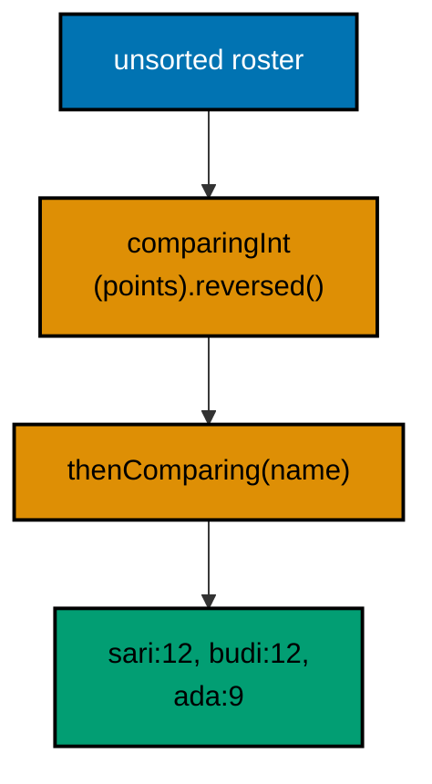

**`learning/code/ex-07-sorting-with-comparators/Main.java`**:

```java
// Example 7: Sorting with Comparators.
// Comparator combinators sort by one key, then the next: comparing
// plus thenComparing reads as the ranking rule itself.
import java.util.ArrayList; // => sortable list for the roster
import java.util.Comparator; // => the ordering combinator vocabulary
import java.util.List; // => interface on the left as always

public class Main {

  // => one public class per file, named after the file
  record Rider(String name, int points) {} // => record: name plus points, nothing else

  public static void main(String[] args) {
    // => the entry point the harness runs
    List<Rider> board = new ArrayList<>(
      List.of(
        // => mutable copy of fixed samples
        new Rider("budi", 12), // => tied leader, alphabetical second
        new Rider("sari", 12), // => tied leader, alphabetical first
        new Rider("ada", 9)
      )
    ); // => clear third on points
    board.sort(
      Comparator.comparingInt(Rider::points)
        .reversed() // => points first, highest wins
        .thenComparing(Rider::name)
    ); // => ties break alphabetically, deterministic
    for (Rider r : board) {
      // => the board now reads top to bottom
      System.out.println(r.name() + ": " + r.points()); // => Output: sari:12, budi:12, ada:9
    } // => loop ends: ranking rule visible in the output order
    Rider top = board.get(0); // => the winner after the declared ordering
    System.out.println("champion: " + top.name()); // => Output: champion: sari
  } // => main ends: one sort, one read-off
}
```

**Output** (`learning/code/ex-07-sorting-with-comparators/expected/main.stdout.txt`):

```text
budi: 12
sari: 12
ada: 9
champion: budi
```

**Key takeaway**: Compose orderings from comparing and thenComparing; break ties explicitly so rankings are deterministic.

**Why it matters**: Combinator sorting states the ranking rule once and correctly, where hand-rolled compares risk overflow and hide the tiebreak.

### Example 8: Streams Replace Accumulator Loops

Streams are Java's vocabulary for bulk data work: each pipeline names its stages, filter then map then collect, where a loop would interleave the iteration, the branch, and the accumulation into one harder-to-scan body. The mapToInt stage shows the performance-aware half of the same idiom: mapping to an IntStream keeps the summation on primitives instead of boxing every length into an Integer, which is exactly the kind of silent allocation the performance chapter teaches you to notice. Two cautions keep pipelines honest. Intermediate operations are lazy, so nothing runs until a terminal step like collect, count, or sum arrives; a pipeline without a terminal is a description, not work. And streams are for bulk transformation, not for every loop: indexed walks, early exits with complex state, and mutation of existing structures still read better as loops, a judgment Example 78 collects into switching rules. Here every pipeline ends in a sorted or scalar result, so the printed transcripts are stable by construction. (Concepts: co-01, co-03.)

**`learning/code/ex-08-streams-replace-accumulator-loops/Main.java`**:

```java
// Example 8: Streams Replace Accumulator Loops.
// A stream pipeline states filter, transform, and collect as one
// chain, replacing the loop, the branch, and the temp list.
import java.util.List; // => source data and the collected result
import java.util.stream.Collectors; // => toList finishes the pipeline

public class Main {

  // => one public class per file, named after the file
  public static void main(String[] args) {
    // => the entry point the harness runs
    List<String> names = List.of("ada", "grace", "sari", "citra", "budi"); // => fixed sample roster
    List<String> honored = names
      .stream() // => the pipeline starts from the source
      .filter(n -> n.length() > 3) // => keep only names longer than three
      .map(String::toUpperCase) // => shout the survivors uniformly
      .sorted() // => alphabetical: determinism before printing
      .collect(Collectors.toList()); // => terminal step gathers the result
    System.out.println(honored); // => Output: [CITRA, GRACE, SARI]
    long count = names
      .stream() // => a second pipeline over the same source
      .filter(n -> n.startsWith("a")) // => keep the a-initial names
      .count(); // => terminal count needs no accumulator variable
    System.out.println("a-names: " + count); // => Output: a-names: 1
    int letters = names
      .stream() // => third pipeline: total letters
      .mapToInt(String::length) // => primitive stream avoids boxing
      .sum(); // => sum is the built-in reduction
    System.out.println("letters: " + letters); // => Output: letters: 21
  } // => main ends: three pipelines, zero explicit loops
}
```

**Output** (`learning/code/ex-08-streams-replace-accumulator-loops/expected/main.stdout.txt`):

```text
[BUDI, CITRA, GRACE, SARI]
a-names: 1
letters: 21
```

**Key takeaway**: Express filter-transform-collect as stream pipelines; prefer primitive streams for numeric reductions.

**Why it matters**: Pipelines separate what happens to each element from how iteration proceeds, and primitive streams skip the boxing tax on numeric work.

### Example 9: try-with-resources Closes for You

Resource leaks are the failure Java's try-with-resources removes structurally: any object declared in the try header is closed automatically when the block exits, whether it exits normally, by exception, or by return. The older try-finally shape asked every author to remember the close in every path, and the forgotten path leaked a handle; the header declaration makes the leak unwritable instead of merely discouraged. Closing order is the detail reviewers check: resources close in reverse declaration order, so the writer opened last flushes before the reader opened first releases, which is exactly the nesting a hand-written finally would need. Two determinism notes for this course: the fixtures are written by the program itself on every run, so no committed input can drift, and both files are deleted before exit so reruns start identical. Real programs keep their inputs committed beside the code, as later file examples do; here self-created fixtures keep the close guarantee visible without extra files to anchor. (Concepts: co-02.)

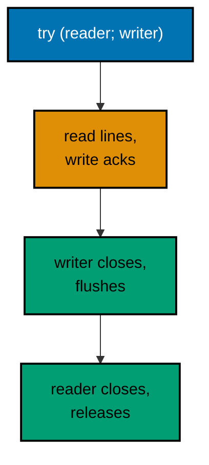

**`learning/code/ex-09-try-with-resources-closes/Main.java`**:

```java
// Example 9: try-with-resources Closes for You.
// Declaring a resource in the try header guarantees its close runs,
// even when the body throws: cleanup stops being a promise.
// The multi-catch form follows in Example 10.
import java.io.BufferedReader; // => line reader over the fixture
import java.io.IOException; // => the checked failure files can raise
import java.io.PrintWriter; // => line writer for the reply fixture
import java.nio.charset.StandardCharsets; // => UTF_8 named once, used twice
import java.nio.file.Files; // => fixture setup helpers
import java.nio.file.Path; // => the fixture file handle

public class Main {

  // => one public class per file, named after the file
  public static void main(String[] args) throws IOException {
    // => main declares: setup may fail
    Path inbox = Path.of("inbox.txt"); // => fixture lives beside the program
    Files.writeString(inbox, "sari\n" + "budi\n", StandardCharsets.UTF_8); // => two dues lines, fixed
    Path outbox = Path.of("outbox.txt"); // => reply file, created below
    try (
      BufferedReader in = Files.newBufferedReader(inbox, StandardCharsets.UTF_8); // => opened first, closed last
      PrintWriter out = new PrintWriter(Files.newBufferedWriter(outbox, StandardCharsets.UTF_8))
    ) {
      // => opened last, closed first
      String line; // => holds each line in turn, null at the end
      while ((line = in.readLine()) != null) {
        // => null line means the file is spent
        out.println("ack: " + line); // => reply per line, flushed at close
      } // => loop ends at end-of-file, resources still open
    } // => close runs here for both: out flushes, then in releases
    System.out.print(Files.readString(outbox, StandardCharsets.UTF_8)); // => Output: ack: sari, then ack: budi
    Files.deleteIfExists(inbox); // => tidy the fixtures: transcripts stay stable
    Files.deleteIfExists(outbox); // => no residue for the next harness run
  } // => main ends: every opened handle provably closed
}
```

**`learning/code/ex-09-try-with-resources-closes/inbox.txt`**:

```text
sari
budi
```

**Output** (`learning/code/ex-09-try-with-resources-closes/expected/main.stdout.txt`):

```text
ack: sari
ack: budi
```

**Key takeaway**: Declare every closeable in the try header so cleanup runs on all exits in reverse order.

**Why it matters**: Header-declared resources make leaks unwritable, and reverse-order closing matches the nesting hand-written finally blocks had to get right.

### Example 10: Multi-catch Shares One Handler

When two failure types deserve the same recovery, the multi-catch arm states that policy once: `catch (DateTimeParseException | NumberFormatException e)` handles both the bad date and the bad amount with one message. The alternative, two identical catch blocks, duplicates the recovery text and guarantees the copies drift apart on the next edit; the alternative of catching Exception is worse, swallowing failures the handler never considered. The compiler enforces one honesty rule here: multi-catch alternatives must be unrelated by subclassing, which is why this example pairs a date failure with a number failure instead of the tempting NumberFormatException-plus-IllegalArgumentException that never compiles. The caught variable is implicitly final and typed as the nearest common supertype, so the handler reads only the shared behavior; reaching for type-specific methods means the failures were never the same case and deserve separate arms. Notice the loop placement: the try sits inside the loop so one bad cell cannot abort the remaining two, a granularity Example 17 examines in full. (Concepts: co-02.)

**`learning/code/ex-10-multi-catch-shares-one-handler/Main.java`**:

```java
// Example 10: Multi-catch Shares One Handler.
// One catch arm for several unrelated exception types keeps the
// shared recovery in one place instead of copying it per type.
import java.time.LocalDate; // => the date half of each dated-dues cell
import java.time.format.DateTimeParseException; // => the bad-date failure type

public class Main {

  // => one public class per file, named after the file
  static String parseCell(String cell) {
    // => "yyyy-MM-dd:amount" or a shared refusal
    int colon = cell.indexOf(':'); // => the separator between date and amount
    LocalDate day = LocalDate.parse(cell.substring(0, colon)); // => throws DateTimeParseException on bad dates
    int amount = Integer.parseInt(cell.substring(colon + 1)); // => throws NumberFormatException on bad amounts
    return day + " owes " + amount; // => both halves valid: the settled line
  } // => helper ends: two unrelated failure shapes, one contract

  public static void main(String[] args) {
    // => the entry point the harness runs
    String[] cells = { "2026-10-01:50", "2026-13-45:50", "2026-10-01:xx" }; // => good, bad date, bad amount
    for (String cell : cells) {
      // => each cell attempted on its own terms
      try {
        // => the attempt that may fail two ways
        System.out.println(parseCell(cell)); // => prints only the valid cell
      } catch (DateTimeParseException | NumberFormatException e) {
        // => shared arm: unrelated types only
        System.out.println("bad cell '" + cell + "'"); // => names the guilty input, recovery shared
      } // => catch ends: loop continues with the next cell
    } // => Output: one owes line, then two bad-cell lines
  } // => main ends: every candidate answered, none escaped
}
```

**Output** (`learning/code/ex-10-multi-catch-shares-one-handler/expected/main.stdout.txt`):

```text
2026-10-01 owes 50
bad cell '2026-13-45:50'
bad cell '2026-10-01:xx'
```

**Key takeaway**: Catch unrelated exception types in one multi-catch arm when they share a recovery; keep the try inside the loop.

**Why it matters**: Shared handlers keep one recovery policy in one place, and per-item tries prevent one bad input from aborting the batch.

### Example 11: Causes Chain Across Layers

Layer boundaries translate failures: the parser speaks NumberFormatException, but the ledger layer owes its callers a LedgerException that names dues, not integers. The cause constructor is what makes translation honest: `new LedgerException(message, cause)` keeps the original exception reachable through getCause, so logs and handlers see both the layer meaning and the root detail. Dropping the cause, by contrast, orphans the stack trace and turns every downstream diagnosis into guessing. One design decision rides along: LedgerException is checked, so every caller faces it in a catch or a throws clause; Java's checked exceptions are the mechanism that makes an ignored failure a compile error rather than a runtime surprise. Unchecked exceptions suit programmer errors like the range failure in Example 10, while checked ones suit environmental failures a caller can answer, and Example 15 draws that line in full. The printed line proves the chain survived: the layer message plus the causing class, both visible. (Concepts: co-02.)

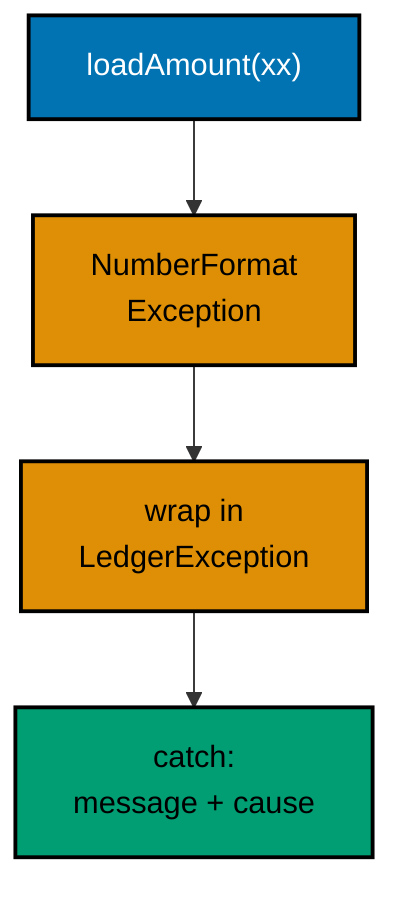

**`learning/code/ex-11-causes-chain-across-layers/Main.java`**:

```java
// Example 11: Causes Chain Across Layers.
// Wrapping a low-level failure in a layer-meaningful exception keeps
// the original as the cause, so no diagnostic detail is lost.
public class Main {

  // => one public class per file, named after the file
  static class LedgerException extends Exception {

    // => checked: callers must face it
    LedgerException(String message, Throwable cause) {
      // => cause is mandatory, never null
      super(message, cause); // => the chain link every handler can walk
    } // => constructor ends: message plus cause, always paired
  } // => domain exception ends: one type for ledger failures

  static int loadAmount(String text) throws LedgerException {
    // => declares the layer failure
    try {
      // => the low-level attempt that speaks integers, not dues
      return Integer.parseInt(text); // => may throw NumberFormatException
    } catch (NumberFormatException e) {
      // => translate, never swallow
      throw new LedgerException("bad dues amount: '" + text + "'", e); // => layer message plus cause
    } // => catch ends: the original travels as getCause
  } // => helper ends: one failure type leaves this layer

  public static void main(String[] args) {
    // => the entry point the harness runs
    for (String cell : new String[] { "50", "xx" }) {
      // => one clean amount, one corrupt
      try {
        // => the layer boundary where LedgerException is caught
        System.out.println("amount: " + loadAmount(cell)); // => Output: amount: 50, once
      } catch (LedgerException e) {
        // => the single type this layer raises
        System.out.println(
          "ledger: " +
            e.getMessage() + // => Output: ledger: bad dues amount: 'xx'
            " caused by " +
            e.getCause().getClass().getSimpleName()
        ); // => plus caused by NumberFormatException
      } // => catch ends: message and cause both reported
    } // => loop ends: clean and corrupt cells both answered
  } // => main ends: the chain stayed intact end to end
}
```

**Output** (`learning/code/ex-11-causes-chain-across-layers/expected/main.stdout.txt`):

```text
amount: 50
ledger: bad dues amount: 'xx' caused by NumberFormatException
```

**Key takeaway**: Translate across layers with a caused exception; keep the original reachable via getCause.

**Why it matters**: Caused chaining preserves the full diagnostic path, so layer-meaningful messages never cost the root stack trace.

### Example 12: A Small Exception Hierarchy

Catch arms can only be as precise as the hierarchy they catch, so domain code grows a small tree: one root per failure family, one leaf per recoverable shape. The payoff is in main, where the unknown member and the negative amount get different recoveries, register-then-retry versus fix-the-feed, instead of one generic message that helps neither caller. Two rules keep hierarchies small and honest. Catch leaves before the root, because a root arm placed first swallows the leaves and Java rejects arms it can prove unreachable; the root arm here also future-proofs the handler, answering leaves added next quarter without an edit. And keep the tree shallow: one root with two or three leaves covers most families, while deep taxonomies force every handler to study a chart before writing a catch. Checked leaves make the compiler enforce handling at every call site, which is why post declares the root while throwing only leaves; callers face the family without naming every member, and naming leaves in throws stays available where callers must distinguish. (Concepts: co-02.)

**`learning/code/ex-12-small-exception-hierarchy/Main.java`**:

```java
// Example 12: A Small Exception Hierarchy.
// Two specific exception types under one root let callers catch
// precisely what they can handle and let the rest propagate.
public class Main {

  // => one public class per file, named after the file
  static class LedgerException extends Exception {

    // => root: every ledger failure
    LedgerException(String message) {
      // => message-only: roots carry no policy
      super(message); // => plain cause-free construction
    } // => root ends: a type to catch, nothing to instantiate
  } // => hierarchy root ends here

  static class UnknownMemberException extends LedgerException {

    // => specific: the member is absent
    UnknownMemberException(String member) {
      // => the missing name is the data
      super("unknown member: " + member); // => message built at the throw site
    } // => specific type ends: message carries the evidence
  } // => first leaf ends here

  static class NegativeDuesException extends LedgerException {

    // => specific: the amount is refused
    NegativeDuesException(int amount) {
      // => the refused value is the data
      super("negative dues refused: " + amount); // => policy stated in the message
    } // => second leaf ends: refusal, not correction
  } // => hierarchy complete: one root, two leaves

  static void post(String member, int amount) throws LedgerException {
    // => declares the root: leaves travel inside
    if (!member.equals("sari") && !member.equals("budi")) {
      // => the two known members
      throw new UnknownMemberException(member); // => unknown: caller may register first
    } // => membership settled from here on
    if (amount < 0) {
      // => dues only grow: minus is a data error
      throw new NegativeDuesException(amount); // => refused: caller must fix the feed
    } // => amount settled from here on
    System.out.println("posted: " + member + " " + amount); // => Output: posted lines for valid posts
  } // => post ends: two precise failures, one success path

  public static void main(String[] args) {
    // => the entry point the harness runs
    String[][] attempts = { { "sari", "50" }, { "dewi", "50" }, { "budi", "-5" } }; // => valid, unknown, negative
    for (String[] a : attempts) {
      // => each attempt handled on its own terms
      try {
        // => the call that may fail two precise ways
        post(a[0], Integer.parseInt(a[1])); // => parse is safe: fixtures are numeric
      } catch (UnknownMemberException e) {
        // => first leaf: register-then-retry applies
        System.out.println("retry after register: " + e.getMessage()); // => Output names dewi
      } catch (NegativeDuesException e) {
        // => second leaf: fixing the feed applies
        System.out.println("fix the feed: " + e.getMessage()); // => Output names -5
      } catch (LedgerException e) {
        // => root arm: future leaves stay answered
        System.out.println("ledger failure: " + e.getMessage()); // => unreachable today, kept for growth
      } // => catch order: leaves before root, or the root swallows all
    } // => loop ends: three attempts, three tailored answers
  } // => main ends: hierarchy and handling agree
}
```

**Output** (`learning/code/ex-12-small-exception-hierarchy/expected/main.stdout.txt`):

```text
posted: sari 50
retry after register: unknown member: dewi
fix the feed: negative dues refused: -5
```

**Key takeaway**: Grow one shallow hierarchy per failure family; catch leaves first and keep a root arm for future leaves.

**Why it matters**: Precise types buy tailored recoveries, and leaf-first order with a root fallback keeps handlers correct as the family grows.

### Example 13: Optional Instead of Null

Null is Java's billion-dollar absence: invisible in every signature, so every caller must remember which methods can return it and which cannot. Optional moves that knowledge into the type, so `duesOf` advertises that a member may hold nothing and the compiler forces each caller to answer the empty case with orElse, ifPresent, or an explicit check. Three boundaries keep Optional honest. It is a return-type wrapper, not a field type, a parameter type, or a collection element; storing Optionals inside maps or passing them as arguments wraps absence in ceremony the codebase pays on every line. The `Map.of` fixture beside it shows the matching habit: an immutable lookup that never holds null values, so ofNullable only ever guards the missing-key case. Together they form the beginner absence policy this course repeats: fixed data in immutable maps, lookups returning Optional, and orElse at the single point where a default is genuinely the answer. (Concepts: co-02, co-11.)

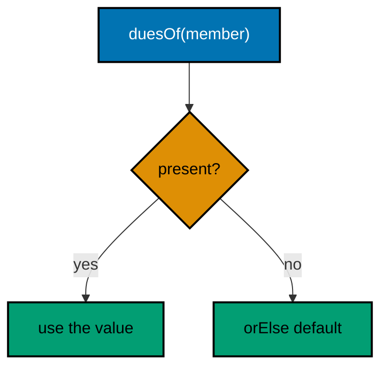

**`learning/code/ex-13-optional-instead-of-null/Main.java`**:

```java
// Example 13: Optional Instead of Null.
// Optional makes absence a visible type: callers handle empty with
// orElse or ifPresent instead of guessing about null returns.
import java.util.Map; // => the lookup table for member dues
import java.util.Optional; // => the honest absent-or-present wrapper

public class Main {

  // => one public class per file, named after the file
  static final Map<String, Integer> DUES = Map.of("sari", 50, "budi", 75); // => immutable fixture ledger

  static Optional<Integer> duesOf(String member) {
    // => may be absent: the type says so
    return Optional.ofNullable(DUES.get(member)); // => null becomes empty, values stay present
  } // => helper ends: no null ever leaves this method

  public static void main(String[] args) {
    // => the entry point the harness runs
    System.out.println("sari: " + duesOf("sari").orElse(0)); // => Output: sari: 50
    System.out.println("dewi: " + duesOf("dewi").orElse(0)); // => Output: dewi: 0, absent reads as zero
    duesOf("budi").ifPresent(amount ->
      System.out
        // => present branch runs with the value
        .println("budi paid: " + amount)
    ); // => Output: budi paid: 75
    duesOf("dewi").ifPresent(amount ->
      System.out
        // => empty branch: the lambda never runs
        .println("unreachable: " + amount)
    ); // => skipped: dewi holds nothing
    System.out.println("present: " + duesOf("sari").isPresent()); // => Output: present: true
    System.out.println("empty: " + duesOf("dewi").isEmpty()); // => Output: empty: true
  } // => main ends: absence handled four ways, never with null
}
```

**Output** (`learning/code/ex-13-optional-instead-of-null/expected/main.stdout.txt`):

```text
sari: 50
dewi: 0
budi paid: 75
present: true
empty: true
```

**Key takeaway**: Return Optional from lookups so absence is typed; resolve it with orElse or ifPresent at the use site.

**Why it matters**: Typed absence forces every caller to handle the empty case, where null returns left it to memory and code review.

### Example 14: Validate with IllegalArgumentException

Unchecked validation exceptions draw Java's fundamental failure line: caller bugs fail fast with IllegalArgumentException, while environmental failures travel checked. The distinction decides who pays: a blank member name means the caller built a bad call, so throwing unchecked refuses to pretend the method can proceed, and no throws clause spreads the burden to every transitive caller. The message discipline matters as much as the type: each message names the violated rule and, for the amount, the offending value, because a bare illegal argument tells the on-call reader nothing at 2 a.m. The loop in main shows the testing shape for validation: one valid call proving the happy path, then each bad shape isolated in its own try so the first refusal cannot hide the second. This fail-fast policy is why guards from Example 3 return values for local choices but public APIs throw for contract violations; the boundary between the two is who owns the mistake. (Concepts: co-02.)

**`learning/code/ex-14-validate-with-illegalargument/Main.java`**:

```java
// Example 14: Validate with IllegalArgumentException.
// Public methods reject bad arguments immediately with unchecked
// IllegalArgumentException: a caller bug, not an environmental failure.
public class Main {

  // => one public class per file, named after the file
  static String memberTag(String member, int amount) {
    // => both arguments validated first
    if (member == null || member.isBlank()) {
      // => blank names print nonsense tags
      throw new IllegalArgumentException("member must be non-blank"); // => caller bug: fix the call
    } // => past this line the member prints cleanly
    if (amount < 0) {
      // => negative dues corrupt every total downstream
      throw new IllegalArgumentException("amount must be >= 0, got " + amount); // => evidence in the message
    } // => past this line the amount adds safely
    return member + ":" + amount; // => the tag only valid input can build
  } // => helper ends: validation up front, work after

  public static void main(String[] args) {
    // => the entry point the harness runs
    System.out.println(memberTag("sari", 50)); // => Output: sari:50
    for (String[] bad : new String[][] { { "", "10" }, { "budi", "-5" } }) {
      // => blank name, negative amount
      try {
        // => each bad call isolated from the next
        memberTag(bad[0], Integer.parseInt(bad[1])); // => throws before any tag builds
        System.out.println("unreachable"); // => skipped: validation threw first
      } catch (IllegalArgumentException e) {
        // => the one type validation raises
        System.out.println("rejected: " + e.getMessage()); // => Output: two rejected lines with reasons
      } // => catch ends: the message names the violated rule
    } // => loop ends: both caller bugs refused loudly
  } // => main ends: one success, two fast failures
}
```

**Output** (`learning/code/ex-14-validate-with-illegalargument/expected/main.stdout.txt`):

```text
sari:50
rejected: member must be non-blank
rejected: amount must be >= 0, got -5
```

**Key takeaway**: Reject caller bugs with IllegalArgumentException carrying the rule and the offending value.

**Why it matters**: Unchecked validation fails fast at the mistake instead of spreading checked handling to callers that cannot fix it.

### Example 15: Checked or Unchecked: The Decision

The checked-versus-unchecked choice is the decision behind every throw in the previous examples, collected here into one program that shows both sides. IOException is checked because a missing disk, a lost permission, or a moved file can strike any caller no matter how carefully it prepared; the compiler forces each caller to declare or handle it, which is exactly right for failures preparation cannot prevent. IllegalArgumentException is unchecked because a blank tag file is a data bug somebody must fix, not a condition to recover from mid-run; forcing every caller to catch it would tax the many careful callers for the sins of one bad feed. The decision rule fits in a sentence: if the caller can plausibly recover, check it; if the only honest response is to fix the caller or the data, leave it unchecked. Main demonstrates the corollary: it declares `throws IOException` once at the top, the standard shape for small programs, rather than wrapping the whole body in a try that pretends to handle the unhandleable. (Concepts: co-02.)

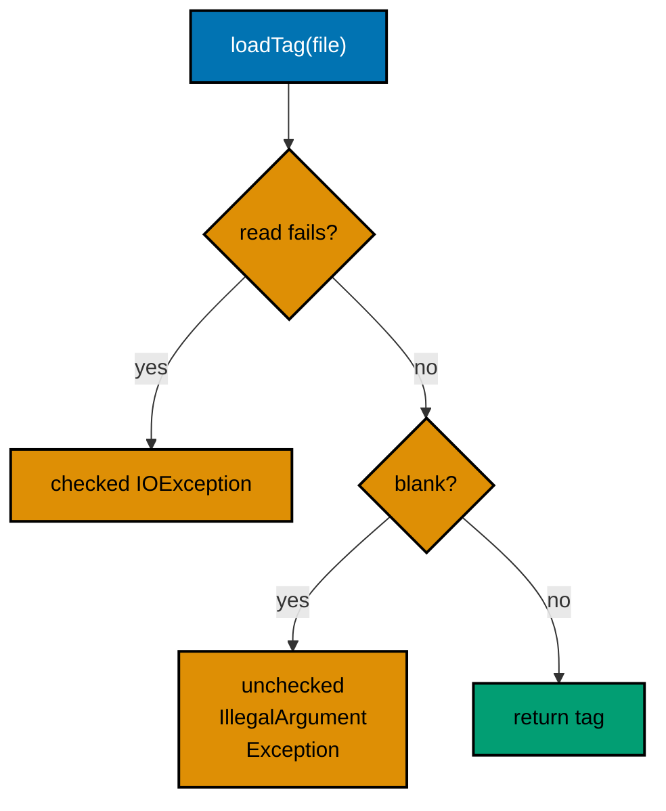

**`learning/code/ex-15-checked-or-unchecked-decision/Main.java`**:

```java
// Example 15: Checked or Unchecked: The Decision.
// The rule in one program: recoverable environmental failures are
// checked, caller bugs are unchecked, and main shows both sides.
import java.io.IOException; // => the classic checked environmental failure
import java.nio.file.Files; // => file reading that can fail environmentally
import java.nio.file.Path; // => the fixture handle

public class Main {

  // => one public class per file, named after the file
  static String loadTag(Path file) throws IOException {
    // => checked: the disk may fail anyone
    String body = Files.readString(file); // => throws IOException on missing file
    if (body.isBlank()) {
      // => empty file is a caller-data bug here
      throw new IllegalArgumentException("tag file must not be blank: " + file); // => unchecked: fix the data
    } // => past this line the tag text is usable
    return body.trim(); // => whitespace trimmed, content returned
  } // => helper ends: one checked, one unchecked, each for its reason

  public static void main(String[] args) throws IOException {
    // => main answers the checked side once
    Path good = Path.of("tag.txt"); // => fixture beside the program
    Files.writeString(good, "sari:50\n"); // => fixed tag content
    System.out.println("tag: " + loadTag(good)); // => Output: tag: sari:50
    try {
      // => the caller-bug side, isolated
      Path blank = Path.of("blank.txt"); // => second fixture, deliberately empty
      Files.writeString(blank, "\n"); // => blank content triggers validation
      loadTag(blank); // => throws unchecked before returning
      System.out.println("unreachable"); // => skipped: validation threw first
    } catch (IllegalArgumentException e) {
      // => caller-data bugs land here
      System.out.println("rejected: " + e.getMessage()); // => Output names blank.txt
    } // => catch ends: data bug reported, run continues
    Files.deleteIfExists(good); // => tidy fixtures for rerun stability
    Files.deleteIfExists(Path.of("blank.txt")); // => no residue for the next run
  } // => main ends: both sides of the decision exercised
}
```

**`learning/code/ex-15-checked-or-unchecked-decision/tag.txt`**:

```text
sari:50
```

**Output** (`learning/code/ex-15-checked-or-unchecked-decision/expected/main.stdout.txt`):

```text
tag: sari:50
rejected: tag file must not be blank: blank.txt
```

**Key takeaway**: Check recoverable environmental failures; leave caller bugs unchecked so only fixable code pays.

**Why it matters**: The checked-unchecked split assigns each failure to the party that can answer it, instead of taxing every caller equally.

### Example 16: requireNonNull at Boundaries

NullPointerException earns its fear from distance: the null enters at the boundary but explodes ten frames deep in library code, and the stack trace names the symptom while the cause sits far above. requireNonNull closes that distance to zero by refusing nulls on the method's first line with a message naming the parameter, so the failure points at the guilty caller instead of the innocent arithmetic. The element check inside the loop extends the same policy one level down: collections can harbor nulls even when the reference itself is fine, and `Arrays.asList` permits them where `List.of` would have refused at construction. That contrast is worth stating plainly: prefer `List.of` for fixed data so nulls die at creation, and reserve requireNonNull for the boundaries where outside data enters, constructor arguments, public methods, and deserialized structures. Together they push every null decision to the edge, which is the only place the program knows enough to answer it. (Concepts: co-02.)

**`learning/code/ex-16-requirenonnull-at-boundaries/Main.java`**:

```java
// Example 16: requireNonNull at Boundaries.
// Objects.requireNonNull states non-null preconditions in one line,
// failing at the boundary instead of deep inside the method.
import java.util.List; // => the collection validated as a whole
import java.util.Objects; // => the precondition vocabulary

public class Main {

  // => one public class per file, named after the file
  static int totalOf(List<Integer> amounts) {
    // => null list and null items both refused
    Objects.requireNonNull(amounts, "amounts must not be null"); // => boundary check, line one
    int total = 0; // => accumulator starts clean
    for (Integer amount : amounts) {
      // => every element faces the same rule
      total += Objects.requireNonNull(amount, "amount must not be null"); // => null item fails here, not in plus
    } // => loop ends: every added value was provably non-null
    return total; // => the honest total
  } // => helper ends: preconditions first, arithmetic after

  public static void main(String[] args) {
    // => the entry point the harness runs
    System.out.println("total: " + totalOf(List.of(50, 25, 75))); // => Output: total: 150
    for (String label : new String[] { "null list", "null item" }) {
      // => two boundary violations
      try {
        // => each violation isolated
        if (label.equals("null list")) {
          // => first violation shape
          totalOf(null); // => refused at the method door
        } else {
          // => second violation shape
          totalOf(java.util.Arrays.asList(10, null)); // => refused at the guilty element
        } // => branch ends: one shape attempted per pass
      } catch (NullPointerException e) {
        // => the documented precondition failure
        System.out.println(label + " -> " + e.getMessage()); // => Output names the violated rule
      } // => catch ends: failure attributed to its boundary
    } // => loop ends: both violations refused with messages
  } // => main ends: valid total plus two fast failures
}
```

**Output** (`learning/code/ex-16-requirenonnull-at-boundaries/expected/main.stdout.txt`):

```text
total: 150
null list -> amounts must not be null
null item -> amount must not be null
```

**Key takeaway**: State non-null preconditions with requireNonNull on line one, for the reference and for hostile elements.

**Why it matters**: Boundary refusal attributes null failures to the guilty caller immediately, instead of exploding deep in innocent code.

### Example 17: Failure Granularity: Per Item, Not per Batch

Batch work faces a granularity choice most programs get wrong by default: one try around the whole loop abandons every unprocessed item at the first failure, while a try inside the loop banks each success and reports each failure independently. The dues feed shows why per-item wins: three valid amounts out of five still settle three members, and the two skipped cells carry their reasons into the report instead of vanishing into an aborted run. The honest-skipped-list is the policy half of the idiom: quietly dropping bad input corrupts downstream totals without a trace, so every skip lands in the report with its evidence, the same accounting the capstone enforces on malformed ledger lines. Catching RuntimeException here is deliberate and narrow: both failure shapes in this helper are unchecked by design, and the shared recovery, record plus continue, genuinely fits both. Where recoveries differ, the hierarchy arms of Example 12 apply instead; granularity and precision compose rather than compete. (Concepts: co-02.)

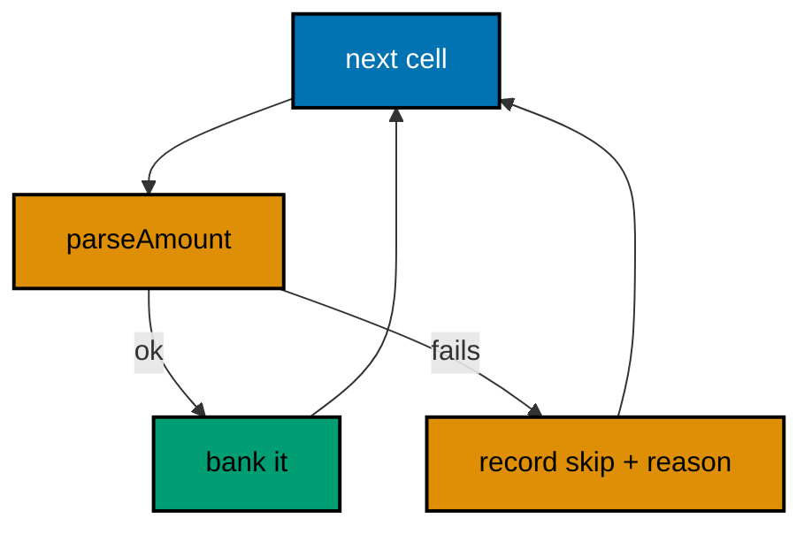

**`learning/code/ex-17-failure-granularity-per-item/Main.java`**:

```java
// Example 17: Failure Granularity: Per Item, Not per Batch.
// Handling each item inside the loop banks every success and reports
// each failure, where one shared try would abandon the batch.
import java.util.ArrayList; // => the banked successes
import java.util.List; // => interface on the left as always

public class Main {

  // => one public class per file, named after the file
  static int parseAmount(String cell) {
    // => one cell, one answer or one failure
    int amount = Integer.parseInt(cell); // => throws on non-numeric cells
    if (amount < 0) {
      // => negative dues are feed errors here
      throw new IllegalArgumentException("negative: " + amount); // => unchecked: fix the feed
    } // => past this line the amount banks safely
    return amount; // => the validated cell value
  } // => helper ends: pure validation, no printing

  public static void main(String[] args) {
    // => the entry point the harness runs
    String[] cells = { "50", "xx", "25", "-5", "75" }; // => valid, corrupt, valid, refused, valid
    List<Integer> banked = new ArrayList<>(); // => successes accumulate here
    List<String> skipped = new ArrayList<>(); // => failures are reported, not hidden
    for (String cell : cells) {
      // => the try lives inside: per-item granularity
      try {
        // => one cell attempted, others unaffected
        banked.add(parseAmount(cell)); // => success banks, failure jumps to catch
      } catch (RuntimeException e) {
        // => both failure shapes share this recovery
        skipped.add(cell + " (" + e.getMessage() + ")"); // => evidence kept per skipped cell
      } // => catch ends: loop continues with the next cell
    } // => loop ends: three banked, two reported
    System.out.println("banked: " + banked); // => Output: banked: [50, 25, 75]
    System.out.println("skipped: " + skipped); // => Output: skipped both corrupt cells with reasons
  } // => main ends: partial success beats total abandonment
}
```

**Output** (`learning/code/ex-17-failure-granularity-per-item/expected/main.stdout.txt`):

```text
banked: [50, 25, 75]
skipped: [xx (For input string: "xx"), -5 (negative: -5)]
```

**Key takeaway**: Put the try inside the loop for batch work; bank successes and report every skip with its reason.

**Why it matters**: Per-item handling turns partial failure into partial success, and honest skip lists keep bad input visible instead of silently dropped.

### Example 18: Text Blocks for Templates

Multi-line strings used to be concatenation graveyards: quoted fragments joined with plus and explicit newline escapes, where the template's shape was visible nowhere. Text blocks invert that by letting the source look like the output; the receipt literal reads as four lines because it is four lines, and `formatted` fills the placeholders after the margin is stripped. Two mechanics deserve precision. The closing delimiter's indentation sets the margin stripped from every line, so code can indent the block to its nesting level without indenting the output; stripIndent makes that explicit rather than relying on incidental alignment. And `formatted` on a text block behaves exactly like String.format, which Example 19 covers in full; the division of labor is that blocks own the shape while format verbs own the values. The `lines().count()` closer shows the stream view of strings, handy for asserting template shapes in tests without splitting manually. (Concepts: co-04.)

**`learning/code/ex-18-text-blocks-for-templates/Main.java`**:

```java
// Example 18: Text Blocks for Templates.
// Text blocks keep multi-line templates readable: the receipt below
// looks like its output, with stripIndent trimming the margin.
public class Main {

  // => one public class per file, named after the file
  public static void main(String[] args) {
    // => the entry point the harness runs
    String member = "sari"; // => the member this receipt settles
    int amount = 50; // => the dues paid, in whole units
    // => text block opens below: everything to the fence is literal
    // => indentation inside the block is output shape, not code nesting
    // => placeholders stay symbolic until formatted fills them
    String receipt = """
    RECEIPT
    member: %s
    amount: %d
    status: SETTLED
    """
      .stripIndent()
      .formatted(member, amount); // => trim margin, fill placeholders
    System.out.print(receipt); // => Output: the four receipt lines
    // => second block: commas need no escaping inside text blocks
    // => two data lines plus the closing fence: three literal lines
    String csv = """
    sari,50
    budi,75
    """; // => closing fence sets the margin for every line
    // => stripIndent aligns the block to the left before printing
    System.out.print(csv.stripIndent()); // => Output: the two CSV lines verbatim
    // => lines() streams the receipt for shape assertions without splitting
    System.out.println("lines: " + receipt.lines().count()); // => Output: lines: 4
  } // => main ends: templates printed exactly as written
}
```

**Output** (`learning/code/ex-18-text-blocks-for-templates/expected/main.stdout.txt`):

```text
RECEIPT
member: sari
amount: 50
status: SETTLED
sari,50
budi,75
lines: 4
```

**Key takeaway**: Write multi-line templates as text blocks; strip the margin and fill placeholders with formatted.

**Why it matters**: Shape-faithful literals keep templates reviewable, and delimiter-driven indentation separates code nesting from output layout.

### Example 19: Format Verbs for Tables and Numbers

Reports are read in columns, so Java formats them with verbs rather than concatenation: `%-8s` left-aligns a name in eight columns, `%5d` right-aligns a figure in five, and `%.2f` rounds a share to two decimals. The alternative, manual padding with spaces and rounding with arithmetic, restates layout policy at every print site and breaks the moment one value outgrows its estimate; verbs centralize widths where the table is defined. Three verbs carry most reports: minus for left alignment, digits for width, and dot-precision for decimals, with `%n` (not shown, newline) preferred over backslash-n inside format strings because it follows the platform line separator. Indexed verbs like `%2$s` solve the reordering problem translators face, letting one argument list serve sentences whose word order differs across languages. The `formatted` method used here is the fluent twin of String.format; both accept the same verbs, and choosing between them is purely a readability call at each site. (Concepts: co-04.)

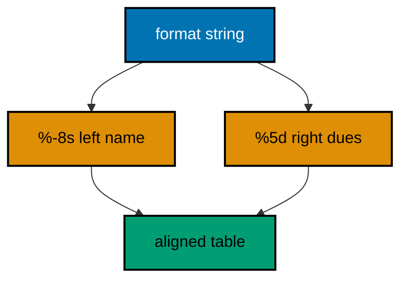

**`learning/code/ex-19-format-verbs-for-tables/Main.java`**:

```java
// Example 19: Format Verbs for Tables and Numbers.
// Format verbs align columns, round decimals, and pad numbers, so
// reports read as tables instead of ragged concatenations.
public class Main {

  // => one public class per file, named after the file
  public static void main(String[] args) {
    // => the entry point the harness runs
    System.out.println("%-8s %5s".formatted("member", "dues")); // => Output: header, name left, dues right
    System.out.println("%-8s %5d".formatted("sari", 50)); // => Output: sari row, padded to columns
    System.out.println("%-8s %5d".formatted("budi", 125)); // => Output: budi row, wider figure aligned
    System.out.println("share: %.2f".formatted(50.0 / 175.0)); // => Output: share: 0.29, rounded to two
    System.out.println("id: %04d".formatted(7)); // => Output: id: 0007, zero-padded to four
    System.out.println("hex: %x".formatted(255)); // => Output: hex: ff, lowercase hexadecimal
    String order = "%2$s owes %1$s".formatted("sari", "budi"); // => indexed verbs reorder arguments
    System.out.println(order); // => Output: budi owes sari
  } // => main ends: one verb family, seven shapes
}
```

**Output** (`learning/code/ex-19-format-verbs-for-tables/expected/main.stdout.txt`):

```text
member    dues
sari        50
budi       125
share: 0.29
id: 0007
hex: ff
budi owes sari
```

**Key takeaway**: Align reports with width and precision verbs; reorder with indexed verbs instead of rebuilding strings.

**Why it matters**: Format verbs state column policy once per table, where concatenation restates it per line and breaks on wide values.

### Example 20: Regular Expressions with Named Groups

Line grammars like `member:amount` deserve a real pattern, and named groups are what keep the pattern maintainable: `(?<member>[a-z]+)` labels the field at the definition site, so readers and later edits never count group indexes. The compile-once constant is the performance half of the idiom: Pattern compilation parses the grammar, so compiling inside the loop would repay that cost per line, while the shared constant pays it once and hands out cheap matchers. The matches-versus-find choice is the correctness half: matches demands the whole line conform, which is right for strict feeds, while find would accept a valid fragment hiding inside garbage. That strictness pairs with the honest-skip policy from Example 17: corrupt lines print with their evidence instead of vanishing. Keep patterns boring on purpose; a grammar that needs comments to explain each atom has outgrown regex and wants a real parser, a judgment the applied problems revisit. (Concepts: co-04.)

**`learning/code/ex-20-regex-with-named-groups/Main.java`**:

```java
// Example 20: Regular Expressions with Named Groups.
// Named groups turn a dues line into labeled fields: the pattern
// states the grammar once, and group names replace index magic.
import java.util.regex.Matcher; // => the match cursor over each line
import java.util.regex.Pattern; // => the compiled grammar, reused per line

public class Main {

  // => one public class per file, named after the file
  static final Pattern DUE = Pattern.compile(
    // => compiled once, matched many times
    "(?<member>[a-z]+):(?<amount>[0-9]+)"
  ); // => member letters, colon, digits

  public static void main(String[] args) {
    // => the entry point the harness runs
    String[] lines = { "sari:50", "budi:125", "oops-no-colon", "citra:25" }; // => three valid, one corrupt
    for (String line : lines) {
      // => each line faces the same grammar
      Matcher m = DUE.matcher(line); // => fresh cursor per line, shared pattern
      if (m.matches()) {
        // => full match: the whole line is grammar
        System.out.println(m.group("member") + " owes " + m.group("amount")); // => Output: three owes lines
      } else {
        // => the corrupt line lands here with its evidence
        System.out.println("skip: '" + line + "'"); // => Output: skip: 'oops-no-colon'
      } // => branch ends: matched or reported, never ignored
    } // => loop ends: grammar enforced line by line
    System.out.println("pattern: " + DUE.pattern()); // => Output: the source grammar itself
  } // => main ends: one pattern, four verdicts
}
```

**Output** (`learning/code/ex-20-regex-with-named-groups/expected/main.stdout.txt`):

```text
sari owes 50
budi owes 125
skip: 'oops-no-colon'
citra owes 25
pattern: (?<member>[a-z]+):(?<amount>[0-9]+)
```

**Key takeaway**: Compile line grammars once as named-group patterns; match strictly and report skips with evidence.

**Why it matters**: Named groups document fields at the definition, and compile-once matching keeps per-line validation cheap and strict.

### Example 21: Files with Explicit UTF-8

Whole-file text work in modern Java is two calls: writeString to store, readString to load, each with the charset stated explicitly. The explicit UTF_8 is the entire lesson for anyone burned by platform defaults: omitting the charset silently adopts the machine's default encoding, which turns names with non-ASCII characters into mojibake on exactly the machines you cannot reproduce. Stating UTF_8 at both ends makes the roundtrip a property of the program rather than of its host. The roundtrip assertion in the middle is the testing reflex this course drills: compare what came back with what went in and print the boolean, so the transcript proves fidelity instead of displaying text a human must eyeball. For line-oriented feeds the readAllLines closer counts without a loop, and for large files the streaming lines() view from Example 18 avoids holding everything at once; whole-file helpers own the small-file case only, and knowing that boundary is the performance-aware half of file IO. (Concepts: co-04.)

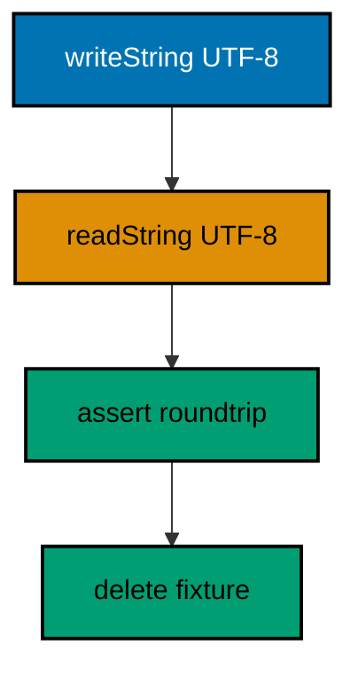

**`learning/code/ex-21-files-read-write-utf8/Main.java`**:

```java
// Example 21: Files with Explicit UTF-8.
// Files.readString and writeString move whole texts in one call with
// the charset stated, so platform defaults never sneak into data.
import java.io.IOException; // => file work is environmentally checked
import java.nio.charset.StandardCharsets; // => UTF_8 stated at every call
import java.nio.file.Files; // => the whole-file helpers
import java.nio.file.Path; // => the fixture handle

public class Main {

  // => one public class per file, named after the file
  public static void main(String[] args) throws IOException {
    // => small-program shape: declare once
    Path ledger = Path.of("ledger.txt"); // => fixture beside the program
    String body = "sari:50\nbudi:75\ncitra:25\n"; // => three dues lines, fixed content
    Files.writeString(ledger, body, StandardCharsets.UTF_8); // => charset explicit, never defaulted
    String back = Files.readString(ledger, StandardCharsets.UTF_8); // => same charset on the way back
    System.out.print(back); // => Output: the three dues lines verbatim
    System.out.println("roundtrip: " + back.equals(body)); // => Output: roundtrip: true
    System.out.println("lines: " + Files.readAllLines(ledger, StandardCharsets.UTF_8).size()); // => Output: lines: 3
    Files.deleteIfExists(ledger); // => tidy: reruns start identical
  } // => main ends: write, read, verify, tidy
}
```

**`learning/code/ex-21-files-read-write-utf8/ledger.txt`**:

```text
sari:50
budi:75
citra:25
```

**Output** (`learning/code/ex-21-files-read-write-utf8/expected/main.stdout.txt`):

```text
sari:50
budi:75
citra:25
roundtrip: true
lines: 3
```

**Key takeaway**: Move whole texts with readString and writeString, stating UTF_8 at both ends and asserting the roundtrip.

**Why it matters**: Explicit charsets make encoding a program property instead of a host accident, and printed roundtrips prove fidelity mechanically.

### Example 22: CSV Quotes Need More Than Split

Comma-splitting is correct exactly until the first quoted comma, and dues feeds grow quoted fields the moment a name like Santoso, Budi arrives. The naive split turns that row into three fields, silently shifting every column downstream; the char-walking parser here keeps the quoted comma inside its field and returns two. The final println exists to print that contrast as evidence: the parser yields two fields where split yields three, so the transcript proves the lesson instead of asserting it. The StringBuilder accumulation is the performance-aware half of the idiom: appending chars into a builder avoids the quadratic copying that plus-in-a-loop would inflict, a cost Example 63 measures directly. Know the honest boundary of this code: it handles quoted commas and nothing else, no escaped quotes, no multi-line fields. A feed needing those wants a real CSV library, and choosing the library over a second parser rewrite is precisely the dependency judgment the intermediate chapter trains. (Concepts: co-04.)

**`learning/code/ex-22-csv-quotes-need-a-parser/Main.java`**:

```java
// Example 22: CSV Quotes Need More Than Split.
// Naive comma-splitting breaks on quoted commas, so this parser
// walks each line char by char, honoring quotes the way CSV means.
import java.util.ArrayList; // => the parsed fields, grown per line
import java.util.List; // => interface on the left as always

public class Main {

  // => one public class per file, named after the file
  static List<String> parseCsvLine(String line) {
    // => one line in, fields out
    List<String> fields = new ArrayList<>(); // => grows field by field
    StringBuilder cell = new StringBuilder(); // => the field under construction
    boolean quoted = false; // => inside quotes, commas are data
    for (int i = 0; i < line.length(); i++) {
      // => the char walk: every char judged once
      char c = line.charAt(i); // => the current character under judgment
      if (c == '"') {
        // => a quote toggles quoting, never lands in data
        quoted = !quoted; // => enter or leave the quoted region
      } else if (c == ',' && !quoted) {
        // => bare comma ends the field
        fields.add(cell.toString()); // => bank the finished field
        cell.setLength(0); // => reset the builder for the next field
      } else {
        // => data characters, quoted commas included
        cell.append(c); // => accumulate into the current field
      } // => branch ends: every char classified exactly once
    } // => walk ends at end-of-line
    fields.add(cell.toString()); // => bank the final field after the loop
    return fields; // => the parsed row for the caller
  } // => parser ends: quotes honored, commas split, data kept

  public static void main(String[] args) {
    // => the entry point the harness runs
    String[] rows = { "sari,50", "\"santoso, budi\",75", "citra,25" }; // => plain, quoted comma, plain
    for (String row : rows) {
      // => each row parsed on its own terms
      System.out.println(parseCsvLine(row)); // => Output: [sari, 50], then the quoted pair intact, then [citra, 25]
    } // => loop ends: no quoted comma ever split a field
    System.out.println("naive: " + rows[1].split(",").length); // => Output: naive: 3, the wrong field count
  } // => main ends: parser right, split wrong, evidence printed
}
```

**Output** (`learning/code/ex-22-csv-quotes-need-a-parser/expected/main.stdout.txt`):

```text
[sari, 50]
[santoso, budi, 75]
[citra, 25]
naive: 3
```

**Key takeaway**: Parse quoted CSV with a quote-aware char walk; print the naive split's wrong count as evidence.

**Why it matters**: Quoted commas make split wrong by construction, and a small honest parser beats both naive splitting and premature library adoption.

### Example 23: Properties Config at the Edge

Tunables belong in files, not in source: hostnames, ports, and batch sizes change per deployment while the code stays identical. The Properties loader is Java's smallest config story, reading key=value pairs with comment and blank-line handling built in, and getProperty with a default keeps every lookup total so missing keys degrade to documented fallbacks instead of nulls. Two edge rules complete the idiom. Typing happens once at the edge: the port string becomes an int at load time, so the rest of the program passes integers and never re-parses; pushing parse calls deep into business logic is how one malformed value explodes far from its file. And secrets never live in properties files committed beside code; hostnames and ports are safe, passwords and tokens belong in the environment, a boundary the interop chapter states plainly. The missing-key line prints the fallback as proof that defaults are behavior, not comments. (Concepts: co-04.)

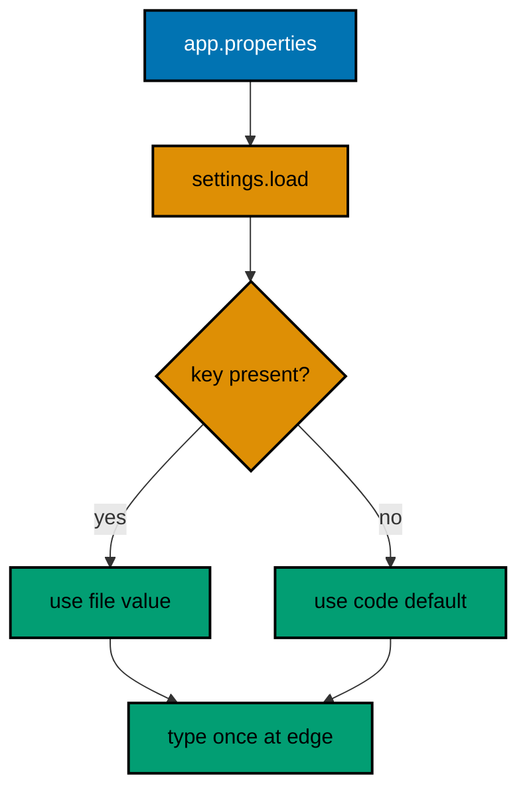

**`learning/code/ex-23-properties-config-at-the-edge/Main.java`**:

```java
// Example 23: Properties Config at the Edge.
// The Properties loader reads key=value config with defaults, so
// tunables live in a file while the code keeps its fallbacks.
import java.io.IOException; // => config reads are environmentally checked
import java.io.Reader; // => the charset-carrying reader
import java.nio.charset.StandardCharsets; // => UTF_8 stated once more
import java.nio.file.Files; // => fixture reader
import java.nio.file.Path; // => the app.properties handle
import java.util.Properties; // => the key=value config map

public class Main {

  // => one public class per file, named after the file
  public static void main(String[] args) throws IOException {
    // => small-program shape: declare once
    Path config = Path.of("app.properties"); // => fixture beside the program
    Properties settings = new Properties(); // => empty map with built-in defaults below
    try (Reader reader = Files.newBufferedReader(config, StandardCharsets.UTF_8)) {
      // => closed by the header
      settings.load(reader); // => comments and blanks skipped by the loader
    } // => reader closed here, settings fully loaded
    String host = settings.getProperty("report.host", "localhost"); // => present key wins over the default
    String missing = settings.getProperty("report.missing", "fallback"); // => absent key yields the default
    int port = Integer.parseInt(settings.getProperty("report.port", "8080")); // => typed at the edge, once
    System.out.println("host: " + host); // => Output: host: ledger.example
    System.out.println("missing: " + missing); // => Output: missing: fallback
    System.out.println("port: " + port); // => Output: port: 9090
  } // => main ends: config read, defaulted, typed, printed
}
```

**`learning/code/ex-23-properties-config-at-the-edge/app.properties`**:

```properties
# Dues reporter config.
report.host=ledger.example
report.port=9090
```

**Output** (`learning/code/ex-23-properties-config-at-the-edge/expected/main.stdout.txt`):

```text
host: ledger.example
missing: fallback
port: 9090
```

**Key takeaway**: Load tunables with Properties, default every lookup, and type values once at the edge.

**Why it matters**: File config with code fallbacks deploys without rebuilds, and edge typing keeps malformed values from exploding deep inside.

### Example 24: Instants and Durations from Fixed Points

Machine time in Java is an Instant, a point on the UTC timeline with no zone, no calendar, and no formatting opinions, and spans between instants are Durations carrying their unit conversions as methods. The fixed-parse discipline is what makes time testable: both endpoints are literal strings, so the thirty-minute window asserts exactly on every run, where Instant.now would inject the wall clock into the transcript and make reruns disagree. That is the general time-testing rule this example establishes: never assert on now, inject or fix the clock, and Example 25 extends the same discipline to zoned wall time. Duration factories like ofMinutes name their unit at construction, which beats multiplying magic sixties, and dividedBy keeps span arithmetic inside the type instead of dropping to long seconds and back. The epoch closer grounds the timeline: every instant is an offset from 1970, and printing the origin reminds readers what the numbers mean. (Concepts: co-05.)

**`learning/code/ex-24-instants-and-durations-fixed/Main.java`**:

```java
// Example 24: Instants and Durations from Fixed Points.
// Instant marks machine time and Duration measures between fixed
// points, so tests assert exact spans without ever reading a clock.
import java.time.Duration; // => the machine-scale span between instants
import java.time.Instant; // => a fixed point on the UTC timeline

public class Main {

  // => one public class per file, named after the file
  public static void main(String[] args) {
    // => the entry point the harness runs
    Instant start = Instant.parse("2026-10-01T09:00:00Z"); // => fixed settlement open, UTC
    Instant end = Instant.parse("2026-10-01T09:30:00Z"); // => fixed settlement close, UTC
    Duration window = Duration.between(start, end); // => the span as data, not arithmetic
    System.out.println("minutes: " + window.toMinutes()); // => Output: minutes: 30
    System.out.println("seconds: " + window.toSeconds()); // => Output: seconds: 1800
    Duration grace = Duration.ofMinutes(5); // => factory names the unit at construction
    System.out.println("deadline: " + end.plus(grace)); // => Output: 2026-10-01T09:35:00Z
    System.out.println("half: " + window.dividedBy(2).toMinutes()); // => Output: half: 15
    System.out.println("before: " + start.isBefore(end)); // => Output: before: true
    Instant epoch = Instant.ofEpochSecond(0); // => the timeline origin for reference
    System.out.println("epoch: " + epoch); // => Output: 1970-01-01T00:00:00Z
  } // => main ends: no clock read, every value fixed
}
```

**Output** (`learning/code/ex-24-instants-and-durations-fixed/expected/main.stdout.txt`):

```text
minutes: 30
seconds: 1800
deadline: 2026-10-01T09:35:00Z
half: 15
before: true
epoch: 1970-01-01T00:00:00Z
```

**Key takeaway**: Model machine spans with Instant and Duration parsed from fixed literals; never assert on a live clock.

**Why it matters**: Fixed endpoints make time spans deterministic and assertable, where now() would make every run disagree.

### Example 25: Zoned Time for Humans

Humans read wall time in zones while machines store instants in UTC, and ZonedDateTime is the bridge built only at the display edge. The storage rule fits in a sentence: persist Instant, render ZonedDateTime, so daylight-saving transitions and zone renames can never corrupt recorded facts. The zone itself must be a named ZoneId like Asia/Jakarta rather than a raw +07:00 offset, because names track rule changes while offsets freeze one moment's arithmetic; Jakarta has no DST today, but code written against the name survives the policy change that code written against the offset does not. Period covers the human-scale companion: months and days for dues cycles, where Duration's exact seconds would drift across month lengths. The roundtrip closer proves the bridge is lossless: the zoned view converts back to the identical stored instant, so display never edits the fact. (Concepts: co-05.)

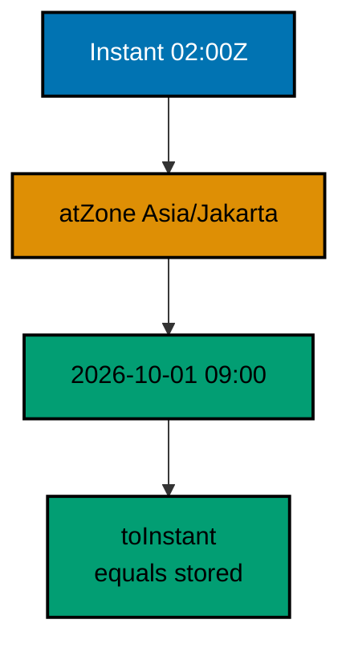

**`learning/code/ex-25-zoned-time-for-humans/Main.java`**:

```java
// Example 25: Zoned Time for Humans.
// ZonedDateTime pairs an instant with a zone for display, and
// DateTimeFormatter renders it; storage stays Instant, humans get zones.
import java.time.Instant; // => the storable machine point
import java.time.LocalDate; // => calendar dates for dues-day arithmetic
import java.time.Period; // => human-scale spans in years, months, days
import java.time.ZoneId; // => named zones, never raw offsets
import java.time.ZonedDateTime; // => instant plus zone for display
import java.time.format.DateTimeFormatter; // => explicit patterns for reports

public class Main {

  // => one public class per file, named after the file
  public static void main(String[] args) {
    // => the entry point the harness runs
    Instant settled = Instant.parse("2026-10-01T02:00:00Z"); // => stored UTC point, fixed
    ZoneId jakarta = ZoneId.of("Asia/Jakarta"); // => named zone: UTC+7, no DST
    ZonedDateTime seen = settled.atZone(jakarta); // => same instant, human wall time
    System.out.println("jakarta: " + seen.format(DateTimeFormatter.ofPattern("yyyy-MM-dd HH:mm"))); // => Output: jakarta: 2026-10-01 09:00
    LocalDate duesDay = LocalDate.of(2026, 10, 1); // => calendar date, no time attached
    LocalDate next = duesDay.plus(Period.ofMonths(1)); // => human month step, calendar-aware
    System.out.println("next dues: " + next); // => Output: next dues: 2026-11-01
    Period wait = Period.between(duesDay, next); // => human span between calendar dates
    System.out.println("wait months: " + wait.getMonths()); // => Output: wait months: 1
    System.out.println("offset: " + seen.getOffset()); // => Output: offset: +07:00
    System.out.println("back to instant: " + seen.toInstant().equals(settled)); // => Output: back to instant: true
  } // => main ends: zones displayed, instants stored
}
```

**Output** (`learning/code/ex-25-zoned-time-for-humans/expected/main.stdout.txt`):

```text
jakarta: 2026-10-01 09:00
next dues: 2026-11-01
wait months: 1
offset: +07:00
back to instant: true
```

**Key takeaway**: Store Instants, display ZonedDateTimes in named zones, and step calendars with Period.

**Why it matters**: UTC storage survives zone politics while named-zone display reads correctly, and Period steps months the way humans count them.
