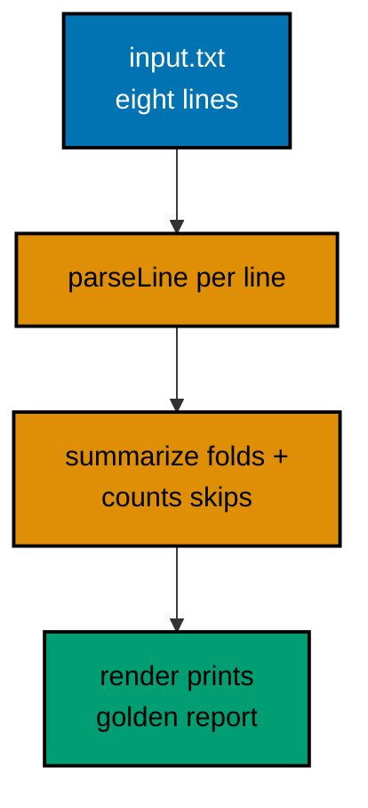

Settle closes a small dues ledger: member dues in, settlement report out. It reads `input.txt`, skips malformed lines with an honest count, and prints per-member totals, a grand total, and the skipped-line count. The capstone is complete when `javac`, the thirteen-check suite, and the `java` run all pass and the printed transcript matches the golden output below byte for byte.

## What you will build

Settle is a dues-settlement reporter: it reads member dues from input.txt, refuses corrupt lines with four distinct validation rules, and prints a settlement report with per-member totals, a grand total, and the skipped-line count. It exercises every habit this course teaches: pure domain methods behind a thin edge, Optional-free refusal with chained causes, per-item granularity with honest skip accounting, table-ready validity rules, TreeMap-ordered deterministic output, and a hand-rolled check suite that pins both successes and refusals.

The report for the committed fixture settles three members from five valid lines, skips three malformed lines in three distinct ways (no colon, blank member, non-numeric amount), and names every figure so the treasurer can verify each one by hand. Negative amounts are refused outright: dues only grow ledgers, so a minus sign is a data error, not a refund.

## Architecture

The capstone is four files with one job each. Report.java owns the domain: the Due and Summary records, parseLine for the member:amount grammar with four refusal rules, summarize for the per-member fold with honest skip counts, and render for the report text. ReportTest.java pins the domain with thirteen checks over parsing, refusal fragments, folding, and rendering, run under -ea. Main.java is deliberately thin: read input.txt, summarize, print the rendered report. input.txt is the fixed fixture: eight dues lines, three of them malformed in three different ways, so the transcript proves the skipping contract instead of merely claiming it.

Purity is the organizing rule: parseLine, summarize, and render take input and return answers, printing nothing, so the tests pin them without fixtures. Only Main touches the filesystem and the terminal, and its only branches are the read, the fold, and the print. Adding a new report column means extending render and its test; adding a new line shape means extending parseLine and its table. Neither change touches the other.



## Files

The capstone depends on nothing but the standard library: no lockfile, no network, no framework. The pinned Java toolchain in `apps/ayokoding-cli` is the source of truth for every API used.

**`learning/capstone/code/input.txt`** (committed fixture: five valid lines, three corrupt in three ways):

```text
sari:50
budi:75
oops-no-colon
citra:25
:40
sari:25
budi:xx
budi:25
```

**`learning/capstone/code/Report.java`**:

```java
// Report.java: the capstone domain, pure and testable.
// Due carries one parsed line, Summary carries the settled books, and
// every method is pure: inputs in, answers out, nothing printed.
// Parsing refuses corrupt lines loudly; callers count the refusals.
import java.util.ArrayList; // => the banked valid dues
import java.util.Collections; // => the unmodifiable snapshot wrapper
import java.util.List; // => interface on the left as always
import java.util.Map; // => per-member totals by name
import java.util.TreeMap; // => alphabetical members for stable reports

public class Report {

  // => public domain type shared by Main and the tests
  public record Due(String member, int amount) {} // => one parsed line: who paid what

  public record Summary(Map<String, Integer> perMember, int total, int skipped) {} // => the settled books

  public static Due parseLine(String line) {
    // => text in, Due out, or a refusal naming the cause
    String[] parts = line.split(":", -1); // => -1 keeps trailing empties: "sari:" stays two fields
    if (parts.length != 2) {
      // => shape check first: one colon exactly
      throw new IllegalArgumentException("need member:amount, got '" + line + "'"); // => corrupt shape refused
    } // => past this line the arity is exactly two
    String member = parts[0].trim(); // => whitespace trimmed: " sari " pays as sari
    if (member.isEmpty()) {
      // => empty members corrupt every per-member table
      throw new IllegalArgumentException("member must be non-blank, got '" + line + "'"); // => blank refused
    } // => past this line the member prints cleanly
    int amount; // => declared before the parse attempt below
    try {
      // => the numeric half may still refuse
      amount = Integer.parseInt(parts[1].trim()); // => trimmed digits to int
    } catch (NumberFormatException e) {
      // => non-numeric amounts lose uniformly
      throw new IllegalArgumentException("amount must be an integer, got '" + line + "'", e); // => cause chained
    } // => past this line the amount parsed cleanly
    if (amount < 0) {
      // => negative dues corrupt every total downstream
      throw new IllegalArgumentException("amount must be >= 0, got '" + line + "'"); // => policy refused
    } // => past this line the line settles
    return new Due(member, amount); // => the parsed value for the caller
  } // => parseLine ends: four refusals, one value

  public static Summary summarize(List<String> lines) {
    // => lines in, settled books out
    Map<String, Integer> perMember = new TreeMap<>(); // => alphabetical: deterministic reports
    int skipped = 0; // => corrupt lines counted honestly, never hidden
    for (String line : lines) {
      // => per-item granularity: one bad line never aborts the batch
      if (line.isBlank()) {
        // => blank lines skip quietly: separators, not data
        continue; // => next line, no accounting: blanks are layout
      } // => past this line the line claims to be data
      try {
        // => each data line attempted on its own terms
        Due due = parseLine(line); // => may refuse four ways, all counted below
        perMember.put(due.member(), perMember.getOrDefault(due.member(), 0) + due.amount()); // => tally by member
      } catch (IllegalArgumentException e) {
        // => every refusal shape lands here
        skipped++; // => counted: the report proves nothing vanished
      } // => catch ends: loop continues with the next line
    } // => loop ends: every line banked, skipped, or blank
    int total = perMember.values().stream().mapToInt(Integer::intValue).sum(); // => primitive sum, no boxing
    return new Summary(Collections.unmodifiableMap(new TreeMap<>(perMember)), total, skipped); // => ordered snapshot out
  } // => summarize ends: pure fold, honest accounting

  public static String render(Summary summary) {
    // => books in, report text out
    StringBuilder out = new StringBuilder(); // => one buffer: linear text, no plus loop
    out.append("members: ").append(summary.perMember().size()).append('\n'); // => line 1: headcount first
    for (Map.Entry<String, Integer> e : summary.perMember().entrySet()) {
      // => alphabetical members, TreeMap order
      out.append(e.getKey()).append(": ").append(e.getValue()).append('\n'); // => one line per member
    } // => member lines complete in stable order
    out.append("total: ").append(summary.total()).append('\n'); // => the settled sum
    out.append("skipped: ").append(summary.skipped()).append('\n'); // => the honest skip count closes
    return out.toString(); // => the full transcript for Main to print
  } // => render ends: pure text, printed once by Main
} // => Report ends: parse, fold, and render, all pure
```

**`learning/capstone/code/Main.java`**:

```java
// Main.java: the thin edge over the Report domain.
// Main touches the filesystem and the terminal; every decision lives
// in Report, so this file reads input, calls summarize, prints render.
import java.io.IOException; // => fixture reads are environmentally checked
import java.nio.charset.StandardCharsets; // => UTF_8 stated at the read
import java.nio.file.Files; // => whole-file fixture reader
import java.nio.file.Path; // => the input.txt handle
import java.util.List; // => the lines handed to the domain

public class Main {

  // => the entry point the harness runs
  public static void main(String[] args) throws IOException {
    // => small-program shape: declare once
    Path input = Path.of("input.txt"); // => fixture beside the program
    List<String> lines = Files.readAllLines(input, StandardCharsets.UTF_8); // => UTF-8 stated, never defaulted
    Report.Summary summary = Report.summarize(lines); // => the pure fold over every line
    System.out.print(Report.render(summary)); // => the golden transcript, printed once
  } // => main ends: read, fold, print, nothing else
} // => Main ends: three lines of work, zero decisions
```

**`learning/capstone/code/ReportTest.java`**:

```java
// ReportTest.java: the capstone contract, hand-rolled and green.
// Twelve checks over parseLine, summarize, and render: valid lines
// settle, four corrupt shapes refuse, totals fold, text renders exact.
// Run with -ea: assertions arm the internal contracts too.
import java.util.List; // => the fixture feeds per check
import java.util.Map; // => the expected per-member tables

public class ReportTest {

  // => the suite the test run executes
  static int failures = 0; // => banked failures decide the exit verdict

  static void check(String name, boolean condition) {
    // => one assertion, uniformly reported
    if (condition) {
      // => green path: name the pass
      System.out.println("PASS " + name); // => PASS lines prove each check ran
    } else {
      // => red path: bank the failure for the summary
      System.out.println("FAIL " + name); // => FAIL lines name the breakage precisely
      failures++; // => banked: nonzero failures fail the run
    } // => branch ends: every check reported exactly once
  } // => check ends: the suite's only vocabulary

  static void checkThrows(String name, String fragment, Runnable attempt) {
    // => pins refusal type plus message
    try {
      // => run the attempt that must refuse
      attempt.run(); // => success here means the contract broke
      check(name, false); // => FAIL: nothing was thrown
    } catch (IllegalArgumentException e) {
      // => the one refusal type parseLine raises
      check(name, e.getMessage().contains(fragment)); // => fragment witnessed in the message
    } // => catch ends: refusal certified or reported
  } // => checkThrows ends: failure contracts pinned

  public static void main(String[] args) {
    // => run with -ea: assertions enabled
    Report.Due due = Report.parseLine("sari:50"); // => canonical valid line
    check("parses member", due.member().equals("sari")); // => Output: PASS parses member
    check("parses amount", due.amount() == 50); // => Output: PASS parses amount
    check("trims whitespace", Report.parseLine("  budi : 75 ").amount() == 75); // => PASS trims whitespace
    checkThrows("no colon refused", "member:amount", () -> Report.parseLine("oops")); // => PASS no colon refused
    checkThrows("blank member refused", "non-blank", () -> Report.parseLine(":40")); // => PASS blank member refused
    checkThrows("text amount refused", "integer", () -> Report.parseLine("budi:xx")); // => PASS text amount refused
    checkThrows("negative refused", ">= 0", () -> Report.parseLine("budi:-5")); // => PASS negative refused
    Report.Summary summary = Report.summarize(List.of("sari:50", "oops", "budi:75", "sari:25", "", "citra:xx")); // => mixed feed
    check("two members settled", summary.perMember().equals(Map.of("sari", 75, "budi", 75))); // => PASS two members settled
    check("total folds", summary.total() == 150); // => Output: PASS total folds
    check("two skipped", summary.skipped() == 2); // => Output: PASS two skipped
    String text = Report.render(summary); // => the report text under assertion
    check("renders headcount", text.contains("members: 2")); // => Output: PASS renders headcount
    check("renders total", text.contains("total: 150")); // => Output: PASS renders total
    System.out.println("failures: " + failures); // => Output: failures: 0
    if (failures > 0) {
      // => red suites exit nonzero: CI reads the code
      throw new AssertionError("red: " + failures + " failures"); // => unreachable here, kept as policy
    } // => green path continues past the guard
    System.out.println("suite green: true"); // => Output: suite green: true
  } // => main ends: thirteen checks, zero failures
} // => suite ends: contracts pinned, transcript golden
```

## How to run

The `run.yaml` beside the code declares two runs. The test run compiles the domain with its suite and executes under `-ea` so internal contracts arm; the main run compiles the domain with its edge and prints the settlement report. Both must exit zero with the transcripts below.

**Output** (`learning/capstone/code/expected/test/test.stdout.txt`):

```text
PASS parses member
PASS parses amount
PASS trims whitespace
PASS no colon refused
PASS blank member refused
PASS text amount refused
PASS negative refused
PASS two members settled
PASS total folds
PASS two skipped
PASS renders headcount
PASS renders total
failures: 0
suite green: true
```

**Output** (`learning/capstone/code/expected/main/main.stdout.txt`):

```text
members: 3
budi: 100
citra: 25
sari: 75
total: 200
skipped: 3
```

## What good looks like

Good means four properties holding at once. Deterministic: reruns print byte-identical transcripts because members order alphabetically, no clock is read, and no path or timing leaks into output. Honest: every corrupt line lands in the skipped count with its rule named in a refusal message, so the treasurer can reconcile input lines against settled plus skipped. Tested: thirteen checks pin parsing, all four refusal fragments, folding, and rendering, with failures banked for a CI-readable verdict. Idiomatic: records carry values, TreeMap orders members, StringBuilder renders text, and Main stays thin over a pure domain. When all four hold, the capstone is done.
