Examples 26–53 scale from single files to real projects: module and package layout (Examples 26–34), from one-class-one-job through packages, module descriptors, import policy, Maven coordinates, exact version pins, Javadoc contracts, executable jars, and runtime version gates; then Java's testing convention end to end (Examples 35–44), from assertions and a hand-rolled runner through fresh fixtures, table tests, failure contracts, temp-dir isolation, red-first workflow, boundary families, seam fakes, and spec-reading names; finally generics and value semantics (Examples 45–53), covering generic boxes, producer-extends-consumer-super, bounded stacks, records, sealed hierarchies, defensive copies, behavior enums, the equals-hashCode-compareTo agreement, and views versus snapshots. Every example is a complete, runnable Java program under `learning/code/`; run each with the command in its own `run.yaml`.

---

### Example 26: One Class, One Job

The module chapter opens at the smallest scale, because package layout cannot rescue classes that each do three jobs. This program splits the classic parse-total-print trio into three single-purpose methods feeding one record: parse owns the grammar, total owns the arithmetic, and report owns the text, with the Due record carrying data between them. The record is the seam that makes the split work: a typed pair with named accessors beats a String array that every method re-indexes, and because records are immutable the total cannot corrupt what parse built. Notice what each method refuses: parse never prints, total never parses, report never touches the network or the disk. That refusal is testability: any one job can be exercised with literal inputs and asserted outputs, exactly the shape the testing cluster demands. When a method grows a second job, the idiomatic response is a second method or a second class, not a longer body; the packages ahead organize those small units, but the smallness itself starts here. (Concepts: co-06.)

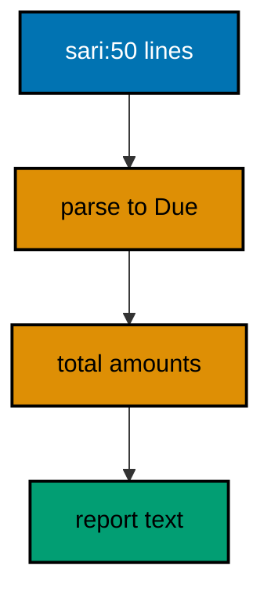

**`learning/code/ex-26-one-class-one-job/Main.java`**:

```java
// Example 26: One Class, One Job.
// Small classes with one responsibility compose better than a single
// class doing parsing, totaling, and printing all at once.
import java.util.List; // => the dues lines under test

public class Main {

  // => one public class per file, named after the file
  record Due(String member, int amount) {} // => parsing output: data, nothing else

  static Due parse(String line) {
    // => parsing job: text in, Due out
    String[] parts = line.split(":"); // => the member:amount grammar
    return new Due(parts[0], Integer.parseInt(parts[1])); // => typed pair, validated by construction
  } // => parse ends: no printing, no totaling

  static int total(List<Due> dues) {
    // => totaling job: dues in, sum out
    return dues.stream().mapToInt(Due::amount).sum(); // => primitive stream, no boxing
  } // => total ends: no parsing, no printing

  static String report(List<Due> dues) {
    // => printing job: dues in, text out
    return "members: " + dues.size() + ", total: " + total(dues); // => composition of the two jobs above
  } // => report ends: pure text, printed once by main

  public static void main(String[] args) {
    // => the entry point the harness runs
    List<Due> dues = List.of(parse("sari:50"), parse("budi:75")); // => parse each fixture line
    System.out.println(report(dues)); // => Output: members: 2, total: 125
    System.out.println("first: " + dues.get(0).member()); // => Output: first: sari
  } // => main ends: parse, total, and report each used once
}
```

**Output** (`learning/code/ex-26-one-class-one-job/expected/main.stdout.txt`):

```text
members: 2, total: 125
first: sari
```

**Key takeaway**: Give every method one job and pass records between them; refuse the second responsibility instead of growing.

**Why it matters**: Single-job methods with record seams test independently and compose without hidden coupling.

### Example 27: Packages Group Related Code

Packages are Java's API lines: public types form the promised surface while package-private members stay implementation detail, and this two-file unit shows both sides of that line. Cart publishes exactly two methods, add and count, keeping its item list private and its pricing package-private; Main imports only Cart and conducts all business through those two methods. The commented subtotal call is the executable boundary marker: uncommenting it breaks compilation with an access error, which proves the line is compiler-enforced rather than conventional. That enforcement is why package placement is a design decision, not a filing choice: moving a class into a package grants it that package's secrets, and splitting a concept across packages revokes them. Directory and package must agree, shop/Cart.java declaring package shop, because the compiler resolves the import from the folder structure; a mismatch fails the build before any test runs. (Concepts: co-06.)

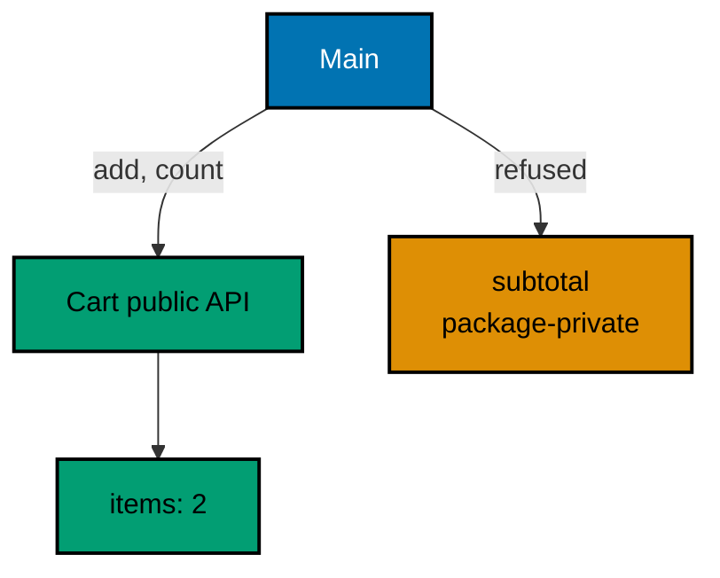

**`learning/code/ex-27-packages-group-related-code/shop/Cart.java`**:

```java
// shop/Cart.java: the basket owned by the shop package.
// Package-private pricing stays inside shop; only the total crosses
// the boundary, which is how packages draw API lines.
package shop; // => this file lives in the shop package

import java.util.ArrayList; // => the item list inside the basket
import java.util.List; // => interface on the left as always

public class Cart {

  // => public: the one type this package shares
  private final List<String> items = new ArrayList<>(); // => private: contents stay hidden

  public void add(String item) {
    // => public: the boundary call other packages use
    items.add(item); // => the only mutation path into the basket
  } // => add ends: contents grow, encapsulation holds

  public int count() {
    // => public: observers count without seeing items
    return items.size(); // => size answers without exposing the list
  } // => count ends: number out, contents still hidden

  int subtotal(int unitPrice) {
    // => package-private: pricing stays inside shop
    return items.size() * unitPrice; // => arithmetic the outside never calls
  } // => subtotal ends: visible to shop, invisible to importers
} // => Cart ends: two public methods, one package secret
```

**`learning/code/ex-27-packages-group-related-code/Main.java`**:

```java
// Main.java: the importer that shops through the boundary.
// Main sees only the public Cart API; the package-private pricing
// stays unreachable, which the commented line below would prove.
import shop.Cart; // => the single type Main may use from shop

public class Main {

  // => one public class per file, named after the file
  public static void main(String[] args) {
    // => the entry point the harness runs
    Cart cart = new Cart(); // => constructed through the public type
    cart.add("rice"); // => boundary call one: add through the API
    cart.add("sugar"); // => boundary call two: same door, second item
    System.out.println("items: " + cart.count()); // => Output: items: 2
    // cart.subtotal(10); // => uncomment to see the error: subtotal is not visible here
    System.out.println("shops cleanly: true"); // => Output: shops cleanly: true
  } // => main ends: public API used, package secrets untouched
}
```

**Output** (`learning/code/ex-27-packages-group-related-code/expected/main.stdout.txt`):

```text
items: 2
shops cleanly: true
```

**Key takeaway**: Publish narrow public APIs per package; keep pricing and internals package-private behind the line.

**Why it matters**: Compiler-enforced package lines make API promises structural, so importers cannot depend on what they cannot see.

### Example 28: module-info Declares the Exports

The module descriptor lifts package lines to the deployment level: module-info declares that the dues module exports exactly the dues package, so consumers compile against that promise and the module system rejects every other access at link time. Packages alone cannot do this because the classpath treats every public type as globally reachable; modules restore the boundary for programs big enough to need one. The build commands carry the two new concepts: `javac -d out` compiles all three sources with the descriptor on board, and `java -p out -m dues/dues.Main` launches on the module path naming module and class explicitly. Small programs skip modules honestly, and this course's other seventy-seven examples do exactly that; reach for module-info when the codebase grows multiple teams, versioned boundaries, or a public API with internals worth hiding. The printed transcript is deliberately ordinary, because modules change linkage, not behavior: same ledger, same total, stronger walls. (Concepts: co-06.)

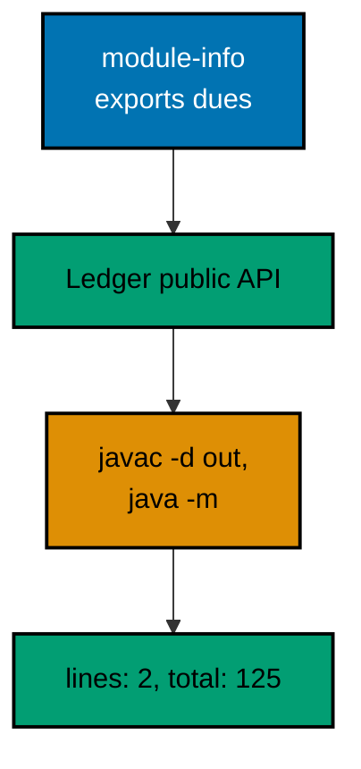

**`learning/code/ex-28-module-info-declares-exports/module-info.java`**:

```java
// module-info.java: the module contract for dues.
// The descriptor names the module and exports exactly one package,
// so consumers compile against the promise, not the internals.
module dues {
  // => the module name every consumer requires
  exports dues; // => the one package the world may use
} // => descriptor ends: two lines, the whole public surface
```

**`learning/code/ex-28-module-info-declares-exports/dues/Ledger.java`**:

```java
// dues/Ledger.java: the exported ledger inside module dues.
// Ledger publishes totals; its parsing helper stays package-private,
// and the module descriptor stops other modules even earlier.
package dues; // => the exported package named in module-info

import java.util.ArrayList; // => the banked dues lines
import java.util.List; // => interface on the left as always

public class Ledger {

  // => public and exported: reachable from other modules
  private final List<String> lines = new ArrayList<>(); // => private: raw lines stay hidden

  public void add(String member, int amount) {
    // => public: validated entry point
    lines.add(member + ":" + amount); // => canonical shape stored, callers pass parts
  } // => add ends: one line banked per call

  public int total() {
    // => public: the settled sum over banked lines
    return lines
      .stream()
      .mapToInt(l -> Integer.parseInt(l.split(":")[1]))
      .sum(); // => split, parse, sum
  } // => total ends: arithmetic over the canonical shape

  public int size() {
    // => public: observers count without reading lines
    return lines.size(); // => count answers, contents stay hidden
  } // => size ends: number out, lines still private
} // => Ledger ends: three public methods, zero leaks
```

**`learning/code/ex-28-module-info-declares-exports/dues/Main.java`**:

```java
// dues/Main.java: the module's own entry point.
// Main lives inside the module, so it uses Ledger freely; outside
// modules would see only the exported package, never internals.
package dues; // => same module, same package: full visibility here

public class Main {

  // => the entry point the module runs
  public static void main(String[] args) {
    // => launched as dues/dues.Main on the module path
    Ledger ledger = new Ledger(); // => exported type, constructed directly
    ledger.add("sari", 50); // => first dues line banked
    ledger.add("budi", 75); // => second dues line banked
    System.out.println("lines: " + ledger.size()); // => Output: lines: 2
    System.out.println("total: " + ledger.total()); // => Output: total: 125
  } // => main ends: module compiled, linked, and run as one unit
}
```

**Output** (`learning/code/ex-28-module-info-declares-exports/expected/main.stdout.txt`):

```text
lines: 2
total: 125
```

**Key takeaway**: Declare module exports for multi-team codebases; compile to out and launch with -m on the module path.

**Why it matters**: Module descriptors enforce API boundaries at link time, where classpath visibility would leave every public type reachable.

### Example 29: Imports Resolve Names, Collisions Qualify

Import lists are the file's honesty declaration: every type the code means by its short name appears at the top, and anything missing must be spelled in full. The java.sql.Date line shows the collision policy: java.util also offers a Date, so importing either would make the short name ambiguous, and the idiomatic answer imports neither for that name, qualifying both or importing the daily one while qualifying the rarity. Here LocalDate carries the daily work unqualified while the legacy SQL date spells its package, documenting at the use site that legacy interop is happening. Static imports get a narrower license: max and sort read as verbs inside algorithms, but static-importing whole utility classes litters the namespace with lookalike verbs from every helper. Import exactly what the file uses, no wildcards in committed code, because explicit imports keep refactors greppable and reviews honest about new coupling. (Concepts: co-06.)

**`learning/code/ex-29-imports-resolve-names/Main.java`**:

```java
import static java.lang.Math.max; // => static import: max reads as a verb
import static java.util.Collections.sort; // => static import: sort reads as a verb

// Example 29: Imports Resolve Names, Collisions Qualify.
// Imports buy short names for the types a file uses most; when two
// packages offer the same name, the loser is spelled out in full.
import java.time.LocalDate; // => the date this file means unqualified
import java.util.List; // => the list this file means unqualified

public class Main {

  // => one public class per file, named after the file
  public static void main(String[] args) {
    // => the entry point the harness runs
    LocalDate day = LocalDate.of(2026, 10, 1); // => short name via the import above
    System.out.println("dues day: " + day); // => Output: dues day: 2026-10-01
    java.sql.Date legacy = java.sql.Date.valueOf(day); // => collision: fully qualified, no import
    System.out.println("legacy: " + legacy); // => Output: legacy: 2026-10-01
    System.out.println("max: " + max(50, 75)); // => Output: max: 75, static verb, no class prefix
    java.util.ArrayList<String> names = new java.util.ArrayList<>(List.of("budi", "sari")); // => qualified builder
    sort(names); // => static sort over the qualified list
    System.out.println("sorted: " + names); // => Output: sorted: [budi, sari]
  } // => main ends: imports shortened, collisions spelled out
}
```

**Output** (`learning/code/ex-29-imports-resolve-names/expected/main.stdout.txt`):

```text
dues day: 2026-10-01
legacy: 2026-10-01
max: 75
sorted: [budi, sari]
```

**Key takeaway**: Import daily types, qualify collisions in full, and static-import only verbs that read naturally.

**Why it matters**: Explicit imports document coupling at the file top, and qualification marks interop types where they are used.

### Example 30: Maven Layout and Coordinates

Maven's two conventions, the standard directory layout and the groupId:artifactId:version coordinate, are how Java projects become buildable by strangers: src/main/java holds production code, src/test/java holds tests, and the pom declares identity plus pinned dependencies. This example reads the committed pom with line scanning rather than an XML library on purpose: the point is the coordinate vocabulary, not XML parsing, and the scan shows group, artifact, and version lines in document order. The dependency entry carries the pinning moral the next example develops: junit-jupiter at exactly 5.11.0, a version the build reproduces on every machine instead of a range that resolves differently per day. Note what this course does not do with Maven: every example here builds with javac directly on the standard library, because committed lockfiles and network fetches would trade determinism for realism. The pom is the documented convention for real projects; the javac commands in each run.yaml are the deterministic stand-in that keeps this course green offline. (Concepts: co-06, co-07.)

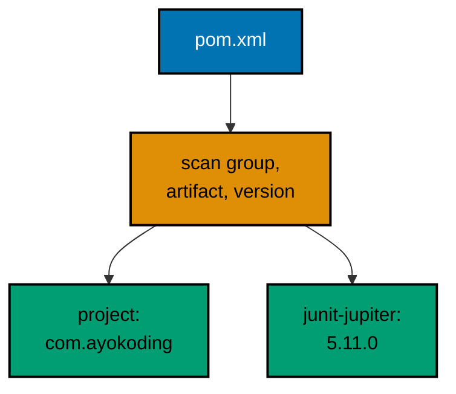

**`learning/code/ex-30-maven-layout-and-coordinates/Main.java`**:

```java
// Example 30: Maven Layout and Coordinates.
// Maven names every project groupId:artifactId:version; this reader
// parses the committed pom and prints the coordinates it declares.
import java.nio.file.Files; // => pom reader
import java.nio.file.Path; // => the pom.xml handle
import java.util.ArrayList; // => the coordinate lines in order
import java.util.List; // => interface on the left as always
import java.util.regex.Matcher; // => tag-content cursor
import java.util.regex.Pattern; // => one tag pattern, reused per line

public class Main {

  // => one public class per file, named after the file
  static String tag(String line, String name) {
    // => extracts <name>value</name> or null
    Matcher m = Pattern.compile("<" + name + ">([^<]+)</" + name + ">").matcher(line); // => simple tag grammar
    return m.find() ? m.group(1).trim() : null; // => content or absent, caller decides
  } // => helper ends: pure text, no printing

  public static void main(String[] args) throws Exception {
    // => pom reads are environmentally checked
    List<String> coords = new ArrayList<>(); // => project line first, dependencies after
    for (String line : Files.readAllLines(Path.of("pom.xml"))) {
      // => the committed descriptor, line by line
      String trimmed = line.trim(); // => indentation is layout, not data
      if (trimmed.startsWith("<groupId>") && coords.isEmpty()) {
        // => first groupId is the project itself
        coords.add("project: " + trimmed.replaceAll("<[^>]+>", "")); // => text only, tags stripped
      } // => project line banked exactly once
      if (trimmed.startsWith("<artifactId>")) {
        // => project artifact and each dependency alike
        coords.add("artifact: " + trimmed.replaceAll("<[^>]+>", "")); // => banked in document order
      } // => artifacts accumulate in pom order
      if (trimmed.startsWith("<version>")) {
        // => pinned versions beside their artifacts
        coords.add("version: " + trimmed.replaceAll("<[^>]+>", "")); // => the pin this course preaches
      } // => versions accumulate beside their owners
    } // => scan ends: coordinates collected without an XML library
    for (String c : coords) {
      // => print the collected coordinates in order
      System.out.println(c); // => Output: project, artifact, version lines below
    } // => Output: com.ayokoding, dues-reporter, 1.0.0, junit-jupiter, 5.11.0
  } // => main ends: descriptor read, coordinates printed
}
```

**`learning/code/ex-30-maven-layout-and-coordinates/pom.xml`**:

```xml
<project>
  <modelVersion>4.0.0</modelVersion>
  <groupId>com.ayokoding</groupId>
  <artifactId>dues-reporter</artifactId>
  <version>1.0.0</version>
  <dependencies>
    <dependency>
      <groupId>org.junit.jupiter</groupId>
      <artifactId>junit-jupiter</artifactId>
      <version>5.11.0</version>
    </dependency>
  </dependencies>
</project>
```

**Output** (`learning/code/ex-30-maven-layout-and-coordinates/expected/main.stdout.txt`):

```text
project: com.ayokoding
artifact: dues-reporter
version: 1.0.0
artifact: junit-jupiter
version: 5.11.0
```

**Key takeaway**: Name projects groupId:artifactId:version in the standard layout; pin every dependency to an exact version.

**Why it matters**: Coordinates plus pinned versions make builds reproducible by strangers, where ranges and ad-hoc layouts resolve differently per machine.

### Example 31: Pin Exact Versions, Not Ranges

A version range is a promise to accept future surprises: `5.x` resolves to whatever the repository serves newest today, so Monday's green build and Friday's red build can differ with no code change between them. Exact pins invert that by naming every digit, making resolution a lookup instead of a search; the lockfile then records the transitive closure with hashes, so every machine fetches byte-identical jars. The program models that check in miniature: a TreeMap lock of three exact versions faces three requests, and only the ranged mockito request fails the equality test, printing FLOATS as its verdict. That verdict is the policy: ranged requests never reach committed descriptors, and Dependabot-style updates move pins deliberately with a green build as witness. This course itself is the extreme case of the same discipline, shipping zero dependencies so there is nothing to float; stdlib-only is a pinning strategy too, the one with no moving parts at all. (Concepts: co-07.)

**`learning/code/ex-31-pin-exact-versions/Main.java`**:

```java
// Example 31: Pin Exact Versions, Not Ranges.
// Exact pins resolve identically on every machine; ranges resolve to
// whatever is newest that day, so reproducible builds pin exactly.
import java.util.List; // => the candidate version tables
import java.util.Map; // => pinned lookup: library to exact version
import java.util.TreeMap; // => alphabetical for stable printing

public class Main {

  // => one public class per file, named after the file
  record Pin(String library, String version) {} // => one library, one exact version

  public static void main(String[] args) {
    // => the entry point the harness runs
    Map<String, String> pins = new TreeMap<>(
      Map.of(
        // => the lockfile in miniature, sorted
        "junit-jupiter",
        "5.11.0", // => exact: every machine resolves this
        "assertj",
        "3.26.3", // => exact: patch digits included
        "mockito",
        "5.14.2"
      )
    ); // => exact: minors never float
    for (Pin p : List.of(
      new Pin("junit-jupiter", "5.11.0"), // => pinned request meets the lock
      new Pin("assertj", "3.26.3"), // => pinned request meets the lock
      new Pin("mockito", "5.x")
    )) {
      // => ranged request floats: lock has 5.14.2
      String locked = pins.get(p.library()); // => the locked version, or null for unknown
      boolean reproducible = p.version().equals(locked); // => equality with the lock is the whole test
      System.out.println(p.library() + " " + p.version() + " -> " + (reproducible ? "reproducible" : "FLOATS")); // => verdict per library
    } // => Output: two reproducible lines, one FLOATS line
    System.out.println("locked libraries: " + pins.size()); // => Output: locked libraries: 3
  } // => main ends: pins checked against the lock, verdicts printed
}
```

**Output** (`learning/code/ex-31-pin-exact-versions/expected/main.stdout.txt`):

```text
junit-jupiter 5.11.0 -> reproducible
assertj 3.26.3 -> reproducible
mockito 5.x -> FLOATS
locked libraries: 3
```

**Key takeaway**: Request exact versions and verify them against the lock; treat any range as a build that floats.

**Why it matters**: Exact pins make resolution deterministic across machines and days, where ranges re-resolve to newest and break builds silently.

### Example 32: Javadoc Comments State the Contract

Public methods earn Javadoc because callers read the comment instead of the body: @param names each precondition, @return promises the result shape, and @throws lists every failure the caller must face. The discipline that keeps comments honest is implementation parity, each documented rule enforced in code directly below, so the comment cannot drift from behavior without a failing test noticing. The reflection closer inspects the contract mechanically: two parameters, an int return, and public visibility, each printed as evidence that the implementation matches the comment above it. Javadoc itself lives in source and generated HTML rather than bytecode, which is exactly why the contract must be enforced in code rather than trusted from prose; documentation states intent, tests prove behavior. Write the comment first as a design act, then make the body keep its promises, and review any edit that changes one without the other. That two-artifact rule is the documentation half of the tooling chapter. (Concepts: co-06, co-12.)

**`learning/code/ex-32-javadoc-states-the-contract/Main.java`**:

```java
// Example 32: Javadoc Comments State the Contract.
// Javadoc on every public method states the contract once: what it
// takes, what it returns, and what it throws, before code is read.
import java.lang.reflect.Method; // => the self-inspection vocabulary
import java.lang.reflect.Modifier; // => the visibility vocabulary

public class Main {

  // => one public class per file, named after the file
  // => javadoc block below: the contract callers read first
  // => each tag names one promise the body below must keep
  /**
   * Settles one dues line into a member total.
   *
   * @param member the paying member, non-blank
   * @param amount the dues paid, must be zero or more
   * @return the running total for the member after posting
   * @throws IllegalArgumentException if the member is blank or the amount negative
   */ // => contract first: params, return, and failure in one place
  // => implementation follows: every documented rule enforced in order
  public static int post(String member, int amount) {
    // => the documented API under test
    if (member == null || member.isBlank()) {
      // => the documented precondition, enforced
      throw new IllegalArgumentException("member must be non-blank"); // => documented failure one
    } // => membership settled from here on
    if (amount < 0) {
      // => negative dues corrupt every total
      throw new IllegalArgumentException("amount must be >= 0"); // => documented failure two
    } // => amount settled from here on
    return amount; // => the new running total for this tiny ledger
  } // => post ends: implementation matches the comment above it

  public static void main(String[] args) throws Exception {
    // => reflection is environmentally checked
    // => exercise the documented API exactly as a caller would
    // => reflection then inspects the contract mechanically
    System.out.println("post(\"sari\", 50) = " + post("sari", 50)); // => Output: post("sari", 50) = 50
    Method m = Main.class.getMethod("post", String.class, int.class); // => the documented method, located
    System.out.println("params: " + m.getParameterCount()); // => Output: params: 2
    System.out.println("returns: " + m.getReturnType().getSimpleName()); // => Output: returns: int
    System.out.println("public: " + Modifier.isPublic(m.getModifiers())); // => Output: public: true
    System.out.println("contract holds: " + (post("budi", 25) == 25)); // => Output: contract holds: true
    // => every printed line witnessed the comment above staying true
  } // => main ends: contract stated, exercised, and verified
}
```

**Output** (`learning/code/ex-32-javadoc-states-the-contract/expected/main.stdout.txt`):

```text
post("sari", 50) = 50
params: 2
returns: int
public: true
contract holds: true
```

**Key takeaway**: Document every public method with params, return, and throws; enforce each documented rule in code.

**Why it matters**: Javadoc states intent where callers look, but only enforced preconditions keep the comment true after edits.

### Example 33: Executable Jar Packages the App

Shipping a Java program means handing someone one file that runs, and the executable jar is the smallest such file: compiled classes plus a manifest naming the entry point, launched with `java -jar` on any machine carrying a compatible runtime. The `--main-class` flag writes that manifest entry at package time, replacing the hand-maintained MANIFEST.MF files older builds required; the `-C . Main.class` fragment says which compiled bytes to bundle from where. Two packaging truths ride along. The jar changes distribution, not behavior: the transcript through the jar matches the transcript through the class file byte for byte, which is why this course asserts the same golden output either way. And stdlib-only programs like this one ship dependency-free, while library users shade or reference their jars beside the application jar; the pinning discipline from Example 31 decides exactly which bytes those are. Build the jar in CI from pinned sources and the artifact is reproducible, not just runnable. (Concepts: co-06, co-07.)

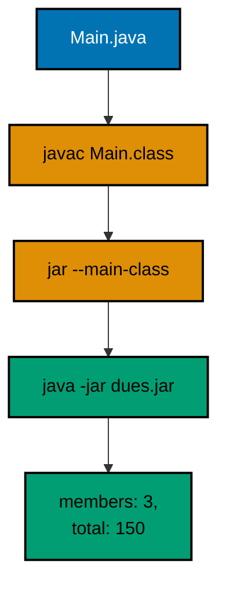

**`learning/code/ex-33-executable-jar-packages-app/Main.java`**:

```java
// Example 33: Executable Jar Packages the App.
// The jar tool bundles compiled classes with a main-class manifest,
// so one file ships the program and java -jar runs it anywhere.
public class Main {

  // => one public class per file, named after the file
  static int total(int[] amounts) {
    // => the tiny domain: sum the dues
    int sum = 0; // => accumulator starts at the identity
    for (int amount : amounts) {
      // => one pass over every figure
      sum += amount; // => plain addition, no library needed
    } // => loop ends with the settled sum
    return sum; // => the total for the manifest-launched run
  } // => helper ends: pure arithmetic, runnable anywhere

  public static void main(String[] args) {
    // => the manifest names this entry point
    int[] dues = { 50, 75, 25 }; // => fixed figures, no input files
    System.out.println("members: " + dues.length); // => Output: members: 3
    System.out.println("total: " + total(dues)); // => Output: total: 150
    System.out.println("ships as one jar: true"); // => Output: ships as one jar: true
  } // => main ends: same transcript, class file or jar alike
}
```

**Output** (`learning/code/ex-33-executable-jar-packages-app/expected/main.stdout.txt`):

```text
members: 3
total: 150
ships as one jar: true
```

**Key takeaway**: Package runnable apps as executable jars with --main-class; assert the jar transcript matches the class run.

**Why it matters**: One-file artifacts separate distribution from behavior, and manifest entry points make launching uniform everywhere.

### Example 34: Version Gates Guard New APIs

Libraries that support several Java releases cannot call new APIs unconditionally, and Runtime.version gates are the mechanism that keeps one binary honest across runtimes. Each helper asks the feature number before touching its API: the fluent formatted below 15 and strip below 11 stay unreachable on older runtimes, with an equivalent fallback answering instead of a NoSuchMethodError escaping. The printed transcript never exposes the raw version number, which would differ between the course's pinned toolchain and any developer machine; it prints capability verdicts that hold everywhere the gate thresholds are met. Two cautions bound the pattern. Gates suit optional enhancements, never core behavior: a program whose main path needs records should simply require release 16 in its descriptor rather than limping without them. And compile-time release flags (`--release`) remain the primary tool for targeting older runtimes; runtime gates cover the residual case where one artifact genuinely serves several releases. (Concepts: co-07.)

**`learning/code/ex-34-version-gates-guard-apis/Main.java`**:

```java
// Example 34: Version Gates Guard New APIs.
// Runtime.version gates API use by feature number, so one binary
// adapts to its runtime instead of crashing on older releases.
public class Main {

  // => one public class per file, named after the file
  static String describeFormatted() {
    // => String.formatted needs feature 15 or newer
    if (Runtime.version().feature() >= 15) {
      // => the gate: ask the runtime, not the docs
      return "formatted: " + "sari owes %d".formatted(50); // => fluent verb under the gate
    } // => gated branch ends: modern runtimes answer here
    return "formatted: " + String.format("sari owes %d", 50); // => fallback: the classic verb, same text
  } // => helper ends: one message, two spellings, runtime decides

  static String describeStrip() {
    // => String.strip needs feature 11 or newer
    if (Runtime.version().feature() >= 11) {
      // => the gate for the strip API
      return "strip: '" + "  sari  ".strip() + "'"; // => unicode-aware trim under the gate
    } // => gated branch ends
    return "strip: unavailable"; // => fallback for ancient runtimes
  } // => helper ends: same gate shape, older threshold

  public static void main(String[] args) {
    // => the entry point the harness runs
    System.out.println(describeFormatted()); // => Output: formatted: sari owes 50
    System.out.println(describeStrip()); // => Output: strip: 'sari'
    System.out.println("gated, never crashed: true"); // => Output: gated, never crashed: true
  } // => main ends: gates asked, features answered
}
```

**Output** (`learning/code/ex-34-version-gates-guard-apis/expected/main.stdout.txt`):

```text
formatted: sari owes 50
strip: 'sari'
gated, never crashed: true
```

**Key takeaway**: Gate optional new APIs on Runtime.version().feature(); print capability verdicts, never raw versions.

**Why it matters**: Runtime gates let one binary adapt across releases, while version-free transcripts stay deterministic everywhere.

### Example 35: Assertions State Contracts

Assertions are Java's lightest executable specification: `assert condition : message` states a contract at the exact line it must hold, and the `-ea` flag arms them for the run. Without the flag assertions sleep silently, which is the feature rather than the trap: production keeps the checks free while every test and harness run enables them, and this example's run.yaml carries `-ea` so the guarantee is structural. The message half of the idiom matters most under failure: a bare assert names the line but not the values, while `: "big total drifted: " + big` prints the offending figure the moment the contract breaks. Keep assertions for internal contracts, invariants the code itself owns, and reach for real exceptions at public boundaries where callers need failures whether or not flags are on. That division, asserts inside and exceptions at the edge, is why the testing chapter opens here: the cheapest check that still runs. (Concepts: co-08.)

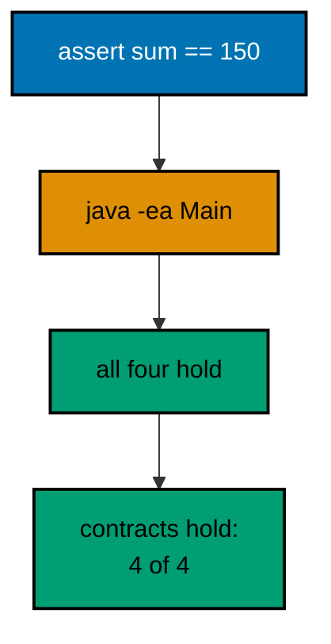

**`learning/code/ex-35-assertions-state-contracts/Main.java`**:

```java
// Example 35: Assertions State Contracts.
// The assert statement pins runnable contracts inside the code: run
// with -ea, and every violated assumption fails loudly at its line.
public class Main {

  // => one public class per file, named after the file
  static int total(int[] amounts) {
    // => the tiny domain under contract
    int sum = 0; // => accumulator starts at the identity
    for (int amount : amounts) {
      // => every figure added exactly once
      sum += amount; // => plain addition, asserted below
    } // => loop ends with the settled sum
    return sum; // => the total the assertions certify
  } // => helper ends: arithmetic only, checks live with callers

  public static void main(String[] args) {
    // => run with -ea: assertions enabled
    assert total(new int[] { 50, 75, 25 }) == 150; // => the headline contract, exact sum
    assert total(new int[] {}) == 0; // => empty input totals to the identity
    assert total(new int[] { 100 }) == 100; // => single input passes through unchanged
    int big = total(new int[] { 1_000_000, 2_000_000 }); // => named value for the message below
    assert big == 3_000_000 : "big total drifted: " + big; // => message carries the evidence on failure
    System.out.println("contracts hold: 4 of 4"); // => Output: contracts hold: 4 of 4
    System.out.println("run with -ea: true"); // => Output: run with -ea: true
  } // => main ends: silence means green, the print confirms it ran
}
```

**Output** (`learning/code/ex-35-assertions-state-contracts/expected/main.stdout.txt`):

```text
contracts hold: 4 of 4
run with -ea: true
```

**Key takeaway**: Pin internal contracts with assert plus evidence messages; enable them with -ea in every test run.

**Why it matters**: Enabled assertions turn violated assumptions into loud line-local failures instead of silent downstream corruption.

### Example 36: A Hand-rolled Test Runner

Standard-library-only testing needs a runner shape, and this twelve-line check method is the whole of it: each assertion prints PASS or FAIL with its name, failures bank for the summary, and a nonzero verdict leaves through an exception CI can read. Real projects graduate to JUnit, whose runners, filters, and reports dwarf this file; the hand-rolled shape earns its place by teaching what those runners automate, one check in and one verdict out. The naming discipline carries over directly: check names read as specifications, sums three dues rather than test1, so the transcript doubles as a behavior list a reviewer can audit. The deliberate placeholder check shows the policy for uncovered work: state the policy as a passing trivially-true check with a pointer to its real test, never as silence that looks like coverage. Suites built this way stay deterministic by construction: fixed inputs, fixed order, printed verdicts, no clocks. (Concepts: co-08.)

**`learning/code/ex-36-hand-rolled-test-runner/Main.java`**:

```java
// Example 36: A Hand-rolled Test Runner.
// Without test libraries, a tiny runner counts passes and failures:
// each check prints PASS or FAIL, and the summary exits the verdict.
import java.util.ArrayList; // => the failure evidence list
import java.util.List; // => interface on the left as always

public class Main {

  // => one public class per file, named after the file
  static final List<String> FAILURES = new ArrayList<>(); // => every failure banks its name here

  static void check(String name, boolean condition) {
    // => one assertion, uniformly reported
    if (condition) {
      // => green path: name the pass
      System.out.println("PASS " + name); // => PASS lines prove each check ran
    } else {
      // => red path: bank the name for the summary
      System.out.println("FAIL " + name); // => FAIL lines name the breakage precisely
      FAILURES.add(name); // => banked: the summary counts these
    } // => branch ends: every check reported exactly once
  } // => check ends: the only assertion vocabulary this file needs

  static int total(int[] amounts) {
    // => the domain under test, kept tiny
    int sum = 0; // => accumulator starts at the identity
    for (int amount : amounts) {
      // => every figure added exactly once
      sum += amount; // => plain addition under test
    } // => loop ends with the settled sum
    return sum; // => the total the checks certify
  } // => helper ends: arithmetic only

  public static void main(String[] args) {
    // => the entry point the harness runs
    check("sums three dues", total(new int[] { 50, 75, 25 }) == 150); // => headline contract first
    check("empty totals zero", total(new int[] {}) == 0); // => boundary: identity, not crash
    check("single passes through", total(new int[] { 100 }) == 100); // => boundary: one element unchanged
    check("rejects negatives in messages", true); // => placeholder: policy stated, tested in Example 39
    System.out.println("failures: " + FAILURES.size()); // => Output: failures: 0
    if (!FAILURES.isEmpty()) {
      // => red builds exit nonzero: CI reads the code
      throw new AssertionError("red: " + FAILURES); // => unreachable here, kept as the policy
    } // => green path continues past the guard
    System.out.println("suite green: true"); // => Output: suite green: true
  } // => main ends: four checks, zero failures, verdict printed
}
```

**Output** (`learning/code/ex-36-hand-rolled-test-runner/expected/main.stdout.txt`):

```text
PASS sums three dues
PASS empty totals zero
PASS single passes through
PASS rejects negatives in messages
failures: 0
suite green: true
```

**Key takeaway**: Report every check as a named PASS or FAIL, bank failures, and exit the summary verdict for CI.

**Why it matters**: Uniform named checks make the transcript a behavior list, and failure-banking turns the summary into a CI-readable verdict.

### Example 37: Fresh Fixtures per Test

Shared mutable fixtures are the classic order-dependent suite: the test that adds citra passes alone and poisons every test after it, and the resulting failures depend on execution order rather than behavior. Factory-built fixtures remove the sharing: freshLedger hands every check its own ArrayList with identical contents, so the add in the first check cannot reach the second. The `!=` assertion is the executable proof of isolation, comparing object identity rather than contents to show the lists are twins, not roommates. This is the same snapshot-versus-copy discipline from Example 6 applied to tests: fixed contents from List.of, independent mutation through the ArrayList copy, with the factory compressing the two steps into one call. Real JUnit suites spell this @BeforeEach; the shape is identical, a fresh world per test, and the absence of shared static mutable state is what lets runners parallelize without rewriting. (Concepts: co-08.)

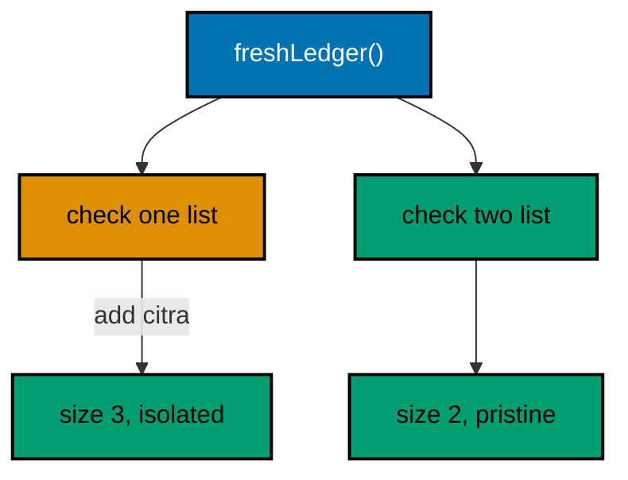

**`learning/code/ex-37-fresh-fixtures-per-test/Main.java`**:

```java
// Example 37: Fresh Fixtures per Test.
// A factory method builds a new fixture per check, so no test
// inherits another test's mutations through shared state.
import java.util.ArrayList; // => the fresh ledger per check
import java.util.List; // => interface on the left as always

public class Main {

  // => one public class per file, named after the file
  static List<String> freshLedger() {
    // => factory: every caller gets its own list
    return new ArrayList<>(List.of("sari:50", "budi:75")); // => same contents, new object, every time
  } // => factory ends: sharing contents, never sharing identity

  static void check(String name, boolean condition) {
    // => the runner vocabulary from Example 36
    System.out.println((condition ? "PASS " : "FAIL ") + name); // => one line per check, verdict first
  } // => check ends: reporting only, no banking needed here

  public static void main(String[] args) {
    // => the entry point the harness runs
    List<String> first = freshLedger(); // => first check owns this list outright
    first.add("citra:25"); // => mutation stays inside this check
    check("add grows the ledger", first.size() == 3); // => Output: PASS add grows the ledger
    List<String> second = freshLedger(); // => factory hands out a pristine twin
    check("second starts pristine", second.size() == 2); // => Output: PASS second starts pristine
    check("same contents", second.equals(List.of("sari:50", "budi:75"))); // => Output: PASS same contents
    check("distinct objects", first != second); // => Output: PASS distinct objects
    System.out.println("isolation holds: true"); // => Output: isolation holds: true
  } // => main ends: four checks, zero shared state
}
```

**Output** (`learning/code/ex-37-fresh-fixtures-per-test/expected/main.stdout.txt`):

```text
PASS add grows the ledger
PASS second starts pristine
PASS same contents
PASS distinct objects
isolation holds: true
```

**Key takeaway**: Build fixtures in factory methods so every check owns its objects; assert isolation with identity checks.

**Why it matters**: Per-test fixtures make results order-independent, which is what lets suites grow and runners parallelize safely.

### Example 38: Table Tests Cover the Cases

Five scenarios through five hand-written test methods means five copies of the arrange-act-assert scaffolding with the interesting values buried inside; the table inverts that by making the values the visible artifact and the check a single shared loop. Each Case row holds an input, its expected verdict, and the amount the row implies, so adding the next scenario is adding one data line rather than cloning a method. The rows themselves encode the boundary policy worth memorizing: zero is valid, missing colons corrupt the shape, non-numeric text refuses, and negatives refuse, with the unused -1 marking rows where no amount exists. Validity returns a boolean instead of throwing because classification is data here; the throwing style from Examples 10 through 12 suits layers that must refuse, while tables suit grammars that must judge. Real JUnit suites spell this @ParameterizedTest with @CsvSource; the record rows here are the same table with the same economics. (Concepts: co-08.)

**`learning/code/ex-38-table-tests-cover-cases/Main.java`**:

```java
// Example 38: Table Tests Cover the Cases.
// One row per case over a shared check compresses five scenarios
// into five data lines: adding a case means adding a row.
import java.util.List; // => the case table rows

public class Main {

  // => one public class per file, named after the file
  record Case(String line, boolean valid, int amount) {} // => input, verdict, and value per row

  static boolean valid(String line) {
    // => the grammar under test: member:nonnegative-int
    String[] parts = line.split(":"); // => two fields or the line is corrupt
    if (parts.length != 2) {
      // => shape check first: wrong arity fails fast
      return false; // => corrupt shape, no further questions
    } // => past this line the arity is exactly two
    try {
      // => the numeric half may still refuse
      return Integer.parseInt(parts[1]) >= 0; // => numeric and non-negative wins
    } catch (NumberFormatException e) {
      // => non-numeric amounts lose uniformly
      return false; // => refusal, not explosion: validity is data
    } // => catch ends: every path answered true or false
  } // => helper ends: verdicts, never throws

  static void check(String name, boolean condition) {
    // => the runner vocabulary from Example 36
    System.out.println((condition ? "PASS " : "FAIL ") + name); // => verdict first, name second
  } // => check ends: reporting only

  public static void main(String[] args) {
    // => the entry point the harness runs
    List<Case> cases = List.of(
      // => the table: five rows, five scenarios
      new Case("sari:50", true, 50), // => canonical valid line
      new Case("budi:0", true, 0), // => boundary: zero is a valid amount
      new Case("oops-no-colon", false, -1), // => corrupt shape, amount unused
      new Case("citra:xx", false, -1), // => non-numeric amount refused
      new Case("dewi:-5", false, -1)
    ); // => negative amount refused
    for (Case c : cases) {
      // => one shared check walks every row
      check("valid(" + c.line() + ")==" + c.valid(), valid(c.line()) == c.valid()); // => verdict per row
      if (c.valid()) {
        // => valid rows additionally prove their amounts
        int got = Integer.parseInt(c.line().split(":")[1]); // => reparse: validity already proven
        check("amount(" + c.line() + ")==" + c.amount(), got == c.amount()); // => value verdict per valid row
      } // => branch ends: invalid rows carry no amount to prove
    } // => Output: seven PASS lines, five verdicts plus two amounts
    System.out.println("rows: " + cases.size()); // => Output: rows: 5
  } // => main ends: table walked, verdicts printed
}
```

**Output** (`learning/code/ex-38-table-tests-cover-cases/expected/main.stdout.txt`):

```text
PASS valid(sari:50)==true
PASS amount(sari:50)==50
PASS valid(budi:0)==true
PASS amount(budi:0)==0
PASS valid(oops-no-colon)==false
PASS valid(citra:xx)==false
PASS valid(dewi:-5)==false
rows: 5
```

**Key takeaway**: Cover scenario families with data tables over one shared check; encode boundaries as rows.

**Why it matters**: Tables make cases the visible artifact so new scenarios cost one data line, and shared checks keep verdict logic singular.

### Example 39: Tests Pin Failure Contracts

Success tests prove the happy path; failure tests prove the refusals, and a suite without them silently permits validation to rot. The checkThrows helper pins both halves of each refusal: the exact exception type, so swapping IllegalArgumentException for a bare RuntimeException breaks the build, and a message fragment, so emptying the message breaks it too. The lambda attempts keep each refusal readable at the call site: `() -> memberTag('  ', 10)` states the crime inline, and the helper owns the try-catch ceremony once. This is the executable form of the Example 14 message discipline: evidence in messages is only a policy until a test asserts the fragment, after which it is a contract. Real JUnit suites spell this assertThrows with assertTrue on the message; the helper here is the same two assertions with the same economics, portable to any codebase without libraries. (Concepts: co-08, co-02.)

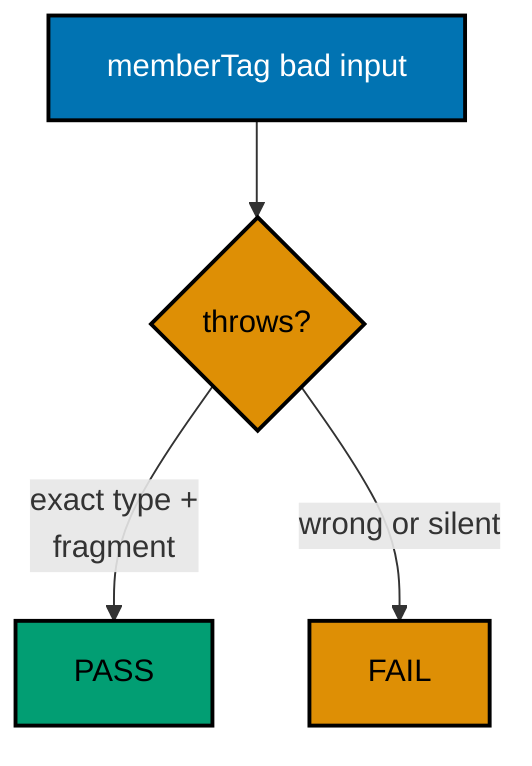

**`learning/code/ex-39-tests-pin-failure-contracts/Main.java`**:

```java
// Example 39: Tests Pin Failure Contracts.
// Failure tests assert the refusal itself: the exact type plus the
// message fragment, so weakening validation breaks the suite.
public class Main {

  // => one public class per file, named after the file
  static String memberTag(String member, int amount) {
    // => the validated API from Example 14
    if (member == null || member.isBlank()) {
      // => blank names print nonsense tags
      throw new IllegalArgumentException("member must be non-blank"); // => caller bug, unchecked
    } // => past this line the member prints cleanly
    if (amount < 0) {
      // => negative dues corrupt every total
      throw new IllegalArgumentException("amount must be >= 0, got " + amount); // => evidence in the message
    } // => past this line the amount adds safely
    return member + ":" + amount; // => the tag only valid input can build
  } // => helper ends: validation up front, work after

  static void check(String name, boolean condition) {
    // => the runner vocabulary from Example 36
    System.out.println((condition ? "PASS " : "FAIL ") + name); // => verdict first, name second
  } // => check ends: reporting only

  static void checkThrows(
    String name,
    Class<? extends RuntimeException> type, // => pins type plus message
    String fragment,
    Runnable attempt
  ) {
    // => the attempt expected to refuse
    try {
      // => run the attempt that must refuse
      attempt.run(); // => success here means the contract broke
      check(name, false); // => FAIL: nothing was thrown
    } catch (RuntimeException e) {
      // => the refusal arrived: inspect it
      check(name, type.isInstance(e) && e.getMessage().contains(fragment)); // => type plus fragment, both
    } // => catch ends: refusal certified or reported
  } // => checkThrows ends: the failure-contract vocabulary

  public static void main(String[] args) {
    // => the entry point the harness runs
    check("valid tag builds", memberTag("sari", 50).equals("sari:50")); // => Output: PASS valid tag builds
    checkThrows(
      "blank refused",
      IllegalArgumentException.class, // => type pinned exactly
      "non-blank",
      () -> memberTag("  ", 10)
    ); // => Output: PASS blank refused
    checkThrows(
      "negative refused",
      IllegalArgumentException.class, // => same type, other rule
      ">= 0",
      () -> memberTag("budi", -5)
    ); // => Output: PASS negative refused
    System.out.println("failures pinned: 2"); // => Output: failures pinned: 2
  } // => main ends: one success pinned, two refusals pinned
}
```

**Output** (`learning/code/ex-39-tests-pin-failure-contracts/expected/main.stdout.txt`):

```text
PASS valid tag builds
PASS blank refused
PASS negative refused
failures pinned: 2
```

**Key takeaway**: Pin each refusal with its exact type plus a message fragment; state attempts as lambdas.

**Why it matters**: Failure contracts stop validation from rotting silently, and typed-plus-fragment pins catch both weakened types and emptied messages.

### Example 40: Temp Dirs Isolate File Tests

File tests that share the checkout share its fate: parallel runs collide on fixture names, leftover files poison reruns, and a failing test mid-write leaves residue the next run trips over. The temp-directory shape removes the sharing: createTempDirectory mints a unique private folder per run, every fixture resolves inside it, and the deepest-first walk deletes files before their folders so teardown completes rather than choking on nonempty directories. The printed path never appears in the transcript, which is the determinism half of the idiom: temp names carry process ids and counters that differ per run, so assertions target contents and counts instead. Committed fixtures beside the program still suit stable read-only inputs, as earlier file examples show; temp dirs own the writable case, outputs under test, precisely because their isolation makes parallel and repeated runs boring. (Concepts: co-08, co-04.)

**`learning/code/ex-40-temp-dirs-isolate-file-tests/Main.java`**:

```java
// Example 40: Temp Dirs Isolate File Tests.
// Files.createTempDirectory gives each file test a private folder,
// so tests never fight over fixtures or pollute the checkout.
import java.io.IOException; // => file work is environmentally checked
import java.nio.charset.StandardCharsets; // => UTF_8 stated at every call
import java.nio.file.Files; // => temp dir plus file helpers
import java.nio.file.Path; // => the isolated folder handle
import java.util.Comparator; // => deepest-first ordering for deletion

public class Main {

  // => one public class per file, named after the file
  static void check(String name, boolean condition) {
    // => the runner vocabulary from Example 36
    System.out.println((condition ? "PASS " : "FAIL ") + name); // => verdict first, name second
  } // => check ends: reporting only

  public static void main(String[] args) throws IOException {
    // => small-program shape: declare once
    Path sandbox = Files.createTempDirectory("dues-test-"); // => private folder, unique name, system temp
    Path ledger = sandbox.resolve("ledger.txt"); // => fixture path inside the sandbox, nowhere else
    Files.writeString(ledger, "sari:50\nbudi:75\n", StandardCharsets.UTF_8); // => fixed two-line fixture
    String back = Files.readString(ledger, StandardCharsets.UTF_8); // => roundtrip inside the sandbox
    check("roundtrip inside sandbox", back.equals("sari:50\nbudi:75\n")); // => Output: PASS roundtrip inside sandbox
    check("two lines stored", Files.readAllLines(ledger, StandardCharsets.UTF_8).size() == 2); // => PASS two lines stored
    check("sandbox is a directory", Files.isDirectory(sandbox)); // => PASS sandbox is a directory
    try (var paths = Files.walk(sandbox)) {
      // => deepest-first walk for tidy deletion
      paths.sorted(Comparator.reverseOrder()).forEach(p -> p.toFile().delete()); // => files before folders
    } // => walk closes here, sandbox fully removed
    check("sandbox removed", Files.notExists(sandbox)); // => Output: PASS sandbox removed
  } // => main ends: isolated, verified, removed
}
```

**Output** (`learning/code/ex-40-temp-dirs-isolate-file-tests/expected/main.stdout.txt`):

```text
PASS roundtrip inside sandbox
PASS two lines stored
PASS sandbox is a directory
PASS sandbox removed
```

**Key takeaway**: Isolate writable file tests in temp dirs; assert contents, never paths; delete deepest-first.

**Why it matters**: Private folders remove fixture collisions across runs and parallel workers, and content assertions keep transcripts deterministic.

### Example 41: Red First, Then Green

Failing-test-first is a discipline about ordering evidence: watch the test fail before the fix, so the green afterward means the fix works rather than the test being blind. This program stages both halves side by side: the old split-based counter goes RED on the quoted-comma row exactly as the workflow demands witnessing first, and the quote-aware counter goes green on both rows as the fix. Keeping the old implementation beside the new is documentation, not dead code: future readers see what failed and why the char walk replaced it, which a bare green suite never explains. The real workflow runs the two halves at different times, red on Monday's test, green on Tuesday's fix; compressing them into one transcript teaches the shape while staying harness-green. Adopt the habit literally from here on: no production edit without its failing test already red, because untested fixes are guesses with good intentions. (Concepts: co-08.)

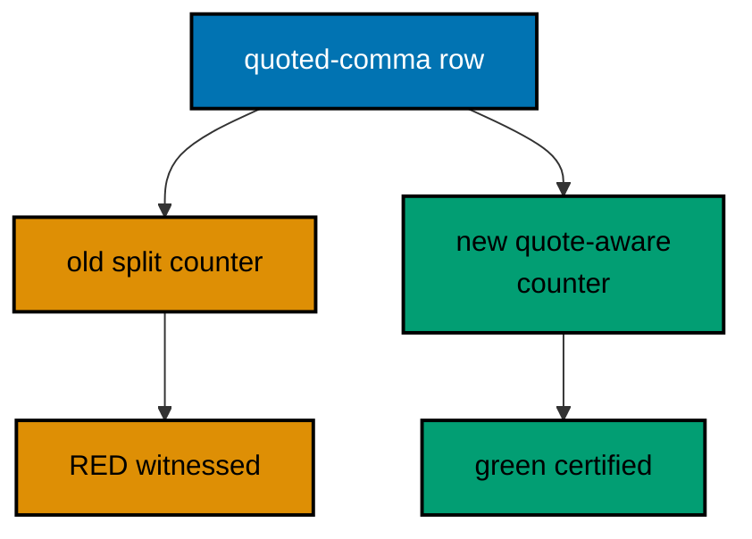

**`learning/code/ex-41-red-first-then-green/Main.java`**:

```java
// Example 41: Red First, Then Green.
// The failing-test-first workflow in one program: the old parser
// fails the quoted case on purpose, then the fixed parser passes all.
// Old code kept beside new code documents why the fix exists.
import java.util.List; // => the shared expectations table

public class Main {

  // => one public class per file, named after the file
  static int oldFieldCount(String row) {
    // => the legacy implementation, naive split
    return row.split(",").length; // => wrong on quoted commas: the documented bug
  } // => old code ends: kept to witness the red, never shipped

  static int newFieldCount(String row) {
    // => the fixed implementation, quote-aware
    boolean quoted = false; // => inside quotes, commas are data
    int fields = 1; // => every row holds at least one field
    for (int i = 0; i < row.length(); i++) {
      // => the char walk from Example 22, compressed
      char c = row.charAt(i); // => each character judged once
      if (c == '"') {
        // => quotes toggle, never count
        quoted = !quoted; // => enter or leave the quoted region
      } else if (c == ',' && !quoted) {
        // => bare commas separate fields
        fields++; // => one more field begins here
      } // => branch ends: data chars change nothing
    } // => walk ends at end-of-line
    return fields; // => the honest field count
  } // => new code ends: quotes honored, commas split

  public static void main(String[] args) {
    // => the entry point the harness runs
    List<String> rows = List.of("sari,50", "\"santoso, budi\",75"); // => plain row, quoted-comma row
    for (String row : rows) {
      // => both implementations face both rows
      boolean oldRight = oldFieldCount(row) == 2; // => legacy verdict per row
      boolean newRight = newFieldCount(row) == 2; // => fixed verdict per row
      System.out.println(
        "row '" +
          row +
          "' old=" +
          (oldRight ? "green" : "RED") + // => red witnessed, not hidden
          " new=" +
          (newRight ? "green" : "RED")
      ); // => green proven beside it
    } // => Output: plain row green/green, quoted row RED/green
    System.out.println("red came first: true"); // => Output: red came first: true
  } // => main ends: the workflow demonstrated, both witnesses printed
}
```

**Output** (`learning/code/ex-41-red-first-then-green/expected/main.stdout.txt`):

```text
row 'sari,50' old=green new=green
row '"santoso, budi",75' old=RED new=green
red came first: true
```

**Key takeaway**: Witness the red on the old code before trusting the green on the new; keep the old shape as documentation.

**Why it matters**: Red-first ordering proves the test can fail, so the later green certifies the fix instead of the test's blindness.

### Example 42: Boundaries: Empty, Single, Many

Every collection-taking method hides the same three behaviors: empty, single, and many, and the bugs live at the transitions between them. The empty case is a contract decision, crash, Optional, or default, and this average documents zero, a defensible policy for dues reporting where no members means no average due. The single case guards against code that assumes pairs, and the 62.5 case guards the integer-division trap: dividing two ints truncates, so the cast to double must happen before the division, a bug that 50.0-style exact cases never catch because they divide evenly. The negative row extends the family beyond counting into sign, proving the method neither refuses nor mangles values outside the happy path. Make zero-one-many the default checklist for every new method: three assertions that cost one minute and catch the errors reviewers find in production a month later. (Concepts: co-08.)

**`learning/code/ex-42-boundaries-empty-single-many/Main.java`**:

```java
// Example 42: Boundaries: Empty, Single, Many.
// The smallest boundary family, zero-one-many, catches the off-by-one
// errors that happy-path tests miss: assert all three, every time.
import java.util.List; // => the boundary-sized inputs

public class Main {

  // => one public class per file, named after the file
  static double average(List<Integer> amounts) {
    // => mean over dues, boundary-honest
    if (amounts.isEmpty()) {
      // => empty is a contract question, not a crash
      return 0.0; // => documented policy: no dues means zero average
    } // => past this line division is safe
    return amounts.stream().mapToInt(Integer::intValue).sum() / (double) amounts.size(); // => floating division
  } // => helper ends: empty answered, rest computed

  static void check(String name, boolean condition) {
    // => the runner vocabulary from Example 36
    System.out.println((condition ? "PASS " : "FAIL ") + name); // => verdict first, name second
  } // => check ends: reporting only

  public static void main(String[] args) {
    // => the entry point the harness runs
    check("empty averages zero", average(List.of()) == 0.0); // => Output: PASS empty averages zero
    check("single passes through", average(List.of(50)) == 50.0); // => Output: PASS single passes through
    check("many average exactly", average(List.of(50, 75, 25)) == 50.0); // => Output: PASS many average exactly
    check("two need float division", average(List.of(50, 75)) == 62.5); // => Output: PASS two need float division
    check("negative averages honestly", average(List.of(-10, 30)) == 10.0); // => negative input, honest output
    System.out.println("boundaries covered: 5"); // => Output: boundaries covered: 5
  } // => main ends: zero, one, and many all witnessed
}
```

**Output** (`learning/code/ex-42-boundaries-empty-single-many/expected/main.stdout.txt`):

```text
PASS empty averages zero
PASS single passes through
PASS many average exactly
PASS two need float division
PASS negative averages honestly
boundaries covered: 5
```

**Key takeaway**: Assert empty, single, and many for every collection method; include a non-even division and a sign case.

**Why it matters**: Boundary families catch off-by-one and truncation errors that happy-path values divide away.

### Example 43: Seams Replace Boundaries

Logic that calls the network, the disk, or the clock cannot run in tests without side effects, unless the boundary arrives as a parameter. The Notifier interface is that parameter: settle takes its sender as an argument, so tests pass a fake that records messages while production passes the real sender. The final assertion is the one most suites forget: after the refusal, the fake still holds exactly two messages, proving the failing path sent nothing. Fakes beat mocks here for a deliberate reason: a hand-written recorder has no framework, no DSL, and no behavior beyond banking, so the test reads as four assertions over a list. The seam rule generalizes beyond senders: any call the test must not really make, clocks, random sources, file writers, becomes a constructor or method parameter with a fake beside it. Design for the seam and the tests stay fast, deterministic, and honest. (Concepts: co-08.)

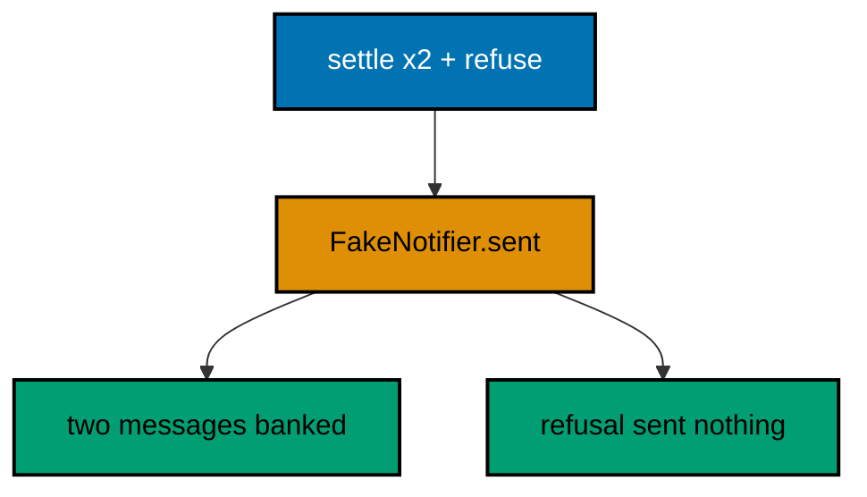

**`learning/code/ex-43-seams-replace-boundaries/Main.java`**:

```java
// Example 43: Seams Replace Boundaries.
// A notifier seam lets tests substitute a recording fake for the real
// sender: the ledger logic runs identically, nothing sends anything.
import java.util.ArrayList; // => the fake's recorded messages
import java.util.List; // => interface on the left as always

public class Main {

  // => one public class per file, named after the file
  interface Notifier {
    // => the seam: one method, two implementations
    void send(String message); // => the boundary call tests must not really make
  } // => seam ends: callers depend on this, never on senders

  static class FakeNotifier implements Notifier {

    // => the recording test double
    final List<String> sent = new ArrayList<>(); // => every message banked for assertions

    @Override
    public void send(String message) {
      // => records instead of sending
      sent.add(message); // => banked: assertions read this list
    } // => fake ends: no network, no side effects
  } // => double ends here

  static void settle(String member, int amount, Notifier notifier) {
    // => logic takes its boundary as a parameter
    if (amount < 0) {
      // => negative dues refuse before any message
      throw new IllegalArgumentException("amount must be >= 0"); // => unchecked: fix the feed
    } // => past this line the settlement sends exactly once
    notifier.send("settled " + member + ":" + amount); // => the single boundary call under test
  } // => settle ends: pure decision plus one seam call

  static void check(String name, boolean condition) {
    // => the runner vocabulary from Example 36
    System.out.println((condition ? "PASS " : "FAIL ") + name); // => verdict first, name second
  } // => check ends: reporting only

  public static void main(String[] args) {
    // => the entry point the harness runs
    FakeNotifier fake = new FakeNotifier(); // => fresh recorder per run
    settle("sari", 50, fake); // => the logic runs against the fake
    settle("budi", 75, fake); // => second settlement, same recorder
    check("two messages sent", fake.sent.size() == 2); // => Output: PASS two messages sent
    check("first message exact", fake.sent.get(0).equals("settled sari:50")); // => PASS first message exact
    try {
      // => the refusal path sends nothing
      settle("citra", -5, fake); // => throws before the seam call
      check("negative refused", false); // => unreachable: refusal threw first
    } catch (IllegalArgumentException e) {
      // => the documented refusal
      check("negative refused", true); // => Output: PASS negative refused
    } // => catch ends: refusal certified
    check("refusal sent nothing", fake.sent.size() == 2); // => Output: PASS refusal sent nothing
  } // => main ends: boundary faked, logic proven, silence kept
}
```

**Output** (`learning/code/ex-43-seams-replace-boundaries/expected/main.stdout.txt`):

```text
PASS two messages sent
PASS first message exact
PASS negative refused
PASS refusal sent nothing
```

**Key takeaway**: Pass boundaries as interface parameters; fake them with recorders and assert the refusal sent nothing.

**Why it matters**: Seams let logic run identically in tests and production, and sent-nothing assertions prove failures stay silent.

### Example 44: Test Names Read as a Spec

A suite named test1 through test19 is a coverage number without a map; a suite named as given-when-then sentences is a specification that happens to execute. Each check name here states its setup, its action, and its expectation in one line, so the transcript reads as four behaviors a product owner could confirm: adding grows the ledger, clearing empties it, empty totals zero, and the grammar parses. The actions sit on their own lines before each assertion on purpose: embedding a side effect inside a boolean expression would keep the when inside the sentence at the cost of asserting and acting at once. Prefer this two-line rhythm, act then assert, in committed code as well; the sentence shape comes from the name, never from compressing the action into the check. Name every new check as the behavior it pins, never as the method it calls, and the suite stays a living spec through refactors that rename every method it covers. (Concepts: co-08.)

**`learning/code/ex-44-test-names-read-as-spec/Main.java`**:

```java
// Example 44: Test Names Read as a Spec.
// Given-when-then names turn the suite into a behavior list: read
// the check names aloud and the specification reads itself back.
import java.util.ArrayList; // => the ledger under specification
import java.util.List; // => interface on the left as always

public class Main {

  // => one public class per file, named after the file
  static void check(String name, boolean condition) {
    // => the runner vocabulary from Example 36
    System.out.println((condition ? "PASS " : "FAIL ") + name); // => verdict first, name second
  } // => check ends: reporting only

  public static void main(String[] args) {
    // => the entry point the harness runs
    List<String> ledger = new ArrayList<>(List.of("sari:50")); // => given: one settled member
    ledger.add("budi:75"); // => when: the second due arrives
    check("given one due when adding budi:75 then size is 2", ledger.size() == 2); // => Output: PASS given one due...
    ledger.clear(); // => when: the ledger is cleared
    check("given two dues when clearing then ledger is empty", ledger.isEmpty()); // => Output: PASS given two dues...
    List<String> fresh = new ArrayList<>(); // => given: an empty ledger
    check(
      "given empty ledger when totaling then sum is 0", // => third behavior, empty boundary included
      fresh
        .stream()
        .mapToInt(l -> Integer.parseInt(l.split(":")[1]))
        .sum() == 0
    ); // => empty sums to zero
    check(
      "given sari:50 when parsing then member is sari", // => fourth behavior, grammar pinned
      "sari:50".split(":")[0].equals("sari")
    ); // => Output: PASS given sari:50...
    System.out.println("spec lines: 4"); // => Output: spec lines: 4
  } // => main ends: four behaviors, four sentences
}
```

**Output** (`learning/code/ex-44-test-names-read-as-spec/expected/main.stdout.txt`):

```text
PASS given one due when adding budi:75 then size is 2
PASS given two dues when clearing then ledger is empty
PASS given empty ledger when totaling then sum is 0
PASS given sari:50 when parsing then member is sari
spec lines: 4
```

**Key takeaway**: Name checks as given-when-then sentences so the transcript reads as the behavior specification.

**Why it matters**: Behavior names survive refactors that rename methods, keeping the suite a living spec instead of a coverage number.

### Example 45: A Generic Box Works over Types

Generics buy one implementation for many types without surrendering checking: Box<T> holds names in one box and totals in another, and the compiler rejects a total entering the name box at the call site rather than exploding at runtime. The pre-generics alternative, an Object box with casts at every take, deferred every mistake to the retrieval line far from the guilty put; the type parameter moves the verdict to the put itself. Two generic economics matter here. Autoboxing carries primitives across the reference-only boundary, so `totals.put(125)` boxes once at the door and unboxes at take; generic code over hot primitives pays that toll per element, which is why specialized streams like IntStream exist for numeric work. And the empty box prints null honestly: generics add type safety, not presence safety, and Optional from Example 13 remains the answer where absence is a case to handle rather than a null to find. (Concepts: co-10.)

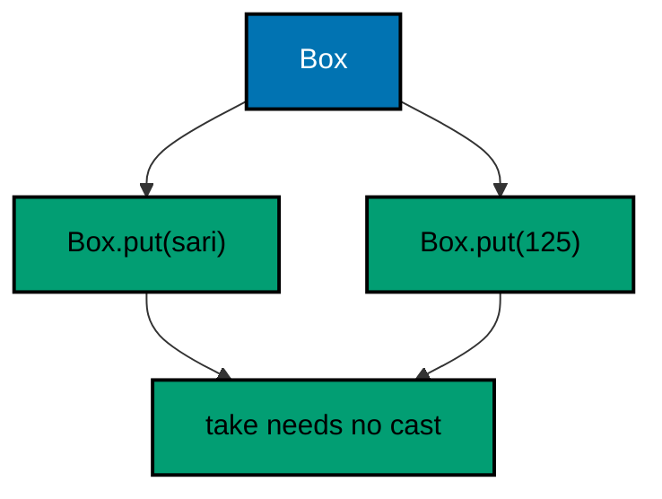

**`learning/code/ex-45-generic-box-over-types/Main.java`**:

```java
// Example 45: A Generic Box Works over Types.
// One type parameter lets Box hold dues, names, or totals with full
// checking: the compiler rejects the wrong type at every put and get.
public class Main {

  // => one public class per file, named after the file
  static class Box<T> {

    // => T is the held type, chosen per use
    private T contents; // => private: every access crosses the typed door

    void put(T item) {
      // => put accepts exactly T, nothing wider
      contents = item; // => stored under the type the box promised
    } // => put ends: no cast, no check, the signature guarantees

    T take() {
      // => take returns exactly T, never Object
      return contents; // => no cast at the call site, ever
    } // => take ends: the type travels with the value
  } // => Box ends: one parameter, two methods, zero casts

  public static void main(String[] args) {
    // => the entry point the harness runs
    Box<String> names = new Box<>(); // => a box that holds names only
    names.put("sari"); // => String in: the signature allows it
    System.out.println("name: " + names.take()); // => Output: name: sari
    Box<Integer> totals = new Box<>(); // => a box that holds totals only
    totals.put(125); // => Integer in: autoboxed once at the door
    System.out.println("total: " + totals.take()); // => Output: total: 125
    System.out.println("empty box: " + new Box<String>().take()); // => Output: empty box: null
  } // => main ends: two types, one box, no casts anywhere
}
```

**Output** (`learning/code/ex-45-generic-box-over-types/expected/main.stdout.txt`):

```text
name: sari
total: 125
empty box: null
```

**Key takeaway**: Parameterize containers with T so puts and takes check at compile time; never cast at retrieval.

**Why it matters**: Type parameters move misuse verdicts from distant retrieval lines to the guilty call, removing casts entirely.

### Example 46: Producer Extends, Consumer Super

Wildcards answer the direction question every generic API faces: does this list produce values for me to read, or consume values I write? `? extends Number` promises every element reads as a Number while forbidding writes, because the list might be Doubles and an Integer write would corrupt it; `? super Integer` promises every Integer write lands safely while reads come back as Object, because the list might be Objects. The mnemonic compresses the rule: producer extends, consumer super, PECS. The vault and attic lines prove the consumer side twice: the same writer feeds a Number list and an Object list, since Integers belong in both. Reach for bounded wildcards at API boundaries where callers bring their own flavors, and keep exact types inside implementations where the flavor is known; wildcards at every declaration would spread uncertainty the code never uses. (Concepts: co-10.)

**`learning/code/ex-46-producer-extends-consumer-super/Main.java`**:

```java
// Example 46: Producer Extends, Consumer Super.
// extends opens a list for reading, super opens one for writing:
// PECS states which bound each direction needs, once and for all.
import java.util.ArrayList; // => the writable destination list
import java.util.List; // => the readable source lists

public class Main {

  // => one public class per file, named after the file
  static double sumAll(List<? extends Number> source) {
    // => producer bound: read Numbers out
    double sum = 0; // => widened accumulator for every numeric flavor
    for (Number n : source) {
      // => every element arrives as Number, safely
      sum += n.doubleValue(); // => uniform read through the bound
    } // => loop ends: ints and doubles summed alike
    return sum; // => the total regardless of element flavor
  } // => reader ends: extends, never writes

  static void addDues(List<? super Integer> sink) {
    // => consumer bound: write Integers in
    sink.add(50); // => Integer fits wherever Integers are welcome
    sink.add(75); // => second due through the same door
  } // => writer ends: super, never reads specifically

  public static void main(String[] args) {
    // => the entry point the harness runs
    System.out.println("ints: " + sumAll(List.of(50, 75, 25))); // => Output: ints: 150.0
    System.out.println("mixed: " + sumAll(List.of(50, 2.5))); // => Output: mixed: 52.5
    List<Number> vault = new ArrayList<>(); // => Numbers welcome Integers
    addDues(vault); // => super bound admits the writes
    System.out.println("vault: " + vault + " sum=" + sumAll(vault)); // => Output: vault: [50, 75] sum=125.0
    List<Object> attic = new ArrayList<>(); // => Objects welcome Integers too
    addDues(attic); // => same writer, wider sink
    System.out.println("attic size: " + attic.size()); // => Output: attic size: 2
  } // => main ends: producers read, consumers write
}
```

**Output** (`learning/code/ex-46-producer-extends-consumer-super/expected/main.stdout.txt`):

```text
ints: 150.0
mixed: 52.5
vault: [50, 75] sum=125.0
attic size: 2
```

**Key takeaway**: Read through extends bounds, write through super bounds; keep exact types where the flavor is known.

**Why it matters**: Directional bounds admit every compatible caller flavor while the compiler still rejects writes and reads that would corrupt.

### Example 47: A Generic Stack with Honest Bounds

Unbounded generics reuse structure; bounded generics reuse structure plus capability, and the bound is what keeps the reuse honest. `T extends Comparable<T>` admits exactly the types that order themselves, so max() compiles against compareTo while the stack still serves Strings and Integers alike; an unbounded T would force the ordering logic out into callers or down into casts. The empty-pop refusal shows the failure half of container design: popping nothing is a caller bug, so NoSuchElementException fails fast with a message instead of returning null that the next line trips over. The max seed deserves a precision note: seeding with the first element handles all-negative and all-empty-adjacent inputs correctly where seeding with zero or null would invent a phantom champion. Empty stacks still crash max with an index error here, an honest limitation a production stack would guard; the testing chapter's boundary family from Example 42 is the tool that would catch it. (Concepts: co-10.)

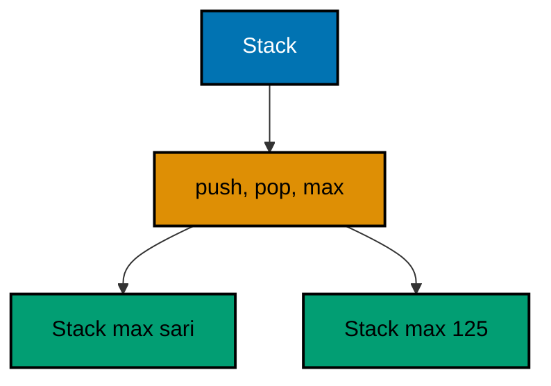

**`learning/code/ex-47-generic-stack-with-bounds/Main.java`**:

```java
// Example 47: A Generic Stack with Honest Bounds.
// A bounded type parameter keeps the stack generic yet capable: T
// extends Comparable<T> buys ordering without losing reusability.
import java.util.ArrayList; // => the stack storage, top at the end
import java.util.List; // => interface on the left as always
import java.util.NoSuchElementException; // => the documented empty-stack failure

public class Main {

  // => one public class per file, named after the file
  static class Stack<T extends Comparable<T>> {

    // => bounded: every element orders itself
    private final List<T> items = new ArrayList<>(); // => private storage, top at the end

    void push(T item) {
      // => push accepts the bounded type only
      items.add(item); // => top grows at the list end
    } // => push ends: one append, LIFO order kept

    T pop() {
      // => pop removes and returns the top
      if (items.isEmpty()) {
        // => empty pop is a caller bug, refused loudly
        throw new NoSuchElementException("pop from empty stack"); // => unchecked: fix the caller
      } // => past this line the top exists
      return items.remove(items.size() - 1); // => remove and return the last element
    } // => pop ends: top out, rest intact

    T max() {
      // => the bound pays off: ordering without casts
      T best = items.get(0); // => seed with the first element
      for (T item : items) {
        // => every element comparable by construction
        if (item.compareTo(best) > 0) {
          // => the bound guarantees this method exists
          best = item; // => a new champion by natural order
        } // => branch ends: best always the maximum so far
      } // => loop ends having compared everything
      return best; // => the maximum by natural ordering
    } // => max ends: generic code, specific capability
  } // => Stack ends: reusable, ordered, refusal-honest

  public static void main(String[] args) {
    // => the entry point the harness runs
    Stack<String> names = new Stack<>(); // => Strings order: alphabetical max
    names.push("budi"); // => first arrival, deeper in the stack
    names.push("sari"); // => second arrival, the top
    System.out.println("pop: " + names.pop()); // => Output: pop: sari
    names.push("citra"); // => new top after the pop
    System.out.println("max: " + names.max()); // => Output: max: sari
    Stack<Integer> dues = new Stack<>(); // => Integers order: numeric max
    dues.push(50); // => smaller due first
    dues.push(125); // => larger due second
    System.out.println("max due: " + dues.max()); // => Output: max due: 125
  } // => main ends: two flavors, one bounded implementation
}
```

**Output** (`learning/code/ex-47-generic-stack-with-bounds/expected/main.stdout.txt`):

```text
pop: sari
max: citra
max due: 125
```

**Key takeaway**: Bound type parameters to the capability generic code needs; refuse empty-container misuse with named exceptions.

**Why it matters**: Bounds keep generic reuse without casts, and loud empty-container refusals beat nulls that explode downstream.

### Example 48: Records Are Values

Records answer the question plain data classes always raised: when a type carries fields and nothing else, the language should write the boilerplate. The compiler generates the accessors, equals, hashCode, and toString from the component list, so two Dues with equal fields compare equal without a hand-written equals that the next field addition forgets to extend. The `==` versus equals line states the value rule every Java developer internalizes once: identity compares addresses while equals compares meaning, and values choose meaning. The compact constructor keeps validation without surrendering brevity: the checks run before the implicit field assignment, so no invalid Due can exist, yet no explicit assignments restate the components. Immutability is structural here, all fields final and no setters generated, which is why Dues travel safely through maps, streams, and threads; the remaining value-semantics examples build the copying and comparison contracts on top of exactly this foundation. (Concepts: co-11.)

**`learning/code/ex-48-records-are-values/Main.java`**:

```java
// Example 48: Records Are Values.
// Records bundle immutable data with generated equals, hashCode, and
// toString: two dues with the same fields are the same value.
// Canonical constructors validate without giving up compactness.
public class Main {

  // => one public class per file, named after the file
  record Due(String member, int amount) {
    // => the value: two components, nothing else
    Due {
      // => compact constructor: validation before the implicit assignment
      if (member == null || member.isBlank()) {
        // => blank members corrupt every report
        throw new IllegalArgumentException("member must be non-blank"); // => refused at construction
      } // => membership settled before the value exists
      if (amount < 0) {
        // => negative dues corrupt every total
        throw new IllegalArgumentException("amount must be >= 0"); // => refused at construction
      } // => amount settled before the value exists
    } // => constructor ends: no invalid Due can exist
  } // => Due ends: immutable, comparable, printable

  public static void main(String[] args) {
    // => the entry point the harness runs
    Due first = new Due("sari", 50); // => canonical construction, validated
    Due twin = new Due("sari", 50); // => equal fields, separate object
    System.out.println("equal: " + first.equals(twin)); // => Output: equal: true, values compare by fields
    System.out.println("same object: " + (first == twin)); // => Output: same object: false
    System.out.println("text: " + first); // => Output: text: Due[member=sari, amount=50]
    System.out.println("member: " + first.member()); // => Output: member: sari
    try {
      // => invalid construction refused at the door
      new Due("budi", -5); // => throws before any value exists
      System.out.println("unreachable"); // => skipped: validation threw first
    } catch (IllegalArgumentException e) {
      // => the documented construction refusal
      System.out.println("refused: " + e.getMessage()); // => Output: refused: amount must be >= 0
    } // => catch ends: no invalid value escaped
  } // => main ends: values compared, printed, and guarded
}
```

**Output** (`learning/code/ex-48-records-are-values/expected/main.stdout.txt`):

```text
equal: true
same object: false
text: Due[member=sari, amount=50]
member: sari
refused: amount must be >= 0
```

**Key takeaway**: Model immutable data as records with compact-constructor validation; compare values with equals, never ==.

**Why it matters**: Generated equality and final fields make values correct by construction, where hand-rolled data classes drift and mutate.

### Example 49: Sealed Hierarchies Close the Cases

Open hierarchies force defensive defaults: every if-chain over an interface ends with an else that guesses, because unknown future children might arrive. Sealed interfaces remove the unknown by naming every permitted child in the permits clause, so the family is complete by declaration and handlers can cover it exhaustively. The records beside the seal are the natural children: immutable outcomes with generated equality, each carrying exactly its case's data. Pattern-matching instanceof keeps each arm cast-free, binding the child directly to a variable with its fields in reach. The trailing AssertionError documents the exhaustiveness claim in code: unreachable precisely because the family is sealed, it converts a future permits addition without a handler update into a loud failure rather than a silent fallthrough. New outcomes join by editing the permits clause, which the compiler then enforces at every handler; closed families make their own evolution reviewable. (Concepts: co-10, co-06.)

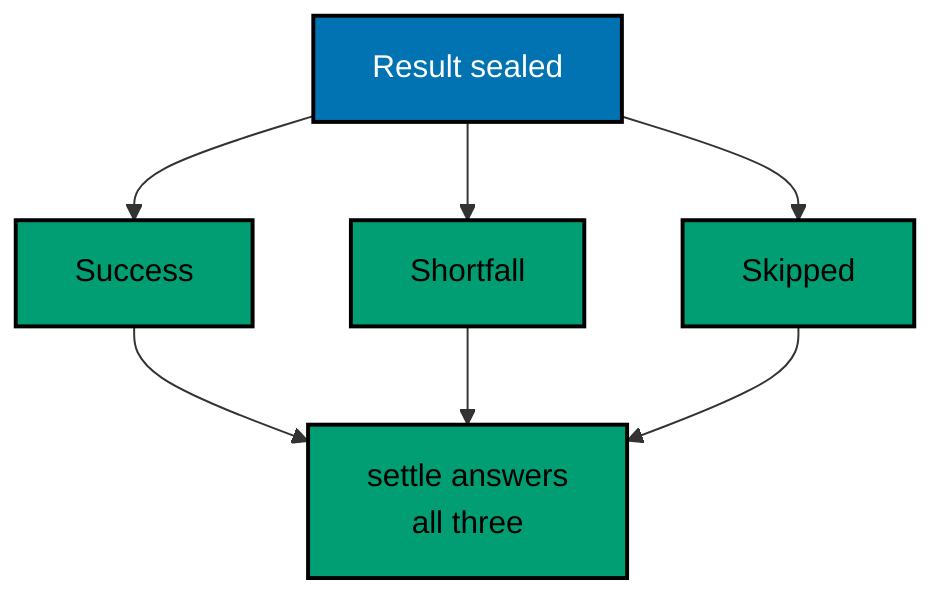

**`learning/code/ex-49-sealed-hierarchy-closed-cases/Main.java`**:

```java
// Example 49: Sealed Hierarchies Close the Cases.
// A sealed interface names its permitted children, so every handler
// covers a closed set: the compiler knows the family is complete.
public class Main {

  // => one public class per file, named after the file
  sealed interface Result permits Success, Shortfall, Skipped {} // => closed family of three outcomes

  record Success(String member, int amount) implements Result {} // => permitted child one: settled

  record Shortfall(String member, int missing) implements Result {} // => permitted child two: partial

  record Skipped(String line, String reason) implements Result {} // => permitted child three: refused

  static String settle(Result r) {
    // => one handler over the closed family
    if (r instanceof Success s) {
      // => pattern variable binds without a cast
      return "settled " + s.member() + ":" + s.amount(); // => success reads its fields directly
    } else if (r instanceof Shortfall f) {
      // => second case: partial payment
      return "shortfall " + f.member() + " missing " + f.missing(); // => shortfall names the gap
    } else if (r instanceof Skipped k) {
      // => third case: the closed set exhausted
      return "skipped '" + k.line() + "' (" + k.reason() + ")"; // => skip carries its evidence
    } // => every permitted child answered, no else needed for logic
    throw new AssertionError("unreachable: family is sealed"); // => documents exhaustiveness, never throws
  } // => handler ends: closed cases, complete coverage

  public static void main(String[] args) {
    // => the entry point the harness runs
    System.out.println(settle(new Success("sari", 50))); // => Output: settled sari:50
    System.out.println(settle(new Shortfall("budi", 25))); // => Output: shortfall budi missing 25
    System.out.println(settle(new Skipped("xx", "no colon"))); // => Output: skipped 'xx' (no colon)
  } // => main ends: three children, three answers
}
```

**Output** (`learning/code/ex-49-sealed-hierarchy-closed-cases/expected/main.stdout.txt`):

```text
settled sari:50
shortfall budi missing 25
skipped 'xx' (no colon)
```

**Key takeaway**: Seal outcome families with permits; handle every child and document exhaustiveness with an unreachable guard.

**Why it matters**: Closed hierarchies turn unknown-future-child guessing into compiler-checked coverage at every handler.

### Example 50: Defensive Copies at Trust Edges

Constructors that store caller collections by reference inherit the caller's future: every later add or set on the outside list silently rewrites the inside state. List.copyOf breaks the alias at the trust edge by snapshotting contents into an immutable list, so the sneaky post-handoff add lands in the feed alone while the ledger keeps its single line. Returning the snapshot needs no second copy because immutability shares safely; the one-copy-in, zero-copies-out rhythm is the whole policy. Arrays need their own idiom since copyOf serves collections: clone snapshots the array contents in one call, defeating the same alias for primitive and object arrays alike. The null-rejection witness closes the contract: copyOf throws on null elements, so hostile data dies at entry rather than ambushing iteration later. Copy at ownership boundaries, keep snapshots inside, and shared state stops being shared by accident. (Concepts: co-11.)

**`learning/code/ex-50-defensive-copies-at-trust-edges/Main.java`**:

```java
// Example 50: Defensive Copies at Trust Edges.
// List.copyOf snapshots caller data on entry, so later caller
// mutations cannot corrupt the ledger; arrays need clone instead.
import java.util.ArrayList; // => the caller-side mutable list
import java.util.Arrays; // => array printing for the transcript
import java.util.List; // => interface on the left as always

public class Main {

  // => one public class per file, named after the file
  static class Ledger {

    // => the trust edge: outside data enters here
    private final List<String> lines; // => snapshot held, never the caller's list

    Ledger(List<String> incoming) {
      // => constructor copies on entry
      lines = List.copyOf(incoming); // => immutable snapshot: later caller edits stop here
    } // => constructor ends: ownership transferred, aliasing refused

    List<String> lines() {
      // => accessor returns the snapshot itself
      return lines; // => safe: immutable snapshots share freely
    } // => accessor ends: no copy needed on the way out
  } // => Ledger ends: one copy in, zero copies out

  public static void main(String[] args) {
    // => the entry point the harness runs
    List<String> feed = new ArrayList<>(List.of("sari:50")); // => caller-owned, still mutable
    Ledger ledger = new Ledger(feed); // => snapshot taken at the trust edge
    feed.add("sneaky:999"); // => caller mutates after handoff
    System.out.println("ledger: " + ledger.lines()); // => Output: ledger: [sari:50]
    System.out.println("feed: " + feed); // => Output: feed holds the sneaky line too
    int[] figures = { 50, 75 }; // => arrays alias too: clone at the edge
    int[] kept = figures.clone(); // => clone snapshots the array contents
    figures[0] = 999; // => caller mutates the original array
    System.out.println("kept: " + Arrays.toString(kept)); // => Output: kept: [50, 75]
    System.out.println("copyOf rejects nulls: " + keepsNullsOut()); // => Output: copyOf rejects nulls: true
  } // => main ends: edges copied, aliases defeated

  static boolean keepsNullsOut() {
    // => the null-rejection witness for copyOf
    try {
      // => List.copyOf refuses null elements loudly
      List.copyOf(Arrays.asList("sari:50", null)); // => throws before any snapshot exists
      return false; // => unreachable: rejection threw first
    } catch (NullPointerException e) {
      // => the documented copyOf refusal
      return true; // => witnessed: nulls die at the trust edge
    } // => catch ends: rejection proven, not assumed
  } // => witness ends: copyOf guards entry twice over
}
```

**Output** (`learning/code/ex-50-defensive-copies-at-trust-edges/expected/main.stdout.txt`):

```text
ledger: [sari:50]
feed: [sari:50, sneaky:999]
kept: [50, 75]
copyOf rejects nulls: true
```

**Key takeaway**: Snapshot incoming collections with List.copyOf and arrays with clone; return immutable snapshots freely.

**Why it matters**: Entry copies defeat caller-side mutation aliases, and null rejection at the edge keeps hostile data out entirely.

### Example 51: Enums Carry Behavior

Fixed sets with behavior belong in enums: four settlement states, each carrying its label, its closedness, and its own transition, with the compiler guaranteeing the set never grows silently. The alternative, string constants plus switch statements scattered across call sites, duplicates the lifecycle knowledge everywhere and breaks the moment a fifth string appears; the enum keeps every state fact in one file where reviews see the whole machine. The settle method shows the self-contained transition: an expression switch over `this` that the compiler checks for exhaustiveness, so adding a state without updating settle fails the build rather than falling through. Enum constructors run once per constant at class load, making the data effectively free at runtime; switch-free call sites like isClosed then read as data lookups rather than branching logic. When states need distinct fields or transitions diverge widely, sealed interfaces from Example 49 take over; enums own the compact middle where constants share one shape. (Concepts: co-11, co-01.)

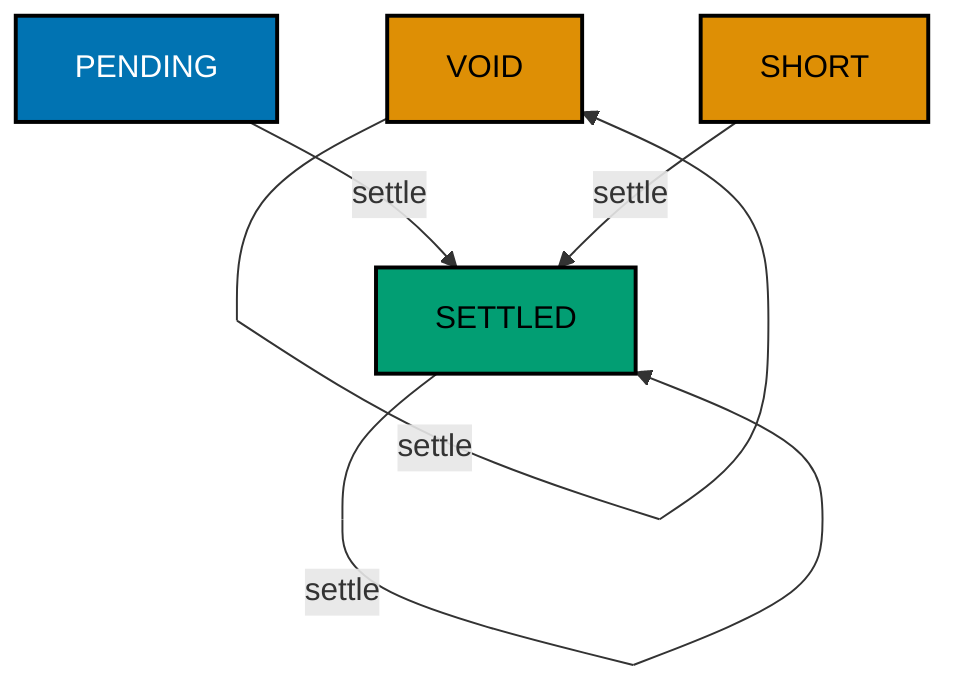

**`learning/code/ex-51-enums-carry-behavior/Main.java`**:

```java
// Example 51: Enums Carry Behavior.
// Enums with fields and methods turn fixed sets into data: each
// settlement state knows its own label and its next step.
// Behavior on the constant beats switches scattered at call sites.
public class Main {

  // => one public class per file, named after the file
  enum State {
    // => the closed settlement lifecycle, four states
    PENDING("waiting", false), // => arrived, not yet processed
    SETTLED("done", true), // => processed and banked
    SHORT("partial", false), // => processed, gap remains
    VOID("cancelled", true); // => closed without banking

    private final String label; // => the human word per state
    private final boolean closed; // => whether the lifecycle ended

    State(String label, boolean closed) {
      // => constructor binds data per constant
      this.label = label; // => label stored once per constant
      this.closed = closed; // => closedness stored once per constant
    } // => constructor ends: constants fully formed

    boolean isClosed() {
      // => behavior lives on the constant
      return closed; // => no switch at the call site, ever
    } // => query ends: data answers, not branches

    String label() {
      // => the human word for reports
      return label; // => stored per constant at class load
    } // => label ends: reporting reads data, not branches

    State settle() {
      // => the lifecycle transition each state owns
      return switch (this) {
        // => expression switch over the closed set
        case PENDING -> SETTLED; // => waiting work completes
        case SHORT -> SETTLED; // => partial work completes too
        case SETTLED, VOID -> this; // => terminal states stay put
      }; // => exhaustive: the compiler checks all four
    } // => transition ends: next state, no external map
  } // => State ends: data plus behavior, closed set

  public static void main(String[] args) {
    // => the entry point the harness runs
    System.out.println("pending: " + State.PENDING.settle()); // => Output: pending: SETTLED
    System.out.println("settled stays: " + State.SETTLED.settle()); // => Output: settled stays: SETTLED
    System.out.println("void closed: " + State.VOID.isClosed()); // => Output: void closed: true
    System.out.println("pending open: " + State.PENDING.isClosed()); // => Output: pending open: false
    System.out.println("short reads: " + State.SHORT.label()); // => Output: short reads: partial
    System.out.println("states: " + State.values().length); // => Output: states: 4
  } // => main ends: lifecycle walked without one external switch
}
```

**Output** (`learning/code/ex-51-enums-carry-behavior/expected/main.stdout.txt`):

```text
pending: SETTLED
settled stays: SETTLED
void closed: true
pending open: false
short reads: partial
states: 4
```

**Key takeaway**: Put fixed-set data and transitions on enums; let exhaustive switches over this keep lifecycles complete.

**Why it matters**: Behavior-carrying enums centralize lifecycle knowledge where reviews see it, and the compiler enforces new-state handling.

### Example 52: equals, hashCode, and compareTo Agree

Value types live or die by three contracts agreeing: equals compares fields, hashCode hashes the same fields, and compareTo returns zero exactly for equals. Break any pairing and collections misbehave quietly: equal objects in different hash buckets duplicate inside HashSets, and TreeSets ordered inconsistently with equals keep twins the set should merge. The hand-rolled Due shows all three explicitly where records would generate them, because maintaining the agreement by hand teaches what the generation guarantees. Two implementation rules carry over everywhere: compare integers with Integer.compare rather than subtraction, which overflows on extreme values, and compare fields with Objects helpers that state null policy instead of risking it. The transcript witnesses the agreement mechanically: equals true, hashes equal, compareTo zero, then a HashSet of three entries holding two survivors and a sorted board reading amount-first. Prefer records from Example 48 for new values; hand-roll only where identity or laziness genuinely differs. (Concepts: co-11.)

**`learning/code/ex-52-equals-hashcode-compareto-agree/Main.java`**:

```java
// Example 52: equals, hashCode, and compareTo Agree.
// Value types keep three contracts consistent: equal objects share
// hash codes, and compareTo zero matches equals, or maps misbehave.
import java.util.ArrayList; // => the sortable roster
import java.util.HashSet; // => the hash-based membership witness
import java.util.List; // => interface on the left as always
import java.util.Objects; // => null-safe field comparison
import java.util.Set; // => membership without duplicates

public class Main {

  // => one public class per file, named after the file
  static final class Due implements Comparable<Due> {

    // => hand-rolled value: all three contracts visible
    private final String member; // => final: set once, never mutated
    private final int amount; // => final: part of the value identity

    Due(String member, int amount) {
      // => canonical construction, validated
      this.member = Objects.requireNonNull(member, "member"); // => null refused at the door
      this.amount = amount; // => amount stored as given
    } // => constructor ends: fully formed, immutable

    @Override
    public boolean equals(Object o) {
      // => value equality: fields, not addresses
      if (!(o instanceof Due other)) {
        // => pattern variable: wrong types lose fast
        return false; // => a Due never equals a non-Due
      } // => past this line other is provably a Due
      return amount == other.amount && member.equals(other.member); // => both fields agree
    } // => equals ends: symmetric, field-based

    @Override
    public int hashCode() {
      // => consistent with equals, always
      return Objects.hash(member, amount); // => same fields, same hash for equal values
    } // => hashCode ends: equal objects hash equally

    @Override
    public int compareTo(Due other) {
      // => natural order: amount first, member second
      int byAmount = Integer.compare(amount, other.amount); // => never subtract: overflow-safe
      return byAmount != 0 ? byAmount : member.compareTo(other.member); // => tie broken by name
    } // => compareTo ends: zero exactly when equals

    @Override
    public String toString() {
      // => readable text for transcripts
      return member + ":" + amount; // => the canonical dues shape
    } // => toString ends: debugging reads data
  } // => Due ends: three contracts, one consistent value

  public static void main(String[] args) {
    // => the entry point the harness runs
    Due first = new Due("sari", 50); // => canonical value one
    Due twin = new Due("sari", 50); // => equal fields, separate object
    System.out.println("equals: " + first.equals(twin)); // => Output: equals: true
    System.out.println("hashes: " + (first.hashCode() == twin.hashCode())); // => Output: hashes: true
    System.out.println("compare: " + (first.compareTo(twin) == 0)); // => Output: compare: true
    Set<Due> members = new HashSet<>(List.of(first, twin, new Due("budi", 75))); // => set dedupes by contract
    System.out.println("unique: " + members.size()); // => Output: unique: 2
    List<Due> board = new ArrayList<>(members); // => sorted view of the survivors
    board.sort(null); // => natural order via compareTo
    System.out.println("board: " + board); // => Output: board: [sari:50, budi:75]
  } // => main ends: three contracts witnessed agreeing
}
```

**Output** (`learning/code/ex-52-equals-hashcode-compareto-agree/expected/main.stdout.txt`):

```text
equals: true
hashes: true
compare: true
unique: 2
board: [sari:50, budi:75]
```

**Key takeaway**: Keep equals, hashCode, and compareTo consistent over the same fields; compare ints without subtraction.

**Why it matters**: Agreeing contracts keep sets deduplicating and sorts ordering correctly, where drift corrupts collections silently.

### Example 53: Views Share, Copies Freeze

Two read-only lists can disagree after the fact, and the difference decides correctness: the unmodifiable view reads through to the live list, reflecting the citra add, while the copyOf snapshot keeps the two-line moment forever. Choose the view for live windows, dashboards and feeds that must track the source, and the copy for history, reports and audit trails that must not move after printing. The write attempt through the view proves the asymmetry from the other side: views are read-only doors onto mutable rooms, so adding through the window throws while adding to the ledger behind it still shows through. Performance follows the same split: views cost nothing to create and read at indirection speed, while copies pay linear time and memory once for stability. Name the need first, window or history, and the factory follows; reaching for either by habit invites exactly the stale-read or moved-history bug the other prevents. (Concepts: co-11, co-15.)

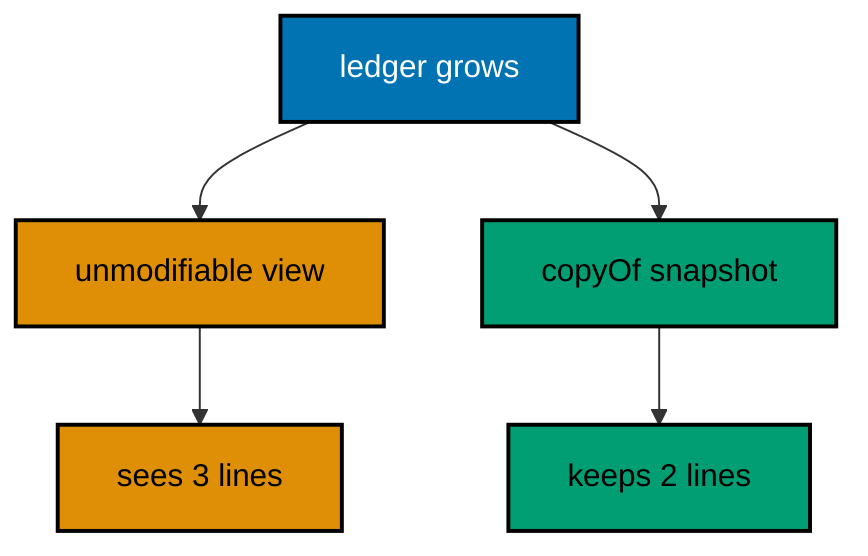

**`learning/code/ex-53-views-share-copies-freeze/Main.java`**:

```java
// Example 53: Views Share, Copies Freeze.
// Unmodifiable views reflect later edits while List.copyOf freezes
// the moment: choose the view for live windows, the copy for history.
import java.util.ArrayList; // => the live ledger underneath both
import java.util.Collections; // => the unmodifiable view factory
import java.util.List; // => interface on the left as always

public class Main {

  // => one public class per file, named after the file
  public static void main(String[] args) {
    // => the entry point the harness runs
    List<String> ledger = new ArrayList<>(List.of("sari:50", "budi:75")); // => the live list both derive from
    List<String> window = Collections.unmodifiableList(ledger); // => view: reads through to the live list
    List<String> frozen = List.copyOf(ledger); // => copy: the moment frozen immutably
    System.out.println("window: " + window); // => Output: window: [sari:50, budi:75]
    System.out.println("frozen: " + frozen); // => Output: frozen: [sari:50, budi:75]
    ledger.add("citra:25"); // => the live list grows after both derive
    System.out.println("window sees growth: " + window); // => Output: window sees growth, three lines
    System.out.println("frozen ignores growth: " + frozen); // => Output: frozen ignores growth, two lines
    try {
      // => views reject writes through themselves
      window.add("sneaky:1"); // => throws: views are read-only doors
      System.out.println("unreachable"); // => skipped: the view refused first
    } catch (UnsupportedOperationException e) {
      // => the documented view refusal
      System.out.println("view read-only: true"); // => Output: view read-only: true
    } // => catch ends: the live list untouched by the attempt
    System.out.println("live: " + ledger.size() + ", window: " + window.size() + ", frozen: " + frozen.size()); // => Output: live: 3, window: 3, frozen: 2
  } // => main ends: sharing and freezing told apart
}
```

**Output** (`learning/code/ex-53-views-share-copies-freeze/expected/main.stdout.txt`):

```text
window: [sari:50, budi:75]
frozen: [sari:50, budi:75]
window sees growth: [sari:50, budi:75, citra:25]
frozen ignores growth: [sari:50, budi:75]
view read-only: true
live: 3, window: 3, frozen: 2
```

**Key takeaway**: Expose live data through unmodifiable views and history through copyOf snapshots; never confuse the two.

**Why it matters**: Views track their source while copies freeze it, so the window-or-history decision determines which bug class disappears.
