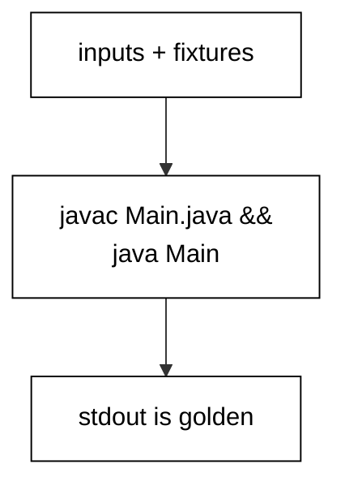

Prerequisites for this course: [just-enough-java](/en/learn/courses/just-enough-java/learning/overview) for Java's basic syntax, which every example here assumes you can already read; and [enterprise-java-and-the-jvm](/en/learn/courses/enterprise-java-and-the-jvm/learning/overview) for the specialized concurrency and enterprise angle this course deliberately surveys instead of repeating. Assumed knowledge: comfort with Java's basic syntax from just-enough-java.

## Why this exists -- the big idea

**The problem before the solution**: developers who learn Java as a second language write it with their first language accent -- index loops from C, null checks from habit, string paths instead of NIO, error codes instead of exceptions. The programs work, but they resist the ecosystem: standard tools, reviewers, and future maintainers all expect the idiomatic forms. This course replaces each accent with the native habit, one small runnable program at a time, until the idiomatic form is the first one you reach for.

**Keep this if you forget everything else**: Write Java the way its own standard library does -- total functions with visible edge policies, values over mutation, explicitness at boundaries.

## Tensions and trade-offs -- when NOT to reach for this

- **Idiom versus clarity**: streams beat loops until they need debugging; immutability beats mutation until the copy costs dominate; records beat classes until behavior outgrows data. Each example names its cost alongside its form, and Example 78 collects the reading rules.
- **Standard library versus dependency**: the course reaches for the standard library first, which keeps every example runnable with zero installs. Real projects still adopt dependencies for genuinely hard problems -- web frameworks, object mapping, test engines -- where the standard library ends and the ecosystem begins.
- **When NOT**: one-off exploration in JShell needs no packaging, no tests, and no linting. The engineering in this course earns its place when the program runs twice -- on a schedule, on someone else's machine, or a year from now with you unavailable.

## Lineage -- where this language sits

Java is the enterprise backbone across much of this catalog: backend courses build on it, migration courses move data beside it, tooling courses drive it. This course is the depth behind that ubiquity -- the reason the same language serves CLIs and systems alike. The primer teaches reading and writing; this course teaches fluency; later courses assume both and build domain systems on top.

## How this course is organized

[Beginner](/en/learn/courses/java-in-depth/learning/beginner) (Examples 1-25) installs idiomatic control flow and collections, the error-handling idiom, and standard-library text, files, and time. [Intermediate](/en/learn/courses/java-in-depth/learning/intermediate) (Examples 26-53) organizes modules and packages, declares and pins dependencies, tests with assertions and hand-rolled runners, and types generic, value-shaped code. [Advanced](/en/learn/courses/java-in-depth/learning/advanced) (Examples 54-78) surveys concurrency primitives, configures tooling and style, and trains systematic reading of idiomatic code. The [capstone](/en/learn/courses/java-in-depth/learning/capstone/overview) ships a dues-settlement CLI with a thirteen-check suite and a golden transcript, and [drilling](/en/learn/courses/java-in-depth/drilling/overview) turns the sixteen concepts into recall, katas, and checklists.

## About the runtime

Every example runs as `javac Main.java && java Main` in the pinned Java container with no network and a read-only course tree: only the scratch directory is writable, so fixtures ship beside each program. Multi-file examples state their extra files explicitly; every file the lesson shows is embedded byte-identically. Standard output is the asserted golden transcript. Programs print names, counts, and fixed labels -- never paths, timings, addresses, or versions -- so reruns are byte-stable.

## Examples by Level

### Beginner (Examples 1-25)

- [Example 1: Switch Expressions Choose Values](/en/learn/courses/java-in-depth/learning/beginner#example-1-switch-expressions-choose-values)
- [Example 2: The Enhanced for Loop Over Indexes](/en/learn/courses/java-in-depth/learning/beginner#example-2-the-enhanced-for-loop-over-indexes)
- [Example 3: Guard Clauses Flatten Nesting](/en/learn/courses/java-in-depth/learning/beginner#example-3-guard-clauses-flatten-nesting)
- [Example 4: ArrayList Grows on Add](/en/learn/courses/java-in-depth/learning/beginner#example-4-arraylist-grows-on-add)
- [Example 5: HashMap Counts with getOrDefault](/en/learn/courses/java-in-depth/learning/beginner#example-5-hashmap-counts-with-getordefault)
- [Example 6: List.of Snapshots That Cannot Change](/en/learn/courses/java-in-depth/learning/beginner#example-6-list-of-snapshots-that-cannot-change)
- [Example 7: Sorting with Comparators](/en/learn/courses/java-in-depth/learning/beginner#example-7-sorting-with-comparators)
- [Example 8: Streams Replace Accumulator Loops](/en/learn/courses/java-in-depth/learning/beginner#example-8-streams-replace-accumulator-loops)
- [Example 9: try-with-resources Closes for You](/en/learn/courses/java-in-depth/learning/beginner#example-9-try-with-resources-closes-for-you)
- [Example 10: Multi-catch Shares One Handler](/en/learn/courses/java-in-depth/learning/beginner#example-10-multi-catch-shares-one-handler)
- [Example 11: Causes Chain Across Layers](/en/learn/courses/java-in-depth/learning/beginner#example-11-causes-chain-across-layers)
- [Example 12: A Small Exception Hierarchy](/en/learn/courses/java-in-depth/learning/beginner#example-12-a-small-exception-hierarchy)
- [Example 13: Optional Instead of Null](/en/learn/courses/java-in-depth/learning/beginner#example-13-optional-instead-of-null)
- [Example 14: Validate with IllegalArgumentException](/en/learn/courses/java-in-depth/learning/beginner#example-14-validate-with-illegalargumentexception)
- [Example 15: Checked or Unchecked: The Decision](/en/learn/courses/java-in-depth/learning/beginner#example-15-checked-or-unchecked-the-decision)
- [Example 16: requireNonNull at Boundaries](/en/learn/courses/java-in-depth/learning/beginner#example-16-requirenonnull-at-boundaries)
- [Example 17: Failure Granularity: Per Item, Not per Batch](/en/learn/courses/java-in-depth/learning/beginner#example-17-failure-granularity-per-item-not-per-batch)
- [Example 18: Text Blocks for Templates](/en/learn/courses/java-in-depth/learning/beginner#example-18-text-blocks-for-templates)
- [Example 19: Format Verbs for Tables and Numbers](/en/learn/courses/java-in-depth/learning/beginner#example-19-format-verbs-for-tables-and-numbers)
- [Example 20: Regular Expressions with Named Groups](/en/learn/courses/java-in-depth/learning/beginner#example-20-regular-expressions-with-named-groups)
- [Example 21: Files with Explicit UTF-8](/en/learn/courses/java-in-depth/learning/beginner#example-21-files-with-explicit-utf-8)
- [Example 22: CSV Quotes Need More Than Split](/en/learn/courses/java-in-depth/learning/beginner#example-22-csv-quotes-need-more-than-split)
- [Example 23: Properties Config at the Edge](/en/learn/courses/java-in-depth/learning/beginner#example-23-properties-config-at-the-edge)
- [Example 24: Instants and Durations from Fixed Points](/en/learn/courses/java-in-depth/learning/beginner#example-24-instants-and-durations-from-fixed-points)
- [Example 25: Zoned Time for Humans](/en/learn/courses/java-in-depth/learning/beginner#example-25-zoned-time-for-humans)

### Intermediate (Examples 26-53)

- [Example 26: One Class, One Job](/en/learn/courses/java-in-depth/learning/intermediate#example-26-one-class-one-job)
- [Example 27: Packages Group Related Code](/en/learn/courses/java-in-depth/learning/intermediate#example-27-packages-group-related-code)
- [Example 28: module-info Declares the Exports](/en/learn/courses/java-in-depth/learning/intermediate#example-28-module-info-declares-the-exports)
- [Example 29: Imports Resolve Names, Collisions Qualify](/en/learn/courses/java-in-depth/learning/intermediate#example-29-imports-resolve-names-collisions-qualify)
- [Example 30: Maven Layout and Coordinates](/en/learn/courses/java-in-depth/learning/intermediate#example-30-maven-layout-and-coordinates)
- [Example 31: Pin Exact Versions, Not Ranges](/en/learn/courses/java-in-depth/learning/intermediate#example-31-pin-exact-versions-not-ranges)
- [Example 32: Javadoc Comments State the Contract](/en/learn/courses/java-in-depth/learning/intermediate#example-32-javadoc-comments-state-the-contract)
- [Example 33: Executable Jar Packages the App](/en/learn/courses/java-in-depth/learning/intermediate#example-33-executable-jar-packages-the-app)
- [Example 34: Version Gates Guard New APIs](/en/learn/courses/java-in-depth/learning/intermediate#example-34-version-gates-guard-new-apis)
- [Example 35: Assertions State Contracts](/en/learn/courses/java-in-depth/learning/intermediate#example-35-assertions-state-contracts)
- [Example 36: A Hand-rolled Test Runner](/en/learn/courses/java-in-depth/learning/intermediate#example-36-a-hand-rolled-test-runner)
- [Example 37: Fresh Fixtures per Test](/en/learn/courses/java-in-depth/learning/intermediate#example-37-fresh-fixtures-per-test)
- [Example 38: Table Tests Cover the Cases](/en/learn/courses/java-in-depth/learning/intermediate#example-38-table-tests-cover-the-cases)
- [Example 39: Tests Pin Failure Contracts](/en/learn/courses/java-in-depth/learning/intermediate#example-39-tests-pin-failure-contracts)
- [Example 40: Temp Dirs Isolate File Tests](/en/learn/courses/java-in-depth/learning/intermediate#example-40-temp-dirs-isolate-file-tests)
- [Example 41: Red First, Then Green](/en/learn/courses/java-in-depth/learning/intermediate#example-41-red-first-then-green)
- [Example 42: Boundaries: Empty, Single, Many](/en/learn/courses/java-in-depth/learning/intermediate#example-42-boundaries-empty-single-many)
- [Example 43: Seams Replace Boundaries](/en/learn/courses/java-in-depth/learning/intermediate#example-43-seams-replace-boundaries)
- [Example 44: Test Names Read as a Spec](/en/learn/courses/java-in-depth/learning/intermediate#example-44-test-names-read-as-a-spec)
- [Example 45: A Generic Box Works over Types](/en/learn/courses/java-in-depth/learning/intermediate#example-45-a-generic-box-works-over-types)
- [Example 46: Producer Extends, Consumer Super](/en/learn/courses/java-in-depth/learning/intermediate#example-46-producer-extends-consumer-super)
- [Example 47: A Generic Stack with Honest Bounds](/en/learn/courses/java-in-depth/learning/intermediate#example-47-a-generic-stack-with-honest-bounds)
- [Example 48: Records Are Values](/en/learn/courses/java-in-depth/learning/intermediate#example-48-records-are-values)
- [Example 49: Sealed Hierarchies Close the Cases](/en/learn/courses/java-in-depth/learning/intermediate#example-49-sealed-hierarchies-close-the-cases)
- [Example 50: Defensive Copies at Trust Edges](/en/learn/courses/java-in-depth/learning/intermediate#example-50-defensive-copies-at-trust-edges)
- [Example 51: Enums Carry Behavior](/en/learn/courses/java-in-depth/learning/intermediate#example-51-enums-carry-behavior)
- [Example 52: equals, hashCode, and compareTo Agree](/en/learn/courses/java-in-depth/learning/intermediate#example-52-equals-hashcode-and-compareto-agree)
- [Example 53: Views Share, Copies Freeze](/en/learn/courses/java-in-depth/learning/intermediate#example-53-views-share-copies-freeze)

### Advanced (Examples 54-78)

- [Example 54: Threads Join Before Printing](/en/learn/courses/java-in-depth/learning/advanced#example-54-threads-join-before-printing)
- [Example 55: Executor invokeAll Orders Results](/en/learn/courses/java-in-depth/learning/advanced#example-55-executor-invokeall-orders-results)
- [Example 56: Futures Carry Answers Back](/en/learn/courses/java-in-depth/learning/advanced#example-56-futures-carry-answers-back)
- [Example 57: synchronized Guards the Shared Total](/en/learn/courses/java-in-depth/learning/advanced#example-57-synchronized-guards-the-shared-total)
- [Example 58: BlockingQueue Connects Stages](/en/learn/courses/java-in-depth/learning/advanced#example-58-blockingqueue-connects-stages)
- [Example 59: CompletableFuture Pipelines Compose](/en/learn/courses/java-in-depth/learning/advanced#example-59-completablefuture-pipelines-compose)
- [Example 60: Parallel Streams Sort After](/en/learn/courses/java-in-depth/learning/advanced#example-60-parallel-streams-sort-after)
- [Example 61: Atomics Count Without Locks](/en/learn/courses/java-in-depth/learning/advanced#example-61-atomics-count-without-locks)
- [Example 62: Names Read Aloud](/en/learn/courses/java-in-depth/learning/advanced#example-62-names-read-aloud)
- [Example 63: StringBuilder in Loops](/en/learn/courses/java-in-depth/learning/advanced#example-63-stringbuilder-in-loops)
- [Example 64: Size Collections Upfront](/en/learn/courses/java-in-depth/learning/advanced#example-64-size-collections-upfront)
- [Example 65: EnumSet Flags Stay Compact](/en/learn/courses/java-in-depth/learning/advanced#example-65-enumset-flags-stay-compact)
- [Example 66: Lint-clean Under -Xlint](/en/learn/courses/java-in-depth/learning/advanced#example-66-lint-clean-under-xlint)
- [Example 67: Comments Explain Why, Not What](/en/learn/courses/java-in-depth/learning/advanced#example-67-comments-explain-why-not-what)
- [Example 68: Small Methods, Extracted Early](/en/learn/courses/java-in-depth/learning/advanced#example-68-small-methods-extracted-early)
- [Example 69: Config Through System Properties](/en/learn/courses/java-in-depth/learning/advanced#example-69-config-through-system-properties)
- [Example 70: ProcessBuilder Calls Out](/en/learn/courses/java-in-depth/learning/advanced#example-70-processbuilder-calls-out)
- [Example 71: Read the Handler First](/en/learn/courses/java-in-depth/learning/advanced#example-71-read-the-handler-first)
- [Example 72: Read Pipelines Stage by Stage](/en/learn/courses/java-in-depth/learning/advanced#example-72-read-pipelines-stage-by-stage)
- [Example 73: Read Interfaces for Seams](/en/learn/courses/java-in-depth/learning/advanced#example-73-read-interfaces-for-seams)
- [Example 74: Read Tests as the Spec First](/en/learn/courses/java-in-depth/learning/advanced#example-74-read-tests-as-the-spec-first)
- [Example 75: Read CLIs Outside In](/en/learn/courses/java-in-depth/learning/advanced#example-75-read-clis-outside-in)
- [Example 76: Read Data Contracts First](/en/learn/courses/java-in-depth/learning/advanced#example-76-read-data-contracts-first)
- [Example 77: Read Cleanup Inside Out](/en/learn/courses/java-in-depth/learning/advanced#example-77-read-cleanup-inside-out)
- [Example 78: Read a Whole Program Top Down](/en/learn/courses/java-in-depth/learning/advanced#example-78-read-a-whole-program-top-down)

---
