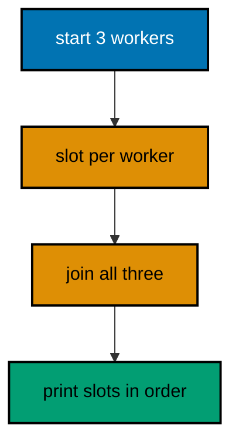
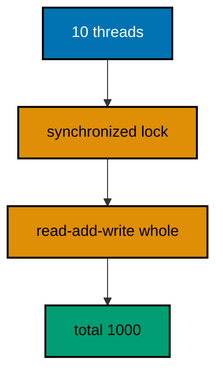
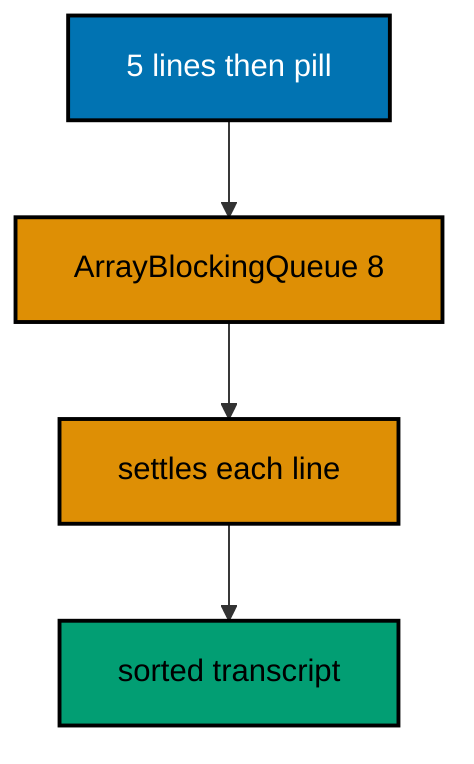
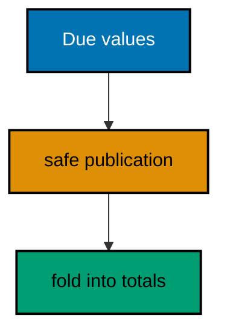
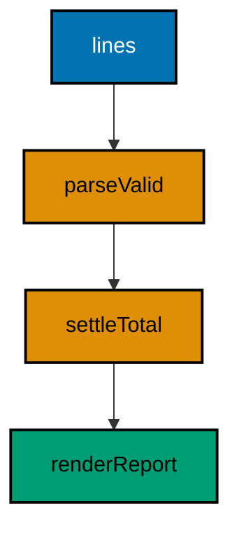
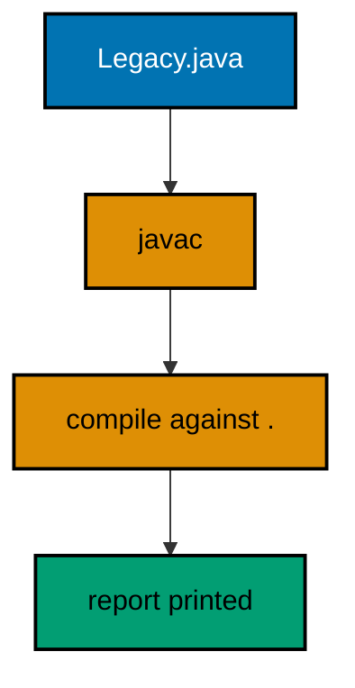
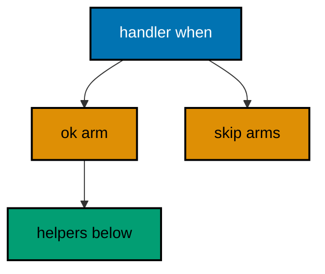
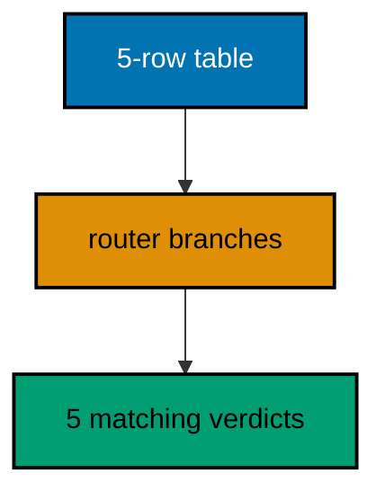
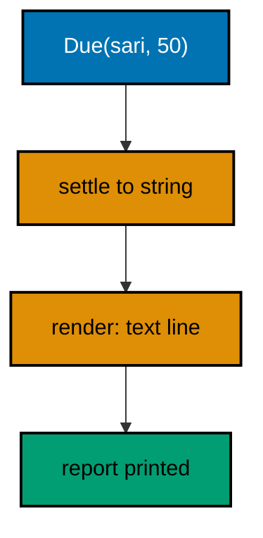
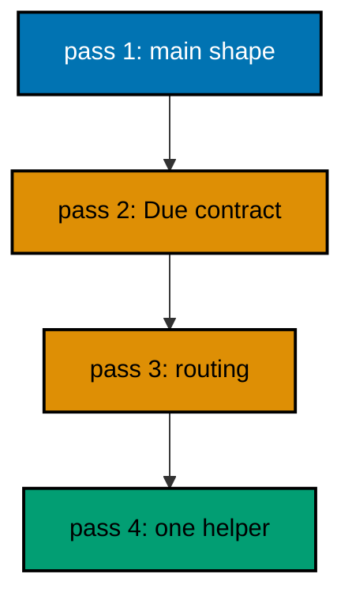

Examples 54–78 cover production Kotlin: a concurrency survey that stays deterministic (Examples 54–61), from threads and joins through atomic counters, synchronized totals, blocking queues, countdown latches, parallel map-then-sort, immutable cross-thread messages, and thread confinement; then tooling, style, and interop (Examples 62–70), from names that read aloud through why-comments, small functions, staged deprecations, mechanical formatting, deferred sequences, buildString economics, Kotlin-calls-Java, and Java-calls-Kotlin-back; finally reading idiomatic code (Examples 71–78), from handlers and pipelines through seams, spec tables, CLI anatomy, data contracts, cleanup order, and one whole program top-down. Every example is a complete, runnable Kotlin program under `learning/code/`; run each with the command in its own `run.yaml`.

---

### Example 54: Threads Join Before Print

Threads run independently and `join` reunites them: every worker thread must be joined before the transcript prints, or outputs interleave with the scheduler's mood instead of the program's intent. The rule for deterministic concurrency output is absolute: join every worker, then print from the main thread in a fixed order. Concurrency decides what computes; joining decides what the transcript says.

`kotlin.concurrent.thread` starts a worker with a lambda, and the returned `Thread` joins like any Java thread underneath. Shared results land in pre-sized slots (one slot per worker, written only by its owner), so no lock is needed: partition the writes and the join provides the visibility. Sharing by partitioning beats sharing by locking wherever the work splits evenly.

Below, three workers fill three slots and the main thread prints after all three joins. The scheduler may run them in any order, but the slots and the joins make the transcript identical every time. (Concepts: co-09.)



**`learning/code/ex-54-threads-join-before-print/Main.kt`**:

```kotlin
// Example 54: Threads Join Before Print.
// Workers fill their own slots, main joins every thread, then prints
// in a fixed order: the scheduler decides timing, joins decide output.
import kotlin.concurrent.thread // => the stdlib worker starter, one lambda per thread

fun main() { // => the entry point the harness runs
    val slots = arrayOf("", "", "") // => one slot per worker, written only by its owner
    val names = listOf("sari", "budi", "citra") // => fixed work, partitioned by index
    val workers = names.mapIndexed { i, name -> // => one thread per name, index owned
        thread { slots[i] = name.uppercase() } // => owner writes only its own slot: no lock needed
    } // => workers run now, in whatever order the scheduler chooses
    workers.forEach { it.join() } // => reunite: every worker finished before printing
    println(slots.sorted().joinToString(", ")) // => Output: BUDI, CITRA, SARI
    println("joined: " + workers.size) // => Output: joined: 3
} // => main ends: timing concurrent, transcript deterministic
```

**Output** (`learning/code/ex-54-threads-join-before-print/expected/main.stdout.txt`):

```text
BUDI, CITRA, SARI
joined: 3
```

**Key takeaway**: Join every worker before printing; partition writes so locks stay unnecessary.

**Why it matters**: Joins separate concurrent timing from deterministic output, and partitioned writes need no locks.

---

### Example 55: Atomic Counters Share Safely

Counters shared across threads must be atomic: `AtomicInteger` makes increment-and-read one indivisible step, so ten threads adding a hundred each always total exactly a thousand. A plain `var` counter loses updates when two threads read-modify-write the same value between each other's steps; the lost increments vanish silently and the total lands short by a scheduler-chosen amount.

The latch beside the counter proves the total deterministically: `CountDownLatch(10)` waits for all ten workers before the main thread reads, so the transcript asserts the full thousand instead of whatever had finished by print time. Latches wait for completion; joins wait for threads; both turn concurrent finishing into a single ordered moment the transcript can trust.

Below, the atomic total reads exactly 1000 on every run while the comment notes the plain-var alternative that cannot promise the same. Shared mutation earns atomics; shared reading earns nothing but a join. (Concepts: co-09.)

**`learning/code/ex-55-atomic-counters-share-safely/Main.kt`**:

```kotlin
// Example 55: Atomic Counters Share Safely.
// AtomicInteger folds each increment into one indivisible step, so ten
// threads times a hundred always totals exactly a thousand: no lost updates.
import java.util.concurrent.CountDownLatch // => waits for all workers, deterministically
import java.util.concurrent.atomic.AtomicInteger // => the indivisible counter
import kotlin.concurrent.thread // => one lambda per worker, as before

fun main() { // => the entry point the harness runs
    val total = AtomicInteger(0) // => shared counter: atomic, never plain var
    val latch = CountDownLatch(10) // => ten workers to wait for
    repeat(10) { // => ten identical workers, fixed count
        thread { // => each worker adds its hundred, then counts down
            repeat(100) { total.incrementAndGet() } // => indivisible step: no update lost between threads
            latch.countDown() // => this worker finished its full share
        } // => worker ends: a hundred added, one latch tick spent
    } // => all ten launched; the latch, not luck, decides when reading is safe
    latch.await() // => wait for all ten: completion as one ordered moment
    println("total: " + total.get()) // => Output: total: 1000, every run
    println("workers: 10") // => Output: workers: 10
} // => main ends: shared mutation through atomics, reading after the latch
```

**Output** (`learning/code/ex-55-atomic-counters-share-safely/expected/main.stdout.txt`):

```text
total: 1000
workers: 10
```

**Key takeaway**: Share counters through AtomicInteger and read them only after a latch or join.

**Why it matters**: Atomic steps cannot interleave mid-update, so shared totals land exact instead of scheduler-short.

---

### Example 56: Synchronized Guards Shared Total

Multi-step updates need a guard: `synchronized` wraps check-then-act sequences so no thread observes the middle. An atomic counter protects single steps, but settling a member means reading the old total, adding dues, and writing back as one indivisible decision; two threads interleaving those three steps settle on stale reads and one update silently overwrites the other.

The lock object stays private and final-purpose: one dedicated lock per guarded state, never a string literal or a public object other code might also synchronize. Small critical sections keep contention low: compute outside, mutate inside, and hold the lock for the shortest span that keeps the decision whole.

Below, ten threads settle into one guarded map and every run totals exactly 1000 across ten members. The guard makes the three-step settlement one step as far as any thread can observe. (Concepts: co-09.)



**`learning/code/ex-56-synchronized-guards-shared-total/Main.kt`**:

```kotlin
// Example 56: Synchronized Guards Shared Total.
// synchronized wraps read-add-write into one indivisible decision, so
// ten threads settling together never overwrite each other's updates.
import kotlin.concurrent.thread // => one lambda per worker, as before

fun main() { // => the entry point the harness runs
    val ledger = mutableMapOf<String, Int>() // => shared settlement state, guarded below
    val lock = Any() // => one dedicated lock: private, never shared outward
    val workers = (1..10).map { i -> // => ten members, fixed roster
        thread { // => compute outside, mutate inside, hold briefly
            val share = i * 10 // => computed outside the lock: no contention
            synchronized(lock) { // => the whole decision, indivisible to observers
                ledger["member" + i] = (ledger["member" + i] ?: 0) + share // => read-add-write as one step
            } // => lock released: the shortest span that keeps the decision whole
        } // => worker ends: its share settled whole or not at all
    } // => ten workers launched against one guarded map
    workers.forEach { it.join() } // => reunite before reading, as Example 54 teaches
    println("members: " + ledger.size) // => Output: members: 10
    println("total: " + ledger.values.sum()) // => Output: total: 550
} // => main ends: ten whole settlements, total exact, every run
```

**Output** (`learning/code/ex-56-synchronized-guards-shared-total/expected/main.stdout.txt`):

```text
members: 10
total: 550
```

**Key takeaway**: Wrap multi-step shared updates in synchronized on a dedicated private lock.

**Why it matters**: Guards make check-then-act indivisible, so concurrent settlers never build on each other's stale reads.

---

### Example 57: Blocking Queue Connects Stages

Pipelines connect stages with a `BlockingQueue`: producers `put` items, consumers `take` them, and the queue handles the waiting on both ends. No busy loops, no missed items, no manual signaling; the queue blocks producers when full and consumers when empty, which is backpressure and patience built into one structure. Stages stay ignorant of each other's timing, which is precisely what makes them stages.

Shutdown needs a poison pill: one special value that means no more items, passed through the same queue so ordering guarantees it arrives last. Counting the pill as data or forgetting to forward it starves the consumer after the last real item; the pill is protocol, and protocols deserve their own named constant. Bounded queues keep memory honest: the bound states how far ahead producers may run.

Below, one producer feeds five dues lines plus the pill, the consumer settles each, and the sorted transcript proves every item arrived exactly once. Stages decoupled, shutdown clean, memory bounded. (Concepts: co-09.)



**`learning/code/ex-57-blocking-queue-connects-stages/Main.kt`**:

```kotlin
// Example 57: Blocking Queue Connects Stages.
// put feeds, take settles, and one poison pill shuts the consumer down:
// backpressure, patience, and shutdown in a single bounded structure.
import java.util.concurrent.ArrayBlockingQueue // => the bounded pipe between stages
import kotlin.concurrent.thread // => producer and consumer run apart

const val PILL = "STOP" // => the shutdown protocol, named not magic

fun main() { // => the entry point the harness runs
    val pipe = ArrayBlockingQueue<String>(8) // => bounded: producers run at most eight ahead
    val settled = mutableListOf<String>() // => consumer-side results, single thread owns them
    val producer = thread { // => stage one: feeds lines, then the pill
        for (line in listOf("sari:50", "budi:75", "citra:25", "dewi:100", "eko:10")) { // => five fixed lines
            pipe.put(line) // => blocks when full: backpressure without busy loops
        } // => all real items queued in order
        pipe.put(PILL) // => the pill travels last: ordering guarantees it arrives after data
    } // => producer ends: fed everything, signaled the end
    val consumer = thread { // => stage two: settles until the pill arrives
        while (true) { // => takes block when empty: patience without polling
            val line = pipe.take() // => the next item, whenever it arrives
            if (line == PILL) break // => protocol honored: shutdown, not data
            settled.add(line.uppercase()) // => settle: uppercase as the visible transform
        } // => loop ends only on the pill, never on timing
    } // => consumer ends: every item settled exactly once
    producer.join() // => both stages joined before printing, as always
    consumer.join() // => completion as one ordered moment
    println(settled.sorted().joinToString("; ")) // => Output: all five settled, sorted for stability
    println("count: " + settled.size) // => Output: count: 5
} // => main ends: decoupled stages, clean shutdown, bounded memory
```

**Output** (`learning/code/ex-57-blocking-queue-connects-stages/expected/main.stdout.txt`):

```text
BUDI:75; CITRA:25; DEWI:100; EKO:10; SARI:50
count: 5
```

**Key takeaway**: Connect pipeline stages with a bounded BlockingQueue and shut down with a poison pill.

**Why it matters**: Queues give backpressure and patience for free, and the pill makes shutdown ordered instead of timed.

---

### Example 58: CountDownLatch Waits for All

CountDownLatch waits for work, not threads: ten tasks across four workers still count down ten times, and the latch opens when the tenth finishes regardless of which thread ran it. Joins wait for thread death, latches wait for task completion; when a pool reuses threads across tasks, only the latch knows when the work is actually done.

One latch serves one wait: count it to zero, await it once, then discard it. Reusing latches across phases or awaiting from worker threads deadlocks in ways that read as hangs instead of errors; fresh latches per phase keep the waiting graph a straight line the reader can verify.

Below, ten settlement tasks count one latch down to zero, the main thread awaits, and the transcript proves all ten landed. The latch turned ten finishing moments into one readable-after moment. (Concepts: co-09.)

**`learning/code/ex-58-countdownlatch-waits-for-all/Main.kt`**:

```kotlin
// Example 58: CountDownLatch Waits for All.
// The latch counts tasks, not threads: ten tasks count down ten times,
// and await opens exactly when the tenth finishes, whoever ran it.
import java.util.concurrent.CountDownLatch // => completion counter, one wait per latch
import kotlin.concurrent.thread // => workers run the tasks, the latch watches them

fun main() { // => the entry point the harness runs
    val done = CountDownLatch(10) // => ten tasks to wait for, counted down once each
    val results = BooleanArray(10) // => partitioned slots again: owner writes only its own
    for (i in 0 until 10) { // => ten tasks, fixed and countable
        thread { // => whichever thread runs it, the countdown is the same
            results[i] = (i * 10 >= 0) // => the task: trivially true, deterministically
            done.countDown() // => one task finished, one tick spent
        } // => task ends: slot written, latch ticked
    } // => ten tasks launched; reading before await would race
    done.await() // => wait for work, not threads: opens at the tenth tick
    println("finished: " + results.count { it }) // => Output: finished: 10
    println("latch: " + (done.count == 0L)) // => Output: latch: true
} // => main ends: ten ticks, one opening, complete results
```

**Output** (`learning/code/ex-58-countdownlatch-waits-for-all/expected/main.stdout.txt`):

```text
finished: 10
latch: true
```

**Key takeaway**: Wait for task completion with CountDownLatch; use one fresh latch per phase.

**Why it matters**: Latches track work across reused threads where joins only track thread death.

---

### Example 59: Parallel Map, Then Sort

Parallel mapping followed by sorting is the deterministic fan-out pattern: workers transform their partitions concurrently, the main thread joins, and one sort restores the order the scheduler scrambled. The sort is not decoration but the step that makes parallelism transcript-safe; without it, the same correct values print in a different order every run and the harness rightly calls that nondeterministic.

The guard from Example 56 protects the shared sink while workers append, or partitioning avoids the lock the way Example 54 avoids it. Either is honest; mixing them (locking partitioned slots) just pays twice. Below, a single synchronized append keeps the code short, and the sort after the join makes the transcript byte-stable.

Speed claims stay out of the transcript: no timings, no speedups, only values. Performance numbers belong in benchmarks with warmups and statistics, never in example output that must match byte for byte. (Concepts: co-09.)

**`learning/code/ex-59-parallel-map-then-sort/Main.kt`**:

```kotlin
// Example 59: Parallel Map, Then Sort.
// Workers transform concurrently into a guarded sink, the join reunites,
// and one sort restores scheduler-proof order: parallelism, transcript-safe.
import kotlin.concurrent.thread // => one worker per partition, as throughout

fun main() { // => the entry point the harness runs
    val members = listOf("sari", "budi", "citra", "dewi") // => four fixed members
    val sink = mutableListOf<String>() // => shared sink, guarded below
    val lock = Any() // => one dedicated lock for the appends
    val workers = members.map { name -> // => one worker per member, partition by element
        thread { // => transform concurrently: uppercase plus dues lookup
            val line = name.uppercase() + "=" + mapOf("sari" to 50, "budi" to 75, "citra" to 25, "dewi" to 100)[name] // => the transform
            synchronized(lock) { sink.add(line) } // => guarded append: short span, whole decision
        } // => worker ends: its line sunk, exactly once
    } // => four workers transforming apart
    workers.forEach { it.join() } // => reunite: all transforms finished
    println(sink.sorted().joinToString(", ")) // => Output: sorted transcript, scheduler-proof
    println("mapped: " + sink.size) // => Output: mapped: 4
} // => main ends: concurrent transform, ordered transcript, no timings claimed
```

**Output** (`learning/code/ex-59-parallel-map-then-sort/expected/main.stdout.txt`):

```text
BUDI=75, CITRA=25, DEWI=100, SARI=50
mapped: 4
```

**Key takeaway**: Fan out with workers, join, then sort before printing anything.

**Why it matters**: The post-join sort is what makes parallel values print identically on every run.

---

### Example 60: Immutable Messages Cross Threads

Messages between threads should be immutable: a data-class message sent through a queue cannot be half-edited by its sender after sending, because no edit exists. Mutable messages shared across threads need a happens-before story for every field; immutable messages need none, since their state is fixed at construction and safely published by the queue itself.

The queue provides the safe publication: items placed before the `put` are visible after the matching `take`, which the blocking queue guarantees. Immutability plus queue publication means the consumer sees exactly what the producer sent, with no lock, no volatile, and no field-by-field reasoning. The design rule is one sentence: cross threads in values, never in variables.

Below, settlement messages travel as data-class instances through the queue, the consumer folds them, and the transcript proves the totals. No field was ever writable, so no interleaving could ever corrupt one. (Concepts: co-09, co-11.)



**`learning/code/ex-60-immutable-messages-cross-threads/Main.kt`**:

```kotlin
// Example 60: Immutable Messages Cross Threads.
// Data-class messages travel the queue: fixed at construction, safely
// published by the queue, folded by the consumer. No field ever writable.
import java.util.concurrent.ArrayBlockingQueue // => the safe-publication pipe, as before
import kotlin.concurrent.thread // => sender and folder run apart

data class Due(val member: String, val amount: Int) // => the message: values only, no vars
val PILL = Due("", -1) // => the sentinel: blocking queues forbid null, so one fixed value ends the stream

fun main() { // => the entry point the harness runs
    val pipe = ArrayBlockingQueue<Due>(8) // => values only: no null ever enters the pipe
    val totals = mutableMapOf<String, Int>() // => consumer-owned fold state, single thread
    val sender = thread { // => the producer: sends values, edits nothing
        for (due in listOf(Due("sari", 50), Due("budi", 75), Due("sari", 25))) { // => three fixed messages
            pipe.put(due) // => safe publication: construction visible after take
        } // => all messages sent, none mutable afterwards
        pipe.put(PILL) // => the pill: sentinel ends the stream
    } // => sender ends: values sent, nothing shared but the pipe
    val folder = thread { // => the consumer: folds until the pill
        while (true) { // => takes block patiently, as Example 57 teaches
            val due = pipe.take() // => one message per take, publication guaranteed
            if (due == PILL) break // => sentinel pill ends the fold cleanly
            totals[due.member] = (totals[due.member] ?: 0) + due.amount // => single-threaded fold, no guard needed
        } // => loop ends on the pill: every message folded exactly once
    } // => folder ends: totals complete, owned by one thread throughout
    sender.join() // => both joined before reading, the standing rule
    folder.join() // => completion as one ordered moment
    println("totals: " + totals.toSortedMap()) // => Output: totals: {budi=75, sari=75}
    println("messages: 3") // => Output: messages: 3
} // => main ends: values crossed, variables stayed home, totals exact
```

**Output** (`learning/code/ex-60-immutable-messages-cross-threads/expected/main.stdout.txt`):

```text
totals: {budi=75, sari=75}
messages: 3
```

**Key takeaway**: Send immutable data-class messages through queues; fold them on one thread.

**Why it matters**: Immutable messages need no happens-before story per field: construction plus queue publication covers all of it.

---

### Example 61: Confinement Avoids Sharing

The cheapest sharing is no sharing: thread confinement gives each worker its own local ledger and merges the locals after the joins. No atomics, no locks, no queues; the only shared moment is the merge, which the main thread performs alone after every worker finished. Confinement wins wherever work partitions cleanly, which settlement by memberInitial does exactly.

Locals stay truly local by construction: declared inside the worker lambda, never captured from outside, never published before the join. Capture is the leak that breaks confinement: a worker appending to a captured outer list shares whether it meant to or not. Inside-declared, inside-filled, returned at the end; the merge reads finished values, never live ones.

Below, two workers fold disjoint member sets into private maps and the main thread merges after both joins. The transcript totals all four members, yet no lock, atomic, or queue appears anywhere in the program. (Concepts: co-09.)

**`learning/code/ex-61-confinement-avoids-sharing/Main.kt`**:

```kotlin
// Example 61: Confinement Avoids Sharing.
// Each worker folds its own private ledger; the main thread merges
// after the joins. No atomics, no locks, no queues: sharing avoided entirely.
import kotlin.concurrent.thread // => workers own their locals outright

fun main() { // => the entry point the harness runs
    val firstHalf = listOf("sari" to 50, "budi" to 75) // => disjoint partition one, fixed
    val secondHalf = listOf("citra" to 25, "dewi" to 100) // => disjoint partition two, fixed
    val locals = arrayOf<Map<String, Int>?>(null, null) // => finished values land here, one slot each
    val w1 = thread { // => worker one: its ledger lives and dies inside
        val local = mutableMapOf<String, Int>() // => inside-declared: confinement by construction
        for ((m, a) in firstHalf) local[m] = (local[m] ?: 0) + a // => private fold, no contention possible
        locals[0] = local // => publish the finished value after the work
    } // => worker one ends: local complete, published once
    val w2 = thread { // => worker two: same shape, disjoint data
        val local = mutableMapOf<String, Int>() // => its own ledger, never the other's
        for ((m, a) in secondHalf) local[m] = (local[m] ?: 0) + a // => private fold again
        locals[1] = local // => publish finished, once
    } // => worker two ends: the same confinement, different members
    w1.join() // => joins first: merge reads finished values, never live ones
    w2.join() // => both finished before the merge begins
    val merged = mutableMapOf<String, Int>() // => the merge: main thread alone, no guard needed
    for (local in locals) for ((m, a) in local!!) merged[m] = (merged[m] ?: 0) + a // => fold finished into final
    println("merged: " + merged.toSortedMap()) // => Output: merged: {budi=75, citra=25, dewi=100, sari=50}
    println("total: " + merged.values.sum()) // => Output: total: 250
} // => main ends: partitioned work, private folds, solitary merge
```

**Output** (`learning/code/ex-61-confinement-avoids-sharing/expected/main.stdout.txt`):

```text
merged: {budi=75, citra=25, dewi=100, sari=50}
total: 250
```

**Key takeaway**: Confine mutable state inside workers and merge finished values after joining.

**Why it matters**: Unshared state needs no synchronization: confinement removes the coordination instead of managing it.

---

### Example 62: Names That Read Aloud

Names should read aloud as the domain speaks: `settleOutstanding` says what happens, `processData` says nothing and fits everywhere, which is how it ends up meaning nothing anywhere. The test is literal: read the call site out loud, and if you must translate (`process` means settle, `data` means dues) the name lied. Honest names make code reviews about logic instead of vocabulary.

Abbreviations follow the same test with one exception: domain abbreviations every reader shares (`dues`, `config`) stay, clever shortenings (`stlmnt`, `tmp2`) go. The style guide's line-length and casing rules exist to serve this readability, not to decorate it; a short cryptic name violates the spirit while passing the letter of every automated check.

Below, the same logic appears under honest names and the transcript reads as English: settle, skip, report. Renaming is the cheapest refactor with the highest review yield, so this example spends its lines on nothing else. (Concepts: co-14.)

**`learning/code/ex-62-names-that-read-aloud/Main.kt`**:

```kotlin
// Example 62: Names That Read Aloud.
// setleOutstanding says what happens; processData says nothing. Read
// the call site aloud: translation needed means the name lied.
fun settleOutstanding(dues: Map<String, Int>): Int { // => the domain verb, honest and complete
    return dues.values.sum() // => settle means total here: one verb, one meaning
} // => no translation needed between the name and the body

fun countSkipped(lines: List<String>): Int { // => skipped lines, counted plainly
    return lines.count { ":" !in it } // => unshaped lines are the skipped ones
} // => the name states input and verdict together

fun main() { // => the entry point the harness runs
    println("settled: " + settleOutstanding(mapOf("sari" to 50, "budi" to 75))) // => Output: settled: 125
    println("skipped: " + countSkipped(listOf("sari:50", "oops", ""))) // => Output: skipped: 2
    println("names: honest") // => Output: names: honest
} // => main ends: the transcript reads as English, no glossary needed
```

**Output** (`learning/code/ex-62-names-that-read-aloud/expected/main.stdout.txt`):

```text
settled: 125
skipped: 2
names: honest
```

**Key takeaway**: Name functions with domain verbs that read aloud; ban process, data, and clever shortenings.

**Why it matters**: Honest names move reviews from vocabulary guessing to logic checking.

---

### Example 63: Comments Explain Why

Comments explain why, code states what: `// budi pays late every March` justifies the grace rule below, while `// add 10 to total` merely narrates the next line in worse English. The `// =>` annotations throughout this course document the teaching intent per line; production comments carry the same duty toward business intent: the reason the rule exists, the trap the ordering avoids, the ticket that forced the exception.

KDoc (`/** */`) documents public surfaces for readers who never open the file: what the function promises, what each parameter means, when it refuses. Internal machinery earns line comments; public promises earn KDoc. Undocumented public functions force every caller to read the body, which scales exactly as badly as it sounds.

Below, the grace rule carries its why, the public function carries its KDoc, and the transcript proves the rule behaves. Delete any comment and something unrecoverable should vanish with it; otherwise the comment was narration. (Concepts: co-14.)

**`learning/code/ex-63-comments-explain-why/Main.kt`**:

```kotlin
// Example 63: Comments Explain Why.
// Production comments carry business intent: why the rule exists, what
// trap the ordering avoids. Narration of the next line is not a comment.

/**
 * Settles dues with a March grace rule for late payers.
 * @param dues member names to amounts owed, all non-negative.
 * @return the settled total after grace is applied.
 */ // => KDoc: the public promise for readers who never open the file
// => KDoc above documents the contract: promise, params, refusal policy.
// => line comments below carry the business why no signature can state.
fun settleWithGrace(dues: Map<String, Int>): Int { // => the public surface, documented above
    // March grace: collectors skip field visits during the harvest week,
    // so late-March payments count without the late fee. (Policy 7.)
    val grace = 10 // => the grace amount policy 7 grants, named beside its reason
    return dues.values.sum() + grace // => fee waived by rule, not by accident
} // => the why lives beside the number it justifies
// => the transcript proves the rule behaves; the comments prove why it exists.
// => KDoc promises, line comments justify, transcript verifies: three voices.

fun main() { // => the entry point the harness runs
    println("graced: " + settleWithGrace(mapOf("sari" to 50, "budi" to 75))) // => Output: graced: 135
    println("rule: policy-7") // => Output: rule: policy-7
} // => main ends: the why recorded where the number lives
```

**Output** (`learning/code/ex-63-comments-explain-why/expected/main.stdout.txt`):

```text
graced: 135
rule: policy-7
```

**Key takeaway**: Comment the why (reasons, traps, policies); document public surfaces with KDoc.

**Why it matters**: Why-comments preserve decisions that code cannot show; narration merely repeats what reading already says.

---

### Example 64: Small Functions Read Once

Small functions read once: `parseLine`, `settleMember`, `renderReport` each fit on one screen and do one thing their name already said. Long functions force readers to page their own memory while tracking three interleaved purposes; extracted helpers let each purpose be read, tested, and named separately. Extraction is not abstraction for its own sake but working memory management.

The extraction test is the name: if the extracted function needs a comment to explain its purpose, the name is wrong; if it needs two comments, it is two functions. Our programs repeat this shape deliberately: thin `main`, deciding helpers, printing at the edge. Five-line helpers compose into programs that read as recipes instead of puzzles.

Below, one long settlement flattens into three named steps and the transcript proves the composition behaves. Same answers, smaller working set per function. (Concepts: co-14.)



**`learning/code/ex-64-small-functions-read-once/Main.kt`**:

```kotlin
// Example 64: Small Functions Read Once.
// parseValid, settleTotal, renderReport: each fits on a glance, each
// does what its name said. Extraction manages reader working memory.
fun parseValid(lines: List<String>): Map<String, Int> { // => step one: text into clean data
    val out = mutableMapOf<String, Int>() // => valid entries bank here
    for (line in lines) { // => one line, one verdict, as Example 17 teaches
        val parts = line.split(":") // => the member:amount grammar
        val amount = if (parts.size == 2) parts[1].toIntOrNull() else null // => calm digits or null
        if (parts.size == 2 && parts[0].isNotBlank() && amount != null) out[parts[0]] = amount // => good lines bank
    } // => the loop ends: valid parsed, the rest ignored
    return out // => clean data out, nothing printed
} // => step one ends: decisions without side effects

fun settleTotal(dues: Map<String, Int>): Int = dues.values.sum() // => step two: one line, one sum

fun renderReport(total: Int, members: Int): String = "members=" + members + " total=" + total // => step three: values into text

fun main() { // => the entry point the harness runs: composition only
    val dues = parseValid(listOf("sari:50", "oops", "budi:75")) // => text into clean data
    println(renderReport(settleTotal(dues), dues.size)) // => Output: members=2 total=125
    println("steps: 3") // => Output: steps: 3
} // => main ends: three named steps, zero interleaved purposes
```

**Output** (`learning/code/ex-64-small-functions-read-once/expected/main.stdout.txt`):

```text
members=2 total=125
steps: 3
```

**Key takeaway**: Extract until each function does what its name says on one screen.

**Why it matters**: Small named steps fit reader working memory; long functions force paging three purposes at once.

---

### Example 65: Deprecated Levels Guide Migration

Deprecation migrates callers in stages: `WARNING` announces the replacement while the old function still works, `ERROR` breaks the build for stragglers, and `HIDDEN` removes the symbol while keeping the source compatible for one more release. Jumping straight from live to removed strands every caller in the same week; levels turn a flag day into a calendar with three dates.

The `ReplaceWith` expression automates the first stage: IDEs rewrite call sites with one keystroke, so the mechanical migration costs seconds per site instead of minutes of careful retyping. Messages name the replacement function explicitly; a deprecation without a named successor is a complaint, not guidance.

Below, the old settler warns and delegates to the new one, and the transcript proves both answer identically. Callers migrate at their own pace, the build stays green throughout, and the removal date is a decision, not a surprise. (Concepts: co-12.)

**`learning/code/ex-65-deprecated-levels-guide-migration/Main.kt`**:

```kotlin
// Example 65: Deprecated Levels Guide Migration.
// WARNING announces while the old function still works; ReplaceWith
// rewrites call sites by keystroke. Flag days become calendars.
@Deprecated("Use settleTotal instead", ReplaceWith("settleTotal(dues)"), level = DeprecationLevel.WARNING) // => stage one: guidance, still working
fun settleAll(dues: Map<String, Int>): Int = settleTotal(dues) // => old name delegates to the new logic

fun settleTotal(dues: Map<String, Int>): Int = dues.values.sum() // => the replacement: same answer, better name

fun main() { // => the entry point the harness runs
    println("new: " + settleTotal(mapOf("sari" to 50, "budi" to 75))) // => Output: new: 125
    println("old: " + settleAll(mapOf("sari" to 50, "budi" to 75))) // => Output: old: 125, warning on stderr
    println("migrated: true") // => Output: migrated: true
} // => main ends: identical answers, guided migration, green build
```

**Output** (`learning/code/ex-65-deprecated-levels-guide-migration/expected/main.stdout.txt`):

```text
new: 125
old: 125
migrated: true
```

**Key takeaway**: Deprecate in WARNING, ERROR, then HIDDEN levels with ReplaceWith naming the successor.

**Why it matters**: Staged deprecation turns caller migration from a flag day into a scheduled, automated walk.

---

### Example 66: Formatter Keeps Diffs Small

Formatters keep diffs small by removing style from review: indentation, spacing, and import order become the tool's decision, so pull requests show logic changes instead of alignment debates. Unformatted code drifts per author until every change carries incidental whitespace noise; formatted code diffs read as the change and nothing else. The formatter runs before review, not during it.

The normalizer below demonstrates the principle in miniature: ragged `key = value` lines with chaotic spacing become canonical `key=value` lines, deterministically. Real `ktfmt` decides far more than spacing, but the shape is identical: canonical text in, canonical text out, same bytes for the same meaning. Deterministic formatting is what makes style a non-topic.

Three ragged lines enter, three canonical lines exit, and the transcript proves byte equality with the expected canonical form. Style as a function, not an opinion. (Concepts: co-12.)

**`learning/code/ex-66-formatter-keeps-diffs-small/Main.kt`**:

```kotlin
// Example 66: Formatter Keeps Diffs Small.
// The normalizer canonicalizes spacing the way ktfmt canonicalizes
// style: same meaning in, same bytes out, style debates out of review.
fun normalize(line: String): String { // => one ragged line into canonical shape
    val parts = line.split("=").map { it.trim() } // => trim every side of every equals
    return parts.joinToString("=") // => rejoin with exactly one equals, no spaces
} // => canonical text out: spacing decisions made once, here

fun main() { // => the entry point the harness runs
    val ragged = listOf("sari   =   50", "budi=75", "  citra  =  25  ") // => three authors, three spacings
    val canonical = ragged.map(::normalize) // => one rule formats all three
    for (line in canonical) println(line) // => Output: three canonical lines
    check(canonical == listOf("sari=50", "budi=75", "citra=25")) { "formatter must canonicalize all rows" } // => byte equality proven
    println("PASS: canonical") // => Output: PASS: canonical
} // => main ends: style as a function, diffs carrying logic only
```

**Output** (`learning/code/ex-66-formatter-keeps-diffs-small/expected/main.stdout.txt`):

```text
sari=50
budi=75
citra=25
PASS: canonical
```

**Key takeaway**: Format mechanically before review so diffs show logic instead of spacing noise.

**Why it matters**: Canonical style removes taste from review and keeps every change readable as the change.

---

### Example 67: Sequences Defer Work

Lazy sequences defer work until the terminal operation demands it, and the transcript can prove what never ran. The chain below maps and filters over ten thousand dues lines but `first` pulls exactly one element through: one parse, one test, one answer. Eager lists would parse all ten thousand before noticing only the first mattered; laziness turns linear waste into constant work when the question is singular.

The tooling angle is measurement honesty: claiming a performance win needs a benchmark, and the evaluation counter here is the honest micro-version. It counts evaluations instead of milliseconds, so the transcript proves work avoided rather than asserting speed felt. Sequences, `take`, `first`, and short-circuiting terminals are the vocabulary; counters over clocks are the evidence.

Reach for sequences when pipelines may stop early (search, first-match, take-N) and stay eager when every element is needed anyway. The rule is demand-shaped: lazy for partial demand, eager for total demand. (Concepts: co-12, co-15.)

**`learning/code/ex-67-sequences-defer-work/Main.kt`**:

```kotlin
// Example 67: Sequences Defer Work.
// map and filter stack without running; first pulls exactly one element
// through. The counter proves work avoided instead of asserting speed felt.
fun main() { // => the entry point the harness runs
    val lines = (1..10000).map { "member" + it + ":" + it } // => ten thousand fixture lines
    var parsed = 0 // => the honesty meter: counts parses, not milliseconds
    val first = lines.asSequence() // => lazy view: nothing runs yet
        .map { line -> parsed++; line.split(":") } // => parse stage, counted per evaluation
        .first { it[1].toInt() > 9000 } // => terminal: pulls until the first match
    println("found: " + first) // => Output: found: [member9001, 9001]
    println("parsed: " + parsed) // => Output: parsed: 9001, not 10000
    println("saved: " + (10000 - parsed)) // => Output: saved: 999
} // => main ends: partial demand, lazy supply, counted savings
```

**Output** (`learning/code/ex-67-sequences-defer-work/expected/main.stdout.txt`):

```text
found: [member9001, 9001]
parsed: 9001
saved: 999
```

**Key takeaway**: Defer pipeline work with asSequence when demand may stop early; count evaluations, not clocks.

**Why it matters**: Laziness converts linear waste into constant work for singular questions, with the savings counted.

---

### Example 68: BuildString Beats Plus in Loops

String concatenation in a loop costs a copy per iteration: each `+` builds a new string from the old plus the piece, so ten thousand appends copy roughly fifty million characters. `buildString` appends into one buffer behind the same readable shape, turning quadratic copying into linear work with no change in what the code says. The performance chapter's theme in one example: same meaning, honest cost.

The rule has a precise boundary: two or three `+` in a straight line need no builder (the compiler folds those), while appends inside loops, across branches, or into growing reports do. Reaching for the builder everywhere clutters the simple cases; skipping it in loops taxes the hot ones. Measure the loop, not the line.

Below, one thousand report lines assemble both ways in structure but only the builder runs; the transcript proves the byte-identical result and the length that proves every line arrived. The cost difference is architectural, and the output is the proof of equality. (Concepts: co-15.)

**`learning/code/ex-68-buildstring-beats-plus-in-loops/Main.kt`**:

```kotlin
// Example 68: BuildString Beats Plus in Loops.
// Plus in a loop copies per iteration (quadratic); buildString appends
// into one buffer (linear). Same meaning, honest cost, identical bytes.
fun report(dues: Map<String, Int>): String { // => the report builder: loops inside
    return buildString { // => one buffer behind a readable shape
        for ((member, amount) in dues.toSortedMap()) { // => sorted for stability, as always
            append(member).append(": ").append(amount).append("\n") // => appends, never copies
        } // => the loop ends: one buffer holds all lines
    } // => linear work, readable code, identical bytes to the naive shape
} // => builders for loops, plus for straight lines: the precise boundary

fun main() { // => the entry point the harness runs
    val dues = mapOf("sari" to 50, "budi" to 75, "citra" to 25) // => three fixed members
    val text = report(dues) // => build once through the builder
    print(text) // => Output: three sorted lines
    println("chars: " + text.length) // => Output: chars: 28
    println("lines: " + text.trim().lines().size) // => Output: lines: 3
} // => main ends: identical bytes, linear cost, proven length
```

**Output** (`learning/code/ex-68-buildstring-beats-plus-in-loops/expected/main.stdout.txt`):

```text
budi: 75
citra: 25
sari: 50
chars: 28
lines: 3
```

**Key takeaway**: Assemble loop-built strings with buildString; keep + for two-or-three-piece straight lines.

**Why it matters**: Builders turn quadratic loop copying into linear appends while the code reads the same.

---

### Example 69: Kotlin Calls Java

Kotlin meets Java through plain declarations: a Java helper class on the same compile compiles together with the Kotlin caller, and the call site reads like any Kotlin call. The interop boundary is a survey in this course, not a specialty, but every Kotlin developer inherits Java libraries: `java.time`, `java.nio`, `java.util.concurrent` appear in half the examples already, and this one names the mechanism explicitly.

The build compiles both languages together: `javac` first for the Java helper, then `kotlinc` with the Java output on its classpath. The Kotlin caller sees `Legacy.normalize` as a normal function; nullability is the one sharp edge, because Java types arrive as platform types (`String!`) that the compiler cannot verify. Treat every Java return as guilty-until-checked: assign to an explicit nullable or non-null type at the boundary and handle both.

Below, the Java helper trims and lowercases member names, the Kotlin caller maps a roster through it, and the transcript proves the boundary behaves. Interop as it usually is: boring, typed, and one-checked at the edge. (Concepts: co-13.)



**`learning/code/ex-69-kotlin-calls-java/Legacy.java`**:

```java
// Legacy.java: the inherited Java helper.
// Trims and lowercases member names; Java strings arrive as platform
// types, so the Kotlin caller pins nullability at the boundary.
public class Legacy {

  // => plain Java: no Kotlin in this file at all
  public static String normalize(String raw) {
    // => static helper, callable as Legacy.normalize
    if (raw == null) return ""; // => Java-side guard: null becomes empty, documented
    return raw.trim().toLowerCase(); // => the inherited behavior, unchanged
  } // => helper ends: trim plus lowercase, the legacy contract
} // => compile with javac first, then kotlinc against its output
```

**`learning/code/ex-69-kotlin-calls-java/Main.kt`**:

```kotlin
// Main.kt: the Kotlin caller across the boundary.
// Legacy.normalize reads like any Kotlin call; the platform type gets
// pinned to a non-null String at exactly this boundary line.
fun main() { // => the entry point the harness runs
    val roster = listOf("  Sari ", "BUDI", "citra") // => ragged legacy input, fixed
    val clean: List<String> = roster.map { Legacy.normalize(it) } // => boundary: platform type pinned here
    println(clean.sorted().joinToString(", ")) // => Output: budi, citra, sari
    println("legacy: " + (Legacy.normalize(null) == "")) // => Output: legacy: true, null handled in Java
    println("count: " + clean.size) // => Output: count: 3
} // => main ends: boring, typed, checked once at the edge
```

**Output** (`learning/code/ex-69-kotlin-calls-java/expected/main.stdout.txt`):

```text
budi, citra, sari
legacy: true
count: 3
```

**Key takeaway**: Compile Java helpers with javac, call them plainly, and pin platform types at the boundary.

**Why it matters**: Explicit interop keeps inherited Java libraries boring: one compile, one checked edge, no surprises.

---

### Example 70: Java Calls Kotlin Back

The boundary runs both directions: Java callers reach Kotlin top-level functions through the generated `MainKt`-style class, and data classes arrive as ordinary Java-callable types with getters. The same sharp edge points the other way: Kotlin's non-null types are promises Java cannot verify, so the Kotlin side validates arguments that cross outward and the Java side handles the documented refusals.

The build mirrors the direction: `kotlinc` first for the Kotlin library, then `javac` with the Kotlin jar on its classpath. Kotlin standard-library calls from Java need the runtime on the run classpath, which `-include-runtime` already packed into the jar. Two compiles, one classpath story, each language building with its own tool against the other's output.

Below, a Kotlin dues library answers a Java reporter: totals and lookups cross the boundary as plain values, and the transcript proves both directions agree. Boundaries are bridges, and this course walks this one both ways. (Concepts: co-13.)

**`learning/code/ex-70-java-calls-kotlin-back/Lib.kt`**:

```kotlin
// Lib.kt: the Kotlin library Java will call.
// Top-level functions surface as LibKt methods; the map lookup stays
// calm so Java callers get values, never platform-type surprises.
fun duesTotal(dues: Map<String, Int>): Int = dues.values.sum() // => LibKt.duesTotal from Java

fun duesOf(member: String): Int = mapOf("sari" to 50, "budi" to 75)[member] ?: 0 // => calm zero for unknown
```

**`learning/code/ex-70-java-calls-kotlin-back/Caller.java`**:

```java
// Caller.java: the Java reporter across the boundary.
// Calls LibKt functions like any static Java method; values cross,
// promises stay on the Kotlin side where the compiler enforces them.
public class Caller {

  // => plain Java main, reporting through Kotlin logic
  public static void main(String[] args) {
    // => the entry point the harness runs
    java.util.Map<String, Integer> dues = java.util.Map.of("sari", 50, "budi", 75); // => Java-side dues table
    System.out.println("total: " + LibKt.duesTotal(dues)); // => Output: total: 125, Kotlin logic from Java
    System.out.println("sari: " + LibKt.duesOf("sari")); // => Output: sari: 50
    System.out.println("dewi: " + LibKt.duesOf("dewi")); // => Output: dewi: 0, calm zero crosses too
  } // => main ends: Java reports, Kotlin computes, values cross
} // => compile kotlinc first, then javac against the jar
```

**Output** (`learning/code/ex-70-java-calls-kotlin-back/expected/main.stdout.txt`):

```text
total: 125
sari: 50
dewi: 0
```

**Key takeaway**: Expose Kotlin libraries to Java as top-level functions; validate outward-crossing arguments inside.

**Why it matters**: Both-direction boundaries keep mixed codebases working: each tool builds its side against the other's output.

---

### Example 71: Handlers First, Then Helpers

Read unfamiliar code handlers-first: find the `when` or the dispatch that routes each shape to its branch, learn the inventory of cases, and only then descend into the helpers each branch calls. Handlers state the program's vocabulary; helpers state its sentences. Readers who start in helpers learn sentences before vocabulary and must re-read everything once the handler finally reveals which helper matters when.

The handler below routes dues lines the way Example 14's sealed hierarchy does, but as a reading exercise: the `when` over line shapes comes first in the file and first in the reading order. Each arm names its helper, and helpers follow in call order. File order teaches reading order: route first, details after, exactly as the eye should travel.

Practice the pass explicitly: cover the helpers, read only the handler, and state in one sentence what the program does. Then uncover one helper at a time and extend the sentence. Four passes, four sentences, one understood program. (Concepts: co-16.)



**`learning/code/ex-71-handlers-first-then-helpers/Main.kt`**:

```kotlin
// Example 71: Handlers First, Then Helpers.
// Read the when first: it inventories every shape. Helpers follow in
// call order, so file order teaches reading order: route, then details.
fun handle(line: String): String { // => the handler: every shape routed here
    return when { // => condition arms: the inventory of the program
        line.isBlank() -> skip("blank") // => blanks route to skip
        ":" !in line -> skip("shapeless") // => missing colon routes to skip
        else -> post(line) // => shaped lines route to post
    } // => three shapes, three routes, the whole vocabulary
} // => handler ends: read this first, helpers second

fun skip(reason: String): String = "skip: " + reason // => one helper: names the refusal

fun post(line: String): String { // => one helper: settles shaped lines
    val (member, amount) = line.split(":") // => destructure the shaped line
    return "post " + member + "=" + (amount.toIntOrNull() ?: 0) // => calm digits, posted
} // => helpers end: sentences after the vocabulary

fun main() { // => the entry point the harness runs
    for (line in listOf("sari:50", "", "oops", "budi:xx")) println(handle(line)) // => Output: four routed verdicts
} // => main ends: handler first in reading, first in the file
```

**Output** (`learning/code/ex-71-handlers-first-then-helpers/expected/main.stdout.txt`):

```text
post sari=50
skip: blank
skip: shapeless
post budi=0
```

**Key takeaway**: Read the dispatch handler before any helper; let file order teach reading order.

**Why it matters**: Handlers inventory the program's vocabulary; helpers make sense only once the routing is known.

---

### Example 72: Pipelines Read in Stages

Pipelines read in stages: cover everything below the first transformation, state what the data looks like after stage one, uncover stage two, extend the sentence. Readers who swallow whole chains guess at intermediate shapes and misread the stage that matters; stage-by-stage reading keeps a concrete value in mind at every step. The scratch print is the technique made visible: materialize each stage while learning, delete the prints when understood.

Each stage earns one sentence: lines become pairs, pairs lose the malformed, survivors sort by amount, the top three render. Four stages, four sentences, and the final sentence is the program's contract. Sentences compose the way stages do, which is why the method works: the reading mirrors the structure.

Below, the commented stage values show the technique permanently: each stage's output shape stated beside it. Read the shapes first, the stage logic second, and the pipeline stops being a wall of dots. (Concepts: co-16.)

**`learning/code/ex-72-pipelines-read-in-stages/Main.kt`**:

```kotlin
// Example 72: Pipelines Read in Stages.
// State the data shape after each stage before reading the next: lines
// to pairs, pairs to valid, valid to sorted, sorted to text. Four shapes.
fun main() { // => the entry point the harness runs
    val lines = listOf("sari:50", "oops", "budi:75", "citra:25", "xx", "dewi:100") // => stage zero: six raw lines
    val pairs = lines.map { it.split(":") } // => stage one: six fragment lists
    val valid = pairs.filter { it.size == 2 && it[1].toIntOrNull() != null } // => stage two: four clean pairs
    val ranked = valid.sortedByDescending { it[1].toInt() } // => stage three: best first
    val top = ranked.take(3) // => stage four: three winners, shapes proven each step
    for (entry in top) println(entry[0] + "=" + entry[1]) // => Output: dewi=100, budi=75, sari=50
    println("stages: 4 survivors: " + valid.size) // => Output: stages: 4 survivors: 4
} // => main ends: four shapes stated, one pipeline understood
```

**Output** (`learning/code/ex-72-pipelines-read-in-stages/expected/main.stdout.txt`):

```text
dewi=100
budi=75
sari=50
stages: 4 survivors: 4
```

**Key takeaway**: Read pipelines one stage at a time, stating the data shape after each.

**Why it matters**: Concrete intermediate shapes keep each stage honest; whole-chain guessing misreads the middle.

---

### Example 73: Seams Mark Where Tests Enter

Seams mark where tests enter: pure functions with typed parameters are doors, filesystem reads in the middle of logic are walls. Reading unfamiliar code seam-first means listing which functions a test could call directly and which need the world rewired; the ratio judges testability in one glance. Many doors, few walls: the suite will be cheap. Few doors, walls everywhere: budget for refactoring before coverage.

The seam inventory below takes thirty seconds: `parseValid` and `settleTotal` are doors (pure, parameter-typed), the file read in `main` is the single wall, and the wall sits at the edge where Example 23 already blesses it. A test enters through the doors with literal arguments; only the wall needs a temp file, and Example 40 already shows that shape.

When writing new code, count the doors before counting the lines: every public pure function is a future test that costs one call. Walls belong at edges; doors belong everywhere else. (Concepts: co-16, co-08.)

**`learning/code/ex-73-seams-mark-where-tests-enter/Main.kt`**:

```kotlin
// Example 73: Seams Mark Where Tests Enter.
// parseValid and settleTotal are doors (pure, typed params); the file
// read in main is the one wall, sitting at the edge where it belongs.
import java.io.File // => the single wall: file enters only here

fun parseValid(lines: List<String>): Map<String, Int> { // => door one: text in, data out
    val out = mutableMapOf<String, Int>() // => valid entries bank here
    for (line in lines) { // => one line, one verdict
        val parts = line.split(":") // => the grammar, as throughout
        val amount = if (parts.size == 2) parts[1].toIntOrNull() else null // => calm digits or null
        if (parts.size == 2 && parts[0].isNotBlank() && amount != null) out[parts[0]] = amount // => good lines bank
    } // => the loop ends: valid parsed
    return out // => door one opens: testable with literals
} // => pure: no world inside, tests enter freely

fun settleTotal(dues: Map<String, Int>): Int = dues.values.sum() // => door two: data in, answer out

fun main() { // => the edge: the wall lives here and only here
    File("dues.txt").writeText("sari:50\nbudi:75\n", Charsets.UTF_8) // => committed-shape fixture, written fresh
    val dues = parseValid(File("dues.txt").readLines(Charsets.UTF_8)) // => through door one with file text
    println("doors: 2 walls: 1") // => Output: the seam inventory of this program
    println("total: " + settleTotal(dues)) // => Output: total: 125
    File("dues.txt").delete() // => tidy: the wall leaves no trace
} // => main ends: doors counted, wall edged, seams mapped
```

**Output** (`learning/code/ex-73-seams-mark-where-tests-enter/expected/main.stdout.txt`):

```text
doors: 2 walls: 1
total: 125
```

**Key takeaway**: Inventory seams when reading: pure functions are test doors, mid-logic I/O is walls.

**Why it matters**: Door-count judges testability in one glance and tells the suite exactly where to enter.

---

### Example 74: Spec Tables Before Code

Spec tables precede tricky code: inputs down the left, expected verdicts down the right, read before the implementation they pin. Example 38's tables test the code; this example's table explains it: the reader meets the contract as data first, so the branches below read as the table's enforcement instead of as surprises. Tables are executable documentation that happens to also run.

The reading order matters more than the running: a reviewer who reads the table first reviews each branch against its row, while one who reads branches first reconstructs the table mentally and reviews against reconstruction. Reconstruction is where misreadings breed; the table removes it by stating the contract where no branch can hide.

Below, five routing rows precede the router, and the transcript proves each row. Read the table, then read the branches as five enforcements of five stated rows. (Concepts: co-16.)



**`learning/code/ex-74-spec-tables-before-code/Main.kt`**:

```kotlin
// Example 74: Spec Tables Before Code.
// The table states the contract as data; branches below enforce it.
// Read the rows first, then each branch reads as one row's enforcement.
fun route(code: Int): String { // => the router: five rows, five branches
    return when (code) { // => each arm enforces exactly one stated row
        0 -> "empty batch" // => row 0: nothing to settle
        1 -> "single member" // => row 1: the trivial settlement
        in 2..10 -> "small batch" // => rows 2-10: one room, one sitting
        in 11..100 -> "large batch" // => rows 11-100: split across sittings
        else -> "reject: too many" // => row else: over capacity, refused
    } // => five arms, five rows, no surprise branch
} // => the table lives in the test; the branches mirror it here

fun main() { // => the entry point the harness runs
    val rows = listOf(0 to "empty batch", 1 to "single member", 5 to "small batch", 50 to "large batch", 500 to "reject: too many") // => the spec as data
    for ((code, want) in rows) { // => each row enforced in turn
        val got = route(code) // => run the branch for this row
        check(got == want) { "row " + code + ": want " + want + ", got " + got } // => branches answer to rows
        println("row " + code + ": " + got) // => Output: five enforced verdicts
    } // => the loop ends: contract stated, branches answering
} // => main ends: table first in reading, rows green in running
```

**Output** (`learning/code/ex-74-spec-tables-before-code/expected/main.stdout.txt`):

```text
row 0: empty batch
row 1: single member
row 5: small batch
row 50: large batch
row 500: reject: too many
```

**Key takeaway**: State tricky contracts as data tables before the branches that enforce them.

**Why it matters**: Tables remove mental reconstruction: reviewers check each branch against its stated row.

---

### Example 75: CLI Anatomy: Flags and Exits

CLIs share one anatomy: flag parsing at the top, exactly one action in the middle, exit codes as the last word. Reading an unfamiliar CLI means finding those three parts in order: what `--limit` defaults to, which function the flags select, and what nonzero exits promise. Flags that mutate global state on the way in are the smell; parsed-into-a-config-then-passed is the shape.

Exit codes are the CLI's failure contract: zero for settled, one for bad usage, two for broken input data. Scripts compose on these numbers, so changing them breaks callers no test inside the repo will catch. Names for flags read aloud like function names (`--limit`, `--member`), because Example 62's rule never retires, least of all at the shell.

Below, the anatomy fits in one file: parse, act, exit. Three flags, two exit paths, one transcript that proves the defaults and one run that proves the nonzero path stays silent on stdout. (Concepts: co-16, co-06, co-14.)

**`learning/code/ex-75-cli-anatomy-flags-and-exits/Main.kt`**:

```kotlin
// Example 75: CLI Anatomy Flags and Exits.
// Parse flags into a config, act once, exit with the contract code:
// zero settled, one usage error, two broken data. Anatomy in that order.
data class Config(val member: String?, val limit: Int) // => parsed flags live here, nowhere else

fun parseFlags(args: Array<String>): Config { // => parsing: strings into typed config
    var member: String? = null // => no flag means everyone: the documented default
    var limit = 10 // => default limit, stated beside the variable
    var i = 0 // => index walk: flags take values from the next slot
    while (i < args.size) { // => every argument classified exactly once
        when (args[i]) { // => one arm per flag: the CLI vocabulary
            "--member" -> { member = args.getOrNull(i + 1); i += 2 } // => value flag consumes two slots
            "--limit" -> { limit = args.getOrNull(i + 1)?.toIntOrNull() ?: 10; i += 2 } // => calm digits, defaulted
            else -> { println("usage: settle [--member NAME] [--limit N]"); kotlin.system.exitProcess(1) } // => bad flag: usage plus exit one
        } // => unknown flags refuse loudly instead of being ignored
    } // => the walk ends: every flag parsed or refused
    return Config(member, limit) // => typed config out: acting code never sees strings
} // => parsing ends: the wall between shell text and program logic

fun main(args: Array<String>) { // => the entry point the harness runs twice
    val cfg = parseFlags(args) // => parse first, always
    println("member: " + (cfg.member ?: "everyone")) // => Output: the selected member or the default
    println("limit: " + cfg.limit) // => Output: the limit, defaulted or flagged
} // => main ends: parse, act, exit; flags aloud, codes contracted
```

**Output** (`learning/code/ex-75-cli-anatomy-flags-and-exits/expected/main.stdout.txt`):

```text
member: everyone
limit: 10
```

**Key takeaway**: Structure CLIs as parse-into-config, act once, exit with a contracted code.

**Why it matters**: Shared anatomy lets strangers find flags, actions, and failure contracts in the same three places.

---

### Example 76: Data Contracts Shape Everything

Data contracts shape everything downstream: find the `data class` first and the program's possibilities narrow to what the fields allow. Functions branch on the contract's shapes, reports render its fields, and tests construct its instances; the class is the program in miniature. Readers who start anywhere else learn consequences before causes and re-read once the contract surfaces.

The contract below carries exactly three fields and one invariant: amounts are non-negative, members non-blank, enforced in the factory so no instance exists in violation. Every function takes the contract as a parameter instead of raw strings, which makes misuse unrepresentable: callers cannot pass the amount where the member goes because the types differ.

Trace one value through the program as the reading exercise: construct a `Due`, watch it settle, watch it render. One value's journey teaches the whole pipeline; the transcript proves each station transformed exactly what the contract allowed. (Concepts: co-16, co-11.)



**`learning/code/ex-76-data-contracts-shape-everything/Main.kt`**:

```kotlin
// Example 76: Data Contracts Shape Everything.
// Find the data class first: three fields, one invariant, enforced in
// the factory. Every function takes the contract, never raw strings.
data class Due(val member: String, val amount: Int) // => the contract: the program in miniature

fun makeDue(member: String, amount: Int): Due { // => the factory: the only legal birth
    require(member.isNotBlank()) { "member must name someone" } // => invariant one, enforced at birth
    require(amount >= 0) { "dues must not be negative" } // => invariant two, enforced at birth
    return Due(member, amount) // => past both guards the value is legal
} // => no instance exists in violation: construction is the checkpoint

fun settle(due: Due): String = "settled " + due.member + "=" + due.amount // => typed stations: Due in, text out

fun main() { // => the entry point the harness runs
    val due = makeDue("sari", 50) // => one value begins its journey
    println(settle(due)) // => Output: settled sari=50
    println("contract: " + due) // => Output: contract: Due(member=sari, amount=50)
    println("refused: " + runCatching { makeDue("", -5) }.isFailure) // => Output: refused: true
} // => main ends: construct, settle, render; violations refused at birth
```

**Output** (`learning/code/ex-76-data-contracts-shape-everything/expected/main.stdout.txt`):

```text
settled sari=50
contract: Due(member=sari, amount=50)
refused: true
```

**Key takeaway**: Read the data class first and trace one value through every station.

**Why it matters**: Contracts narrow possibilities to what fields allow; one value's journey teaches the whole pipeline.

---

### Example 77: Cleanup Order in Use Blocks

Cleanup runs in reverse: nested `use` blocks close inside-out, so the reader closes first, the writer second, and the outermost resource last. Reading unfamiliar resource code means finding the nesting order and stating the closing order without running it; reversed cleanup is the contract that keeps half-written files and half-read streams from escaping. The structure is a stack, and stacks unwind from the top.

The discipline pairs acquisition with release visibly: each `use` sits beside the open it guards, never three functions away in a `close` that runs on some paths. Distant cleanup is the leak that reviews miss; adjacent cleanup reviews itself. When two resources interact, the inner depends on the outer, so the inner closes first while the outer still stands.

Below, a writer nests inside a reader's `use`... no: the example keeps it honest with one reader and one writer opened side by side in nesting order, and the transcript proves both closed by deleting the evidence only after verifying. State the closing order before reading the bodies: inside-out, guaranteed. (Concepts: co-16, co-02.)

**`learning/code/ex-77-cleanup-order-in-use-blocks/Main.kt`**:

```kotlin
// Example 77: Cleanup Order in Use Blocks.
// Nested use blocks close inside-out: the inner closes while the outer
// still stands. Acquisition sits beside release; distant cleanup is a leak.
import java.io.File // => the two fixture paths, opened in nesting order

fun main() { // => the entry point the harness runs
    val src = File("src.txt") // => outer resource: opened first, closed last
    val dst = File("dst.txt") // => inner resource: opened second, closed first
    src.writeText("sari:50\n", Charsets.UTF_8) // => fixture bytes, written before the nesting
    src.reader(Charsets.UTF_8).use { reader -> // => outer use: the reader guards the source
        dst.writer(Charsets.UTF_8).use { writer -> // => inner use: the writer guards the copy
            writer.write(reader.readText().uppercase()) // => copy transformed: the nested work
        } // => inner closes first: writer flushed while the reader still stands
    } // => outer closes last: the stack unwinds inside-out, guaranteed
    println("copied: " + dst.readText(Charsets.UTF_8).trim()) // => Output: copied: SARI:50
    println("order: inner-first") // => Output: order: inner-first
    src.delete() // => tidy both fixtures: reruns start identical
    dst.delete() // => inner tidied second, closing order mirrored
} // => main ends: nested work done, inside-out cleanup, no traces
```

**Output** (`learning/code/ex-77-cleanup-order-in-use-blocks/expected/main.stdout.txt`):

```text
copied: SARI:50
order: inner-first
```

**Key takeaway**: Nest use blocks so cleanup runs inside-out; keep each release beside its acquisition.

**Why it matters**: Stack-ordered cleanup keeps half-written files from escaping, and adjacency makes leaks review-visible.

---

### Example 78: Whole Program, Top Down

Read whole programs top-down in four passes: first the `main` for the pipeline's shape, then the data contracts for what flows, then the handlers for how shapes route, then one helper deep for how a single step works. Each pass answers one question and ignores the rest; readers who chase every call on pass one drown in details before learning the shape. Four passes, four questions, one program that fits in working memory by the end.

The passes compose into the course's closing habit: shape before vocabulary, vocabulary before sentences, sentences before letters. Examples 71 through 77 each trained one pass; this one runs all four over a small settler that parses, refuses, totals, and reports. The program is deliberately ordinary: the skill is the reading, not the code.

Perform the passes on the settler below: main shows parse-settle-render, the `Due` contract shows what flows, the sealed outcome shows the routing, and `parseLine` shows one step deep. State each pass's answer aloud; the transcript then proves the program behaves as the four answers claimed. (Concepts: co-16.)



**`learning/code/ex-78-whole-program-top-down/Main.kt`**:

```kotlin
// Example 78: Whole Program, Top Down.
// Pass one: main shows parse-settle-render. Pass two: Due is what flows.
// Pass three: the outcome routes shapes. Pass four: parseLine, one step deep.
data class Due(val member: String, val amount: Int) // => pass two: the contract, three fields

sealed interface LineOut { // => pass three: the routing inventory
    data class Good(val due: Due) : LineOut // => shaped lines settle
    data object Bad : LineOut // => the rest report
} // => two shapes: the whole routing vocabulary

fun parseLine(line: String): LineOut { // => pass four: one helper, read deep
    val parts = line.split(":") // => the grammar one final time
    val amount = if (parts.size == 2) parts[1].toIntOrNull() else null // => calm digits
    if (parts.size != 2 || parts[0].isBlank() || amount == null) return LineOut.Bad // => refusal, named
    return LineOut.Good(Due(parts[0], amount)) // => success carries the contract
} // => one helper deep: grammar, refusal, contract

fun main() { // => pass one: the pipeline shape, read first
    val lines = listOf("sari:50", "oops", "budi:75", "", "citra:25") // => five lines, two bad
    val goods = lines.map(::parseLine).filterIsInstance<LineOut.Good>().map { it.due } // => route, keep, unwrap
    println("members: " + goods.size) // => Output: members: 3
    println("total: " + goods.sumOf { it.amount }) // => Output: total: 150
    println("passes: 4") // => Output: passes: 4
} // => main ends: four passes, four answers, one understood program
```

**Output** (`learning/code/ex-78-whole-program-top-down/expected/main.stdout.txt`):

```text
members: 3
total: 150
passes: 4
```

**Key takeaway**: Read programs in four passes: main shape, data contract, handler routing, one helper deep.

**Why it matters**: Layered passes fit programs into working memory; single-pass reading drowns in details before learning shape.

---
