Examples 1–25 build Kotlin fluency from the ground up: idiomatic control flow and collections first (Examples 1–8), from when-expressions and element loops through guard clauses, ranges, mutable growth, grouping counts, immutable snapshots, and comparator sorting; then the error-handling idiom in full (Examples 9–17), from use blocks and nullable types through require and check contracts, runCatching, Result pipelines, sealed error hierarchies, chained causes, boundary Elvis, and per-item granularity; finally the standard library for daily text, file, and time work (Examples 18–25), covering multiline templates, format verbs, named-group regex, UTF-8 file roundtrips, quote-aware CSV parsing, edge properties config, fixed instants and durations, and zoned display time. Every example is a complete, runnable Kotlin program under `learning/code/`; run each with the command in its own `run.yaml`.

---

### Example 1: When Expressions Choose Values

New Kotlin code reaches for the when-expression whenever one value must become another across a fixed set of cases. Developers arriving from statement-switch languages write a chain of if-else assignments, which works but repeats the target on every branch and invites one branch to assign something else by accident. The when-expression makes each arm yield exactly one value, and the compiler rejects a non-exhaustive when used as an expression. That single guarantee removes a whole class of translation bugs where execution silently takes the wrong branch.

The second habit inside this example is the else arm: a when over an Int cannot be exhaustive without it, so else is not decoration but the contract that every uncovered input still gets an answer. Exhaustiveness turns the review question from did you handle every case into a compile-time check. The how is deliberately boring: a pure function takes the code and returns the label, and main only prints three calls that together cover a first arm, a middle arm, and the else.

Kotlin adds one more kindness Java lacks: arms accept multiple matches (1, 2 ->), ranges (in 1..3 ->), and type checks (is String ->) in the same position. This example uses plain equality arms so the shape stays obvious; later examples spend the fancier conditions once the value-yielding shape is familiar. (Concepts: co-01.)

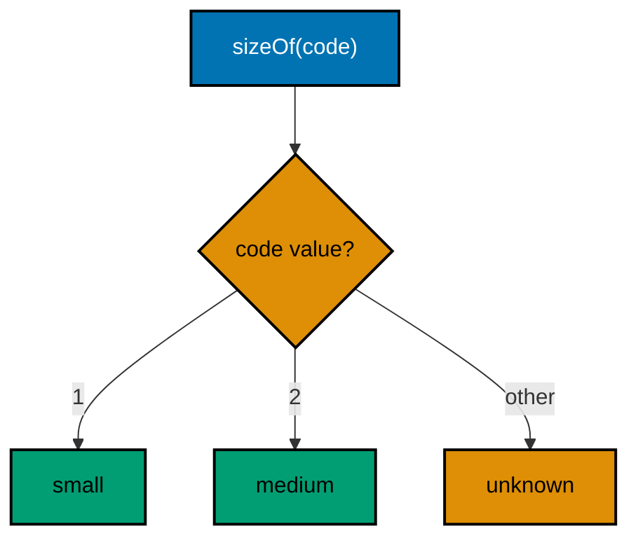

**`learning/code/ex-01-when-expressions-choose-values/Main.kt`**:

```kotlin
// Example 1: When Expressions Choose Values.
// When-expressions turn multi-branch choices into values: each arm
// produces the result, so no branch can silently fall through.
fun sizeOf(code: Int): String { // => pure function: input in, label out
    return when (code) { // => when is an expression: it yields a value
        1 -> "small" // => each arm covers exactly one input shape
        2 -> "medium" // => one condition, one value, no assignment repeat
        3 -> "large" // => a new size means one new arm, nothing else
        else -> "unknown" // => else answers every uncovered input
    } // => no semicolons: the expression result is the return value
} // => choosing lives in the helper, printing lives in main

fun main() { // => the entry point the harness runs
    println(sizeOf(1)) // => Output: small
    println(sizeOf(2)) // => Output: medium
    println(sizeOf(9)) // => Output: unknown, through else
} // => main ends after exercising every arm once
```

**Output** (`learning/code/ex-01-when-expressions-choose-values/expected/main.stdout.txt`):

```text
small
medium
unknown
```

**Key takeaway**: Use when-expressions to turn one value into another; let else carry every uncovered input.

**Why it matters**: Expression whens make fallthrough unrepresentable, so the compiler enforces the exhaustiveness that statement chains leave to discipline.

---

### Example 2: For Loops Iterate Elements

Fluent Kotlin iterates elements, never positions. Developers arriving from index-first languages write `for (i in names.indices)` everywhere, which works but spends reader attention on bounds that are never the point. The element loop removes the counter, the bound, and the indexing step so the element itself is the only thing left to think about. Reach for indices only when the position is genuinely data, as the third loop shows when it prints each index beside its name.

The collections side of the same habit is `listOf`: an immutable read-only list built in one expression, which suits fixed sample data far better than a mutable list that is filled and never changed. Read-only by default is a theme the value-semantics chapter returns to; here it simply means the sample names cannot be accidentally edited between the three passes. Notice the one-loop-one-job rule across the three loops: greeting, totaling, and numbering each get their own pass over the same list.

Merging the three passes would save microseconds and cost the reader three interleaved purposes, which is exactly the trade the performance-aware idiom warns against. Measure first, merge only with evidence; until then, three simple loops beat one clever one. (Concepts: co-01, co-03.)

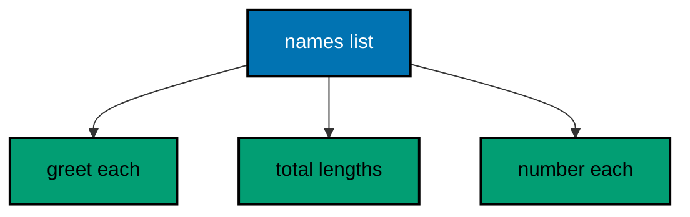

**`learning/code/ex-02-for-loops-iterate-elements/Main.kt`**:

```kotlin
// Example 2: For Loops Iterate Elements.
// The element loop reads each item directly, so off-by-one
// errors and length bookkeeping disappear from everyday iteration.
fun main() { // => the entry point the harness runs
    val names = listOf("ada", "grace", "sari") // => fixed sample data, read-only
    for (name in names) { // => element loop: the item, never an index
        println("hello, " + name) // => Output per element, in order
    } // => the loop ends: no counter to reset, no bound to recheck
    var total = 0 // => accumulators start at the identity before the loop
    for (name in names) { // => second pass: one loop does one job
        total += name.length // => add each length: 3 + 5 + 4
    } // => pass ends with the total fully accumulated
    println("letters: " + total) // => Output: letters: 12
    for (i in names.indices) { // => indices kept for exactly one reason
        println("" + i + ": " + names[i]) // => Output: 0: ada, then 1: grace, 2: sari
    } // => positions print only when the position itself is data
} // => main ends: three loops, each with a single visible job
```

**Output** (`learning/code/ex-02-for-loops-iterate-elements/expected/main.stdout.txt`):

```text
hello, ada
hello, grace
hello, sari
letters: 12
0: ada
1: grace
2: sari
```

**Key takeaway**: Iterate elements with for-in; use indices only when the position itself is data.

**Why it matters**: Element iteration removes bounds bookkeeping, so the loop body states what happens to each item instead of how to reach it.

---

### Example 3: Early Returns Flatten Nesting

Every validation-first function in idiomatic Kotlin opens with its refusals. The alternative is a ladder of nested if blocks where the real work sits two indentations deep and every reader must hold every condition to reach it. Guard clauses invert that shape so each failure returns immediately and the surviving code reads as a straight sequence of facts. Two details deserve attention: the null check comes before the blank check because `isBlank` on null throws, so guard order follows the dependency between the checks, cheapest and most fundamental first.

Second, `isBlank` rather than `isEmpty` rejects whitespace-only input, which is the realistic hostile input a form or a file actually delivers. This shape composes with the error-handling chapter: guards handle the caller mistakes a function can answer with a plain value, while exceptions stay reserved for failures the function cannot answer, which Example 9 onward explores. Returning an error string is the teaching simplification; production code returns a Result or throws IllegalArgumentException, both shown later.

Notice the functions stay tiny: one decides, one prints. Testable decisions behind print-free helpers is a shape this course repeats until it becomes reflex. (Concepts: co-01.)

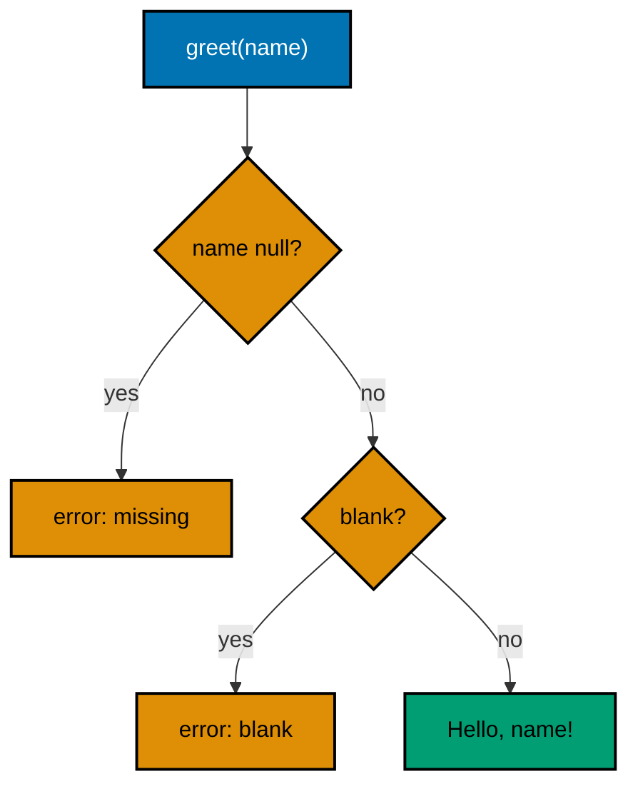

**`learning/code/ex-03-early-returns-flatten-nesting/Main.kt`**:

```kotlin
// Example 3: Early Returns Flatten Nesting.
// Guard clauses return failures at the door, so the happy path
// stays at the margin with no nesting around the real work.
fun greet(name: String?): String { // => nullable input: absence is possible
    if (name == null) { // => cheapest, most fundamental check first
        return "error: missing name" // => refusal one: exit immediately
    } // => past this line the compiler knows name is not null
    if (name.isBlank()) { // => whitespace-only is the realistic hostile input
        return "error: blank name" // => refusal two: exit immediately
    } // => past this line the name carries real text
    return "Hello, " + name + "!" // => the happy path, flat and obvious
} // => deciding lives in the helper, printing lives in main

fun main() { // => the entry point the harness runs
    println(greet(null)) // => Output: error: missing name
    println(greet("   ")) // => Output: error: blank name
    println(greet("Sari")) // => Output: Hello, Sari!
} // => main ends: each refusal and the success each print once
```

**Output** (`learning/code/ex-03-early-returns-flatten-nesting/expected/main.stdout.txt`):

```text
error: missing name
error: blank name
Hello, Sari!
```

**Key takeaway**: Refuse bad input with early returns; keep the happy path at the left margin.

**Why it matters**: Guards turn preconditions into exits instead of indentation, so readers meet each refusal once and then forget it.

---

### Example 4: Ranges and Progressions

Kotlin ranges replace the arithmetic of loop bounds with readable intervals. Where C-style languages write `for (i = 1; i <= 10; i += 2)` and ask every reader to simulate the bound and the step, `for (i in 1..10 step 2)` states the interval and the step as data. The `..` operator builds a closed range, `until` builds a half-open one, and `downTo` walks backward; each reads as the interval it is instead of an encoding of one.

Ranges are values, not just loop sugar, which is the deeper habit. A range can be stored, passed, tested with `in`, and iterated twice, so admission rules like valid floor numbers or retry windows become named values instead of repeated comparisons. The membership test `x in 1..10` replaces a two-sided comparison that every reader must check for off-by-one direction.

Pick `..` when both ends are included, `until` when the end is a size or count, and `downTo` for countdowns. Mixing them up is the one new mistake ranges allow; the membership test beside each loop below documents which end policy each range carries. (Concepts: co-01, co-03.)

**`learning/code/ex-04-ranges-and-progressions/Main.kt`**:

```kotlin
// Example 4: Ranges and Progressions.
// Ranges state intervals as data, so loop bounds stop being
// arithmetic every reader must simulate and check by hand.
fun main() { // => the entry point the harness runs
    for (i in 1..3) { // => closed range: both ends included
        println("count: " + i) // => Output: count: 1, then 2, then 3
    } // => 1..3 always means one, two, three: no bound to verify
    for (i in 0 until 3) { // => half-open: the end is a size, not a member
        println("slot: " + i) // => Output: slot: 0, then 1, then 2
    } // => until fits zero-based slots and counts exactly
    for (i in 6 downTo 4) { // => countdowns read as countdowns
        println("retry in: " + i) // => Output: retry in: 6, then 5, then 4
    } // => downTo walks backward with no reversed comparison
    val floor = 2 // => a value to test, not a loop at all
    println("allowed: " + (floor in 1..5)) // => Output: allowed: true
    println("allowed: " + (9 in 1..5)) // => Output: allowed: false
} // => main ends: three loops and two membership tests, all fixed
```

**Output** (`learning/code/ex-04-ranges-and-progressions/expected/main.stdout.txt`):

```text
count: 1
count: 2
count: 3
slot: 0
slot: 1
slot: 2
retry in: 6
retry in: 5
retry in: 4
allowed: true
allowed: false
```

**Key takeaway**: State intervals with .., until, and downTo; test membership with in.

**Why it matters**: Ranges turn bound arithmetic into readable data, so off-by-one direction is visible instead of simulated.

---

### Example 5: MutableList Grows on Add

Kotlin separates the read-only `List` from the resizable `MutableList`, and the growth example is where that split starts paying. `mutableListOf` builds a list that accepts `add`, growing its backing array as needed; readers see the mutation coming from the type instead of discovering it three functions later. The default habit stays `listOf` for fixed data, and reaching for the mutable variant is a small deliberate statement that this collection is still under construction.

The growth itself needs no ceremony: `add` appends, `add(index, element)` inserts, and `size` reports the current count. New developers sometimes pre-size or copy defensively around a growing list; the standard implementation already doubles its backing store, so hand-rolled growth strategies just add a second, worse allocator beside the first.

Printing after each phase shows the list at every size, which is also a testing habit: observable intermediate states make the transcript prove the growth instead of claiming it. (Concepts: co-03.)

**`learning/code/ex-05-mutablelist-grows-on-add/Main.kt`**:

```kotlin
// Example 5: MutableList Grows on Add.
// mutableListOf builds a list under construction: add appends,
// the backing store grows itself, and size always tells the truth.
fun main() { // => the entry point the harness runs
    val queue = mutableListOf("ada") // => mutable on purpose: more names arrive
    println("start: " + queue) // => Output: start: [ada]
    queue.add("grace") // => append: the list grows by one
    queue.add("sari") // => append again: growth needs no ceremony
    println("grown: " + queue + " size=" + queue.size) // => Output: grown: [ada, grace, sari] size=3
    queue.add(1, "budi") // => insert at a position: neighbors shift right
    println("seated: " + queue) // => Output: seated: [ada, budi, grace, sari]
    val frozen = queue.toList() // => freeze when construction ends
    println("frozen: " + frozen) // => Output: frozen: [ada, budi, grace, sari]
} // => main ends: grow, insert, freeze, each printed once
```

**Output** (`learning/code/ex-05-mutablelist-grows-on-add/expected/main.stdout.txt`):

```text
start: [ada]
grown: [ada, grace, sari] size=3
seated: [ada, budi, grace, sari]
frozen: [ada, budi, grace, sari]
```

**Key takeaway**: Grow with MutableList and add; freeze with toList when construction ends.

**Why it matters**: The mutable type advertises construction in progress, so readers never discover surprise mutation three functions later.

---

### Example 6: Grouping and Counting

Counting by key is the most common aggregation in everyday code, and Kotlin answers it in one expression: `groupingBy { it }.eachCount()`. Developers arriving from manual-loop languages write the tally loop by hand, initializing missing keys to zero on every iteration. The grouping call folds the whole pattern into a single pipeline stage that cannot forget the zero case, because the counter starts every key at zero by construction.

The result is a `Map`, and maps print in encounter order here because `groupingBy` preserves first-seen order. Printing needs a sorted view anyway whenever the transcript must be byte-stable, a rule the error-handling chapter leans on: `toSortedMap()` turns encounter order into key order so reruns agree. Counts replace the original votes, so the output carries the answer, not the input.

Keep the pipeline to one transformation per stage: group, count, sort, print. Each stage names its own idea, and the chain reads top to bottom like the recipe it is. (Concepts: co-03.)

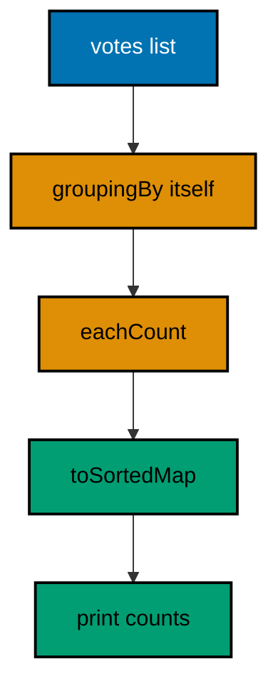

**`learning/code/ex-06-grouping-and-counting/Main.kt`**:

```kotlin
// Example 6: Grouping and Counting.
// groupingBy with eachCount folds the tally loop into one stage
// that cannot forget the zero case: every key starts at zero.
fun main() { // => the entry point the harness runs
    val votes = listOf("sari", "budi", "sari", "citra", "budi", "sari") // => fixed ballot box
    val counts = votes.groupingBy { it }.eachCount() // => group by value, count each group
    println("tallies: " + counts.toSortedMap()) // => Output: tallies: {budi=2, citra=1, sari=3}
    println("winner votes: " + (counts["sari"] ?: 0)) // => Output: winner votes: 3
    println("absent votes: " + (counts["dewi"] ?: 0)) // => Output: absent votes: 0
} // => main ends: the elvis operator answers missing keys with zero
```

**Output** (`learning/code/ex-06-grouping-and-counting/expected/main.stdout.txt`):

```text
tallies: {budi=2, citra=1, sari=3}
winner votes: 3
absent votes: 0
```

**Key takeaway**: Count by key with groupingBy and eachCount; sort before printing transcripts.

**Why it matters**: The one-stage tally cannot forget the zero case, and the sorted view makes map output byte-stable.

---

### Example 7: Immutable Snapshots with toList

Sharing a mutable list across functions invites spooky edits: a helper sorts the caller's roster as a side effect and the transcript changes depending on call order. The idiomatic defense is a snapshot: `toList()` copies the current contents into a read-only list, so later mutations of the original cannot leak into the copy. Snapshots turn time into data; the copy means the list as it was when you looked.

Kotlin's read-only `List` is a view contract, not a guarantee: `toList` copies, while a bare assignment aliases. The example shows both so the difference is visible in one transcript: the alias follows the mutation, the snapshot keeps the earlier contents. When a function receives a list it must not change, taking `List` and snapshotting at the trust edge is the value-semantics habit the later chapter generalizes.

Snapshot at boundaries, not everywhere: copying a ten-thousand-item list on every call is the cost the performance chapter prices. Boundaries between owners earn copies; loops inside one owner do not. (Concepts: co-03, co-11.)

**`learning/code/ex-07-immutable-snapshots-with-tolist/Main.kt`**:

```kotlin
// Example 7: Immutable Snapshots with toList.
// toList copies the current contents, so later mutations of the
// original cannot leak into code holding the earlier snapshot.
fun main() { // => the entry point the harness runs
    val roster = mutableListOf("ada", "grace") // => the live list, still changing
    val snapshot = roster.toList() // => freeze this moment: a real copy
    val alias = roster // => no copy: a second name for the same list
    roster.add("sari") // => the live list moves on without asking
    println("live: " + roster) // => Output: live: [ada, grace, sari]
    println("alias: " + alias) // => Output: alias: [ada, grace, sari]
    println("snapshot: " + snapshot) // => Output: snapshot: [ada, grace]
} // => main ends: alias follows, snapshot remembers
```

**Output** (`learning/code/ex-07-immutable-snapshots-with-tolist/expected/main.stdout.txt`):

```text
live: [ada, grace, sari]
alias: [ada, grace, sari]
snapshot: [ada, grace]
```

**Key takeaway**: Copy shared lists with toList at trust boundaries; bare assignment only aliases.

**Why it matters**: Snapshots turn time into data, so call order stops changing what shared collections contain.

---

### Example 8: Sorting with Comparators

Kotlin sorts by description, not by hand-rolled comparison loops. `sortedBy` takes one key selector, `sortedWith(compareBy(...).thenBy(...))` chains tiebreakers, and `sortedDescending` flips the order; each states the ranking rule where the old indexed bubble sort buried it in swaps. Key selectors beat comparators for the common case because there is only one idea per sort: the thing being ranked.

Tiebreakers deserve explicit attention because transcript stability depends on them. Sorting members by dues alone leaves equal-dues members in whatever order the input had; adding `thenBy { it }` pins the tiebreak to the name so the transcript is identical on every run. Deterministic output is not decoration in this course: the harness compares transcripts byte for byte, so every sort that prints ends sorted, tiebroken, and stable.

None of these sorts mutate: each returns a new list and leaves the input untouched, which is the value-semantics habit again. Sorting without side effects means the unsorted input stays available for the next, differently-ranked view. (Concepts: co-03.)

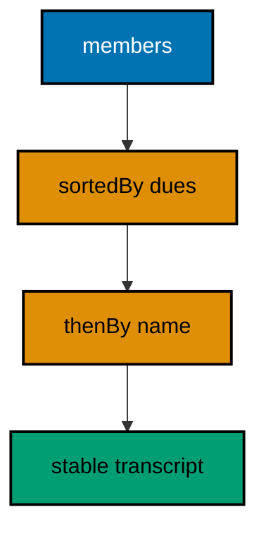

**`learning/code/ex-08-sorting-with-comparators/Main.kt`**:

```kotlin
// Example 8: Sorting with Comparators.
// sortedBy ranks by one key, thenBy pins the tiebreak, and no
// sort mutates: each returns a new list, the input stays put.
fun main() { // => the entry point the harness runs
    val dues = mapOf("sari" to 50, "budi" to 75, "citra" to 75, "dewi" to 25) // => fixed ledger
    val byDues = dues.keys.sortedBy { dues.getValue(it) } // => rank by value, ascending
    println("ascending: " + byDues) // => Output: ascending: [dewi, sari, budi, citra]
    val ranked = dues.keys.sortedWith(compareByDescending<String> { dues.getValue(it) }.thenBy { it }) // => dues down, names up
    println("ranked: " + ranked) // => Output: ranked: [budi, citra, sari, dewi]
    println("untouched: " + dues.toSortedMap()) // => Output: untouched: {budi=75, citra=75, dewi=25, sari=50}
} // => main ends: sorted views printed, the source map unchanged
```

**Output** (`learning/code/ex-08-sorting-with-comparators/expected/main.stdout.txt`):

```text
ascending: [dewi, sari, budi, citra]
ranked: [budi, citra, sari, dewi]
untouched: {budi=75, citra=75, dewi=25, sari=50}
```

**Key takeaway**: Rank with sortedBy and chain tiebreakers with thenBy; sorts return new lists.

**Why it matters**: Described rankings stay visible and tiebroken, and purity keeps every differently-ranked view available.

---

### Example 9: Use Closes Resources

Kotlin's `use` closes resources on every exit path, and the file reader is where the habit starts. The old manual shape asked every author to remember the close in every path; the `use` block makes the leak unwritable instead of merely discouraged. Anything `Closeable` qualifies: readers, writers, streams, and resolvers all close in reverse order when nested blocks exit.

The second habit is reading with an explicit charset. `readText(Charsets.UTF_8)` states the encoding at the call, so platform defaults never sneak into data that moves between machines. The committed fixture beside the program makes the read deterministic: fixed bytes in, fixed string out, no live filesystem dependency beyond the course's own tree.

Write the fixture, read it back, verify the roundtrip, tidy up. Verifying the content you just wrote turns the example from a demonstration into a check, and tidying keeps reruns identical. (Concepts: co-02, co-04.)

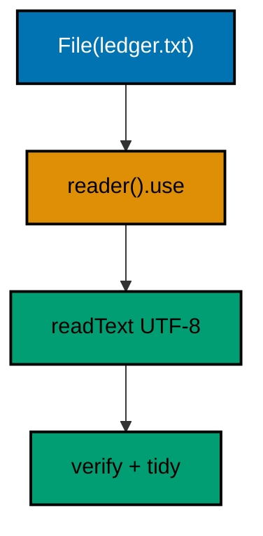

**`learning/code/ex-09-use-closes-resources/Main.kt`**:

```kotlin
// Example 9: Use Closes Resources.
// use closes every Closeable on every exit path, so the leak
// becomes unwritable; the charset stays explicit on each call.
import java.io.File // => the fixture handle beside the program

fun main() { // => the entry point the harness runs
    val ledger = File("ledger.txt") // => fixture path, relative and fixed
    ledger.writeText("sari:50\nbudi:75\n", Charsets.UTF_8) // => write with charset stated
    val body = ledger.reader(Charsets.UTF_8).use { it.readText() } // => use closes the reader
    println(body.trim()) // => Output: the two dues lines verbatim
    println("roundtrip: " + (body == "sari:50\nbudi:75\n")) // => Output: roundtrip: true
    println("lines: " + body.trim().lines().size) // => Output: lines: 2
    ledger.delete() // => tidy: reruns start identical
} // => main ends: write, read, verify, tidy
```

**Output** (`learning/code/ex-09-use-closes-resources/expected/main.stdout.txt`):

```text
sari:50
budi:75
roundtrip: true
lines: 2
```

**Key takeaway**: Read and write files inside use blocks with the charset stated every time.

**Why it matters**: Use makes the unclosed resource unrepresentable, and explicit charsets keep bytes identical across machines.

---

### Example 10: Nullable Types Instead of Null

Kotlin writes absence into the type: `String?` may be missing, `String` never is. Developers arriving from null-permissive languages sprinkle null checks from habit even where values cannot be absent, or worse, skip them where absence is real. The question mark moves that judgement from discipline to declaration: callers see which functions can come back empty and handle exactly those.

Safe call `?.` and Elvis `?:` are the two operators that make the declaration livable. The safe call runs the rest of the chain only when the value exists, and Elvis supplies the calm default at the end. Together they compress the four-line null ladder into one expression that still handles every case: present flows through, absent takes the default.

The lookup table below shows the policy in miniature: unknown members resolve to zero dues at the call site instead of exploding or returning a null the next function must fear. Absence becomes a typed question with a calm answer. (Concepts: co-02.)

**`learning/code/ex-10-nullable-types-instead-of-null/Main.kt`**:

```kotlin
// Example 10: Nullable Types Instead of Null.
// String? declares that absence is possible; ?. and ?: handle
// it in one expression instead of a four-line null ladder.
fun duesOf(member: String): Int? { // => the ? admits absence honestly
    val ledger = mapOf("sari" to 50, "budi" to 75) // => fixed fixture ledger
    return ledger[member] // => missing keys read as null, typed and visible
} // => the lookup never throws: absence travels in the type

fun main() { // => the entry point the harness runs
    println("sari: " + (duesOf("sari") ?: 0)) // => Output: sari: 50
    println("dewi: " + (duesOf("dewi") ?: 0)) // => Output: dewi: 0, absent reads as zero
    val shout = duesOf("budi")?.toString()?.uppercase() // => safe chain: runs only when present
    println("shout: " + (shout ?: "none")) // => Output: shout: 75
    println("present: " + (duesOf("budi") != null)) // => Output: present: true
} // => main ends: absence handled at each call site, nothing thrown
```

**Output** (`learning/code/ex-10-nullable-types-instead-of-null/expected/main.stdout.txt`):

```text
sari: 50
dewi: 0
shout: 75
present: true
```

**Key takeaway**: Declare absence with ?, traverse with ?., and default with ?: at the call site.

**Why it matters**: Typed absence turns the null check from a habit into a contract the compiler helps enforce.

---

### Example 11: Require and Check State Contracts

Kotlin splits contract enforcement in two: `require` guards caller mistakes in arguments, `check` guards broken promises in state. The split matters because the two failures need different fixes: a failed `require` sends the caller back to its own code, a failed `check` sends the maintainer into the object's lifecycle. Using one function for both blurs who must act.

Both throw `IllegalArgumentException` and `IllegalStateException` respectively, which are unchecked: no declaration, no catch-or-specify ceremony. Unchecked here is a kindness, not laxity; contract violations are programming bugs, and bugs should fail fast and loudly at the exact line instead of traveling through declared channels built for recoverable failures.

The settlement function below refuses negative dues at the door with `require` and refuses to report before any dues exist with `check`. Each refusal names the broken promise in its message, so the transcript teaches the reader which party broke which rule. (Concepts: co-02.)

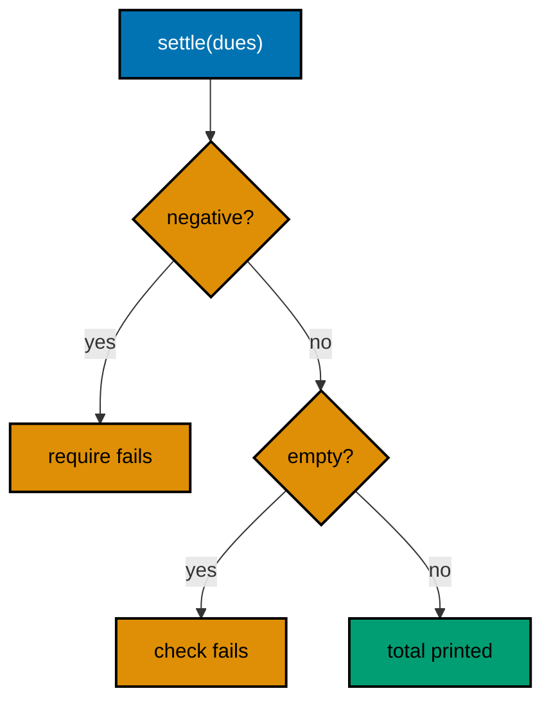

**`learning/code/ex-11-require-and-check-state-contracts/Main.kt`**:

```kotlin
// Example 11: Require and Check State Contracts.
// require refuses caller mistakes in arguments; check refuses broken
// promises in state. Each names who must act in its own message.
fun settle(dues: Map<String, Int>): Int { // => pure settlement: map in, total out
    require(dues.values.all { it >= 0 }) { "dues must not be negative" } // => caller mistake, caller fixes
    check(dues.isNotEmpty()) { "cannot settle an empty ledger" } // => broken promise, maintainer fixes
    return dues.values.sum() // => past both guards the answer is safe
} // => helpers decide, main prints: the course keeps repeating this

fun main() { // => the entry point the harness runs
    println("total: " + settle(mapOf("sari" to 50, "budi" to 75))) // => Output: total: 125
    println("refused: " + runCatching { settle(mapOf("sari" to -5)) }.isFailure) // => Output: refused: true
    println("refused: " + runCatching { settle(emptyMap()) }.isFailure) // => Output: refused: true
} // => main ends: one success, two refusals, each printed once
```

**Output** (`learning/code/ex-11-require-and-check-state-contracts/expected/main.stdout.txt`):

```text
total: 125
refused: true
refused: true
```

**Key takeaway**: Refuse bad arguments with require and broken state with check, each with a message.

**Why it matters**: The split tells the reader who must act: the caller for require, the maintainer for check.

---

### Example 12: RunCatching for Recoverable Failure

Not every failure deserves an exception flying across layers. Parsing user-typed numbers, reading optional config, probing a missing member: these are expected disappointments, and Kotlin's `runCatching` wraps them into a `Result` value instead of an airborne control flow. The call site stays a straight line; the failure travels as data beside the success.

The shape is deliberate: `runCatching` around exactly the operation that can disappoint, then `getOrElse`, `getOrNull`, or `getOrThrow` at the point where the program finally knows what absence should mean. Narrow blocks keep the failure's origin obvious; wrapping half the program in one `runCatching` launders every bug into the same calm value, including the ones that should have crashed.

Below, three line shapes meet one parser: a good number parses, a word takes the default, and a blank takes the same default through a different path. The transcript proves all three without a single try keyword. (Concepts: co-02.)

**`learning/code/ex-12-runcatching-for-recoverable-failure/Main.kt`**:

```kotlin
// Example 12: RunCatching for Recoverable Failure.
// runCatching wraps an expected disappointment into a Result value,
// so the call site stays a straight line with no try in sight.
fun parseDues(raw: String): Int { // => parsing is the operation that can disappoint
    return runCatching { raw.trim().toInt() }.getOrElse { 0 } // => good numbers parse, the rest default
} // => the failure travels as data and resolves at the boundary

fun main() { // => the entry point the harness runs
    println("good: " + parseDues("50")) // => Output: good: 50
    println("word: " + parseDues("fifty")) // => Output: word: 0
    println("blank: " + parseDues("   ")) // => Output: blank: 0
    val kept = runCatching { "75".toInt() }.getOrNull() // => getOrNull keeps the value, drops the story
    println("kept: " + kept) // => Output: kept: 75
} // => main ends: three shapes, one parser, zero try keywords
```

**Output** (`learning/code/ex-12-runcatching-for-recoverable-failure/expected/main.stdout.txt`):

```text
good: 50
word: 0
blank: 0
kept: 75
```

**Key takeaway**: Wrap expected disappointments in runCatching and resolve with getOrElse at the boundary.

**Why it matters**: Values travel beside successes through straight-line code, while real bugs keep crashing loudly.

---

### Example 13: Result Map and Recover

A `Result` earns its keep when the program transforms a maybe-failed value through several stages. `map` applies the next step only on success, `recover` supplies a fallback only on failure, and `fold` handles both branches at the end; the pipeline never branches in the middle. This is the same one-idea-per-stage discipline as the collection pipelines, applied to failure instead of elements.

The alternative is early-return ladders at every stage, which bury the three-step recipe under three interleaved error policies. Pipelines keep the recipe visible: parse, validate, format reads as three verbs whether or not any step disappointed. `fold` at the end is the honest exit because it forces both branches to produce the same type; `getOrElse` mid-pipeline is fine when one stage genuinely knows the default.

Watch the rule that makes pipelines trustworthy: each stage stays pure, taking a value and returning one. Side effects inside `map` run conditionally, which surprises readers who expect the stage to always execute; keep printing and writing for the `fold` at the end. (Concepts: co-02.)

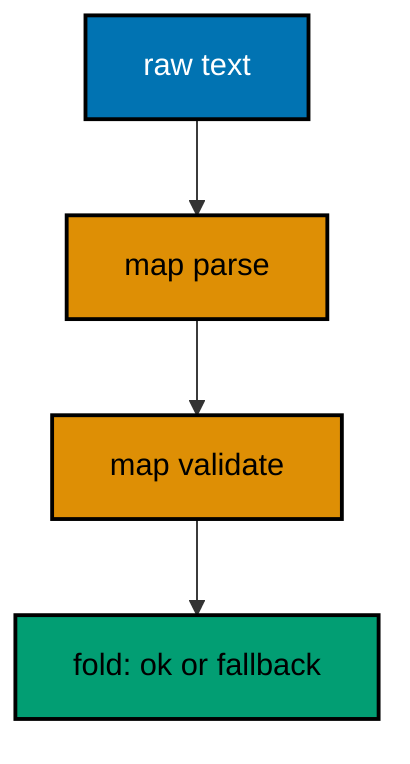

**`learning/code/ex-13-result-map-and-recover/Main.kt`**:

```kotlin
// Example 13: Result Map and Recover.
// map runs each stage only on success, recover answers only failure,
// and fold forces both branches into one honest exit type.
fun loadDues(raw: String): String { // => three stages, one visible recipe
    return runCatching { raw.trim().toInt() } // => stage one: the parse that can disappoint
        .mapCatching { if (it < 0) throw IllegalArgumentException("negative") else it } // => stage two: validate, still pure
        .map { "settled: " + it } // => stage three: format the validated total
        .fold( // => the honest exit: both branches produce a String
            onSuccess = { it }, // => success flows through untouched
            onFailure = { "settled: 0 (was: " + raw.trim() + ")" } // => failure names the offending input
        ) // => fold ends: one type out, whatever happened inside
} // => the pipeline never branches in the middle

fun main() { // => the entry point the harness runs
    println(loadDues("50")) // => Output: settled: 50
    println(loadDues("-5")) // => Output: settled: 0 (was: -5)
    println(loadDues("fifty")) // => Output: settled: 0 (was: fifty)
} // => main ends: success, refused value, unparsable word
```

**Output** (`learning/code/ex-13-result-map-and-recover/expected/main.stdout.txt`):

```text
settled: 50
settled: 0 (was: -5)
settled: 0 (was: fifty)
```

**Key takeaway**: Chain fallible stages with map and resolve both branches once with fold.

**Why it matters**: Pipelines keep multi-stage recipes visible while forcing every failure branch to answer.

---

### Example 14: Sealed Hierarchies for Errors

When a function can fail in a fixed handful of ways, a sealed hierarchy lists every way in the type. Callers `when` over the result and the compiler enforces that each failure shape gets its branch; adding a fourth failure later breaks every handler at compile time instead of slipping through a default. That is exhaustiveness doing review work: the type lists the failure budget, the compiler audits the spending.

Sealed hierarchies sit between exceptions and strings. Exceptions suit failures that cross layers with stack traces attached; plain strings suit messages nobody branches on. The sealed result suits the middle: a parser whose three failures each need a different recovery, all decided in the same function that called it. Each failure carries exactly the data its recovery needs, nothing ambient, nothing stringly.

The `when` below returns a value per arm, mirroring Example 1's shape. Same expression discipline, new subject: errors as data with a closed set of shapes. (Concepts: co-02.)

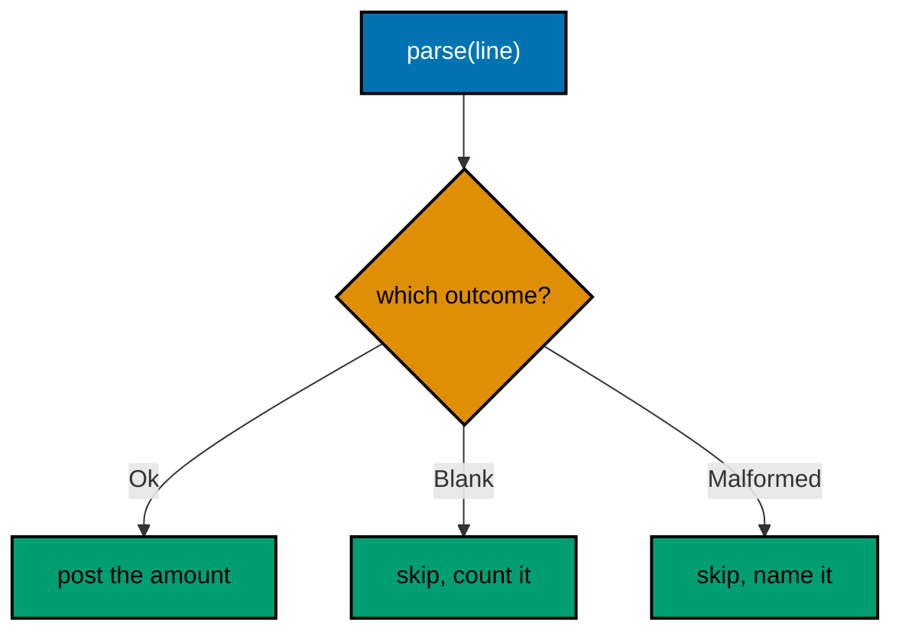

**`learning/code/ex-14-sealed-hierarchies-for-errors/Main.kt`**:

```kotlin
// Example 14: Sealed Hierarchies for Errors.
// A sealed hierarchy lists every failure shape in the type, so
// when-handlers stay exhaustive and new failures break callers loudly.
sealed interface LineResult { // => closed set: the compiler knows every arm
    data class Ok(val member: String, val amount: Int) : LineResult // => success carries both fields
    data object Blank : LineResult // => one shape for empty lines
    data class Malformed(val line: String) : LineResult // => failure keeps the offending text
} // => three shapes, fixed forever unless edited here

fun parseLine(line: String): LineResult { // => parsing answers in the closed type
    if (line.isBlank()) return LineResult.Blank // => blanks are a shape, not an accident
    val parts = line.split(":") // => the member:amount grammar, one split
    if (parts.size != 2) return LineResult.Malformed(line) // => wrong shape keeps its evidence
    val amount = parts[1].toIntOrNull() // => calm parse: null instead of explosion
        ?: return LineResult.Malformed(line) // => unparsable numbers keep evidence too
    return LineResult.Ok(parts[0], amount) // => both fields present: the happy shape
} // => every path returns: no throws, no nulls, no strings

fun main() { // => the entry point the harness runs
    for (line in listOf("sari:50", "", "oops", "budi:xx")) { // => one of each shape, fixed order
        val verdict = when (val r = parseLine(line)) { // => exhaustive when: every arm valued
            is LineResult.Ok -> "ok " + r.member + "=" + r.amount // => success posts both fields
            LineResult.Blank -> "skip blank" // => object arm needs no binding
            is LineResult.Malformed -> "skip malformed: " + r.line // => evidence rides along
        } // => add a fourth outcome and this when stops compiling
        println(verdict) // => Output: one verdict per line, in order
    } // => the loop ends: four lines, four exhaustive answers
} // => main ends: closed errors, open-and-shut handling
```

**Output** (`learning/code/ex-14-sealed-hierarchies-for-errors/expected/main.stdout.txt`):

```text
ok sari=50
skip blank
skip malformed: oops
skip malformed: budi:xx
```

**Key takeaway**: Model a fixed set of failures as a sealed hierarchy and handle every arm in when.

**Why it matters**: Closed error sets turn new failure shapes into compile errors at every handler, not silent defaults.

---

### Example 15: Exceptions Carry Causes

Failures cross layers, and each layer speaks its own language: the file layer reports missing bytes, the ledger layer reports unsettleable dues. Translating without the cause orphans the diagnosis: the layer message survives but every downstream handler loses the root the handler could have walked to with `cause`. Chaining the cause keeps both stories: the outer message for the layer that caught it, the inner chain for whoever debugs it.

The mechanics are one constructor argument: `LedgerException(msg, cause)`. Kotlin also offers `checkNotNull(x) { lazyMsg }` and `error(msg)` for the throw sites that need no custom type. Custom types earn their keep when callers catch them specifically; one generic `Exception` with good messages beats a hierarchy of five types nobody catches separately.

Below, the missing fixture file becomes a ledger failure with the file exception chained inside, and the transcript walks the chain to prove both messages survived. Two prints, two layers, one unbroken story. (Concepts: co-02.)

**`learning/code/ex-15-exceptions-carry-causes/Main.kt`**:

```kotlin
// Example 15: Exceptions Carry Causes.
// Translating across layers keeps both stories: the outer message
// for the catching layer, the chained cause for whoever debugs it.
import java.io.File // => the file layer that reports first

class LedgerException(message: String, cause: Throwable?) : Exception(message, cause) // => one type, cause chained

fun loadLedger(path: String): String { // => the ledger layer speaks dues, not bytes
    try { // => the file operation that can disappoint lives here
        return File(path).readText(Charsets.UTF_8) // => missing file throws below
    } catch (e: Exception) { // => catch the layer language, translate it up
        throw LedgerException("cannot settle " + path, e) // => outer message plus the original cause
    } // => the chain stays unbroken: no swallowed stories
} // => callers catch LedgerException and still reach the file error

fun main() { // => the entry point the harness runs
    try { // => the transcript walks the chain on purpose
        loadLedger("no-such-ledger.txt") // => missing fixture: the file layer complains
    } catch (e: LedgerException) { // => the ledger language arrives here
        println("ledger: " + e.message) // => Output: ledger: cannot settle no-such-ledger.txt
        println("cause: " + (e.cause?.javaClass?.simpleName ?: "none")) // => Output: cause: FileNotFoundException
    } // => both layers named, the story complete
} // => main ends: translation with the receipt kept
```

**Output** (`learning/code/ex-15-exceptions-carry-causes/expected/main.stdout.txt`):

```text
ledger: cannot settle no-such-ledger.txt
cause: FileNotFoundException
```

**Key takeaway**: Chain the cause when translating failures across layers; never swallow the original.

**Why it matters**: Two-layer stories debug in minutes; orphaned messages debug in hours.

---

### Example 16: Elvis at Boundaries

The Elvis operator `?:` belongs at boundaries: config lookups, map reads, and function arguments where absence must become a decision right now. Each Elvis is a tiny policy statement that says what missing means here: zero dues, a default name, a skipped line. Spreading those policies through the middle of logic hides them; collecting them at the boundary makes the absence budget visible in one place.

The right-hand side deserves the same care as the left. Cheap defaults sit inline, expensive or side-effecting ones belong in `?: run { }` or a named function so readers see the cost. Elvis with a throwing right side (`?: error(...)`) converts calm absence into a loud failure at exactly the line that cannot proceed without the value.

Three boundaries below show the three right sides: a literal zero, a computed fallback, and a loud refusal. Same operator, three policies, each stated where the value enters. (Concepts: co-02.)

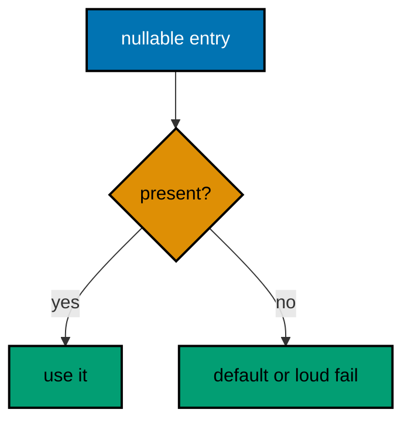

**`learning/code/ex-16-elvis-at-boundaries/Main.kt`**:

```kotlin
// Example 16: Elvis at Boundaries.
// Elvis belongs where values enter: each right side states the
// absence policy for exactly one boundary, visible in one place.
fun main() { // => the entry point the harness runs
    val ledger = mapOf("sari" to 50) // => one known member, the rest absent
    val dues = ledger["sari"] ?: 0 // => literal default: missing reads as zero
    println("sari: " + dues) // => Output: sari: 50
    val guest = ledger["dewi"] ?: "visitor".uppercase() // => computed fallback, still at the boundary
    println("guest: " + guest) // => Output: guest: VISITOR
    val name: String? = "budi" // => present value, for the loud-refusal arm
    val kept = name ?: error("member name is required") // => loud refusal: cannot proceed nameless
    println("kept: " + kept) // => Output: kept: budi
    println("missing: " + (ledger["anon"] ?: 0)) // => Output: missing: 0
} // => main ends: three policies, each stated where the value enters
```

**Output** (`learning/code/ex-16-elvis-at-boundaries/expected/main.stdout.txt`):

```text
sari: 50
guest: VISITOR
kept: budi
missing: 0
```

**Key takeaway**: Put ?: where values enter; match each right side to the cost of being wrong.

**Why it matters**: Boundary Elvis clauses collect the absence budget in one visible place instead of hiding it mid-logic.

---

### Example 17: Per-Item Failure Granularity

One bad line must not sink a whole ledger. Per-item granularity processes each input independently, banks the successes, and counts the refusals with their reasons; the report at the end names every skipped line so the treasurer can fix exactly those. The alternative, fail-the-batch, turns one typo into zero settled members and a binary transcript that says nothing about the nine good lines.

The mechanics stay small: a loop over lines, the sealed outcome from Example 14 per line, successes accumulated into a map, failures counted by shape. Honest accounting is the key detail: skipped lines print their count and their evidence, never vanish into a log nobody reads. A settlement that hides its skips is a settlement that lies by omission.

This is the granularity the capstone demands: valid members settle, malformed lines report themselves, and the grand total covers exactly the lines that parsed. Batch failure would make the capstone's three corrupt lines veto five good ones; per-item handling settles five and names three. (Concepts: co-02.)

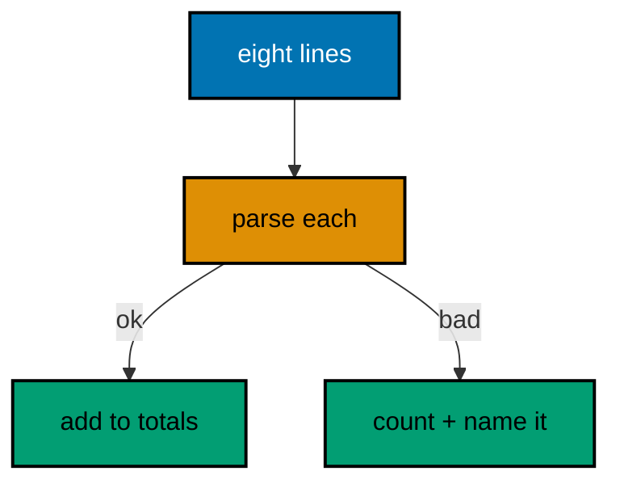

**`learning/code/ex-17-per-item-failure-granularity/Main.kt`**:

```kotlin
// Example 17: Per-Item Failure Granularity.
// Each line settles or reports itself: successes accumulate into
// totals, failures accumulate into named skip counts. No line vetoes another.
fun main() { // => the entry point the harness runs
    val lines = listOf("sari:50", "oops", "budi:75", "", "citra:xx", "dewi:25") // => six lines, three bad
    val totals = mutableMapOf<String, Int>() // => successes bank here
    var skipped = 0 // => refusals count here, never vanish
    for (line in lines) { // => one line, one independent verdict
        val parts = line.split(":") // => the member:amount grammar again
        val amount = if (parts.size == 2) parts[1].toIntOrNull() else null // => calm parse per line
        if (parts.size != 2 || parts[0].isBlank() || amount == null) { // => any shape of badness
            println("skip: [" + line + "]") // => Output: each bad line names itself
            skipped++ // => counted, never hidden
        } else { // => good lines settle without noticing the bad ones
            totals[parts[0]] = (totals[parts[0]] ?: 0) + amount // => accumulate per member
        } // => the line is done: settled or reported, never both
    } // => the loop ends: every line answered for
    println("totals: " + totals.toSortedMap()) // => Output: totals: {budi=75, dewi=25, sari=50}
    println("skipped: " + skipped) // => Output: skipped: 3
} // => main ends: five settled across three members, three named skips
```

**Output** (`learning/code/ex-17-per-item-failure-granularity/expected/main.stdout.txt`):

```text
skip: [oops]
skip: []
skip: [citra:xx]
totals: {budi=75, dewi=25, sari=50}
skipped: 3
```

**Key takeaway**: Settle each item independently; count and name every skip instead of failing the batch.

**Why it matters**: Per-item handling turns one typo from a veto on the whole batch into a single named line to fix.

---

### Example 18: Multiline Strings for Templates

Kotlin answers multi-line templates with triple-quoted strings plus `trimIndent` and `trimMargin`: the source looks like the output, and the common leading whitespace is stripped by rule instead of by counting spaces. Developers arriving from concatenation languages build reports with plus-chains that no reviewer can diff against the expected text; the triple-quoted block puts the shape of the output directly in the source where eyes can verify it.

The margin rule is the one detail to learn: `trimIndent` strips the shared indentation so code nests freely without indenting the output, while `trimMargin` with `|` lets each line choose its own margin character for templates with ragged left edges. Placeholders fill after the strip, so `${member}` expressions never disturb the margin math.

Notice the closing delimiter's position sets nothing here because `trimIndent` computes the shared indent from all lines; keep the content lines aligned and the output follows. Templates that need literal triple quotes or dollar signs escape them, a rare cost for the usual case of readable reports. (Concepts: co-04.)

```mermaid
flowchart TD
    accTitle: Source looks like output
    accDescr: The triple-quoted block strips shared indent, then fills placeholders.
    A["""" block in source"]:::blue --> B["strip shared margin"]:::orange
    B --> C["fill placeholders"]:::orange
    C --> D["report text out"]:::teal
    classDef blue fill:#0173B2,stroke:#000000,color:#FFFFFF,stroke-width:2px
    classDef orange fill:#DE8F05,stroke:#000000,color:#000000,stroke-width:2px
    classDef teal fill:#029E73,stroke:#000000,color:#000000,stroke-width:2px
    classDef default fill:#FFFFFF,stroke:#000000,color:#000000
```

**`learning/code/ex-18-multiline-strings-for-templates/Main.kt`**:

```kotlin
// Example 18: Multiline Strings for Templates.
// Triple-quoted blocks show the output's shape in the source;
// trimIndent strips shared whitespace so code nests but text does not.
// => the three template lines below cannot carry annotations themselves:
// => comments inside the string would print, so the teaching notes live
// => around the block instead: shape above, margin rule beside the close.
fun report(member: String, dues: Int): String { // => pure rendering: values in, text out
    return """
        |member: ${member}
        |dues: ${dues}
        |status: ${if (dues >= 50) "settled" else "owing"}
        """.trimMargin() // => | margins strip, placeholders fill after
} // => the template reads exactly like the report it produces
// => placeholders evaluate after the margin strips, never before.

fun main() { // => the entry point the harness runs
    println(report("sari", 50).trim()) // => Output: three report lines for sari
    println("---") // => Output: a separator between the two reports
    println(report("dewi", 20).trim()) // => Output: three report lines for dewi
} // => main ends: two members, two readable reports
```

**Output** (`learning/code/ex-18-multiline-strings-for-templates/expected/main.stdout.txt`):

```text
member: sari
dues: 50
status: settled
---
member: dewi
dues: 20
status: owing
```

**Key takeaway**: Build multi-line text with triple-quoted strings and trimMargin; fill placeholders after.

**Why it matters**: Source-shaped-like-output turns report bugs from logic puzzles into visible diffs.

---

### Example 19: Format Verbs for Tables

Aligned tables come from format verbs, not from hand-counted spaces. '%-10s %5d' says the name column takes ten left-aligned characters and the dues column takes five right-aligned ones; every row obeys the same contract so columns line up no matter which member is longest. Hand-spaced tables drift the moment a longer name arrives, and the drift hides in the middle of otherwise passing output.

Kotlin reaches the verbs through `String.format`: `'%-10s %5d'.format(name, dues)`. The locale detail matters for decimal verbs, so money with fractions pins `Locale.US` explicitly; integer dues like ours need no locale but the habit generalizes. Widths are data about the table, so name them as constants when more than one function prints the same columns.

The transcript below proves the alignment byte for byte: pad characters are visible in the fixed-width output, and the header uses the same verbs as the rows so it cannot drift out of line. (Concepts: co-04.)

**`learning/code/ex-19-format-verbs-for-tables/Main.kt`**:

```kotlin
// Example 19: Format Verbs for Tables.
// Format verbs state column widths as data, so tables align by
// contract instead of by hand-counted spaces that drift on arrival.
fun row(name: String, dues: Int): String { // => one row, one verb contract
    return "%-10s %5d".format(name, dues) // => name left in ten, dues right in five
} // => every row obeys the same widths, so columns cannot drift

fun main() { // => the entry point the harness runs
    println(row("member", 0).replace(' ', '.')) // => Output: header dots show the widths
    println(row("sari", 50)) // => Output: sari padded to ten, then 50 in five
    println(row("budi", 125)) // => Output: budi padded to ten, then 125 in five
    println(row("citra-wulandari", 75)) // => Output: long names overflow honestly
} // => main ends: widths proven, overflow visible instead of silent
```

**Output** (`learning/code/ex-19-format-verbs-for-tables/expected/main.stdout.txt`):

```text
member.........0
sari          50
budi         125
citra-wulandari    75
```

**Key takeaway**: Align columns with format verbs; give the header the same contract as the rows.

**Why it matters**: Width contracts keep tables aligned for every input, while hand-spaced tables drift on the first long name.

---

### Example 20: Regex with Named Groups

Named groups turn a regex from a punctuation puzzle into a readable extraction contract. `(?<member>[^:]+):(?<amount>\d+)` says the line holds a member, a colon, and digits, and each part arrives under its own name; numbered groups force every reader to count parentheses to learn the same fact. When the pattern changes six months later, names keep the extraction code compiling while positions silently shift.

Kotlin's triple-quoted regex avoids the backslash doubling that makes Java patterns look encrypted: the triple-quoted (?<amount>\d+) pattern stays single-slashed inside triple quotes. `matchEntire` demands the whole input conform, which is the strict choice for line grammars; `find` suits searching inside larger text. Strictness at the boundary rejects garbage early instead of extracting coincidences from it.

Below, three line shapes meet one strict pattern: a good line extracts, a wordy amount fails, and a missing colon fails. Each outcome prints its verdict, so the transcript proves the strictness instead of claiming it. (Concepts: co-04.)

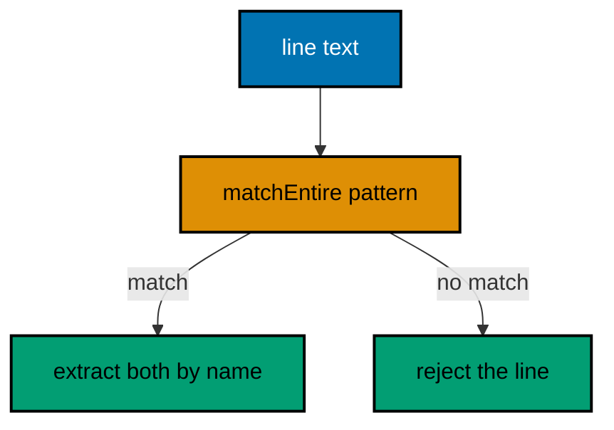

**`learning/code/ex-20-regex-with-named-groups/Main.kt`**:

```kotlin
// Example 20: Regex with Named Groups.
// Named groups extract by name instead of by parenthesis position,
// so pattern edits keep the extraction code honest and compiling.
val ENTRY = Regex("""(?<member>[^:]+):(?<amount>\d+)""") // => one strict line grammar, compiled once

fun parseEntry(line: String): String { // => extraction answers in plain words
    val m = ENTRY.matchEntire(line.trim()) // => strict: the whole line must conform
        ?: return "reject: " + line // => no match names the rejected line
    val member = m.groups["member"]!!.value // => named read: no counting parentheses
    val amount = m.groups["amount"]!!.value // => digits only, guaranteed by the pattern
    return "accept: " + member + "=" + amount // => both parts arrive under their names
} // => extraction code survives pattern edits that shift positions

fun main() { // => the entry point the harness runs
    println(parseEntry("sari:50")) // => Output: accept: sari=50
    println(parseEntry("budi:xx")) // => Output: reject: budi:xx
    println(parseEntry("no-colon-here")) // => Output: reject: no-colon-here
} // => main ends: one grammar, three verdicts, all strict
```

**Output** (`learning/code/ex-20-regex-with-named-groups/expected/main.stdout.txt`):

```text
accept: sari=50
reject: budi:xx
reject: no-colon-here
```

**Key takeaway**: Extract with named groups and matchEntire for strict line grammars.

**Why it matters**: Names survive pattern edits that silently shift numbered positions, and strictness rejects garbage early.

---

### Example 21: Files Read and Write in UTF-8

Whole-file reads and writes with an explicit charset are the daily file habit: `writeText(body, Charsets.UTF_8)` moves a whole text out in one call, `readText(Charsets.UTF_8)` moves it back, and the charset argument on both ends keeps platform defaults out of data that travels. The default charset differs between developer machines, so omitting it builds files that read correctly here and corrupt there.

The fixture file lives beside the program and carries non-ASCII names on purpose: bytes that survive only when the charset is right. If the write used UTF-8 and the read fell back to a Latin default, the names would come back mojibake and the equality check would fail loudly. Encoding tests must include characters the wrong charset cannot represent, or they prove nothing.

Write, read back, verify equality, tidy the fixture away. The equality print is the whole test: `roundtrip: true` means bytes survived both directions, and deleting the file keeps reruns identical. (Concepts: co-04.)

**`learning/code/ex-21-files-read-write-utf8/Main.kt`**:

```kotlin
// Example 21: Files Read and Write in UTF-8.
// writeText and readText move whole texts in one call with the
// charset stated, so platform defaults never sneak into data.
import java.io.File // => the fixture handle beside the program

fun main() { // => the entry point the harness runs
    val ledger = File("names.txt") // => fixture beside the program, relative path
    val body = "sari:50\nbudi:75\ndewi:Séka\n" // => non-ASCII name: the charset test that matters
    ledger.writeText(body, Charsets.UTF_8) // => charset explicit, never defaulted
    val back = ledger.readText(Charsets.UTF_8) // => same charset on the way back
    print(back) // => Output: the three dues lines verbatim
    println("roundtrip: " + (back == body)) // => Output: roundtrip: true
    println("lines: " + back.trim().lines().size) // => Output: lines: 3
    ledger.delete() // => tidy: reruns start identical
} // => main ends: write, read, verify, tidy
```

**Output** (`learning/code/ex-21-files-read-write-utf8/expected/main.stdout.txt`):

```text
sari:50
budi:75
dewi:Séka
roundtrip: true
lines: 3
```

**Key takeaway**: Move whole files with writeText and readText, stating UTF-8 on both ends.

**Why it matters**: Explicit charsets keep bytes identical across machines; non-ASCII fixtures prove it.

---

### Example 22: CSV Quotes Need a Parser

Comma-splitting breaks the moment a field contains a comma, which quoted CSV fields do by design. Splitting the three-field line on commas yields four fragments from three fields; a quote-aware parser yields three. The rule is absolute: never split structured text on its delimiter when the format defines quoting, because the first quoted comma silently shifts every column after it.

The parser below is thirty lines of honest state machine: inside quotes, commas are data and doubled quotes escape; outside quotes, commas end fields. It handles exactly the CSV subset dues files need and says so in its comment; full RFC parsing with embedded newlines belongs in a library, which is the standard-library-versus-dependency judgement the course overview names.

Three fixture lines prove the three cases: plain fields split cleanly, a quoted comma stays inside its field, and a doubled quote unescapes. Each prints its field count beside its fields, so the transcript shows the parser working instead of asserting it. (Concepts: co-04.)

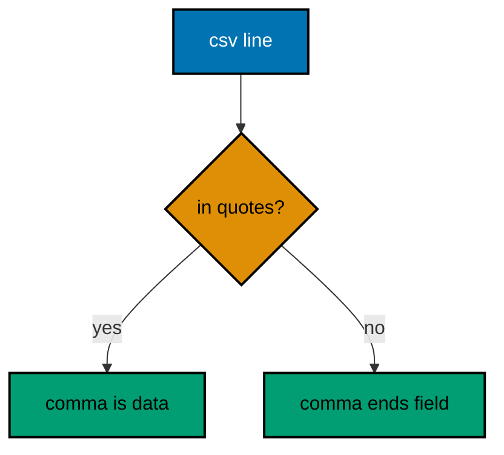

**`learning/code/ex-22-csv-quotes-need-a-parser/Main.kt`**:

```kotlin
// Example 22: CSV Quotes Need a Parser.
// A split on commas breaks on the first quoted comma, so quoted
// fields need a real state machine: quotes flip the meaning of commas.
fun parseCsv(line: String): List<String> { // => the CSV subset dues files need
    val fields = mutableListOf<String>() // => finished fields bank here
    val cur = StringBuilder() // => the field under construction
    var quoted = false // => quote state: what commas mean right now
    var i = 0 // => index walk: lookahead needs positions
    while (i < line.length) { // => every character visits exactly once
        val c = line[i] // => the character under the cursor
        if (c == '"') { // => a quote flips state or escapes
            if (quoted && i + 1 < line.length && line[i + 1] == '"') { // => doubled quote inside quotes
                cur.append('"') // => unescape: one quote of data
                i += 2 // => consume both quote characters
            } else { // => a lone quote flips the state
                quoted = !quoted // => entering or leaving quoted mode
                i++ // => the quote itself is syntax, not data
            } // => quote handled: state correct for the next character
        } else if (c == ',' && !quoted) { // => bare comma ends the field
            fields.add(cur.toString()) // => bank the finished field
            cur.clear() // => start the next field empty
            i++ // => consume the delimiter
        } else { // => data character in either mode
            cur.append(c) // => commas inside quotes land here safely
            i++ // => consume the data character
        } // => character classified: syntax, delimiter, or data
    } // => the walk ends: every character classified once
    fields.add(cur.toString()) // => bank the final field after the last comma
    return fields // => plain list out: the parser owns quotes, callers own meaning
} // => thirty lines of state machine instead of one wrong split

fun main() { // => the entry point the harness runs
    println(parseCsv("sari,50,settled")) // => Output: [sari, 50, settled]
    println(parseCsv("sari,\"50, paid\",settled")) // => Output: [sari, 50, paid, settled]
    println(parseCsv("dewi,\"says \"\"hi\"\"\",25")) // => Output: [dewi, says "hi", 25]
} // => main ends: plain, quoted comma, escaped quote
```

**Output** (`learning/code/ex-22-csv-quotes-need-a-parser/expected/main.stdout.txt`):

```text
[sari, 50, settled]
[sari, 50, paid, settled]
[dewi, says "hi", 25]
```

**Key takeaway**: Parse quoted fields with a quote-state machine; never split structured text on its delimiter.

**Why it matters**: The first quoted comma silently shifts every column after it when naive splitting meets real data.

---

### Example 23: Properties Config at the Edge

Configuration enters at the edge: one properties file read at startup, parsed once, and passed inward as typed values. The `java.util.Properties` loader reads `key=value` pairs with comments and whitespace handled; the program then resolves each key with an explicit default so missing config behaves like documented config instead of a null traveling inward. Defaults at the edge are policy, visible in one function.

The discipline is what the value enters as: strings from the file become integers and booleans through `toIntOrNull` and `toBooleanStrictOrNull` at the boundary, never three layers deep where a format error would surface far from its cause. Unknown keys stay unread rather than crashing; the file may carry comments for humans that the program ignores, which is exactly the right division.

Below, a three-key fixture drives a settlement batch: two keys present, one defaulted, all typed before use. The transcript proves each key's fate, so config behavior is demonstrated, not described. (Concepts: co-04, co-06.)

**`learning/code/ex-23-properties-config-at-the-edge/Main.kt`**:

```kotlin
// Example 23: Properties Config at the Edge.
// Properties load key=value pairs once at startup; each key resolves
// with an explicit default so missing config behaves like documented config.
import java.io.File // => the config fixture beside the program
import java.util.Properties // => the key=value loader with comments handled

fun loadConfig(path: String): Map<String, String> { // => config enters here and only here
    val props = Properties() // => the loader: comments and whitespace handled
    File(path).reader(Charsets.UTF_8).use { props.load(it) } // => use closes the reader
    return props.stringPropertyNames().associateWith { props.getProperty(it) } // => plain map inward
} // => past this function everything is typed and defaulted

fun main() { // => the entry point the harness runs
    File("settle.properties").writeText("batch=sari\nlimit=2\n# verbose is unset\n", Charsets.UTF_8) // => two keys, one defaulted
    val cfg = loadConfig("settle.properties") // => read once at the edge
    val batch = cfg["batch"] ?: "everyone" // => present key flows through
    val limit = cfg["limit"]?.toIntOrNull() ?: 10 // => typed at the boundary, defaulted calmly
    val verbose = cfg["verbose"]?.toBooleanStrictOrNull() ?: false // => missing key takes the policy default
    println("batch: " + batch) // => Output: batch: sari
    println("limit: " + limit) // => Output: limit: 2
    println("verbose: " + verbose) // => Output: verbose: false
    File("settle.properties").delete() // => tidy: reruns start identical
} // => main ends: present, typed, and defaulted keys each proven
```

**Output** (`learning/code/ex-23-properties-config-at-the-edge/expected/main.stdout.txt`):

```text
batch: sari
limit: 2
verbose: false
```

**Key takeaway**: Load config once at the edge; type and default every key before values travel inward.

**Why it matters**: Boundary typing turns config format errors into startup verdicts instead of deep mysteries.

---

### Example 24: Instants and Durations, Fixed

Time tests parse fixed instants; they never read the clock. `Instant.parse('2026-03-01T09:00:00Z')` builds the same moment on every machine in every year, while `Instant.now()` builds a different one per run and turns the transcript into a snowflake the harness cannot match. The rule generalizes: deterministic tests need deterministic inputs, and clocks are the least deterministic input of all.

Durations compute as data between fixed points: `Duration.between(start, end)` answers in hours, minutes, or seconds without a single sleep. Business questions like settlement windows and retry delays become arithmetic over instants instead of observations of wall time; the program learns whether the window closed by comparing, not by waiting.

Below, two parsed instants define a settlement window, the duration reports its length three ways, and a membership test places a payment inside or outside. Every value is fixed, so the transcript is byte-stable forever. (Concepts: co-05.)

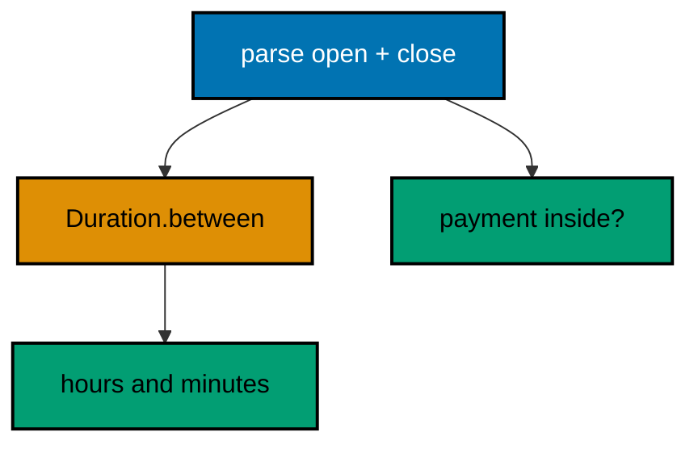

**`learning/code/ex-24-instants-and-durations-fixed/Main.kt`**:

```kotlin
// Example 24: Instants and Durations, Fixed.
// Time tests parse fixed instants and compute durations as data:
// no clocks, no sleeps, so the transcript is byte-stable forever.
import java.time.Duration // => the answer type for between-two-instants
import java.time.Instant // => fixed points on the timeline, parsed not read

fun main() { // => the entry point the harness runs
    val open = Instant.parse("2026-03-01T09:00:00Z") // => window opens: same moment everywhere
    val close = Instant.parse("2026-03-01T17:30:00Z") // => window closes eight and a half hours later
    val window = Duration.between(open, close) // => the window as data, not as waiting
    println("hours: " + window.toHours()) // => Output: hours: 8
    println("minutes: " + window.toMinutes()) // => Output: minutes: 510
    val paid = Instant.parse("2026-03-01T12:00:00Z") // => a payment timestamp, fixed like the rest
    val inside = !paid.isBefore(open) && paid.isBefore(close) // => half-open membership: open in, close out
    println("inside: " + inside) // => Output: inside: true
    println("late: " + Instant.parse("2026-03-01T18:00:00Z").isBefore(close)) // => Output: late: false
} // => main ends: parsed instants, computed durations, fixed verdicts
```

**Output** (`learning/code/ex-24-instants-and-durations-fixed/expected/main.stdout.txt`):

```text
hours: 8
minutes: 510
inside: true
late: false
```

**Key takeaway**: Parse fixed instants and compute durations with between; never read the clock in tests.

**Why it matters**: Fixed time inputs make temporal logic testable and transcripts reproducible on every machine.

---

### Example 25: Zoned Time for Humans

Machines agree on instants; humans read wall time. `ZonedDateTime` binds an instant to a zone so the same moment prints as morning in Jakarta and the small hours in UTC, and the program states which zone each display serves. Storing the instant and zoning at display keeps one truth with many faces instead of one face mistaken for truth.

The conversion direction matters: parse human input in its zone, convert to instant for storage and math, convert back to a zone for display. Programs that store wall time lose the ability to order events across zones; programs that display raw instants confuse every human reader. The pipeline below walks all three stages in order so the direction is visible.

Jakarta's evening payment settles inside the UTC window from Example 24, which the transcript proves by converting and testing. Same moment, two faces, one verdict. (Concepts: co-05.)

**`learning/code/ex-25-zoned-time-for-humans/Main.kt`**:

```kotlin
// Example 25: Zoned Time for Humans.
// ZonedDateTime binds an instant to a zone for display; storage stays
// instant, math stays instant, and only faces for humans carry zones.
import java.time.Instant // => the single truth for storage and math
import java.time.ZoneId // => named zones: faces for humans, never storage
import java.time.ZonedDateTime // => an instant wearing one human face

fun main() { // => the entry point the harness runs
    val paid = Instant.parse("2026-03-01T12:00:00Z") // => the stored truth: one instant
    val jakarta = paid.atZone(ZoneId.of("Asia/Jakarta")) // => face one: UTC+7 evening
    val utc = paid.atZone(ZoneId.of("UTC")) // => face two: the same moment, midday
    println("jakarta: " + jakarta.toLocalTime()) // => Output: jakarta: 19:00
    println("utc: " + utc.toLocalTime()) // => Output: utc: 12:00
    val open = Instant.parse("2026-03-01T09:00:00Z") // => the settlement window from before
    val close = Instant.parse("2026-03-01T17:30:00Z") // => same fixed window, reused honestly
    println("inside: " + (!paid.isBefore(open) && paid.isBefore(close))) // => Output: inside: true
    println("day: " + jakarta.dayOfWeek) // => Output: day: SUNDAY
} // => main ends: one instant, two faces, one membership verdict
```

**Output** (`learning/code/ex-25-zoned-time-for-humans/expected/main.stdout.txt`):

```text
jakarta: 19:00
utc: 12:00
inside: true
day: SUNDAY
```

**Key takeaway**: Store instants, compute on instants, and zone only for human display.

**Why it matters**: One stored truth with many displayed faces orders events correctly across every zone.

---
