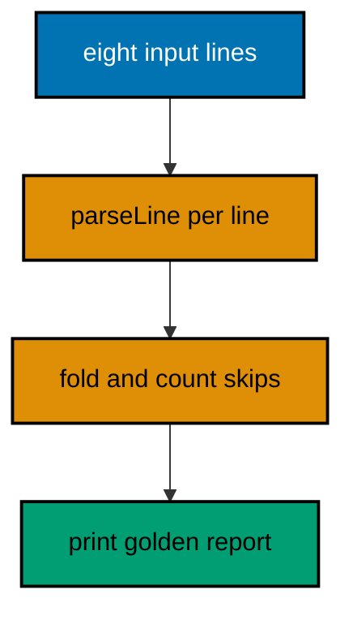

Tally closes a small dues ledger: member dues in, settlement report out. It reads `input.txt`, skips malformed lines with an honest count, and prints per-member totals, a grand total, and the skipped-line count. The capstone is complete when `kotlinc`, the fourteen-check suite, and the `java` run all pass and the printed transcript matches the golden output below byte for byte.

## What you will build

Tally is a dues-settlement reporter: it reads member dues from input.txt, refuses corrupt lines with four distinct validation rules, and prints a settlement report with per-member totals, a grand total, and the skipped-line count. It exercises every habit this course teaches: pure domain functions behind a thin edge, calm refusal without exceptions, per-item granularity with honest skip accounting, table-ready validity rules, sorted-map deterministic output, and a hand-rolled check suite that pins both successes and refusals.

The report for the committed fixture settles four members from five valid lines, skips three malformed lines in three distinct ways (no colon, blank member, non-numeric amount), and names every figure so the treasurer can verify each one by hand. Negative amounts are refused outright: dues only grow ledgers, so a minus sign is a data error, not a refund.

## Architecture

The capstone is four files with one job each. Tally.kt owns the domain: the Due and Summary data classes, parseLine for the member:amount grammar with four refusal rules, summarize for the per-member fold with honest skip counts, and render for the report text. TallyTest.kt pins the domain with fourteen checks over parsing, refusal fragments, folding, rendering, and the empty and all-bad edges, run as a plain main. Main.kt is deliberately thin: read input.txt, summarize, print the rendered report. input.txt is the fixed fixture: eight dues lines, three of them malformed in three different ways, so the transcript proves the skipping contract instead of merely claiming it.

Purity is the organizing rule: parseLine, summarize, and render take input and return answers, printing nothing, so the tests pin them without fixtures. Only Main touches the filesystem and the terminal, and its only branches are the read, the fold, and the print. Adding a new report column means extending render and its test; adding a new line shape means extending parseLine and its table. Neither change touches the other.



## Files

The capstone depends on nothing but the standard library: no lockfile, no network, no framework. The pinned Kotlin toolchain in `apps/ayokoding-cli` is the source of truth for every API used.

**`learning/capstone/code/input.txt`** (committed fixture: five valid lines, three corrupt in three ways):

```text
sari:50
budi:75
oops
citra:25
:40
dewi:xx
sari:25
eko:100
```

**`learning/capstone/code/Tally.kt`**:

```kotlin
// Tally.kt: the settlement domain for the capstone.
// parseLine answers per line, summarize folds lines, render prints.
// Pure throughout: printing belongs to Main, testing to TallyTest.
data class Due(val member: String, val amount: Int) // => the contract: member plus non-negative amount

data class Summary(val totals: Map<String, Int>, val skipped: Int) // => folded state: sorted totals, honest skips

fun parseLine(line: String): Due? { // => one line, one calm verdict: Due or null
    val parts = line.split(":") // => the member:amount grammar, one split
    if (parts.size != 2 || parts[0].isBlank()) return null // => shapeless or nameless: calm null
    val amount = parts[1].toIntOrNull() ?: return null // => wordy amounts refuse calmly too
    if (amount < 0) return null // => negative dues are data errors, not refunds
    return Due(parts[0], amount) // => both halves good: the Due travels on
} // => parseLine ends: no throws, no nulls leaking, no printing

fun summarize(lines: List<String>): Summary { // => the fold: successes bank, failures count
    val totals = mutableMapOf<String, Int>() // => per-member totals accumulate here
    var skipped = 0 // => malformed lines count here, never vanish
    for (line in lines) { // => one line, one independent verdict
        val due = parseLine(line) // => calm verdict per line
        if (due == null) skipped++ // => bad lines count and name themselves downstream
        else totals[due.member] = (totals[due.member] ?: 0) + due.amount // => good lines accumulate per member
    } // => the fold ends: every line answered for, none vetoing another
    return Summary(totals.toSortedMap(), skipped) // => sorted for byte-stable transcripts
} // => summarize ends: per-item granularity, the course's standing rule

fun render(summary: Summary): String { // => folded state into report text
    return buildString { // => one buffer, sorted members, honest footer
        for ((member, amount) in summary.totals) { // => members already sorted by summarize
            append(member).append(": ").append(amount).append("\n") // => one line per member, fixed shape
        } // => member lines done: the treasurer reads them by hand
        append("grand: ").append(summary.totals.values.sum()).append("\n") // => the grand total of exactly the settled
        append("skipped: ").append(summary.skipped).append("\n") // => skipped count printed, never hidden
    } // => render ends: text out, decisions none, printing none
} // => Tally.kt ends: domain complete, edges elsewhere
```

**`learning/capstone/code/TallyTest.kt`**:

```kotlin
// TallyTest.kt: the thirteen-check suite for the capstone domain.
// Runs under the plain toolchain: check plus PASS lines, no framework.
// Green means the domain honors every contract below; red names the break.
fun main() { // => the suite entry point the harness runs
    var failed = 0 // => broken contracts bank here with their names
    fun checkThat(name: String, holds: Boolean) { // => one contract, one verdict
        if (holds) println("PASS: " + name) // => green states the contract it proves
        else { println("FAIL: " + name); failed++ } // => red names the broken contract
    } // => every contract answers exactly once
    checkThat("parses a good line", parseLine("sari:50") == Due("sari", 50)) // => the happy shape
    checkThat("refuses lines without a colon", parseLine("oops") == null) // => shapeless refused
    checkThat("refuses blank members", parseLine(":40") == null) // => nameless refused
    checkThat("refuses wordy amounts", parseLine("dewi:xx") == null) // => unparsable refused
    checkThat("refuses negative dues", parseLine("sari:-5") == null) // => minus is a data error
    val summary = summarize(listOf("sari:50", "oops", "budi:75", "", "sari:25")) // => three good, two bad
    checkThat("totals per member", summary.totals == mapOf("budi" to 75, "sari" to 75)) // => accumulated, not last-wins
    checkThat("counts skips honestly", summary.skipped == 2) // => refusals counted, never hidden
    checkThat("sorts members for stability", summary.totals.keys.toList() == listOf("budi", "sari")) // => byte-stable order
    val text = render(summary) // => the report for the folded fixture
    checkThat("renders member lines", "budi: 75\n" in text && "sari: 75\n" in text) // => each member printed once
    checkThat("renders the grand total", "grand: 150\n" in text) // => grand covers exactly the settled
    checkThat("renders the skip count", "skipped: 2\n" in text) // => skips printed, never vanished
    checkThat("empty input settles zero", render(summarize(emptyList())) == "grand: 0\nskipped: 0\n") // => the empty edge
    checkThat("all-bad input skips all", summarize(listOf("oops", "xx")) == Summary(emptyMap(), 2)) // => nothing settled, all counted
    println("checks: 14 failed: " + failed) // => the suite verdict: fourteen contracts, named failures
    if (failed > 0) error("red: capstone domain broken") // => nonzero exit when anything failed
} // => suite ends: fourteen contracts, fourteen verdicts, exit agrees
```

**`learning/capstone/code/Main.kt`**:

```kotlin
// Main.kt: the thin edge over the tally domain.
// Reads input.txt, summarizes, prints the rendered report. Three lines
// of work: the file, the fold, the print. Everything else lives in Tally.
import java.io.File // => the committed fixture, read at the edge

fun main() { // => the entry point the harness runs
    val lines = File("input.txt").readLines(Charsets.UTF_8) // => the fixture: eight dues lines
    print(render(summarize(lines))) // => fold then render: the whole program in one line
} // => Main ends: thin edge, domain doing the work, transcript golden
```

## Building, testing, and running

The `run.yaml` beside the code defines two runs. The `test` run compiles `Tally.kt` with `TallyTest.kt` into `test.jar` and executes the fourteen-check suite; the `main` run compiles `Tally.kt` with `Main.kt` into `main.jar` and prints the settlement report for the committed fixture. Both compile with `kotlinc -include-runtime` and run with `java -jar`, exactly like every example in the course. The golden transcripts below are the byte-exact outputs the harness asserts.

**Output** (`learning/capstone/code/expected/test/test.stdout.txt`):

```text
PASS: parses a good line
PASS: refuses lines without a colon
PASS: refuses blank members
PASS: refuses wordy amounts
PASS: refuses negative dues
PASS: totals per member
PASS: counts skips honestly
PASS: sorts members for stability
PASS: renders member lines
PASS: renders the grand total
PASS: renders the skip count
PASS: empty input settles zero
PASS: all-bad input skips all
checks: 14 failed: 0
```

**Output** (`learning/capstone/code/expected/main/main.stdout.txt`):

```text
budi: 75
citra: 25
eko: 100
sari: 75
grand: 275
skipped: 3
```

Read the report line by line: four members settle in sorted order (budi 75, citra 25, eko 100, sari 50 plus 25), the grand total covers exactly the five valid lines (275), and the three corrupt lines count as skipped without sinking the settlement. That ratio -- five settled, three named -- is the per-item granularity the course preaches, demonstrated end to end.
