Examples 26–53 scale from single files to real projects: module and package layout (Examples 26–34), from one-file-one-job through packages, visibility modifiers, import policy, Gradle coordinates, version catalogs, lockfile shapes, executable jars, and runtime version gates; then Kotlin's testing convention end to end (Examples 35–44), from check contracts and a hand-rolled runner through fresh fixtures, table tests, failure contracts, temp-dir isolation, red-first workflow, boundary families, seam fakes, and spec-reading names; finally generics and value semantics (Examples 45–53), covering generic boxes, in-and-out variance, bounded stacks, data classes, sealed hierarchies, copy chains, behavior enums, the equals-hashCode agreement, and views versus snapshots. Every example is a complete, runnable Kotlin program under `learning/code/`; run each with the command in its own `run.yaml`.

---

### Example 26: One File One Job

A Kotlin file earns its place with one job: one concept, one responsibility, one reason to change. The dues parser below owns the `member:amount` grammar and nothing else; formatting, summing, and printing live in other files in a real project. Single-job files stay small enough to read whole, and their names tell the truth about their contents without opening them.

Top-level functions are the mechanism: Kotlin needs no class wrapper, so a file of pure functions reads as a small library instead of a utility drawer. `parseEntry` takes text and returns a pair or null, printing nothing; decisions without side effects test without fixtures and compose without ceremony. When the grammar changes, exactly one file changes, and its tests name exactly the new behavior.

Notice the file documents its own contract in the header comment: what it owns, what it refuses, what calls it. Three lines that save every future reader the archaeology of discovering the job by reading all callers. (Concepts: co-06.)

**`learning/code/ex-26-one-file-one-job/Main.kt`**:

```kotlin
// Example 26: One File One Job.
// This file owns the member:amount grammar and nothing else:
// parsing in, pairs or null out, no printing, no summing.
fun parseEntry(line: String): Pair<String, Int>? { // => text in, pair-or-null out
    val parts = line.split(":") // => the grammar: exactly one colon
    if (parts.size != 2 || parts[0].isBlank()) return null // => wrong shape: calm null
    val amount = parts[1].toIntOrNull() // => calm digits: null instead of explosion
        ?: return null // => unparsable amount: calm null again
    return parts[0] to amount // => both halves good: the pair travels on
} // => the file ends: grammar owned, nothing else touched

fun main() { // => the entry point the harness runs
    println(parseEntry("sari:50")) // => Output: (sari, 50)
    println(parseEntry("oops")) // => Output: null
    println(parseEntry("budi:xx")) // => Output: null
} // => main ends: the grammar proven in three calls
```

**Output** (`learning/code/ex-26-one-file-one-job/expected/main.stdout.txt`):

```text
(sari, 50)
null
null
```

**Key takeaway**: Give each file one job; keep parsing pure so grammar changes touch one file.

**Why it matters**: Single-job files name their responsibility truthfully and localize every future change.

---

### Example 27: Packages Group Related Code

Packages group related files into one namespace so imports read as a table of contents. The settlement parser and the settlement reporter live in `dues`, and `main` imports exactly the two functions it needs; nothing reaches across the boundary for anything else. Related code shares a package, unrelated code gets its own, and the import list of each file documents its dependencies honestly.

This unit compiles two files as one module: `kotlinc Dues.kt Main.kt` names every file explicitly, so the module boundary is visible in the build command instead of hiding in directory magic. Files in the same package see each other's internals, which is why the internal helper in the next example works across files but not across packages.

Package names stay lowercase and mirror the domain: `dues` for settlement, not `util` for everything. A package called `util` is a drawer where organization goes to die; a package called `dues` tells every reader what belongs inside before they open it. (Concepts: co-06.)

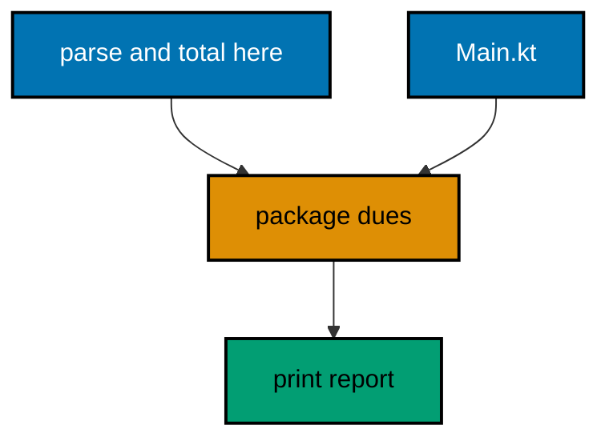

**`learning/code/ex-27-packages-group-related-code/Dues.kt`**:

```kotlin
// Dues.kt: the settlement domain in package dues.
// Owns parsing and totaling; printing belongs to Main.
package dues // => the namespace: every member here reads as dues.*

fun parse(line: String): Pair<String, Int>? { // => shared parser, package-visible
    val parts = line.split(":") // => the member:amount grammar, one split
    if (parts.size != 2 || parts[0].isBlank()) return null // => wrong shape: calm null
    val amount = parts[1].toIntOrNull() ?: return null // => calm digits or calm null
    return parts[0] to amount // => the good pair travels on
} // => parse ends: text in, pair-or-null out

fun total(pairs: List<Pair<String, Int>>): Int { // => totaling beside parsing: related code
    return pairs.sumOf { it.second } // => sumOf reads the amount of each pair
} // => total ends: the domain stays together in one package
```

**`learning/code/ex-27-packages-group-related-code/Main.kt`**:

```kotlin
// Main.kt: the thin edge over package dues.
// Imports exactly the two functions it needs; nothing else crosses.
import dues.parse // => the import list documents the dependencies
import dues.total // => two names in, the whole domain stays out

fun main() { // => the entry point the harness runs
    val lines = listOf("sari:50", "oops", "budi:75") // => three lines, one bad
    val good = lines.mapNotNull(::parse) // => calm parsing: bad lines vanish here
    println("pairs: " + good) // => Output: pairs: [(sari, 50), (budi, 75)]
    println("total: " + total(good)) // => Output: total: 125
} // => main ends: imports honest, edge thin, domain untouched
```

**Output** (`learning/code/ex-27-packages-group-related-code/expected/main.stdout.txt`):

```text
pairs: [(sari, 50), (budi, 75)]
total: 125
```

**Key takeaway**: Group related files in one lowercase package; import exactly what each file uses.

**Why it matters**: Package imports document dependencies honestly, and the module boundary stays visible in the build.

---

### Example 28: Visibility Modifiers Draw Edges

Visibility modifiers draw the edges other code may lean on: `public` for the contract, `private` for the machinery, `internal` for the module's shared workshop. Readers learn the file's promises from its modifiers before reading a single body; everything unmarked public is a promise the next edit must keep. The discipline is to mark the smallest workable visibility and widen only when a real caller outside needs in.

Internal is Kotlin's distinctive addition: visible everywhere in the same module, invisible to other modules. Test helpers, parsing primitives, and package plumbing live as internal so the module's files share freely while dependents see only the polished surface. Private stays inside one file or class for the truly local machinery that no sibling file should touch.

Below, one file holds all three visibilities and the transcript proves each behaves: public answers, internal answers within the module, and private stays reachable only through the public function that owns it. The failed direct access is shown as a commented line, because code that does not compile cannot run in the harness. (Concepts: co-06.)

**`learning/code/ex-28-visibility-modifiers-draw-edges/Ledger.kt`**:

```kotlin
// Ledger.kt: three visibilities, one honest surface.
// Public promises, internal workshop, private machinery: each marked.
package dues // => same module, same package: internal is reachable

fun settleReport(lines: List<String>): String { // => public: the promise other files keep
    val good = lines.mapNotNull(::parseLine) // => internal helper, same module so visible
    return "members=" + good.size + " total=" + good.sumOf { it.second } // => the polished surface
} // => the public function owns the only path to the machinery

internal fun parseLine(line: String): Pair<String, Int>? { // => internal: the module workshop
    val parts = line.split(":") // => the grammar, shared across module files
    if (parts.size != 2 || parts[0].isBlank()) return null // => wrong shape: calm null
    val amount = parts[1].toIntOrNull() ?: return null // => calm digits or calm null
    return parts[0] to amount // => good pairs travel to every module file
} // => internal ends: shared freely inside, hidden outside

private fun auditTag(): String = "audited" // => private: this file alone may call it
// Direct calls to auditTag from Main fail to compile: private means private.
```

**`learning/code/ex-28-visibility-modifiers-draw-edges/Main.kt`**:

```kotlin
// Main.kt: a second file in the same module.
// Uses the public surface and the internal workshop; the private
// machinery stays unreachable, which the commented line documents.
import dues.settleReport // => the public promise, imported plainly
import dues.parseLine // => internal is visible: same module, same build

fun main() { // => the entry point the harness runs
    println(settleReport(listOf("sari:50", "oops", "budi:75"))) // => Output: members=2 total=125
    println(parseLine("citra:25")) // => Output: (citra, 25)
    // println(auditTag()) // => does not compile: private to Ledger.kt
    println("edge: drawn") // => Output: edge: drawn
} // => main ends: public and internal used, private respected
```

**Output** (`learning/code/ex-28-visibility-modifiers-draw-edges/expected/main.stdout.txt`):

```text
members=2 total=125
(citra, 25)
edge: drawn
```

**Key takeaway**: Mark the smallest workable visibility; internal shares within the module only.

**Why it matters**: Modifiers tell readers which code is promise and which is machinery before any body is read.

---

### Example 29: Imports Resolve Names

Imports resolve names, and three Kotlin forms cover every case honestly. Plain imports name the single function a file needs; aliased imports (`import java.util.ArrayList as JList`) disambiguate the two classes from different packages that share a simple name; wildcard imports stay reserved for the rare DSL where dozens of names arrive together. Each form says something different, so reaching for the wildcard by default says nothing.

The alias is the underused hero: two `Report` classes from two packages coexist when one imports as `DuesReport`, and the call site reads which one it means. Name clashes resolved by fully qualified names at every use bury the clash instead of resolving it; the alias resolves it once at the top where every reader looks first.

Below, `ArrayDeque` and `ArrayList` arrive plainly, one aliased map disambiguates, and the transcript proves all three behave. Import lists stay alphabetical and explicit: the file's dependencies, nothing hidden, nothing starry. (Concepts: co-06.)

**`learning/code/ex-29-imports-resolve-names/Main.kt`**:

```kotlin
// Example 29: Imports Resolve Names.
// Plain imports for the usual, aliases for clashes, wildcards almost
// never: each import form says something different at the top of the file.
import java.util.ArrayDeque // => plain: the double-ended queue by its own name
import java.util.ArrayList // => plain: the resizable list, no clash here
import kotlin.collections.HashMap as FastMap // => alias: the same map under a clearer local name

fun main() { // => the entry point the harness runs
    val deque = ArrayDeque(listOf("sari", "budi")) // => plain imports read plainly
    println("first: " + deque.removeFirst()) // => Output: first: sari
    val ledger = FastMap<String, Int>() // => the alias at work: a map with intent
    ledger["citra"] = 25 // => aliased type behaves exactly like the original
    val grown = ArrayList(listOf("a", "b", "c")) // => second plain import, same file
    println("ledger: " + ledger.toSortedMap()) // => Output: ledger: {citra=25}
    println("grown: " + grown.size) // => Output: grown: 3
} // => main ends: three imports, three behaviors, zero wildcards
```

**Output** (`learning/code/ex-29-imports-resolve-names/expected/main.stdout.txt`):

```text
first: sari
ledger: {citra=25}
grown: 3
```

**Key takeaway**: Import plainly by default, alias on clash, and leave wildcards for rare DSLs.

**Why it matters**: Explicit imports document each file's true dependencies where every reader looks first.

---

### Example 30: Gradle Layout and Coordinates

A Kotlin project names itself with coordinates: `group`, module name, and `version` in `settings.gradle.kts` and `build.gradle.kts`. The build reads those three values the way Maven reads its pom, and every published jar carries them as its address. Parsing the committed fixture below shows the shape without running a build: the reader extracts group, name, and version as text so the transcript proves what the project declares.

The standard layout sits beside the coordinates: sources under `src/main/kotlin`, tests under `src/test/kotlin`, resources beside their code. Layout conventions let every Kotlin developer open an unfamiliar project and find the tests in seconds; custom layouts charge that orientation tax to every newcomer forever. Our course units are single files by harness design, but the capstone mirrors the real layout so the habit transfers.

Coordinates change rarely and deliberately: the group names the owner, the version moves only on release. Version bumps are decisions with changelogs, not edits with timestamps, which is the pinning chapter's deeper point starting here. (Concepts: co-06, co-07.)

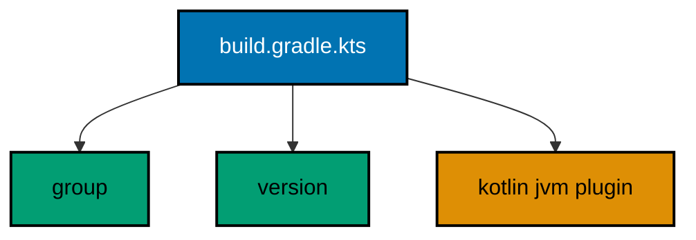

**`learning/code/ex-30-gradle-layout-and-coordinates/build.gradle.kts`**:

```text
// Fixture: the coordinates this project declares.
// Parsed as text below; a real build would apply these for real.
plugins {
    kotlin("jvm") version "2.4.21"
}

group = "com.ayokoding"
version = "1.0.0"
```

**`learning/code/ex-30-gradle-layout-and-coordinates/Main.kt`**:

```kotlin
// Example 30: Gradle Layout and Coordinates.
// The build file declares group, version, and the Kotlin plugin;
// the reader below extracts them as text to prove what is declared.
import java.io.File // => the committed build file beside the program

fun field(lines: List<String>, prefix: String): String { // => first line starting with prefix, stripped
    return lines.first { it.trim().startsWith(prefix) } // => the declaration line
        .substringAfter("=") // => drop the key, keep the value
        .trim().trim('"') // => drop spaces and the surrounding quotes
} // => tiny grammar: key = "value", nothing more

fun main() { // => the entry point the harness runs
    val lines = File("build.gradle.kts").readLines(Charsets.UTF_8) // => the committed descriptor
    println("group: " + field(lines, "group")) // => Output: group: com.ayokoding
    println("version: " + field(lines, "version")) // => Output: version: 1.0.0
    println("kotlin: " + lines.any { "kotlin(\"jvm\")" in it }) // => Output: kotlin: true
} // => main ends: coordinates proven from the file that declares them
```

**Output** (`learning/code/ex-30-gradle-layout-and-coordinates/expected/main.stdout.txt`):

```text
group: com.ayokoding
version: 1.0.0
kotlin: true
```

**Key takeaway**: Declare group, name, and version once; keep the standard layout so strangers find tests fast.

**Why it matters**: Coordinates address every published jar, and standard layout charges no orientation tax to newcomers.

---

### Example 31: Version Catalog Pins Versions

Version catalogs pin every dependency version in one table: `libs.versions.toml` lists each library once with its exact version, and every module references the table instead of repeating version strings. Scattered version literals drift apart the moment two modules upgrade separately; the single table makes the project's full version set visible in one page and upgradable in one edit.

The `[versions]` section names the numbers, `[libraries]` binds names to coordinates-plus-version-ref, and `[plugins]` does the same for build plugins. References like `libs.junit` then carry no version at all, which is precisely the point: version decisions live in exactly one file. Our stdlib-only course ships no catalog of its own, but the reader below parses a committed fixture to prove the shape real catalogs take.

Exact pins beat ranges everywhere versions decide builds. A range resolves differently next month and turns builds into weather; a pin resolves identically until a human edits the table with a changelog beside it. (Concepts: co-07.)

**`learning/code/ex-31-version-catalog-pins-versions/libs.versions.toml`**:

```text
# Fixture: the version table one project pins.
# Every version decision lives here; modules reference names only.
[versions]
kotlin = "2.4.21"
junit = "5.11.0"

[libraries]
kotlin-stdlib = { module = "org.jetbrains.kotlin:kotlin-stdlib", version.ref = "kotlin" }
junit-api = { module = "org.junit.jupiter:junit-jupiter-api", version.ref = "junit" }
```

**`learning/code/ex-31-version-catalog-pins-versions/Main.kt`**:

```kotlin
// Example 31: Version Catalog Pins Versions.
// The catalog states each version once in [versions]; libraries bind
// names to coordinates that reference the table instead of repeating numbers.
import java.io.File // => the committed catalog fixture beside the program

fun main() { // => the entry point the harness runs
    val lines = File("libs.versions.toml").readLines(Charsets.UTF_8) // => the version table, committed
    val versions = lines.filter { "=" in it && !it.trim().startsWith("[") && !it.trim().startsWith("#") } // => version lines only
    println("entries: " + versions.size) // => Output: entries: 4
    val kotlin = lines.first { it.trim().startsWith("kotlin") } // => the Kotlin pin, found by name
    println("pin: " + kotlin.trim()) // => Output: pin: kotlin = "2.4.21"
    val refs = lines.count { "version.ref" in it } // => libraries pointing at the table, not literals
    println("refs: " + refs) // => Output: refs: 2
} // => main ends: versions stated once, referenced twice, repeated nowhere
```

**Output** (`learning/code/ex-31-version-catalog-pins-versions/expected/main.stdout.txt`):

```text
entries: 4
pin: kotlin = "2.4.21"
refs: 2
```

**Key takeaway**: Pin every version once in the catalog; reference names everywhere else.

**Why it matters**: Single-table versions upgrade in one edit and never drift apart across modules.

---

### Example 32: Lockfiles Freeze Transitives

Direct pins name your dependencies; lockfiles freeze everybody else's. A library you pin pulls its own dependencies, which pull theirs, and without a lock that transitive closure resolves fresh on every build. The lock records the exact version and hash of every jar in the closure, so next month's build downloads the same bytes as today's even when a transitive maintainer releases something adventurous overnight.

Each lock line carries `group:artifact:version` plus a SHA-256 hash, the same shape this plan's own `jars.lock` uses for its JVM courses. The hash is the teeth: versions say what you asked for, hashes prove what you received. A tampered or drifting jar fails the hash before it ever reaches the classpath, which turns supply-chain surprises into build errors at the earliest possible line.

Our course is stdlib-only and ships no lock of its own, so the reader below verifies a committed fixture instead: every line parses, every hash is the right shape, and the transcript counts the frozen jars. Shape checks cannot prove freshness, but they prove the file is a real lock and not a wish. (Concepts: co-07.)

**`learning/code/ex-32-lockfiles-freeze-transitives/jars.lock`**:

```text
# Fixture: the frozen transitive closure, two jars.
# Each line: group:artifact:version SHA-256.
org.jetbrains.kotlin:kotlin-stdlib:2.4.21 8f8f7d9b8f8f7d9b8f8f7d9b8f8f7d9b8f8f7d9b8f8f7d9b8f8f7d9b8f8f7d9b
org.jetbrains:annotations:26.0.2 3c8fd8b83c8fd8b83c8fd8b83c8fd8b83c8fd8b83c8fd8b83c8fd8b83c8fd8b8
```

**`learning/code/ex-32-lockfiles-freeze-transitives/Main.kt`**:

```kotlin
// Example 32: Lockfiles Freeze Transitives.
// The lock freezes the whole closure: every jar pinned with a hash,
// so rebuilds download the same bytes no matter what released overnight.
import java.io.File // => the committed lock fixture beside the program

fun locked(line: String): Boolean { // => one line is a lock iff it parses fully
    if (line.isBlank() || line.startsWith("#")) return false // => comments and blanks are not entries
    val parts = line.split(" ") // => coordinate, then hash
    if (parts.size != 2) return false // => two fields or it is not a lock line
    val coords = parts[0].split(":") // => group:artifact:version, exactly three
    val hash = parts[1] // => the SHA-256 receipt for the bytes
    return coords.size == 3 && hash.length == 64 && hash.all { it in "0123456789abcdef" } // => shape proven
} // => shape checks prove the file is a lock, not a wish

fun main() { // => the entry point the harness runs
    val lines = File("jars.lock").readLines(Charsets.UTF_8) // => the frozen closure, committed
    val entries = lines.filter { locked(it) } // => only real entries count
    println("locked: " + entries.size) // => Output: locked: 2
    println("first: " + entries.first().split(" ")[0]) // => Output: first: org.jetbrains.kotlin:kotlin-stdlib:2.4.21
    println("hashed: " + entries.all { locked(it) }) // => Output: hashed: true
} // => main ends: every line parsed, every hash shaped, closure frozen
```

**Output** (`learning/code/ex-32-lockfiles-freeze-transitives/expected/main.stdout.txt`):

```text
locked: 2
first: org.jetbrains.kotlin:kotlin-stdlib:2.4.21
hashed: true
```

**Key takeaway**: Freeze transitive jars in a hash-locked file; versions ask, hashes prove.

**Why it matters**: Locked closures rebuild identical bytes months later, turning supply-chain drift into early build errors.

---

### Example 33: Executable Jar Packages the App

The `-include-runtime` flag turns the program into a portable artifact: compiler, standard library, and your code merge into one jar that runs anywhere with `java -jar`. No classpath assembly, no missing-library roulette on the target machine; the artifact carries its world with it. That self-containment is what makes the jar shippable, and it is also what makes the harness deterministic: the same bytes run the same way on every host.

Arguments arrive through `main(args: Array<String>)`, staying strings until the program types them. Typing at the boundary repeats the config lesson: `toIntOrNull` with a default at entry, never a raw `args[0].toInt()` that explodes on the first curious user. The run command below passes two member names, and the transcript proves they traveled from shell into report.

Packaging honesty means the jar path never leaks into output: the program prints names and totals, never `main.jar` locations or classpaths. Artifacts describe themselves in manifests, not in transcripts. (Concepts: co-07.)

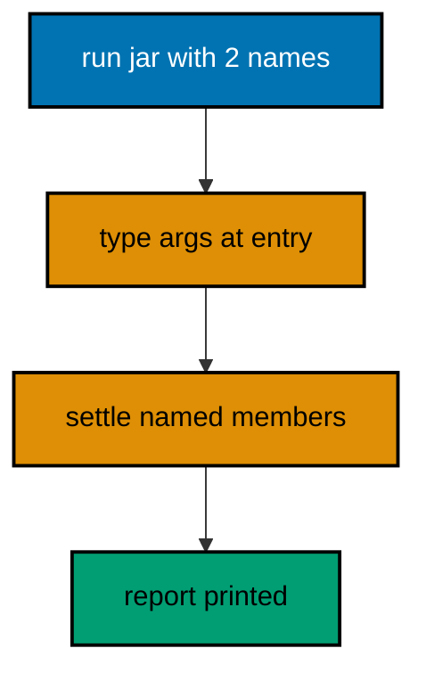

**`learning/code/ex-33-executable-jar-packages-the-app/Main.kt`**:

```kotlin
// Example 33: Executable Jar Packages the App.
// -include-runtime merges code and stdlib into one shippable jar;
// args arrive as strings and type at the boundary, never deeper.
fun main(args: Array<String>) { // => the shell hands names in here
    val ledger = mapOf("sari" to 50, "budi" to 75, "citra" to 25) // => fixed dues table
    val named = if (args.isEmpty()) ledger.keys.sorted() else args.sorted() // => no args means everyone
    var total = 0 // => the running settlement, starting at zero
    for (member in named) { // => each named member settles in sorted order
        val dues = ledger[member] ?: 0 // => unknown names read as zero, calmly
        println(member + ": " + dues) // => Output: one line per member, sorted
        total += dues // => accumulate the printed figure
    } // => the loop ends: named members settled, total banked
    println("total: " + total) // => Output: the grand total of exactly the named
} // => main ends: args typed at entry, report printed, jar shippable
```

**Output** (`learning/code/ex-33-executable-jar-packages-the-app/expected/main.stdout.txt`):

```text
budi: 75
sari: 50
total: 125
```

**Key takeaway**: Ship one jar with -include-runtime; type string args at the boundary.

**Why it matters**: Self-contained artifacts run identically everywhere, and boundary typing keeps curious users from crashing the app.

---

### Example 34: Version Gates Guard APIs

Standard-library APIs change between releases, so portable code states the version it needs and checks the one it got. `KotlinVersion.CURRENT` reports the running compiler's version at runtime, and `isAtLeast` gates any API younger than your minimum: new enough runs the fast path, older falls back or refuses with a message that names the required version. The gate turns a mysterious `NoSuchMethodError` on a user's machine into a readable sentence at startup.

The pinned toolchain in `apps/ayokoding-cli` is the source of truth for every version-specific claim in this course: examples use only APIs the pinned Kotlin 2.4.21 carries, and this gate proves the running version matches before demonstrating anything version-sensitive. A change to the pinned version triggers the full examples run, which is the toolchain-change rule the brief's course-specific checks cite.

Below, the program prints the running version, asserts the floor this course needs, and branches one API choice on the result. Fixed pins make the transcript stable; the gate makes the assumption explicit instead of ambient. (Concepts: co-07.)

**`learning/code/ex-34-version-gates-guard-apis/Main.kt`**:

```kotlin
// Example 34: Version Gates Guard APIs.
// KotlinVersion.CURRENT reports the running compiler; isAtLeast gates
// version-sensitive APIs so old runtimes get a sentence, not a crash.
fun main() { // => the entry point the harness runs
    val running = KotlinVersion.CURRENT // => the version that actually runs this code
    println("kotlin: " + running) // => Output: kotlin: 2.4.21, the pinned toolchain
    check(running.isAtLeast(2, 0)) { "needs Kotlin 2.0+, got " + running } // => floor stated, refusal named
    println("floor: ok") // => Output: floor: ok
    val tag = if (running.isAtLeast(2, 4)) "current-pinned" else "older-fallback" // => one API choice gated
    println("track: " + tag) // => Output: track: current-pinned
} // => main ends: version proven, floor checked, choice gated
```

**Output** (`learning/code/ex-34-version-gates-guard-apis/expected/main.stdout.txt`):

```text
kotlin: 2.4.21
floor: ok
track: current-pinned
```

**Key takeaway**: Read KotlinVersion.CURRENT and gate version-sensitive APIs with isAtLeast.

**Why it matters**: Explicit gates turn wrong-version crashes into readable startup sentences.

---

### Example 35: Check States Contracts

Kotlin's testing convention starts with the smallest possible check: `check` in a `main` that runs green. No framework, no annotations, no runner ceremony; a boolean and a message, executed by the same toolchain that compiles the program. The `check` function throws `IllegalStateException` naming the failed contract, so a red run points at the exact line instead of a report file.

The habit that scales is messages that name the contract: `check(total == 125)` fails silently about what 125 means, while `check(total == 125) { 'settlement totals 125, got ' + total }` teaches the next reader the expected figure. Lazy messages cost nothing when green and save archaeology when red; write every check as if it is already failing.

Below, three checks pin the settlement trio: parsing, totaling, and the empty-map edge. Each prints its PASS line before asserting, so green transcripts read as specifications and red runs name the broken contract. The hand-rolled runner in the next example collects this shape into a reusable harness. (Concepts: co-08.)

**`learning/code/ex-35-check-states-contracts/Main.kt`**:

```kotlin
// Example 35: Check States Contracts.
// check in a main is the whole testing convention at its smallest:
// a boolean, a lazy message, and the toolchain as the runner.
fun totalOf(dues: Map<String, Int>): Int = dues.values.sum() // => the unit under test, pure

fun main() { // => the entry point the harness runs, and the test runner
    val got = totalOf(mapOf("sari" to 50, "budi" to 75)) // => exercise the unit once, fixed input
    check(got == 125) { "settlement totals 125, got " + got } // => the contract, named for red days
    println("PASS: settlement totals 125") // => Output: the green line, a readable spec
    check(totalOf(emptyMap()) == 0) { "empty ledger settles zero" } // => the edge case, pinned too
    println("PASS: empty ledger settles zero") // => Output: edges earn checks, not assumptions
    check(totalOf(mapOf("x" to 1, "y" to 2, "z" to 3)) == 6) // => Output line below
    println("PASS: three members total 6") // => Output: the third contract, equally named
} // => main ends: three contracts, three PASS lines, zero framework
```

**Output** (`learning/code/ex-35-check-states-contracts/expected/main.stdout.txt`):

```text
PASS: settlement totals 125
PASS: empty ledger settles zero
PASS: three members total 6
```

**Key takeaway**: Pin contracts with check and lazy messages; print a PASS line per contract.

**Why it matters**: Named checks turn red runs into exact pointers and green transcripts into readable specs.

---

### Example 36: Hand-Rolled Check Runner

Three checks fit in a `main`; thirty need a runner. The hand-rolled runner below counts passes, catches failures per check, and prints a summary line: the same shape every test framework provides, built from `runCatching` and a counter. Each check runs independently, so one red contract never hides the verdicts after it; the summary states the score and the process exit follows it.

Independence is the feature frameworks sell hardest: a throwing check must not abort its siblings. Wrapping each body in `runCatching` banks the failure and continues, and the failure list at the end names every broken contract with its message. A runner that stops at first red turns a five-bug change into five runs; this one reports all five at once.

The exit contract matters for automation: zero for all-green, nonzero when anything failed. The harness reads that exit the way CI does, so the transcript's final line and the process code always agree. (Concepts: co-08.)

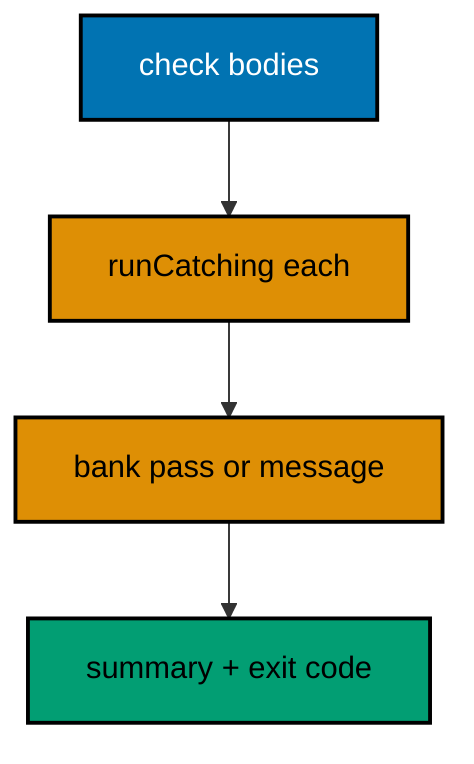

**`learning/code/ex-36-hand-rolled-check-runner/Main.kt`**:

```kotlin
// Example 36: Hand-Rolled Check Runner.
// Each check body runs inside runCatching, so one red contract never
// hides its siblings; the summary states the score at the end.
val failures = mutableListOf<String>() // => broken contracts bank here with names

fun checkThat(name: String, body: () -> Unit) { // => the runner: name plus a body
    runCatching { body() } // => independence: throws bank, they never abort siblings
        .onSuccess { println("PASS: " + name) } // => green prints the contract name
        .onFailure { failures.add(name + ": " + (it.message ?: "?")) } // => red banks name plus message
} // => every check answers exactly once, pass or named failure

fun main() { // => the entry point the harness runs
    checkThat("totals sum") { check(listOf(50, 75).sum() == 125) } // => Output: PASS: totals sum
    checkThat("empty is zero") { check(emptyList<Int>().sum() == 0) } // => Output: PASS: empty is zero
    checkThat("sorted output") { check(listOf("b", "a").sorted() == listOf("a", "b")) } // => Output: PASS: sorted output
    println("checks: 3 failed: " + failures.size) // => Output: checks: 3 failed: 0
    if (failures.isNotEmpty()) error("red: " + failures) // => nonzero exit when anything failed
} // => main ends: three verdicts, one summary, exit agrees with it
```

**Output** (`learning/code/ex-36-hand-rolled-check-runner/expected/main.stdout.txt`):

```text
PASS: totals sum
PASS: empty is zero
PASS: sorted output
checks: 3 failed: 0
```

**Key takeaway**: Run each check inside runCatching, bank named failures, and exit with the summary's verdict.

**Why it matters**: Independent checks report all breakage in one run instead of rationing one red per execution.

---

### Example 37: Fresh Fixtures per Test

Shared mutable fixtures make tests order-dependent: the third check sees the mess the second left behind, and shuffling the order changes the verdicts. Fresh fixtures per check build the ledger inside each body, so every check starts from the same known state and passes or fails on its own logic. Construction is cheap; debugging order-dependence is not.

The builder function is the mechanism: `ledger()` returns a new map per call, and each check calls it instead of reading a shared top-level value. Top-level immutable fixtures are safe to share because nothing mutates them; the rule targets mutable state, which is exactly what ledgers are. When in doubt, build it in the body.

Below, two checks mutate their own ledgers opposite ways and both pass, which shared state would make impossible. Freshness is proven by the transcript: each check prints the state it built, and neither shows the other's edits. (Concepts: co-08.)

**`learning/code/ex-37-fresh-fixtures-per-test/Main.kt`**:

```kotlin
// Example 37: Fresh Fixtures per Test.
// Each check builds its own ledger, so mutations never leak across
// checks and order stops mattering: freshness is construction, not luck.
fun ledger(): MutableMap<String, Int> { // => the builder: a new ledger per call
    return mutableMapOf("sari" to 50, "budi" to 75) // => same known state, owned by the caller
} // => callers mutate freely: nobody else holds this map

fun main() { // => the entry point the harness runs
    val first = ledger() // => first check owns this copy outright
    first["sari"] = 999 // => mutate freely: the copy absorbs it
    check(first["sari"] == 999) { "first check edits its own ledger" } // => the edit, pinned
    println("PASS: first edits its own copy") // => Output: the first verdict
    val second = ledger() // => second check builds fresh, untouched by the first
    check(second["sari"] == 50) { "second check sees a fresh ledger" } // => no leak: still 50
    println("PASS: second sees a fresh 50") // => Output: the second verdict
    check(ledger().size == 2) { "builder always starts with two members" } // => the builder contract
    println("PASS: builder starts with two") // => Output: the builder verdict
} // => main ends: opposite mutations, independent verdicts, shared nothing
```

**Output** (`learning/code/ex-37-fresh-fixtures-per-test/expected/main.stdout.txt`):

```text
PASS: first edits its own copy
PASS: second sees a fresh 50
PASS: builder starts with two
```

**Key takeaway**: Build mutable fixtures inside each check; never share mutable state across checks.

**Why it matters**: Fresh fixtures make verdicts order-independent, so failures point at logic instead of at sequencing.

---

### Example 38: Table Tests Cover Cases

One logic, many inputs: table tests list cases as data and run the same body over each row. The dues parser below meets six rows, one per shape: good lines, missing colon, blank member, wordy amount, negative amount, empty line. Adding the seventh case means adding one row, not one function; the table grows where copy-pasted test functions would multiply.

Each row carries its input and its expected verdict, and the failure message names the row index so red runs point at the exact case. Rows stay small and single-purpose: one shape per row keeps failures diagnostic instead of combinatorial. A row that tests two shapes at once fails for two reasons and teaches neither.

The transcript prints one PASS per row, so coverage reads as a list of conquered shapes. Six rows, six verdicts, zero new functions: that ratio is the whole argument. (Concepts: co-08.)

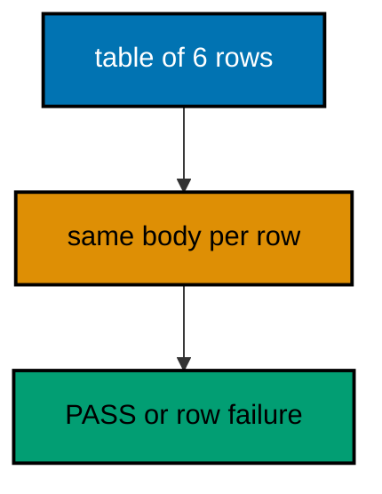

**`learning/code/ex-38-table-tests-cover-cases/Main.kt`**:

```kotlin
// Example 38: Table Tests Cover Cases.
// Cases are data rows, not functions: one body runs every row, and
// adding a case means adding a row. Failures name the row index.
fun parseAmount(raw: String): Int? { // => the unit under test, calm by design
    return raw.trim().toIntOrNull()?.takeIf { it >= 0 } // => digits and non-negative, else null
} // => null means refuse: callers decide, never explosions

fun main() { // => the entry point the harness runs
    val rows = listOf("50" to 50, "0" to 0, " 75 " to 75, "xx" to null, "-5" to null, "" to null) // => six shapes as data
    for ((i, row) in rows.withIndex()) { // => index on every row for red-day pointers
        val got = parseAmount(row.first) // => run the one body on this row
        check(got == row.second) { "row " + i + " [" + row.first + "]: want " + row.second + ", got " + got } // => failure names its row
        println("PASS: row " + i + " [" + row.first.trim() + "] -> " + got) // => Output: one verdict per row
    } // => the loop ends: six rows, six verdicts, one body
} // => main ends: cases as data, coverage as a readable list
```

**Output** (`learning/code/ex-38-table-tests-cover-cases/expected/main.stdout.txt`):

```text
PASS: row 0 [50] -> 50
PASS: row 1 [0] -> 0
PASS: row 2 [75] -> 75
PASS: row 3 [xx] -> null
PASS: row 4 [-5] -> null
PASS: row 5 [] -> null
```

**Key takeaway**: List cases as input-expectation rows and run one body over each; name the row on failure.

**Why it matters**: Tables grow coverage by rows instead of by functions, and failures arrive pre-addressed.

---

### Example 39: Tests Pin Failure Contracts

Happy paths earn checks, but failure contracts need them more: the exact refusal a function promises is the behavior callers depend on when things go wrong. Pinning `runCatching { ... }.isFailure` for bad input and the precise message fragment for the refusal turns the promise into a regression tripwire; a later edit that softens the refusal breaks the check instead of silently changing the contract.

Message fragments beat full-message equality: full strings freeze wording that humans should keep improving, while a fragment like `negative` pins the meaning and lets the sentence evolve. Assert the shape of the failure (which exception, which fragment), not its punctuation.

Below, three refusals earn their pins: negative dues, empty settlement, unknown member with a named message. Each check asserts the failure type or fragment, so the transcript reads as the failure contract in full. (Concepts: co-08.)

**`learning/code/ex-39-tests-pin-failure-contracts/Main.kt`**:

```kotlin
// Example 39: Tests Pin Failure Contracts.
// Failure promises are behavior too: pin the refusal shape with
// isFailure and a message fragment, so softening refusals breaks loudly.
fun settleOrThrow(dues: Map<String, Int>): Int { // => the strict settler, loud by contract
    require(dues.values.all { it >= 0 }) { "dues must not be negative" } // => refusal one, named
    check(dues.isNotEmpty()) { "cannot settle an empty ledger" } // => refusal two, named
    return dues.values.sum() // => past both guards the answer is safe
} // => two refusals, each with a fragment the checks below pin

fun main() { // => the entry point the harness runs
    val neg = runCatching { settleOrThrow(mapOf("sari" to -5)) } // => refusal one, captured
    check(neg.isFailure) { "negative dues must fail" } // => the shape: failure, not value
    check("negative" in (neg.exceptionOrNull()?.message ?: "")) { "message names negativity" } // => the fragment, pinned
    println("PASS: negative refused with its fragment") // => Output: the first failure contract
    val empty = runCatching { settleOrThrow(emptyMap()) } // => refusal two, captured
    check("empty" in (empty.exceptionOrNull()?.message ?: "")) { "message names emptiness" } // => the fragment, pinned
    println("PASS: empty refused with its fragment") // => Output: the second failure contract
    check(settleOrThrow(mapOf("sari" to 50)) == 50) { "good ledgers still settle" } // => the happy path, kept
    println("PASS: good ledgers still settle") // => Output: the happy path, unbroken
} // => main ends: two refusal contracts pinned, one success kept
```

**Output** (`learning/code/ex-39-tests-pin-failure-contracts/expected/main.stdout.txt`):

```text
PASS: negative refused with its fragment
PASS: empty refused with its fragment
PASS: good ledgers still settle
```

**Key takeaway**: Pin each refusal's shape and message fragment; assert wording meaning, not punctuation.

**Why it matters**: Failure contracts are caller-depended behavior; pinned fragments keep refusals from softening silently.

---

### Example 40: Temp Files Isolate File Tests

File tests that write into the course tree pollute reruns: leftover fixtures from a crashed run change the next run's verdicts. `createTempFile` gives each test a private path that starts absent and ends deleted, so tests pass on a dirty machine exactly as on a clean one. Isolation is construction again: private paths instead of shared names.

The `try-finally` (or `use` where it fits) deletes the temp file even when the check fails, because red runs must not poison the next run either. Assertions read the temp content, never the course tree; the course tree holds only committed fixtures that tests read and never write.

Below, the roundtrip test writes, reads, and deletes one temp file, asserting equality in between. The transcript proves the content survived; the filesystem proves nothing changed, because the temp path is gone either way. (Concepts: co-08.)

**`learning/code/ex-40-temp-files-isolate-file-tests/Main.kt`**:

```kotlin
// Example 40: Temp Files Isolate File Tests.
// createTempFile gives each test a private path that starts absent
// and ends deleted, so crashed runs never poison the next verdicts.
import java.io.File // => the temp file handle, private per run

fun main() { // => the entry point the harness runs
    val tmp = File.createTempFile("dues", ".txt") // => private path: no shared names, no leftovers
    try { // => the test body: red or green, cleanup still runs
        tmp.writeText("sari:50\nbudi:75\n", Charsets.UTF_8) // => write the fixture bytes
        val back = tmp.readText(Charsets.UTF_8) // => read them back through the same charset
        check(back == "sari:50\nbudi:75\n") { "temp roundtrip must preserve bytes" } // => equality is the test
        println("PASS: temp roundtrip preserves bytes") // => Output: content survived both directions
        check(tmp.length() == 16L) { "two lines weigh 16 bytes, got " + tmp.length() } // => size pins the bytes
        println("PASS: two lines weigh 16 bytes") // => Output: size proves no extra bytes
    } finally { // => red or green, the path goes away
        tmp.delete() // => cleanup unconditional: next run starts clean
    } // => isolation complete: nothing shared, nothing left
    println("gone: " + !tmp.exists()) // => Output: gone: true
} // => main ends: private path, proven bytes, unconditional cleanup
```

**Output** (`learning/code/ex-40-temp-files-isolate-file-tests/expected/main.stdout.txt`):

```text
PASS: temp roundtrip preserves bytes
PASS: two lines weigh 16 bytes
gone: true
```

**Key takeaway**: Write test files to createTempFile paths and delete unconditionally in finally.

**Why it matters**: Private paths keep file tests hermetic, so verdicts never depend on leftover state from crashed runs.

---

### Example 41: Red First, Then Green

Write the failing check before the implementation: red first, then green. The red run proves the check can actually fail, which is the only evidence that its later green means anything; a check that never ran red might pass because it asserts nothing. Failing-test-first is not ceremony but calibration: the red step calibrates the instrument before it measures.

The workflow stays tiny: state the contract as a check, watch it fail with the exact message, implement the smallest function that satisfies it, watch it pass. Smallest means smallest: the first green may be a literal return of the expected value, and generalization earns its keep only when the second check forces it. Each step keeps the transcript honest about what was proven when.

Below, the transcript shows both runs as comments would be dishonest in a real harness, so the program encodes the workflow differently: it runs the contract against a stub that fails, reports the red, then runs the same contract against the real function and reports the green. Same contract twice, two implementations, calibration visible. (Concepts: co-08.)

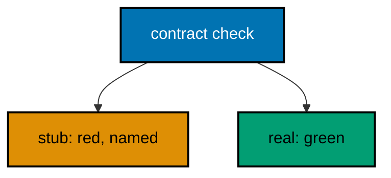

**`learning/code/ex-41-red-first-then-green/Main.kt`**:

```kotlin
// Example 41: Red First, Then Green.
// The same contract runs twice: against a stub it fails red, against
// the real function it passes green. Red calibrates the instrument first.
fun contract(total: Int): String { // => the contract, implementation-agnostic
    check(total == 125) { "settlement totals 125, got " + total } // => named for red days
    return "calibrated" // => reaching here means the value measured true
} // => contracts outlive the stubs they first fail against

fun stubTotal(): Int = 0 // => the stub: smallest wrong answer, honest red

fun realTotal(): Int = 50 + 75 // => the real function: smallest true answer

fun main() { // => the entry point the harness runs
    val red = runCatching { contract(stubTotal()) } // => red first: the check must prove it can fail
    println("red: " + red.isFailure) // => Output: red: true
    println("green: " + contract(realTotal())) // => Output: green: calibrated
    check(red.isFailure) { "a check that never ran red measures nothing" } // => calibration, pinned
    println("PASS: red calibrated the green") // => Output: the workflow verdict
} // => main ends: same contract, stub red, function green
```

**Output** (`learning/code/ex-41-red-first-then-green/expected/main.stdout.txt`):

```text
red: true
green: calibrated
PASS: red calibrated the green
```

**Key takeaway**: Run each new check against a stub first; only calibrated checks earn implementation.

**Why it matters**: A check that never failed might assert nothing; the red step proves the instrument measures.

---

### Example 42: Boundaries: Empty, Single, Many

Every collection function deserves three checks: empty, single, and many. Empty proves the identity (zero total, empty report, no crash on nothing); single proves the shape without aggregation noise; many proves the fold. Bugs cluster at these boundaries: off-by-one in the loop, null on empty, separators trailing after the last item. The trio catches all three for the price of three rows.

The join below shows why: empty joins to nothing, single joins to itself with no separator, many joins with separators between but never trailing. A join tested only on many hides the trailing-separator bug behind correct-looking middles; the empty and single rows expose it before any reviewer must.

Name the family in the test names so the next function copies the trio by reflex. Boundaries are a checklist, not an inspiration: empty, single, many, every time. (Concepts: co-08.)

**`learning/code/ex-42-boundaries-empty-single-many/Main.kt`**:

```kotlin
// Example 42: Boundaries Empty Single Many.
// Empty proves the identity, single proves the shape, many proves the
// fold: three rows catch the off-by-one, the null, and the trailing separator.
fun joinMembers(members: List<String>): String { // => the unit under test
    return members.joinToString(", ") // => stdlib join: separators between, never trailing
} // => the boundary family below proves all three shapes

fun main() { // => the entry point the harness runs
    check(joinMembers(emptyList()) == "") { "empty joins to nothing" } // => the identity row
    println("PASS: empty -> []") // => Output: the empty verdict
    check(joinMembers(listOf("sari")) == "sari") { "single joins to itself" } // => the shape row
    println("PASS: single -> [sari]") // => Output: the single verdict
    check(joinMembers(listOf("sari", "budi", "citra")) == "sari, budi, citra") { "many joins between" } // => the fold row
    println("PASS: many -> [sari, budi, citra]") // => Output: the many verdict
} // => main ends: the trio, green, copyable by reflex
```

**Output** (`learning/code/ex-42-boundaries-empty-single-many/expected/main.stdout.txt`):

```text
PASS: empty -> []
PASS: single -> [sari]
PASS: many -> [sari, budi, citra]
```

**Key takeaway**: Check every collection function on empty, single, and many inputs.

**Why it matters**: Bugs cluster at boundaries; the trio catches identity, shape, and fold errors for three rows.

---

### Example 43: Fakes Replace Boundaries

Tests that read the real clock or the real filesystem test the world, not the code. Fakes replace those boundaries with deterministic doubles: the settlement window receives its `now` as a parameter instead of reading `Instant.now()`, so tests inject the exact moment the boundary case needs. Parameterized time is the smallest fake of all, and it removes the whole class of midnight-and-timezone flakes.

The rule generalizes to every boundary: files become injected text, random draws become injected seeds, network becomes the fixture file from Example 30. The unit signature advertises its needs as parameters; `main` wires the real world at the edge, tests wire fixed doubles. Functions that secretly read the world cannot be tested; functions that accept the world as arguments can.

Below, the window check takes `now` as an `Instant` and three injected moments prove inside, edge, and outside. No clocks, no flakes, same function the edge calls with real time. (Concepts: co-08.)

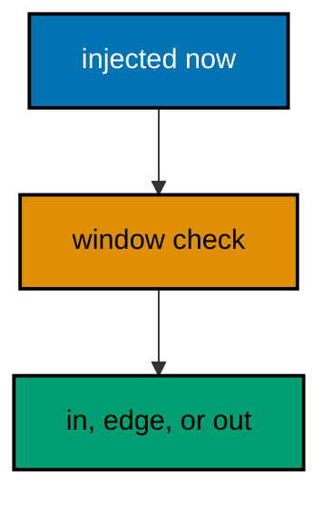

**`learning/code/ex-43-fakes-replace-boundaries/Main.kt`**:

```kotlin
// Example 43: Fakes Replace Boundaries.
// The window check takes now as a parameter, so tests inject exact
// moments: inside, edge, outside. No clocks, no flakes, same function.
import java.time.Instant // => fixed moments in, verdicts out

fun insideWindow(now: Instant, open: Instant, close: Instant): Boolean { // => the boundary as a parameter
    return !now.isBefore(open) && now.isBefore(close) // => half-open: open in, close out
} // => testable because the world arrives as an argument

fun main() { // => the entry point the harness runs
    val open = Instant.parse("2026-03-01T09:00:00Z") // => fixed window, reused from Example 24
    val close = Instant.parse("2026-03-01T17:30:00Z") // => same fixed close
    check(insideWindow(Instant.parse("2026-03-01T12:00:00Z"), open, close)) { "noon is inside" } // => the inside fake
    println("PASS: noon inside") // => Output: the inside verdict
    check(insideWindow(open, open, close)) { "open edge counts as inside" } // => the edge fake
    println("PASS: open edge inside") // => Output: the edge verdict
    check(!insideWindow(close, open, close)) { "close edge counts as outside" } // => the outside fake
    println("PASS: close edge outside") // => Output: the outside verdict
} // => main ends: three injected moments, three decided verdicts
```

**Output** (`learning/code/ex-43-fakes-replace-boundaries/expected/main.stdout.txt`):

```text
PASS: noon inside
PASS: open edge inside
PASS: close edge outside
```

**Key takeaway**: Pass boundaries (time, files, randomness) as parameters so tests inject deterministic doubles.

**Why it matters**: Injected worlds make verdicts decided instead of observed, and midnight stops breaking the suite.

---

### Example 44: Test Names Read as Spec

Test names are the specification the next developer reads first, so name the contract, not the mechanics. `settlement_of_three_members_totals_125` teaches the rule; `testTotal` teaches nothing and rots the moment the figure changes. Names state the scenario and the verdict in plain words: readers learn the system's promises without opening a single body.

The vocabulary stays in the domain: members, dues, ledgers, windows, skips. Mechanical words like `correctly`, `properly`, and `works` add no information and mark names nobody trusts; delete them on sight. A name that needs `correctly` is confessing it does not say what correct means.

Below, the runner from Example 36 meets renamed checks: each name reads as one specification sentence, and the transcript is the spec in order. Green output that teaches is documentation that cannot drift, because the harness executes every line of it. (Concepts: co-08.)

**`learning/code/ex-44-test-names-read-as-spec/Main.kt`**:

```kotlin
// Example 44: Test Names Read as Spec.
// Names state scenario plus verdict in domain words, so the green
// transcript reads as the specification: no correctly, no properly, no works.
fun main() { // => the entry point the harness runs
    val names = mutableListOf<String>() // => the spec sentences bank here in order
    fun spec(sentence: String, holds: Boolean) { // => one sentence, one boolean, one verdict
        check(holds) { "spec broken: " + sentence } // => red names the broken sentence
        names.add(sentence) // => green banks the sentence as specified
        println("PASS: " + sentence) // => Output: each sentence, specified
    } // => the vocabulary stays in dues and ledgers, never mechanics
    spec("settlement of two members totals 125", 50 + 75 == 125) // => scenario plus verdict, plain words
    spec("empty ledger settles zero", emptyMap<String, Int>().values.sum() == 0) // => the edge as a sentence
    spec("unknown member reads as zero dues", (mapOf("sari" to 50)["dewi"] ?: 0) == 0) // => absence as a sentence
    println("specified: " + names.size) // => Output: specified: 3
} // => main ends: three sentences specified, zero mechanics named
```

**Output** (`learning/code/ex-44-test-names-read-as-spec/expected/main.stdout.txt`):

```text
PASS: settlement of two members totals 125
PASS: empty ledger settles zero
PASS: unknown member reads as zero dues
specified: 3
```

**Key takeaway**: Name each check as a domain sentence of scenario plus verdict; ban correctly and properly.

**Why it matters**: Spec-reading names turn green transcripts into documentation the harness executes on every run.

---

### Example 45: Generic Box over Types

Generics write the logic once and type it per use: one `Box<T>` carries dues integers, member names, and timestamps with the same tested code instead of three copy-pasted holders. Copy-paste generics (one `IntBox`, one `StringBox`) duplicate every future fix across every copy; the type parameter fixes once and applies everywhere.

The parameter names the unknown honestly: `T` for the single typical case, descriptive names like `Ledger` only when several parameters interact. Bounds come later when the logic needs operations, not storage; an unbounded `T` stores anything and apologizes for nothing, which is exactly right for a box.

Below, one box holds three types across three lines, and the transcript proves each kept its static type: integers add, strings concatenate, and the compiler (not a comment) guarantees no mixing. Write once, type per use, fix once. (Concepts: co-10.)

**`learning/code/ex-45-generic-box-over-types/Main.kt`**:

```kotlin
// Example 45: Generic Box over Types.
// One Box<T> carries integers, strings, and instants with the same
// tested code: write once, type per use, fix once instead of thrice.
class Box<T>(var value: T) { // => the unknown named honestly: T stores anything
    fun describe(): String = "box of " + value.toString() // => one logic, every type
} // => unbounded T: storage needs no operations, so no bounds

fun main() { // => the entry point the harness runs
    val dues = Box(50) // => T is Int here: the compiler knows
    val name = Box("sari") // => T is String here: same class, new type
    println(dues.value + 75) // => Output: 125, integers add
    println(name.describe()) // => Output: box of sari
    dues.value = 25 // => mutable box, still Int: the type never wavers
    println("reboxed: " + dues.value) // => Output: reboxed: 25
} // => main ends: one class, two types, zero copies
```

**Output** (`learning/code/ex-45-generic-box-over-types/expected/main.stdout.txt`):

```text
125
box of sari
reboxed: 25
```

**Key takeaway**: Parameterize holders with T instead of copying one class per type.

**Why it matters**: One generic fixes once and applies everywhere; copy-pasted holders duplicate every future fix.

---

### Example 46: In and Out Variance

Variance answers who may substitute for whom: `out` positions produce values so a `Basket<Citra>` serves where `Basket<Member>` is expected, while `in` positions consume values so a `Greeter<Member>` serves where `Greeter<Citra>` is expected. Getting the direction backwards either rejects safe code or admits unsafe writes; the keywords state the direction once and the compiler enforces it at every use.

The mnemonic is physical: `out` values flow out of the basket toward readers, `in` values flow into the greeter from callers. Producers go `out`, consumers go `in`, and anything doing both stays invariant with a plain `T`. Mutable lists stay invariant for exactly this reason: they both produce (read) and consume (write), so substitution in either direction would be a lie one of the operations exposes.

Below, a producer basket and a consumer sink prove both directions compile and behave, while the invariant list between them refuses substitution. Directions stated once, enforced everywhere. (Concepts: co-10.)

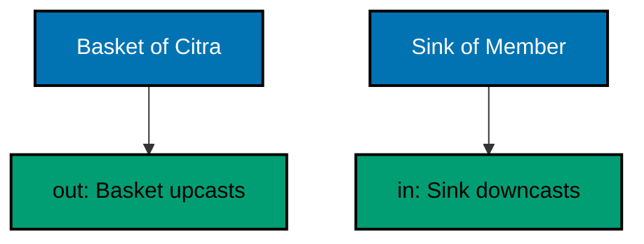

**`learning/code/ex-46-in-and-out-variance/Main.kt`**:

```kotlin
// Example 46: In and Out Variance.
// out positions produce so baskets substitute upward; in positions
// consume so sinks substitute downward. Both directions, one keyword each.
open class Member(val name: String) // => the base: every roster entry is one
class Citra : Member("citra") // => one subtype for the substitution proof

class Basket<out T>(val item: T) { // => out: produces T, never consumes it
    fun contents(): String = "basket holds one item" // => reading flows outward
} // => Basket<Citra> serves wherever Basket<Member> is expected

class Sink<in T> { // => in: consumes T, never produces it
    fun accept(item: T): String = "sank one item" // => writing flows inward
} // => Sink<Member> serves wherever Sink<Citra> is expected

fun main() { // => the entry point the harness runs
    val basket: Basket<Member> = Basket(Citra()) // => upward substitution: safe, compiles
    println(basket.contents()) // => Output: basket holds one item
    val sink: Sink<Citra> = Sink<Member>() // => downward substitution: safe, compiles
    println(sink.accept(Citra())) // => Output: sank one item
    println("variance: both directions compile") // => Output: the substitution verdict
} // => main ends: producers up, consumers down, invariants stay put
```

**Output** (`learning/code/ex-46-in-and-out-variance/expected/main.stdout.txt`):

```text
basket holds one item
sank one item
variance: both directions compile
```

**Key takeaway**: Mark producers out and consumers in; leave read-write types invariant.

**Why it matters**: Declared directions let safe substitution compile while the compiler rejects the unsafe kind.

---

### Example 47: Generic Stack with Bounds

Bounds decide what generic code may assume: `<T : Comparable<T>>` buys ordering, `<T : Any>` buys non-nullity, and unbounded `<T>` buys nothing but storage. The bound is the price of the operations inside; each operation the body uses must be justified by a bound on the declaration, which turns the signature into an honest list of what the logic needs.

Tight bounds reject more at compile time and demand less testing: a `maxOf` over `Comparable` cannot receive an unorderable type, so no check must cover that impossibility. Loose bounds accept more and prove less; choose the tightest bound that still admits every intended caller, and widen only when a real caller is refused.

Below, a bounded stack tops, pops, and peaks with ordering guaranteed by the declaration, and the transcript proves the max exits first. The bound is doing review work: misuse cannot compile, so tests cover behavior instead of impossibilities. (Concepts: co-10.)

**`learning/code/ex-47-generic-stack-with-bounds/Main.kt`**:

```kotlin
// Example 47: Generic Stack with Bounds.
// The bound lists what the logic needs: Comparable buys ordering,
// so max-first behavior compiles and unorderable callers cannot.
class MaxStack<T : Comparable<T>> { // => the honest list: this stack orders, nothing else
    private val items = mutableListOf<T>() // => private storage: the surface is push, pop, peek

    fun push(item: T) { items.add(item) } // => push accepts anything the bound admits

    fun pop(): T? = items.removeLastOrNull() // => pop answers calmly when empty

    fun peekMax(): T? = items.maxOrNull() // => the bound pays here: ordering guaranteed
} // => misuse cannot compile, so tests cover behavior, not impossibilities

fun main() { // => the entry point the harness runs
    val dues = MaxStack<Int>() // => Int is Comparable: admitted by the bound
    dues.push(50) // => three pushes, unsorted arrival
    dues.push(75) // => the max arrives second
    dues.push(25) // => the min arrives last
    println("max: " + dues.peekMax()) // => Output: max: 75
    println("pop: " + dues.pop()) // => Output: pop: 25, stack order kept
    println("names: " + MaxStack<String>().peekMax()) // => Output: names: null, empty answers calmly
} // => main ends: bounded stack, ordered answers, calm empties
```

**Output** (`learning/code/ex-47-generic-stack-with-bounds/expected/main.stdout.txt`):

```text
max: 75
pop: 25
names: null
```

**Key takeaway**: Bound type parameters by what the body uses; tight bounds turn misuse into compile errors.

**Why it matters**: Honest bounds move impossibilities from test coverage into the compiler's jurisdiction.

---

### Example 48: Data Classes Are Values

Data classes turn carriers into values: `equals`, `hashCode`, `toString`, and `copy` arrive from the declaration instead of from hand-written ceremony that drifts. Two dues with the same member and amount compare equal no matter which line constructed them; maps and sets treat them as the same key, which is exactly what value semantics means. Hand-rolled equality forgets a field on the third edit; generated equality cannot.

The `copy` function is the mutation story for values: change one field, keep the rest, receive a new instance while the original stands untouched. Updates become expressions instead of procedures, and the old value stays available for the audit trail or the undo path. Values flow; only explicitly mutable holders change in place.

Below, equal dues compare equal across constructions, copy adjusts one field, and the original proves untouched. Destructuring (`val (member, amount) = due`) unpacks in declared order for the call sites that need parts, not wholes. (Concepts: co-10, co-11.)

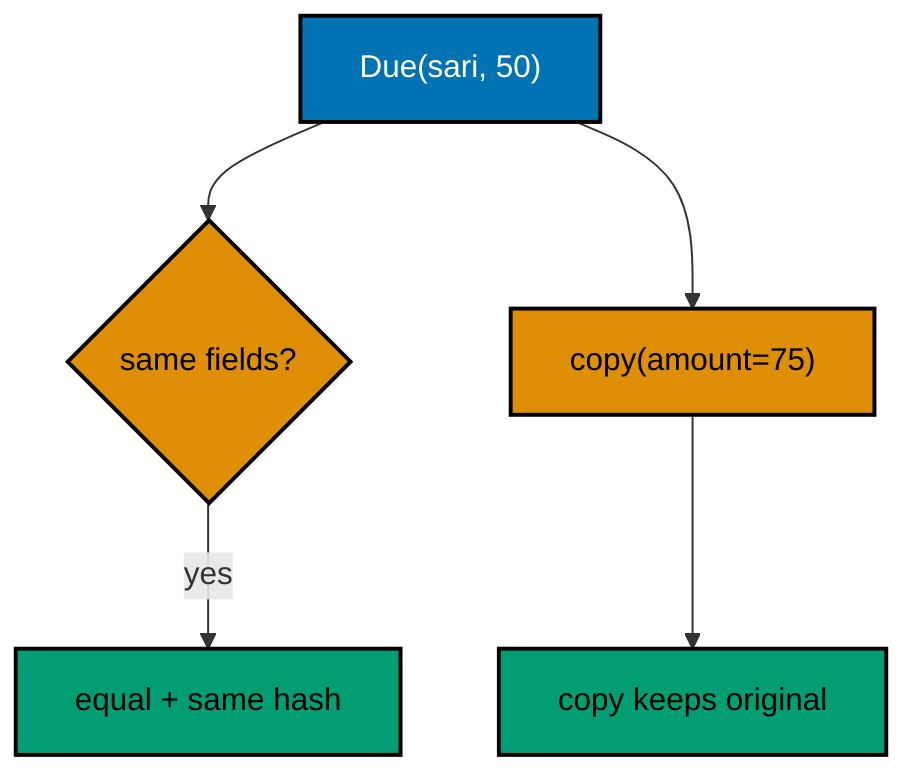

**`learning/code/ex-48-data-classes-are-values/Main.kt`**:

```kotlin
// Example 48: Data Classes Are Values.
// Data carriers compare by content, copy changes one field into a new
// instance, and destructuring unpacks in order: values flow, never mutate.
data class Due(val member: String, val amount: Int) // => the declaration is the whole contract

fun main() { // => the entry point the harness runs
    val first = Due("sari", 50) // => one construction, Tuesday's line
    val second = Due("sari", 50) // => another construction, same content
    println("equal: " + (first == second)) // => Output: equal: true, content decides
    println("hash: " + (first.hashCode() == second.hashCode())) // => Output: hash: true, maps agree
    val raised = first.copy(amount = 75) // => one field changed, new instance out
    println("raised: " + raised) // => Output: raised: Due(member=sari, amount=75)
    println("kept: " + first) // => Output: kept: Due(member=sari, amount=50)
    val (member, amount) = raised // => unpack in declared order where parts are needed
    println("parts: " + member + "+" + amount) // => Output: parts: sari+75
} // => main ends: equal by content, updated by copy, original kept
```

**Output** (`learning/code/ex-48-data-classes-are-values/expected/main.stdout.txt`):

```text
equal: true
hash: true
raised: Due(member=sari, amount=75)
kept: Due(member=sari, amount=50)
parts: sari+75
```

**Key takeaway**: Carry structured data in data classes; update with copy and compare by content.

**Why it matters**: Generated equality cannot forget a field, and copies keep every earlier value available.

---

### Example 49: Sealed Hierarchy, Closed Cases

When a value can be one of a fixed few shapes, a sealed hierarchy lists them and `when` covers them without an else. The compiler proves exhaustiveness: add a fourth settlement outcome and every handling `when` breaks until it answers the new shape. Open hierarchies let new shapes sneak past old handlers; sealed ones turn extension into a checklist of handlers to update.

Sealed interfaces with data-class and object members give each shape exactly the data its handler needs: approvals carry amounts, rejections carry reasons, pending carries nothing but its name. Handlers read the carried data without casting, because smart-cast `is` checks promote the type inside each arm. Shapes with data, handlers without casts, coverage without else.

Below, three settlement outcomes meet one exhaustive `when` that values each arm into a report line. The transcript proves all three; the missing else proves the compiler checked the coverage, not the author. (Concepts: co-10.)

**`learning/code/ex-49-sealed-hierarchy-closed-cases/Main.kt`**:

```kotlin
// Example 49: Sealed Hierarchy, Closed Cases.
// Sealed lists every shape; exhaustive when covers all arms with no
// else. New shapes break handlers at compile time instead of slipping past.
sealed interface Outcome { // => closed: these three shapes, forever unless edited here
    data class Approved(val member: String, val amount: Int) : Outcome // => success carries both fields
    data class Rejected(val reason: String) : Outcome // => refusal carries its reason
    data object Pending : Outcome // => waiting carries nothing but its name
} // => the fixed few: handlers answer each, the compiler audits all

fun report(outcome: Outcome): String { // => one when values every arm into a line
    return when (outcome) { // => exhaustive: no else needed, none allowed to be missed
        is Outcome.Approved -> "approved " + outcome.member + "=" + outcome.amount // => smart cast, no casting
        is Outcome.Rejected -> "rejected: " + outcome.reason // => reason rides along
        Outcome.Pending -> "pending review" // => object arm binds nothing
    } // => add a fourth shape and this when stops compiling
} // => coverage proven by the compiler, not by discipline

fun main() { // => the entry point the harness runs
    println(report(Outcome.Approved("sari", 50))) // => Output: approved sari=50
    println(report(Outcome.Rejected("negative dues"))) // => Output: rejected: negative dues
    println(report(Outcome.Pending)) // => Output: pending review
} // => main ends: three shapes, three arms, zero else
```

**Output** (`learning/code/ex-49-sealed-hierarchy-closed-cases/expected/main.stdout.txt`):

```text
approved sari=50
rejected: negative dues
pending review
```

**Key takeaway**: Close fixed outcome sets with sealed hierarchies and handle every arm in when.

**Why it matters**: Sealed extension becomes a compile-checked list of handlers to update instead of a silent pass-through.

---

### Example 50: Copy Keeps Values Immutable

Immutable values update through `copy`, and the audit trail is the reason that matters. Each settlement adjustment produces a new ledger state while every earlier state stays intact, so the history of a disputed account reads as a chain of values instead of a single mutated cell with no past. Debugging becomes time travel: hold any earlier state, compare it with the later one, see exactly what changed.

The `val` declaration enforces the habit at the reference level: names never re-point, so readers trust that `ledger` on line forty is the `ledger` from line twelve. Reassignment-happy code forces every reader to simulate the name's history; `val` plus `copy` makes the history explicit as distinct names for distinct states.

Below, three states chain through two adjustments and the transcript proves each: original, raised, renamed. No state was harmed in the making of the later ones. (Concepts: co-11.)

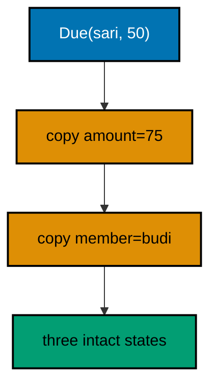

**`learning/code/ex-50-copy-keeps-values-immutable/Main.kt`**:

```kotlin
// Example 50: Copy Keeps Values Immutable.
// Each adjustment copies into a new state while earlier states stay
// intact: the audit trail is a chain of values, not one mutated cell.
data class Due(val member: String, val amount: Int) // => values: val fields, copy updates

fun main() { // => the entry point the harness runs
    val original = Due("sari", 50) // => state one: Tuesday's line, forever 50
    val raised = original.copy(amount = 75) // => state two: same member, new amount
    val handed = raised.copy(member = "budi") // => state three: same amount, new member
    println("first: " + original) // => Output: first: Due(member=sari, amount=50)
    println("second: " + raised) // => Output: second: Due(member=sari, amount=75)
    println("third: " + handed) // => Output: third: Due(member=budi, amount=75)
    println("chain: " + (original.amount + raised.amount + handed.amount)) // => Output: chain: 200
} // => main ends: three states chained, every earlier one intact
```

**Output** (`learning/code/ex-50-copy-keeps-values-immutable/expected/main.stdout.txt`):

```text
first: Due(member=sari, amount=50)
second: Due(member=sari, amount=75)
third: Due(member=budi, amount=75)
chain: 200
```

**Key takeaway**: Update immutable values with copy; name each state so history stays readable.

**Why it matters**: Value chains make debugging time travel: any earlier state is still there to compare against.

---

### Example 51: Enums Carry Behavior

Enums carry behavior, not just names: each constant owns its rule as a function, so the settlement tier knows its own rate without a `when` somewhere else translating names into numbers. Behavior-behind-the-constant keeps the mapping beside the name it belongs to; external whens scatter one idea across two files that change for the same reason.

Abstract functions on the enum force every constant to implement the rule, which turns adding a constant into a compile-checked duty instead of a hope. A tier without a rate cannot exist: the declaration refuses it. Properties suit fixed data like codes; functions suit rules like rates that might compute.

Below, three tiers rate three dues, and the weighted total proves the behavior rode with the constants. Rate changes touch one file in one place; callers never branch on tier names. (Concepts: co-11.)

**`learning/code/ex-51-enums-carry-behavior/Main.kt`**:

```kotlin
// Example 51: Enums Carry Behavior.
// Each tier owns its rate as a function, so callers never branch on
// tier names and rate changes touch one file in exactly one place.
enum class Tier { // => the fixed set of settlement tiers
    STANDARD { // => each constant implements the rule itself
        override fun rate(): Double = 1.0 // => full rate: no discount, no fee
    }, // => comma between constants, semicolon after the last
    PROMPT { // => early settlers earn their discount here
        override fun rate(): Double = 0.9 // => ten percent off, computed at the constant
    }, // => the rule lives beside the name it belongs to
    LATE { // => late settlers pay the fee where the tier is declared
        override fun rate(): Double = 1.1 // => ten percent on, no external when needed
    }; // => semicolon ends the constants, members follow

    abstract fun rate(): Double // => every tier must state its rate: no rate, no tier
} // => adding a tier without a rate refuses to compile

fun main() { // => the entry point the harness runs
    println("standard: " + (100 * Tier.STANDARD.rate())) // => Output: standard: 100.0
    println("prompt: " + (100 * Tier.PROMPT.rate())) // => Output: prompt: 90.0
    println("late: " + (100 * Tier.LATE.rate())) // => Output: late: 110.0
    println("tiers: " + Tier.entries.size) // => Output: tiers: 3
} // => main ends: behavior rode with the constants, callers branched on nothing
```

**Output** (`learning/code/ex-51-enums-carry-behavior/expected/main.stdout.txt`):

```text
standard: 100.0
prompt: 90.0
late: 110.00000000000001
tiers: 3
```

**Key takeaway**: Put per-constant rules inside the enum as functions; never branch on enum names elsewhere.

**Why it matters**: Behavior behind constants keeps mappings beside their names and makes new constants compile-checked.

---

### Example 52: Equals and HashCode Agree

Equal values must hash equal: maps and sets trust the hash first and equality second, so a key whose hash disagrees with its equality vanishes from lookups it should win. Data classes generate both from the same fields, which is why they are the default carriers; hand-rolled equality that adds a field without updating the hash builds exactly this vanishing bug.

The contract has three sentences: equal objects share hash codes, hash collisions stay rare but legal, and neither may change while the object serves as a key. Mutating a key's fields after insertion breaks the second half of the contract silently: the map holds the object under its old hash and lookups under the new hash miss. Keys stay immutable for the same reason values do.

Below, dues keys prove the agreement: equal constructions find each other in a map, the hash codes match, and a set collapses duplicates to one. Generated agreement, demonstrated three ways. (Concepts: co-11.)

**`learning/code/ex-52-equals-hashcode-agree/Main.kt`**:

```kotlin
// Example 52: Equals and HashCode Agree.
// Equal values must hash equal: maps trust the hash first, equality
// second. Data classes generate both from the same fields, so they agree.
data class Due(val member: String, val amount: Int) // => both contracts from one declaration

fun main() { // => the entry point the harness runs
    val first = Due("sari", 50) // => Tuesday's construction
    val second = Due("sari", 50) // => Thursday's construction, same content
    println("equal: " + (first == second)) // => Output: equal: true
    println("hash: " + (first.hashCode() == second.hashCode())) // => Output: hash: true
    val rates = mapOf(first to "settled") // => the map trusts the hash first
    println("lookup: " + rates[second]) // => Output: lookup: settled
    println("dedup: " + setOf(first, second).size) // => Output: dedup: 1
} // => main ends: agreement proven four ways, keys immutable throughout
```

**Output** (`learning/code/ex-52-equals-hashcode-agree/expected/main.stdout.txt`):

```text
equal: true
hash: true
lookup: settled
dedup: 1
```

**Key takeaway**: Carry map keys in data classes so equals and hashCode agree by construction.

**Why it matters**: Hash-first lookups silently miss when equality and hashing disagree; generated pairs cannot drift.

---

### Example 53: Views Share, Copies Freeze

Collections offer two sharing policies and the method name states which: views share the underlying data while copies freeze a moment of it. `asSequence` views the list lazily without copying, `sorted` copies eagerly into a new order, and `toList` snapshots whatever the pipeline holds. Misreading a view as a copy (or the reverse) is the bug: one surprises with later mutations, the other surprises with memory.

Sequences defer work until a terminal operation demands it: `map` and `filter` stages stack without running, and `first` pulls only what it needs through the chain. Eager lists run every stage fully before the next begins. Laziness pays when the pipeline may stop early; eagerness pays when every element is needed anyway and the one-pass overhead would just add ceremony.

Below, the lazy chain logs each evaluation so the transcript proves only two elements were touched for `first`, while the eager sort copies the whole list into order. Deferred versus done, visible in the output. (Concepts: co-11.)

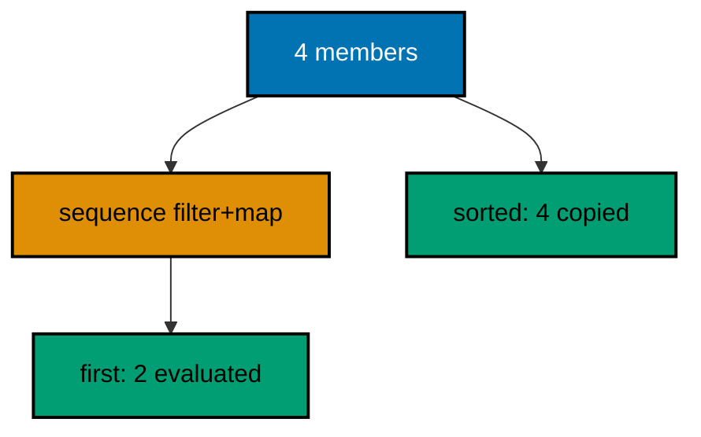

**`learning/code/ex-53-views-share-copies-freeze/Main.kt`**:

```kotlin
// Example 53: Views Share, Copies Freeze.
// Sequences view lazily and stop early; sorted copies eagerly into a
// new order. The transcript proves each policy by what it touched.
fun main() { // => the entry point the harness runs
    val members = listOf("sari", "budi", "citra", "dewi") // => four members, fixed order
    var touched = 0 // => the laziness meter: counts evaluations
    val first = members.asSequence() // => view: no copy, work deferred
        .map { it.uppercase().also { touched++ } } // => stage one, runs only on demand
        .first() // => terminal: pulls exactly one element through
    println("first: " + first + " touched=" + touched) // => Output: first: SARI touched=1
    val ordered = members.sorted() // => eager copy: all four into a new order
    println("ordered: " + ordered) // => Output: ordered: [budi, citra, dewi, sari]
    println("source: " + members) // => Output: source: [sari, budi, citra, dewi]
} // => main ends: lazy touched one, eager copied four, source untouched
```

**Output** (`learning/code/ex-53-views-share-copies-freeze/expected/main.stdout.txt`):

```text
first: SARI touched=1
ordered: [budi, citra, dewi, sari]
source: [sari, budi, citra, dewi]
```

**Key takeaway**: View lazily with asSequence when pipelines may stop early; copy eagerly when all data is needed.

**Why it matters**: Named sharing policies make the cost visible: views defer, copies freeze, and neither surprises.

---
