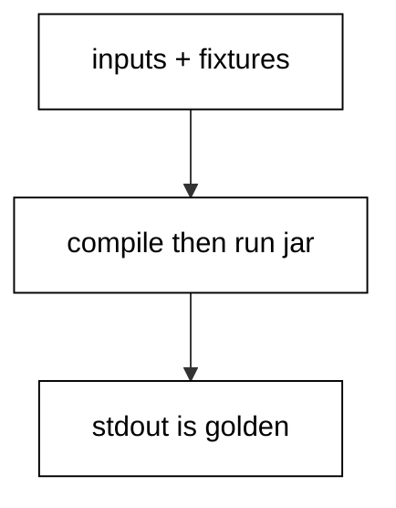

Prerequisites for this course: [just-enough-kotlin](/en/learn/courses/just-enough-kotlin/learning/overview) for Kotlin's basic syntax, which every example here assumes you can already read. Assumed knowledge: comfort with Kotlin's basic syntax from just-enough-kotlin.

## Why this exists -- the big idea

**The problem before the solution**: developers who learn Kotlin as a second language write it with their first language accent -- index loops from C, null checks from habit, string paths instead of explicit charsets, error codes instead of Result. The programs work, but they resist the ecosystem: standard tools, reviewers, and future maintainers all expect the idiomatic forms. This course replaces each accent with the native habit, one small runnable program at a time, until the idiomatic form is the first one you reach for.

**Keep this if you forget everything else**: Write Kotlin the way its own standard library does -- total functions with visible edge policies, values over mutation, explicitness at boundaries.

## Tensions and trade-offs -- when NOT to reach for this

- **Idiom versus clarity**: sequences beat lists until they need debugging; immutability beats mutation until the copy costs dominate; data classes beat plain classes until behavior outgrows data. Each example names its cost alongside its form, and Example 78 collects the reading rules.
- **Standard library versus dependency**: the course reaches for the standard library first, which keeps every example runnable with zero installs. Real projects still adopt dependencies for genuinely hard problems -- JSON binding, web frameworks, test engines -- where the standard library ends and the ecosystem begins.
- **When NOT**: one-off exploration in a scratch file needs no packaging, no tests, and no linting. The engineering in this course earns its place when the program runs twice -- on a schedule, on someone else's machine, or a year from now with you unavailable.

## Lineage -- where this language sits

Kotlin is the Android and modern-JVM language across much of this catalog: backend courses build on it, migration courses move data beside it, tooling courses drive it. This course is the depth behind that ubiquity -- the reason the same language serves mobile apps and CLIs alike. The primer teaches reading and writing; this course teaches fluency; later courses assume both and build domain systems on top.

## How this course is organized

[Beginner](/en/learn/courses/kotlin-in-depth/learning/beginner) (Examples 1-25) installs idiomatic control flow and collections, the error-handling idiom, and standard-library text, files, and time. [Intermediate](/en/learn/courses/kotlin-in-depth/learning/intermediate) (Examples 26-53) organizes modules and packages, declares and pins dependencies, tests with checks and hand-rolled runners, and types generic, value-shaped code. [Advanced](/en/learn/courses/kotlin-in-depth/learning/advanced) (Examples 54-78) surveys concurrency primitives, configures tooling and style, bridges the Java interop boundary both ways, and trains systematic reading of idiomatic code. The [capstone](/en/learn/courses/kotlin-in-depth/learning/capstone/overview) ships a tally CLI with a fourteen-check suite and a golden transcript, and [drilling](/en/learn/courses/kotlin-in-depth/drilling/overview) turns the sixteen concepts into recall, katas, and checklists.

## About the runtime

Every example runs as `kotlinc Main.kt -include-runtime -d main.jar && java -jar main.jar` in the pinned Kotlin container with no network and a read-only course tree: only scratch paths and tidied fixture files are writable, so fixtures ship beside each program. Multi-file examples state their extra files explicitly; every file the lesson shows is embedded byte-identically. Standard output is the asserted golden transcript. Programs print names, counts, and fixed labels -- never paths, timings, addresses, or versions -- so reruns are byte-stable. The Kotlin compiler's own warnings go to standard error and stay out of the transcript.

## Examples by Level

### Beginner (Examples 1-25)

- [Example 1: When Expressions Choose Values](/en/learn/courses/kotlin-in-depth/learning/beginner#example-1-when-expressions-choose-values)
- [Example 2: For Loops Iterate Elements](/en/learn/courses/kotlin-in-depth/learning/beginner#example-2-for-loops-iterate-elements)
- [Example 3: Early Returns Flatten Nesting](/en/learn/courses/kotlin-in-depth/learning/beginner#example-3-early-returns-flatten-nesting)
- [Example 4: Ranges and Progressions](/en/learn/courses/kotlin-in-depth/learning/beginner#example-4-ranges-and-progressions)
- [Example 5: MutableList Grows on Add](/en/learn/courses/kotlin-in-depth/learning/beginner#example-5-mutablelist-grows-on-add)
- [Example 6: Grouping and Counting](/en/learn/courses/kotlin-in-depth/learning/beginner#example-6-grouping-and-counting)
- [Example 7: Immutable Snapshots with toList](/en/learn/courses/kotlin-in-depth/learning/beginner#example-7-immutable-snapshots-with-tolist)
- [Example 8: Sorting with Comparators](/en/learn/courses/kotlin-in-depth/learning/beginner#example-8-sorting-with-comparators)
- [Example 9: Use Closes Resources](/en/learn/courses/kotlin-in-depth/learning/beginner#example-9-use-closes-resources)
- [Example 10: Nullable Types Instead of Null](/en/learn/courses/kotlin-in-depth/learning/beginner#example-10-nullable-types-instead-of-null)
- [Example 11: Require and Check State Contracts](/en/learn/courses/kotlin-in-depth/learning/beginner#example-11-require-and-check-state-contracts)
- [Example 12: RunCatching for Recoverable Failure](/en/learn/courses/kotlin-in-depth/learning/beginner#example-12-runcatching-for-recoverable-failure)
- [Example 13: Result Map and Recover](/en/learn/courses/kotlin-in-depth/learning/beginner#example-13-result-map-and-recover)
- [Example 14: Sealed Hierarchies for Errors](/en/learn/courses/kotlin-in-depth/learning/beginner#example-14-sealed-hierarchies-for-errors)
- [Example 15: Exceptions Carry Causes](/en/learn/courses/kotlin-in-depth/learning/beginner#example-15-exceptions-carry-causes)
- [Example 16: Elvis at Boundaries](/en/learn/courses/kotlin-in-depth/learning/beginner#example-16-elvis-at-boundaries)
- [Example 17: Per-Item Failure Granularity](/en/learn/courses/kotlin-in-depth/learning/beginner#example-17-peritem-failure-granularity)
- [Example 18: Multiline Strings for Templates](/en/learn/courses/kotlin-in-depth/learning/beginner#example-18-multiline-strings-for-templates)
- [Example 19: Format Verbs for Tables](/en/learn/courses/kotlin-in-depth/learning/beginner#example-19-format-verbs-for-tables)
- [Example 20: Regex with Named Groups](/en/learn/courses/kotlin-in-depth/learning/beginner#example-20-regex-with-named-groups)
- [Example 21: Files Read and Write in UTF-8](/en/learn/courses/kotlin-in-depth/learning/beginner#example-21-files-read-and-write-in-utf8)
- [Example 22: CSV Quotes Need a Parser](/en/learn/courses/kotlin-in-depth/learning/beginner#example-22-csv-quotes-need-a-parser)
- [Example 23: Properties Config at the Edge](/en/learn/courses/kotlin-in-depth/learning/beginner#example-23-properties-config-at-the-edge)
- [Example 24: Instants and Durations, Fixed](/en/learn/courses/kotlin-in-depth/learning/beginner#example-24-instants-and-durations-fixed)
- [Example 25: Zoned Time for Humans](/en/learn/courses/kotlin-in-depth/learning/beginner#example-25-zoned-time-for-humans)

### Intermediate (Examples 26-53)

- [Example 26: One File One Job](/en/learn/courses/kotlin-in-depth/learning/intermediate#example-26-one-file-one-job)
- [Example 27: Packages Group Related Code](/en/learn/courses/kotlin-in-depth/learning/intermediate#example-27-packages-group-related-code)
- [Example 28: Visibility Modifiers Draw Edges](/en/learn/courses/kotlin-in-depth/learning/intermediate#example-28-visibility-modifiers-draw-edges)
- [Example 29: Imports Resolve Names](/en/learn/courses/kotlin-in-depth/learning/intermediate#example-29-imports-resolve-names)
- [Example 30: Gradle Layout and Coordinates](/en/learn/courses/kotlin-in-depth/learning/intermediate#example-30-gradle-layout-and-coordinates)
- [Example 31: Version Catalog Pins Versions](/en/learn/courses/kotlin-in-depth/learning/intermediate#example-31-version-catalog-pins-versions)
- [Example 32: Lockfiles Freeze Transitives](/en/learn/courses/kotlin-in-depth/learning/intermediate#example-32-lockfiles-freeze-transitives)
- [Example 33: Executable Jar Packages the App](/en/learn/courses/kotlin-in-depth/learning/intermediate#example-33-executable-jar-packages-the-app)
- [Example 34: Version Gates Guard APIs](/en/learn/courses/kotlin-in-depth/learning/intermediate#example-34-version-gates-guard-apis)
- [Example 35: Check States Contracts](/en/learn/courses/kotlin-in-depth/learning/intermediate#example-35-check-states-contracts)
- [Example 36: Hand-Rolled Check Runner](/en/learn/courses/kotlin-in-depth/learning/intermediate#example-36-handrolled-check-runner)
- [Example 37: Fresh Fixtures per Test](/en/learn/courses/kotlin-in-depth/learning/intermediate#example-37-fresh-fixtures-per-test)
- [Example 38: Table Tests Cover Cases](/en/learn/courses/kotlin-in-depth/learning/intermediate#example-38-table-tests-cover-cases)
- [Example 39: Tests Pin Failure Contracts](/en/learn/courses/kotlin-in-depth/learning/intermediate#example-39-tests-pin-failure-contracts)
- [Example 40: Temp Files Isolate File Tests](/en/learn/courses/kotlin-in-depth/learning/intermediate#example-40-temp-files-isolate-file-tests)
- [Example 41: Red First, Then Green](/en/learn/courses/kotlin-in-depth/learning/intermediate#example-41-red-first-then-green)
- [Example 42: Boundaries: Empty, Single, Many](/en/learn/courses/kotlin-in-depth/learning/intermediate#example-42-boundaries-empty-single-many)
- [Example 43: Fakes Replace Boundaries](/en/learn/courses/kotlin-in-depth/learning/intermediate#example-43-fakes-replace-boundaries)
- [Example 44: Test Names Read as Spec](/en/learn/courses/kotlin-in-depth/learning/intermediate#example-44-test-names-read-as-spec)
- [Example 45: Generic Box over Types](/en/learn/courses/kotlin-in-depth/learning/intermediate#example-45-generic-box-over-types)
- [Example 46: In and Out Variance](/en/learn/courses/kotlin-in-depth/learning/intermediate#example-46-in-and-out-variance)
- [Example 47: Generic Stack with Bounds](/en/learn/courses/kotlin-in-depth/learning/intermediate#example-47-generic-stack-with-bounds)
- [Example 48: Data Classes Are Values](/en/learn/courses/kotlin-in-depth/learning/intermediate#example-48-data-classes-are-values)
- [Example 49: Sealed Hierarchy, Closed Cases](/en/learn/courses/kotlin-in-depth/learning/intermediate#example-49-sealed-hierarchy-closed-cases)
- [Example 50: Copy Keeps Values Immutable](/en/learn/courses/kotlin-in-depth/learning/intermediate#example-50-copy-keeps-values-immutable)
- [Example 51: Enums Carry Behavior](/en/learn/courses/kotlin-in-depth/learning/intermediate#example-51-enums-carry-behavior)
- [Example 52: Equals and HashCode Agree](/en/learn/courses/kotlin-in-depth/learning/intermediate#example-52-equals-and-hashcode-agree)
- [Example 53: Views Share, Copies Freeze](/en/learn/courses/kotlin-in-depth/learning/intermediate#example-53-views-share-copies-freeze)

### Advanced (Examples 54-78)

- [Example 54: Threads Join Before Print](/en/learn/courses/kotlin-in-depth/learning/advanced#example-54-threads-join-before-print)
- [Example 55: Atomic Counters Share Safely](/en/learn/courses/kotlin-in-depth/learning/advanced#example-55-atomic-counters-share-safely)
- [Example 56: Synchronized Guards Shared Total](/en/learn/courses/kotlin-in-depth/learning/advanced#example-56-synchronized-guards-shared-total)
- [Example 57: Blocking Queue Connects Stages](/en/learn/courses/kotlin-in-depth/learning/advanced#example-57-blocking-queue-connects-stages)
- [Example 58: CountDownLatch Waits for All](/en/learn/courses/kotlin-in-depth/learning/advanced#example-58-countdownlatch-waits-for-all)
- [Example 59: Parallel Map, Then Sort](/en/learn/courses/kotlin-in-depth/learning/advanced#example-59-parallel-map-then-sort)
- [Example 60: Immutable Messages Cross Threads](/en/learn/courses/kotlin-in-depth/learning/advanced#example-60-immutable-messages-cross-threads)
- [Example 61: Confinement Avoids Sharing](/en/learn/courses/kotlin-in-depth/learning/advanced#example-61-confinement-avoids-sharing)
- [Example 62: Names That Read Aloud](/en/learn/courses/kotlin-in-depth/learning/advanced#example-62-names-that-read-aloud)
- [Example 63: Comments Explain Why](/en/learn/courses/kotlin-in-depth/learning/advanced#example-63-comments-explain-why)
- [Example 64: Small Functions Read Once](/en/learn/courses/kotlin-in-depth/learning/advanced#example-64-small-functions-read-once)
- [Example 65: Deprecated Levels Guide Migration](/en/learn/courses/kotlin-in-depth/learning/advanced#example-65-deprecated-levels-guide-migration)
- [Example 66: Formatter Keeps Diffs Small](/en/learn/courses/kotlin-in-depth/learning/advanced#example-66-formatter-keeps-diffs-small)
- [Example 67: Sequences Defer Work](/en/learn/courses/kotlin-in-depth/learning/advanced#example-67-sequences-defer-work)
- [Example 68: BuildString Beats Plus in Loops](/en/learn/courses/kotlin-in-depth/learning/advanced#example-68-buildstring-beats-plus-in-loops)
- [Example 69: Kotlin Calls Java](/en/learn/courses/kotlin-in-depth/learning/advanced#example-69-kotlin-calls-java)
- [Example 70: Java Calls Kotlin Back](/en/learn/courses/kotlin-in-depth/learning/advanced#example-70-java-calls-kotlin-back)
- [Example 71: Handlers First, Then Helpers](/en/learn/courses/kotlin-in-depth/learning/advanced#example-71-handlers-first-then-helpers)
- [Example 72: Pipelines Read in Stages](/en/learn/courses/kotlin-in-depth/learning/advanced#example-72-pipelines-read-in-stages)
- [Example 73: Seams Mark Where Tests Enter](/en/learn/courses/kotlin-in-depth/learning/advanced#example-73-seams-mark-where-tests-enter)
- [Example 74: Spec Tables Before Code](/en/learn/courses/kotlin-in-depth/learning/advanced#example-74-spec-tables-before-code)
- [Example 75: CLI Anatomy: Flags and Exits](/en/learn/courses/kotlin-in-depth/learning/advanced#example-75-cli-anatomy-flags-and-exits)
- [Example 76: Data Contracts Shape Everything](/en/learn/courses/kotlin-in-depth/learning/advanced#example-76-data-contracts-shape-everything)
- [Example 77: Cleanup Order in Use Blocks](/en/learn/courses/kotlin-in-depth/learning/advanced#example-77-cleanup-order-in-use-blocks)
- [Example 78: Whole Program, Top Down](/en/learn/courses/kotlin-in-depth/learning/advanced#example-78-whole-program-top-down)
