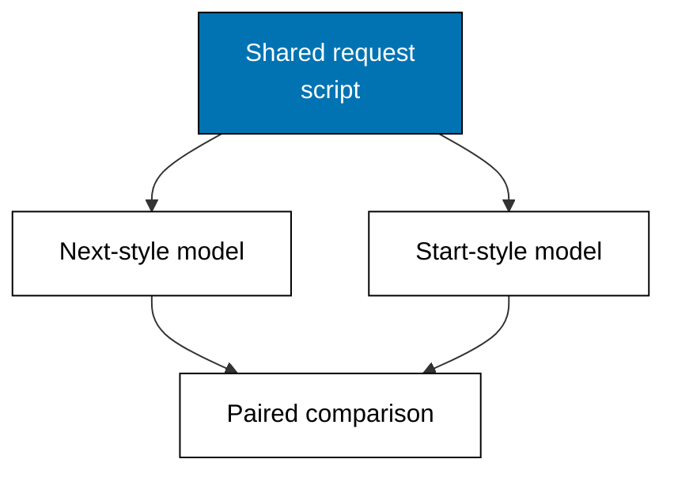

NusaMart is fictional, and so is the launch in front of it: three goods, a shelf to list them, a detail page per good, and a cart that must accept quantities, reject ghosts, and survive double submits. This capstone builds that small product-catalog app twice — once as a Next.js-style model, once as a TanStack Start-style model — with an identical route and data-loading shape, then writes the comparison report. Every technique comes from Themes A through I; nothing new is introduced, because the point is combination under one request script.

## The app

The catalog has three routes: the list, one detail per product, and a cart action. The list shows every id; the detail loads its row before rendering and refuses unknown ids; the action validates quantity and existence, mutates the server cart, and reports the new count and total. Both models answer the same five-step script — list, detail, add, bad add, cart report — so the comparison measures behavior, not memory.



## Routes, both spellings

The Next.js-style model reads its routes as `app/page.tsx`, `app/products/page.tsx`, and `app/products/[id]/page.tsx`; the Start-style model reads them as `routes/index.tsx`, `routes/products/index.tsx`, and `routes/products/$productId.tsx`. The comparison script does not care: it requests list, detail, and cart behavior through the shared model interface, exactly the separation Example 44 practices. Spelling differences live in comments and tags; behavior is what the transcript compares.

## Loading before rendering, twice

Both models resolve the detail row before the reply, refuse the ghost product with a named error, and validate quantity before mutating — the loader contract from Example 24 and the validation discipline from Example 29, applied identically. The transcript's value is the sameness: five steps, five agreements, zero behavioral divergence. When two implementations agree step for step, the frameworks differ only where the matrix in Example 45 says they do.

## The comparison report

Every step prints both answers plus whether the bodies agree after the dialect tag. List, detail, mutation, refusal, and cart report all agree: same ids listed, same row rendered, same rejection for the ghost product, same count and total. The report's conclusion is therefore specific rather than sweeping — on routing, loading, mutation, and error shape, the two dialects are behaviorally identical for this app, and the choice between them rests on team familiarity and existing code rather than on any capability this catalog needed.

**`learning/capstone/code/main.ts`**

```typescript
// Capstone: the same product-catalog app twice, compared.
// => NusaMart is fictional; every product and quantity here is fixed.
// => One request script (list, detail, add, bad add) runs against a
// => Next.js-style model and a TanStack Start-style model, and the final
// => table shows both dialects answering identically: conventions differ,
// => behavior agrees.

// => Fixed catalog: both models read the same fictional rows.
type Product = { id: string; name: string; price: number }; // => shop row shape
const PRODUCTS: Product[] = [
  // => three fictional goods, prices in rupiah
  { id: "kopi-001", name: "Kopi Toraja 250g", price: 68000 }, // => first shelf row
  { id: "teh-002", name: "Teh Melati 100g", price: 32000 }, // => second shelf row
  { id: "gula-003", name: "Gula Aren 500g", price: 21000 }, // => third shelf row
]; // => end of the fixed catalog

// => A catalog model answers the four script steps: list ids, detail one
// => row, add to the cart, and report the cart. Both dialects implement it.
type Model = {
  // => catalog model shape
  list: () => string; // => list step
  detail: (id: string) => string; // => detail step
  add: (id: string, qty: number) => string; // => mutation step
  cart: () => string; // => cart report
}; // => end of Model

// => Build one model per dialect: Next.js reads like an async Server
// => Component plus a server action; Start reads like a loader plus a
// => server function. The bodies below share the logic on purpose.
function buildModel(side: "next" | "start"): Model {
  // => model builder
  const cart: Record<string, number> = {}; // => server-owned cart
  return {
    // => the four steps
    list: () => side + ": list " + PRODUCTS.map((p) => p.id).join(","), // => list step
    detail: (id: string) => {
      // => detail step
      const found = PRODUCTS.find((p) => p.id === id); // => the loader read
      return found === undefined ? side + ": not-found " + id : side + ": detail " + found.name + " " + found.price; // => row or miss
    }, // => end of detail
    add: (id: string, qty: number) => {
      // => mutation step
      if (PRODUCTS.find((p) => p.id === id) === undefined) {
        // => unknown product
        return side + ": error unknown " + id; // => named failure
      } // => end of the unknown branch
      if (!Number.isInteger(qty) || qty < 1 || qty > 9) {
        // => bad quantity
        return side + ": error bad-qty " + qty; // => named failure
      } // => end of the quantity branch
      cart[id] = (cart[id] ?? 0) + qty; // => the mutation
      return side + ": added " + qty + " x " + id; // => success reply
    }, // => end of add
    cart: () => {
      // => cart report
      const lines = Object.entries(cart).map(([k, q]) => k + " x" + q); // => cart lines
      const total = Object.entries(cart).reduce(
        (a, [k, q]) => a + (PRODUCTS.find((p) => p.id === k)?.price ?? 0) * q,
        0,
      ); // => cart total
      return side + ": cart [" + lines.join(",") + "] total " + total; // => the report
    }, // => end of cart
  }; // => end of the steps
} // => end of buildModel

// => The shared request script: the same four steps run on both models,
// => and the comparison prints agree whenever the bodies match after the
// => dialect tag.
const next = buildModel("next"); // => Next.js-style model
const start = buildModel("start"); // => Start-style model
const steps: [string, (m: Model) => string][] = [
  // => the script
  ["list", (m) => m.list()], // => step one
  ["detail teh-002", (m) => m.detail("teh-002")], // => step two
  ["add 2 kopi", (m) => m.add("kopi-001", 2)], // => step three
  ["add ghost", (m) => m.add("susu-009", 1)], // => step four
  ["cart", (m) => m.cart()], // => step five
]; // => end of the script
for (const [name, run] of steps) {
  // => each step on both models
  const a = run(next); // => Next.js answer
  const b = run(start); // => Start answer
  const strip = (s: string): string => s.replace(/^(next|start):/, ""); // => drop the dialect tag
  console.log(name + ": next=" + a + " | start=" + b + " agree=" + (strip(a) === strip(b))); // => Output the pair
} // => end of the script loop
export {}; // => module scope keeps these names local
```

**Output** (`learning/capstone/code/expected/main.stdout.txt`):

```text
list: next=next: list kopi-001,teh-002,gula-003 | start=start: list kopi-001,teh-002,gula-003 agree=true
detail teh-002: next=next: detail Teh Melati 100g 32000 | start=start: detail Teh Melati 100g 32000 agree=true
add 2 kopi: next=next: added 2 x kopi-001 | start=start: added 2 x kopi-001 agree=true
add ghost: next=next: error unknown susu-009 | start=start: error unknown susu-009 agree=true
cart: next=next: cart [kopi-001 x2] total 136000 | start=start: cart [kopi-001 x2] total 136000 agree=true
```

## What the numbers do not cover

The models prove behavior, not performance: loopback latency stands in for nothing, and five scripted steps stand in for no real visitor. Real catalogs add images, search, pagination, and payment — each a new theme-sized decision about placement, caching, and validation. The comparison also covers only the happy-path-plus-ghost shape; permission checks, concurrent edits, and partial failures would widen the script before any production claim. Treat the five agreements as what they are: evidence that the conventions transfer, not that the apps are done.
