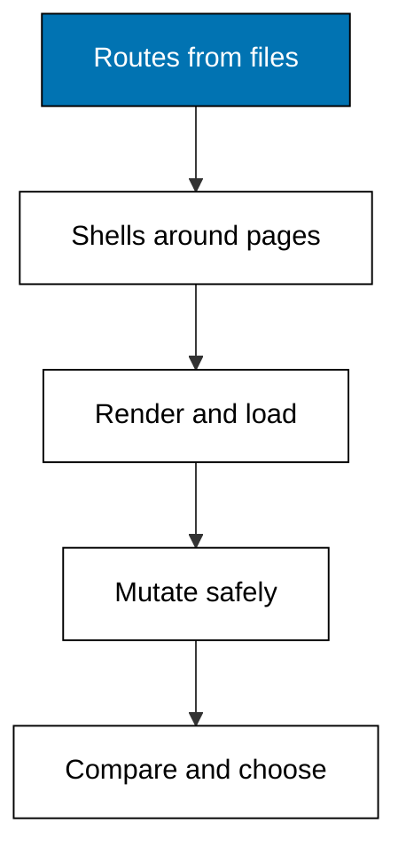

Prerequisites for this course: [just-enough-typescript](/en/learn/courses/just-enough-typescript/learning/overview) for the TypeScript every example runs in, [frontend-essentials](/en/learn/courses/frontend-essentials/learning/overview) for components and hooks, and [advanced-frontend](/en/learn/courses/advanced-frontend/learning/overview) for the rendering vocabulary. Comfort reading a route table and a small server log is assumed throughout.

## Why this exists -- the big idea

**The problem before the solution**: component skills do not teach placement — knowing React does not tell you which code runs on the server, which HTML the crawler sees, or why identical shops behave differently on two frameworks. Nothing in the catalog teaches routing, rendering mode, and data loading as a dedicated, compared subject. **Keep this if you forget everything else**: decide, per page, what must run on the server and what can run in the browser, and let the framework's routing convention make that decision visible.

## Tensions and trade-offs -- when NOT to reach for this

- **Server versus client is per page, not per project**: rendering everything on the server wastes server time on dashboards nobody crawls; rendering everything in the browser starves content pages of first paint. The chooser in Example 46 exists because both extremes are wrong somewhere.
- **Static versus fresh is a staleness budget**: a built page is free per request but frozen until rebuilt; a dynamic page is always right but never free. Name the budget before picking the mode, as Theme D practices.
- **When NOT**: component design, styling, and client state patterns live in frontend-essentials and advanced-frontend; this course never teaches a hook or a stylesheet. Full deployment operations live elsewhere too — the deployment target appears only as the consumer of the build output.

## Lineage -- where this judgement sits

Components came first: functions of state that render UI. Meta-frameworks grew around them as the placement layer: file-based routing turned the project tree into URLs, server components moved data fetching next to rendering, loaders formalized load-before-render, actions gave client components a safe way to mutate, and typed routes made the URL surface checkable. The component skills live in the prerequisite courses; this course is the placement judgement on top.

## How this course is organized

[Theme A](/en/learn/courses/modern-frontend-meta-frameworks/learning/theme-a-file-based-routing) (Worked Examples 1-5) turns files into URLs in both dialects. [Theme B](/en/learn/courses/modern-frontend-meta-frameworks/learning/theme-b-nested-layouts) (Examples 6-10) nests shared shells with loading and error slots. [Theme C](/en/learn/courses/modern-frontend-meta-frameworks/learning/theme-c-server-rendering) (Examples 11-15) renders on the server and hydrates. [Theme D](/en/learn/courses/modern-frontend-meta-frameworks/learning/theme-d-static-generation) (Examples 16-21) builds once, replays, and revalidates. [Theme E](/en/learn/courses/modern-frontend-meta-frameworks/learning/theme-e-server-data-loading) (Examples 22-27) loads data before rendering and refuses bad renders early. [Theme F](/en/learn/courses/modern-frontend-meta-frameworks/learning/theme-f-server-actions-and-mutations) (Examples 28-33) validates, mutates, and settles. [Theme G](/en/learn/courses/modern-frontend-meta-frameworks/learning/theme-g-caching-and-streaming) (Examples 34-38) replays cached pages and streams slow sections. [Theme H](/en/learn/courses/modern-frontend-meta-frameworks/learning/theme-h-type-safe-routing) (Examples 39-43) types links, params, and queries. [Theme I](/en/learn/courses/modern-frontend-meta-frameworks/learning/theme-i-framework-comparison-and-trade-offs) (Examples 44-48) measures both dialects side by side and chooses per page. The [capstone](/en/learn/courses/modern-frontend-meta-frameworks/learning/capstone/overview) builds the catalog twice with a comparison report, and [drilling](/en/learn/courses/modern-frontend-meta-frameworks/drilling/overview) turns the concepts into recall, problems, katas, and checklists.

## References

- Next.js documentation, App Router: project structure and file conventions, server and client components, data fetching, and caching. Accessed 2026-10-25; the Next.js spellings in this course follow the docs as of this date.
- TanStack Start documentation and TanStack Router routing guides: file-based routing, route tree generation, loaders, and server functions. Accessed 2026-10-25; the Start spellings in this course follow the docs as of this date.
- The pinned Node/TypeScript toolchain versions are the source of truth for any version-specific API.
- Legacy material this course migrates and re-verifies: `fe-nextjs` and `fe-tanstack-start` legacy pages — accessed 2026-10-25; every fact mined from those pages was re-checked against the framework docs above on the same date rather than copied as already correct.

## Examples by Theme

### Theme A: File-Based Routing (Examples 1-5)

- [Worked Example 1: First Route on Two Servers](/en/learn/courses/modern-frontend-meta-frameworks/learning/theme-a-file-based-routing#worked-example-1-first-route-on-two-servers)
- [Worked Example 2: File Path to URL Pattern](/en/learn/courses/modern-frontend-meta-frameworks/learning/theme-a-file-based-routing#worked-example-2-file-path-to-url-pattern)
- [Worked Example 3: Dynamic Segment Values](/en/learn/courses/modern-frontend-meta-frameworks/learning/theme-a-file-based-routing#worked-example-3-dynamic-segment-values)
- [Worked Example 4: Catch-All Segments](/en/learn/courses/modern-frontend-meta-frameworks/learning/theme-a-file-based-routing#worked-example-4-catch-all-segments)
- [Worked Example 5: File-to-URL Convention Map](/en/learn/courses/modern-frontend-meta-frameworks/learning/theme-a-file-based-routing#worked-example-5-file-to-url-convention-map)

### Theme B: Nested Layouts (Examples 6-10)

- [Worked Example 6: Layout Chain Around a Page](/en/learn/courses/modern-frontend-meta-frameworks/learning/theme-b-nested-layouts#worked-example-6-layout-chain-around-a-page)
- [Worked Example 7: Layout Nesting Order](/en/learn/courses/modern-frontend-meta-frameworks/learning/theme-b-nested-layouts#worked-example-7-layout-nesting-order)
- [Worked Example 8: Route Groups Without URLs](/en/learn/courses/modern-frontend-meta-frameworks/learning/theme-b-nested-layouts#worked-example-8-route-groups-without-urls)
- [Worked Example 9: Loading and Error Slots](/en/learn/courses/modern-frontend-meta-frameworks/learning/theme-b-nested-layouts#worked-example-9-loading-and-error-slots)
- [Worked Example 10: Layout Tree Reference](/en/learn/courses/modern-frontend-meta-frameworks/learning/theme-b-nested-layouts#worked-example-10-layout-tree-reference)

### Theme C: Server Rendering (Examples 11-15)

- [Worked Example 11: Server HTML First Paint](/en/learn/courses/modern-frontend-meta-frameworks/learning/theme-c-server-rendering#worked-example-11-server-html-first-paint)
- [Worked Example 12: Server Render Versus Client Render](/en/learn/courses/modern-frontend-meta-frameworks/learning/theme-c-server-rendering#worked-example-12-server-render-versus-client-render)
- [Worked Example 13: Serializable Props Boundary](/en/learn/courses/modern-frontend-meta-frameworks/learning/theme-c-server-rendering#worked-example-13-serializable-props-boundary)
- [Worked Example 14: Hydration Mismatch Warning](/en/learn/courses/modern-frontend-meta-frameworks/learning/theme-c-server-rendering#worked-example-14-hydration-mismatch-warning)
- [Worked Example 15: Request-to-Hydrate Flow Reference](/en/learn/courses/modern-frontend-meta-frameworks/learning/theme-c-server-rendering#worked-example-15-request-to-hydrate-flow-reference)

### Theme D: Static Generation (Examples 16-21)

- [Worked Example 16: Prerendered Versus Dynamic](/en/learn/courses/modern-frontend-meta-frameworks/learning/theme-d-static-generation#worked-example-16-prerendered-versus-dynamic)
- [Worked Example 17: Static Paths at Build](/en/learn/courses/modern-frontend-meta-frameworks/learning/theme-d-static-generation#worked-example-17-static-paths-at-build)
- [Worked Example 18: Fallback Shapes](/en/learn/courses/modern-frontend-meta-frameworks/learning/theme-d-static-generation#worked-example-18-fallback-shapes)
- [Worked Example 19: Revalidation Clock](/en/learn/courses/modern-frontend-meta-frameworks/learning/theme-d-static-generation#worked-example-19-revalidation-clock)
- [Worked Example 20: Build-Versus-Request Timeline Reference](/en/learn/courses/modern-frontend-meta-frameworks/learning/theme-d-static-generation#worked-example-20-build-versus-request-timeline-reference)
- [Worked Example 21: Static Export Sitemap](/en/learn/courses/modern-frontend-meta-frameworks/learning/theme-d-static-generation#worked-example-21-static-export-sitemap)

### Theme E: Server Data Loading (Examples 22-27)

- [Worked Example 22: Loader Before Render](/en/learn/courses/modern-frontend-meta-frameworks/learning/theme-e-server-data-loading#worked-example-22-loader-before-render)
- [Worked Example 23: Parallel Loader Fanout](/en/learn/courses/modern-frontend-meta-frameworks/learning/theme-e-server-data-loading#worked-example-23-parallel-loader-fanout)
- [Worked Example 24: Loader Params to Row](/en/learn/courses/modern-frontend-meta-frameworks/learning/theme-e-server-data-loading#worked-example-24-loader-params-to-row)
- [Worked Example 25: Deferred Chunks](/en/learn/courses/modern-frontend-meta-frameworks/learning/theme-e-server-data-loading#worked-example-25-deferred-chunks)
- [Worked Example 26: Loader Data-Flow Reference](/en/learn/courses/modern-frontend-meta-frameworks/learning/theme-e-server-data-loading#worked-example-26-loader-data-flow-reference)
- [Worked Example 27: Loader Not-Found and Redirect](/en/learn/courses/modern-frontend-meta-frameworks/learning/theme-e-server-data-loading#worked-example-27-loader-not-found-and-redirect)

### Theme F: Server Actions and Mutations (Examples 28-33)

- [Worked Example 28: Action Mutates Cart](/en/learn/courses/modern-frontend-meta-frameworks/learning/theme-f-server-actions-and-mutations#worked-example-28-action-mutates-cart)
- [Worked Example 29: Action Input Validation](/en/learn/courses/modern-frontend-meta-frameworks/learning/theme-f-server-actions-and-mutations#worked-example-29-action-input-validation)
- [Worked Example 30: Optimistic Cart Update](/en/learn/courses/modern-frontend-meta-frameworks/learning/theme-f-server-actions-and-mutations#worked-example-30-optimistic-cart-update)
- [Worked Example 31: Idempotent Submit](/en/learn/courses/modern-frontend-meta-frameworks/learning/theme-f-server-actions-and-mutations#worked-example-31-idempotent-submit)
- [Worked Example 32: Action Round-Trip Reference](/en/learn/courses/modern-frontend-meta-frameworks/learning/theme-f-server-actions-and-mutations#worked-example-32-action-round-trip-reference)
- [Worked Example 33: Action Error to Boundary](/en/learn/courses/modern-frontend-meta-frameworks/learning/theme-f-server-actions-and-mutations#worked-example-33-action-error-to-boundary)

### Theme G: Caching and Streaming (Examples 34-38)

- [Worked Example 34: Second-Visit Cache Hit](/en/learn/courses/modern-frontend-meta-frameworks/learning/theme-g-caching-and-streaming#worked-example-34-second-visit-cache-hit)
- [Worked Example 35: Tag Invalidation](/en/learn/courses/modern-frontend-meta-frameworks/learning/theme-g-caching-and-streaming#worked-example-35-tag-invalidation)
- [Worked Example 36: Streamed Chunks in Order](/en/learn/courses/modern-frontend-meta-frameworks/learning/theme-g-caching-and-streaming#worked-example-36-streamed-chunks-in-order)
- [Worked Example 37: Section Suspense States](/en/learn/courses/modern-frontend-meta-frameworks/learning/theme-g-caching-and-streaming#worked-example-37-section-suspense-states)
- [Worked Example 38: Freshness Timeline Reference](/en/learn/courses/modern-frontend-meta-frameworks/learning/theme-g-caching-and-streaming#worked-example-38-freshness-timeline-reference)

### Theme H: Type-Safe Routing (Examples 39-43)

- [Worked Example 39: Typed Link Builder](/en/learn/courses/modern-frontend-meta-frameworks/learning/theme-h-type-safe-routing#worked-example-39-typed-link-builder)
- [Worked Example 40: Route Params as Types](/en/learn/courses/modern-frontend-meta-frameworks/learning/theme-h-type-safe-routing#worked-example-40-route-params-as-types)
- [Worked Example 41: Link Target Guard](/en/learn/courses/modern-frontend-meta-frameworks/learning/theme-h-type-safe-routing#worked-example-41-link-target-guard)
- [Worked Example 42: Search Params Schema](/en/learn/courses/modern-frontend-meta-frameworks/learning/theme-h-type-safe-routing#worked-example-42-search-params-schema)
- [Worked Example 43: Type-Flow Reference](/en/learn/courses/modern-frontend-meta-frameworks/learning/theme-h-type-safe-routing#worked-example-43-type-flow-reference)

### Theme I: Framework Comparison and Trade-Offs (Examples 44-48)

- [Worked Example 44: Same Requests, Two Servers](/en/learn/courses/modern-frontend-meta-frameworks/learning/theme-i-framework-comparison-and-trade-offs#worked-example-44-same-requests-two-servers)
- [Worked Example 45: Convention Matrix](/en/learn/courses/modern-frontend-meta-frameworks/learning/theme-i-framework-comparison-and-trade-offs#worked-example-45-convention-matrix)
- [Worked Example 46: Render Mode Chooser](/en/learn/courses/modern-frontend-meta-frameworks/learning/theme-i-framework-comparison-and-trade-offs#worked-example-46-render-mode-chooser)
- [Worked Example 47: Enhancement Ladder](/en/learn/courses/modern-frontend-meta-frameworks/learning/theme-i-framework-comparison-and-trade-offs#worked-example-47-enhancement-ladder)
- [Worked Example 48: Decision Tree Reference](/en/learn/courses/modern-frontend-meta-frameworks/learning/theme-i-framework-comparison-and-trade-offs#worked-example-48-decision-tree-reference)
