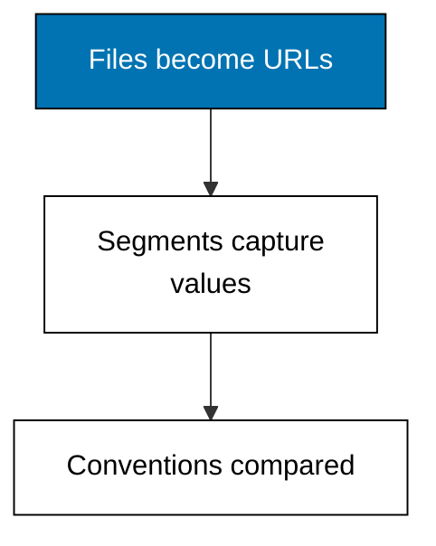
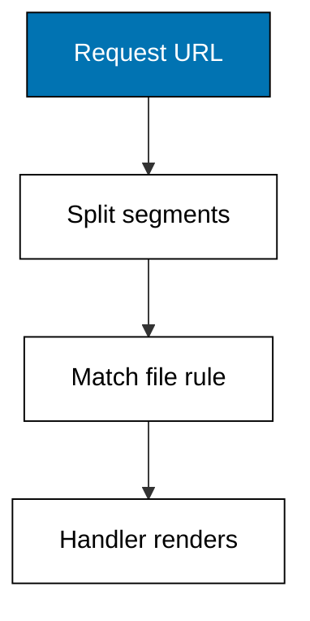

Examples 1-5 turn file paths into URLs: one route table per framework, dynamic segments, catch-alls, and the full convention map. Everything later — layouts, rendering, loaders, actions — hangs off the routes built here, so read slowly here and quickly everywhere else.



### Worked Example 1: First Route on Two Servers

_Exercises co-01, co-15._

**Context**: Before any abstraction, see the mechanism run. One loopback server hosts a Next.js-style route table under `/next/*` and a TanStack Start-style route tree under `/start/*`, then plain `fetch` reads home, list, one detail, and one miss back from each side. No browser, no deployed URL: the request goes to a server the script itself started. **Check**: both lists read `kopi-001,teh-002,gula-003`, both details read `Teh Melati 100g 32000`, both misses return 404.

**`learning/code/ex-01-first-route-on-two-servers/main.ts`**

```typescript
// Worked Example 1: First route on two servers.
// => NusaMart is fictional; every product and price here is fixed.
// => A meta-framework turns a file path into a URL: this anchor serves one
// => Next.js-style route table and one TanStack Start-style route tree over
// => loopback, then reads URLs back with plain fetch, no browser involved.
declare const require: any; // => Node-only import without @types/node in the harness
const http: any = require("node:http"); // => standard-library HTTP server, no dependency

// => Fixed catalog: the only data any route in this example may show.
type Product = { id: string; name: string; price: number }; // => shop row shape
const PRODUCTS: Product[] = [
  // => three fictional goods, prices in rupiah
  { id: "kopi-001", name: "Kopi Toraja 250g", price: 68000 }, // => first shelf row
  { id: "teh-002", name: "Teh Melati 100g", price: 32000 }, // => second shelf row
  { id: "gula-003", name: "Gula Aren 500g", price: 21000 }, // => third shelf row
]; // => end of the fixed catalog

// => Next.js file convention: app/page.tsx, app/products/page.tsx, and
// => app/products/[id]/page.tsx, where square brackets mark a dynamic segment.
function nextBody(url: string): { status: number; body: string } {
  // => Next-style dispatch
  if (url === "/") {
    // => app/page.tsx answers the root
    return { status: 200, body: "next home: NusaMart" }; // => static home line
  } // => end of the root branch
  if (url === "/products") {
    // => app/products/page.tsx lists the shelf
    return { status: 200, body: "next list: " + PRODUCTS.map((p) => p.id).join(",") }; // => id list
  } // => end of the list branch
  const detail = url.match(/^\/products\/([^/]+)$/); // => app/products/[id]/page.tsx shape
  if (detail !== null) {
    // => one segment after /products/ is a detail id
    const found = PRODUCTS.find((p) => p.id === detail[1]); // => look the id up
    if (found !== undefined) {
      // => a known id renders its row
      return { status: 200, body: "next detail: " + found.name + " " + found.price }; // => name plus price
    } // => end of the known-id branch
    return { status: 404, body: "next detail: product not found" }; // => unknown id misses
  } // => end of the detail branch
  return { status: 404, body: "next: page not found" }; // => nothing else matches
} // => end of nextBody

// => TanStack Start file convention: routes/index.tsx,
// => routes/products/index.tsx, and routes/products/$productId.tsx,
// => where a dollar prefix marks a dynamic segment.
function startBody(url: string): { status: number; body: string } {
  // => Start-style dispatch
  if (url === "/") {
    // => routes/index.tsx answers the root
    return { status: 200, body: "start home: NusaMart" }; // => static home line
  } // => end of the root branch
  if (url === "/products") {
    // => routes/products/index.tsx lists the shelf
    return { status: 200, body: "start list: " + PRODUCTS.map((p) => p.id).join(",") }; // => id list
  } // => end of the list branch
  const detail = url.match(/^\/products\/([^/]+)$/); // => routes/products/$productId.tsx shape
  if (detail !== null) {
    // => one segment after /products/ is a product id
    const found = PRODUCTS.find((p) => p.id === detail[1]); // => look the id up
    if (found !== undefined) {
      // => a known id renders its row
      return { status: 200, body: "start detail: " + found.name + " " + found.price }; // => name plus price
    } // => end of the known-id branch
    return { status: 404, body: "start detail: product not found" }; // => unknown id misses
  } // => end of the detail branch
  return { status: 404, body: "start: route not found" }; // => nothing else matches
} // => end of startBody

// => One loopback server hosts both tables: /next/* follows the Next.js
// => file convention and /start/* follows the TanStack Start file convention.
async function main(): Promise<void> {
  // => script entry point
  const server: any = http.createServer((req: any, res: any) => {
    // => one server, two conventions
    const url: string = req.url ?? "/"; // => the request path
    let answered: { status: number; body: string }; // => the chosen reply
    if (url === "/next" || url.startsWith("/next/")) {
      // => Next.js table owns /next/*
      answered = nextBody(url === "/next" ? "/" : url.slice("/next".length)); // => strip the prefix
    } else if (url === "/start" || url.startsWith("/start/")) {
      // => Start tree owns /start/*
      answered = startBody(url === "/start" ? "/" : url.slice("/start".length)); // => strip the prefix
    } else {
      // => no framework owns the bare path
      answered = { status: 404, body: "pick /next/* or /start/*" }; // => guidance reply
    } // => end of the framework choice
    res.writeHead(answered.status, { "content-type": "text/plain" }); // => status line plus type
    res.end(answered.body); // => plain-text body, no HTML shell here
  }); // => end of the request handler
  await new Promise<void>((resolve) => server.listen(0, "127.0.0.1", resolve)); // => ephemeral loopback port
  const port: number = server.address().port; // => the assigned port, never printed
  const get = async (path: string): Promise<string> => {
    // => one headless request
    const res: any = await fetch("http://127.0.0.1:" + port + path); // => loopback only
    return "GET " + path + " -> " + res.status + " " + (await res.text()); // => status plus body
  }; // => end of get
  console.log(await get("/next/")); // => Output home from the Next.js table
  console.log(await get("/next/products")); // => Output list from the Next.js table
  console.log(await get("/next/products/teh-002")); // => Output detail from the Next.js table
  console.log(await get("/next/products/unknown")); // => Output miss from the Next.js table
  console.log(await get("/start/")); // => Output home from the Start tree
  console.log(await get("/start/products")); // => Output list from the Start tree
  console.log(await get("/start/products/teh-002")); // => Output detail from the Start tree
  console.log(await get("/start/products/unknown")); // => Output miss from the Start tree
  await new Promise<void>((resolve) => server.close(() => resolve())); // => stop serving
} // => end of main

void main(); // => run the script
export {}; // => module scope keeps these names local
```

**Output** (`learning/code/ex-01-first-route-on-two-servers/expected/main.stdout.txt`):

```text
GET /next/ -> 200 next home: NusaMart
GET /next/products -> 200 next list: kopi-001,teh-002,gula-003
GET /next/products/teh-002 -> 200 next detail: Teh Melati 100g 32000
GET /next/products/unknown -> 404 next detail: product not found
GET /start/ -> 200 start home: NusaMart
GET /start/products -> 200 start list: kopi-001,teh-002,gula-003
GET /start/products/teh-002 -> 200 start detail: Teh Melati 100g 32000
GET /start/products/unknown -> 404 start detail: product not found
```

**Key takeaway**: a route table plus a running server plus a loopback request is the whole meta-framework contract in miniature.

**Why It Matters**: every later example reuses this harness shape — model the convention, serve it, read it back. When a routing claim feels abstract, come back here: the eight transcript lines show exactly which URL reaches which handler on each side, and the 404 lines show what happens when nothing matches. Testing against a local server you started is the fastest honest check in this course.

---

### Worked Example 2: File Path to URL Pattern

_Exercises co-01, co-15._

**Context**: The file-to-URL rule fits in a table: each file owns one URL shape, and dynamic markers own one segment each. Next.js spells the dynamic hole `[id]` inside `page.tsx` files; TanStack Start spells it `$productId` in the filename itself. This example prints both dialects' tables, then proves the matcher against two URLs. **Check**: the detail pattern accepts `/products/teh-002` and rejects `/products` on both sides.

**`learning/code/ex-02-file-path-to-url-pattern/main.ts`**

```typescript
// Worked Example 2: File path to URL pattern.
// => NusaMart is fictional; every product and price here is fixed.
// => Two frameworks, two filename dialects, one idea: the file's position in
// => the project decides the URL, and a marker decides which part is dynamic.
type Convention = "next" | "start"; // => the two filename dialects

// => One row of the mapping: the file on disk and the URL shape it owns.
type FileRoute = { file: string; pattern: string }; // => disk path plus URL shape

// => Next.js App Router files: page.tsx renders, brackets capture a segment.
const NEXT_FILES: FileRoute[] = [
  // => Next.js dialect rows
  { file: "app/page.tsx", pattern: "/" }, // => root file owns root URL
  { file: "app/products/page.tsx", pattern: "/products" }, // => folder owns list URL
  { file: "app/products/[id]/page.tsx", pattern: "/products/:id" }, // => brackets own detail
]; // => end of the Next.js rows

// => TanStack Start files: index.tsx renders a folder, dollar captures a segment.
const START_FILES: FileRoute[] = [
  // => Start dialect rows
  { file: "src/routes/index.tsx", pattern: "/" }, // => root file owns root URL
  { file: "src/routes/products/index.tsx", pattern: "/products" }, // => folder owns list URL
  { file: "src/routes/products/$productId.tsx", pattern: "/products/:productId" }, // => dollar owns detail
]; // => end of the Start rows

// => A URL pattern matches when every static segment is equal and every
// => dynamic segment (after the colon) accepts any single non-empty piece.
function matches(pattern: string, url: string): boolean {
  // => pattern matcher
  const want = pattern.split("/"); // => pattern pieces
  const got = url.split("/"); // => URL pieces
  if (want.length !== got.length) {
    // => different depth never matches
    return false; // => depth guards first
  } // => end of the depth guard
  return want.every((piece, i) => piece.startsWith(":") || piece === got[i]); // => colon means anything
} // => end of matches

// => Print one dialect's whole table, then prove two URLs against it.
function show(side: Convention, rows: FileRoute[]): void {
  // => dialect reporter
  for (const row of rows) {
    // => every file owns exactly one URL shape
    console.log(side + " " + row.file + " => " + row.pattern); // => Output the mapping row
  } // => end of the row loop
  console.log(side + " /products/teh-002 matches detail: " + matches(rows[2].pattern, "/products/teh-002")); // => Output true
  console.log(side + " /products matches detail: " + matches(rows[2].pattern, "/products")); // => Output false
} // => end of show

show("next", NEXT_FILES); // => Output the Next.js table plus two proofs
show("start", START_FILES); // => Output the Start table plus two proofs
export {}; // => module scope keeps these names local
```

**Output** (`learning/code/ex-02-file-path-to-url-pattern/expected/main.stdout.txt`):

```text
next app/page.tsx => /
next app/products/page.tsx => /products
next app/products/[id]/page.tsx => /products/:id
next /products/teh-002 matches detail: true
next /products matches detail: false
start src/routes/index.tsx => /
start src/routes/products/index.tsx => /products
start src/routes/products/$productId.tsx => /products/:productId
start /products/teh-002 matches detail: true
start /products matches detail: false
```

**Key takeaway**: static segments match literally, marked segments match any single piece, and depth must agree.

**Why It Matters**: routing bugs are almost always depth bugs — a link with one segment too many, a pattern one level too shallow. The matcher here is twelve lines, but it encodes the rule both frameworks share under different spellings. Learn to read `[id]` and `$productId` as the same idea and the rest of the course reads twice as fast.

---

### Worked Example 3: Dynamic Segment Values

_Exercises co-09, co-01._

**Context**: Matching is only the handshake; the value is the point. The framework pulls the captured segment out of the URL and hands it to the page as a named parameter object — `{ id }` in Next.js, `{ productId }` in TanStack Start. This example extracts both, then resolves the value against the catalog so a miss is a named outcome, not a crash. **Check**: both extractions read `gula-003`, resolution reports `found`, and the ghost id reports `missing susu-009`.

**`learning/code/ex-03-dynamic-segment-values/main.ts`**

```typescript
// Worked Example 3: Dynamic segment values.
// => NusaMart is fictional; every product and price here is fixed.
// => A dynamic segment is a named hole in the URL: the framework pulls the
// => value out and hands it to the page as a typed parameter object.

// => Fixed catalog: the only ids any extraction below may resolve.
const KNOWN_IDS = ["kopi-001", "teh-002", "gula-003"]; // => three fictional goods

// => Next.js spells the hole [id] and hands the page { params: { id } };
// => TanStack Start spells it $productId and hands the loader { productId }.
function extractNext(url: string): { id: string } | null {
  // => Next-style extraction
  const hit = url.match(/^\/products\/([^/]+)$/); // => [id] accepts one segment
  if (hit === null) {
    // => no segment means no match
    return null; // => list URLs carry no id
  } // => end of the miss branch
  return { id: hit[1] }; // => the captured segment under its name
} // => end of extractNext

// => Start spells the same hole $productId: one segment, different name,
// => same value, and the loader receives it before the component renders.
function extractStart(url: string): { productId: string } | null {
  // => Start-style extraction
  const hit = url.match(/^\/products\/([^/]+)$/); // => $productId accepts one segment
  if (hit === null) {
    // => no segment means no match
    return null; // => list URLs carry no id
  } // => end of the miss branch
  return { productId: hit[1] }; // => the captured segment under its name
} // => end of extractStart

// => Extraction is only half the job: the page then resolves the value
// => against real data, and an unknown value is a miss, not a crash.
function resolve(ids: string[], value: string): string {
  // => id resolver
  return ids.includes(value) ? "found " + value : "missing " + value; // => found or missing
} // => end of resolve

const nextParams = extractNext("/products/gula-003"); // => pull [id] from the URL
console.log("next params: " + JSON.stringify(nextParams)); // => Output {"id":"gula-003"}
console.log("next resolve: " + resolve(KNOWN_IDS, nextParams?.id ?? "")); // => Output found gula-003
const startParams = extractStart("/products/gula-003"); // => pull $productId from the URL
console.log("start params: " + JSON.stringify(startParams)); // => Output {"productId":"gula-003"}
console.log("start resolve: " + resolve(KNOWN_IDS, startParams?.productId ?? "")); // => Output found gula-003
console.log("next resolve unknown: " + resolve(KNOWN_IDS, "susu-009")); // => Output missing susu-009
export {}; // => module scope keeps these names local
```

**Output** (`learning/code/ex-03-dynamic-segment-values/expected/main.stdout.txt`):

```text
next params: {"id":"gula-003"}
next resolve: found gula-003
start params: {"productId":"gula-003"}
start resolve: found gula-003
next resolve unknown: missing susu-009
```

**Key takeaway**: extraction names the segment, resolution validates it, and the two steps stay separate.

**Why It Matters**: mixing "pull the value out" with "check it exists" produces pages that crash on bookmarks and pasted links. The loader pattern in Theme E builds directly on this split: params in, exactly one row out, failures named. Keep the two jobs apart here and every loader later is just this function with a database behind it.

---

### Worked Example 4: Catch-All Segments

_Exercises co-09._

**Context**: Help-center articles live at any depth, so one segment is not enough: the route must capture the rest of the path. Next.js spells it `[...slug]` and TanStack Start spells it a bare `$` splat captured as `_splat`, but both answer the same three URLs with the same arrays. **Check**: `/help`, `/help/shipping`, and `/help/shipping/cod` capture identically on both sides, and `/products` matches neither.

**`learning/code/ex-04-catch-all-segments/main.ts`**

```typescript
// Worked Example 4: Catch-all segments.
// => NusaMart is fictional; every category and path here is fixed.
// => One segment is not always enough: help-center articles live at any
// => depth, so both frameworks offer a rest-of-the-path capture with
// => different spellings and the same result: an array of segments.

// => Next.js catch-all file: app/help/[...slug]/page.tsx owns /help plus
// => any depth below it; the page receives params.slug as a string array.
function nextCatchAll(url: string): string[] | null {
  // => Next-style rest capture
  const hit = url.match(/^\/help(\/.*)?$/); // => /help plus optional rest
  if (hit === null) {
    // => outside /help entirely
    return null; // => no match
  } // => end of the miss branch
  const rest = hit[1] ?? ""; // => the part after /help, maybe empty
  if (rest === "") {
    // => bare /help still matches: [...slug] requires one segment, but the
    // => optional form [[...slug]] also owns the bare path, shown here
    return []; // => empty capture for the bare path
  } // => end of the bare-path branch
  return rest.slice(1).split("/"); // => split the rest into segments
} // => end of nextCatchAll

// => TanStack Start splat file: routes/help/$.tsx owns /help plus any depth
// => below it; the loader reads the rest from params._splat as one string.
function startSplat(url: string): string[] | null {
  // => Start-style rest capture
  const hit = url.match(/^\/help(\/.*)?$/); // => /help plus optional rest
  if (hit === null) {
    // => outside /help entirely
    return null; // => no match
  } // => end of the miss branch
  const splat = (hit[1] ?? "").replace(/^\//, ""); // => params._splat without leading slash
  if (splat === "") {
    // => bare /help carries an empty splat
    return []; // => empty capture for the bare path
  } // => end of the bare-path branch
  return splat.split("/"); // => split the rest into segments
} // => end of startSplat

// => Both spellings answer the same three URLs identically: the convention
// => differs, the captured segments do not.
for (const url of ["/help", "/help/shipping", "/help/shipping/cod"]) {
  // => three depths, both frameworks
  console.log("next " + url + " => " + JSON.stringify(nextCatchAll(url))); // => Output the capture
  console.log("start " + url + " => " + JSON.stringify(startSplat(url))); // => Output the capture
} // => end of the depth loop
console.log("next /products => " + JSON.stringify(nextCatchAll("/products"))); // => Output null
export {}; // => module scope keeps these names local
```

**Output** (`learning/code/ex-04-catch-all-segments/expected/main.stdout.txt`):

```text
next /help => []
start /help => []
next /help/shipping => ["shipping"]
start /help/shipping => ["shipping"]
next /help/shipping/cod => ["shipping","cod"]
start /help/shipping/cod => ["shipping","cod"]
next /products => null
```

**Key takeaway**: rest-capture turns an unknown-depth URL into an array, spelled differently but shaped identically.

**Why It Matters**: documentation, changelogs, and marketing pages all need depth-flexible routes, and the wrong choice here means a new article needs a code change. The splat versus bracket decision is pure spelling — what matters is remembering that the capture is an array (possibly empty) rather than a string, because every consumer downstream must handle the empty case.

---

### Worked Example 5: File-to-URL Convention Map

_Exercises co-01, co-15._

**Context**: With four runnable models behind you, the full map fits on one page. The table lists every file-to-URL rule from this theme side by side; the diagram shows how a request flows from URL to file to handler. No code runs here because the mechanism is already proven — this example is the reference you will revisit.



| URL                  | Next.js file                  | TanStack Start file                  | Capture       |
| -------------------- | ----------------------------- | ------------------------------------ | ------------- |
| `/`                  | `app/page.tsx`                | `src/routes/index.tsx`               | none          |
| `/products`          | `app/products/page.tsx`       | `src/routes/products/index.tsx`      | none          |
| `/products/teh-002`  | `app/products/[id]/page.tsx`  | `src/routes/products/$productId.tsx` | one segment   |
| `/help/shipping/cod` | `app/help/[...slug]/page.tsx` | `src/routes/help/$.tsx`              | rest as array |
| any miss             | nearest `not-found.tsx`       | nearest route miss                   | named miss    |

**Key takeaway**: five URL shapes cover the whole theme, and every row has a file on both sides.

**Why It Matters**: framework choice never changes which URLs a shop needs — it changes which filenames produce them. Pin this table to memory and the remaining themes stop feeling like two subjects: they become one subject (routing, rendering, loading, mutating) with two spellings, and Example 44 will prove the behaviors agree line for line.
