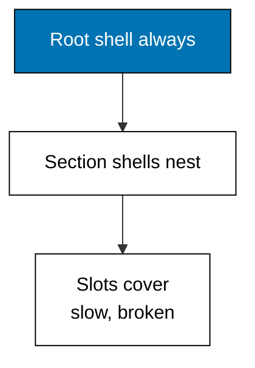
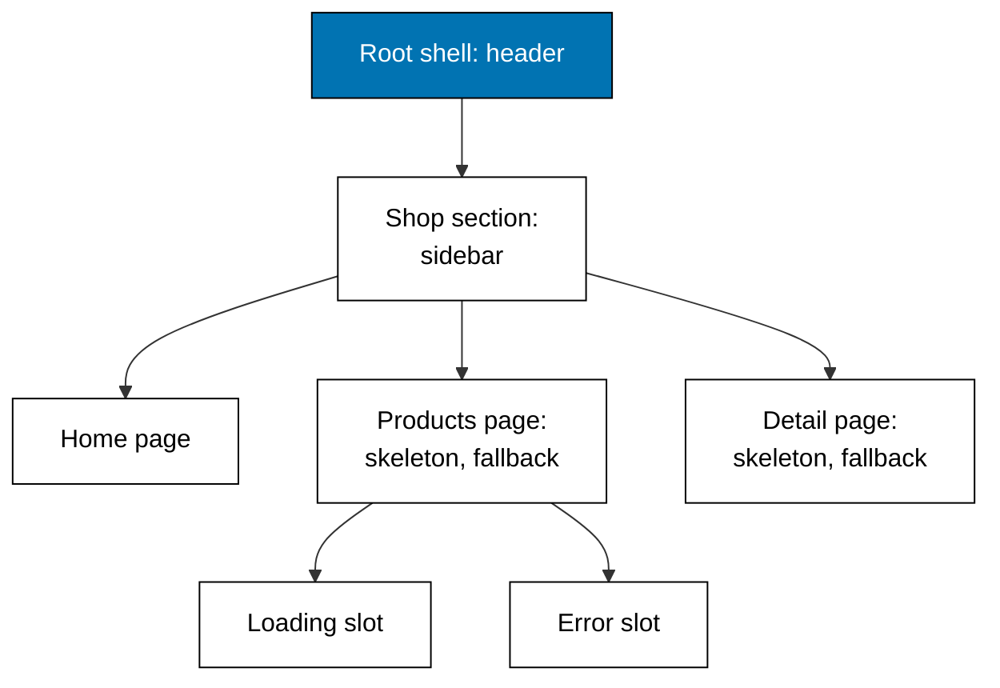

Examples 6-10 wrap pages in shared shells: a root layout, a section layout, folders that organize without appearing in URLs, and per-segment loading and error slots. A route decides the URL; layouts decide what surrounds it.



### Worked Example 6: Layout Chain Around a Page

_Exercises co-02._

**Context**: The anchor for layouts serves the full nesting over loopback: a root shell (store header) wraps a section shell (shelf sidebar), which wraps the product page. Both dialects compose identically — Next.js `children` and Start `Outlet` are the same hole with different names. **Check**: both replies return 200 with the header, the sidebar, and `Teh Melati 100g` in one HTML string.

**`learning/code/ex-06-layout-chain-around-a-page/main.ts`**

```typescript
// Worked Example 6: Layout chain around a page.
// => NusaMart is fictional; every product and price here is fixed.
// => A layout is a shell shared by a route and its children: the root shell
// => wraps the shop shell, which wraps the page. This anchor serves the
// => nested shells over loopback and reads the composed HTML back.
declare const require: any; // => Node-only import without @types/node in the harness
const http: any = require("node:http"); // => standard-library HTTP server, no dependency

// => The fixed page body both layouts will wrap.
const PAGE_BODY = "<h1>Teh Melati 100g</h1><p>32000</p>"; // => one fictional product

// => Next.js file convention: app/layout.tsx wraps every route, and
// => app/products/layout.tsx wraps only the product subtree; children is
// => the hole the next level down fills.
function nextRootLayout(children: string): string {
  // => Next-style root shell
  return "<html><body><header>NusaMart</header>" + children + "</body></html>"; // => header plus hole
} // => end of nextRootLayout

// => The shop section shell: a sidebar the root shell knows nothing about.
function nextShopLayout(children: string): string {
  // => Next-style section shell
  return "<div class='shop'><nav>shelf</nav>" + children + "</div>"; // => nav plus hole
} // => end of nextShopLayout

// => TanStack Start convention: routes/__root.tsx always renders and hosts
// => <Outlet/>, while routes/products/route.tsx nests the product subtree.
function startRootLayout(children: string): string {
  // => Start-style root shell
  return "<html><body><header>NusaMart</header>" + children + "</body></html>"; // => header plus hole
} // => end of startRootLayout

// => The product section shell in the Start dialect: same shape, Outlet hole.
function startProductsLayout(children: string): string {
  // => Start-style section shell
  return "<div class='shop'><nav>shelf</nav>" + children + "</div>"; // => nav plus hole
} // => end of startProductsLayout

// => Composition order is outside-in: the root shell wraps the section
// => shell, which wraps the page. Swap the order and the sidebar escapes.
function composeNext(): string {
  // => Next-style composition
  return nextRootLayout(nextShopLayout(PAGE_BODY)); // => root outside, page inside
} // => end of composeNext

// => The Start tree composes identically: root outside, section, then page.
function composeStart(): string {
  // => Start-style composition
  return startRootLayout(startProductsLayout(PAGE_BODY)); // => root outside, page inside
} // => end of composeStart

// => One loopback server answers /next/layout and /start/layout with the
// => fully composed HTML of each dialect's layout chain.
async function main(): Promise<void> {
  // => script entry point
  const server: any = http.createServer((req: any, res: any) => {
    // => one server, two layout chains
    const url: string = req.url ?? "/"; // => the request path
    let body = ""; // => the composed HTML
    if (url === "/next/layout") {
      // => Next.js chain owns this path
      body = composeNext(); // => root wraps section wraps page
    } else if (url === "/start/layout") {
      // => Start chain owns this path
      body = composeStart(); // => root wraps section wraps page
    } else {
      // => anything else misses
      res.writeHead(404, { "content-type": "text/plain" }); // => status line
      res.end("unknown layout path"); // => miss body
      return; // => stop here
    } // => end of the path choice
    res.writeHead(200, { "content-type": "text/html" }); // => HTML status line
    res.end(body); // => the composed shells plus page
  }); // => end of the request handler
  await new Promise<void>((resolve) => server.listen(0, "127.0.0.1", resolve)); // => ephemeral loopback port
  const port: number = server.address().port; // => the assigned port, never printed
  const get = async (path: string): Promise<string> => {
    // => one headless request
    const res: any = await fetch("http://127.0.0.1:" + port + path); // => loopback only
    return "GET " + path + " -> " + res.status + " " + (await res.text()); // => status plus HTML
  }; // => end of get
  console.log(await get("/next/layout")); // => Output nested Next.js shells plus page
  console.log(await get("/start/layout")); // => Output nested Start shells plus page
  await new Promise<void>((resolve) => server.close(() => resolve())); // => stop serving
} // => end of main

void main(); // => run the script
export {}; // => module scope keeps these names local
```

**Output** (`learning/code/ex-06-layout-chain-around-a-page/expected/main.stdout.txt`):

```text
GET /next/layout -> 200 <html><body><header>NusaMart</header><div class='shop'><nav>shelf</nav><h1>Teh Melati 100g</h1><p>32000</p></div></body></html>
GET /start/layout -> 200 <html><body><header>NusaMart</header><div class='shop'><nav>shelf</nav><h1>Teh Melati 100g</h1><p>32000</p></div></body></html>
```

**Key takeaway**: layouts compose outside-in, and the composition order is the rendering contract.

**Why It Matters**: layout bugs are order bugs — a sidebar escaping its section, a header rendering twice. Seeing the whole chain in one response line makes the nesting tangible: root outside, section inside, page innermost. Every layout decision in this theme is a variation on this three-level sandwich.

---

### Worked Example 7: Layout Nesting Order

_Exercises co-02._

**Context**: Which shell renders first? The record shows root, then section, then page — outside-in, parent before child. This example logs the order explicitly so the rule is a fact, not a guess. **Check**: the HTML nests `<root><shop>page</shop></root>` and the log reads `render root then render shop then render page`.

**`learning/code/ex-07-layout-nesting-order/main.ts`**

```typescript
// Worked Example 7: Layout nesting order.
// => NusaMart is fictional; every label here is fixed.
// => Layouts nest outside-in: the outermost shell renders first and its
// => hole fills with the next shell down. This example records the render
// => order so the rule is visible: root, then section, then page.

// => A render log: every shell appends its name as it renders.
const order: string[] = []; // => the recorded render order

// => Each shell logs itself, then renders its child into the hole.
function shell(name: string, child: () => string): string {
  // => generic nested shell
  order.push("render " + name); // => record this shell rendering
  return "<" + name + ">" + child() + "</" + name + ">"; // => wrap the child output
} // => end of shell

// => The page logs last: it is the innermost level of the nest.
function page(): string {
  // => innermost page
  order.push("render page"); // => record the page rendering
  return "Teh Melati 100g"; // => the page body
} // => end of page

// => Next.js reads this as app/layout.tsx around app/products/layout.tsx
// => around the page; Start reads it as __root.tsx around a section route.
const html = shell("root", () => shell("shop", page)); // => compose outside-in
console.log(html); // => Output <root><shop>Teh Melati 100g</shop></root>
console.log(order.join(" then ")); // => Output render root then render shop then render page
export {}; // => module scope keeps these names local
```

**Output** (`learning/code/ex-07-layout-nesting-order/expected/main.stdout.txt`):

```text
<root><shop>Teh Melati 100g</shop></root>
render root then render shop then render page
```

**Key takeaway**: parents render before children, and each parent wraps exactly what its child returns.

**Why It Matters**: data flows down the same path rendering does — a layout that needs the route param must sit at or below the segment that captures it. The order log is also a debugging tool in disguise: when a shell misbehaves, logging render order locates the break in seconds.

---

### Worked Example 8: Route Groups Without URLs

_Exercises co-02, co-15._

**Context**: Folders organize code, but URLs are a public promise — these grouping folders must not leak into them. Next.js wraps the folder in parentheses `(shop)`; TanStack Start prefixes a pathless route with `_shop`. Both vanish from the URL while keeping their layout. **Check**: `(shop)/products` resolves to `/products` and `_shop/products` resolves to `/products`.

**`learning/code/ex-08-route-groups-without-urls/main.ts`**

```typescript
// Worked Example 8: Route groups without URLs.
// => NusaMart is fictional; every segment here is fixed.
// => Some folders organize code without adding URL segments: Next.js wraps
// => them in parentheses, TanStack Start uses underscore-prefixed pathless
// => routes. Both hide the folder from the URL while keeping its layout.

// => Next.js convention: a (shop) folder groups routes and can own a
// => layout, but the parentheses never appear in the URL.
function nextVisible(file: string): string {
  // => Next-style URL derivation
  const noGroup = file.replace(/\([^/]+\)\//g, ""); // => drop parenthesized folders
  const noPage = noGroup.replace(/\/page\.tsx$/, ""); // => drop the leaf file
  const noApp = noPage.replace(/^app/, ""); // => drop the app root
  return noApp === "" ? "/" : noApp; // => empty means the root URL
} // => end of nextVisible

// => Start convention: a _shop pathless route groups children under its
// => layout without contributing a segment to the URL.
function startVisible(routeId: string): string {
  // => Start-style URL derivation
  const pieces = routeId.split("/").filter((p) => !p.startsWith("_")); // => drop pathless pieces
  const url = pieces.join("/"); // => rejoin the visible pieces
  return url === "" ? "/" : "/" + url; // => empty means the root URL
} // => end of startVisible

// => The same storefront organized two ways, resolving to identical URLs:
// => grouping is a code-layout tool, never a URL promise.
console.log("next app/(shop)/products/page.tsx => " + nextVisible("app/(shop)/products/page.tsx")); // => Output /products
console.log("next app/(shop)/page.tsx => " + nextVisible("app/(shop)/page.tsx")); // => Output /
console.log("start _shop/products => " + startVisible("_shop/products")); // => Output /products
console.log("start _shop => " + startVisible("_shop")); // => Output / adds no segment
export {}; // => module scope keeps these names local
```

**Output** (`learning/code/ex-08-route-groups-without-urls/expected/main.stdout.txt`):

```text
next app/(shop)/products/page.tsx => /products
next app/(shop)/page.tsx => /
start _shop/products => /products
start _shop => /
```

**Key takeaway**: grouping is a code-layout tool, and the URL derivation simply deletes the marked folders.

**Why It Matters**: large shops reorganize constantly — marketing pages move sections, checkout gains steps. Route groups let the folder tree follow the team while the URL tree follows the customer. Reach for them whenever two routes share a shell but not a URL prefix.

---

### Worked Example 9: Loading and Error Slots

_Exercises co-12, co-02._

**Context**: A slow shelf should skeletonize, not blank the page; a failed shelf should apologize, not crash it. Next.js names these slots `loading.tsx` and `error.tsx`; TanStack Start names them `pendingComponent` and `errorComponent`. Same three states, same rule: siblings keep rendering. **Check**: loading prints the skeleton line, ready prints the two-product shelf, failed prints the retry fallback on both sides.

**`learning/code/ex-09-loading-and-error-slots/main.ts`**

```typescript
// Worked Example 9: Loading and error slots.
// => NusaMart is fictional; every state here is fixed.
// => A slow section should not blank the whole page, and a failed section
// => should not crash it: loading.tsx reserves a skeleton per segment and
// => error.tsx reserves a fallback per segment, in both frameworks' idiom.

// => The three states one product section can be in.
type SectionState = "loading" | "ready" | "failed"; // => skeleton, content, or fallback

// => Next.js file convention: loading.tsx renders while the segment loads,
// => error.tsx renders when the segment throws; siblings keep rendering.
function nextSection(state: SectionState): string {
  // => Next-style section slot
  if (state === "loading") {
    // => the skeleton branch
    return "skeleton: loading shelf..."; // => loading.tsx output
  } // => end of the skeleton branch
  if (state === "failed") {
    // => the fallback branch
    return "fallback: shelf unavailable, retry"; // => error.tsx output
  } // => end of the fallback branch
  return "shelf: Kopi Toraja 250g, Teh Melati 100g"; // => the loaded section
} // => end of nextSection

// => Start idiom: pendingComponent renders while the loader runs and
// => errorComponent renders when the loader rejects; siblings keep rendering.
function startSection(state: SectionState): string {
  // => Start-style section slot
  if (state === "loading") {
    // => the pending branch
    return "pending: loading shelf..."; // => pendingComponent output
  } // => end of the pending branch
  if (state === "failed") {
    // => the error branch
    return "error: shelf unavailable, retry"; // => errorComponent output
  } // => end of the error branch
  return "shelf: Kopi Toraja 250g, Teh Melati 100g"; // => the loaded section
} // => end of startSection

// => Every state renders something: the page never blanks and never crashes,
// => whichever dialect names the slots.
const states: SectionState[] = ["loading", "ready", "failed"]; // => all three states
for (const state of states) {
  // => each state through both dialects
  console.log("next " + state + " => " + nextSection(state)); // => Output the Next.js slot
  console.log("start " + state + " => " + startSection(state)); // => Output the Start slot
} // => end of the state loop
export {}; // => module scope keeps these names local
```

**Output** (`learning/code/ex-09-loading-and-error-slots/expected/main.stdout.txt`):

```text
next loading => skeleton: loading shelf...
start loading => pending: loading shelf...
next ready => shelf: Kopi Toraja 250g, Teh Melati 100g
start ready => shelf: Kopi Toraja 250g, Teh Melati 100g
next failed => fallback: shelf unavailable, retry
start failed => error: shelf unavailable, retry
```

**Key takeaway**: every segment owns three faces — skeleton, content, fallback — and the framework picks by state.

**Why It Matters**: resilience is per-segment, not per-page. A reviews widget that fails should never take down the buy button beside it, and a slow recommendation rail should never delay the product title. Design each section's three faces deliberately and the page degrades gracefully instead of failing totally.

---

### Worked Example 10: Layout Tree Reference

_Exercises co-02, co-12._

**Context**: The whole theme as one tree: which shell wraps which, where the group folders hide, and which slots guard the slow and fragile sections. The runnable models above prove each node; this example is the map of the forest.



| Segment          | Next.js shell files        | TanStack Start route files           | Guards             |
| ---------------- | -------------------------- | ------------------------------------ | ------------------ |
| `/` (root)       | `app/layout.tsx`           | `src/routes/__root.tsx`              | always renders     |
| `(shop)` group   | `app/(shop)/layout.tsx`    | `_shop` pathless route               | no URL segment     |
| `/products`      | `loading.tsx`, `error.tsx` | `pendingComponent`, `errorComponent` | skeleton, fallback |
| `/products/[id]` | `loading.tsx`, `error.tsx` | `pendingComponent`, `errorComponent` | skeleton, fallback |

**Key takeaway**: one root, one section, three pages, and every slow page guarded twice.

**Why It Matters**: new routes are added weekly and each one must answer three questions — which shells wrap it, which groups hide it, which slots guard it. This table turns those questions into a checklist, and the checklist keeps the shop coherent as it grows past the five routes in this course.
