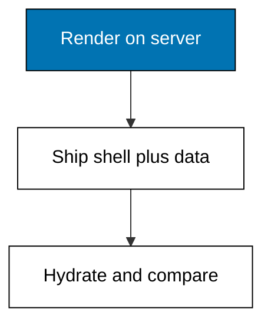
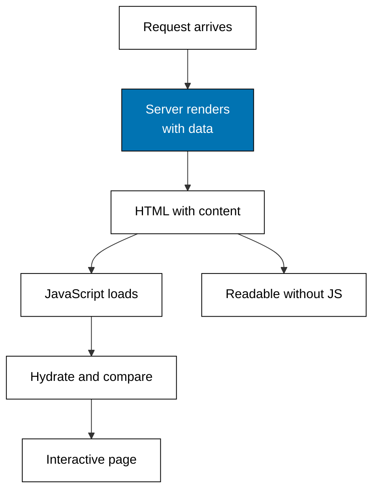

Examples 11-15 decide where HTML is born: on the server with content inside, in the browser after a fetch, and how the two halves meet at hydration. The meta-framework's core promise is that this decision is per page, not per project.



### Worked Example 11: Server HTML First Paint

_Exercises co-03._

**Context**: The rendering anchor serves a server-rendered product list from both dialects and reads it back to prove the product name is in the first bytes — before any JavaScript could run. That is the whole of server rendering: data resolves, HTML carries it, crawlers and slow networks see content immediately. **Check**: both paints report `paints-kopi=true`.

**`learning/code/ex-11-server-html-first-paint/main.ts`**

```typescript
// Worked Example 11: Server HTML first paint.
// => NusaMart is fictional; every product and price here is fixed.
// => Server rendering means the HTML arrives with content already inside:
// => this anchor renders the product list on the server for both dialects,
// => serves the HTML over loopback, and reads it back to prove the names
// => are in the first bytes, before any JavaScript runs.
declare const require: any; // => Node-only import without @types/node in the harness
const http: any = require("node:http"); // => standard-library HTTP server, no dependency

// => Fixed catalog: the only rows the server may render.
type Product = { id: string; name: string; price: number }; // => shop row shape
const PRODUCTS: Product[] = [
  // => three fictional goods, prices in rupiah
  { id: "kopi-001", name: "Kopi Toraja 250g", price: 68000 }, // => first shelf row
  { id: "teh-002", name: "Teh Melati 100g", price: 32000 }, // => second shelf row
  { id: "gula-003", name: "Gula Aren 500g", price: 21000 }, // => third shelf row
]; // => end of the fixed catalog

// => Next.js Server Component: an async page awaits its data, then returns
// => HTML with the rows already inside; no client JavaScript needed to read.
function nextServerHtml(): string {
  // => Next-style server render
  const rows = PRODUCTS.map((p) => "<li>" + p.name + " " + p.price + "</li>").join(""); // => rows first
  return "<ul>" + rows + "</ul>"; // => list HTML with content inside
} // => end of nextServerHtml

// => TanStack Start SSR: the loader resolves before render, so the HTML
// => the server streams already contains the same rows.
function startServerHtml(): string {
  // => Start-style server render
  const rows = PRODUCTS.map((p) => "<li>" + p.name + " " + p.price + "</li>").join(""); // => rows first
  return "<ul>" + rows + "</ul>"; // => list HTML with content inside
} // => end of startServerHtml

// => One loopback server answers /next/ssr and /start/ssr with server HTML;
// => the reader then checks the first paint already names a product.
async function main(): Promise<void> {
  // => script entry point
  const server: any = http.createServer((req: any, res: any) => {
    // => one server, two server renders
    const url: string = req.url ?? "/"; // => the request path
    let html = ""; // => the server HTML
    if (url === "/next/ssr") {
      // => Next.js server render owns this path
      html = nextServerHtml(); // => rows rendered on the server
    } else if (url === "/start/ssr") {
      // => Start server render owns this path
      html = startServerHtml(); // => rows rendered on the server
    } else {
      // => anything else misses
      res.writeHead(404, { "content-type": "text/plain" }); // => status line
      res.end("unknown render path"); // => miss body
      return; // => stop here
    } // => end of the path choice
    res.writeHead(200, { "content-type": "text/html" }); // => HTML status line
    res.end(html); // => HTML with content already inside
  }); // => end of the request handler
  await new Promise<void>((resolve) => server.listen(0, "127.0.0.1", resolve)); // => ephemeral loopback port
  const port: number = server.address().port; // => the assigned port, never printed
  const paints = async (path: string): Promise<string> => {
    // => one headless first paint
    const res: any = await fetch("http://127.0.0.1:" + port + path); // => loopback only
    const html: string = await res.text(); // => the full first HTML
    return "GET " + path + " -> " + res.status + " paints-kopi=" + html.includes("Kopi Toraja"); // => name check
  }; // => end of paints
  console.log(await paints("/next/ssr")); // => Output true: content in first HTML
  console.log(await paints("/start/ssr")); // => Output true: content in first HTML
  await new Promise<void>((resolve) => server.close(() => resolve())); // => stop serving
} // => end of main

void main(); // => run the script
export {}; // => module scope keeps these names local
```

**Output** (`learning/code/ex-11-server-html-first-paint/expected/main.stdout.txt`):

```text
GET /next/ssr -> 200 paints-kopi=true
GET /start/ssr -> 200 paints-kopi=true
```

**Key takeaway**: server rendering puts content in the first HTML, which is observable with a request, not a browser.

**Why It Matters**: first paint decides bounce rates on shop pages and indexability on content pages. Whenever someone claims a page "is server-rendered", the honest test is this example: fetch it and search the bytes. If the content is there, the claim holds; tooling debates are secondary to that one check.

---

### Worked Example 12: Server Render Versus Client Render

_Exercises co-03, co-05._

**Context**: The same shelf reads two ways. The server render arrives full; the client shell arrives empty and fills in after its fetch. Side by side, the trade is concrete: server rendering spends server time to buy instant content, client rendering spends waiting to save the server round trip later. **Check**: the server had rows first (`true`), the client did not (`false`), and the client converges after its fetch.

**`learning/code/ex-12-server-render-versus-client-render/main.ts`**

```typescript
// Worked Example 12: Server render versus client render.
// => NusaMart is fictional; every product and price here is fixed.
// => The same shelf reads two ways: server-rendered HTML arrives full, while
// => a client-rendered shell arrives empty and fills in after its fetch.
// => First paint tells them apart.

// => Fixed catalog: the only rows either render may show.
const NAMES = ["Kopi Toraja 250g", "Teh Melati 100g"]; // => two fictional goods

// => Server render: data resolves before HTML, so the first bytes are full.
function serverRender(): string {
  // => server-side render
  return "<ul><li>" + NAMES.join("</li><li>") + "</li></ul>"; // => rows inside first HTML
} // => end of serverRender

// => Client render: the shell ships without rows, then a fetch fills the
// => same list in; crawlers and slow networks see the shell first.
function clientShell(): string {
  // => client-side shell
  return "<ul><li>loading...</li></ul>"; // => placeholder, no rows yet
} // => end of clientShell

// => The client's late fetch resolves the same rows the server had first.
function clientHydrated(): string {
  // => client after fetch
  return "<ul><li>" + NAMES.join("</li><li>") + "</li></ul>"; // => rows arrive late
} // => end of clientHydrated

console.log("server first paint: " + serverRender()); // => Output HTML with rows inside
console.log("client first paint: " + clientShell()); // => Output shell without rows
console.log("client after fetch: " + clientHydrated()); // => Output HTML with rows, late
console.log("server had rows first: " + serverRender().includes("Kopi")); // => Output true
console.log("client had rows first: " + clientShell().includes("Kopi")); // => Output false
export {}; // => module scope keeps these names local
```

**Output** (`learning/code/ex-12-server-render-versus-client-render/expected/main.stdout.txt`):

```text
server first paint: <ul><li>Kopi Toraja 250g</li><li>Teh Melati 100g</li></ul>
client first paint: <ul><li>loading...</li></ul>
client after fetch: <ul><li>Kopi Toraja 250g</li><li>Teh Melati 100g</li></ul>
server had rows first: true
client had rows first: false
```

**Key takeaway**: identical end state, different first paint — the choice is about the wait, not the content.

**Why It Matters**: teams argue rendering modes as identity, but the transcript shows they differ only in timing. Product lists and marketing pages should paint full; dashboards behind logins can paint shells. Choose per page by asking who waits and what they see while waiting, and Example 46 will turn that question into a chooser.

---

### Worked Example 13: Serializable Props Boundary

_Exercises co-03, co-11._

**Context**: Server-to-client props cross as JSON: plain data survives, functions do not. This example round-trips one product plus a formatter function through the wire to draw the boundary exactly — the row arrives intact, the function arrives as inert text. **Check**: `row survives: true`, `price is number: true`, `formatter is text: true`.

**`learning/code/ex-13-serializable-props-boundary/main.ts`**

```typescript
// Worked Example 13: Serializable props boundary.
// => NusaMart is fictional; every product and price here is fixed.
// => Server-to-client props cross as JSON: plain data survives, functions
// => and class instances do not. This example draws the boundary by
// => round-tripping one product and naming exactly what arrives.

// => Fixed product: the row the server will serialize.
type Product = { id: string; name: string; price: number }; // => plain data shape
const ROW: Product = { id: "kopi-001", name: "Kopi Toraja 250g", price: 68000 }; // => fictional row

// => The server render may only hand JSON-safe values to the client:
// => a formatter function looks innocent but cannot cross the wire.
const FORMATTER = "(price) => price + ' IDR'"; // => source text, not the function

// => Serialize the row the way the framework does: JSON, then parse back
// => on the client. What survives is the contract; the rest stays behind.
const wire: string = JSON.stringify({ row: ROW, formatter: FORMATTER }); // => the wire payload
const back: { row: Product; formatter: string } = JSON.parse(wire); // => the client copy
console.log("wire: " + wire); // => Output the JSON payload
console.log("row survives: " + (back.row.name === "Kopi Toraja 250g")); // => Output true
console.log("price is number: " + (typeof back.row.price === "number")); // => Output true
console.log("formatter is text: " + (typeof back.formatter === "string")); // => Output true, never callable
export {}; // => module scope keeps these names local
```

**Output** (`learning/code/ex-13-serializable-props-boundary/expected/main.stdout.txt`):

```text
wire: {"row":{"id":"kopi-001","name":"Kopi Toraja 250g","price":68000},"formatter":"(price) => price + ' IDR'"}
row survives: true
price is number: true
formatter is text: true
```

**Key takeaway**: only JSON-safe values cross the boundary; behavior stays on the server or ships as its own client code.

**Why It Matters**: half of all hydration-era bugs are boundary violations — a Date that became a string, a function that became undefined, a class instance that became a plain object. The rule is mechanical: if `JSON.stringify` cannot carry it, the framework cannot either. Serialize deliberately and the client receives exactly what the server sent.

---

### Worked Example 14: Hydration Mismatch Warning

_Exercises co-11, co-03._

**Context**: Hydration replays the server HTML on the client, and when the client computes something different the framework warns and repairs. The classic trigger is formatting: the server wrote `68,000`, the client wrote `68000` — same value, different string. **Check**: the matching pair hydrates `silent`, the mismatching pair warns with both strings shown.

**`learning/code/ex-14-hydration-mismatch-warning/main.ts`**

```typescript
// Worked Example 14: Hydration mismatch warning.
// => NusaMart is fictional; every price here is fixed.
// => Hydration replays the server HTML on the client: when the client
// => computes something different, React warns and repairs. This example
// => models the comparison so the warning rule is explicit: equal strings
// => hydrate silently, different strings warn.

// => The server rendered the price with thousand separators at request time.
const SERVER_HTML = "<p>68,000</p>"; // => fixed server output

// => Case one: the client formats identically, so hydration is silent.
function clientSame(): string {
  // => matching client render
  return "<p>68,000</p>"; // => same string as the server
} // => end of clientSame

// => Case two: the client formats with a locale rule the server lacked,
// => so the strings differ and hydration must warn and repair.
function clientDifferent(): string {
  // => mismatching client render
  return "<p>68000</p>"; // => same value, different string
} // => end of clientDifferent

// => The hydration rule: compare checksums, warn on difference, keep the
// => client string as the repaired truth.
function hydrate(server: string, client: string): string {
  // => hydration comparison
  if (server === client) {
    // => identical strings
    return "hydrate silent"; // => no warning needed
  } // => end of the match branch
  return "hydrate warn: server " + server + " vs client " + client; // => warning plus repair
} // => end of hydrate

console.log(hydrate(SERVER_HTML, clientSame())); // => Output hydrate silent
console.log(hydrate(SERVER_HTML, clientDifferent())); // => Output hydrate warn with both strings
export {}; // => module scope keeps these names local
```

**Output** (`learning/code/ex-14-hydration-mismatch-warning/expected/main.stdout.txt`):

```text
hydrate silent
hydrate warn: server <p>68,000</p> vs client <p>68000</p>
```

**Key takeaway**: hydration compares strings, warns on difference, and keeps the client string as the repaired truth.

**Why It Matters**: mismatches hide in locale formatters, timestamps, and random ids — anything the server and client compute independently. The fix is always the same: compute once, share the rule, as Kata 05 practices. Treat every hydration warning as a shared-state bug, not a rendering quirk, and they stop recurring.

---

### Worked Example 15: Request-to-Hydrate Flow Reference

_Exercises co-03, co-16._

**Context**: The full journey on one page: request, server render, HTML with content, JavaScript load, hydration comparison, interactive page — plus where the flow degrades when JavaScript never arrives. The runnable models above prove each leg; this example is the map.



| Stage              | Server-rendered page                | Client-rendered page               |
| ------------------ | ----------------------------------- | ---------------------------------- |
| First bytes        | content inside                      | shell plus spinner                 |
| Without JavaScript | readable, links work                | empty shell                        |
| After JavaScript   | hydration compare, then interactive | fetch, then fill, then interactive |
| Failure mode       | hydration warning                   | blank until fetch succeeds         |

**Key takeaway**: server rendering front-loads content so every later stage — including no-JavaScript — starts from something readable.

**Why It Matters**: this table is the progressive-enhancement argument in miniature, and Example 47 climbs the full ladder. When a page must work for everyone — search engines, feature phones, broken bundles — start from the left column and add interactivity; never start from the right column and hope the fetch succeeds.
