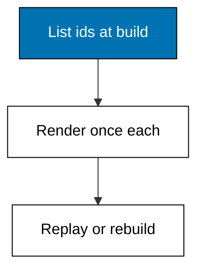
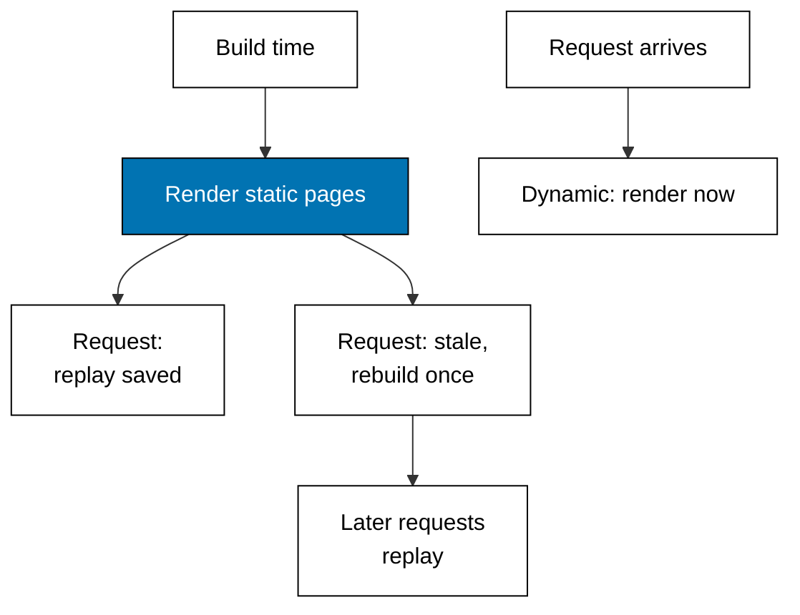

Examples 16-21 render once at build time and replay: which pages qualify, how the builder learns the id list, what happens to late arrivals, when saved pages expire, and how a fully static site deploys. Static generation is caching pushed all the way back to the build.



### Worked Example 16: Prerendered Versus Dynamic

_Exercises co-04._

**Context**: The anchor serves one page saved at build time and one page rendered per request, stamping each reply `static` or `dynamic`. The about page replays the same bytes with the same build stamp; the cart renders fresh per guest. **Check**: `/about` replies `static` with `build-042`, and the two cart guests get different bodies.

**`learning/code/ex-16-prerendered-versus-dynamic/main.ts`**

```typescript
// Worked Example 16: Prerendered versus dynamic.
// => NusaMart is fictional; every product and price here is fixed.
// => Static generation renders once at build time and replays the saved
// => HTML; dynamic routes render per request. This anchor serves one saved
// => page and one per-request page over loopback and stamps each reply with
// => which path it took, so the difference is observable in the transcript.
declare const require: any; // => Node-only import without @types/node in the harness
const http: any = require("node:http"); // => standard-library HTTP server, no dependency

// => The build step ran once, long ago: its saved HTML never changes.
const BUILT_HTML = "<h1>NusaMart shelf</h1><p>3 goods</p>"; // => frozen at build time
const BUILD_ID = "build-042"; // => fixed build stamp, not a clock read

// => The cart is per-visitor: it must render per request, never from cache.
function dynamicCart(query: string): string {
  // => dynamic render
  return "<p>cart for " + query + "</p>"; // => fresh HTML per request
} // => end of dynamicCart

// => One loopback server: /about replays the build artifact with its stamp,
// => /cart renders per request and says so.
async function main(): Promise<void> {
  // => script entry point
  const server: any = http.createServer((req: any, res: any) => {
    // => one server, two render paths
    const url: string = req.url ?? "/"; // => the request path
    if (url === "/about") {
      // => prerendered page owns this path
      res.writeHead(200, { "content-type": "text/html", "x-render": "static" }); // => static stamp
      res.end(BUILT_HTML + "<!-- " + BUILD_ID + " -->"); // => saved HTML plus stamp
      return; // => stop here
    } // => end of the static branch
    if (url.startsWith("/cart")) {
      // => dynamic page owns this path
      res.writeHead(200, { "content-type": "text/html", "x-render": "dynamic" }); // => dynamic stamp
      res.end(dynamicCart(url)); // => fresh HTML per request
      return; // => stop here
    } // => end of the dynamic branch
    res.writeHead(404, { "content-type": "text/plain" }); // => miss status
    res.end("unknown page"); // => miss body
  }); // => end of the request handler
  await new Promise<void>((resolve) => server.listen(0, "127.0.0.1", resolve)); // => ephemeral loopback port
  const port: number = server.address().port; // => the assigned port, never printed
  const get = async (path: string): Promise<string> => {
    // => one headless request
    const res: any = await fetch("http://127.0.0.1:" + port + path); // => loopback only
    const mode: string = res.headers.get("x-render") ?? "miss"; // => which path served
    return "GET " + path + " -> " + res.status + " " + mode + " " + (await res.text()); // => full line
  }; // => end of get
  console.log(await get("/about")); // => Output static replay with build stamp
  console.log(await get("/cart?guest=7")); // => Output dynamic render for guest 7
  console.log(await get("/cart?guest=8")); // => Output dynamic render for guest 8
  await new Promise<void>((resolve) => server.close(() => resolve())); // => stop serving
} // => end of main

void main(); // => run the script
export {}; // => module scope keeps these names local
```

**Output** (`learning/code/ex-16-prerendered-versus-dynamic/expected/main.stdout.txt`):

```text
GET /about -> 200 static <h1>NusaMart shelf</h1><p>3 goods</p><!-- build-042 -->
GET /cart?guest=7 -> 200 dynamic <p>cart for /cart?guest=7</p>
GET /cart?guest=8 -> 200 dynamic <p>cart for /cart?guest=8</p>
```

**Key takeaway**: static replays the build artifact; dynamic renders per request — the stamp tells you which served.

**Why It Matters**: misclassifying a page is the most expensive static-generation bug: a personal page cached and shown to the wrong visitor, or a marketing page re-rendered a million times. The `static` versus `dynamic` stamp is worth copying into real debugging — when unsure which path served, make the server say so.

---

### Worked Example 17: Static Paths at Build

_Exercises co-04, co-09._

**Context**: Static detail pages need their id list before the build: Next.js asks `generateStaticParams` for one params object per page, TanStack Start prerenders the routes its crawler discovers from the shelf links. Either way, one list in, one HTML file per id out. **Check**: three pages per side, and every detail prints its own id.

**`learning/code/ex-17-static-paths-at-build/main.ts`**

```typescript
// Worked Example 17: Static paths at build.
// => NusaMart is fictional; every product id here is fixed.
// => Static detail pages need their id list at build time: Next.js calls it
// => generateStaticParams, TanStack Start prerenders the routes its crawler
// => reaches. Either way the rule is one list in, one HTML file per id out.

// => Fixed catalog ids: the entire universe of detail pages.
const IDS = ["kopi-001", "teh-002", "gula-003"]; // => three fictional goods

// => Next.js spelling: generateStaticParams returns one params object per
// => page; the builder renders each id exactly once.
function nextStaticParams(): { id: string }[] {
  // => Next-style build list
  return IDS.map((id) => ({ id })); // => one object per page
} // => end of nextStaticParams

// => Start spelling: the prerender crawler discovers the same three links
// => from the shelf page; the builder renders each discovered route once.
function startDiscoveredLinks(): string[] {
  // => Start-style discovered routes
  return IDS.map((id) => "/products/" + id); // => one link per page
} // => end of startDiscoveredLinks

// => Rendering is a pure function of the id: same input, same HTML, and the
// => builder records which file each HTML came from.
function renderDetail(id: string): string {
  // => detail renderer
  return "<h1>" + id + "</h1>"; // => one HTML per id
} // => end of renderDetail

const nextPages = nextStaticParams(); // => the build list
console.log("next pages: " + nextPages.length); // => Output 3
for (const params of nextPages) {
  // => one HTML file per id
  console.log("next /products/" + params.id + " => " + renderDetail(params.id)); // => Output the HTML
} // => end of the Next.js loop
const startPages = startDiscoveredLinks(); // => the discovered links
console.log("start pages: " + startPages.length); // => Output 3
for (const link of startPages) {
  // => one HTML file per discovered link
  console.log("start " + link + " => " + renderDetail(link.split("/").pop() ?? "")); // => Output the HTML
} // => end of the Start loop
export {}; // => module scope keeps these names local
```

**Output** (`learning/code/ex-17-static-paths-at-build/expected/main.stdout.txt`):

```text
next pages: 3
next /products/kopi-001 => <h1>kopi-001</h1>
next /products/teh-002 => <h1>teh-002</h1>
next /products/gula-003 => <h1>gula-003</h1>
start pages: 3
start /products/kopi-001 => <h1>kopi-001</h1>
start /products/teh-002 => <h1>teh-002</h1>
start /products/gula-003 => <h1>gula-003</h1>
```

**Key takeaway**: enumeration is the price of prerendering — unlisted pages do not exist until the list grows.

**Why It Matters**: the build list is a second source of truth that drifts from the database: products added after the build have no page until someone rebuilds or a fallback covers them. Treat the enumeration as load-bearing code — tested, reviewed, and re-run — not as configuration that "just works".

---

### Worked Example 18: Fallback Shapes

_Exercises co-04._

**Context**: A product launched after the build forces a choice. Blocking waits and serves complete HTML, the `true` shape serves a shell and swaps in the page, and `false` 404s the unbuilt. There is no default-shaped answer: the trade is latency against correctness against honesty. **Check**: the late id waits under `blocking`, shells under `true`, 404s under `false`, while the built id always serves saved HTML.

**`learning/code/ex-18-fallback-shapes/main.ts`**

```typescript
// Worked Example 18: Fallback shapes.
// => NusaMart is fictional; every product id here is fixed.
// => A new product can appear after the build: blocking waits for its HTML,
// => true serves a shell first and swaps in the page, false 404s anything
// => unbuilt. The choice is a latency-versus-correctness trade, not a default.

// => Ids the build knew about; susu-009 arrived after the build finished.
const BUILT = ["kopi-001", "teh-002", "gula-003"]; // => frozen build list
const LATE_ID = "susu-009"; // => the after-build arrival

// => The three fallback shapes as one decision function: given the mode and
// => the id, name what the visitor sees first.
function fallback(mode: "blocking" | "true" | "false", id: string): string {
  // => fallback decision
  if (BUILT.includes(id)) {
    // => built ids always serve saved HTML
    return "serve built HTML"; // => no fallback involved
  } // => end of the built branch
  if (mode === "blocking") {
    // => wait, then serve the fresh HTML
    return "wait then serve fresh HTML for " + id; // => slow but complete
  } // => end of the blocking branch
  if (mode === "true") {
    // => shell now, page when ready
    return "serve shell, swap in " + id + " later"; // => fast but partial
  } // => end of the true branch
  return "404 for " + id; // => false: unbuilt means missing
} // => end of fallback

// => The late arrival exercises all three modes; the built id never does.
const modes: ("blocking" | "true" | "false")[] = ["blocking", "true", "false"]; // => all three modes
for (const mode of modes) {
  // => each mode against the late id
  console.log(mode + " late => " + fallback(mode, LATE_ID)); // => Output the late behavior
} // => end of the mode loop
console.log("blocking built => " + fallback("blocking", "kopi-001")); // => Output serve built HTML
export {}; // => module scope keeps these names local
```

**Output** (`learning/code/ex-18-fallback-shapes/expected/main.stdout.txt`):

```text
blocking late => wait then serve fresh HTML for susu-009
true late => serve shell, swap in susu-009 later
false late => 404 for susu-009
blocking built => serve built HTML
```

**Key takeaway**: the fallback decides what an unbuilt URL means — wait, preview, or miss — and each mode names its cost.

**Why It Matters**: launch-day traffic hits exactly the pages the build never saw. Pick blocking for flagship launches where completeness matters, shell-swap for long-tail catalogs where speed matters, and 404 only when unbuilt genuinely means nonexistent. Document the choice per route section; "we use the default" is how launch days break.

---

### Worked Example 19: Revalidation Clock

_Exercises co-04, co-10._

**Context**: Saved pages go stale: revalidation replays the cache while it is young and rebuilds once it passes the limit. The clock here is logical ticks, never the wall clock, so the transcript is identical on every run — the same discipline real revalidation needs in tests. **Check**: tick 10 replays at age 10, tick 70 rebuilds with the new price, tick 80 replays the rebuild at age 10.

**`learning/code/ex-19-revalidation-clock/main.ts`**

```typescript
// Worked Example 19: Revalidation clock.
// => NusaMart is fictional; every price and tick here is fixed.
// => Revalidation replays saved HTML until its age passes a limit, then
// => rebuilds once and serves fresh. The clock is logical ticks, never the
// => wall clock, so the transcript is byte-identical on every run.

// => Saved page plus the tick it was built at; the limit is 60 ticks.
let savedHtml = "<p>Teh 32000</p>"; // => the cached page
let builtAt = 0; // => the build tick
const LIMIT = 60; // => revalidate interval in ticks

// => One request at one tick: fresh while young, rebuilt once stale, and
// => the rebuild moves the build tick so the next request is fresh again.
function request(now: number, freshHtml: string): string {
  // => revalidation decision
  if (now - builtAt <= LIMIT) {
    // => within the limit
    return "serve saved (age " + (now - builtAt) + ")"; // => replay the cache
  } // => end of the fresh branch
  savedHtml = freshHtml; // => rebuild with current data
  builtAt = now; // => the rebuild becomes the new baseline
  return "rebuilt at " + now + ": " + savedHtml; // => fresh page after rebuild
} // => end of request

console.log("t10: " + request(10, "<p>Teh 33000</p>")); // => Output serve saved (age 10)
console.log("t70: " + request(70, "<p>Teh 33000</p>")); // => Output rebuilt at 70
console.log("t80: " + request(80, "<p>Teh 34000</p>")); // => Output serve saved (age 10)
export {}; // => module scope keeps these names local
```

**Output** (`learning/code/ex-19-revalidation-clock/expected/main.stdout.txt`):

```text
t10: serve saved (age 10)
t70: rebuilt at 70: <p>Teh 33000</p>
t80: serve saved (age 10)
```

**Key takeaway**: revalidation is an age check with a limit — replay while young, rebuild once, reset the baseline.

**Why It Matters**: the limit encodes how wrong you may be: a 60-tick shelf can show a stale price for 60 ticks, by design. Set the limit from the business cost of staleness — prices deserve short limits, help articles deserve long ones — and never from a desire for a round number. Kata 04 practices exactly this repair.

---

### Worked Example 20: Build-Versus-Request Timeline Reference

_Exercises co-04, co-10._

**Context**: Three timelines side by side: fully static (rendered at build, replayed forever), revalidated (replayed young, rebuilt stale), and dynamic (rendered per request). The runnable models above prove each behavior; this example lines up when the work happens.



| Page kind     | Work at build            | Work per request              | Staleness            |
| ------------- | ------------------------ | ----------------------------- | -------------------- |
| Static export | render every listed page | none, replay files            | until next build     |
| Revalidated   | render every listed page | age check, occasional rebuild | bounded by the limit |
| Dynamic       | none                     | full render                   | none, always fresh   |

**Key takeaway**: the three modes differ only in when rendering work happens — build time, occasionally, or every request.

**Why It Matters**: hosting bills and latency graphs both follow this table. Static pages cost nothing per request but cannot personalize; dynamic pages personalize but cost every visit; revalidation splits the difference with a bounded lie. Match the page to the row deliberately and the infrastructure bill stops being a surprise.

---

### Worked Example 21: Static Export Sitemap

_Exercises co-14, co-04._

**Context**: A fully static site is a file list: the export writes one HTML file per route, and the sitemap repeats that list in XML so crawlers find every page the export wrote. Same list, two formats, no drift allowed — a page missing from either is missing from the site. **Check**: five files exported, five sitemap entries, every route in both.

**`learning/code/ex-21-static-export-sitemap/main.ts`**

```typescript
// Worked Example 21: Static export sitemap.
// => NusaMart is fictional; every path here is fixed.
// => A fully static site is a file list: the export writes one HTML file per
// => route, and the sitemap is that same list in XML. Anything missing from
// => the list is missing from the site, which is the deployment contract.

// => The exported route list: the whole site, no server required.
const ROUTES = ["/", "/products", "/products/kopi-001", "/products/teh-002", "/about"]; // => five files

// => The export writes one HTML file per route; the filename mirrors the URL.
function exportFiles(): string[] {
  // => static export
  return ROUTES.map((r) => (r === "/" ? "/index.html" : r + ".html")); // => file per route
} // => end of exportFiles

// => The sitemap repeats the route list in XML so crawlers find every page
// => the export wrote: same list, second format, no drift allowed.
function sitemap(): string {
  // => sitemap builder
  const host = "https://fictional-nusamart.example"; // => fictional host, never fetched
  return ROUTES.map((r) => "<url><loc>" + host + r + "</loc></url>").join("\n"); // => one entry per route
} // => end of sitemap

console.log("files: " + exportFiles().join(",")); // => Output the five files
console.log("sitemap entries: " + ROUTES.length); // => Output 5
console.log(sitemap()); // => Output the XML entries
export {}; // => module scope keeps these names local
```

**Output** (`learning/code/ex-21-static-export-sitemap/expected/main.stdout.txt`):

```text
files: /index.html,/products.html,/products/kopi-001.html,/products/teh-002.html,/about.html
sitemap entries: 5
<url><loc>https://fictional-nusamart.example/</loc></url>
<url><loc>https://fictional-nusamart.example/products</loc></url>
<url><loc>https://fictional-nusamart.example/products/kopi-001</loc></url>
<url><loc>https://fictional-nusamart.example/products/teh-002</loc></url>
<url><loc>https://fictional-nusamart.example/about</loc></url>
```

**Key takeaway**: the deployment target consumes a file list, so the export and the sitemap must derive from one source.

**Why It Matters**: static hosting is the cheapest deployment target in this course — no server, just files — but it only works when the file list is complete and honest. Generate both artifacts from the same route enumeration and the "deployed but unreachable" class of bug disappears: what the crawler sees is exactly what the export wrote.
