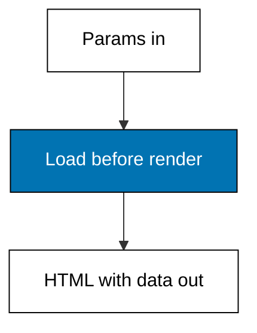
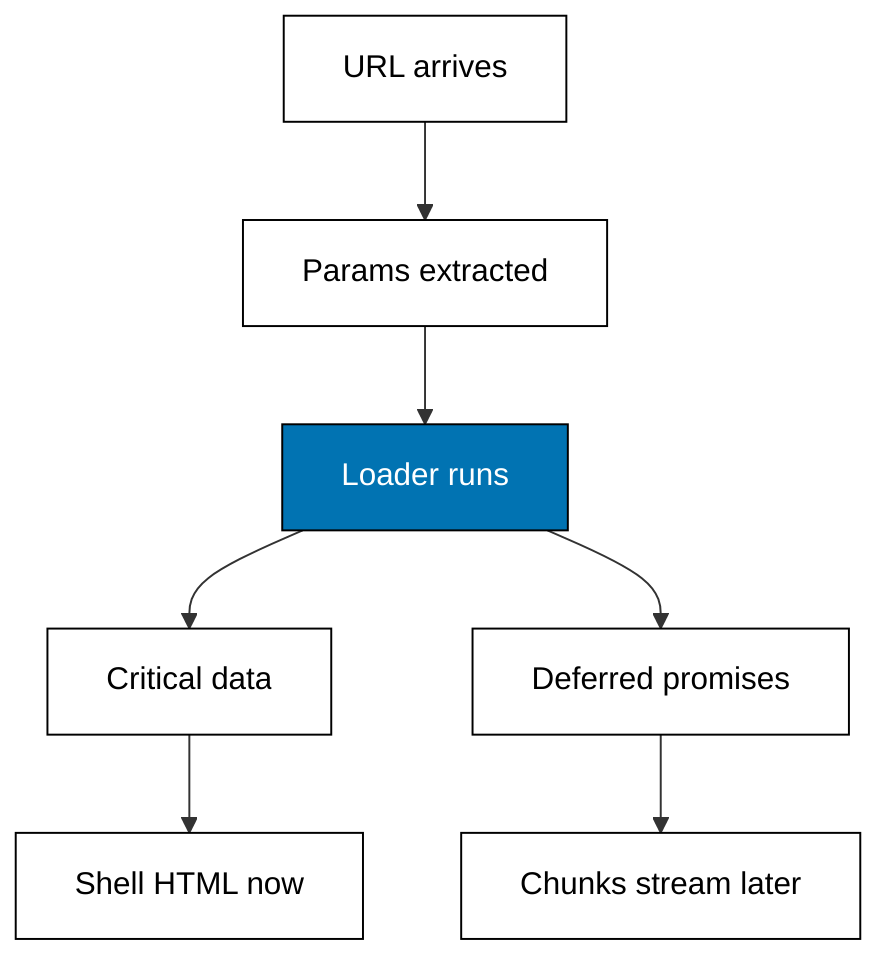

Examples 22-27 load data before rendering: the loader contract, parallel fanout, params-to-row reads, deferred chunks, refused renders, and the data-flow map. Data loading is the reason server rendering exists — HTML without data is a shell.



### Worked Example 22: Loader Before Render

_Exercises co-06._

**Context**: The loading anchor serves a loader-backed detail page from both dialects: the data resolves, then the HTML carries it — never the reverse. Next.js spells this an async Server Component; TanStack Start spells it a route loader feeding the component. The transcript proves the order: price with first HTML on both sides. **Check**: both dialects return `Teh Melati 100g 32000` with status 200, and the ghost id misses with 404.

**`learning/code/ex-22-loader-before-render/main.ts`**

```typescript
// Worked Example 22: Loader before render.
// => NusaMart is fictional; every product and price here is fixed.
// => Server data loading fetches what the page needs before it renders: the
// => loader resolves first, the HTML carries the answer. This anchor serves
// => a loader-backed detail page over loopback and reads it back to prove
// => the price arrived with the first HTML, on both dialects.
declare const require: any; // => Node-only import without @types/node in the harness
const http: any = require("node:http"); // => standard-library HTTP server, no dependency

// => Fixed catalog: the only rows any loader may return.
type Product = { id: string; name: string; price: number }; // => shop row shape
const PRODUCTS: Product[] = [
  // => three fictional goods, prices in rupiah
  { id: "kopi-001", name: "Kopi Toraja 250g", price: 68000 }, // => first shelf row
  { id: "teh-002", name: "Teh Melati 100g", price: 32000 }, // => second shelf row
  { id: "gula-003", name: "Gula Aren 500g", price: 21000 }, // => third shelf row
]; // => end of the fixed catalog

// => Next.js spelling: the async Server Component awaits its data inline,
// => then renders; the await blocks the segment, nothing renders half-ready.
function nextDetail(id: string): { status: number; body: string } {
  // => Next-style loader render
  const found = PRODUCTS.find((p) => p.id === id); // => the inline data fetch
  if (found === undefined) {
    // => unknown id
    return { status: 404, body: "next: product not found" }; // => miss body
  } // => end of the miss branch
  return { status: 200, body: "next: " + found.name + " " + found.price }; // => data plus render
} // => end of nextDetail

// => Start spelling: the route loader resolves before the component, so the
// => component reads useLoaderData instead of fetching; same order, new name.
function startDetail(id: string): { status: number; body: string } {
  // => Start-style loader render
  const found = PRODUCTS.find((p) => p.id === id); // => the loader fetch
  if (found === undefined) {
    // => unknown id
    return { status: 404, body: "start: product not found" }; // => miss body
  } // => end of the miss branch
  return { status: 200, body: "start: " + found.name + " " + found.price }; // => data plus render
} // => end of startDetail

// => One loopback server: /next/detail/:id and /start/detail/:id both load
// => before they render; the transcript shows data with first HTML.
async function main(): Promise<void> {
  // => script entry point
  const server: any = http.createServer((req: any, res: any) => {
    // => one server, two loaders
    const url: string = req.url ?? "/"; // => the request path
    const hit = url.match(/^\/(next|start)\/detail\/([^/]+)$/); // => detail shape, either dialect
    if (hit === null) {
      // => not a detail URL
      res.writeHead(404, { "content-type": "text/plain" }); // => miss status
      res.end("unknown loader path"); // => miss body
      return; // => stop here
    } // => end of the miss branch
    const answered = hit[1] === "next" ? nextDetail(hit[2]) : startDetail(hit[2]); // => dialect dispatch
    res.writeHead(answered.status, { "content-type": "text/plain" }); // => status line
    res.end(answered.body); // => loaded data inside the reply
  }); // => end of the request handler
  await new Promise<void>((resolve) => server.listen(0, "127.0.0.1", resolve)); // => ephemeral loopback port
  const port: number = server.address().port; // => the assigned port, never printed
  const get = async (path: string): Promise<string> => {
    // => one headless request
    const res: any = await fetch("http://127.0.0.1:" + port + path); // => loopback only
    return "GET " + path + " -> " + res.status + " " + (await res.text()); // => status plus data
  }; // => end of get
  console.log(await get("/next/detail/kopi-001")); // => Output loaded Next.js detail
  console.log(await get("/start/detail/kopi-001")); // => Output loaded Start detail
  console.log(await get("/next/detail/susu-009")); // => Output Next.js miss
  await new Promise<void>((resolve) => server.close(() => resolve())); // => stop serving
} // => end of main

void main(); // => run the script
export {}; // => module scope keeps these names local
```

**Output** (`learning/code/ex-22-loader-before-render/expected/main.stdout.txt`):

```text
GET /next/detail/kopi-001 -> 200 next: Kopi Toraja 250g 68000
GET /start/detail/kopi-001 -> 200 start: Kopi Toraja 250g 68000
GET /next/detail/susu-009 -> 404 next: product not found
```

**Key takeaway**: the loader runs before the render commits, so the HTML never shows a half-loaded page.

**Why It Matters**: "load then render" versus "render then load" is the line between server and client data fetching, and it decides everything about spinners, SEO, and error states. When a page flashes empty content, the loader contract was broken somewhere upstream — come back to this anchor and check which side renders before its data.

---

### Worked Example 23: Parallel Loader Fanout

_Exercises co-06._

**Context**: A detail page needs three independent reads — product, stock, reviews. Sequential loading adds the waits (100 ticks); parallel loading pays only the slowest (50 ticks). Logical ticks stand in for milliseconds so the arithmetic is exact and repeatable. **Check**: sequential costs 100 ticks, parallel costs 50, saving exactly 50.

**`learning/code/ex-23-parallel-loader-fanout/main.ts`**

```typescript
// Worked Example 23: Parallel loader fanout.
// => NusaMart is fictional; every price and tick here is fixed.
// => A detail page needs three independent reads: the product, its stock,
// => and its reviews. Sequential loads add the waits; parallel loads pay
// => only the slowest. Logical ticks stand in for milliseconds so the
// => transcript is identical on every run.

// => Fixed waits: product takes 30 ticks, stock 20, reviews 50.
const WAITS = { product: 30, stock: 20, reviews: 50 }; // => fictional latencies

// => Sequential loading pays every wait in turn: 30 plus 20 plus 50.
function sequential(): { total: number; order: string[] } {
  // => sequential loader
  const order = ["product", "stock", "reviews"]; // => fixed request order
  const total = WAITS.product + WAITS.stock + WAITS.reviews; // => summed waits
  return { total, order }; // => cost plus order
} // => end of sequential

// => Parallel loading starts all three at once and pays only the slowest:
// => 50 ticks, the reviews read.
function parallel(): { total: number; order: string[] } {
  // => parallel loader
  const order = ["product+stock+reviews"]; // => one joint launch
  const total = Math.max(WAITS.product, WAITS.stock, WAITS.reviews); // => slowest wins
  return { total, order }; // => cost plus order
} // => end of parallel

const seq = sequential(); // => run the sequential plan
console.log("sequential ticks: " + seq.total + " order " + seq.order.join(",")); // => Output 100
const par = parallel(); // => run the parallel plan
console.log("parallel ticks: " + par.total + " order " + par.order.join(",")); // => Output 50
console.log("saved ticks: " + (seq.total - par.total)); // => Output 50
export {}; // => module scope keeps these names local
```

**Output** (`learning/code/ex-23-parallel-loader-fanout/expected/main.stdout.txt`):

```text
sequential ticks: 100 order product,stock,reviews
parallel ticks: 50 order product+stock+reviews
saved ticks: 50
```

**Key takeaway**: independent reads launch together and cost the maximum, never the sum.

**Why It Matters**: waterfall loading is the quiet performance killer in server components — each awaited fetch delays everything below it. The habit is mechanical: reads that do not depend on each other start in the same tick. Audit every loader for accidental sequences and slow pages get fast without any caching at all.

---

### Worked Example 24: Loader Params to Row

_Exercises co-06, co-09._

**Context**: The loader's only input is the route params: validate the param, read exactly one row, and name both failure modes. A missing segment and an unknown id are different failures and deserve different names, because they route to different fixes. **Check**: the known id loads its row, the missing param reports `missing productId`, the ghost id reports `unknown susu-009`.

**`learning/code/ex-24-loader-params-to-row/main.ts`**

```typescript
// Worked Example 24: Loader params to row.
// => NusaMart is fictional; every product and price here is fixed.
// => The loader's only input is the route params: it validates the param,
// => reads exactly one row, and names its failure modes. No param, no query.

// => Fixed catalog: the only rows any loader may return.
type Product = { id: string; name: string; price: number }; // => shop row shape
const PRODUCTS: Product[] = [
  // => three fictional goods, prices in rupiah
  { id: "kopi-001", name: "Kopi Toraja 250g", price: 68000 }, // => first shelf row
  { id: "teh-002", name: "Teh Melati 100g", price: 32000 }, // => second shelf row
]; // => end of the fixed catalog

// => The loader contract: params in, one row out, or a named failure.
// => Empty means the segment is missing; unknown means no such product.
function load(params: { productId?: string }): string {
  // => loader function
  const id = params.productId ?? ""; // => the route param, maybe absent
  if (id === "") {
    // => missing segment
    return "loader: missing productId"; // => named failure one
  } // => end of the missing branch
  const found = PRODUCTS.find((p) => p.id === id); // => exactly one row read
  if (found === undefined) {
    // => unknown id
    return "loader: unknown " + id; // => named failure two
  } // => end of the unknown branch
  return "loader: " + found.name + " " + found.price; // => the loaded row
} // => end of load

console.log(load({ productId: "teh-002" })); // => Output the Teh row
console.log(load({})); // => Output missing productId
console.log(load({ productId: "susu-009" })); // => Output unknown susu-009
export {}; // => module scope keeps these names local
```

**Output** (`learning/code/ex-24-loader-params-to-row/expected/main.stdout.txt`):

```text
loader: Teh Melati 100g 32000
loader: missing productId
loader: unknown susu-009
```

**Key takeaway**: params in, one row out, failures named — the loader contract in three lines.

**Why It Matters**: loaders that read the world — session, headers, query strings — become untestable and surprising. Constraining the input to route params keeps every loader a pure function of the URL, which is exactly what makes static generation, caching, and type-safe links possible downstream. Discipline at the input buys freedom everywhere else.

---

### Worked Example 25: Deferred Chunks

_Exercises co-08, co-06._

**Context**: Not all data deserves to block the page: the product shell renders now, the reviews stream in later. Deferred values split one loader into critical data plus promises the page awaits independently, and the shell alone is already a complete, readable page. **Check**: the shell chunk prints first with the name and price, reviews arrive second, and the shell alone reads as complete.

**`learning/code/ex-25-deferred-chunks/main.ts`**

```typescript
// Worked Example 25: Deferred chunks.
// => NusaMart is fictional; every chunk here is fixed.
// => Not all data deserves to block the page: the product shell renders
// => now, reviews stream in later. Deferred values split one loader into
// => critical data plus promises the page awaits independently.

// => The loader returns the critical row plus a deferred reviews promise,
// => modelled here as a tagged chunk list in arrival order.
type Chunk = { kind: "shell" | "reviews"; body: string }; // => chunk shape

// => Critical data first: name and price render with the shell.
function shellChunk(): Chunk {
  // => shell builder
  return { kind: "shell", body: "<h1>Kopi Toraja 250g 68000</h1>" }; // => critical HTML
} // => end of shellChunk

// => Deferred data later: reviews resolve after the shell is already up.
function reviewsChunk(): Chunk {
  // => reviews builder
  return { kind: "reviews", body: "<p>4.8 from 212 tasters</p>" }; // => late HTML
} // => end of reviewsChunk

// => The stream order is the lesson: shell, then reviews, never reversed,
// => and the shell alone is already a complete, readable page.
const stream: Chunk[] = [shellChunk(), reviewsChunk()]; // => arrival order
for (const chunk of stream) {
  // => each chunk as it arrives
  console.log(chunk.kind + ": " + chunk.body); // => Output the chunk
} // => end of the chunk loop
console.log("shell alone readable: " + stream[0].body.includes("Kopi")); // => Output true
export {}; // => module scope keeps these names local
```

**Output** (`learning/code/ex-25-deferred-chunks/expected/main.stdout.txt`):

```text
shell: <h1>Kopi Toraja 250g 68000</h1>
reviews: <p>4.8 from 212 tasters</p>
shell alone readable: true
```

**Key takeaway**: critical data blocks, deferred data streams, and the page is useful before everything arrives.

**Why It Matters**: deferral is how fast pages carry slow widgets — recommendations, reviews, activity feeds — without making the visitor wait for the slowest query. The design question per section is always "does the page make sense without this yet?"; if yes, defer it. Theme G streams the same idea at the HTML level.

---

### Worked Example 26: Loader Data-Flow Reference

_Exercises co-06, co-08._

**Context**: The full loading journey on one page: URL to params, params to loader, loader to critical plus deferred data, data to HTML, HTML to stream. The runnable models above prove each step; this example is the pipeline map.



| Step           | Next.js name               | TanStack Start name        | Failure mode          |
| -------------- | -------------------------- | -------------------------- | --------------------- |
| Params         | `params` prop              | loader `params`            | missing segment       |
| Critical read  | `await` in component       | `loader` before render     | throws to boundary    |
| Deferred read  | wrapped in `Suspense`      | deferred promise           | streams late          |
| Refused render | `notFound()`, `redirect()` | `notFound()`, `redirect()` | error slot or new URL |

**Key takeaway**: one pipeline, two vocabularies — params, load, render-or-refuse, stream the rest.

**Why It Matters**: data-loading debates dissolve when the pipeline is visible: both frameworks extract params, run loading code on the server, and refuse bad renders before bytes flow. Memorize the pipeline, translate the vocabulary per project, and every loader in either framework reads as familiar on first sight.

---

### Worked Example 27: Loader Not-Found and Redirect

_Exercises co-12, co-06._

**Context**: A loader can refuse to render: an unknown id throws not-found and the nearest error slot renders; a moved id redirects before any HTML flows. Both decisions happen before the first byte of the page, which is what makes them cheap. **Check**: the current id renders, the moved id redirects to `/products/gula-aren`, the ghost id reports not-found.

**`learning/code/ex-27-loader-not-found-redirect/main.ts`**

```typescript
// Worked Example 27: Loader not-found and redirect.
// => NusaMart is fictional; every product id here is fixed.
// => A loader can refuse to render: an unknown id throws not-found and the
// => framework renders the nearest error slot; a moved id redirects before
// => any HTML. Both decisions happen before the first byte of the page.

// => Fixed catalog plus one moved id: gula-003 now lives under a new slug.
const IDS = ["kopi-001", "teh-002"]; // => current ids
const MOVED: Record<string, string> = { "gula-003": "/products/gula-aren" }; // => old to new

// => The loader verdict: render the row, redirect the moved id, or refuse
// => the unknown id. Order matters: moves are checked before misses.
function loadDetail(id: string): string {
  // => loader verdict
  const target = MOVED[id]; // => the new home, if this id moved
  if (target !== undefined) {
    // => moved id
    return "redirect to " + target; // => before any HTML
  } // => end of the moved branch
  if (!IDS.includes(id)) {
    // => unknown id
    return "not-found: " + id; // => nearest error slot renders
  } // => end of the unknown branch
  return "render " + id; // => the row renders
} // => end of loadDetail

console.log(loadDetail("teh-002")); // => Output render teh-002
console.log(loadDetail("gula-003")); // => Output redirect to /products/gula-aren
console.log(loadDetail("susu-009")); // => Output not-found: susu-009
export {}; // => module scope keeps these names local
```

**Output** (`learning/code/ex-27-loader-not-found-redirect/expected/main.stdout.txt`):

```text
render teh-002
redirect to /products/gula-aren
not-found: susu-009
```

**Key takeaway**: refuse early — redirects and not-founds are loader verdicts, not page content.

**Why It Matters**: rendering a page just to say "this does not exist" wastes the render and confuses crawlers; redirecting after paint flashes the wrong content. The loader is the last cheap place to change course, so put every existence and permission check there. Pages then only handle the happy path, which is exactly what keeps them simple.
