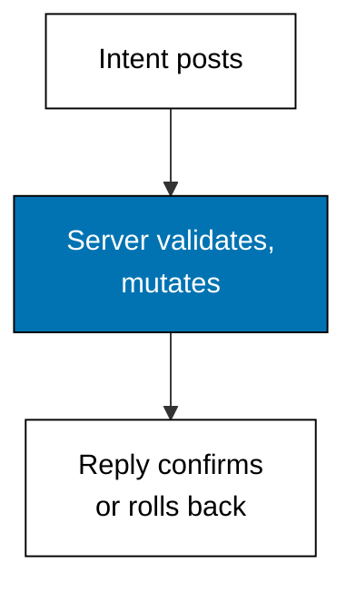
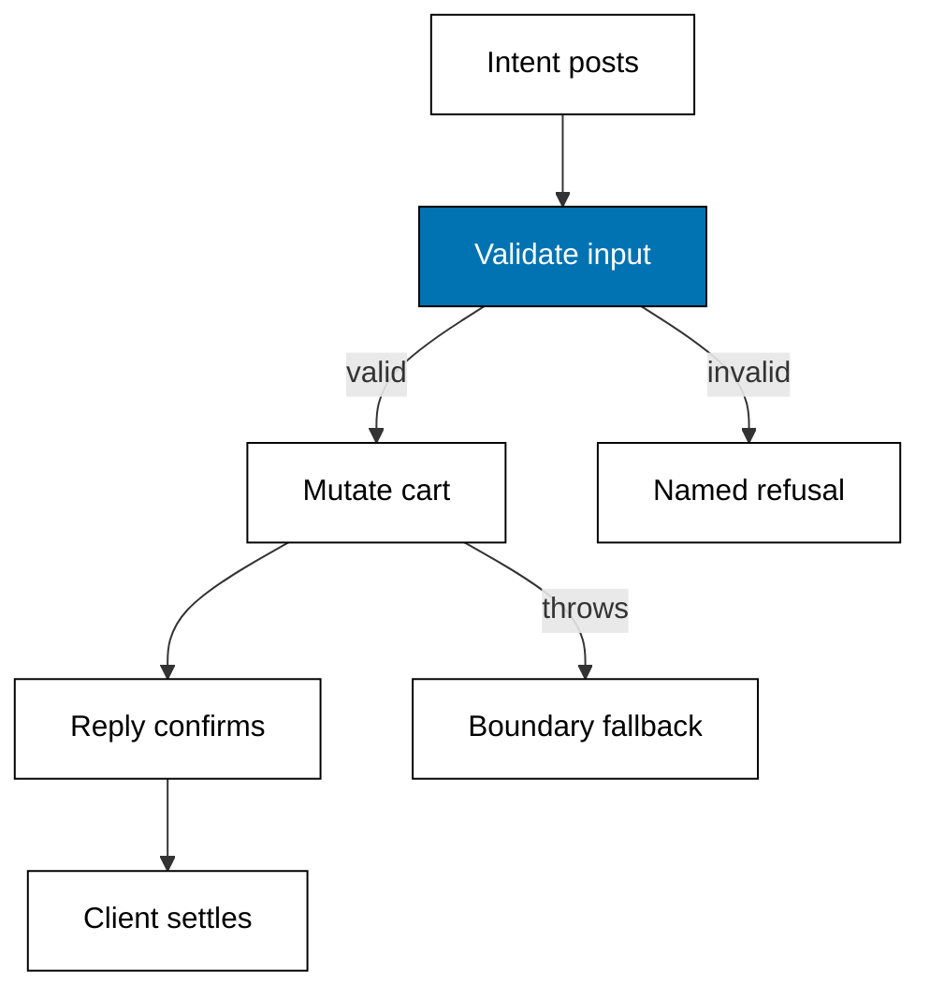

Examples 28-33 mutate safely from client components: the action contract, input validation, optimistic display, idempotent retries, failure boundaries, and the round-trip map. Reads get loaders; writes get actions — and actions never trust the caller.



### Worked Example 28: Action Mutates Cart

_Exercises co-07._

**Context**: The action anchor serves a cart mutation for both dialects: the browser posts an intent, the server validates it, owns the cart, and replies with the new count and total. Invalid intent changes nothing — the 422 for the ghost product proves the server is the last word. **Check**: two Kopi total `136000`, adding Teh brings count 3 total `168000`, and the ghost id returns 422.

**`learning/code/ex-28-action-mutates-cart/main.ts`**

```typescript
// Worked Example 28: Action mutates cart.
// => NusaMart is fictional; every product and quantity here is fixed.
// => A server action is a mutation callable from a client component: the
// => browser posts intent, the server validates and owns the cart, and the
// => reply carries the new count. This anchor serves a cart action over
// => loopback for both dialects and posts two intents to prove the count.
declare const require: any; // => Node-only import without @types/node in the harness
const http: any = require("node:http"); // => standard-library HTTP server, no dependency

// => Fixed prices: the only math any action may do.
const PRICES: Record<string, number> = {
  // => fictional price list
  "kopi-001": 68000, // => Kopi Toraja 250g
  "teh-002": 32000, // => Teh Melati 100g
}; // => end of the price list

// => One cart per dialect: server-owned state the client may only change
// => through the action, never by editing a reply.
const carts: Record<string, Record<string, number>> = { next: {}, start: {} }; // => server carts

// => The action contract: read the intent, validate it, mutate, reply with
// => the new count and total. Invalid intent changes nothing.
function cartAction(side: string, id: string, qty: number): { status: number; body: string } {
  // => server action
  if (PRICES[id] === undefined) {
    // => unknown product
    return { status: 422, body: side + " cart: unknown " + id }; // => no mutation
  } // => end of the unknown branch
  if (!Number.isInteger(qty) || qty < 1 || qty > 9) {
    // => bad quantity
    return { status: 422, body: side + " cart: bad qty " + qty }; // => no mutation
  } // => end of the quantity branch
  const cart = carts[side]; // => this dialect's cart
  cart[id] = (cart[id] ?? 0) + qty; // => the mutation
  const count = Object.values(cart).reduce((a, b) => a + b, 0); // => new item count
  const total = Object.entries(cart).reduce((a, [k, q]) => a + PRICES[k] * q, 0); // => new total
  return { status: 200, body: side + " cart: count " + count + " total " + total }; // => the reply
} // => end of cartAction

// => One loopback server: POST /next/cart/add and /start/cart/add run the
// => action; the body carries id and qty as a tiny JSON intent.
async function main(): Promise<void> {
  // => script entry point
  const server: any = http.createServer((req: any, res: any) => {
    // => one server, two actions
    const url: string = req.url ?? "/"; // => the request path
    const hit = url.match(/^\/(next|start)\/cart\/add$/); // => action shape, either dialect
    if (req.method !== "POST" || hit === null) {
      // => wrong method or path
      res.writeHead(404, { "content-type": "text/plain" }); // => miss status
      res.end("unknown action path"); // => miss body
      return; // => stop here
    } // => end of the miss branch
    let raw = ""; // => the intent bytes
    req.on("data", (c: any) => (raw += c)); // => collect the body
    req.on("end", () => {
      // => intent complete
      const intent = JSON.parse(raw) as { id: string; qty: number }; // => the posted intent
      const answered = cartAction(hit[1], intent.id, intent.qty); // => run the action
      res.writeHead(answered.status, { "content-type": "text/plain" }); // => status line
      res.end(answered.body); // => new count and total
    }); // => end of the intent handler
  }); // => end of the request handler
  await new Promise<void>((resolve) => server.listen(0, "127.0.0.1", resolve)); // => ephemeral loopback port
  const port: number = server.address().port; // => the assigned port, never printed
  const post = async (path: string, id: string, qty: number): Promise<string> => {
    // => one headless intent
    const res: any = await fetch("http://127.0.0.1:" + port + path, {
      // => loopback only
      method: "POST", // => actions mutate, so they post
      body: JSON.stringify({ id, qty }), // => the intent
    }); // => end of the post
    return "POST " + path + " " + id + " x" + qty + " -> " + res.status + " " + (await res.text()); // => reply
  }; // => end of post
  console.log(await post("/next/cart/add", "kopi-001", 2)); // => Output count 2 total 136000
  console.log(await post("/next/cart/add", "teh-002", 1)); // => Output count 3 total 168000
  console.log(await post("/start/cart/add", "kopi-001", 2)); // => Output count 2 total 136000
  console.log(await post("/next/cart/add", "susu-009", 1)); // => Output 422 unknown
  await new Promise<void>((resolve) => server.close(() => resolve())); // => stop serving
} // => end of main

void main(); // => run the script
export {}; // => module scope keeps these names local
```

**Output** (`learning/code/ex-28-action-mutates-cart/expected/main.stdout.txt`):

```text
POST /next/cart/add kopi-001 x2 -> 200 next cart: count 2 total 136000
POST /next/cart/add teh-002 x1 -> 200 next cart: count 3 total 168000
POST /start/cart/add kopi-001 x2 -> 200 start cart: count 2 total 136000
POST /next/cart/add susu-009 x1 -> 422 next cart: unknown susu-009
```

**Key takeaway**: the client proposes, the server disposes — intent in, validated mutation out.

**Why It Matters**: every checkout bug that ever charged wrong began with the client computing the total. The action owns the cart, the prices, and the rules; the browser owns pixels and intent. Keep that ownership split and whole categories of fraud and inconsistency become unrepresentable.

---

### Worked Example 29: Action Input Validation

_Exercises co-07._

**Context**: The form already validated — validate again. The action re-checks shape, range, and existence, returning every field error at once so the form can mark each field. Unknown ids, non-integer quantities, and out-of-range quantities each get their own named error. **Check**: the valid intent returns no errors, and the doubly-bad intent returns both the id and the range error together.

**`learning/code/ex-29-action-input-validation/main.ts`**

```typescript
// Worked Example 29: Action input validation.
// => NusaMart is fictional; every product and quantity here is fixed.
// => Never trust the client: the action re-validates everything the form
// => claimed, and returns field errors the form can render. The server is
// => the last word on shape, range, and existence.

// => Fixed price list: the existence check for every id.
const PRICES: Record<string, number> = { "kopi-001": 68000, "teh-002": 32000 }; // => fictional prices

// => One field error names the field and the rule it broke.
type FieldError = { field: string; rule: string }; // => error shape

// => Validate an add-to-cart intent: unknown id, non-integer qty, and
// => out-of-range qty each produce their own named error, and all errors
// => return together so the form can mark every field at once.
function validate(id: string, qty: number): FieldError[] {
  // => intent validator
  const errors: FieldError[] = []; // => collected errors
  if (PRICES[id] === undefined) {
    // => unknown product
    errors.push({ field: "id", rule: "unknown product" }); // => existence rule
  } // => end of the id branch
  if (!Number.isInteger(qty)) {
    // => non-integer qty
    errors.push({ field: "qty", rule: "must be an integer" }); // => shape rule
  } // => end of the shape branch
  if (qty < 1 || qty > 9) {
    // => out-of-range qty
    errors.push({ field: "qty", rule: "must be 1 to 9" }); // => range rule
  } // => end of the range branch
  return errors; // => every broken rule, at once
} // => end of validate

console.log("valid: " + JSON.stringify(validate("kopi-001", 2))); // => Output []
console.log("unknown id: " + JSON.stringify(validate("susu-009", 2))); // => Output one id error
console.log("bad qty: " + JSON.stringify(validate("kopi-001", 0))); // => Output one qty error
console.log("both bad: " + JSON.stringify(validate("susu-009", 99))); // => Output id plus range errors
export {}; // => module scope keeps these names local
```

**Output** (`learning/code/ex-29-action-input-validation/expected/main.stdout.txt`):

```text
valid: []
unknown id: [{"field":"id","rule":"unknown product"}]
bad qty: [{"field":"qty","rule":"must be 1 to 9"}]
both bad: [{"field":"id","rule":"unknown product"},{"field":"qty","rule":"must be 1 to 9"}]
```

**Key takeaway**: validate everything server-side, collect all violations, mutate only when the list is empty.

**Why It Matters**: client validation is user experience; server validation is security. Any rule enforced only in the browser is a suggestion attackers ignore. The errors array is also a design tool: returning all violations at once instead of the first one turns a frustrating form into a fixable one.

---

### Worked Example 30: Optimistic Cart Update

_Exercises co-07._

**Context**: Waiting for the server on every click feels broken: the optimistic update applies the intent instantly and settles when the reply lands. The cart keeps two numbers — shown and confirmed — and the gap between them is the pending intent. **Check**: the click shows 2 while 0 are confirmed, success aligns them, and the rejected intent rolls shown back to 2.

**`learning/code/ex-30-optimistic-cart-update/main.ts`**

```typescript
// Worked Example 30: Optimistic cart update.
// => NusaMart is fictional; every product and quantity here is fixed.
// => Waiting for the server on every click feels slow: an optimistic update
// => applies the intent instantly, then confirms or rolls back when the
// => reply lands. The cart keeps both numbers: shown and confirmed.

// => The cart holds a confirmed count the server blessed and a shown count
// => the visitor already sees; the gap between them is the pending intent.
type Cart = { shown: number; confirmed: number }; // => two-number cart
const cart: Cart = { shown: 0, confirmed: 0 }; // => empty cart

// => Apply the click instantly: the shown count moves now, confirmation
// => comes later. This is the optimism.
function click(qty: number): void {
  // => instant apply
  cart.shown += qty; // => visitor sees the new count now
} // => end of click

// => Settle one pending intent: success moves confirmed up to shown, and
// => failure rolls shown back down so the display tells the truth again.
function settle(ok: boolean, qty: number): string {
  // => reply handler
  if (ok) {
    // => server blessed the intent
    cart.confirmed += qty; // => confirmed catches up
    return "confirmed " + cart.confirmed + " shown " + cart.shown; // => counts agree
  } // => end of the success branch
  cart.shown -= qty; // => rollback the unblessed intent
  return "rolled back to shown " + cart.shown; // => display tells the truth
} // => end of settle

click(2); // => visitor adds two Kopi instantly
console.log("after click: shown " + cart.shown + " confirmed " + cart.confirmed); // => Output 2 and 0
console.log("server ok: " + settle(true, 2)); // => Output confirmed 2 shown 2
click(5); // => visitor adds five Teh instantly
console.log("second click: shown " + cart.shown + " confirmed " + cart.confirmed); // => Output 7 and 2
console.log("server rejects: " + settle(false, 5)); // => Output rolled back to shown 2
export {}; // => module scope keeps these names local
```

**Output** (`learning/code/ex-30-optimistic-cart-update/expected/main.stdout.txt`):

```text
after click: shown 2 confirmed 0
server ok: confirmed 2 shown 2
second click: shown 7 confirmed 2
server rejects: rolled back to shown 2
```

**Key takeaway**: show the intent now, confirm it later, and roll back visibly when the server refuses.

**Why It Matters**: optimism is a loan against the server's answer, and every loan needs a repayment plan — the rollback. Interfaces that apply optimistically but never roll back lie to visitors when actions fail. Keep both numbers, settle every intent, and the cart tells the truth at every moment including the unhappy ones.

---

### Worked Example 31: Idempotent Submit

_Exercises co-07._

**Context**: Double clicks and retried requests post the same intent twice: an idempotency key lets the server recognize the replay and return the first reply instead of charging twice. Same key in, same answer out, one mutation. **Check**: the replay returns the recorded reply and the mutation count stays 2, not 3.

**`learning/code/ex-31-idempotent-submit/main.ts`**

```typescript
// Worked Example 31: Idempotent submit.
// => NusaMart is fictional; every key and quantity here is fixed.
// => Double clicks and retries post the same intent twice: an idempotency
// => key lets the server recognize the replay and return the first reply
// => instead of charging twice. Same key in, same answer out, one mutation.

// => Seen keys map to their first reply: the replay log of this action.
const seen = new Map<string, string>(); // => key to first reply

// => Run the add intent once per key: new keys mutate and record, replays
// => return the recorded reply with a replay flag and mutate nothing.
function addOnce(key: string, id: string, qty: number): string {
  // => idempotent action
  const replay = seen.get(key); // => the first reply, if any
  if (replay !== undefined) {
    // => key seen before
    return "replay: " + replay; // => same answer, no mutation
  } // => end of the replay branch
  const reply = "added " + qty + " x " + id; // => the single mutation
  seen.set(key, reply); // => record the reply under the key
  return "fresh: " + reply; // => first answer
} // => end of addOnce

console.log(addOnce("key-1", "kopi-001", 2)); // => Output fresh: added 2 x kopi-001
console.log(addOnce("key-1", "kopi-001", 2)); // => Output replay of the first reply
console.log(addOnce("key-2", "kopi-001", 2)); // => Output fresh: a new key mutates again
console.log("mutations: " + seen.size); // => Output 2, not 3
export {}; // => module scope keeps these names local
```

**Output** (`learning/code/ex-31-idempotent-submit/expected/main.stdout.txt`):

```text
fresh: added 2 x kopi-001
replay: added 2 x kopi-001
fresh: added 2 x kopi-001
mutations: 2
```

**Key takeaway**: keyed actions run once per key — replays return history, only new keys mutate.

**Why It Matters**: networks retry and visitors double-click; without idempotency every retry is a potential double charge. Generate the key with the intent (per form, per click-session), store first replies, and the scariest checkout bug — paying twice — becomes structurally impossible rather than hopefully avoided.

---

### Worked Example 32: Action Round-Trip Reference

_Exercises co-07, co-12._

**Context**: The full mutation journey on one page: intent, validation, mutation or named refusal, reply, confirm or rollback, boundary on throw. The runnable models above prove each leg; this example is the round-trip map.



| Leg      | Happy path            | Unhappy path                    |
| -------- | --------------------- | ------------------------------- |
| Validate | rules pass, mutate    | named field errors, no mutation |
| Mutate   | count and total reply | throw to the error boundary     |
| Settle   | confirmed catches up  | shown rolls back                |
| Retry    | new key mutates again | same key replays first reply    |

**Key takeaway**: every leg has two exits, and the unhappy exit is designed, not improvised.

**Why It Matters**: checkout flows fail in production in exactly these four places, and each needs its designed answer before launch — not a crash report after. Walk this table for every mutation you ship: refused input, thrown error, rejected confirmation, repeated submit. If any cell is blank, the design is unfinished.

---

### Worked Example 33: Action Error to Boundary

_Exercises co-07, co-12._

**Context**: Actions fail for real reasons: stock runs out, quantities offend. The action throws a named error, the framework catches it at the nearest error boundary, and the visitor sees a fallback instead of a blank page. **Check**: one unit buys cleanly, five units hit the out-of-stock fallback with 1 left, zero hits the bad-quantity fallback.

**`learning/code/ex-33-action-error-to-boundary/main.ts`**

```typescript
// Worked Example 33: Action error to boundary.
// => NusaMart is fictional; every product and quantity here is fixed.
// => Actions fail for real reasons: stock runs out, payments decline. The
// => action throws a named error, the framework catches it at the nearest
// => error boundary, and the visitor sees a fallback instead of a blank page.

// => Fixed stock: only two Kopi left, which the third unit will exceed.
const STOCK: Record<string, number> = { "kopi-001": 2 }; // => fictional stock

// => Named action errors: each carries the code the boundary switches on.
type ActionError = { code: "out-of-stock" | "bad-qty"; detail: string }; // => error shape

// => The action either mutates or throws: no silent half-success exists.
// => Throwing here models the framework behavior of routing to error.tsx.
function buy(id: string, qty: number): string {
  // => buying action
  if (qty < 1) {
    // => bad quantity
    const err: ActionError = { code: "bad-qty", detail: "qty " + qty }; // => named error
    throw err; // => boundary catches this
  } // => end of the quantity branch
  const left = STOCK[id] ?? 0; // => stock on hand, zero when unknown
  if (qty > left) {
    // => not enough stock
    const err: ActionError = { code: "out-of-stock", detail: id + " has " + left }; // => named error
    throw err; // => boundary catches this
  } // => end of the stock branch
  STOCK[id] = left - qty; // => the mutation
  return "bought " + qty + " x " + id; // => success reply
} // => end of buy

// => The boundary: run the action, render its reply on success and the
// => matching fallback on each named failure.
function boundary(id: string, qty: number): string {
  // => error boundary
  try {
    // => attempt the action
    return buy(id, qty); // => success renders the reply
  } catch (e) {
    // => action threw
    const err = e as ActionError; // => the named error
    return "fallback [" + err.code + "]: " + err.detail; // => fallback renders instead
  } // => end of the catch
} // => end of boundary

console.log(boundary("kopi-001", 1)); // => Output bought 1 x kopi-001
console.log(boundary("kopi-001", 5)); // => Output fallback out-of-stock with 1 left
console.log(boundary("kopi-001", 0)); // => Output fallback bad-qty
export {}; // => module scope keeps these names local
```

**Output** (`learning/code/ex-33-action-error-to-boundary/expected/main.stdout.txt`):

```text
bought 1 x kopi-001
fallback [out-of-stock]: kopi-001 has 1
fallback [bad-qty]: qty 0
```

**Key takeaway**: throw named errors, catch at the nearest boundary, render a fallback that names the problem.

**Why It Matters**: uncaught action errors blank pages and strand carts mid-checkout. Named errors plus boundaries turn every failure into a message the visitor can act on — reduce quantity, pick another product — instead of a dead screen. The boundary is the last line of defense; design it like one, with real copy and a real next step.
