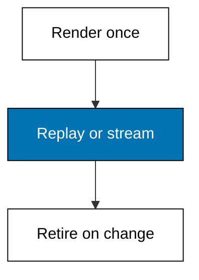
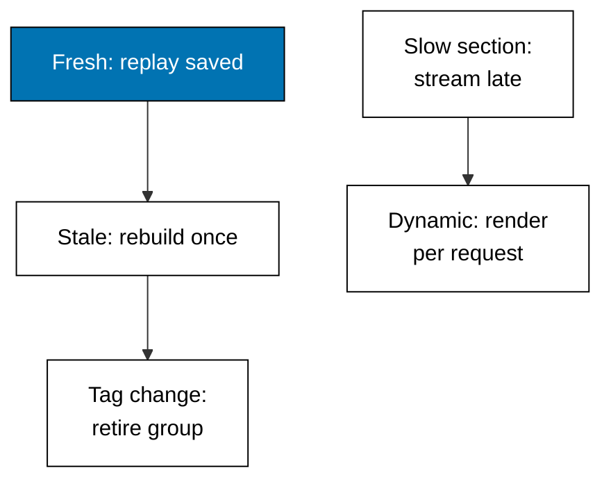

Examples 34-38 stop re-rendering what has not changed and stop waiting for what has not arrived: cache hits, tag invalidation, streamed chunks, per-section suspense, and the freshness timeline. Rendering is expensive; replay and streaming spend it once.



### Worked Example 34: Second-Visit Cache Hit

_Exercises co-10._

**Context**: The caching anchor serves one cached shelf and stamps each reply `HIT` or `MISS`. The first visit renders and saves; the second and third replay without rendering — the render counter proves the work happened exactly once. **Check**: first visit `MISS` with `renders=1`, both later visits `HIT` with `renders` still 1.

**`learning/code/ex-34-second-visit-cache-hit/main.ts`**

```typescript
// Worked Example 34: Second-visit cache hit.
// => NusaMart is fictional; every product and price here is fixed.
// => Caching replays a saved reply for a repeat visit: the first request
// => renders and saves, the second request replays without rendering. This
// => anchor serves a cached shelf over loopback and stamps each reply HIT
// => or MISS so the transcript shows the render happening exactly once.
declare const require: any; // => Node-only import without @types/node in the harness
const http: any = require("node:http"); // => standard-library HTTP server, no dependency

// => The cache: one saved reply per path, plus a render counter proving
// => the second visit skipped the work.
let saved = ""; // => the cached shelf HTML
let renders = 0; // => how many times the shelf rendered

// => Render the shelf: the only expensive step, counted every time it runs.
function renderShelf(): string {
  // => shelf renderer
  renders += 1; // => count this render
  return "<ul><li>Kopi Toraja 250g</li><li>Teh Melati 100g</li></ul>"; // => fixed shelf HTML
} // => end of renderShelf

// => One loopback server: the first GET /shelf renders and saves, later
// => GETs replay the save; the x-cache stamp names which happened.
async function main(): Promise<void> {
  // => script entry point
  const server: any = http.createServer((req: any, res: any) => {
    // => one server, one cached page
    if ((req.url ?? "/") !== "/shelf") {
      // => only the shelf is cached here
      res.writeHead(404, { "content-type": "text/plain" }); // => miss status
      res.end("unknown page"); // => miss body
      return; // => stop here
    } // => end of the miss branch
    if (saved === "") {
      // => nothing saved yet
      saved = renderShelf(); // => render once and save
      res.writeHead(200, { "content-type": "text/html", "x-cache": "MISS" }); // => miss stamp
      res.end(saved); // => fresh render
      return; // => stop here
    } // => end of the miss branch
    res.writeHead(200, { "content-type": "text/html", "x-cache": "HIT" }); // => hit stamp
    res.end(saved); // => replay without rendering
  }); // => end of the request handler
  await new Promise<void>((resolve) => server.listen(0, "127.0.0.1", resolve)); // => ephemeral loopback port
  const port: number = server.address().port; // => the assigned port, never printed
  const get = async (visit: string): Promise<string> => {
    // => one headless visit
    const res: any = await fetch("http://127.0.0.1:" + port + "/shelf"); // => loopback only
    const stamp: string = res.headers.get("x-cache") ?? "?"; // => HIT or MISS
    return visit + " -> " + res.status + " " + stamp + " renders=" + renders + " " + (await res.text()); // => line
  }; // => end of get
  console.log(await get("first visit")); // => Output MISS with renders=1
  console.log(await get("second visit")); // => Output HIT with renders still 1
  console.log(await get("third visit")); // => Output HIT with renders still 1
  await new Promise<void>((resolve) => server.close(() => resolve())); // => stop serving
} // => end of main

void main(); // => run the script
export {}; // => module scope keeps these names local
```

**Output** (`learning/code/ex-34-second-visit-cache-hit/expected/main.stdout.txt`):

```text
first visit -> 200 MISS renders=1 <ul><li>Kopi Toraja 250g</li><li>Teh Melati 100g</li></ul>
second visit -> 200 HIT renders=1 <ul><li>Kopi Toraja 250g</li><li>Teh Melati 100g</li></ul>
third visit -> 200 HIT renders=1 <ul><li>Kopi Toraja 250g</li><li>Teh Melati 100g</li></ul>
```

**Key takeaway**: a cached page renders once and replays, and the stamp proves which happened.

**Why It Matters**: cache mysteries — "did it render or replay?" — waste hours in production debugging. Stamping replies (or logging the path) turns the question into a glance at the transcript. Build the stamp habit here and every cache you operate later stays observable instead of magical.

---

### Worked Example 35: Tag Invalidation

_Exercises co-10._

**Context**: A price change must retire every saved page that showed the old price: cache tags group saved pages by topic, and invalidating one tag drops the whole group at once. The shelf and detail carry the `prices` tag; the story page does not, so it survives. **Check**: two pages drop on invalidating `prices`, and only `/about` remains.

**`learning/code/ex-35-tag-invalidation/main.ts`**

```typescript
// Worked Example 35: Tag invalidation.
// => NusaMart is fictional; every product and price here is fixed.
// => A price change must retire every saved page that showed the old price:
// => cache tags group saved pages by topic, and invalidating one tag drops
// => the whole group at once. No tag, no targeted retirement.

// => Saved pages grouped by tag: the shelf shows prices, the story does not.
const cache = new Map<string, { tags: string[] }>([
  // => saved pages plus tags
  ["/products", { tags: ["prices", "shelf"] }], // => shows every price
  ["/products/teh-002", { tags: ["prices"] }], // => shows one price
  ["/about", { tags: ["story"] }], // => shows no price
]); // => end of the cache

// => Invalidate one tag: every page carrying it is dropped, the rest stay.
// => Returns the dropped paths so the transcript shows the blast radius.
function invalidate(tag: string): string[] {
  // => tag invalidation
  const dropped: string[] = []; // => retired pages
  for (const [path, entry] of cache) {
    // => every saved page
    if (entry.tags.includes(tag)) {
      // => page carries the tag
      cache.delete(path); // => retire it
      dropped.push(path); // => record it
    } // => end of the tagged branch
  } // => end of the page loop
  return dropped; // => the blast radius
} // => end of invalidate

console.log("before: " + [...cache.keys()].join(",")); // => Output three saved pages
console.log("invalidate prices drops: " + invalidate("prices").join(",")); // => Output two pages
console.log("after: " + [...cache.keys()].join(",")); // => Output /about only
export {}; // => module scope keeps these names local
```

**Output** (`learning/code/ex-35-tag-invalidation/expected/main.stdout.txt`):

```text
before: /products,/products/teh-002,/about
invalidate prices drops: /products,/products/teh-002
after: /about
```

**Key takeaway**: tags turn "which pages showed this data" from a search into a lookup — invalidate the tag, retire the group.

**Why It Matters**: without tags the options are grim: expire everything (slow) or expire nothing (stale). Tags are the middle path — surgical retirement by topic. Tag every cached page by the data it shows at write time, and price changes, stock changes, and content edits each retire exactly their blast radius.

---

### Worked Example 36: Streamed Chunks in Order

_Exercises co-08._

**Context**: Streaming sends the page in pieces: shell first, shelf next, reviews last. Each chunk is usable HTML on arrival, and the order is a contract — shell, then sections slowest-last. **Check**: three chunks arrive in order and assemble into the complete page.

**`learning/code/ex-36-streamed-chunks-in-order/main.ts`**

```typescript
// Worked Example 36: Streamed chunks in order.
// => NusaMart is fictional; every chunk here is fixed.
// => Streaming sends the page in pieces: the shell first, the shelf next,
// => the reviews last. Each chunk is usable HTML on arrival, and the order
// => is a contract: shell, then sections slowest-last.

// => The three chunks in stream order: shell, shelf, reviews.
const CHUNKS = [
  // => fixed chunk list
  "<header>NusaMart</header>", // => shell, usable instantly
  "<ul><li>Kopi Toraja 250g</li></ul>", // => fast section
  "<p>4.8 from 212 tasters</p>", // => slow section, last
]; // => end of the chunk list

// => Stream the page: print each chunk as it arrives and the running total,
// => so the transcript shows progressive completion, not one late blob.
let assembled = ""; // => the page so far
for (const chunk of CHUNKS) {
  // => each chunk in order
  assembled += chunk; // => append to the page
  console.log("chunk: " + chunk); // => Output the arriving chunk
} // => end of the chunk loop
console.log("assembled: " + assembled); // => Output the complete page
export {}; // => module scope keeps these names local
```

**Output** (`learning/code/ex-36-streamed-chunks-in-order/expected/main.stdout.txt`):

```text
chunk: <header>NusaMart</header>
chunk: <ul><li>Kopi Toraja 250g</li></ul>
chunk: <p>4.8 from 212 tasters</p>
assembled: <header>NusaMart</header><ul><li>Kopi Toraja 250g</li></ul><p>4.8 from 212 tasters</p>
```

**Key takeaway**: streaming replaces one late blob with progressive, usable pieces in a fixed order.

**Why It Matters**: time-to-first-byte and time-to-complete are different numbers, and visitors feel the first far more. Streaming buys an instant shell while slow queries finish — the page feels alive at once instead of dead until everything resolves. Order the chunks slowest-last and the stream reads as deliberate pace, not random arrival.

---

### Worked Example 37: Section Suspense States

_Exercises co-08._

**Context**: A Suspense boundary lets each slow section load on its own clock: the shell and the fast shelf render now while reviews show a fallback, then the reviews swap in without touching the rest. One slow section no longer holds the page hostage. **Check**: first paint shows shell, shelf, and the reviews fallback; settled paint shows all three contents.

**`learning/code/ex-37-section-suspense-states/main.ts`**

```typescript
// Worked Example 37: Section suspense states.
// => NusaMart is fictional; every section here is fixed.
// => A Suspense boundary lets each slow section load on its own clock: the
// => shell and the fast shelf render now, reviews show a fallback until
// => their data lands. One slow section no longer holds the page hostage.

// => The three sections and which ones are ready on first paint.
type Section = { name: string; ready: boolean; html: string }; // => section shape
const SECTIONS: Section[] = [
  // => fixed sections
  { name: "shell", ready: true, html: "<header>NusaMart</header>" }, // => always ready
  { name: "shelf", ready: true, html: "<ul><li>Kopi Toraja 250g</li></ul>" }, // => fast data
  { name: "reviews", ready: false, html: "<p>4.8 from 212 tasters</p>" }, // => slow data
]; // => end of the sections

// => Render with boundaries: ready sections show content, unready sections
// => show their own fallback while the rest of the page is already complete.
function firstPaint(): string[] {
  // => first paint
  return SECTIONS.map((s) => (s.ready ? s.name + ": " + s.html : s.name + ": loading reviews...")); // => per-section state
} // => end of firstPaint

// => Settle the slow section: its fallback swaps for content, and only its
// => boundary re-renders; the shell and shelf are untouched.
function settled(): string[] {
  // => settled paint
  return SECTIONS.map((s) => s.name + ": " + s.html); // => every section content
} // => end of settled

console.log("first: " + firstPaint().join(" | ")); // => Output shell, shelf, reviews fallback
console.log("settled: " + settled().join(" | ")); // => Output all three contents
export {}; // => module scope keeps these names local
```

**Output** (`learning/code/ex-37-section-suspense-states/expected/main.stdout.txt`):

```text
first: shell: <header>NusaMart</header> | shelf: <ul><li>Kopi Toraja 250g</li></ul> | reviews: loading reviews...
settled: shell: <header>NusaMart</header> | shelf: <ul><li>Kopi Toraja 250g</li></ul> | reviews: <p>4.8 from 212 tasters</p>
```

**Key takeaway**: boundaries isolate slowness — each section paints on its own schedule inside a shared page.

**Why It Matters**: without boundaries every page loads at the speed of its slowest query, and one flaky widget delays everything. Wrap each independently-slow section and the page degrades section by section instead of all at once. The boundary map from Example 10 and the streaming order from Example 36 meet here: this is the technique that makes both work.

---

### Worked Example 38: Freshness Timeline Reference

_Exercises co-10, co-08._

**Context**: Every caching and streaming choice on one timeline: what replays, what streams, what rebuilds, and what each costs the visitor. The runnable models above prove each mechanism; this example lines up their freshness guarantees.



| Mechanism           | Visitor sees           | Server does                 | Guarantee                  |
| ------------------- | ---------------------- | --------------------------- | -------------------------- |
| Cache hit           | saved HTML instantly   | nothing                     | fresh within the limit     |
| Revalidated rebuild | waits once, then fresh | one render, resets baseline | stale bounded by the limit |
| Tag invalidation    | fresh after the change | drops the tagged group      | retired on write           |
| Streamed chunk      | shell now, rest later  | renders sections in order   | progressive, slowest-last  |
| Dynamic render      | fresh, slower start    | full render per request     | never stale                |

**Key takeaway**: five mechanisms, one question each answers — how stale may this be, and what does freshness cost?

**Why It Matters**: caching arguments go in circles until someone writes the guarantees down. This table is that writing: pick the row whose staleness the business accepts at whose cost, per page section, and the architecture follows. Revisit it whenever a page feels slow or a price looks stale — the answer is always a different row.
