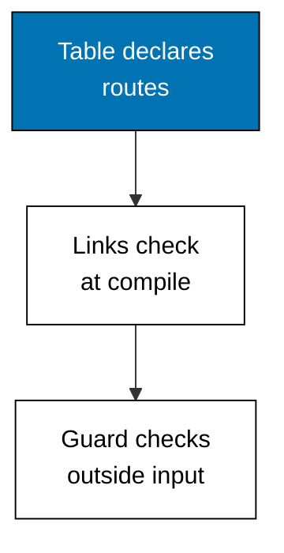
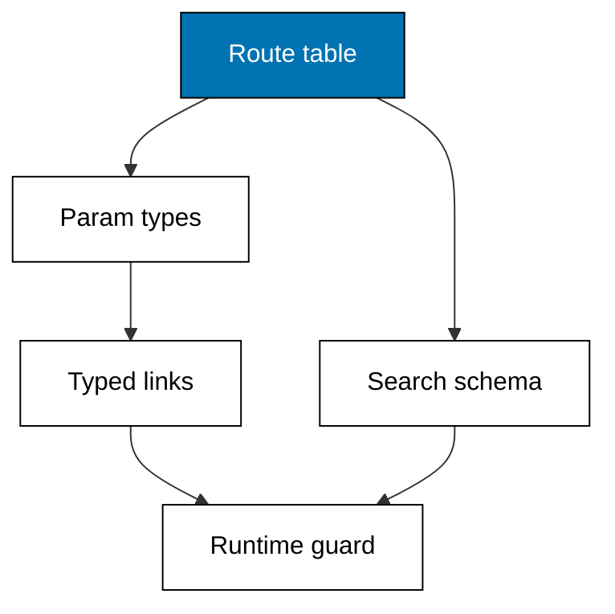

Examples 39-43 move broken links from runtime to compile time: a typed link builder, params as types, a runtime guard for outside URLs, search-param schemas, and the type-flow map. Renaming a route should break the build, never a visitor.



### Worked Example 39: Typed Link Builder

_Exercises co-13._

**Context**: The types anchor builds every link through the route table, so a wrong path or a missing param fails `tsc` instead of failing a visitor — then serves the built links over loopback to prove they resolve. The table is the single source: add a route and every builder learns it. **Check**: all four built paths return 200 with the typed hit line.

**`learning/code/ex-39-typed-link-builder/main.ts`**

```typescript
// Worked Example 39: Typed link builder.
// => NusaMart is fictional; every product id here is fixed.
// => Type-safe routing moves broken links from runtime to compile time: the
// => route table is a type, buildPath only accepts its keys, and a wrong
// => path fails tsc instead of failing a visitor. This anchor serves the
// => typed paths over loopback and reads them back to prove they resolve.
declare const require: any; // => Node-only import without @types/node in the harness
const http: any = require("node:http"); // => standard-library HTTP server, no dependency

// => The route table as a type: every legal path and its param names.
// => Add a route here and every link builder learns it; miss one and tsc
// => rejects the link before the app ever runs.
const ROUTES = {
  // => fixed route table
  "/": [], // => root takes no params
  "/products": [], // => list takes no params
  "/products/:id": ["id"], // => detail takes one param
} as const; // => literal types, never widened
type RoutePath = keyof typeof ROUTES; // => the legal path union

// => Build a path from a legal route plus its params: unknown routes and
// => missing params are type errors, caught by tsc, never by a visitor.
function buildPath(path: RoutePath, params: Record<string, string> = {}): string {
  // => typed link builder
  let built: string = path; // => the growing URL
  for (const [key, value] of Object.entries(params)) {
    // => every supplied param
    built = built.replace(":" + key, value); // => fill its hole
  } // => end of the param loop
  return built; // => the finished URL
} // => end of buildPath

// => Fixed catalog ids: the only values links may carry.
const IDS = ["kopi-001", "teh-002"]; // => two fictional goods

// => One loopback server: any built path that matches a table entry renders;
// => anything else 404s, which typed links can never produce.
async function main(): Promise<void> {
  // => script entry point
  const server: any = http.createServer((req: any, res: any) => {
    // => one server, typed links only
    const url: string = req.url ?? "/"; // => the request path
    const known = url === "/" || url === "/products" || /^\/products\/[^/]+$/.test(url); // => table check
    if (!known) {
      // => outside the table
      res.writeHead(404, { "content-type": "text/plain" }); // => miss status
      res.end("no such route"); // => miss body
      return; // => stop here
    } // => end of the miss branch
    res.writeHead(200, { "content-type": "text/plain" }); // => hit status
    res.end("typed hit: " + url); // => hit body
  }); // => end of the request handler
  await new Promise<void>((resolve) => server.listen(0, "127.0.0.1", resolve)); // => ephemeral loopback port
  const port: number = server.address().port; // => the assigned port, never printed
  const get = async (path: string): Promise<string> => {
    // => one headless request
    const res: any = await fetch("http://127.0.0.1:" + port + path); // => loopback only
    return "GET " + path + " -> " + res.status + " " + (await res.text()); // => status plus body
  }; // => end of get
  console.log(await get(buildPath("/"))); // => Output typed hit for root
  console.log(await get(buildPath("/products"))); // => Output typed hit for list
  console.log(await get(buildPath("/products/:id", { id: IDS[0] }))); // => Output typed hit for detail
  console.log(await get(buildPath("/products/:id", { id: IDS[1] }))); // => Output typed hit for detail
  await new Promise<void>((resolve) => server.close(() => resolve())); // => stop serving
} // => end of main

void main(); // => run the script
export {}; // => module scope keeps these names local
```

**Output** (`learning/code/ex-39-typed-link-builder/expected/main.stdout.txt`):

```text
GET / -> 200 typed hit: /
GET /products -> 200 typed hit: /products
GET /products/kopi-001 -> 200 typed hit: /products/kopi-001
GET /products/teh-002 -> 200 typed hit: /products/teh-002
```

**Key takeaway**: links derive from the route table type, so illegal paths are compile errors, not 404s.

**Why It Matters**: string links rot — routes rename, params change, and every hardcoded href becomes a landmine. A typed builder turns the whole link set into checked code: rename a segment and the compiler lists every link to fix. The loopback proof closes the loop: checked links also resolve, so types and runtime agree.

---

### Worked Example 40: Route Params as Types

_Exercises co-13, co-09._

**Context**: Params should carry their names into the type system: extracting the declared names from each path means renaming a segment without updating its readers is a compile error, never a silent `undefined`. The type lookup mirrors the runtime table exactly. **Check**: the detail id reads `kopi-001`, the article slug reads `shipping`, and the table lists both paths.

**`learning/code/ex-40-route-params-as-types/main.ts`**

```typescript
// Worked Example 40: Route params as types.
// => NusaMart is fictional; every product id here is fixed.
// => Params should carry their names into the type system: extracting
// => ["id"] from "/products/:id" at the type level means renaming the
// => segment without updating the reader is a compile error, not a silent
// => undefined at runtime.

// => The route table: paths plus the param names each one declares.
const ROUTES = {
  // => fixed route table
  "/products/:id": ["id"], // => detail declares id
  "/help/:slug": ["slug"], // => article declares slug
} as const; // => literal types, never widened

// => ParamOf pulls the declared names out of a path: "/products/:id"
// => becomes the union "id", so readers stay in sync with the table.
type ParamOf<P extends string> = P extends "/products/:id" ? "id" : P extends "/help/:slug" ? "slug" : never; // => name lookup

// => ParamsFor builds the object type the loader receives: every declared
// => name is a required string, and no other key is allowed.
type ParamsFor<P extends string> = Record<ParamOf<P>, string>; // => object from names

// => Read one param by its typed name: the compiler rejects misspelled
// => names, and the runtime mirrors the same lookup.
function readParam<P extends string>(path: P, params: ParamsFor<P>, name: ParamOf<P>): string {
  // => typed param reader
  return params[name]; // => the value under its declared name
} // => end of readParam

const detail: ParamsFor<"/products/:id"> = { id: "kopi-001" }; // => loader params
console.log("detail id: " + readParam("/products/:id", detail, "id")); // => Output kopi-001
const article: ParamsFor<"/help/:slug"> = { slug: "shipping" }; // => article params
console.log("article slug: " + readParam("/help/:slug", article, "slug")); // => Output shipping
console.log("table keys: " + Object.keys(ROUTES).join(",")); // => Output both paths
export {}; // => module scope keeps these names local
```

**Output** (`learning/code/ex-40-route-params-as-types/expected/main.stdout.txt`):

```text
detail id: kopi-001
article slug: shipping
table keys: /products/:id,/help/:slug
```

**Key takeaway**: param names live in one table and flow into both the loader input type and the reader.

**Why It Matters**: untyped params fail in the worst way — `undefined` where a string was assumed, deep in rendering, far from the cause. Typing the params object turns every misspelling into a build error at the exact line. Keep the runtime table and the type table as one declaration and they can never drift apart.

---

### Worked Example 41: Link Target Guard

_Exercises co-13._

**Context**: Even with typed builders, URLs arrive from outside: bookmarks, pasted links, old emails. A runtime guard mirrors the type table and rejects unknown targets with a named reason — traversal attempts and ghost paths get different answers because they need different responses. **Check**: shop paths pass, `/admin` rejects as unknown, the traversal rejects as traversal.

**`learning/code/ex-41-link-target-guard/main.ts`**

```typescript
// Worked Example 41: Link target guard.
// => NusaMart is fictional; every path here is fixed.
// => Even with typed builders, URLs arrive from outside: bookmarks, pasted
// => links, old emails. A runtime guard mirrors the type table and rejects
// => unknown targets before they render, with a named reason per rejection.

// => The legal target set: the same table the type system sees, kept as a
// => runtime list so outside input can be checked against it.
const LEGAL = ["/", "/products", "/products/:id"]; // => legal target shapes

// => Guard one incoming target: legal shapes pass, unknown paths fail with
// => a reason the UI can render instead of a blank page.
function guard(target: string): string {
  // => link target guard
  if (target === "/" || target === "/products") {
    // => static legal targets
    return "pass: " + target; // => render it
  } // => end of the static branch
  if (/^\/products\/[^/]+$/.test(target)) {
    // => detail shape
    return "pass: " + target; // => render it
  } // => end of the detail branch
  if (target.includes("..") || target.includes("//")) {
    // => traversal attempt
    return "reject traversal: " + target; // => named rejection
  } // => end of the traversal branch
  return "reject unknown: " + target; // => named rejection
} // => end of guard

console.log(guard("/products/kopi-001")); // => Output pass
console.log(guard("/products")); // => Output pass
console.log(guard("/admin")); // => Output reject unknown
console.log(guard("/products/../../etc")); // => Output reject traversal
console.log("legal shapes: " + LEGAL.join(",")); // => Output the three shapes
export {}; // => module scope keeps these names local
```

**Output** (`learning/code/ex-41-link-target-guard/expected/main.stdout.txt`):

```text
pass: /products/kopi-001
pass: /products
reject unknown: /admin
reject traversal: /products/../../etc
legal shapes: /,/products,/products/:id
```

**Key takeaway**: compile-time checks cover links you write; runtime guards cover links the world writes.

**Why It Matters**: defense in depth is not paranoia here, it is arithmetic — most production URLs are typed by strangers, not by your builder. The guard is cheap, total, and honest: pass what is legal, name what is not. Pair every typed link set with one of these and the route surface is closed from both directions.

---

### Worked Example 42: Search Params Schema

_Exercises co-13._

**Context**: Search params are untrusted strings: page `two` is not 2, a missing sort is not an error. A schema parses each param once, applies defaults, clamps ranges, and collects every violation before the page decides anything. **Check**: empty input parses to defaults with no errors, valid input parses cleanly, and the hostile input reports all three violations at once.

**`learning/code/ex-42-search-params-schema/main.ts`**

```typescript
// Worked Example 42: Search params schema.
// => NusaMart is fictional; every value here is fixed.
// => Search params are untrusted strings: page "two" is not 2, and a missing
// => sort is not an error. A schema parses each param once, applies defaults,
// => and collects every violation before the page decides anything.

// => Raw input: everything arrives as a string or not at all.
type Raw = Record<string, string | undefined>; // => untrusted input shape

// => Parsed output: page and limit are numbers, sort is a fixed union, and
// => violations name every param the input got wrong.
type Parsed = { page: number; limit: number; sort: "price" | "name"; errors: string[] }; // => trusted shape

// => Parse the shelf query: page defaults to 1, limit to 10 and clamps at
// => 50, sort defaults to price, and every violation is collected, not thrown.
function parseShelf(raw: Raw): Parsed {
  // => search params parser
  const errors: string[] = []; // => collected violations
  const page = raw.page === undefined ? 1 : Number(raw.page); // => default 1
  if (!Number.isInteger(page) || page < 1) {
    // => bad page
    errors.push("page must be a positive integer"); // => violation one
  } // => end of the page branch
  const limit = raw.limit === undefined ? 10 : Number(raw.limit); // => default 10
  if (!Number.isInteger(limit) || limit < 1 || limit > 50) {
    // => bad limit
    errors.push("limit must be 1 to 50"); // => violation two
  } // => end of the limit branch
  const sort = raw.sort ?? "price"; // => default price
  if (sort !== "price" && sort !== "name") {
    // => bad sort
    errors.push("sort must be price or name"); // => violation three
  } // => end of the sort branch
  return { page, limit, sort: sort === "name" ? "name" : "price", errors }; // => trusted output
} // => end of parseShelf

console.log(JSON.stringify(parseShelf({}))); // => Output defaults, no errors
console.log(JSON.stringify(parseShelf({ page: "2", sort: "name" }))); // => Output page 2, no errors
console.log(JSON.stringify(parseShelf({ page: "two", limit: "99", sort: "color" }))); // => Output three errors
export {}; // => module scope keeps these names local
```

**Output** (`learning/code/ex-42-search-params-schema/expected/main.stdout.txt`):

```text
{"page":1,"limit":10,"sort":"price","errors":[]}
{"page":2,"limit":10,"sort":"name","errors":[]}
{"page":null,"limit":99,"sort":"price","errors":["page must be a positive integer","limit must be 1 to 50","sort must be price or name"]}
```

**Key takeaway**: parse once at the boundary into a trusted shape — defaults applied, ranges clamped, violations collected.

**Why It Matters**: search params drive pagination, sorting, and filters — the most user-visible state in a shop. Unparsed params scatter `Number()` calls and silent `NaN`s through rendering; a schema concentrates every assumption in one reviewable function. Write the schema before the page and the page never defends itself.

---

### Worked Example 43: Type-Flow Reference

_Exercises co-13, co-09._

**Context**: The whole theme as one flow: route table to param types to checked links to guarded entry, with the search schema guarding the query side. No code runs here because every mechanism is proven above — this example is the map of how types travel.



| Type artifact | Built from              | Catches                     | Example                |
| ------------- | ----------------------- | --------------------------- | ---------------------- |
| Route table   | file conventions        | missing routes at authoring | `ROUTES` const         |
| Param types   | route table             | misspelled param names      | `ParamOf`, `ParamsFor` |
| Link builder  | route table plus params | wrong paths, missing params | `buildPath`            |
| Runtime guard | legal target set        | outside URLs, traversal     | `guard`                |
| Search schema | expected query shape    | bad page, limit, sort       | `parseShelf`           |

**Key takeaway**: five artifacts, one direction — outward from the route table, checked at compile time, guarded at runtime.

**Why It Matters**: type-safe routing is a system, not a feature: any single artifact alone leaves a hole the others cover. Adopt the flow whole — table, types, builder, guard, schema — and renaming anything in the URL surface becomes a guided, compiler-assisted migration instead of a grep-and-hope expedition.
