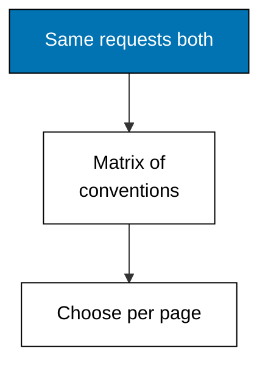
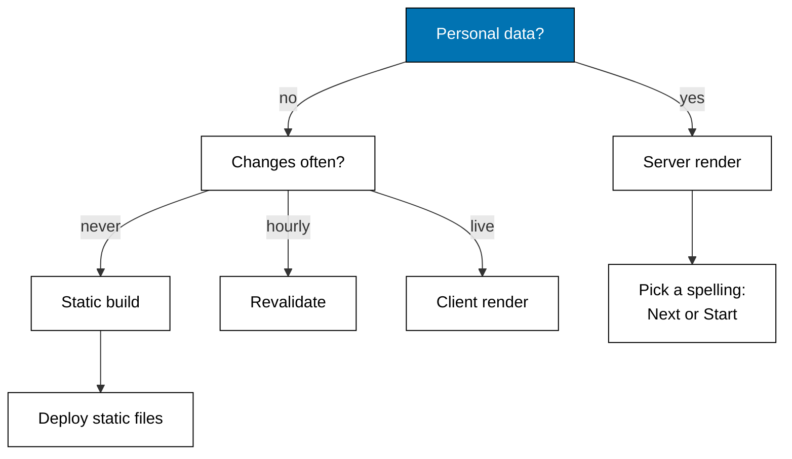

Examples 44-48 stop comparing from memory: one request script against both servers, the convention matrix, a render-mode chooser, the enhancement ladder, and the decision tree. Agreements outnumber differences, and every difference is a spelling.



### Worked Example 44: Same Requests, Two Servers

_Exercises co-15._

**Context**: The comparison anchor runs one request script — home, list, one detail, one miss — against a Next.js-style server and a TanStack Start-style server, and lines the pairs up so agreements are visible instead of argued. Same data, same script, two dialects. **Check**: all four pairs agree — identical bodies on home, list, and detail, identical 404s on the ghost id.

**`learning/code/ex-44-same-requests-two-servers/main.ts`**

```typescript
// Worked Example 44: Same requests, two servers.
// => NusaMart is fictional; every product and price here is fixed.
// => The comparison anchor: one request script hits the same three URLs on
// => a Next.js-style server and a TanStack Start-style server, and the
// => transcript lines up the pair so agreements and differences are visible
// => side by side instead of argued from memory.
declare const require: any; // => Node-only import without @types/node in the harness
const http: any = require("node:http"); // => standard-library HTTP server, no dependency

// => Fixed catalog: both servers read the same fictional rows.
type Product = { id: string; name: string; price: number }; // => shop row shape
const PRODUCTS: Product[] = [
  // => two fictional goods, prices in rupiah
  { id: "kopi-001", name: "Kopi Toraja 250g", price: 68000 }, // => first shelf row
  { id: "teh-002", name: "Teh Melati 100g", price: 32000 }, // => second shelf row
]; // => end of the fixed catalog

// => Next.js-style answers: app/page.tsx, app/products/page.tsx, and
// => app/products/[id]/page.tsx with its async data read.
function nextAnswer(url: string): { status: number; body: string } {
  // => Next-style dispatch
  if (url === "/") {
    // => home
    return { status: 200, body: "home with 2 goods" }; // => static home
  } // => end of the home branch
  if (url === "/products") {
    // => list
    return { status: 200, body: "list: " + PRODUCTS.map((p) => p.id).join(",") }; // => id list
  } // => end of the list branch
  const found = PRODUCTS.find((p) => "/products/" + p.id === url); // => detail lookup
  if (found !== undefined) {
    // => known id
    return { status: 200, body: "detail: " + found.name + " " + found.price }; // => row
  } // => end of the known branch
  return { status: 404, body: "next: not found" }; // => miss
} // => end of nextAnswer

// => Start-style answers: routes/index.tsx, routes/products/index.tsx, and
// => routes/products/$productId.tsx with its loader read. Same data, and
// => the transcript will show whether the bodies agree.
function startAnswer(url: string): { status: number; body: string } {
  // => Start-style dispatch
  if (url === "/") {
    // => home
    return { status: 200, body: "home with 2 goods" }; // => static home
  } // => end of the home branch
  if (url === "/products") {
    // => list
    return { status: 200, body: "list: " + PRODUCTS.map((p) => p.id).join(",") }; // => id list
  } // => end of the list branch
  const found = PRODUCTS.find((p) => "/products/" + p.id === url); // => loader lookup
  if (found !== undefined) {
    // => known id
    return { status: 200, body: "detail: " + found.name + " " + found.price }; // => row
  } // => end of the known branch
  return { status: 404, body: "start: not found" }; // => miss
} // => end of startAnswer

// => One loopback server hosts both dialects under /next and /start; one
// => request script visits home, list, and one detail on each side.
async function main(): Promise<void> {
  // => script entry point
  const server: any = http.createServer((req: any, res: any) => {
    // => one server, two dialects
    const url: string = req.url ?? "/"; // => the request path
    let answered: { status: number; body: string } | null = null; // => the reply
    if (url === "/next" || url.startsWith("/next/")) {
      // => Next.js side
      answered = nextAnswer(url === "/next" ? "/" : url.slice("/next".length)); // => strip prefix
    } else if (url === "/start" || url.startsWith("/start/")) {
      // => Start side
      answered = startAnswer(url === "/start" ? "/" : url.slice("/start".length)); // => strip prefix
    } // => end of the side choice
    if (answered === null) {
      // => neither side
      res.writeHead(404, { "content-type": "text/plain" }); // => miss status
      res.end("pick /next/* or /start/*"); // => miss body
      return; // => stop here
    } // => end of the miss branch
    res.writeHead(answered.status, { "content-type": "text/plain" }); // => status line
    res.end(answered.body); // => the dialect's answer
  }); // => end of the request handler
  await new Promise<void>((resolve) => server.listen(0, "127.0.0.1", resolve)); // => ephemeral loopback port
  const port: number = server.address().port; // => the assigned port, never printed
  const script = ["/", "/products", "/products/teh-002", "/products/susu-009"]; // => shared request script
  for (const path of script) {
    // => each URL on both sides
    const lines: string[] = []; // => the paired replies
    for (const side of ["next", "start"]) {
      // => both dialects
      const res: any = await fetch("http://127.0.0.1:" + port + "/" + side + path); // => loopback only
      lines.push(side + " " + res.status + " " + (await res.text())); // => status plus body
    } // => end of the side loop
    console.log(path + " => " + lines.join(" | ")); // => Output the pair
  } // => end of the script loop
  await new Promise<void>((resolve) => server.close(() => resolve())); // => stop serving
} // => end of main

void main(); // => run the script
export {}; // => module scope keeps these names local
```

**Output** (`learning/code/ex-44-same-requests-two-servers/expected/main.stdout.txt`):

```text
/ => next 200 home with 2 goods | start 200 home with 2 goods
/products => next 200 list: kopi-001,teh-002 | start 200 list: kopi-001,teh-002
/products/teh-002 => next 200 detail: Teh Melati 100g 32000 | start 200 detail: Teh Melati 100g 32000
/products/susu-009 => next 404 next: not found | start 404 start: not found
```

**Key takeaway**: identical requests produce identical behavior on both dialects — the comparison is measured, not remembered.

**Why It Matters**: framework debates run on anecdote; this transcript runs on bytes. When someone claims a behavior differs, the answer is a paired request, not an opinion. Keep this script pattern for every future comparison: same input, both sides, lined-up output. Disagreement then means a real difference worth knowing, not a memory worth distrusting.

---

### Worked Example 45: Convention Matrix

_Exercises co-15, co-14._

**Context**: Fifteen concepts, two dialects, one printed matrix: eight convention rows with the verdict per row. Agreements outnumber differences five to three, and every difference is a spelling — a filename, a sigil — never a capability one side lacks. **Check**: five rows agree, three differ, and the differing rows are file names and segment markers only.

**`learning/code/ex-45-convention-matrix/main.ts`**

```typescript
// Worked Example 45: Convention matrix.
// => NusaMart is fictional; the shop below is only an example row.
// => Fifteen concepts, two dialects: this matrix prints where Next.js and
// => TanStack Start agree and where they diverge, one row per convention,
// => so the choice between them is a lookup instead of folklore.

// => One matrix row: the topic, both spellings, and the verdict.
type Row = { topic: string; next: string; start: string; verdict: "agree" | "differ" }; // => row shape

// => The matrix: routing, shells, rendering, loading, actions, caching,
// => types, and deployment targets side by side.
const MATRIX: Row[] = [
  // => eight convention rows
  { topic: "route file", next: "app/.../page.tsx", start: "routes/.../index.tsx", verdict: "differ" }, // => file names
  { topic: "dynamic segment", next: "[id]", start: "$productId", verdict: "differ" }, // => param spelling
  { topic: "catch-all", next: "[...slug]", start: "$ splat", verdict: "differ" }, // => rest capture
  { topic: "shared shell", next: "layout.tsx + children", start: "__root + Outlet", verdict: "agree" }, // => nesting idea
  { topic: "server data", next: "async Server Component", start: "route loader", verdict: "agree" }, // => load before render
  { topic: "mutation", next: "server action", start: "server function POST", verdict: "agree" }, // => server mutation
  { topic: "param types", next: "inferred from files", start: "inferred from tree", verdict: "agree" }, // => typed routes
  { topic: "deploy target", next: "node server or static", start: "node server or static", verdict: "agree" }, // => same targets
]; // => end of the matrix

// => Print the matrix plus its totals: agreements outnumber differences,
// => and every difference is a spelling, never a capability the other lacks.
for (const row of MATRIX) {
  // => each convention
  console.log(row.topic + ": next=" + row.next + " start=" + row.start + " " + row.verdict); // => Output the row
} // => end of the row loop
console.log("agree: " + MATRIX.filter((r) => r.verdict === "agree").length); // => Output 5
console.log("differ: " + MATRIX.filter((r) => r.verdict === "differ").length); // => Output 3
export {}; // => module scope keeps these names local
```

**Output** (`learning/code/ex-45-convention-matrix/expected/main.stdout.txt`):

```text
route file: next=app/.../page.tsx start=routes/.../index.tsx differ
dynamic segment: next=[id] start=$productId differ
catch-all: next=[...slug] start=$ splat differ
shared shell: next=layout.tsx + children start=__root + Outlet agree
server data: next=async Server Component start=route loader agree
mutation: next=server action start=server function POST agree
param types: next=inferred from files start=inferred from tree agree
deploy target: next=node server or static start=node server or static agree
agree: 5
differ: 3
```

**Key takeaway**: the frameworks agree on mechanisms and differ on spellings — learn mechanisms once, translate spellings per project.

**Why It Matters**: hiring, migration, and rescue decisions all rest on this matrix. "We use the other framework" changes filenames and sigils, not architecture: shells nest, loaders precede renders, actions own mutations, routes type-check on both sides. The matrix keeps the conversation on capabilities, where it belongs, instead of on taste.

---

### Worked Example 46: Render Mode Chooser

_Exercises co-03, co-04, co-05._

**Context**: No single render mode fits every page, so the chooser maps page traits to a mode and names the reason each time. Personal pages render per request, fixed public pages build once, and pages that must work without JavaScript never choose client. **Check**: the story builds static, the shelf and both personal pages render on the server, each with its reason.

**`learning/code/ex-46-render-mode-chooser/main.ts`**

```typescript
// Worked Example 46: Render mode chooser.
// => NusaMart is fictional; every page below is fixed.
// => No single render mode fits every page: the chooser maps page traits to
// => server, static, or client rendering, and names the reason each time so
// => the choice is reviewable instead of habitual.

// => The three modes: per-request HTML, build-time HTML, or browser render.
type Mode = "server" | "static" | "client"; // => render modes

// => Page traits the chooser reads: personal data, change frequency, and
// => whether the page must work with JavaScript disabled.
type Traits = { personal: boolean; changes: "never" | "hourly" | "live"; noJs: boolean }; // => trait shape

// => Choose the mode: personal pages render per request, never-changing
// => public pages build once, live pages render in the browser, and pages
// => that must work without JavaScript never choose client.
function choose(traits: Traits): { mode: Mode; reason: string } {
  // => mode chooser
  if (traits.personal) {
    // => per-visitor data
    return { mode: "server", reason: "personal data cannot be shared" }; // => server wins
  } // => end of the personal branch
  if (traits.changes === "live") {
    // => ticking data
    return { mode: "client", reason: "live updates need the browser" }; // => client wins
  } // => end of the live branch
  if (traits.noJs) {
    // => must work without JavaScript
    return traits.changes === "never"
      ? { mode: "static", reason: "fixed content, no JS needed" }
      : { mode: "server", reason: "fresh HTML without JS" }; // => no client
  } // => end of the no-JS branch
  return { mode: "static", reason: "public and stable, build once" }; // => static default
} // => end of choose

// => Four NusaMart pages through the chooser: story, shelf, cart, tracker.
const pages: Record<string, Traits> = {
  // => fixed page traits
  story: { personal: false, changes: "never", noJs: true }, // => about page
  shelf: { personal: false, changes: "hourly", noJs: true }, // => product list
  cart: { personal: true, changes: "live", noJs: false }, // => visitor cart
  tracker: { personal: true, changes: "live", noJs: false }, // => order tracker
}; // => end of the pages
for (const [name, traits] of Object.entries(pages)) {
  // => each page through the chooser
  const picked = choose(traits); // => the mode plus reason
  console.log(name + ": " + picked.mode + " (" + picked.reason + ")"); // => Output the choice
} // => end of the page loop
export {}; // => module scope keeps these names local
```

**Output** (`learning/code/ex-46-render-mode-chooser/expected/main.stdout.txt`):

```text
story: static (fixed content, no JS needed)
shelf: server (fresh HTML without JS)
cart: server (personal data cannot be shared)
tracker: server (personal data cannot be shared)
```

**Key takeaway**: traits decide the mode — personal data, change frequency, and no-JS duty — and the reason is part of the answer.

**Why It Matters**: "which mode" is the question this whole course serves, and guessing wastes both latency and money. The chooser makes the decision reviewable: traits in, mode plus reason out. Run every new page through it, record the verdict beside the route, and rendering choices stop drifting with whoever edited last.

---

### Worked Example 47: Enhancement Ladder

_Exercises co-16, co-05._

**Context**: Progressive enhancement is a ladder: plain HTML works everywhere, and each rung adds capability without removing the rung below. The first three rungs survive without JavaScript; the fourth degrades to the third instead of breaking. **Check**: three of four rungs work without JavaScript, and the fourth names its fallback.

**`learning/code/ex-47-enhancement-ladder/main.ts`**

```typescript
// Worked Example 47: Enhancement ladder.
// => NusaMart is fictional; every rung here is fixed.
// => Progressive enhancement is a ladder: plain HTML works everywhere, and
// => each rung adds capability without removing the rung below. JavaScript
// => failing still leaves a working shop, only a quieter one.

// => The four rungs: readable, navigable, submittable, delightful.
const RUNGS = [
  // => fixed ladder
  "html: shelf list readable with no JavaScript", // => rung one
  "links: detail pages reachable with no JavaScript", // => rung two
  "forms: add-to-cart posts with no JavaScript", // => rung three
  "islands: cart count updates without reloads, needs JavaScript", // => rung four
]; // => end of the ladder

// => Climb the ladder printing what each rung adds and what still works
// => when JavaScript is absent: the first three rungs survive, the fourth
// => degrades to the third instead of breaking.
for (let i = 0; i < RUNGS.length; i++) {
  // => each rung
  const worksWithoutJs = i < 3 ? "works without JS" : "needs JS, falls back to forms"; // => survival rule
  console.log("rung " + (i + 1) + ": " + RUNGS[i] + " [" + worksWithoutJs + "]"); // => Output the rung
} // => end of the rung loop
console.log("rungs without JS: 3 of 4"); // => Output the survival count
export {}; // => module scope keeps these names local
```

**Output** (`learning/code/ex-47-enhancement-ladder/expected/main.stdout.txt`):

```text
rung 1: html: shelf list readable with no JavaScript [works without JS]
rung 2: links: detail pages reachable with no JavaScript [works without JS]
rung 3: forms: add-to-cart posts with no JavaScript [works without JS]
rung 4: islands: cart count updates without reloads, needs JavaScript [needs JS, falls back to forms]
rungs without JS: 3 of 4
```

**Key takeaway**: build the no-JS shop first, then enhance — failure then removes delight, never function.

**Why It Matters**: bundles fail, networks drop, scripts get blocked — and the shop must still sell. The ladder orders the work so the most resilient version ships first and every enhancement is optional. When a Plain Old Form Post can complete the purchase, no JavaScript failure can stop revenue; everything above is speed and polish.

---

### Worked Example 48: Decision Tree Reference

_Exercises co-15, co-03, co-14._

**Context**: The course as one decision tree: which framework shape, which render mode, which deployment target — for the next page you actually have to build. The runnable models above prove every branch; this example is the map you carry out of the course.



| Decision           | Options                        | Decided by                      | Theme   |
| ------------------ | ------------------------------ | ------------------------------- | ------- |
| Framework spelling | Next.js files or Start routes  | team familiarity, existing code | A, I    |
| Render mode        | server, static, client         | traits via the chooser          | C, D, I |
| Data loading       | loader, deferred, client fetch | criticality per section         | E, G    |
| Mutation           | action plus boundary           | every write path                | F       |
| Type safety        | builder, guard, schema         | whole URL surface               | H       |
| Deployment         | node server or static files    | render modes used               | D       |

**Key takeaway**: six decisions, each owned by traits and each proven runnable somewhere in Themes A through H.

**Why It Matters**: keep-this-if-you-forget-everything: decide per page what must run on the server and what can run in the browser, and let the routing convention make that decision visible. The tree turns the course into a procedure: walk it for every page, record each verdict, and the meta-framework stops being magic and becomes method.
